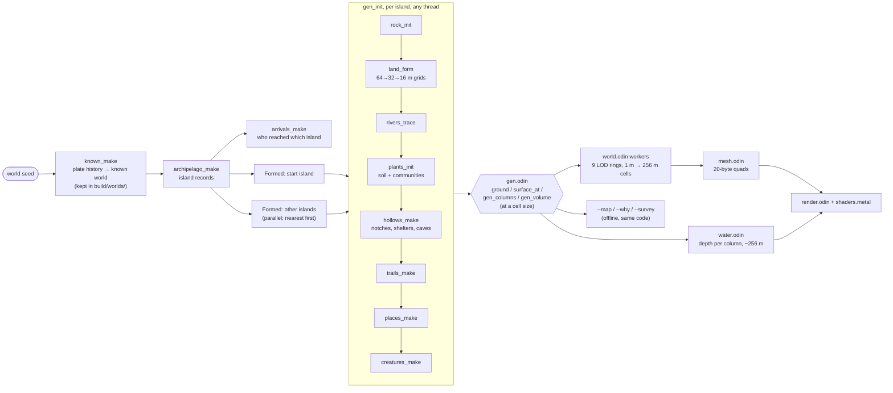

# Architecture

This is a map for someone opening the code for the first time. The design reasoning lives in [`docs/adr/`](docs/adr/) (why the engine is shaped this way) and [`docs/foundations.md`](docs/foundations.md) (the plan for the world, step by step).

## Shape of the program

`src/` is a single Odin package (about 11,900 lines including `shaders.metal`). The one executable does two jobs:

1. **The game.** It reads the known world from the plate history, forms the islands near the start, opens a window, streams chunks around the camera and simulates water near the player.
2. **Offline tools behind flags.** These print or draw what the generator made, then exit: `--map`, `--archipelago`, `--why`, `--survey`, `--plates`, `--plates-why`. They share every line of the generator with the game, which is the point. A picture or an explanation of the land is always the land the game would show.

Everything random is keyed from one seed through `hash`/`hash01` (`gen.odin`). There is no global RNG state, so any value can be recomputed anywhere, on any thread, in any order.

## Module map

| Area | Files | What it owns |
|---|---|---|
| Entry | `main.odin`, `options.odin` | Start-up order, the frame loop, input, `--bench` report; command-line parsing |
| World layout | `known.odin`, `archipelago.odin`, `arrivals.odin`, `regions.odin` | The known world, resampled from the plate history every 2 km and kept in `build/worlds/`; the archipelago as records (`Island`: origin, size, kind, seed) read from it; which animals reached which island; `Formed`, the per-island record, and `bind`, which points a thread's subsystem names at one island |
| Land forming | `rock.odin`, `land.odin`, `erosion.odin` | Rock as a function of position: each island's story (`STORIES`), read from its setting, its beds, faults, dikes, plugs, plutons and any cover; island *kinds* (`KINDS`) and the coarse-to-fine forming driver (`land_form`); the grid simulation (priority-flood routing, uplift, stream-power erosion, creep, coast and coral reef, refine) |
| Water features | `rivers.odin`, `events.odin` | Rivers traced from the simulated drainage and cut by design ([ADR 0003](docs/adr/0003-rivers-are-traced-from-the-simulation-and-cut-by-design.md)); events and the features they leave (landslide, lakes, ponds, sea notches, shelters, caves, falls, springs, stacks) |
| Living things | `fields.odin`, `communities.odin`, `trees.odin`, `plants.odin`, `trails.odin`, `creatures.odin`, `places.odin` | The named fields every rule is written in; soil and plant communities; tree species, stands and the tree grower; ground plants; deer trails and fords; birds and fish posed from the clock; landmarks and their names |
| Query surface | `gen.odin` | Materials (`Mat`, 16 bits) and their traits, noise, and the generator's answers: `ground`, `surface_at`, `gen_columns`, `gen_volume`. **Everything the engine knows about the world comes through here.** |
| Engine | `world.odin`, `mesh.odin`, `water.odin`, `player.odin` | 9 LOD rings of chunks built on worker threads; 20-byte instanced quads; per-column water depth near the player ([ADR 0004](docs/adr/0004-water-near-the-player-is-a-depth-in-every-column.md)); walking/flying collision |
| Drawing | `render.odin`, `shaders.metal` | SDL3 GPU pipeline: 4 sun shadow cascades, half-size cloud layer, terrain, sky and water into a 4× MSAA target; lighting, fog, curvature and tone mapping in Metal |
| Reporting | `land_report.odin` | Start-up figures measured the same way as on real islands; `--map` |
| Plate history | `plates.odin`, `plates_report.odin`, `tools/plates_compare.py` | A 350 Myr plate-tectonics history on a cube-sphere and the choice of the known world, which the game runs once per seed; its frames, the comparison grids and `--plates-why` (`plates_report.odin`), and the comparison with the real Earth's |
| Assets | `assets/`, `tools/blocks.py` | Texture atlases built from CC BY-SA tiles and embedded with `#load` |

## Data flow

### Start-up (`main`)

1. Parse options. `--plates` branches off here, because it needs no island.
2. Bind a `Formed` for the start island and draw its record (`region_init`). Read the known world (`known_make`: from `build/worlds/`, or by running the plate history, about 2 s, on a seed's first run), make the archipelago records from it (`archipelago_make`; `--plates-why` answers here and exits), and decide which animals reached each island (`arrivals_make`).
3. Form the islands within `--near` km (default 64) on all cores but one, in the background. At the same time, form the start island on the main thread (`gen_init`).
4. `--map`, `--why` and `--survey` act on the start island and exit.
5. Wait for the near islands. Pick the weather. Open the window, or don't, for `--shot`/`--bench`, so scripts never steal focus. Initialise the world and water. Put the player on the bank of the largest river, or near the shore of an island with none (`find_start`).
6. Form the remaining islands on three low-priority threads while play goes on.

### A frame

`player_update` → `world_update`: queue chunks for rings whose reach now covers ground, and upload finished meshes from the workers. → `water_update`: steps at 30 Hz within the block volume. → raycast for break/place. → `creatures_pose`: animals are not stored; each is posed from its home, kind and the clock. → `render`.

## Key decisions

- **One generator sampled at a cell size** ([ADR 0001](docs/adr/0001-one-generator-sampled-at-a-cell-size.md)). Every query takes a cell size, and detail finer than the cell fades out inside the generator. A far chunk is the average of the near one, so the levels agree without stitching. Only the nearest ring is a true block volume. The far rings are columns, so edits and caves show within about 256 m.
- **Form the land, then design the rivers along it** ([ADR 0003](docs/adr/0003-rivers-are-traced-from-the-simulation-and-cut-by-design.md)). The 16 m simulation decides where water runs and how much. Channels a person can stand beside are then designed along those lines, and they only ever fall toward the sea. Earlier attempts carved rivers into finished terrain, and those rivers floated or looked dug.
- **Thread-local bound names, not a context parameter** ([ADR 0005](docs/adr/0005-each-thread-reads-one-island-through-bound-names.md)). The code was written for one island. To hold many islands without threading a `^Formed` through every call, each subsystem's state (`region`, `land`, `rivers`, …) became a `@(thread_local)` pointer that `bind` sets. The cost: a procedure that forgets to bind silently reads the last island. Every world-space entry point therefore binds first, and `bound` restores the binding on scope exit. The check is that islands formed alone and side by side produce identical maps.
- **Lit by the slope, not the face** ([ADR 0002](docs/adr/0002-faces-are-lit-by-the-slope-they-are-cut-from.md)). A block face is lit halfway between its own normal and the smooth ground's normal, which makes stepped hillsides read as hillsides.
- **Round world, flat shading** ([ADR 0006](docs/adr/0006-the-world-is-drawn-round-and-shaded-flat.md)). Each vertex is lowered by d²/2R in the vertex shader, while shadows are computed on the flat world. Distant islands sink below the horizon correctly, and nothing else has to know the world is round.
- **Rules as data.** Soil, cover, communities, plants, creatures and places are ordered rows. Each row's *host* is a product of windows on named fields (`FIELDS` in `fields.odin`). `--overlay` paints any field, and `--why` prints which row won at a point and why.

## Where to start reading

1. [`gen.odin`](src/gen.odin), from the top to `surface_at`: what a "point of ground" is.
2. [`land.odin`](src/land.odin), `KINDS` and `land_form`: how an island's recipe becomes land.
3. [`world.odin`](src/world.odin), the top comment and `worker`: how that becomes chunks.
4. [`regions.odin`](src/regions.odin) and ADR 0005, before touching anything that runs on more than one thread.

## Tooling

- `./build.sh [run …]`: one `odin build` with `-o:speed -vet-unused`.
- `odin check src -vet-unused`: the typecheck CI runs first.
- `./build.sh test`: the determinism test (`src/forming_test.odin`). It forms the start island and island 1, the second on a worker thread and again on the test thread, and checks both against a golden hash. Beyond that, changes to forming are checked by comparing `--map` output byte for byte and by `--bench` frame times, as the commit messages record.
- `tools/blocks.py` (Pillow) rebuilds the texture atlases. `tools/plates_compare.py` (pygplates, plate-model-manager, numpy, netCDF4, Pillow, matplotlib) fetches the EarthByte reference data and compares it with `--plates` output.
