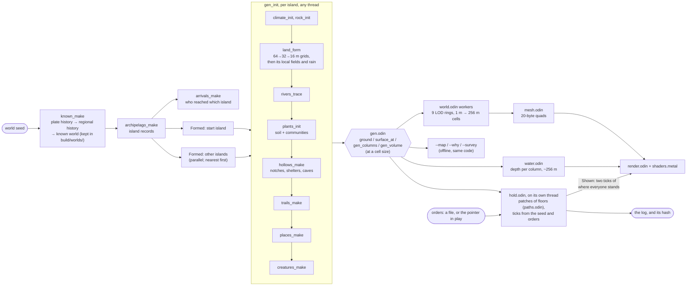

# Architecture

This is a map for someone opening the code for the first time. The design reasoning lives in [`docs/adr/`](docs/adr/) (why the engine is shaped this way) and [`docs/foundations.md`](docs/foundations.md) (the plan for the world, step by step).

## Shape of the program

`src/` is a single Odin package (about 19,000 lines including the shaders). The one executable does two jobs:

1. **The game.** It reads the known world from the plate history, forms the islands near the start, opens a window in the view from above, streams chunks around what the camera looks at and simulates water near it.
2. **Offline tools behind flags.** These print or draw what the generator made, then exit: `--map`, `--archipelago`, `--known`, `--why`, `--survey`, `--plates`, `--plates-why`, and `--dwarves`, which runs the dwarves' world with no window and prints what happened. They share every line of the generator with the game, which is the point. A picture or an explanation of the land is always the land the game would show.

Everything random is keyed from one seed through `hash`/`hash01` (`gen.odin`). There is no global RNG state, so any value can be recomputed anywhere, on any thread, in any order.

## Module map

| Area | Files | What it owns |
|---|---|---|
| Entry | `main.odin`, `options.odin` | Start-up order, the frame loop, input, `--bench` report; command-line parsing |
| Play | `above.odin`, `clock.odin` | The view from above: the camera over a point of the ground, the cut's level, picking a block or a box of blocks through the cut, why at the pointer, down to first person and back ([ADR 0007](docs/adr/0007-the-view-from-above-cuts-the-world-at-a-level.md)); the one clock everything that moves reads, with pause and speeds ([ADR 0008](docs/adr/0008-one-clock-for-everything-that-moves.md)) |
| The interface | `ui.odin`, `ui.metal`, `type.odin`, `play.odin`, `hand.odin` | A screen as a list of parts, drawn over the finished picture, with one table for its look (`LOOK`) and the atlas of text made for each scale ([ADR 0010](docs/adr/0010-a-screen-is-a-list-of-parts-drawn-over-the-picture.md)); the TrueType reader and glyph drawer; the play screen's regions, the acts and the keys that do them (`BINDS`), the pointer shared with the world, messages (`tell`), alerts (`alert_raise`), lenses and lessons; what a click picks up and what its card says ([`foundations/interface.md`](docs/foundations/interface.md)) |
| World layout | `known.odin`, `archipelago.odin`, `arrivals.odin`, `regions.odin` | The known world, resampled every 2 km from the regional history and kept in `build/worlds/` with how fast each place rose over its last 4 Myr; the archipelago as records (`Island`: origin, size, kind, seed) read from it, the start among them, and each island's `Record`; which animals reached which island; `Formed`, the per-island record, and `bind`, which points a thread's subsystem names at one island |
| Land forming | `rock.odin`, `land.odin`, `erosion.odin` | Rock as a function of position: each island's story (`STORIES`), read from its setting, its beds, faults, dikes, plugs, plutons and any cover; island *kinds* (`KINDS`) and the coarse-to-fine forming driver (`land_form`); the grid simulation (priority-flood routing, uplift, stream-power erosion, creep, coast and coral reef, refine) |
| Climate | `climate.odin` | Each island's climate: the latitude it follows (the known world's 1,000 km stand for 30°, stretched about the start's own), its year's mean, swing and the sea's rain fitted to Japan's island stations, rain carried on the one wind over its land, and the climate zones as rows over warmth and dryness |
| Water features | `rivers.odin`, `events.odin` | Rivers traced from the simulated drainage and cut by design ([ADR 0003](docs/adr/0003-rivers-are-traced-from-the-simulation-and-cut-by-design.md)), and what each lays at its mouth; events and the features they leave (landslide, lakes, ponds, sea notches, shelters, caves, falls, springs, stacks) |
| Living things | `fields.odin`, `communities.odin`, `trees.odin`, `plants.odin`, `trails.odin`, `creatures.odin`, `places.odin` | The named fields every rule is written in; soil and plant communities; tree species, stands and the tree grower; ground plants; deer trails and fords; birds and fish posed from the clock; landmarks and their names |
| The hold | `hold.odin`, `dwarves.odin`, `landing.odin`, `paths.odin` | The dwarves' world: a simulation in ticks on a thread of its own, its orders and its log ([ADR 0009](docs/adr/0009-the-dwarves-world-runs-in-ticks-beside-the-frame.md)), and what the frame draws, asks and orders of it; the floor each dwarf takes up, how two pass, and what becomes of one whose floor a changed block took; who each dwarf is, its body as boxes and its card of three lines; the landing as rows on the land's fields; walking ground read from the blocks into floors, rooms and the way between two floors |
| Query surface | `gen.odin` | Materials (`Mat`, 16 bits) and their traits, noise, and the generator's answers: `ground`, `surface_at`, `gen_columns`, `gen_volume`. **Everything the engine knows about the world comes through here.** |
| Engine | `world.odin`, `mesh.odin`, `water.odin`, `player.odin` | 9 LOD rings of chunks built on worker threads; 20-byte instanced quads; per-column water depth near the player ([ADR 0004](docs/adr/0004-water-near-the-player-is-a-depth-in-every-column.md)); walking/flying collision |
| Drawing | `render.odin`, `shaders.metal` | SDL3 GPU pipeline: 4 sun shadow cascades, half-size cloud layer, terrain, sky and water into a 4× MSAA target; lighting, fog, curvature and tone mapping in Metal; the cut, as a clip distance in every vertex shader and caps meshed from the block volume |
| Reporting | `land_report.odin` | Start-up figures measured the same way as on real islands; `--map` |
| Plate history | `plates.odin`, `plates_report.odin`, `tools/plates_compare.py` | A 350 Myr plate-tectonics history on a cube-sphere and the choice of the known world, then its last 20 Myr again with a regional history of the known world on 6 km cells beside it (the same step on a second grid), which the game runs once per seed; its frames, the comparison grids and `--plates-why` (`plates_report.odin`), and the comparison with the real Earth's |
| Assets | `assets/`, `tools/blocks.py` | Texture atlases built from CC BY-SA tiles, and two typefaces under the Open Font License, embedded with `#load` |

## Data flow

### Start-up (`main`)

1. Parse options. `--plates` branches off here, because it needs no island.
2. Draw a record at the start's place, for the swell and any `--kind`. Read the known world (`known_make`: from `build/worlds/`, or by running the plate history and its regional history, about 2.5 to 3 s, on a seed's first run), make the archipelago records from it, the start island's among them (`archipelago_make`; `--plates-why` and `--known` answer here and exit), and decide which animals reached each island (`arrivals_make`).
3. Form the islands within `--near` km (default 64) on all cores but one, in the background. At the same time, form the start island on the main thread (`gen_init`).
4. Make the hold on the start island (`hold_make`): draw the dwarves the boat brings, choose their landing by its rows on the land's fields and say where and why. `--dwarves=seconds` runs their world that long, here, with no window.
5. `--map`, `--why` and `--survey` act on the start island and exit. So does `--dwarves` alone, having printed its log.
6. Wait for the near islands. Pick the weather. Open the window, or don't, for `--shot`/`--bench`, so scripts never steal focus. Initialise the world and water. Put the view from above over the landing, facing the water the boat crosses, and the player where the landing can be seen on foot (`hold_enter`); on an island no boat can come in to, both go to the bank of the largest river (`find_start`). The options can ask for first person. Start the hold's thread.
7. Form the remaining islands on three low-priority threads while play goes on.

### A frame

`above_update`, or in first person `player_update`: the camera, and the point the world streams round. → `clock_step`: the world's time this frame, none while paused. → `world_update`: queue chunks for rings whose reach now covers ground, and upload finished meshes from the workers. → `water_update`: steps at 30 Hz of the world's time within the block volume. → `above_point`: the block under the pointer, picked through the cut; in first person the raycast for break/place. → `hold_frame`: hand the hold any orders, copy what it last showed, move its clock on by the world's time this frame, and answer the pointer and the keys that select a dwarf or send the party. → `creatures_pose`: animals are not stored; each is posed from its home, kind and the clock. → `hold_pose`: the boat and the dwarves as boxes, drawn between the last two ticks. → `play_frame`: the interface's parts for this frame, listed from the game as it stands. → `render`, which remakes the cut's caps if the level or the volume changed, paints a lens over the ground if one is on, and draws the interface over the finished picture (`ui_render`).

Every event goes to the interface first (`play_event`): a key that is one of its rows, a press on a panel, the wheel over a list. What it does not take is the world's.

## Key decisions

- **One generator sampled at a cell size** ([ADR 0001](docs/adr/0001-one-generator-sampled-at-a-cell-size.md)). Every query takes a cell size, and detail finer than the cell fades out inside the generator. A far chunk is the average of the near one, so the levels agree without stitching. Only the nearest ring is a true block volume. The far rings are columns, so edits and caves show within about 256 m.
- **Form the land, then design the rivers along it** ([ADR 0003](docs/adr/0003-rivers-are-traced-from-the-simulation-and-cut-by-design.md)). The 16 m simulation decides where water runs and how much. Channels a person can stand beside are then designed along those lines, and they only ever fall toward the sea. Earlier attempts carved rivers into finished terrain, and those rivers floated or looked dug.
- **Thread-local bound names, not a context parameter** ([ADR 0005](docs/adr/0005-each-thread-reads-one-island-through-bound-names.md)). The code was written for one island. To hold many islands without threading a `^Formed` through every call, each subsystem's state (`region`, `land`, `rivers`, …) became a `@(thread_local)` pointer that `bind` sets. The cost: a procedure that forgets to bind silently reads the last island. Every world-space entry point therefore binds first, and `bound` restores the binding on scope exit. The check is that islands formed alone and side by side produce identical maps.
- **Lit by the slope, not the face** ([ADR 0002](docs/adr/0002-faces-are-lit-by-the-slope-they-are-cut-from.md)). A block face is lit halfway between its own normal and the smooth ground's normal, which makes stepped hillsides read as hillsides.
- **Round world, flat shading** ([ADR 0006](docs/adr/0006-the-world-is-drawn-round-and-shaded-flat.md)). Each vertex is lowered by d²/2R in the vertex shader, while shadows are computed on the flat world. Distant islands sink below the horizon correctly, and nothing else has to know the world is round.
- **The cut is made where things are drawn** ([ADR 0007](docs/adr/0007-the-view-from-above-cuts-the-world-at-a-level.md)). From above, nothing over a chosen level is drawn: every vertex shader clips at it, and caps meshed from the block volume close the solid ground it opens, in the blocks' own materials. Beyond the block volume the columns are lowered to the level and show no rock.
- **One clock** ([ADR 0008](docs/adr/0008-one-clock-for-everything-that-moves.md)). Water, animals, clouds and the wind in the plants read one count of the world's seconds, which pauses and runs at 1, 2 or 4 times; the camera does not.
- **The dwarves' world in ticks, beside the frame** ([ADR 0009](docs/adr/0009-the-dwarves-world-runs-in-ticks-beside-the-frame.md)). One thread owns one record and advances it a tenth of a second at a time from the seed and a list of orders, so the same orders give the same log with a window or without, paused or hurried. It reads the ground from the generator into its own floors, never from what the frame has streamed. A way is found over rooms of joined floors first, which says whether one exists, and then over the floors of those rooms. Nothing in it counts on seven dwarves.
- **A screen is a list of parts** ([ADR 0010](docs/adr/0010-a-screen-is-a-list-of-parts-drawn-over-the-picture.md)). The interface is the game's own code: each frame the play screen lists rectangles that say what they are, what they say and what a click does, and one file draws them, finds the one under the pointer, and can say the screen in words for a test. Text is drawn from an atlas made at the exact pixel size of the scale in use.
- **Rules as data.** Soil, cover, communities, plants, creatures and places are ordered rows. Each row's *host* is a product of windows on named fields (`FIELDS` in `fields.odin`). `--overlay` paints any field, and `--why` prints which row won at a point and why.

## Where to start reading

1. [`gen.odin`](src/gen.odin), from the top to `surface_at`: what a "point of ground" is.
2. [`land.odin`](src/land.odin), `KINDS` and `land_form`: how an island's recipe becomes land.
3. [`world.odin`](src/world.odin), the top comment and `worker`: how that becomes chunks.
4. [`regions.odin`](src/regions.odin) and ADR 0005, before touching anything that runs on more than one thread.
5. [`hold.odin`](src/hold.odin), the top comment and `hold_tick`, and ADR 0009: how the dwarves' world runs. Then [`paths.odin`](src/paths.odin), the top comment and `walk_way`.
6. [`play.odin`](src/play.odin), the top comment, `BINDS` and `play_frame`, and ADR 0010: how a screen is made and what the pointer and the keys do. Then `LOOK` in [`ui.odin`](src/ui.odin).

## Tooling

- `./build.sh [run …]`: one `odin build` with `-o:speed -vet-unused`.
- `odin check src -vet-unused`: the typecheck CI runs first.
- `./build.sh test`: the determinism test (`src/forming_test.odin`). It forms the start island and island 1, the second on a worker thread and again on the test thread, and checks both against a golden hash. It then runs the dwarves' world twice on the start island, once beside a thread that reads it as the frame does, and checks that the two logs are the same (`src/hold_test.odin`). Last it makes the play screen with no window and asks what it says (`src/play_test.odin`). Beyond that, changes to forming are checked by comparing `--map` output byte for byte and by `--bench` frame times, as the commit messages record.
- `tools/blocks.py` (Pillow) rebuilds the texture atlases. `tools/plates_compare.py` (pygplates, plate-model-manager, numpy, netCDF4, Pillow, matplotlib) fetches the EarthByte reference data and compares it with `--plates` output.
