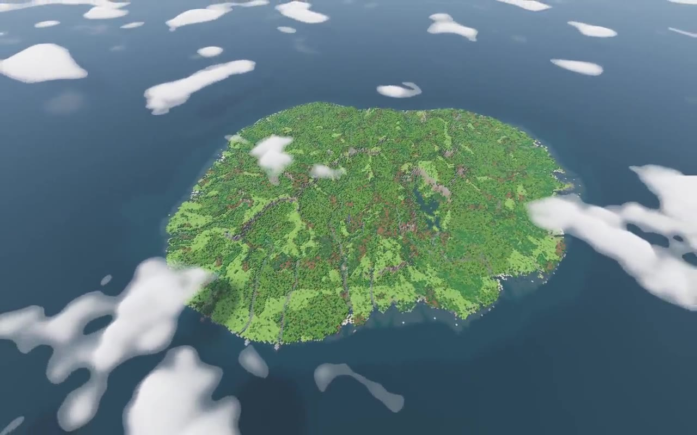
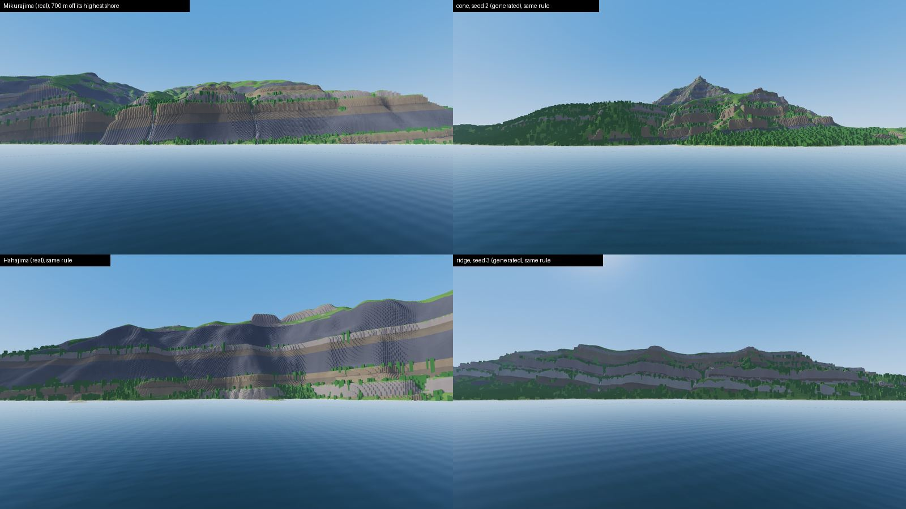
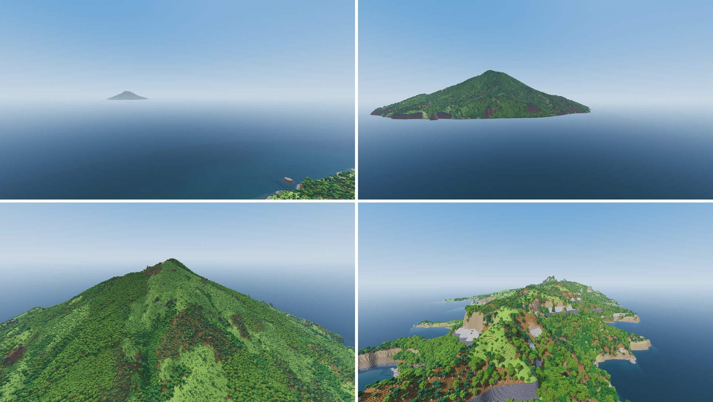
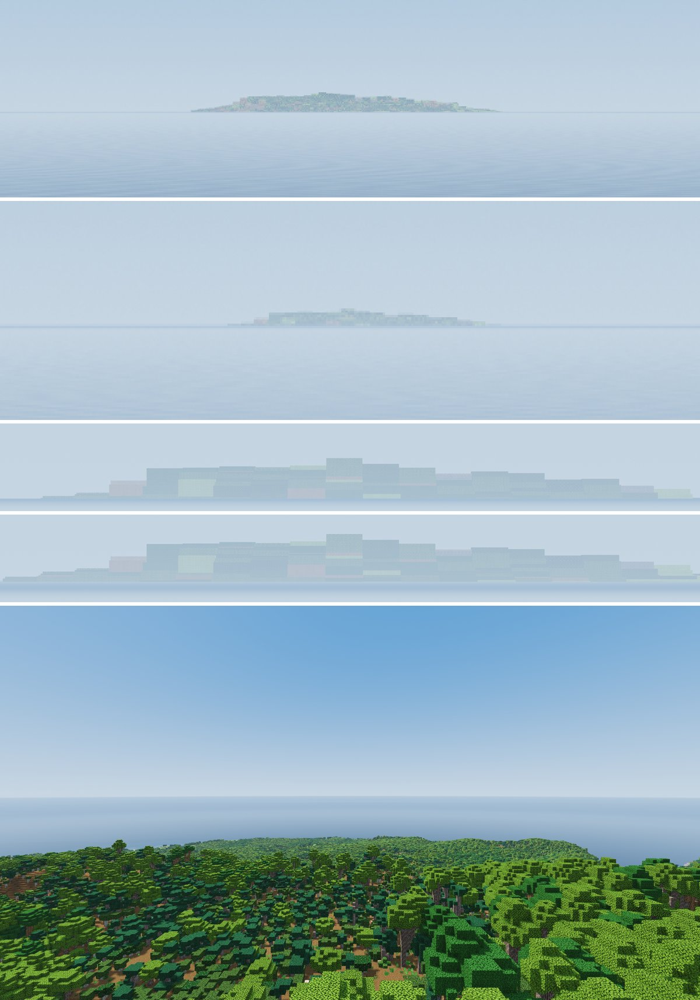
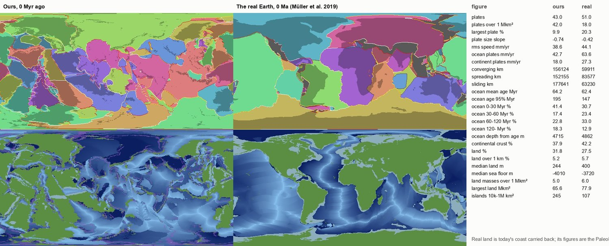

# Odincraft

A block world formed by geology rather than noise: islands raised and worn down by simulated uplift, rivers and sea, then drawn out to the horizon 65 km away. It's written in Odin on SDL3's GPU API with Metal shaders.

<!-- Hero. GitHub only plays video inline from an uploaded attachment: edit this README on github.com,
     drag docs/media/odincraft-island.mp4 into the editor, and replace the image below with the
     https://github.com/user-attachments/assets/... URL it produces. Until then, the poster links to the file. -->
[](docs/media/odincraft-island.mp4)

*Flying up out of the forest until the whole island is in view (20 s, [mp4](docs/media/odincraft-island.mp4)).*

## What it is

Odincraft is a first-person block game: walk, fly, dig and build. It exists to answer one question: can a block world feel like a real place, the kind you would want to hike across?

At start-up it forms an island in about a second. It pushes the island up out of the sea, lets rivers cut valleys into rock beds of different strengths, lets the sea cut cliffs and platforms into the coast, and lets a hillside slide and dam a lake. Then it grows soil, plant communities, forest stands of different ages, and, on islands deer could have reached, the trails they wear between water and shelter. Which animals reached which island is decided once for the whole archipelago, from the straits between the islands and how far each kind walks, swims, flies or drifts. The islands within 64 km of it form in parallel before you enter, and the rest of the archipelago forms in the background. The whole archipelago is drawn on a curved planet at 120 fps.

The target is the volcanic and uplifted islands of southern Japan, from Izu and Ogasawara to the raised reefs of the Ryukyus. The generated islands are measured against eight real ones from Japan's GSI elevation data, using the same figures for both. See [the comparison](docs/interesting-world/notes/real-islands.md).

| | |
|---|---|
|  |  |
| Real islands (left, rebuilt in the game from elevation data) beside generated ones (right) | The archipelago from the air |
|  |  |
| Far sight: levels of detail out to 65 km on a round world | The plate-tectonics experiment against Müller et al. 2019 |

## The interesting engineering

- **Terrain from process, not noise.** The island is formed coarse to fine on 64, 32 and 16 m grids. Each step floods the land from the shore upward with a priority queue to route water ([`route`](src/erosion.odin)), then applies uplift, stream-power erosion through rock of each bed's strength, hillslope creep and wave erosion at the coast. Rivers are traced from that drainage and cut by design, so a river and its valley come from the same simulation ([ADR 0003](docs/adr/0003-rivers-are-traced-from-the-simulation-and-cut-by-design.md)). The rock is a function of position (tilted, folded beds or a volcano's flows), so cliffs and ledges appear where strong beds cross steep ground. The engine reads all of this through one query surface, [`gen.odin`](src/gen.odin).
- **One generator, sampled at any cell size.** Every question the engine asks ("what is the ground here?") takes a cell size, so the same code answers for 1 m blocks underfoot and for 256 m cells on the horizon ([ADR 0001](docs/adr/0001-one-generator-sampled-at-a-cell-size.md)). [`world.odin`](src/world.odin) keeps nine rings of chunks, each twice the reach of the one inside it. The rings are built on worker threads and drawn as instanced 20-byte quads, with the planet's curvature applied in the shader ([ADR 0006](docs/adr/0006-the-world-is-drawn-round-and-shaded-flat.md)). Flying at 120 m/s on an M3 Max, it holds 120 fps (`--bench` paces frames as a 120 Hz display does: median interval 8.3 ms, p99 8.9 ms, none over 12.5 ms), and the CPU's share of a frame is 0.85 ms.
- **Many islands, bit-for-bit deterministic.** An island is formed from its record and seed alone, on any thread, and comes out identical whether it is formed alone or beside the rest of the archipelago. Each subsystem keeps reading "the island" through thread-local names that a thread binds to the island it is working on ([`regions.odin`](src/regions.odin), [ADR 0005](docs/adr/0005-each-thread-reads-one-island-through-bound-names.md)). Performance changes are checked against a byte-identical map of the island (`--map`).
- **Rules as rows on named fields.** Soil, ground cover, plant communities, ground plants, creatures and named places are ordered catalogues. Each row's condition is written as windows on named fields (slope, wetness, exposure, stand age, and fifty more) defined once in [`fields.odin`](src/fields.odin). A new kind of condition becomes a new field, never new code in a row. `--overlay=<field>` paints any field on the map, and `--why=x,z` explains every decision at a point.
- **Islands from a plate history.** [`plates.odin`](src/plates.odin) runs 350 million years of plate tectonics on a 393,216-cell cube-sphere the size of the Earth. Each world seed runs it once (about 2 s, then kept in `build/worlds/`) and chooses a known world 1,000 km across where a continent's margin meets the sea over a sinking slab or a hotspot. The islands near the start are read from it ([`known.odin`](src/known.odin), [`archipelago.odin`](src/archipelago.odin)): where each stands on the forearc, the volcanic arc or the shelf, and how fast its stretch rises, choose its kind. The history is measured against real plate reconstructions with [`tools/plates_compare.py`](tools/plates_compare.py) ([notes](docs/interesting-world/notes/real-plates.md)); `--plates=dir` writes its frames and grids.

## Architecture in brief

The code is one Odin package of about 11,200 lines in `src/`. Shaders are in `src/shaders.metal`. [ARCHITECTURE.md](ARCHITECTURE.md) has the module map and data flow. In short:

```
seed ─▶ plate history ─▶ known world ─▶ archipelago: island records, who reached which
                                                │
        per island: rock ▸ land forming ▸ rivers ▸ events ▸ soil/plants/trees ▸ trails ▸ places
                                                │
        engine asks gen.odin "what is here, at this cell size?"
                                                │
        world.odin: 9 LOD rings on worker threads ─▶ mesh.odin quads ─▶ render.odin + shaders.metal
        water.odin: simulated water within ~256 m of the player
```

Design decisions are recorded as ADRs in [`docs/adr/`](docs/adr/). The plan for the wider world and the research behind it are in [`docs/foundations.md`](docs/foundations.md) and [`docs/interesting-world.md`](docs/interesting-world.md).

## How it's built

This project is the latest of about ten rebuilds of the same idea, a realistic generated world with endless view distance. It started in Zig in 2024 ([zigcraft](https://github.com/macklinhrw/zigcraft)), went through three "Neo" generations in Zig, then four Odin versions before this one. [`docs/lessons.md`](docs/lessons.md) records what each attempt reached and why it stalled. This version exists because of those lessons: form the ground the player stands on first, form rivers together with their valleys, and judge by eye rather than by passing metrics.

Each rebuild doubles as a benchmark of LLM-assisted development. The same goal goes to the newest models to see how far they get. This version was built with Claude (Opus) agents working in numbered steps from a written plan ([`docs/foundations.md`](docs/foundations.md)). Ten parallel designers drafted one system each against a shared brief ([`docs/foundations/brief.md`](docs/foundations/brief.md)), and each step landed as its own merged branch. I set the direction, judge every visual result by looking, and record each decision in [`docs/open-decisions.md`](docs/open-decisions.md). The commit history is that record, step by step.

## Getting started

Requirements: **macOS on Apple Silicon** (the renderer uses Metal through SDL3's GPU API), [Odin](https://odin-lang.org) dev-2026-07 or newer, and SDL3.

```sh
brew install odin sdl3
git clone https://github.com/macklinhrw/odincraft && cd odincraft
./build.sh run
```

The first run of a world runs its plate history (about 2 s, kept in `build/worlds/` for later runs) and forms the islands near the start, then opens the window on a river bank.

| | |
|---|---|
| click | capture the mouse; Esc releases it, Esc again quits |
| W A S D | move; Shift runs, or flies fast |
| Space, Ctrl | jump; rise and sink when flying |
| F | switch between walking and flying |
| left, right button | break a block, place a block |
| 1 to 6 | choose the block to place |
| [ and ] | turn the clock back and forward |
| F2 | save a screenshot to `screenshots/` |

Every option is listed at the top of [`src/options.odin`](src/options.odin). The useful ones need no window:

```sh
mkdir -p out
build/odincraft --seed=3 --map=out/island.png                 # the island from above: relief, rivers, trails
build/odincraft --map=out/wet.png --overlay=wetness           # any field painted over the relief
build/odincraft --why=300,-200                                # what the ground is at a point, and why
build/odincraft --survey                                      # what the island holds; candidate named places
build/odincraft --archipelago=out/islands.png                 # every island near the start, side by side
build/odincraft --shot=out/view.png --above=300,40,-200 --look=45,-15 --hour=11
build/odincraft --bench=15 --fly --speed=120                  # fly straight and report frame times
```

`--kind=ridge|inlets|cone|crater|domes|worn|raised|reef` forces the start island's kind. `--seed=N` changes the world.

`./build.sh test` runs the determinism test, which forms two islands and checks them against a golden hash. The Python tools that build the texture atlases and compare the plate history with the real Earth's are described in [`tools/README.md`](tools/README.md).

## Status

This is an active personal project, not a finished game. It works today: an archipelago read from a plate history, far sight, water, forests, coasts, raised reefs, sea caves, landslides, trails, named places, birds and fish, and which of them reached each island. The steps still planned are in [`docs/foundations.md`](docs/foundations.md). It has no saving, no inventory and no crafting. Edits last for the session.

## License

Copyright © 2026 Macklin Reeve-Wilson.

The code is licensed under the [GNU Affero General Public License v3.0 or later](LICENSE) (SPDX: `AGPL-3.0-or-later`). If you run a modified version for others over a network, the AGPL asks you to offer them its source.

The block textures in `assets/` are adapted from the Pixel Perfection pack via Mineclonia and are licensed under CC BY-SA 4.0. See [`assets/LICENSE.md`](assets/LICENSE.md) and [`THIRD_PARTY.md`](THIRD_PARTY.md) for details and for the datasets used in the research notes.
