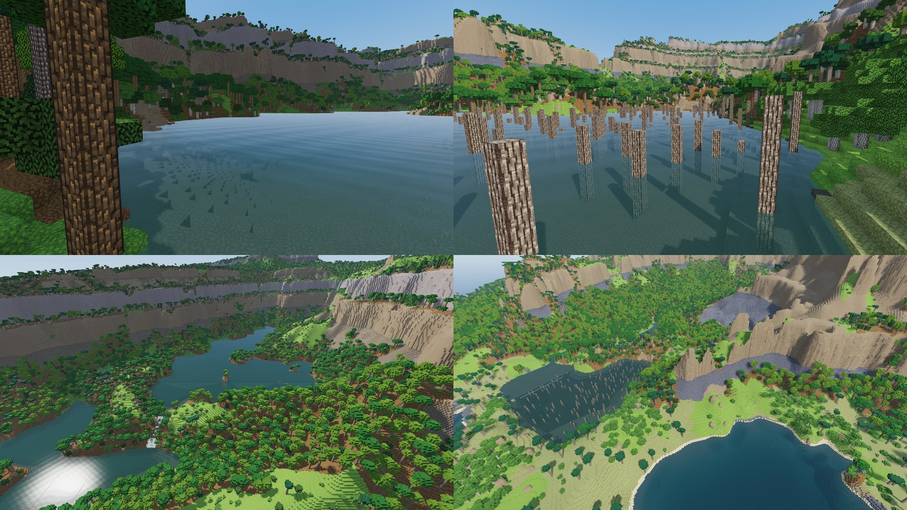
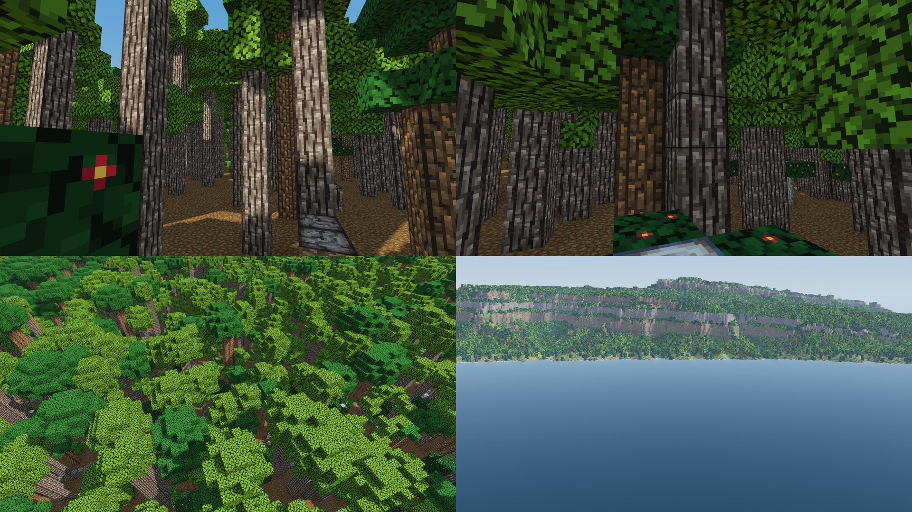
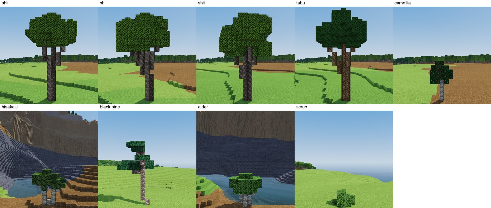
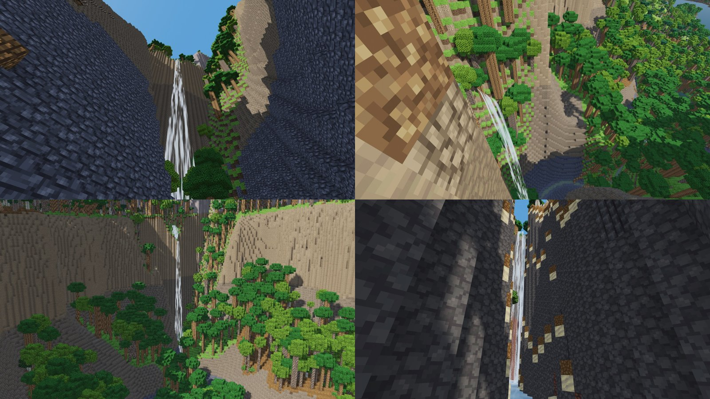

# Foundations for the wider world

A plan, 2026-11-11. Nothing here is a commitment until it is recorded in `open-decisions.md`.

The owner asked for a comprehensive plan of the systems that become the foundation of the future game, beyond the current island: a wider world whose variety matches or exceeds Dwarf Fortress and RimWorld, with each system given its own attention. While it was being written the owner named the destination: **a fantasy world grounded in realism, in the vein of The Lord of the Rings.**

How this was made: ten designers (Opus agents) each designed one system against a shared brief and the research in `interesting-world.md`. Their designs are in `foundations/` and carry the detail, the example catalogues and the sources. This document joins them: it states the decisions they share, settles where they disagreed, counts the variety, and orders the work. Numbers are marked measured, sourced or a guess; most line counts and costs are guesses.

## Summary

1. **A foundation here means a decision that is cheap now and expensive later.** There are fifteen (section 3). Everything else in this plan is catalogue rows and stages that wait for a trigger.
2. **Variety grows by adding rows of data, and each row names its cause.** A rock, a plant community, a landform piece, an animal: each is a row that says under what conditions it occurs. This is how Dwarf Fortress and RimWorld hold their variety, with one difference: here the conditions are measured from a land that was formed, so each kind can be inspected and looks different on foot.
3. **Variety comes from independent axes multiplying.** Rock story, history, climate, exposure, water, plant community, stand age, and later peoples and ages of the world. Section 6 counts them against the benchmarks.
4. **The world grows in three steps.** One island worth walking; an archipelago where each island has its own rock, history and climate; then a mainland with a long road, which the fantasy vision needs. The sea is a free seam between regions. A land seam along a drainage divide is the plan's largest untested risk and gets tested early, on today's island.
5. **Forming time bounds a region.** Today's 8 km grid forms in about 1 s, 16 km in 4.8 s and 33 km in 21.9 s on one thread (measured). A region is therefore at most about 33 km, and a larger land is formed coarsely and then refined in pieces.
6. **The fantastic enters as a cause.** A blight, an elder wood or a raised mountain adds terms to the same fields nature uses, so the simulation produces its consequences and inspection can explain it. This costs nothing to allow now and a rebuild to add later.
7. **The first phase is still one island**, sixteen changes, each ending in something the owner can look at. By the designers' guesses it roughly doubles the game, from about 2,800 to about 5,700 lines.
8. **Two findings changed earlier advice.** The land forming leaves no hollows, so lakes need events (measured: three one-cell dips on today's island). And the shader reads only four bits of a block's material, so sixteen colours is today's ceiling.
9. **Building the first four steps and measuring against real islands changed the plan again.** The generated land is the wrong shape at the coast, in its mass, in its steepest faces and at its crests, and the plan had ordered the work from a diagnosis the real data only partly supports. Section 11 holds what was learned and what it changes in how every system is designed and judged.

## 1. What this plan is, and how it avoids the last one

`lessons.md` records plans heavier than the change they described, scale fixed before anything was worth scaling, and a 200-entry catalogue of which none was accepted. This plan is large because it was asked to be comprehensive. It is kept from becoming v4 by five rules:

- **Only section 3 is fixed in advance.** Those decisions shape code that everything later stands on.
- **Nothing is built before its turn.** Every deferred part has a named trigger (section 8).
- **One change at a time**, each visible on today's island, each judged by the owner looking.
- **A kind counts only when the owner has accepted it in the game.** Targets in section 6 are ceilings to grow toward, never a ledger to fill.
- **Tools can reject a change and never accept one.** They live in the game, in one file, and write to the terminal or one picture.

## 2. The destination

From `foundations/fantasy.md`. What makes a world in this vein feel real, and who can make it:

| Property | Who makes it |
|---|---|
| A geography that comes before the story and stays consistent | The generator. This is what v5 already is. |
| The marvellous obeys the laws of its world | The generator, if the fantastic is a cause inside the same fields |
| Long journeys across lands that differ | The generator for the lands; the road between them is composed |
| Deep time, ruin over ruin | The generator: a few ages written as dated features |
| Peoples shaped by their land | The generator places them; their manner needs authorship |
| The marvellous is rare, placed and explained | The generator, under a rarity budget |
| Quiet land between the great places | A rule the generator follows |
| Plot, meaning, languages | Authorship |

What it asks of the foundations:

- **A mainland.** A mountain wall with few passes, a great river and a long road need land joined to land. An archipelago is honest (Earthsea is one) and comes first, but it cannot be the end shape.
- **Journeys sized by walking.** The player walks at 4.4 m/s (measured in `player.odin`), 3.8 minutes a kilometre. Proposed, all guesses to be judged by walking: a realm 20 to 60 km across, the road between two realms 3 to 8 hours on foot, the known lands about 300 km across inside the 1,000 km world, with far lands beyond that are real and rarely reached.
- **Great landmarks found, not placed.** The lone mountain, the gap in the wall, the falls on the great river, the ancient forest, the dead marsh: each has a natural cause the generator can search the formed land for. Only the most extreme in a region gets a name and a history.
- **Honest rock and big things.** Halls under mountains need massive rock with wide cracks. Great trees need trunks three to five blocks thick. A hold or city spans 0.5 to 2 km, beyond the 256 m block volume, so built things need a far outline as trees have.
- **Restraint as rules.** At most one marvel per region; influences on a few percent of the land; most of any road through quiet country.

## 3. The spine: fifteen decisions

Each is cheap to adopt now and expensive to change once code and catalogues stand on it. The designer's file argues each with its alternatives.

**How the world is described**

1. **Three kinds of thing.** A *field* has a value everywhere and is asked at a cell size (elevation, the rock at a point, wetness, temperature). A *feature* is a record with an identity and an extent (a river reach, a lake, a landslide, a stand of trees, a ruin). A *kind* is a catalogue row. Systems talk to each other only through fields and features.
2. **Kinds are rows of plain data, and a row never holds a formula.** Where a kind occurs is a set of ranges over named fields. A condition of a new shape becomes a new field, never a new rule type: "near a lake" is a range on the field *distance to lake*. Rows live in the Odin source for now; a build takes 2 s (measured), so editing a row costs what reloading a file would. (`kinds-and-places.md`)
3. **Every feature records its identity, its cause and its age, and the world keeps one list of dated events.** Inspection, names, plants on a landslide, ruins and later narration all read it. A cause cannot be recovered afterwards. (`kinds-and-places.md`, `living-world.md`, `fantasy.md`)
4. **Fields are a base plus terms, and there are two doors.** A cause changes a field before the land forms (extra uplift, a poisoned soil), and the simulation makes the consequences. A mark (a trail, a wall, a ruin) is laid on the formed land and expressed in blocks, as rivers are cut. Nothing edits the formed land afterwards. This is the whole reservation for the fantasy layer. (`living-world.md`, `fantasy.md`)
5. **Randomness is keyed by name, and the seed is a run-time value.** Adding a kind then changes only the places it wins. (`kinds-and-places.md`)

**How the land is made**

6. **One rock function, fixed in the finished world, read by everything.** A region's rock is a short list of bodies: stacked beds that are tilted or folded, cut by faults and intrusions. Nothing is stored per block. The land forming reads it shifted by the uplift still to come, so the beds the erosion cut are the beds a cliff shows. Coarse levels of detail read a version with thin beds merged. (`geology.md`)
7. **A region's recipe is a record, and forming is a pure function of the seed and that record.** The record holds the outline, the rock story, and a history: a short list of phases (years, uplift, sea level, rain) and events. Same inputs, same land, in any order, on any core. (`world-frame.md`, `landforms.md`)
8. **The land is left unfinished, and events happen inside the forming.** The last phase stops before gorges and hanging waterfalls have worn away. A landslide or lava flow is chosen by ranking its host conditions, applied, then eroded for its age. (`landforms.md`)
9. **Ground and water are separate, and every body of water is a feature with a level and a cause.** Lakes come from events and from rock, because the forming leaves no hollows (measured). A river changes from a traced line to a corridor of cells at about two cells wide. (`water.md`, `landforms.md`)
10. **Seams go where little crosses: the sea first, then drainage divides.** A region is at most about 33 km. A larger land is formed whole at 64 m and cut into river-basin pieces, each refined to 16 m with its edges pinned. Positions are stored relative to their region, and player edits are a layer over a world that never changes. (`world-frame.md`)

**How it reaches the player**

11. **One block function, and no detail without a cause.** The surface, the soil under it, the rock under that and any declared cave come from one function of seed and point, so what is dug matches what a face shows. Every shape below 16 m takes its size from rock or drainage. Overhangs and caves are declared records with an outline the far terrain can draw. (`ground-and-underground.md`)
12. **A block is an index into one table of materials.** Rock of each kind in four forms (solid, broken, scree, gravel), each soil, the bark and leaf of each species. One byte holds the island; the table goes to 16 bits before the archipelago, while nothing is kept compatible. (`geology.md`, `ground-and-underground.md`, `vegetation.md`; see section 5)
13. **A plant community is a flora crossed with a site slot, and stand age is a third axis.** Climate picks the flora; the same eleven slots (valley floor, ridge, exposed top, water's edge and so on) apply in every climate. Stands are features with an age; trees are recomputed, never stored; one tree grower takes about fourteen numbers per species, and each species' crown outline is what the far terrain draws. (`vegetation.md`)
14. **Climate is a few yearly numbers in real units, from one latitude and one clock.** The sun and the plants read the same latitude. Weather is a fixed result of seed, place and time. Season and weather are drawn by the renderer and never baked into the terrain. (`climate.md`)
15. **Rarity is chosen in its own pass, from candidates nature found.** A finder ranks the most extreme natural candidates; a small pass promotes a few to named places or to the source of something fantastic. Chance per cell would scatter marvels. (`fantasy.md`, `kinds-and-places.md`)

What stands from the four ADRs: all of them. Two get additions: `adr/0001` gains coarser levels (128 m to 1 km) for views across water, and `adr/0004` gains water that belongs to a cave and stands still.

## 4. The ten systems

| System | What it owns | First slice on today's island | Design |
|---|---|---|---|
| World frame | The ladder of scales, region kinds, where seams go, coordinates, edits | The island's constants become a record; four island kinds on `--kind=`; the island moved to 500 km must look identical | `foundations/world-frame.md` |
| Geology | The rock function, rock kinds, rock stories, deposits | Tilted beds with a hard cap; five rock kinds as blocks | `foundations/geology.md` |
| Landform processes | The forming loop, histories, events, what each cell's surface is made of | History as rows; then one landslide | `foundations/landforms.md` |
| Water | Rivers by discharge and style, lakes by cause, wetlands, springs, falls, the sea's edge | A slide-dammed lake and debris ponds; then falls with their own mesh | `foundations/water.md` |
| Climate, seasons, weather | Base climate, local climate from the land, the clock, weather | Sun by latitude and date, a snow line, local fields on the map, cloud shadows | `foundations/climate.md` |
| Soils and vegetation | Soil, floras, site slots, stands, species, the tree grower | Soil and five communities; then stand ages; then the grower | `foundations/vegetation.md` |
| Ground in blocks, underground | Landform pieces, detail below 16 m, caves and overhangs, materials | Ledges on hard beds; then cracked faces and fallen rock | `foundations/ground-and-underground.md` |
| Living world | Animals, crossing cost and routes, peoples, marks, history | Deer trails traced like rivers | `foundations/living-world.md` |
| Kinds, places, inspection | The row format, the field vocabulary, the survey, named places, "why is this here", tools | Today's rules rewritten as rows with identical output; `--seed=`, `--overlay=`, `--why=` | `foundations/kinds-and-places.md` |
| Fantasy | Landmark archetypes, influences, peoples' bonds to land, ages, restraint | A landmark finder that marks named candidates on the map | `foundations/fantasy.md` |

Who owns each catalogue, where the designs differed: soil belongs to vegetation; landform pieces to the ground in blocks; landscape kinds (a history through a rock story) to landform processes; region kinds to the world frame.

## 5. Where the designs disagreed, and what this plan settles

1. **The end shape of the world.** The world frame recommends an ocean with islands at about 5% land and no large landmass until a land seam is proven. The fantasy design needs a mainland. *Settled:* the end shape is a mainland with islands off its coast, inside known lands about 300 km across; the path is island, archipelago, mainland. The land-seam test moves forward to an early experiment, because it decides whether the mainland can be made this way. *Decided by the owner on 2026-11-15:* the world is one cohesive simulation with continents and islands where the simulation makes them, never an ocean of islands. The seam test decides how a continent is formed, not whether.
2. **Cold to hot.** The world frame suggests a true slice of about nine degrees of latitude; climate recommends letting 1,000 km stand for about thirty. *Settled:* compress, as climate proposes. The known lands, 300 km of it, then span about nine degrees, as varied as Japan from south to north, and the far lands reach cold and hot.
3. **Where lakes come from.** Landform processes proposed keeping the hollows the forming makes. Water measured that there are none. I confirmed it: three cells on today's island, 11 to 17 with rock beds, the deepest 3.4 m. *Settled:* ground and water stay separate fields as both designs want, and lakes come from events and later from rock basins.
4. **Lake before rock, or after.** Water proposes placing the first landslide by relief alone so a lake appears sooner. Landform processes waits for the rock function. *Settled:* after rock, so the slide sits on its real host (a strong bed over a weak one) and is built once. This is the owner's to overturn if water matters sooner.
5. **Which height the erosion reads the rock at.** My experiment and the landform design used the current height; geology shows that puts the eroded beds up to 2.4 km from where the blocks show them. *Settled:* geology's rule (decision 6). Whether it changes the landforms the experiment showed is checked in step 1.
6. **How many bits a block needs.** Geology fits 32 rocks in four forms plus minerals in a byte; vegetation needs a bark and a leaf per species and reaches 70 to 120 plant blocks by the archipelago. Together they overflow. *Settled:* decision 12.
7. **Three names for what covers the ground.** Landforms records a deposit per cell, vegetation derives a soil, the ground design reads bareness. *Settled:* one stack. The forming records the deposit (alluvium, scree, slide debris) and how near the slope is to the rock's limit; the soil rule derives soil kind and depth from deposit, rock, wetness and climate; the block function reads both.
8. **Catalogue sizes.** Where the catalogue designer's table and an owning designer's numbers differ, section 6 uses the owner's.

## 6. The variety, counted

Targets by stage, from the owning designer; all are guesses and ceilings. A row counts only if a walker can tell it from its neighbours by shape, edge or material, and its cause differs.

| Axis | Today | One island, done | Archipelago | Wide world | Benchmarks (sourced) |
|---|---|---|---|---|---|
| Region kinds (island and landmass types) | 1 | 4 | 10 to 14 | 24 to 30 | Vintage Story 6 provinces |
| Rock stories | 0 | 1 | 8 | 12 | Dwarf Fortress: one fixed stack |
| Rock kinds | 1 | 5 | 20 | 28 | DF 25, TerraFirmaCraft 20, RimWorld 5 |
| Landscape kinds (a history through a rock story) | 1 | 3 to 5 | about 30 | 80 to 100 | TFC 125 landforms |
| Landform pieces at 1 to 50 m | 2 | 14 | 14 to 30 | 30 | RimWorld 41 landmarks; DF erodes cliffs away |
| Water kinds | 2 | 8 | 35 | 70 | DF 21 water biomes; RimWorld about 12 |
| Climate zones, plus local climates | 1 | 1 + 5 | 3 to 6 + 7 | 14 to 17 + 7 | DF 27 land biomes; RimWorld 17 |
| Floras × site slots | 1 | 1 × 11 | 3 to 4 × 11 | 13 × 11 | Minecraft 57 biomes |
| Stand ages | 1 | 4 | 4 | 4 | none of them |
| Tree species / silhouettes | 1 / 1 | 8 / 7 | 20 / 10 | 60 / 14 | DF 72 in about 6 shapes; Minecraft 10 in 19; TFC 20 |
| Soils | 1 | 8 | 10 | 13 | DF 21; TFC 8 |
| Animals | 0 | 8 to 12 | 40 to 60 | 150 to 250 | DF hundreds; RimWorld 5 to 36 per biome |
| Settlement and mark kinds | 0 | 0 | 12 to 18 | 40 to 60 | RimWorld 13 man-made landmarks |
| Landmark archetypes found | 0 | 4 to 6 | 12 | 17 | RimWorld 41 |
| Fantastic influences | 0 | 0 | 1 to 2 | 7 | DF evil regions, placed without cause |
| Deposits and minerals | 0 | 0 | about 12 | about 45 | DF 58 minerals and 127 gems |

How this compares:

- **Exceeds on the land itself.** Dwarf Fortress's surface is thin by its author's account, and a RimWorld map is two noise fields and thresholds before landmarks. Here rock stories, histories, pieces and water kinds are the main body of the catalogue, and they multiply: one young history gives scarps over tilted beds and stacked blocks over granite.
- **Exceeds on woods.** 143 communities in four ages against 17 to 57 biomes, each with a cause and an edge.
- **Matches on rock and climate**, with fewer look-alikes.
- **Deliberately below on lists.** 60 tree species against 72, about 45 deposits against 185, fewer animals. Dwarf Fortress's 72 trees read as six. These lists matter mainly to a colony game and can grow as rows when it arrives.
- **Adds axes neither has:** stand age, local climate, how a region's history left it, and causes that can be inspected.

## 7. The shape of the world

**The ladder.**

| Rung | Extent | Cells | What it holds | Cost |
|---|---|---|---|---|
| World | 1,000 km | about 2 km | A stand-in for plates, island and landmass records, base climate, sea-level history | About a second (guess) |
| Landmass pass, only for land larger than one region | up to a few hundred km | 64 m | The whole landmass formed coarsely, then cut along drainage divides | About 80 s for 80,000 km² on one thread (guess, extrapolated) |
| Region | up to 33 km | 16 m | Land formed as today, from its record | 1.0 s at 8 km, 4.8 s at 16 km, 21.9 s at 33 km, one thread (measured); 100 and 313 MB peak for the last two |
| Place | 256 m around the player | 1 m | Blocks, designed from the region's fields and the rock function | As today |

The land forming costs 32 to 43 ms of one core per square kilometre (measured by the world-frame designer, consistent with mine). A constant in absolute metres also surfaced: stretched to 33 km, today's island grows a range one kilometre wide, because the uplift pattern does not scale with the region. Step 3 fixes that.

**How much land.** How much of the world is land, and how much of that is continent, is what the simulation makes, not an option chosen (the owner, 2026-11-15). What forming it costs, at 37 ms per km² and ten threads:

| Land formed | Time to form all of it |
|---|---|
| 20,000 km² | about 1.2 min |
| 50,000 km² (a mainland of 30,000 to 50,000 km² and its islands) | about 3.5 min, most of it in the background |
| 150,000 km² or more | 11 to 20 min, in the background |

Every region within 64 km of the start is formed before the player enters; the rest form in the background and are kept as summaries of a few kilobytes, then formed again, identically, when the player comes near. Nothing far is a placeholder: beyond 64 km a region shows as a coarse outline under the horizon. The world is drawn round, so distant land sinks under the sea's curve.

**The risk.** Nobody has tested whether a divide pinned between two basin pieces leaves a visible seam. The test is small: form today's island whole, then as two pieces cut on its 64 m solution, and show the owner both maps with the seam drawn. If the seam shows, another way of forming land larger than one region has to be found; the end shape does not change. (Run as step 20: it showed, and the search for another way is step 21.)

## 8. The order of work

### Phase 1: one island worth walking

Each step is one change the owner can look at. Line counts are the designers' guesses. Steps 1 to 5 are the base; later steps can be reordered at the owner's wish, within the dependencies shown.

| # | Change | Needs | Lines | The owner looks at |
|---|---|---|---|---|
| 0 | A seed on the command line and field overlays on the map | | 60 | The same island on several seeds; wetness painted on the map |
| 1 | Rock beds in the land forming: the rock function, one rock story, five rock kinds as blocks, the material mask widened | | 205 | The map, a view from the air, the bands in a face |
| 2 | Cliffs in blocks: ledges on hard beds, far faces coloured by their rock; then cracked faces, scree and fallen blocks | 1 | 160 | The foot of the tallest face, and the same face from 1 km |
| 3 | The island's recipe as a record: shape, rock story and history as rows; four island kinds; positions relative to the region | 1 | 130 | Four maps; a river bank at 500 km that matches the same bank at the origin |
| 4 | Local fields from the land: facing, hollow or humped, distance to sea, sunlight, exposure, cold-air pooling | | 90 | Each field painted on the map |
| 5 | Kinds as rows, then soil and five plant communities (valley floor, slope forest, ridge pine, exposed scrub and heath, coast) | 1, 4 | 590 | First: identical screenshots after the rewrite. Then a walk from river to ridge, and `--why=` at three spots |
| 6 | One landslide: scar, hummocks, a dammed lake, ponds, young trees on the debris; features begin to carry cause and age | 1, 5 | 230 | The map; the view from the dam up the lake |
| 7 | Stands with ages: spacing by age, crowding, gaps, logs, standing dead trees, mounds | 5 | 130 | Ground level in an old wood and a young one |
| 8 | The tree grower: eight forms at true heights | 7 | 200 | Under a beech, among birch, at pine on rock |
| 9 | Ground plants and water edges: thickets, reeds in bands, plants you walk through | 6, 8 | 80 | A lake shore |
| 10 | Sky and year: sun by latitude and date, a snow line, a cloud layer and its shadows | | 125 | One view in June and December; a hillside under moving shadows |
| 11 | Falling water and springs: rivers sized by discharge, springs where beds allow, falls with their own mesh, a gorge | 1, 2 | 200 | A fall from below and from its lip |
| 12 | Trails: one cost of crossing ground, one route tracer, deer trails that meet at fords | 2, 5 | 120 | The map; a trail walked down to the river |
| 13 | Landmarks, places and names: a finder for the most extreme summits, passes, falls and lakes; eight to twelve named places; a survey of what the island contains | 6, 11 | 180 | Each named place from 1 to 2 km away |
| 14 | Shelters, sea notches and sea caves in the block volume, with light under a roof | 2 | 150 | Standing inside one |
| 15 | The coast: cliffs where the swell hits, beaches in the bays, stacks | 1, 14 | 100 | A walk along a kilometre of shore |
| 16 | Birds at cliffs, fish in pools | 2, 11 | 150 | A cliff and a pool |

About 2,900 lines in all. After each step that touches drawing, trees or the start, the two benches in `CLAUDE.md` are run.

Forming time is watched as a budget. The designers' estimates add about 0.6 to 1.2 s to today's second across rock, deposits, soil, local fields, the survey and trails. The limit proposed is 2 s for forming plus survey on today's island, with `--map` staying near one.

### After step 3: the land measured against real islands

Added 2026-11-11. Steps 0 to 3 are built. A comparison with eight real Japanese islands (`interesting-world/notes/real-islands.md`) then showed that the land forming itself is short of real land in four ways the table above does not address, and the owner set the direction: real islands are the north star, leaning toward the livable ones, with an inhospitable island kept as a rarer kind (`open-decisions.md`). What this changes in the plan (the owner said yes on 2026-11-11, and the step is built: see the next heading):

- **A land-forming step before step 4.** The sea cuts the coast back inside the forming, so exposed shores stand as cliffs 50 m and more over a platform, and the uplift no longer falls to zero at the shore. Strong rock holds steeper faces and creeps less, so crests sharpen. The kind rows are reshaped toward real masses: a broader, gentler top on the cone, a longer ridge, deeper drowning on the worn kind. The targets are the real figures: 40 to 80% of an exposed shore rising 30 m within 50 m, 1 to 3% of land over 60°, a crest fall of 0.5 to 1 m.
- **Livable ground is kept on purpose.** Cutting the coast removes the low apron that is most of today's gentle land. Gentle ground goes back where it has a cause (a bay head, a valley floor, a river-mouth flat, a terrace, a plateau top), each kind row gets a range for how much, and the draw of kinds is weighted toward the livable ones. Livable ground and sheltered landings join the figures the game prints.
- **Step 15 shrinks.** The large coast (cliffs, bays, platforms) moves into the forming. Step 15 keeps what lives in blocks: beaches, notches, stacks.
- **Step 5 gains a constraint.** The soil rule must keep forest on slopes of 35 to 45°, or a truer island turns bare.
- **Step 11 gains material.** Rivers will hang over the new sea cliffs, so falls become common.
- **A comparison tool.** A scratch build loads a real island in place of a formed one and prints the same figures. Whether it joins the game is the owner's call.

### The land-forming step, as built

Built 2026-11-11 in three parts, each checked against the figures the game now prints at start-up, with the last rise of the sea on the ridge and raised kinds enlarged the next day (below). The owner has not yet looked at it.

**Part 1, coast and steepness.** Uplift reaches the shore. A step inside the forming cuts each shore cell back by how much open sea lies round it and toward a swell whose bearing the seed draws, leaving a platform and a cliff; sheltered shores are not cut. Strong rock stands to 60° and creeps less. Soil and trees hold to about 45° on any rock, and only steeper faces are bare.

**Part 2, livable ground and inlets.** Livable ground is a field: no steeper than 20°, at least 2 m over the sea, in a patch of a hectare or more, set from where mapped buildings stand on the eight real islands. What the streams carry settles in sheltered water and builds flats at bay heads. A fifth kind, inlets, is high ground drowned by a rise of 115 to 120 m. Kinds are drawn by weight, the livable ones more often.

**Part 3, vents.** A vent builds rock (a cone or a dome, by what it erupts), its top can fall in to leave a closed dry crater, and magma swells it from inside. The cone is rewritten as a built island, and crater and domes are new kinds. Two rock stories, lava and ash, and pale lava and pumice, lay their beds over what the vents built.

Medians over the seeds tried (three to six a kind; twelve for ridge and raised, measured after their last rise was enlarged), beside the real ranges:

| Figure | Real high islands | ridge | cone | crater | domes | inlets | worn | raised |
|---|---|---|---|---|---|---|---|---|
| Height within 100 m of the shore, m | 60 to 117 | 60 | 95 | 98 | 78 | 49 | 22 | 18 |
| Shore rising 30 m within 50 m, % | 40 to 85 | 64 | 99 | 95 | 76 | 52 | 12 | 16 |
| Slope in the first 100 m, ° | 29 to 51 | 26 | 38 | 43 | 37 | 20 | 12 | 6 |
| Land under 50 m, % | 5 to 16 | 25 | 6 | 17 | 13 | 41 | 54 | 36 |
| Land steeper than 60°, % | 0.8 to 2.9 | 1.8 | 1.6 | 2.7 | 1.0 | 1.6 | 0.3 | 1.0 |
| Fall at a ridge crest, m | 0.56 to 1.25 | 0.60 | 1.89 | 2.3 | 1.25 | 0.62 | 0.56 | 0.54 |
| Height above the nearest stream, m | 54 to 130 | 57 | 102 | 74 | 137 | 51 | 29 | 36 |
| Livable ground, % of land | 15 to 46 (Kikaijima 91) | 48 | 0 | 24 | 28 | 49 | 62 | 65 |
| Sheltered landings | 0 on the cones, 7 to 14, 80 on Tsushima | 5 | 0 | 0 | 1.5 | 9 | 9 | 0.5 |

Before the step the four kinds stood at 6 to 17 m, 0 to 2%, 4 to 10° and 30 to 55% on the first four rows, and nothing was steeper than 60°. Forming takes 0.25 to 0.9 s on every kind. `src/` grew by 517 lines.

What is still short:

- **Landings.** As first built, the ridge and the raised island, which is now the default, had none. Their outlines enclose no water, and a more ragged outline was cut back smooth by the sea. Only drowning gave landings, so on 2026-11-12 the last rise of the sea was enlarged in both rows, and the ridge island was made longer: its rise is 40 to 60 m (from 5 to 10) and its outline about a tenth larger and a third longer than it is wide; the raised island's rise is 10 to 20 m (from 3 to 6). Twelve ridge seeds now have 2 to 12 landings, median 5, which is 1.8 for every 10 km of shore, where the three real high islands with natural landings have 7 to 14 and 1.3 to 1.9. The cost is at the coast: the height within 100 m of the shore fell from 79 to 60 m and the cliffed share of shore from 81 to 64%, both at the edge of the real range, the slope in the first 100 m fell from 32 to 26°, under it, and the land under 50 m rose from 13 to 25%, over it. Six of twelve raised seeds have a landing, the default among them with one, and that is as it should be: Kikaijima's twelve are harbours built behind breakwaters (section 11).
- **Volcanic crests are too sharp** (1.2 to 2.3 m against 0.19 to 0.69 on their references), and the cone has no livable ground at all where Mikurajima has 15%.
- **Craters and domes look drawn.** A crater floor is a smooth round bowl and the domes are round lobes. That is the fault `lessons.md` warns of, a shape that reads as a diagram, and it is the owner's to judge.
- **The 8 km region.** The inlets island keeps 7.6 km² of land and has 26 to 38% of its outline as sea, against 52 to 60%. On a 16 km region it formed in 4.1 to 4.9 s with 36 to 53 km² and 28 to 41 landings. Not shipped.
- **Not done:** a real island loaded into the new build to test the dressing.

### Step 4, as built

Built 2026-11-12: six fields on the 16 m cells of the land, filled once after forming by `land_local` in `land.odin` (27 ms on the default island, 12 to 20 ms on the others), each painted by `--overlay=`. Nothing reads them yet; step 5 will.

- **Facing** (`facing`): the bearing the ground falls toward, degrees from north. Read it at a cell, not interpolated, since it wraps at north.
- **Hollow or humped** (`hump`, overlay `humped`): metres the ground stands over the mean ground in a square 208 m across. A 3 × 3 neighbourhood, as `foundations/vegetation.md` proposed, shows only gullies at 16 m; 400 m turns whole valley sides into hollows. On the default island it averages −11 m on stream channels and +3 m on ground nothing drains into.
- **Distance to sea** (`inland`): metres to the middle of the nearest sea cell, exact on every cell tested against a brute-force search.
- **Sunlight** (`sun`): clear-sky sunlight through a year at the region's latitude, against the same ground lying flat; 0.15 to 1.11. On slopes of 27 to 35° it runs from 0.63 facing north to 1.10 facing south, the same east as west. Horizon shading is left out, as designed.
- **Exposure** (`exposed`): 0 to 1, from the steepest rise of the ground toward the wind within 300 m (Winstral's index), the hump, and salt off the first sea toward the wind, by how open that sea is, fading over a kilometre. Windward shores average 0.79 to 0.91 on the three islands tried, lee shores 0.09 to 0.41.
- **Cold pool** (`above`, overlay `cold`): metres over the stream a cell drains to, or over the sea where it drains straight there (height above the nearest drainage, HAND). The printed figure "height above the nearest stream" now reads it.

What the designs had wrong or left open:

- **The sun already has a latitude.** `climate.md` reads today's sun as fixed at 60° at noon and recommends 40° N. That sun is exactly the equinox sun at 30° N, so the region record now holds a latitude of 30 and `sun_dir` reads it, which leaves the sky as it was. Moving to 40° N is step 10's to decide, and changes sky and sunlight together.
- **There was no wind.** The wind shares the swell's bearing, drawn from the seed.
- **Cold air over the sea.** Measured from the sea, low coastal ground counts as a cold hollow: the raised island's terraces paint blue. Real coasts are mild, because cold air drains out over warmer water, so step 5 should read the cold pool together with distance to the sea.
- **Salt from `exposure`.** The shore openness the waves use is about 0.3 to 0.5 even on an open coast, so salt read from it hardly showed. Salt uses the share of open sea in the kilometre beyond the shore instead.
- **Temperature**, listed with these fields in `climate.md`'s growth path, is not built: it needs a base climate, which comes with step 10.

### Step 5, first half, as built

Built 2026-11-12: the rules that exist written as rows, with nothing visible changed, and `--why=`. Soil and the five plant communities are the second half.

- **Fields** (`FIELDS`, `fields.odin`): one table of nineteen, each a name, a unit, what it comes from, how to read it at a point and how the map paints it. It replaced the overlay table, so `--overlay=` paints any field; the twelve old overlays keep their names, and three of their maps (uplift, humped, cold) differ in 1 to 4 colour values of 3 million, by one level, from rounding. Thirteen fields are read from the land's 16 m grid, six from the ground the generator makes at the point.
- **Windows and hosts** (`kinds-and-places.md` D2): a window is a field, a range (over `lo`, up to `hi`) and an edge to fade over; a host's windows multiply; a row holds only names and literals.
- **The surface is five ordered rows** (`SURFACES`, `gen.odin`): river gravel, sand, loose rock, bare rock, grass. The first whose host holds wins. The generator's output is identical bit for bit: a hash over surface, height and forest density at every metre of three 512 m squares (a river bank, the steepest cell, a coast), over the whole region at 2, 8 and 64 m cells, over the trees in the squares and over `gen_columns` for 448 chunks matched before and after on the default island, the cone on seed 2 and the inlets on seed 2.
- **The two thresholds that mixed a field with patchy noise became fields**: `beach`, metres under the line the waves throw sand to (1.8 m, give or take 1.2 in patches), and `too-steep`, how much steeper the ground is than soil holds (a rise over run of 1, give or take 0.15). Each old comparison is now the sign of a field, which floating point keeps exactly. River gravel and fallen rock are fields too (`gravel`, `fallen`, the depth of rock fallen from a face).
- **The forest stayed code.** `forest_at` is a sum, 0.12 + 1.3 × wetness + 0.4 × patches, less a fall with height from 170 to 320 m, which windows that multiply cannot express. Its terms are exposed for `--why`, and it is painted as the `woods` field.
- **`--why=x,z`** forms the island and prints four to six lines: the ground; the winning row, its reason and the windows nearest their edges; what the ground would be were that row not to hold; the nearest miss among the rows that do not hold and the window that rules it out; how wooded it is, term by term.
- **Cost.** `gen_columns` over the same 448 chunks at seven cell sizes took 162.6 ms before and 166.9 ms after (medians of five interleaved runs), 2.6% or about 8 ns a column. Forming time and the three benches did not move.

What the design had wrong or left open:

- **The race (D4) cannot carry the surface.** The old `switch` is an ordered choice with hard thresholds, and rows of a race that all score 1 would be decided by their noise keys. An ordered catalogue is right where one cause overrides another (a river's gravel before sand, fallen rock before bare rock); the race is for rows that compete for ground, the plant communities. None of the race is built.
- **Open and closed ends.** A window holds over `lo` and up to `hi`, and each derived field is signed so that the old `<` or `>` falls on the right side.
- **No `Site` and no interleaved grid** (D3). A window reads its field through the table at each test, which costs about 8 ns a column with five rows. When a community catalogue reads six grid fields at every column, gathering them once per point will be worth it.
- **What the plant communities will add**: soil depth and kind as fields; a catalogue whose rows carry a weight, a patch size and up to three hosts taken at their best; the race, with each row's key drawn from noise seeded by its name; and a `--why` that names the runner-up of the race in place of "would be otherwise". Window edges are built and so far unused.

### Step 5, second half, as built

*Changed the same day, after the owner looked: the species, communities and soils below were replaced by those of the warm islands the land is measured against, the forest was closed over and given bushes, and block faces now come from an atlas of drawn tiles. What is described below is the first cast; `interesting-world/notes/real-vegetation.md` has the comparison with real islands and the table of what changed, and `open-decisions.md` the decisions. The tiles are shown in `interesting-world/real/blocks-sheet.jpg`.*

Built 2026-11-12: soil, five plant communities that compete for ground, and four species. The owner has not yet looked at it.

- **The race** (`kinds-and-places.md` D4, `race` in `fields.odin`) runs once after forming on every 16 m land cell. Each community scores its weight times its best host, draws a number u from two octaves of smooth noise at its own patch size, keyed by its name, and keeps u to the power one over its score; the highest wins. The winner is stored as one byte a cell. At a point the map is read up to about 24 m off by noise, so edges wander over 10 to 50 m and never follow the grid. No majority filter: the maps showed neither confetti nor edges along contour lines that needed one. The runner-up and margin are not stored; `--why` reruns the race on the cell.
- **The five communities** (`COMMUNITIES`, `gen.odin`), each a row with a weight, a patch size, hosts, a tree density (the share of 6 m squares with a tree), species shares and a ground cover:
  - *Valley floor wood* (weight 4, patches 150 m): within 3 m of the stream the ground drains to, fading over 3 more, on slopes under 0.2. Katsura 75% and beech 25% in half the squares, over grass.
  - *Slope forest* (weight 1, 400 m): no host, so it takes whatever nothing else wins. Beech 85%, pine 10%, katsura 5% in 70% of the squares, over litter.
  - *Ridge pine* (weight 3, 250 m): ground humped over 4 m with wetness under 0.25, or soil under 0.5 m. Pine 80%, scrub 20% in 45%, over fallen needles.
  - *Scrub and heath* (weight 4, 200 m): exposure over 0.8. Scrub 85%, pine 15% in 30%, over heather.
  - *Coast strand* (weight 5, 150 m): within 150 m of the sea and under 12 m over the shore or stream it drains to. Pine 60%, scrub 40% in 20%, over dune grass.
- **Species** (`SPECIES`): katsura, a broad flattened dome 11 to 14 m high, light yellow-green on a brown trunk; beech, a round dome 9 to 13 m, mid green on a grey trunk; pine, a flat plate 9 to 13 m up on a bare red bole, dark blue-green; scrub, a low olive bush 2 to 4 m from the ground up. Heights stay near the old 8 to 14 m until the tree grower. One function, `envelope`, gives a crown's underside and top at a distance from its trunk; the near blocks, the crowns hung at 270 m to 1.1 km and the canopy beyond all read it, and a far canopy cell takes the leaf and height of a species its community would grow.
- **Soil depth** is a field (`soil-depth`, `land_local`): one minus the hump over 12 m, held between 0.3 and 2.5, plus 1.5 times the wetness; thinned by 0.7 times the square of the slope over what soil holds; 1.3 minus 0.6 times the rock's strength, so weak rock weathers deeper; and 2 m more within a few metres of a stream, fading out by 4 m above it; at most 4 m. **Soil kind** is an ordered catalogue (`SOILS`): river silt over gravel up to 2.5 m above the stream on slopes under 0.15; shore sand within 120 m of the sea and under 10 m up; stony wash on slopes over 0.65, loam over brown earth with a third of its blocks stones broken from the bed beneath; podzol, a bleached band over rust, on dry humps (over 3 m, wetness under 0.3); brown earth, loam over brown, elsewhere. Under the cover lies one block of soil for each metre or part of one, then the rock. Bare rock is still the surface row `too-steep`, so forest holds to about 45° and steep thin soil goes to ridge pine.
- **`--why`** names the community and the window nearest its edge, the runner-up and the window that held it back (or that it held as well and lost the draw), the trees, and the soil with its depth and blocks. The overlays `plants`, `soil`, `soil-depth` and `woods` paint them, and start-up prints the shares.

Shares of the land, from start-up (seed 7 is the default; the others on seed 3):

| | raised | ridge | inlets | worn | domes | cone | crater |
|---|---|---|---|---|---|---|---|
| Valley floor wood, % | 8 | 2 | 3 | 8 | 3 | 0 | 10 |
| Slope forest | 53 | 52 | 44 | 41 | 43 | 48 | 43 |
| Ridge pine | 17 | 29 | 27 | 22 | 36 | 37 | 29 |
| Scrub and heath | 14 | 11 | 14 | 17 | 16 | 13 | 16 |
| Coast strand | 8 | 6 | 12 | 13 | 2 | 1 | 2 |
| River silt | 6 | 1 | 4 | 7 | 3 | 0 | 12 |
| Shore sand | 6 | 4 | 8 | 11 | 2 | 0 | 1 |
| Stony wash | 11 | 28 | 29 | 15 | 55 | 64 | 65 |
| Podzol | 21 | 29 | 25 | 26 | 19 | 17 | 7 |
| Brown earth | 56 | 38 | 33 | 41 | 21 | 18 | 16 |

**Cost.** The race and the soil count take 15 to 17 ms after forming on the default island and 4 to 13 ms on the others. `gen_columns` over 448 chunks at seven cell sizes took 157 to 158 ms before and 159 to 161 ms after, about 1 to 2%. The three benches' own work did not move. `src/` grew by 216 lines (312 added, 96 removed). The start moved, since the old bank on the east side now has a tree within 6 m: it is now a river bank on the south coast terrace near 170, 2,300, in the valley floor wood, and the ground bench covers 59 m.

What the designs had wrong or left open:

- **The six local fields carried five communities unchanged.** With heath over an exposure of 0.8, it takes 11 to 17% of the land on every kind, not the windward half the exposure map suggests. The cold pool's fault at the coast did no harm: no row reads it as frost, and the valley floor and coast read it for what it measures, height over the stream or shore.
- **A weight is a chance, not a rank.** Ridge pine with its host fully held still loses about one cell in four to slope forest, in patches, which mixes crests as real ones are. It first put beech on no soil at all, until soil on humps was held to at least 0.3 m.
- **Reading grid fields smoothly made the race cost 48 ms.** A field asked at the grid's own cell size now reads the cell's value, which is what the smooth curve gives at a cell's middle, and the race costs 16 ms.
- **No soil row reads the rock's chemistry.** Podzol on a basalt cone's crests is wrong; real volcanic islands have dark ash soils. It needs a field for whether the rock is acid, which the rock rows do not yet hold.
- **Still short:** the orchard look (one tree per 6 m square at most, all one age) is step 7's; from 2 to 4 km pine and heath ground shows rust and mauve through an open canopy, so pine slopes read brown more than dark green; a bush is a box of leaves; dug walls are lit as if they were the ground above, which washes out the soil layers seen from above the hole (from inside, they read).

### Step 6, as built

Built 2026-11-12: one landslide an island, the lake its debris dams and the ponds among its hummocks, and the first features with an identity, a cause and an age. The owner has not yet looked at it.

*Changed the same day, after the owner asked for its weak points to be fixed. What follows describes the first build; the changes, and what the pictures now show, are these.*

- **A breached lake drains.** A lake or pond column starts full and is then neither topped up nor dried; the stream running in keeps it at its spill. A notch 9 m wide dug through the default dam drew the level down 1 cm in four minutes: it drains, at the gentle rate the near water moves at.
- **Hollows that share a shore are one water.** Hollows within two cells of each other are one lake at the lowest of their spills, where two used to stand a metre apart at a neck.
- **A wider slide that runs out further.** The scar is 300 to 800 m long and 0.9 to 1.5 times as wide (it was 200 to 600 m and narrower than long), and the debris surface falls 0.05 to 0.1 a metre (was 0.08 to 0.14). Of 20 slides, 17 now dam a lake where 13 did; the default island's is 7.2 ha and 23 m deep.
- **Blocks of the cap lie on the debris**, 2 to 5 m across and up to as high, in about one in six of its 7 m squares where it lies thick. The hummocks themselves cannot be smaller than the 16 m cells hold, so the blocks are what breaks the ground at a walker's scale; they are whole rock, where the debris round them is its rubble.
- **Younger slides, and each kind draws its own.** Ages are 30 to 1,000 years (were 50 to 3,000), and the island's kind is in the key, so one seed no longer gives every kind the same age.
- **A young wood follows the alder**, to about 400 years and fading by 900: tabu with small evergreens and the last alders, lower and darker than the shii forest round it. On Miyakejima's lava flows of known age the tabu wood stands at about 125 years and the shii forest at 800 and more (from memory). The default island's 460-year-old slide now shows as a patch of it.
- **A young lake has the trunks of the trees it drowned**, for a hundred years, half of them fallen (a guess, after Taishō pond in Kamikōchi, dammed in 1915).
- **Deep fresh water is dark.** A lake hides its bed where it is deep and shows it in the shallows, and its far surface is drawn the same; before, the far lake was pale over a bed drawn flat a metre down, and a straight line crossed the lake where the simulated water ended. That line was the white streak.
- **The start skips a bank a lake has drowned.**

Still short: 0 to 9 ponds an island, where Jūniko has 33 on a far larger slide; three slides dam nothing and six lakes are under 0.3 ha; the outlet's fall over the dam is drawn as flat white sheets until falls have their own mesh (step 11); a lake's bed seen through clear shallows shows the risers of its steps as dark wedges; sediment does not yet fill a lake with age.

- **The host** is a row of windows, `SLIDE` in `events.odin`: a slope at 0.9 or more of the steepest its rock holds (`at-limit`), a bed at least 0.3 stronger in strength over a weaker one within 50 m of the surface (`cap`), a valley below whose stream drains 0.5 to 5 km² (`valley`), and 60 m or more of relief above that stream (`cold`), each fading over a margin and multiplied. Every land cell is scored, and the best wins, with a draw from the seed of up to 0.02 to break ties. The winning cell is the scar's head.
- **The scar** runs from the head toward the valley's stream, 200 to 600 m. It is a spoon as deep as the cap and the bed under it (12 to 50 m), steep at its head and sides, thinning to its foot. Only ground nearly as steep as the head gives way, and nothing goes below the valley floor. **The debris** comes to rest under a surface falling 8 to 14 cm a metre from the scar's foot: it fills the valley, rides up its far side and spreads up and down it, holding what slid, swollen by 15 to 30%. Hummocks are twice as wide as the slab was thick and up to that high, and are scattered beyond the front too, which breaks it into lobes. What was laid and taken is the field `slid`.
- **Where in the forming.** After the history ends, the slide is applied and the land then wears for the slide's age in three steps of routing, erosion and creep. The one change to the forming is in `erode`: during those steps a cell under standing water is left as it is, so the lake survives (landforms D1, for these steps only). Inside the history the erosion raises every hollow to its spill in one step. Keeping hollows for the whole history would change every island and leave the noise's pits as lakes without a cause. On the default island the wear stood the scar's head back by 28 to 65 m to what the sandstone holds, and cut the outlet into the debris. The age is drawn from 50 to 3,000 years, evenly in its logarithm.
- **Lakes and ponds.** Each hollow the slide made holds water at a block's top just under its lowest spill (water.md D2, one level, not the filled surface). Water a stream runs into is a lake, which leaves over its spill: the stream cut the spill during the wear, and a reach starts again at the outlet with its water held below the lake's. A hollow with no stream is a pond, which seeps away through the debris with no outlet. Hollows the slide did not make hold no water, nor does a fallen crater's floor. The rivers end where they reach a lake.
- **Near the player** a lake's water stands over its own 16 m cells and the cells beside them, wherever the 1 m ground is below its level. Beyond those cells, ground that would let it out is raised into a bank a block above the water, falling away at about 35°. **Far away** the same cells carry a quad at the level, added to the rivers' strip, with the bed on coarse cells drawn flat a metre under it. The far lake shows at the same level and outline from 450 m, 1 km and 3 km, and no sheet lies over the shore.
- **Features** (`region.features`): the slide, each lake and each pond is a record with a kind, middle, reach, size (m³ moved or m² of water), level, age, the feature that caused it, and up to three measures taken when it was made. For the slide those are its steepness against what its rock holds, the strength of the cap over the bed under it, and the valley's drainage; for a lake or pond, its deepest point and the land draining into it. `--why=` names the feature a point lies in and prints them. Start-up prints the slide, or that the island has no host.
- **Plants read the age** through the field `disturbed`: susuki grass alone under about 30 years, alder scrub to about 150, the forest back by about 300 (two community rows, one new species reusing existing blocks). Soil weathers back on the scar at 0.4 m a thousand years (a guess), and the scar is bare until it has 0.15 m. Debris starts with 0.3 m.

The ranking on seven kinds and three seeds (volume in million m³, the largest lake's area, level and depth, ponds):

| | seed 1 | seed 2 | seed 3 |
|---|---|---|---|
| ridge | 0.0; none; 0 | 0.2; 0.8 ha at 14.6 m, 5 m; 2 | 0.3; 2.3 ha at 20.5 m, 17 m; 1 |
| inlets | 0.1; 0.5 ha at 14.6 m, 6 m; 0 | 0.1; 0.9 ha at 38.5 m, 4 m; 1 | 0.3; 0.7 ha at 35.5 m, 10 m; 0 |
| cone | 0.5; 0.1 ha at 42.5 m, 2 m; 4 | 0.1; none; 0 | 0.5; 0.4 ha at 53.5 m, 9 m; 0 |
| crater | 0.2; none; 0 | no host | 0.7; none; 10 |
| domes | 0.3; 0.6 ha at 37.5 m, 12 m; 1 | 1.3; 1.3 ha at 14.6 m, 11 m; 2 | 0.2; 0.1 ha at 32.5 m, 3 m; 1 |
| worn | 0.2; 0.1 ha at 10.6 m, 3 m; 1 | 0.2; none; 4 | 0.1; 0.5 ha at 3.5 m, 2 m; 2 |
| raised | 0.2; 1.8 ha at 44.5 m, 11 m; 1 | 0.1; none; 0 | 0.2; none; 1 |

Twenty of 21 islands have a host and 13 of the slides dam a lake. The default island (raised, seed 7) has a 980-year-old slide of 0.7 million m³ off its old sea cliff. It dammed a lake of 2.6 ha at 38.5 m, 16 m deep, with a second lake of 1.9 ha up the valley and a small one below the dam, and left one pond. Its deepest closed hollow is now 17 m, over the real 2 to 10.

**Cost.** The slide, with its wear, takes 15 to 65 ms, and the land's local fields are worked out a second time afterward. Forming went from 0.90 to 1.01 s on the default island and rose 0.03 to 0.09 s on the others. The benches' own work did not move: the most for any frame was 3.7 ms on the ground bench, 3.2 on the forest flight, 4.6 on the steep flight, 5.9 over the crater, and 5.0 and 5.6 across the slides and lakes of the default island and ridge seed 3. `src/` grew by 348 lines (287 in the new `events.odin`).

**In play.** After 45 s on the default island the lake stood level at 38.55 m in every one of 23,000 columns. The debris dam was dry, and its only outflow ran down the outlet channel to the river. 809 columns were wet beside that channel at the dam's foot, where its stream overtops the banks. A notch dug 8.5 m deep through the dam drew a falling surface from 38.55 to 30.2 m along 60 m of trench within 45 s. The lake stayed at its level, since a lake column is topped up to its level as a river's is (`adr/0004`), so the lake never empties.

What the designs had wrong or left open:

- **Where the slide happens.** Landforms D4 puts events inside the forming; water.md puts the lake's events after it. Inside, the erosion fills the lake at once. After it, followed by a short wear with lakes kept, gives the head scarp standing back to its rock's limit and an outlet cut by the stream, for three extra steps and no change to the rest of the forming.
- **The scar's shape took four tries.** Centred on the best host cell, the scar cut through the crest behind it, because the steepest cells sit just below crests. Reaching to the valley floor, it dug pits in the gentle lower valley side. On Culmann's plane from under the head to the valley floor, it took almost nothing, because slopes are concave and the plane lies above their lower half.
- **A lake by what it lies on was wrong**: the debris spreads up the valley under the water it dams, so that rule called most lakes ponds. Whether a stream runs in is the test, and it also settles how the water leaves.
- **water.md's footprint grown by one cell with a crest at its edge** made straight shelves along the grid wherever a deep hollow put the true shore in the outer cell. Two rings are needed, the outer one a bank that slopes away rather than a flat crest.
- **"5 to 30 ponds among the hummocks"**: the 16 m grid holds 0 to 4 on most islands, and 10 on one. A pond smaller than about a cell cannot come from the grid, and none was faked.

What is still short:

- **The slides are small and the lakes few.** Volumes run 0.0 to 1.3 million m³, and lakes 0.1 to 2.6 ha. Seven of 20 slides dam nothing, because their debris spreads down a valley rather than across it.
- **An old slide hides.** At 980 years the default island's debris is forest and its scar is wooded below the bare head. From the dam the view is a lake in a wooded valley, and only the map and `--why` say why it is there. On a young slide (ridge, seed 3) the bare scar at the far end of the lake reads from the dam.
- **Hummocks hardly show on foot**: at their 50 m and more they are gentle swells under susuki or forest. Jūniko's are tens of metres across and steeper.
- **The lake cannot empty**, as a river cannot, so a breach pours for ever; and where two lakes touch, one stands a metre over the other at their neck.
- **Not done:** sediment filling the lake with age, drowned trunks, a seeping lake with a stream, a dam that breaches, the lake's own colour (it takes the river's look), and debris faces far away, which show the beds as if in place. One fault was seen and not traced: a thin white streak across the default island's lower lake from the air, perhaps the short stream from the upper lake falling into it.

### Step 7, as built

Built 2026-11-12: stands with ages, spacing and size by age, crowding, gaps, fallen and standing dead trunks, root mounds. The owner has not yet looked at it.

*Changed the same day by Claude on review, because the old wood stood cluttered under a ceiling at head height, which is the opposite of an old laurel forest:*

- **Canopy trees have their real heights**: shii 13 to 19 m, tabu 14 to 20, black pine 10 to 15 (they were 10 to 15 and less). Real shii and tabu stand 13 to 20 m and more (`interesting-world/notes/real-vegetation.md`). The crowns are no wider, so the trunks are longer and the old wood is a hall of boles with its leaves far overhead. Step 8 keeps the forms and the grower; the heights are no longer waiting for it.
- **A tree's leaves begin at least 3 m up**, as its lower branches die in the shade, whatever its form; and a sapling under the canopy is 4 to 6 m with its leaves over a walker's head, where it was a box of leaves at eye level. Bushes are 1 to 2 m, low enough to see over.
- **Beyond about half a kilometre only the canopy trees are drawn singly**; the smaller trees between them are narrower than a cell there. That took back a third of the faces the step added.
- **The second and third shadow cascades take turns, a frame each.** Between them they draw every tree within a kilometre, and with a 3 m grid of trees they had pushed the forest flight's frame from 9.3 to 16.4 ms (median interval, run back to back with the last commit). Taking turns brought it to 8.6 ms. Shadows looked the same standing and at 200 m/s.

- **A stand's age is a field** (`stand-age`, `land.age`, filled by `stand_draw` in `plants_init`). The land's grid is cut into stands round middles about 140 m apart, each reaching as far as its own draw says, with edges moved up to 30 m by noise. Each stand draws the years since a typhoon last threw its canopy, as a waiting time whose mean runs from 2,000 years where the exposure at its middle is 0 to 40 years where it is 1. Ground a slide laid bare takes the slide's age. The row is `STANDS` in `gen.odin`. Half the land lies in stands larger than 2.7 ha and the largest is 6.4 ha, with slivers of a cell or two along wandering edges.
- **Trees** (`trees_in`): a candidate on a 3 m grid, jittered, with a vigour drawn from the seed. It reads its stand and community from its own land cell, read up to 12 m off by its hash, so stands and communities mix along their edges. The canopy spacing runs from 2.5 m when new to 6.5 m when old, thinning over about 150 years. A candidate with no more vigorous candidate within 0.56 of the spacing is a canopy tree, so canopy trees stand about the spacing apart (after Deussen and others, 1998). One shaded only from beyond half that reach stands between them, one time in two, two-thirds as tall with a crown of 1 to 2 m. The rest are under the canopy, a sapling of the community's species or a bush as often as the community's `bushes`, or nothing. Height grows from 35% of full when new to nearly full by 100 years; crowns widen with the spacing up to the species' radius. Canopy trees of 14 m and more stand on trunks two blocks across. The community's `density` now means the share of places in the canopy a tree takes.
- **Gaps** (`gap_at`): one may open in each 24 m square, the likelier the older the stand (as the square of how old it is), so that gaps take 15% of an old stand and none of a young one. A gap is 3 to 8 m in radius and up to 50 years old. Its canopy trees fell the way the storm blew, the swell's bearing give or take 35°: three in four lie fallen and one stands dead, and all the other candidates in it are young growth, 2 m tall and a metre more for every six years. Outside gaps, 4% of an old stand's canopy trees stand dead.
- **A fallen trunk** is one high, as long as the tree was tall (6 to 13 blocks), straight from the root toward the ground at its tip and resting on any rise between, drawn half a metre at a time so a trunk lying aslant is a joined line. At its root a wall of earth three blocks across and two high stands on edge, and beside that a pit a block deep.
- **At each distance.** Near by (the block volume), everything. Out to 1.1 km, canopy trees and the trees between them, as crowns hung on trunks, the same trees. Beyond, the canopy on the columns: a cell is leaf where a draw is under the community's cover at the stand's spacing, and is raised by a tree's height times how far the stand has grown; a cell in a gap is bare.
- **`--why=`** says the stand's age and what set it (the slide, or a typhoon, with how often one comes to ground as open to the wind), the spacing and how tall its trees have grown, whether the point lies in a gap and which way it fell, and the nearest tree: species, height and its place (in the canopy, between, under a taller one, standing dead or fallen). Start-up prints the share of land in young (under 50 years), middle and old (200 and more) stands.

| | default (raised, 7) | ridge 2 | inlets 2 | cone 2 | crater 2 | domes 2 | worn 2 |
|---|---|---|---|---|---|---|---|
| Young stands, % of land | 11 | 12 | 14 | 20 | 24 | 19 | 6 |
| Middle | 19 | 17 | 19 | 16 | 26 | 19 | 22 |
| Old | 70 | 70 | 67 | 64 | 50 | 62 | 72 |

Counted over 0.36 ha of laurel forest on the default island: an old stand (about 1,600 years) has about 190 canopy trees a hectare, 290 between them, 240 small trees and bushes, 20 standing dead, with 67% of the ground under a crown; a young one (22 years) has about 790 canopy trees, 110 between and 50 small, 93% under a crown, its trees 3 to 8 m tall. `interesting-world/notes/real-vegetation.md`, "Stands", compares these with the real forest.

**Cost.** `gen_columns`, with `gen_volume` at the nearest level, over the same 64 chunks round the forest flight's start at each level, on one thread: 53.7 ms before and 62.3 after at the nearest level, 37.2 to 48.0 at 2 m cells, 57.4 to 89.5 at 4 m, 34.1 to 36.6 at 8 m, and unchanged beyond. Faces drawn: 1.37 to 1.48 million from the sea 1 km off a wooded hillside, 1.84 to 2.14 million over the forest at 40 m, 1.92 to 2.22 million at eye height in it, 0.72 million at 3 km either way. Forming is unchanged (0.94 to 0.98 s); the race and stands take 42 ms, from 23. The benches' own work did not move: the most for any frame was 4.4 ms on the ground bench, 3.1 on the forest flight, 4.1 on the steep flight and 5.9 over the crater, against 3.7, 3.0, 3.9 and 5.4 for the last commit run in the same minutes. `src/` grew by 169 lines (220 added, 51 removed).

**The start** did not move (the east coast near 2,640, -254, a stream through open grass). It now needs no canopy tree within 6 m and no small tree within 2 m, falling back to 3 m where every bank is wooded closer, since a closed wood leaves no bank with 6 m clear: the worn island on seed 2 had started at the region's middle and now starts on a bank. The ground bench from the default start covers 26 m, where it covered 55, before it runs into a bush.

What the design had wrong or left open:

- **10 to 12 m between old trees** is beech old growth. Old shii forest has some 1,100 to 1,500 stems a hectare, a tenth of them canopy trees, so 6 to 9 m; and crowns no wider than 9 blocks leave a canopy at 10 m open. 6.5 m is in use.
- **A 6 m grid cannot carry 3 m spacing**, and a finer grid of candidates is cheap only while rejecting is cheap: the thinning itself costs little, and almost all the added cost is the ground under each extra tree. Reading the community through `community_at`'s noise for each tree cost a further 7 ms in 89 at 4 m cells; trees now read it from a dithered cell.
- **Exposure as the cause** gives a mosaic with a lean, not a map of exposure: on the default island young stands are a little commoner on the windward east and on crests, most clearly on the cone's windward flank. There are no stripes along contours and no confetti, and the windy default island is not young all over.
- **Wider crowns trade the canopy for the ceiling.** With trees held under 15 m, crowns 9 blocks across closed the old canopy but brought its underside to head height. True heights in step 8 should let both stand.

Still short: the old wood at eye height is cluttered and low-ceilinged rather than the high hall of a real one, with half its real stems; the difference between young and old reads at eye height and from 30 m and only faintly from 1 km; a root plate reads as a stack of earth blocks and a trunk lying aslant as a stair of bark; the alder scrub on ridge seed 2's 46-year-old slide is now closed and hides more of the raw debris; a camellia can hold a place in the canopy beside taller shii, since vigour, not height, decides; stands younger than 50 years have no self-thinned dead poles. One fault was seen and not traced, and is older than this step: from some cameras a straight seam runs down the middle of the picture, through crowns, which the last commit shows too.

### Step 14, as built

Built 2026-11-12: sea notches, rock shelters and sea caves, the first places in the game with a roof over them. The owner has not yet looked at it.

- **Each is a feature with a host**, chosen as the slide is: the land cells are ranked by a row of `HOLLOWS` in `events.odin`, the best taken up to a number the seed draws, at least 300 to 400 m from any other. A notch wants a shore open to the swell (the new field `swell`, the waves' exposure as the coast cut it), within 24 m of the sea and a slope of 1.5 or more on the 16 m grid. A shelter wants a stronger bed over a weaker one where the two meet on the hillside (`contact`), at a face near the steepest its rock holds, 150 m or more from the sea. A cave wants a headland (`headland`, the share of sea within 48 m), open to the swell, with a slope of 1.5 and rock of strength 0.5 or more (`strength`). Each records what was measured, and a notch and a cave the years the sea has stood at its level.
- **Each keeps its outline**, a square of metres around it, each holding the floor and roof of what is carved there and the top of the ground over it. It is made once, at start-up, from `ground()` at every metre in its square (16 to 40 ms for all of them). `gen_volume` empties each column from floor to roof after filling it, so the roof and walls are the beds' own blocks; a roof thinner than 2 m has fallen in and the place is open there.
- **Shapes.** A notch and a shelter are cut back from where the open air reaches their floor, measured over the outline by two sweeps, so they follow the foot of the face as it actually stands in blocks. A notch's floor is a metre under the sea and its roof 2.5 to 4 m over that at the mouth, falling to meet the floor at the back as a quarter ellipse; it is 2.5 to 5 m deep, tapering to nothing at its ends, its back moved by noise on 5 m. A shelter's roof is the underside of the strong bed at every metre, wherever the tilted, folded bed lies; its floor rises to meet the roof at the back, 4 to 16 m in. A cave is a slot along the crack set that runs most nearly into the land (`rock_strike` or across it), from where its line first meets water 2 m deep: 18 to 40 m long, 4 to 7 m across and 8 to 14 m high at the mouth, an ellipse in section, narrowing and lowering to its end, wandering 1.5 m on 12 m and ragged on 3 to 4 m.
- **Light under a roof** (`sky_seen`, `mesh.odin`). A face whose block of air has rock above it in its column casts thirteen rays, eight 8° over the horizon, four at 50° and one straight up, each weighted by how nearly it runs the way the face looks; a ray that rises above the highest rock of a column before it meets rock has seen out. The face is lit by the square root of that share, because a cave's back is lit by its walls as well as by the sky, and by no less than 2 of 15, so the deepest faces are dim rather than black. It goes in the four spare bits of the quad, as 15 less the light, so every other face is unchanged, and such a face is lit by its own direction rather than the slope's. The sun needs nothing new: the shadow maps already hold the roof, so the evening sun reaches into a west-facing cave and lights its back. Rays that leave the chunk read the outline instead.
- **Water under a roof.** Where the sea's level, the block from −1 to 0, is air under rock, the water stands on the floor beneath it, not on the roof (`column_floor`); a column the outline carves below the sea is sea, so the sea fills a cave and a notch at once and holds there. Water under a roof is drawn dark rather than mirroring the sky, by the share of the four columns at each corner that are roofed, carried in whole twos over the falling water's value. After 45 s the sea stands 1.85 m deep on the cave's −2 floor all the way in, supplied, 19 m from the mouth to the end; with a shaft dug through the roof (`--dig=-1627,3,-106,-1623,60,-102` on the cone, seed 3) the numbers are the same.
- **From afar** (`mesh_columns`). A far column with any roofed metre in its cell, at cells of 2 to 8 m, darkens the part of its risers between the lowest floor and highest roof there, at 4 of 15 of the light and of the sun; nothing is drawn where no near roof is. From 300 m a shelter's mouth is a dark band under its face and a notch a dark line at the cliff's foot; from 1 km a shelter is a faint darker smudge. Beyond 8 m cells nothing is drawn. The near ring's edge is not closed by an unlit face, as `ground-and-underground.md` asks: a cave is 40 m long at most, so a player inside it is never near the ring's edge.
- **`--why=`** names the place and its cause, with the floor, the roof and the bed it is the underside of; **the map** rings each, orange for a notch, white for a shelter, red for a cave; **start-up** prints how many and where.

| | default (raised, 7) | ridge 3 | inlets 3 | cone 3 | crater 3 | domes 3 | worn 3 | raised 3 |
|---|---|---|---|---|---|---|---|---|
| Shore open enough to notch (swell ≥ 0.2, 6 m high, slope over 0.5), km | 2.8 of 27 | 4.7 of 28 | 8.9 of 49 | 6.4 of 14 | 5.2 of 11 | 5.4 of 20 | 2.4 of 45 | 2.9 of 24 |
| Steep cells with a strong bed on a weak one at a face | 1,229 | 1,239 | 1,650 | 1,267 | 774 | 1,796 | 943 | 830 |
| Headland cells (swell ≥ 0.2, 8 m high, sea over 55% within 48 m) | 26 | 24 | 98 | 35 | 29 | 2 | 10 | 10 |
| Notches, shelters, caves made | 0, 4, 0 | 3, 2, 2 | 3, 2, 2 | 3, 2, 2 | 3, 2, 2 | 3, 2, 2 | 3, 2, 0 | 3, 2, 1 |

The hosts were counted before anything was built, on 16 m cells with a temporary count. Shelter hosts are common on every kind. Shore that could notch is scarce on the default island, and what there is does not hold: its best is an 18 m mudstone slope at 45° with sand at its foot, where a notch carves only a bench. So the default island has no notch and no cave. The cones, the ridge and the domes have sheer basalt, grit or rhyolite cliffs straight out of the sea. The worn island's headlands are too low and weak for a cave.

**Unchanged elsewhere.** A temporary hash of the columns (top, material, water, rock base, slope), the block volume and the mesh of four chunks away from any feature (the region's middle, the forest flight's start, the default start, and -1,280, -1,280), on the parent commit and on this one: columns and blocks are the same in all four. The mesh is the same in two. In the other two it differs in 5 and 10 faces, all under the root plate of a fallen tree, the only rock-free overhang the generator made before: the light rule now dims them as it does any roof.

**Cost.** Benches against the parent commit, alternately, twice each (our work: median, and worst; no frame over 12.5 ms in either): the start 1.53/1.04 ms against 1.48/1.01, worst 9.4; the forest flight 2.07/1.74 against 1.60/1.30, then with this commit run first 1.12/1.20 against 1.30/1.41, worst 15.3 against 15.8 in the first round, a frame in each over 12.5 then and none since; the steep flight 1.06/1.13 against 1.10/1.09; along the cone's notched and caved west shore (`--kind=cone --seed=3 --bench=15 --fly --speed=120 --pos=-1665,15,300 --look=0,0`) 1.22/1.19 against 1.23/1.19, worst 16.1 against 18.4 in the first round. Four other agents were benching on the same machine, and frame intervals swung for both builds alike. `--bench=5` on seed 3 of every kind runs, worst 9.8 ms. `src/` grew by 291 lines (318 added, 27 removed).

What the premises had wrong:

- **That hosts exist** held for shelters, for notches on the steep kinds and for caves on most kinds, and failed on the default island, as above.
- **That carving reads as nature** held best for the shelter, whose roof is the bed's underside: from 30 m it is a long dark recess under a pale grit face, its floor the weak bed. The notch reads from inside as an undercut cliff foot, and from 20 m as a dark band at the waterline, because a 1 m deep first try showed only a hairline. The cave reads from inside as a slot along a crack; from outside it is still a tall, regular doorway in the cliff, the least natural of the three.
- **That the light can be told from four bits** held: the back of a cave grades from bright at the mouth to dim, with steps a block wide. Taken straight, the share of sky left everything past the first metre black, and the ceiling faces in upward pockets black too. Lowering the low rays from 20° to 8°, the square root and the floor of 2 of 15 fixed that.
- **That the water copes with a roof** did not hold until two changes: water stood on the roof, and under a roof it mirrored the open sky.

Real ones. Wave-cut notches in Ryukyu limestone are 2 to 4 m deep at most sites and 2 to 9 m across Okinawa, Miyako and Kikai, with a visor of rock over them ([Kogure and Matsukura, IntechOpen](https://intechopen.com/chapters/41066); [KAKEN report 14580103](https://kaken.nii.ac.jp/report/KAKENHI-PROJECT-14580103/145801032004kenkyu_seika_hokoku_gaiyo)). A notch's height grows with its exposure to the waves; its depth grows with time and not clearly with exposure ([Geologica Acta](https://ddd.uab.cat/pub/geoact/geoact_a2015m6v13n2/geoact_a2015m6v13n2p167.pdf)), which this step does not yet follow. On the Echizen coast the notch inside a sea cave stands at the height of the notch on the reef outside it ([Fukui](https://u-fukui.repo.nii.ac.jp/record/27124/files/ito.pdf)), and on Noto both mark a sea level about 2 m up ([JpGU 2016](https://confit.atlas.jp/guide/event/jpgu2016/subject/HGM14-P02/date)). Benches stand at about 0.5 m and 2.5 to 3 m on the Ohda coast of Shimane ([Geographical Review of Japan](https://www.jstage.jst.go.jp/article/grj1925/45/4/45_4_267/_article/-char/en)). At Dogashima on Izu the sea caves are cut in Miocene andesite tuff that the waves wear easily, and Tensōdō's skylight is where its roof fell in ([Tensodo Cave](https://en.wikipedia.org/wiki/Tensodo_Cave); [Dogashima](https://en.wikipedia.org/wiki/Dogashima)). Here a cave asks for strong rock, which is the opposite. A rock shelter forms where a hard bed lies on a thin weak one that is crushed or weathers out from under it, and ends when the overhang topples ([Rock shelter](https://www.wikipedia.org/wiki/Abri); [Ozark bluff shelters](https://archeology.uark.edu/ozarkbluffshelters/basics/geology)). No source found gives shelter depths. Nothing was found for Tsushima.

Left out: arches and skylights; a closing face at the near ring's edge; light from a hole the player digs, past the sun's (the faces round a dug shaft do brighten, since the rays read the blocks); notch depth from the years the sea has stood; a beach or boulders at a cave's back, whose floor rises above the sea only at its very end.

Still short: the cave's mouth from outside is a doorway; the notch on a basalt cliff is dark on dark and hard to see from 300 m except as a line; the far band at 2 m cells is broken into separate blocks where only some cells hold a roofed metre; the sand that the beach rule stands up as pillars at a sheer cliff's foot is still there beside a cave's mouth.
### Step 12, as built

Built 2026-11-12: one cost of crossing ground, one route tracer, and the trails of sika deer meeting at fords, on the islands that have deer. The owner has not yet looked at it.

- **Which animal, and where.** Of the eight reference islands only Tsushima has a large wild animal of its own, the sika deer, at 4 to 75 a km² in its evergreen forest; the Izu and Ogasawara islands have none but what people brought (deer, muntjac, goats), and none was found for Kikaijima (`interesting-world/notes/real-animals.md`). Deer and boar reach an island that was joined to larger land while the sea stood low. So deer are a row (`DEER`, `trails.odin`) whose host is the island: the sea must have risen 100 m or more over it since it stood lowest (a new field, `risen`). Only the inlets kind, after Tsushima, has them. The default island and the ridge, cone, crater, domes, worn and raised kinds have none, and start-up says so.
- **One cost of crossing ground** (`pace`, painted as the field `crossing`, in seconds a metre): Tobler's hiking function, 0.6 s on the flat rising by e^3.5 for each unit of grade along the way; a hundred times that past 45° of slope; up to twice as slow on the wettest valley floors and 30 times in standing water; times the plants in the way (`GOING`, by community: 1.2 in laurel forest to 3 in susuki and dwarf bamboo, twice that in a stand just thrown); and a worn trail takes away the plants and is 0.7 of open ground. Wading a stream costs its width times one plus a hundred times its depth squared, and four seconds for the banks, so a lip a hand deep, just above a drop, costs a few seconds and the usual channel, a metre deep, a couple of minutes.
- **One tracer** (`trace`): least cost over the 16 m cells and their diagonals, a diagonal step paying for the steeper of the corners it cuts and never slipping between two wet ones. It stops at the first cell it wants (water, open ground, or a given bed) or after 40 minutes of a person's walking.
- **The trails.** A bed in each 500 m square, where dry, gentle, sheltered, wooded ground on a shoulder holds best. Each bed sends routes to water, to open ground to feed (woods under half the canopy) and to the bed beside it to the east or the south, as the seed says, each laid as it is found so the next is drawn to it. A stream crossed on the way is a ford, put on the lip in its cell if there is one. The network is cut into chains between junctions, ends and fords, eased (1-2-1 twice) and rounded at its corners as a river is, and filed in 64 m buckets.
- **Features.** Each route is a `.Trail` feature with its two ends, length, highest point, minutes to walk, and age: the years since the sea last moved, or the slide's age if it crosses slide ground. Each crossing is a `.Ford` with its width, depth, the land drained above it and the first trail that crossed. `--why=` says it: "at a ford, where deer cross a stream 3 m wide draining 0.7 km², 0 m off at -2407, -184: it is 0.15 m deep there and takes a person 15 s to wade. 7 deer trails meet at it; the first came from the laurel forest on a slope", and "1.0 m from the middle of a sika deer trail worn by 5 routes, about 7000 years old. The first was from the ridge wood on a spur at 123 m to the stream at 21 m, 146 m off: 401 m long, 16 minutes for a person".
- **In blocks.** A surface row, `trail`, lays bare earth within 0.75 m of the line (soil under it as under any cover) out to 2 m cells, about 512 m; and nothing grows within 2.5 m of it (one line in `trees_in`). The map draws trails red and fords white.

| inlets, seed | 1 | 2 | 3 |
|---|---|---|---|
| Beds; routes | 30; 81 | 43; 111 | 65; 154 |
| Trail, km; m a km² of land | 14.1; 2,714 | 19.7; 2,414 | 27.9; 2,367 |
| Fords (deeper than 0.6 m) | 3 | 8 | 11 (2) |

Allowed everywhere (a scratch build), the default island would carry 44.5 km, 2,320 m a km², with 33 fords, and the other kinds 1,300 to 3,700 m a km². No measured length of deer trail a km² was found; this is about twice the streams.

**Walking it.** Along every metre of the 31 km of trail lines on inlets seed 3 the ground steps two blocks or more 28 times, mostly where a trail ends at a stream's bank or crosses a boulder of slide debris. The ground bench from a junction toward the busiest ford walks 138 m, across the ford and on. It walks in a straight line, so on a winding trail it leaves the line: 90 m uphill on a 36° flank, climbing 41 m, and 35 m down from the top. Before the ford was put on the lip, the walker reached the stream and stood in it: the river's usual bed is two blocks under its banks.

**Cost.** Tracing takes 26 to 102 ms after the plants on the three inlets seeds, under load, and nothing on islands without deer; the land's forming is unchanged. `gen_columns`, with `gen_volume` at the nearest level, over 64 chunks round the busiest ford on inlets seed 3, the least of four runs alternating with the last commit: 50.1 to 55.0 ms at the nearest level, 41.3 to 41.9 at 2 m cells, 72.8 to 73.5 at 4 m, unchanged beyond; the default island's forest square is unchanged (282.4 against 282.9 ms over all levels). The benches' own work: no frame over 12.5 ms on the start, the forest flight and the steep flight in the last of two rounds against the last commit (worst 5.3, 7.4 and 9.5 ms, against 3.6, 3.4 and 8.0), nor over the inlets island's trails (worst 4.6 and 7.6 ms against 5.1 and 18.6); the first round had spikes in both builds. Every kind runs `--bench=5` without fault. The start is unchanged: 26 m. `src/` grew by 278 lines (284 added, 6 removed), from 5,034 to 5,312.

What the plan had wrong or left open:

- **Deer on every island.** The flora changed after the plan was written; on these islands deer are the exception. The default island has no trails.
- **A ford is where the cost dips.** At 16 m cells the tracer picks a cell, not the place in it, and every channel but a lip is two blocks deep: the walker stood in the stream. A ford now sits on the lip in its cell, and wading a deep channel costs enough that routes walk to one.
- **The trails as a lattice.** With routes from each bed to both its east and south neighbours the map read as a road map (3,100 m a km²); one neighbour, chosen by the seed, gives 2,300 to 2,700 m a km² and no grain.

Still short: on a diagonal a one-block trail is a staircase of blocks; under laurel forest the bare earth is only a shade off the litter, plainer in sunlight and from above; on slide rubble and bare rock the trail does not show, since what lies there wins; a fallen trunk can still lie across a trail, two blocks high where it rests on a rise; and trails at a river's mouth cross under the sea's edge. Nothing tells a walker which way a trail leads.
### Step 10, as built

Built 2026-11-12: the sun by latitude and day of the year, weather drawn from the seed through a year of real sunshine, one cloud layer with a cap on the windward heights, and the clouds' shadows on land and water. The owner has not yet looked at it.

**No snow line.** The plan's snow line was written for an island at 40° N. This one lies at 30° N, the latitude of its plants, and the default island is 347 m high. At Tanegashima (30.7° N, 25 m, the nearest low island; JMA normals 1991 to 2020) January averages 11.7 °C and its nights 8.5 °C. At 6.5 °C less a kilometre up (climate.md, "Region rung"), the top of the default island averages 9.4 °C in January and 6.2 °C at night, and a January mean of 0 °C would stand near 1,800 m. The coldest night at Yakushima since 1937 was 0.7 °C (JMA station 47836, 1991 to 2020 table), about −1.6 °C at 347 m: a few flakes at most, once in decades, and its normals list no snowfall in any month. Yakushima's snow lies on its mountains, which reach 1,936 m. The cone on seed 7, the tallest kind, tops out at 692 m and 7.2 °C in January. So nothing whitens.

**What the year changes here**, and what was built of it:

- *The sun.* `sun_dir(hour, day)` in `render.odin` takes the hour as solar time and the day of the year (0 is 1 January), with Cooper's declination at `region.latitude`. The `sunlight` field calls the same procedure, so sky and plants read one sun; the field moved by rounding only, and no plant, soil or stand share changed. `--day=` sets the day; the default, 80, is the March equinox, where the sun stood before. Start-up prints the noon sun, the daylight and the weather.

| Day | Noon sun | Daylight | Rises at |
|---|---|---|---|
| 172, the June solstice | 83° | 13.9 h | 63° (east-north-east) |
| 80, the March equinox | 60° | 12.0 h | 90° |
| 355, the December solstice | 37° | 10.1 h | 117° (east-south-east) |

- *How cloudy each month is.* The row `SKY` holds each month's mean cover as the share of its daylight without sunshine at Tanegashima: 0.66, 0.62, 0.62, 0.57, 0.62, 0.73, 0.48, 0.45, 0.54, 0.55, 0.59, 0.62 from January. June's rainy season (556 mm and 115 hours of sun) is the cloudiest month and July and August the clearest. Spells of two days each draw a cover with their month's mean (a power of a uniform draw) and a cloud base of 250 to 1,000 m, lower under heavier cover, and the weather passes smoothly from one spell to the next. `weather_at` gives both for a day and hour; the same seed, day and hour give the same sky.
- Not built: seasonal colour (Hachijō susuki is reported to keep its leaves green through winter, the atlas has no straw tile, and plumes need a plant shape); typhoons, rain and fog (events and particles for later); a seasonal tint of the light (no source; its colour already follows the sun's height). The year does not run during play.

**The clouds** are drawn, never baked (decision 14). One layer runs from the cloud base 300 m up. Over each point the cloud's top stands at a height given by four octaves of noise 1.2 km across and finer, drifting downwind from the swell's bearing at 8 m/s, and passing a level set so the noise covers the share of the sky the cover asks for (the level was fitted to the noise's measured spread). The **cap** is the other term: the field `lifted` (`land_local`, `--overlay=lifted`) is how high the sea wind has been raised by the ground it crossed in the last 400 m, falling a metre for each four it has run on since a crest. Where it passes the cloud base the cloud rises over it, so a cap stands on the windward heights and the sea round the island stays clear, and it does not drift. A ray from the camera through the layer takes 16 steps, each starting at a random point in each pixel; the light at a step is the sun dimmed by the cloud above it plus the sky, so bases are grey and tops white, and far cloud fades into the haze. The sky, every terrain face and all water march the ray where it crosses the layer, so a camera above the base sees tops over the land and sea, and hills that rise into the base vanish into it. Every terrain face and water surface reads the cloud over the point where its sunlight crosses the layer: in shadow the sun is 85% dimmer and the sky light 30%. The sea and rivers reflect the cloud above them. Under cover the sky and its light grey. `--weather=c[,b]` forces the cover and the base (1,000 m unless given, too high for a cap).

**The clock.** A running clock moved the sun every frame, and a moved sun redrew all four shadow maps every frame: with the clock at a tenth of the speed `]` turns it, all 620 frames of the forest flight were over 12.5 ms. Each map now keeps the light it was drawn with and is read with it until its turn comes round, so the clock costs nothing: run back to back, the forest flight with the clock running had a median frame interval of 10.5 ms and 252 frames over 12.5 ms in 1,180, against 10.4 ms and 215 in 1,203 with it still.

**Cost.** The machine was shared with four other agents' benches throughout, and the parent commit itself ran the forest flight at medians of 12.7 to 18.4 ms, so neither build could be shown to meet 12.5 ms on the interval. Run alternately with the parent four times each, with the drawn default weather (cover 0.77, base 347 m, so the steep flight's camera crosses the cloud layer over the upland): the forest flight's median interval was 11.6, 13.9, 14.7 and 15.2 ms against the parent's 12.7, 17.3, 15.3 and 18.4, the steep flight's 11.3, 12.7, 13.4 and 18.3 against 12.7, 17.2, 12.8 and 17.2, and the start's 11.3, 9.3, 8.6 and 12.7 against 8.4, 16.5, 9.8 and 11.0. The game's own work never went over 12.5 ms except for one frame in one steep run (and one in each of two of the parent's forest runs); its medians were 1.0 to 1.5 ms in both. No regression could be measured. Two things pay for the clouds: the sky is now drawn after the terrain, only where nothing else was, and the march runs only on rays that cross the layer. The start run still covers 26 m. Forming takes about 0.03 s longer (1.00 to 1.01 s against 0.94 to 0.97, two runs each), for the sweep that makes `lifted`. `src/` grew by 138 lines (212 added, 74 removed), from 5,411 to 5,549.

Still short, as seen: cloud edges are grainy at full size, the price of 16 steps, and the far deck at grazing angles shimmers; the clouds are smooth mounds with no cauliflower detail, and from the side the far ones flatten into stacked plates; a cap is a smooth white dome with faint vertical streaks; overcast is a flat grey lid with no texture; dawn clouds are lit pinkish white rather than gold and grey; cloud shadows on a dense far canopy are weaker than in photographs, since the canopy's own shadows and sky light carry much of its brightness; the reflections on the sea are single soft patches, not mirrored shapes. On the default island the high ground lies in the middle, behind lower ground, so from the sea to windward its cap shows only as a fringe on the skyline.
### Step 8, as built

Built 2026-11-12: the tree grower. The owner has not yet looked at it. The plan's eight cool-temperate forms became the seven species of the warm islands, and step 7 had already given the canopy trees their true heights, so the step was the shape of each tree.

- **One grower, species as rows** (`grow`, `SPECIES` in `gen.odin`). A row holds its blocks, its envelope and twelve numbers, four of them ranges: height and crown radius, stems from the ground, the share of the height where a stem forks (or, for a leader, where its tiers begin), whether it keeps a leader, limbs on each stem, how far out a limb carries its lobe, the lobe's size and squash, lean toward the open, the answer to wind, and crook. A stem is three lengths, its lean taken low and its upper knee kinked by the crook; it forks into limbs that run to lobes of leaves set at different heights through the envelope's depth, each limb forking once more near its end into a second, smaller lobe; a leader (the pine) goes on to the top and its limbs leave it in near-level tiers carrying flat plates. Trees between the canopy trees, saplings and bushes are one crown on a stem, or a dome from the ground. Dead trees keep some bare limbs.
- **The lean has causes** (`open`, `trees_in`): away from stronger candidates within twice a crown's reach, toward a gap within 8 m, down the slope, and downwind as far as the place is exposed. A pine on the windward shore leans and carries its plates downwind, with its windward limbs short; a bush does not lean, and the wind cuts it lower on its windward side.
- **Near and far agree through the envelope.** Every leaf lies inside the envelope measured from the crown's middle (`crown_at`), and the far crowns draw that envelope round the same middle, so a leaning crown is moved far off as well. The Broad envelope (tabu, hisakaki) was given a deeper, lower skirt and a flatter top, the pine's Flat envelope reaches down to 55% of the height where its tiers begin, and an Oval was added for camellia.
- **Crowns are wider**: a crown's radius is at most 0.75 of the stand's spacing (was 0.55), so 5 m in an old stand; tabu always takes the widest the stand allows. `TREE_REACH` went from 4 to 6, to hold that radius plus the lean.
- **Walking**: leaves stay 3 m over the ground beneath them as well as over the tree's own foot, the lowest third of a stem has no crook, and a bush is a dome a walker sees over and can step past at its edge.
- **Bark on every face.** The four bark rows in `tools/blocks.py` now take the artist's bark tile on their top and bottom faces too, in place of the log's cut end, which showed on every step of a limb running aslant and on the top of every fallen trunk. No tile was drawn.

What each species looks like (the line-up above): shii, a short bole forking into three to five ascending limbs under a deep crown of rounded lumps, different from tree to tree; tabu, a broad dark crown deeper at its skirt and flatter on top, on limbs that spread further out; camellia, a dark oval in flower on one to three stems; hisakaki, two or three thin pale stems under an uneven crown; black pine, a bare bole, crooked and leaning on a windward shore, with flat plates of needles in two to four tiers; alder, two or three grey stems under a rounded crown; scrub, a low dome.

| | before | after |
|---|---|---|
| Faces drawn, over the forest at 60 m | 2.09 million | 2.40 million (+14.6%) |
| Faces drawn, over the south flank at 160 m | 2.21 million | 2.53 million (+14.2%) |
| 64 near chunks round the forest flight's start (columns, blocks and mesh, one thread, best of three) | 92 ms, 561,000 faces | 110 ms, 677,000 faces |
| Forest flight, median frame interval (back to back with the last commit, twice) | 8.66 and 8.71 ms, 1 and 2 frames over 12.5 ms | 9.25 and 9.25 ms, 1 and 1 frame over, measured on nearly the final shape (crowns 0.55 of the spacing, 13.5% more faces); the final build could not be timed cleanly while other agents' runs shared the GPU |
| Ground run from the start | 26 m | 19 m, into a 3 m bush (the old ragged edge used to eat its arms) |

**Given up for cost**: the first grown crowns drew 19% more faces and added 1.0 ms to the forest flight's median. To bring that back, the trees between the canopy trees are one crown on a stem instead of grown limbs and lobes, shii and tabu have three to five limbs instead of four to six, the ragged edge of the leaves is nearly gone, and crowns are 0.75 of the spacing rather than 0.85.

Still short: tabu differs from shii by its darker leaf, its flatter, looser crown and its brown bark, but is not the dome wider than tall of an open-grown tabu, which the stand's spacing does not allow; camellia reads as an oval on a stem; alder's crown is rounded but boxy; at eye height the forks of an old wood show as steps of bark at 5 to 7 m, a limb running aslant is a stair of blocks, and the hall of boles is about as crowded as before; the old giants of 4 m through do not exist.
### Step 11, as built

*Changed when merged: a fall now stops at the top of the next strong bed under its lip, and only a stream draining 0.12 km² or more makes one, so the counts below are too high for the domes kind (now 10 over 30 m, the tallest 60 m) and a little high elsewhere; `open-decisions.md` has the reason. The start is near 527, -1,061 on the default island, and the ground bench covers 31 m.*

Built 2026-11-12 by Claude: falls as features with water of their own, a gorge below each tall one, rivers sized by discharge, and springs. The owner has not yet looked at it.

**What the generator did at a drop before.** Steep streams stood in pools a block or two apart, and the steeper the ground the taller the steps: on the default island 224 drops over 1.5 m, none over 30 m, and where a stream crossed the old sea cliff, 55 m inside 32 m of channel as a staircase of seven to twelve sheets each 7 to 12 m tall, in a notch sawn through the face. The cone (seed 3) had 710 such steps and the domes 1,341. The simulated water drew each as a flat leaning sheet. Falls were not common: they were staircases.

| Drops in the bed (before) and falls of 2.5 m and more (after) | 1.5–2.5 m | 2.5–5 | 5–10 | 10–30 | over 30 | tallest |
|---|---|---|---|---|---|---|
| default (raised, 7), before | 106 | 66 | 47 | 5 | 0 | 12 m |
| after | | 1 | 0 | 3 | 11 | 97 m |
| ridge 3, before / after | 192 / | 79 / 4 | 4 / 1 | 0 / 2 | 0 / 5 | 61 m |
| inlets 3 | 95 / | 37 / 0 | 5 / 0 | 0 / 2 | 0 / 3 | 61 m |
| cone 3 | 538 / | 156 / 5 | 16 / 1 | 0 / 6 | 0 / 6 | 124 m |
| crater 3 | 46 / | 28 / 0 | 1 / 0 | 0 / 2 | 0 / 2 | 48 m |
| domes 3 | 513 / | 707 / 5 | 121 / 10 | 0 / 16 | 0 / 65 | 322 m |
| worn 3 | 44 / | 18 / 1 | 1 / 0 | 0 / 2 | 0 / 2 | 43 m |

- **Where a stream falls** (`falls_make`, `rivers.odin`). A stream steeper than 0.3 over about 30 m holds no pools. Where such a run crosses a strong bed (strength 0.5 or more), that bed's top is a lip and the stream falls in one drop to the next strong bed's top or to the foot of the steep run, and runs from there at that level, so the drop stands where the run begins and the stream below it lies in the gorge the fall wore back through. Where the run's lowest strong bed stands on a cliff the waves undercut, it falls to the sea. A run down one bed, as on a lava flow's back, does not fall. A run with no strong bed cascades down the land as it is (the steps of a step-pool reach now stop at 0.3).
- **A fall is a feature** (`.Fall`): its lip, height, the land drained and its discharge, the rock of its lip, the length of its gorge, and the depth of its pool, from Veronese's rule for the scour under a falling jet (1.9 H^0.225 q^0.54, q the flow of a flood twenty times the mean over each metre of lip): 1 to 2.7 m of water. The bed under the fall is cut that much deeper and half again as wide; the lip is rock, not gravel. Every drop over 2.5 m is one; drops of a block or two stay the simulation's own.
- **A gorge** is where the stream below a fall runs more than six channel widths under the land it was traced on. Its banks rise from the water within a metre and lean back at about a third of their height, where an ordinary channel has a strip of valley floor. The forming does not make gorges by itself: the 16 m land is too coarse for a slot, and the pools cut a notch with a floor.
- **How a fall is drawn.** One set of quads, `rivers.falls`, built once with the strip and drawn the same near and far by the simulated water's pipeline, so nothing hands over at the edge of the simulation. Each fall is a sheet as wide as its channel, leaving the lip at the speed water crosses a lip (the cube root of g times the flow per metre) and falling freely, in 14 rows, widening as it falls; the shader streaks it in strands that run down, solid where much water crosses the lip and broken where little does. Four quads of churned white water lie on the pool where it lands, thinning outward. The strip breaks at the fall.
- **The near water at a fall.** The simulation draws no sheet into a fall's pool, nor from a film under 30 cm down a drop over 2.5 m, and no water crosses between two columns of the land's river whose levels differ by more than 2.5 m. River columns are now held at their level both ways rather than only topped up, so what crosses a lip goes over the fall and does not climb down the gorge's walls. Probed after 45 s at the 86 m fall: the pool stands at its level, 3.15 m at the deepest and 0.15 m in the channel beside it, the brook above holds 0.28 m and the cascade over the lip 0.5 to 0.9 m; films of 3 to 21 cm wet a few wall columns beside the lip. The pool neither drains nor floods.
- **Rivers by discharge** (`discharge`): 2 m of each year's rain runs off (some 3 m falls on the Izu islands; a guess), so 1 km² gives 0.063 m³/s. Width is 14 √Q and depth 2.1 (w/14)^0.8 (Leopold and Maddock's exponents, scaled to a 14 m river): a block wide and a hand deep at a stream head, to be stepped over; 3.5 m and knee deep at 1 km², to be waded; 9 m and chest deep at 7 km². Streams are narrower than before at their heads (they were 2 m) and about the same at 7 km². The field `discharge` paints the flow of the stream each point drains to.
- **Springs** (`.Spring`). Sandstone, grit, limestone, basalt, scoria and tuff pass water; mudstone, siltstone and rhyolite hold it (`PASSES`, from the ranges in Freeze and Cherry, from memory). A spring is where a bed that passes lies on one that holds, in a hollow (2 m under its surroundings) on a valley side, with at least 3 ha above it, one in 150 m; its brook runs down to the stream. The default island has 16, ridge 5, inlets 3, worn 12, domes 48, the cone and crater none (basalt and scoria both pass). A permeability field on the rock rows was not added: a set of rock kinds is all the host needs while the rule is a contact.
- **Inspection.** Start-up prints the falls by height with the tallest, and the springs. The plain map marks each fall with a white dot sized by its height and each spring with a cyan one. `--why=` near a fall says whether the point is at its lip, in its pool or in its gorge, its height, the land drained, its flow, its lip's rock and its pool; near a spring, the beds it rises between and its flow.
- **The landslide's dam.** Its outlet falls under 2.5 m at a time, so it is still the simulation's own white treads; foam on fast water is now in patches and never solid, which breaks them up a little, and nothing more was done there.

**The start moved** to a bank in valley forest near 527, -1,061, south of the slide's lake: the narrower streams brought the old bank's spot within 6 m of a tree. A bank by a fall, a cascade or in a gorge is never chosen. The ground bench covers 31 m.

**Cost.** `src/` grew from 5,034 to 5,235 lines and the shader by 18 (245 added, 30 removed). Forming is unchanged (0.89 s on the default island). The benches' own work, run alternately with the last commit twice each: worst 3.5 ms against 5.6 on the ground bench, 6.8 against 4.0 on the forest flight, 8.4 against 10.4 on the steep flight, 9.0 against 8.5 on the slide flight in a quiet round; in two later rounds under other agents' load both builds had late frames (12 and 9 for this one, 2 and 9 for the last commit) and a third was clean for both (9.2 against 6.9); `--bench=5` on seed 3 of each other kind ran, none over 6.2 ms.

Still short: from 1 km the default island's fall is a faint thread or lost in its gorge's shadow, where the cone's to the sea still shows; the sheet is a flat ribbon with no spray, and from just above the lip a few thin sheets of the simulated water hang on the wall beside it; the domes have 65 falls over 30 m, many on spring brooks down the dome flanks, and one of 322 m, which has not been looked at in the game; a spring's brook has no moss and no seep line, and looks like any stream head; a gorge's walls are smooth strips, not cracked faces; the lake outlet over the slide's dam is unchanged in kind.

### Step 15, as built

Built 2026-11-12: what lies at the water's edge. The owner has not yet looked at it. The large coast (cliffs, bays, platforms, silt flats) was already made in the forming, and notches and caves in step 14, so this step is the blocks at the shore.

**How much of each shore there is**, counted before building, on 16 m shore cells: open to the swell by `swell` (sheltered under 0.07, where the forming does not cut; moderate to 0.2; open beyond), and behind it a cliff (30 m within 48 m), a flat (under 10 m for 96 m) or a slope between. Kilometres:

| | default (raised 7) | ridge 3 | inlets 3 | worn 3 | domes 3 | cone 3 | crater 3 |
|---|---|---|---|---|---|---|---|
| Sheltered: cliff, slope, flat | 0.3, 0.7, 0 | 1.6, 1.4, 0 | 3.3, 4.9, 2.9 | 0.8, 7.3, 3.7 | 0.7, 1.2, 0 | 0.1, 0, 0 | 0, 0, 0 |
| Moderate | 0.5, 10.2, 5.4 | 5.8, 9.5, 0 | 5.3, 9.1, 0.1 | 2.0, 11.3, 3.2 | 9.9, 0.1, 0 | 7.3, 0, 0 | 5.3, 0.2, 0 |
| Open | 0.1, 7.0, 3.1 | 4.4, 4.7, 0.1 | 8.0, 14.7, 0.3 | 2.4, 12.3, 2.3 | 7.8, 0.2, 0 | 6.6, 0, 0 | 5.3, 0.1, 0 |
| Open, on rock of strength 0.5 or more | 0, 3.4, 1.9 | 2.5, 3.3, 0.1 | 6.2, 12.8, 0.3 | 1.7, 9.1, 1.3 | 7.6, 0.2, 0 | 6.6, 0, 0 | 5.3, 0.1, 0 |

A round island has almost no sheltered shore: its lee still reads 0.05 to 0.1, since the share of open sea round it stays near a half. Only the inlets and worn islands have kilometres of it. The default island's shore is low but open: it has slope and flat behind it, almost no cliff, so a platform and shingle rather than beach.

- **Two fields** (`land_local`): `surf`, the swell of the shore round each place within 48 m of it, on land or at sea, the nearest the most; and the sand the rivers bring (`land.supply`), from each mouth along 320 m of shore, as much as the square root of the km² it drains, up to 1. `sand-kept` is that less four times the surf: over 0, sand stays.
- **The shore in blocks** (`waters_edge`, `gen.odin`, called by `ground`). Where sand is kept it lies as a beach, laid over the ground the forming left wherever that is steeper than the beach: a flat berm 1.2 m over the sea, wider by up to 15 m the more sand is kept, and a face of about 1 in 16 to 2.5 m under the sea, which ends in a steeper front. Where none is kept the waves throw the island's broken rock into a bank 1.2 m high and 6 m more for each unit of surf, with a face of 1 in 4.5. Neither stands on ground steeper than 0.8 to 1.5 or where the surf passes 0.2 to 0.3, so no sand stands at a sheer cliff's foot, and the sand pillars step 14 reported are gone. Where the surf passes 0.1 to 0.2, the platform the forming cut 2 m under the sea is raised to the sea's level where it lies within 2.5 to 4.5 m of it: its top wanders a block either way along the strike of the beds, with gullies along the strike 1.3 m deeper, which the sea fills as pools. Boulders, rounded, 1 to 3 m across and up to 6 m under a cliff, lie in heaps on a 3 m grid along the foot of what rises 0.6 to 6 m over the platform, nine in ten squares filled where the heaps lie.
- **The rows** (`SURFACES`): sand (laid 0.3 m or more and sand kept), boulders (laid and surf over 0.25), shingle (laid), washed rock (surf over 0.1 and lower than 1 m and 8 m more for each unit of surf: the field `washed`), then the old rows, and sea floor (sand under 0.5 m) after bare rock. The old `beach` field, a line 1.8 m over the sea give or take 1.2 that laid pale sand round every shore and on any low ground, is now the depth the waves laid. Shingle and boulders are the loose block of the rock under them, dark on basalt and buff on sandstone. Sand is black on basalt and scoria and pale on every other rock (`SAND_OF`), and so is the shore sand soil; black sand is a new material on the artist's sand tile.
- **Stacks** (`.Stack` in `HOLLOWS`, `stack_make` and `stack_at` in `events.odin`) are ranked as notches are, on a headland (sea over half of the 48 m round it), open to the swell (0.2), in rock of strength 0.5 or more, at a slope of 1 or more, at least 250 m apart. Each stands out from where the ground first lies a metre under the sea, 5 to 40 m off, 12 to 26 m across and up to 1.8 times as long along the strike of its beds, at 40 to 90% of the height of the cliff within 48 m, with up to three skerries 2 to 4.5 m across and up to a third its height, 12 to 40 m further out. Going down a column, each bed reaches out by its strength and its own offset and the column widens toward its foot, so its sides step at the beds and its top is the last bed the waves left; rubble lies round its foot. It is a raise of the ground at every cell size, widened by a third of a cell far off, so the far rings, the map and the near water read the same column. `--why=` names it, and the map rings it yellow.
- **The map** paints the shore in its materials where it stands over the sea (the platform shows as a rim of rock off the open shores) and the stacks.

What each shore is now made of, kilometres, by the surface at the waterline walking from each shore cell to the sea:

| | default | ridge 3 | inlets 3 | worn 3 | domes 3 | cone 3 | crater 3 |
|---|---|---|---|---|---|---|---|
| Sand | 3.2 | 4.3 | 5.9 | 7.1 | 1.0 | 0.2, black | 0.2, black |
| Sand under the water to the shore | 0 | 0.1 | 0 | 3.0 | 0 | 0 | 0 |
| Shingle | 9.8 | 14.0 | 13.1 | 4.2 | 8.4 | 1.5 | 4.5 |
| Boulders | 1.2 | 1.3 | 1.3 | 0.5 | 1.1 | 0.4 | 0.7 |
| Washed rock and platform | 9.0 | 4.6 | 18.7 | 23.9 | 3.4 | 6.9 | 4.3 |
| Bare face or loose rock into deep water | 0.3 | 1.7 | 4.1 | 0.4 | 3.6 | 4.2 | 0.6 |
| Soil to the water | 3.8 | 1.5 | 5.5 | 6.3 | 2.2 | 0.7 | 0.5 |

Every island got two stacks, with one to four skerries. `src/` grew by 203 lines (222 added, 19 removed), from 5,842 to 6,045, and `tools/blocks.py` by one tile.

**Unchanged elsewhere.** A temporary hash of height, surface and water on 128 × 128 points at 1 m and at 4 m round three squares away from the shore on the default island (its middle, the forest flight's start, -1,280, -1,280) and three on the cone, on the parent commit and on this one: five of the six squares are the same. In the sixth, 2 of 32,768 points differ, at 4 m cells 16 m from the sea at the square's corner, where the old sand line made them sand.

**Cost.** Benches against the parent commit, alternately, twice each (our work, median and worst): the start 1.04/1.02 ms against 1.05/1.04, worst 5.6 against 8.1; the forest flight 1.06/0.99 against 1.03/0.99, worst 6.5 against 7.9; the steep flight, four times each, 1.02 to 1.06 against 1.04 to 1.12, with one frame over 12.5 ms in one of mine (18.4) and one in one of the parent's (17.5); along the default island's open north-east shore (`--bench=15 --fly --speed=120 --pos=900,12,-2000 --look=140,0`) 1.04/1.00 against 1.01/1.02, worst 6.6 against 4.8; down the cone's west shore past both stacks (`--kind=cone --seed=3 --bench=15 --fly --speed=120 --pos=-1500,15,1200 --look=200,0`) 0.98/1.02 against 0.97/0.98, worst 7.0 against 6.0. `--bench=5` on seed 3 of every kind runs, worst 6.6 ms. Forming is unchanged (1.00 s on the default island); the map takes about 0.05 s longer. The ground run from the start ends at 19 or 52 m on both builds, varying from run to run.

What the premises had wrong:

- **That the default island has beach to spare.** Its shore is low, but almost all of it is open to the swell: a sixteenth is sheltered. So it is mostly shingle and platform, with sand at a few mouths, as an island cut by the waves would be.
- **That stacks show from a kilometre.** They are drawn at every distance, but a stack 20 m off a cliff of the same black rock is lost against it from out at sea unless seen at an angle that puts water or sky behind it; from its own shore it reads plainly.
- **That a stack reads as a stack in blocks.** The first try, a smooth column on a wider base, read as a built pillar. Stepping its sides at the beds, a ragged outline stretched along the strike, and an uneven top fixed most of that.
- **That boulders can be scattered.** Scattered, they were the single cubes the owner rejected in step 2; only in heaps at the foot of a rise do they read.

Real ones. Miyakejima's beaches are black from its basalt, and its coast alternates black sand with lava headlands and small coves; Toga's shore is an arc of large black rocks ([Seth Lui](https://sethlui.com/visit-miyake-jima-island-tokyo/); [JNTO](https://www.japan.travel/en/spot/1620/)). Hachijōjima's best-known beach, Sokodo, is described as its only sand beach, made by people, of black sand, beside the lava shore of Nanbara Senjōjiki ([Navitime](https://japantravel.navitime.com/en/area/jp/spot/02301-1405383/); [Tokyo islands guide](https://global.shima.metro.tokyo.lg.jp/wp-content/themes/tcvb/assets/docs/island_guide.pdf)). Niijima's Maehama is white sand from its rhyolite, about 6.5 km on an open shore under cliffs ([Wikipedia](https://en.wikipedia.org/wiki/Niijima)), and Kōzushima's Maehama about a kilometre of white sand that a local account derives from the rhyolite of Mt Tenjō ([Tamashima](https://tamashima.tokyo/foreign/collaborate/article009-2.html)). Kikaijima, raised coral, has few sandy beaches, Sugira's white sand lying behind a lagoon ([Japan Experience](https://www.japan-experience.com/all-about-japan/kagoshima/attractions-and-excursions/kikaijima)); Chichijima's Kominato and Hatsuneura are white coral sand ([Go Tokyo](https://www.gotokyo.org/en/spot/535/index.html)). On Tsushima a sandy beach in a sheltered bay is called less common on a mostly rocky coast ([Only Beaches](https://onlybeaches.com/japan/nagasaki-prefecture/tsushima/aso-bay-beach-tsushima/story)). Futo, on Izu's east coast, is a beach of boulders hard to walk on, with two sea stacks with caves ([Locationscout](https://www.locationscout.net/japan/7117-futo-beach-sea-stacks)); the Sanshirō islets stand about 200 m off Dōgashima, the nearest joined at low tide by a bar ([Wikipedia](https://en.wikipedia.org/wiki/Dogashima)). Most of these are travel pages; nothing found measured beach widths or stack heights on these islands. What this corrects: sand needs more than a river. Niijima's long beach is fed by its soft pumice cliffs on an open shore, which the rule here, rivers only, cannot make; black sand is rare on a basalt cone, as on Hachijōjima, which the rule does give; and stacks 200 m out, as at Dōgashima, are further than the 40 m allowed.

Left out: surf (white water where the swell breaks), since the sea's shader is being changed in another step and nothing simple looked right; sand supplied by soft rock behind the shore (Niijima); dunes behind a beach; spits and bars; tides; stacks further out than 40 m and arches.

Still short: the sandstone platform's top tile reads as sand from eye height; the platform is still mostly flat floor; on the cone the shore under a sheer cliff is a ledge of basalt shingle a few metres wide, dark on dark; a beach under a steep wooded slope is a strip a few metres wide; the sea floor off a beach shows its 1 m steps through the water, as it did before.

### Step 9, as built

Built 2026-11-12: ground plants and the water's edge. The owner has not yet looked at it. The owner decided the same day that small plants are crossed pictures, not passable cubes, which made the engine's part most of the step.

- **A plant is two pictures crossed in an X** over a column, set off its middle, turned and sized by its hash, one or two pictures high (`vs_plant`, `fs_plant`). It is cut out by alpha to coverage, its coverage kept in the smaller copies so far plants do not thin away, and the picture's clear pixels hold its own mean colour so the far ones do not darken. It is lit by the ground's normal, as the ground it stands on is, and a little more where the picture faces the sun; it darkens toward its root, takes the light under a roof and the ground's corner shading, casts no shadow and stops nothing.
- **Only near the player**: each nearest-level chunk carries a second buffer of plants beside its faces (`Chunk.plants`), built by the block mesher from the column's plant where the ground block is still the one the plant grows on and air stands over it, so digging, building or a tree removes it. The plants thin from 70 m to 190 m, each sinking into the ground at a distance drawn from its hash, and the ground's tile carries their colour beyond; chunks out of that reach are not drawn. Water that rises over a plant past what its row stands in takes it out of the drawn buffer the next time that chunk's water surface is rebuilt.
- **Fifteen rows** (`GROUND_PLANTS`, `plants.odin`), each with what it grows on, the communities it grows in, the share of columns it takes, the size of its clumps (noise that leaves thick patches and bare ones), the water it can stand in and a host on the fields; the first row whose draw comes up wins. Two new fields: `canopy`, the share of the sky the stand's crowns hide (from the community's cover at the stand's spacing, regrowing in a gap), and `over-water`, the ground's height over a lake's level, or a slow stream's on ground under 1 in 5. Ferns thin as the canopy closes, bracken and susuki need it open, so a gap fills with bracken and the wood's edge is where the community changes; nothing grows on a trail, whose ground is earth.
- **Reeds stand in a band** from 0.8 m of water to 0.4 m over it, 2.6 to 3.2 m tall, with sedges above them to 1.4 m; on the slide lake's steep shores the band is 2 to 4 m wide, and wider only where a shore is gentle. The first plants on slide rubble are itadori and its dead stems; the dune carries kōbōmugi above the wave line and hamagō behind it. `--why=` names the ground plant at a point, or the likeliest one and its share.
- Nothing else changed: a hash of the block volumes and the far columns' faces over 3,024 chunks at every level, on the raised, ridge and cone kinds, matched the parent commit exactly.

| | before | after |
|---|---|---|
| Ground plants drawn a frame (median) | | 17 k at the start, 37 to 39 k flying low over grass, 16 k over the forest, 7 k on the steep flight |
| Forest flight, median frame interval (back to back, twice) | 10.65 and 10.71 ms, 44 and 49 frames over 12.5 | 10.81 and 10.80 ms, 62 and 50 over |
| Steep flight, median (back to back, twice, after chunks out of reach were skipped) | 9.45 ms, 7 over (a second parent run was slowed by other agents to 14.89) | 9.54 and 9.54 ms, 12 and 14 over |
| Low flight over grass, median | 8.54 and 8.54 ms | 8.57 and 8.83 ms |
| Ground run from the start | 19 to 20 m | 19 to 20 m |

**Given up**: floating leaves (the pack's water lily is credited to another author, and nothing else looks like one); susuki's plumes and the reed's plume (no picture); shadows cast by plants; plants beyond 190 m, where the ground's tile stands in. The plants are the same all year.

Still short: close to the eye a plant's pixels are larger than a block's and read flat; from straight above a dense patch reads as stars; itadori is a berry bush recoloured; on the slide lake's steep shores the reed band is narrow and mostly on the bank, since few shallows exist; the beach at the dune is mostly below the line kōbōmugi needs, so the sand is bare.
### Step 13, as built

Built 2026-11-12 by Claude: a survey of what the island holds, a finder that ranks what nature made, named places, and how a player and the owner meet them. Nothing in the land changed: start-up lines are identical on all seven kinds, and the map differs only under the new markers. The owner has not yet looked at it.

- **The survey** (`places.odin`, `--survey`): land area and 1 km squares; the highest point and the longest river; each community, rock and soil with its share of the land and whether it is absent, everywhere (in nine squares of ten) or in how many squares; how many features of each kind; the largest lake and the tallest fall; then every candidate for a place, ranked, with its score and why. It runs after the trails and is kept in `survey`.
- **The finder** gathers candidates in one pass after forming. Summits and the passes between them come from one sweep of the land's cells from the highest down, joined with union-find: where two grounds meet is the pass, and the lower summit's prominence is its height over it. A summit stands out by the lesser of its prominence and its rise over the ground 800 m round it. Faces are the drops down the drainage while steeper than 45°, 400 m apart; headlands are cells with more than half sea within 48 m, by height and swell; falls, lakes, the slide, caves, notches, shelters and springs are the features; the crater is a vent's fallen top; the wood is the oldest stand of valley or laurel forest. Each has a measure against its row's worth in `PLACE_ROWS`.
- **Seen from 1 to 2 km.** For the 48 best, lines from 120 viewpoints (24 bearings, 1 to 2 km) at the row's eye height over the ground or sea, clearing the ground and its woods by 3 m outside the thing's own body; summits and passes also need sky behind them. What stands on the ground is aimed at over its woods, a fall at its lip, a crater at its rim. The score is the measure on a log scale, over the root of how many of its kind are nearly as extreme (summits excepted), times how well seen and how large. `--place=N` stands at the viewpoint whose line clears the most, near 1.5 km, never on steep ground.
- **Places**: best first, 900 m apart, at most three of a kind and twelve in all, a score of 1 or more; each takes in the candidates within 400 m and is a feature (`.Place`) whose cause is the feature it was found from. Names come from the grammar in `place_name`.
- **Meeting them.** Start-up lists each place with where it is, why and what it took in. `--map` marks them with a numbered yellow disc. `--why=` at a place says so and why it was named; elsewhere it names the nearest place, how far and which way. The window's title shows the place the player is at, or the nearest and how far.
- **What was found.** The plan's eight to twelve are not there: over ten seeds of each kind an island has 0 to 5 places, mostly 1 or 2. On the default island the cliff bands run round the whole upland, so no one face stands apart; its top, at 347 m, is a slight rise on a forested skyline (0.91); its falls drain 0.1 to 0.4 km² and are threads invisible at 1.5 km; only the lake and its bare scar read at once. Cones name their cone, craters their crater, domes their walls and tops. From 1 to 2 km a cone's top is seen only up a valley, since the ring is its own shore; it is a landmark from farther.
- **Names over ten seeds of each kind**: about 120, none repeated on one island. Odd before fixing: trees naming craters ("the Hisakaki Pit"), "Redhead" and "Blacktop" from joined words, "North Top" for a central cone, "Windy" on a third of the summits. After: a few still read oddly ("Sliptop", "Slip Head", "Little Pike"), and "Windy Top" recurs across islands.
- **Cost.** 9 to 27 ms on top of forming (40 under other agents' load) (survey, finder and sight lines together). `src/` grew by 454 lines (428 in `places.odin`, 26 elsewhere), over the 330 ceiling set for it. Benches: our own work never over 12.5 ms on the ground bench, the forest flight or `--bench=5` on each kind; frame intervals were over on a loaded machine for the last commit too.

Still short: a cliff band round an island is a landmark as a whole ("the Edge") and is not found as one; a slide older than about 300 years is grown over and its place is named only for its lake; the cone's viewpoint is up a valley; the oldest wood is about 13,000 years old, a tail of the stand ages, which is no forest; names have no language of a people yet.

### Step 16, as built

Built 2026-11-12 by Claude: birds at cliffs and fish in pools, the first things drawn that move and are not blocks or water. The owner has not yet looked at it.

- **Four kinds, from the real islands** (`interesting-world/notes/real-creatures.md`): the black kite and the osprey, both breeding on the Kusagaki islets at our latitude, and the ayu and the yoshinobori goby, after Kano et al.'s survey of Yakushima's streams and Hirano et al.'s of its ayu. The plan's gull is not here: the black-tailed gull breeds no further south than western Kyushu.
- **Rows** (`CREATURES`, `creatures.odin`): home, host, numbers, season, what a fish climbs, its length and how much larger than life it is drawn, how it moves, and its body as three to seven boxes, each with a hinge (wing, wrist, tail, fin, leg, or a rigid pair) and two colours, the back's on its top face and the flank's on the others.
- **Homes** (`creatures_make`, under 2 ms): kites at the three tallest faces the place finder found that the wind meets at 1 m/s or more (the new field `lift`: the wind's 8 m/s times the sine of the slope times the cosine between the way the ground faces and the way the wind comes from), 500 m apart, 2 to 5 to a face; an osprey pair on the tallest stack 8 m or more high. Each is a feature (`.Haunt`). A kite's loop runs along the face, out toward the wind, raised until it clears the ground and its trees by 36 m all round; the osprey circles 75 m off the stack toward the deepest water, clear of it by 12 m. Fish live in each segment of stream and each lake their host holds in: the new field `barrier` is the tallest fall between a cell and the sea, walked down the drainage once; ayu need it at 2.5 m or less and 0.05 m³/s of flow, yoshinobori 5 m or less or, in a quarter of streams over a taller fall, drawn by that fall, got up first. Ponds no stream joins to the sea have none.
- **Nothing is kept** (`creatures_pose`, each frame). Every bird within 3 km and fish within 40 m is posed from its kind, home, number and the clock (day, hour, and seconds since start, or a picture's `--after`). Kites glide to and fro on the lift, banked by the loop's curvature, flapping a few seconds in five; by night they are not drawn. One osprey stands on the nest, upright, wings folded, facing the wind; the other circles, slowing now and then to hang on fast beating wings; by night both stand. Ayu sway in the current facing upstream and beat their tails; yoshinobori rest on the bed and turn now and then. A fish within 2 to 3.5 m of a person no higher than that over the water bolts the way it first chose, as far as the water allows (up to 1 to 3 m), and drifts back over about 8 s; that and its direction are the only things kept, and only while it is fleeing. A fish is drawn only where the simulated water at its column is as deep as it needs, so a drained pool has none.
- **One draw**: the boxes, at most 8,192, go to the GPU each frame through one transfer and are drawn as instances of a 14-corner strip (`vs_box`/`fs_box`), lit as the terrain is, dimmed by the water over a fish, fogged, casting no shadow. A bench prints the boxes drawn: 70 to 110 on the flights, up to 495 by a river.
- **Seen**: start-up says what lives where, why not, and the best pool (under the tallest fall that has fish); `--why=` names the birds of a home and the fish of a stream or lake and why the others are absent; the map rings bird homes pale blue and dots streams with fish green (dark where ayu are).

On seed 3 of every kind and on the default island every island has three kite faces and an osprey pair. Ayu live in 2.8 to 4 km of stream on the raised kinds and the ridge, about a kilometre on inlets, domes and worn, and 39 m or none on the cone and crater, whose streams are small and broken by falls; yoshinobori in 1 to 31 km and most lakes.

What the premises had wrong:

- **That birds can be seen from 1 km.** A kite's 1.6 m span is under two pixels at 1 km on a 2,560-pixel frame, and against the forest behind it nothing shows. They are specks from about 300 m, read as birds against the sky within about 60 m, and as block birds (pale head, wings with pale primaries, a crooked osprey wing) within 30 m. Three to five kites are never a flock.
- **That fish at life size read as fish.** From a bank 3 to 5 m off, through stream water drawn 62% opaque, a 20 cm ayu is a sliver six pixels wide, its true width, and a 7 cm goby a speck; drawn ten times larger they were there, so placement was right. They are now drawn twice (ayu) and 2.5 times (yoshinobori) life size and a quarter as wide as long, with silver or mottled flanks, and read as small dim shapes holding in the current, not crisply as fish. On the default day (95, early April) the ayu are 8 cm juveniles just up from the sea and hardly show; from about day 180 they are full grown.
- **That a gull stands on the stack.** No gull breeds here; the osprey does, and a pair on a nest on the tallest stack is what the real islands give.
- **That the default island has a host.** It does, for all four, but not for the reason the plan gave: its cliffs are inland bands, not sea cliffs, and the kites soar on the old upland's edge and the slide's scar where the wind meets them; its stacks are off its low east shore.

Tried and dropped: one colour on top and another beneath (fish then showed only their dark backs, and the osprey none of its white); a fish fleeing directly away from the person each frame (it swam back under them as they passed); a flat slab as the nest (it read as a box lid); the folded wing lying flat (it read as two plates).

Not done: the streaked shearwater, the best next row, which needs a dusk raft on the sea and a night return (see the note); the peregrine and the reef heron; eels and bōzuhaze; shadows of birds and fish (fish are seen by their shadows on a pale bed in clear water, which the shadow map at 6 cm a texel cannot give); skins from the artist's pack (there is no fish skin and the bird skins are a parrot and a chicken of uncertain licence); flocks; fish in the far rings.

Weak points: every island has the same birds, so they add no difference between islands; fish read only as shapes; the kites over the default island's slide scar fly 15 to 40 m over the face's top, so from the lake they are specks; the osprey's flying bird can circle over its own skerries at 12 m; the yoshinobori's quarter of streams above falls is a guess from 6 of 24 sites; the colours are from memory of the animals, not measured.

**Cost.** Benches against the parent commit, alternately (frame interval median, then our work median): the forest flight 10.76 and 10.72 ms against 10.74 (a first parent run under other agents' load gave 24.3), our work 1.05 and 1.03 against 1.04; the north-south flight 9.55 and 9.55 against 9.49 and 9.47, our work 1.07 against 1.03; the start 9.12 against 9.19, and 11.60 against 10.28 when both were slowed, the ground run 31 m on both; a slow flight 3 m over the start's river with 447 boxes, in one build with and without the draw, 9.11, 9.17 and 9.15 against 9.14, 9.28 and 9.14, and the parent 9.08 to 9.27; our work 0.87 to 1.01 against 0.86 to 1.03. The draw costs nothing measurable; the machine's load (5 to 7) moved runs by more. Forming is unchanged (0.97 to 0.99 s on the default island); homes take under 2 ms. `src/` grew by 468 lines of Odin (422 in `creatures.odin`) and 53 of Metal, three times the 150 guessed.

### Experiments to run early

Each is a scratch copy, folded in or deleted, as the rock experiment was.

- **The land seam** (section 7). Any time after step 1. It decides whether Phase 3 is possible as designed. Run on 2026-11-15 as step 20 (below; `interesting-world/notes/seam-test.md`), and it failed: the 32 m and 16 m phases move the land on a divide a median 54 to 97 m from its 64 m heights, so a divide pinned there stands as a fin or lies as a trench beside the land formed against it, with steps of up to 179 m in one 16 m cell, and the seam can be found on the map of both islands tested.
- **Reading rock in the finished frame** (decision 6). Inside step 1: do the scarps and ridges of the first experiment survive?
- **How unfinished to leave the land** (decision 8). Inside step 3: maps at three lengths of the last phase.
- **Background forming against frame pacing.** Before Phase 2: three threads forming regions while the flight bench runs. Run on 2026-11-14 as three processes forming one island after another at `nice 10` while the forest flight ran, which loads the cores as threads would but shares no memory with the game: frames over 12.5 ms 1 and 2 against 4 alone, the 99th percentile 9.38 and 9.50 ms against 9.31, the game's own work 0.97 and 1.00 ms against 1.03 (12 performance cores, load 6 to 9 from other work). Forming beside play costs nothing measurable. Checked inside the game in step 18 (2026-11-15): 24 islands formed on three low-priority threads during the forest flight cost nothing measurable in four runs of five, and the fifth was matched by the parent with nothing forming ("Step 18, as built").

### Phase 2: the archipelago

Starts when the owner has accepted at least steps 1, 2 and 5 on one island; an archipelago of dull islands would be v4 at a larger size. Ten to thirty islands near the start, as the plates make them, in one world whose plates also make a continent: the islands lie off its coast and its range shows on their horizon (`foundations/fantasy.md`, decision 4). The world is one cohesive simulation with continents and islands where it makes them, never an ocean of islands (the owner, 2026-11-15).

- World frame: a history of moving plates over the whole world that makes the continents and islands, each region's history read from it (the owner's goal, 2026-11-15; a fixed stand-in first), finding the region under a point, levels at 128 and 256 m, the round world, forming in the background; and a way to form land larger than one region with no seam, which step 20 showed the designed method does not give.
- Geology and landforms: eight rock stories and six to eight histories, so no two neighbouring islands are alike; faults, intrusions and lava; volcanic events; coast kinds; deposition for islands over about 10 km.
- Water: wetlands by kind, river mouths by kind, rivers that a player's dam can raise.
- Climate: a coarse grid with rain carried on the wind, so a high island has a wet side and a dry side; weather fronts that cross from island to island; three to six climate zones.
- Vegetation: three or four floras, about twenty species; blocks widen to 16 bits.
- Ground: caves by host (limestone on one island, lava tubes on another), still water in caves.
- Living world: which animals reached which island, decided by whether they fly, swim or walk; one people in two eras, the ruins of the first among the farms of the second; names from that history.
- Fantasy: landmarks on every island; an older sea level and drowned coasts; and, at the earliest here, the first marvel. The design proposes one elder wood, because it only lifts the ceiling on age and size in a community that already exists.

Started 2026-11-14 at the owner's word, in this order (Claude's proposal; the owner can reorder it). As in Phase 1, each step is one change the owner can look at, and steps nothing blocks run in parallel, each in its own checkout. The world frame comes first, because every later step is about what differs between islands, and that needs more than one island. The start island stays today's island at the origin, its kind drawn by the seed as now, and the archipelago is built round it, so the places and benches in `CLAUDE.md` keep their meaning.

| # | Change | Needs | The owner looks at |
|---|---|---|---|
| 17 | The islands near the start as records: a stand-in for plates over the world near the start decides where the crust is continental and where islands form (an arc, a hotspot chain, a shelf off the continent's coast), and places 10 to 30 islands within about 150 km, each a record (middle, size, setting, age, kind chosen by rules from its setting, seed), no two neighbours of a kind (a stand-in for step 22's plate story, which replaces it); the continent is a record too, its coast an outline until it can be formed; `--archipelago=out.png` forms each island in turn and draws the group with the continent's coast | | One grey map: the islands named by kind and setting, and the continent they lie off |
| 18 | Many islands in one world: everything formed for an island kept in one record per region; the generator finds the region under a point and answers the sea between; the islands within 64 km formed before entering, the rest on three low-priority threads; `--island=N` for the map, `--why` and the survey | 17 (a stub of three islands until it lands) | From a summit, the next island; flying to it, its kind differs; the benches while islands form |
| 19 | Far sight: levels at 128 and 256 m, the world drawn round (a drop of d²/2R, R ≈ 7,400 km), haze that lets land 30 to 60 km off show | | Today's island from 20 and 40 km out at sea, sinking under the curve |
| 20 | The seam test (an experiment, section 7): today's island formed whole, and as two basin pieces cut on its 64 m solution with the divide pinned | | Both maps with the seam drawn, and the largest step along it |
| 21 | Continents: a way to form land larger than one region with no seam, found by experiment (wider margins, which came closest in step 20; a forming whose finer phases refine the land rather than reshape it; pieces that trade their edges until they agree; a landmass formed whole at 16 m in less memory), then a piece of the continent formed beside the start's islands | 20 | A continent's land formed in pieces, whose joins cannot be found on the map or on foot |
| 22 | The world's plate story: plates moving over the whole world through tens of millions of years (spreading, sinking under one another, colliding, rifting, carrying continents, hotspots tracking under them), which makes the continents, the island arcs, the hotspot chains and the shelves; each region's record (outline, the uplift and sinking it went through, its vents, its rock, its sea level) read from that history at its place, and a kind becoming the name of a kind of history; replaces step 17's stand-in. The islands it gives must be at least as varied and as close to the real islands' figures as today's kinds, and forming must keep its time budget (the owner, 2026-11-15) | 17 | The world's plates as a sequence of maps through time, and the land they leave; then an island's history traced back to them with `--why` |
| 23 | Blocks widen to 16 bits | 18, 19 | Identical pictures; the benches |
| 24 | Rock stories: eight of the twelve rows in use, faults, intrusions and lava packages, about 20 rock kinds; each island's story from its setting | 17, 23 | Islands of different rock side by side; a cut face on each |
| 25 | Climate per island: base climate across the sea, rain carried on the wind so a high island has a wet side and a dry one, three to six zones | 18 | The rain on the map; the windward and lee sides on foot |
| 26 | Floras: three or four, about twenty species in ten silhouettes, chosen by climate, in the same site slots | 23, 25 | A warm island and a cooler one; a high island's belts |
| 27 | Ground and water by kind: deposition on islands over 10 km, wetlands, river mouths by kind, lava tubes on a young volcanic island, solution caves on limestone | 24 | A river mouth, a marsh and a cave on three islands |
| 28 | Who reached which island: animals by whether they fly, swim or walk, from the straits to their neighbours | 18 | `--why` on two islands |
| 29 | People: one people in two eras, the ruins of the first among the farms of the second, names from that history | 18, 25, 26 | A ruin and a farm |
| 30 | The fantastic: an older sea level and its drowned coasts, landmarks on every island, the first marvel (one elder wood) | 26, 29 | The marvel, and how it is found |

Steps 17 to 20 started together; step 21 followed the seam test's failure, and step 22 the owner's goal of 2026-11-15 that every island and continent comes out of one history of moving plates. Decisions still open that later steps need: how much of the world is cold and hot (section 9, item 8) before step 25; people (item 9) before step 29; the fantastic (item 10) before step 30.

### Step 20, as built

Run 2026-11-15 by Claude as an experiment in a scratch copy; nothing of it is merged. The owner has not yet looked at it. The method, every number and the pictures are in `interesting-world/notes/seam-test.md`.

- **What was done.** The default island (raised, seed 7) and the ridge on seed 3 were each formed whole. Each was then cut on its 64 m solution along the highest divide splitting the land within 2% of evenly (49.9% and 50.3%), found among runs of basins ordered round the coast. Each piece ran the 32 m and 16 m phases alone. No water crossed the cut; the cells beyond it, and the piece's own cells along it, were held to the 64 m heights interpolated; the coast counted only its own sea. The game then played on the two joined.
- **The step across the cut is small**: at most 28 m and 14 m (median 1.7 and 1.9 m), under the island's own steps, because both sides are held to the same surface.
- **The seam is one cell in.** On the whole island, the finer phases leave the land on the divide a median 54 m and 97 m from its 64 m heights (up to 170 and 177 m).
  - On the default island the held line stands as a fin over the land formed beside it (68% of its length; steps up to 179 m in one cell).
  - On the ridge it lies as a trench (73%). 19 stream channels cross the joined seam and one runs along it.
  - Closed hollows up to 68 m deep lie on the seam; the whole islands have none.
  - Stream heads within 300 m of it moved a median 66 m and 260 m.
- **It can be seen.** On the map: a serrated ridge stepping along the 64 m cells and right-angled notches on the default island, and a straight trench along the ridge's crest, which I found half blind. From 300 m: the trench, and a line of crags. On the ground the default island's seam is a spine of bare rock over the forest; in forest elsewhere it does not show.
- **Premises.**
  - That pinning to the 64 m solution suffices: false.
  - That the 64 m divide is where the 16 m land puts it: a median of half a 64 m cell off, up to four cells.
  - That the forming's rules behave the same in a piece: creep, the coast's exposure and cliff height, silt and the refine's warp all read beyond a cell, and each needed a choice.
- **Variants.** Holding nothing on the piece's side is worse (cliffs of 136 to 142 m across the cut). Pinning to a 64 m run of the whole history is still off a median 30 to 36 m. A margin of 2 km past the cut, formed freely and discarded, made 90% of a 16 km island's seam match the whole within 5 m, but left cliffs of 100 to 160 m on 1%. On the 8 km islands a margin covers most of the other piece and says nothing.
- **What it means** *(inference)*: the last two stages reshape the land rather than refine it, so a continent cannot be made of basin pieces pinned to the 64 m solution. It needs a method that has not yet passed (the margin came closest), or each landmass formed whole at 16 m. The owner has decided the world has continents (2026-11-15), so finding that method is step 21.

Weak points: two islands of layered rock, one seed each; the cut ran along the highest divide, where the finer forming changes most; one cell held each side; one margin run at 16 km; the judge of the maps was Claude, not the owner.

### Step 18, as built

Built 2026-11-15 by Claude: many islands in one world, on the branch `step-18-regions`. Step 17 was building at the same time, so the islands are a stand-in of three (`archipelago.odin`, which step 17's file replaces): island 0, the default island at the origin; island 1, a cone 14 km east; island 2, the inlets kind 16 km south. The owner has not yet looked at it.

- **How the islands are held** (`regions.odin`, `docs/adr/0005-each-thread-reads-one-island-through-bound-names.md`). Everything formed for an island's region is one record, `Formed`: its region, land, rock, rivers, slide, roofed places and stacks, trails, animals, candidates, places and survey. Each system still reads its part by its old name, now a thread-local pointer that `bind` points at one island's record, with `seed` the island's seed; so the code that forms, meshes and answers for one island did not change, beyond six places that took a list's address. Forming binds its island; `gen_columns` binds per column (`bind_at`), so a far chunk that spans two regions or the open sea is right in every cell; `gen_volume` binds the island under the chunk's middle, which meshing then reads; creatures are posed for each island whose region is within 3 km; the frame thread keeps the start island bound and binds another for a scope (`bound`) when it needs one. Between the regions lies the open sea, a floor of sand at `SEA_BED`, 200 m down, as every region's rim is.
- **Shared state forming wrote**: one table, `crowns`, which every forming added to; a second island would have doubled it. It is now filled once at start. Every other package-level variable is a catalogue no code writes. Forming prints its start-up lines as it goes; rather than change some sixty print calls, standard output drops what a thread forming quietly writes (`quiet_init`), and each island formed beside another or beside play says one line.
- **Forming**: the start island first, alone, with all its start-up lines, as before; then every island within 64 km (`--near=km`) side by side on half the cores before entering; then the rest on three threads of low priority once play has begun, nearest first. A chunk over an island not yet formed is not built until it is (`waits`, `world.odin`), and nothing is drawn there meanwhile; the far rings fill it in when it is formed.
- **Drawn per island**: terrain, trees, plants and sea through the columns; each island's rivers' ribbon and falls on the GPU once it is formed and drawn relative to the eye from its own region's middle (D5); the cloud cap from the nearest island's `lifted`, a first cut (another island's cap is not seen from off it); the clouds drift from the start island's swell everywhere, so they do not jump at a crossing. The weather is drawn from the world's seed. The window's title names the island and the place nearest.
- **One island at a time**: `--map`, `--why`, `--survey`, `--place=N`, `--kind=` and the start act on the island `--island=N` names (0 by default, which behaves exactly as before); `--map`, `--why` and `--survey`, which exit at once, form only that island.

What the premises had wrong, and what held:

- **That binding leaves no state written by two threads.** It held once `crowns` was moved: the thread sanitizer (`odin build src -sanitize:thread`) reported no race, with the near islands formed side by side and with both formed in the background while chunks built and the frame thread flew toward island 1; its one report was a thread leak, the background threads never being joined, and they are now detached. Each island's `--map`, formed alone and formed side by side with the other two, is identical bit for bit, on seed 7 and on seed 3 with each forced to a crater.
- **That reading the islands through pointers is free.** Forming takes 3 to 8% longer (the default island 1.00 to 1.06 s against 0.91 to 1.02, alternating). A build with plain pointers instead of thread-local ones cost the same, so the cost is the pointer, not the thread: the compiler hoists a thread-local address out of every hot loop.
- **That today's island does not change.** Its `--map` is identical to the base build's on seed 7 and on `--kind=cone --seed=3`, and so are its start-up lines, but for forming times. Shots from the kite, osprey, fish and forest views differ from the base build's only where island 1 stands on the horizon, within what two base runs differ by. The start still walks 43 m.
- **Memory**: each formed island holds about 40 MB: the start bench's peak resident memory was 387 MB against 306 MB, and a scratch build of 25 islands held 1.24 GB. Nothing is summarised or dropped.

**Cost.** Benches against the parent commit, alternately, under a load of 6 to 10 from other work on the machine (frame interval median with the frames over 12.5 ms, base first, then new; then our work median): the forest flight 8.41 (5) and 8.50 (10), 9.48 (59) and 9.35 (115), 8.35 (62) and 8.33 (3), our work 0.90 and 0.88, 0.97 and 1.02, 1.03 and 0.94; the air flight 10.39 (175) and 11.58 (273), 12.27 (303) and 10.69 (168), 8.44 (2) and 8.47 (42), our work 0.86 and 0.87, 0.90 and 0.85, 0.87 and 0.80; the north-south flight 8.34 (9) and 8.35 (2), 8.72 (66) and 8.66 (45), our work 0.97 and 0.99, 1.06 and 0.99; the slide flight 8.48 (3) and 8.48 (1), 8.56 (31) and 8.44 (1), our work 1.08 and 1.06, 1.07 and 1.03; the crater flight 8.34 (3) and 8.40 (7), 8.33 (3) and 8.33 (3), our work 0.77 and 0.79, 0.72 and 0.76; the start 9.37 (34) and 8.34 (2), 8.33 (0) and 8.33 (1), our work 1.05 and 0.90, 0.80 and 0.85, the ground run 43 m on both; the new flight from island 0 to island 1, which the parent flies over empty sea, 8.59 (154) and 8.40 (13), 8.34 (9) and 8.36 (6), our work 0.85 and 0.87, 0.73 and 0.75. Every difference turns over from one round to the next: holding many islands costs nothing measurable at the frame. **Forming beside play**, measured in a scratch build of 25 islands on a 12 km grid, the forest flight with all formed before entering against the other 24 formed on three low-priority threads during the flight (all 24 were done before it ended): 8.42 (15) and 8.51 (68), 8.33 (2) and 8.35 (0), 8.33 (1) and 8.33 (2), and two more forming runs 8.33 (1) and 8.34 (2); our work 1.11 and 1.21, 0.94 and 1.00, 0.97 and 0.95. The one bad run, with the frame thread's own work up to 54 ms, did not recur in four more, and a run of the parent in the same hour, with nothing forming, had the same (62 over, 43 ms); each island's rivers and `lifted` take 0.4 to 0.5 ms of the frame thread to upload, once. Forming beside play costs nothing measurable. **Entering** the default start took 1.1 s longer (10.4 s to the end of `--bench=8`, against 9.3), the two near islands forming side by side in 0.84 s; 24 near islands take about 4 s on eight threads. Forming the default island takes 1.00 to 1.06 s against 0.91 to 1.02. `src/` grew by 252 lines of Odin (349 added, 97 removed; 152 in `regions.odin`, 26 in the stand-in), under the 300 to 400 guessed.

Tried and dropped: an initial value on a thread-local `seed` (Odin allows none; the world's seed is now `world_seed`). Not built: silencing each of the sixty print calls in the forming code, sixty lines in nine files where the steps building alongside would have met them; standard output filters instead.

Weak points: every formed island is held whole, so step 17's ten to thirty islands take 0.4 to 1.2 GB, and the design's summaries of distant islands are not built; within 64 km of the start most of step 17's islands are formed before entering, and 24 islands took about 4 s side by side, twice the budget of two seconds more than today; a procedure that forgets to bind reads whichever island its thread last read, silently; the cloud cap of an island is seen only from nearer it than any other, and the clouds' drift ignores each island's own wind; a chunk waiting for an island also leaves blank whatever open sea or formed island lies in its square, which at 2 km chunks is a few kilometres of sea; `--above` over an island formed in the background reads the open sea's floor; the near water simulation never reads a region, so it was not changed, and the sea across island 0's edge at x = 4,096 was probed plain (ground at -200 m, supplied) but no other edge was; a level-0 chunk that a region's edge crosses fills its border columns' buried rock from the island under its middle, which at the rim lies 200 m under the sea; with the stand-in's two islands, forming beside play is over within the two seconds a bench skips, so measuring it needed a scratch archipelago of 25; the view still ends at about 16 km, so island 2 is at its edge from the start.

### Phase 3: the mainland and the known lands

Starts when the seam test has passed and the archipelago is accepted.

- The landmass pass and the cut along divides; the 1,000 km world rung; the level at 512 m.
- Great rivers as corridors with floodplains, meanders, braids, deltas and estuaries; ranges with passes found as the lowest saddles.
- Thirteen floras, the full climate table, past ice where latitude and height allow.
- Realms, the long road, more peoples and their bonds to land, three ages of the world, the remaining influences.
- The colony game's site choice, reading the same fields: water against flood, soil against exposure, harbour against defence.

### What not to build yet

| Deferred | Trigger |
|---|---|
| A text file format for kinds | The owner asks to edit rows without building, or modding begins |
| Deposits and ores beyond a few rows | Digging has a purpose |
| Limestone cave systems | The owner decides an island has limestone and the cave design starts |
| Glaciation | A region kind with an ice history is chosen |
| ~~A plate simulation~~ | Withdrawn on 2026-11-15: a history of moving plates is the goal (step 22) |
| A disk cache of formed regions | Saves exist, or forming a region again is noticed |
| Seasons that advance during play | A year length is chosen |
| Water under a roof that flows | A cave reaches below the water table |
| Animal behaviour beyond fleeing; population numbers | The player can do something with an animal |
| A history simulation, individual figures, languages | Ruins of two ages are needed in one place; a second people exists |
| A magic system, a creature generator, fantasy biomes | Never as such: each arrives as an influence row with a source |

## 9. Decisions for the owner

Each has the plan's recommendation. Section 8 of each design holds the rest.

**Before step 1**

1. **The island's rock story.** *Layered rock, gently tilted, with a hard cap, and one limestone bed low in the stack* so it shows only in the deepest valleys and keeps springs and caves possible.
2. **The island's history.** *Young and still rising, drowned at the end, with one large landslide.*
3. **Rock before lakes?** *Yes* (section 5, item 4). The alternative gives a lake sooner and builds the slide twice.

**Before step 5**

4. **The island's climate.** *Cool-temperate and oceanic at about 40° north.* Computed caveat from the climate design: at that setting only the top 100 m whitens in midwinter. A snowy winter like Shirakami's needs a colder base.
5. **True tree heights.** *Yes: beech at 20 to 25 m*, for the enclosure in the woodland-lake photograph. Today's trees are 8 to 14 m.
6. **Small plants as cubes you walk through, or crossed planes.** *Cubes*, to stay blocky.

**Before the archipelago**

7. **The end shape of the world.** *A mainland with islands off its coast inside known lands about 300 km across, far lands beyond*, subject to the seam test. *Decided by the owner on 2026-11-15:* one cohesive simulated world with continents and islands where the simulation makes them; the seam test decides only the method.
8. **Cold to hot.** *Let 1,000 km stand for about thirty degrees of latitude.*
9. **People.** *The first island is wild; people arrive with the archipelago, first as ruins; history is a short pass over a few eras that writes dated facts*, not a simulation.
10. **The fantastic.** *Admitted only as a cause with a source, a reach and an age; at most one marvel per region; inspection gives signs first and the cause once learned.*
11. **Named places.** *Eight to twelve on an island, in plain descriptive English drawn from their causes.*
12. **Time.** *A fixed date per session until the colony game.*

## 10. Not verified, and the largest risks

- **The land seam** was tested in step 20 (2026-11-15) and failed: on two islands a divide pinned to the 64 m solution leaves a seam the map shows, because the finer phases move the land on a divide a median 54 to 97 m, not the tens of metres guessed. Forming each piece 2 km past the cut made 90% of a 16 km island's seam match the whole within 5 m but left cliffs of 100 to 160 m on 1% of it. It is now the largest open problem: continents need land larger than one region formed with no seam, by a method not yet found (step 21).
- **Reading rock in the finished frame** was run in step 1 (2026-11-11) and the landforms survive: on seeds 7, 1 and 2, 3.1%, 3.4% and 5.3% of land is steeper than 45°, with faces of 136, 129 and 235 m. The strength mapping in `geology.md` D4 lowered the island to 202 m, so `rock.odin` uses erosion (0.4/strength)² and slope limits from 35° to 55°.
- **How unfinished to leave the land** was run in step 3 (2026-11-11) on the ridge island, seed 7. A last phase of 30, 90 (today) or 450 thousand years changes mostly how finely the slopes are cut, and the longest takes 3.2 s to form; the last phase is also the only one on 16 m cells, so its length mixes "how finished" with "how resolved". A sea that falls 20 m and rises 8 gives a raised apron under the old coast but no gorges far inland. The same run showed the erosion wears land faster than the designs assumed: an island at rest for two million years is gone, so the worn kind rests for about 0.4.
- **Every cost and line count** is a designer's guess, apart from the forming times, the build time, the walking speed, the hollow counts and the facts read from the code that I checked: the four-bit material mask, the fixed sun, the 20 uses of the seed constant.
- **Whether one-metre blocks can show fourteen tree silhouettes**, and whether race-drawn community edges look right, will only be known by looking.
- **Journey sizes** (realm widths, hours of road) are guesses until walked.
- **Sources quoted from memory** by the designers are listed at the end of each design; the Tolkien and Le Guin quotations and several ecology figures are among them.
- **The size of this plan** is itself a risk. If a step cannot be shown to the owner in under a minute, the step is too large.

## 11. What the first steps taught

Added 2026-11-11, after steps 0 to 3 were built and the land was compared with eight real Japanese islands (`interesting-world/notes/real-islands.md`). These are changes to how the systems are designed and judged, beyond the reordering in section 8. Items marked *(inference)* are Claude's reading and are not yet tested.

### Two tests against the real world

A real island loaded onto the game's grid gives two separate tests, and every system falls under one of them.

- **The forming test: is our land like real land?** Form an island, measure it and a set of real islands the same way, and compare maps, figures and views. This judges geology, landform processes, water and the region kinds. It is what found the missing sea cliffs.
- **The dressing test: does the game make real land look like itself?** Load a real island in place of a formed one and compare the game's picture with photographs of the place. This judges everything laid over the land: what is bare, soil, plants, rock in blocks, water, and later people's marks. Mikurajima failed it at once: the game drew bare banded rock where the island is forest to the cliff edge, because the rule for bare ground strips anything steeper than about 36°.

The second test separates two kinds of fault that look the same on a generated island. When a generated hillside looks wrong, the land or the dressing may be at fault. On a real island the land is known to be right, so whatever looks wrong is the dressing.

What this asks for:

- The scratch option that loads a real island becomes part of the game, with the figures, if the owner agrees (question 9 in `open-decisions.md`). It is a tool that can reject a change and never accept one, which is the rule in section 1.
- A real island needs its own rock to be dressed fairly: basalt for a volcano, not the one layered story. So at least a second rock story is wanted before Phase 2, where the plan had put all of them. *(inference)*
- The dressing test needs references to compare with. Photographs can only be looked at by the owner or described from memory; the test stays a judgement by eye.

### Kinds are families of real places

The four island kinds were written from what the forming's knobs could already make. The comparison shows what that misses: a dome-and-bay volcanic island (Kōzushima), a crater island with a closed floor (Aogashima), a drowned coast of long inlets (Tsushima, Chichijima), a terrace island that is mostly flat (Kikaijima). None of ours is any of these.

- **Each kind row names the real islands it stands for, and their figures are its acceptance targets.** A kind is done when its islands fall inside the range of its references on the figures that matter, and the owner accepts it by looking. A kind with no real reference is a guess and is marked as one.
- **The catalogue is drawn from the reference set, leaning toward livable islands**, as the owner decided. The inhospitable cone after Mikurajima and Toshima stays as a rarer draw.
- **This applies down the ladder** *(inference)*: a rock story, a plant community and a coast kind can each name a real place and be judged against it. The designs already cite real places as inspiration (Jūniko, Shirakami, Trotternish, Yakushima); the change is to measure against them.

### A kind as a history, not a shape *(proposal; one test run)*

The owner asked what stops a tectonics simulator from producing the kinds, so that none is written by hand. Two answers:

- **A plate model picks and places kinds; it cannot shape one.** It works at hundreds of kilometres and millions of years and yields a setting for each island: arc or hotspot, age, uplift rate. The stand-in in `foundations/world-frame.md` D4 already does this. What separates the real islands happened on the island itself, mostly in its last few hundred thousand years. v4 had the plate model and dull ground. *(The owner, 2026-11-15: the goal is that every island and continent comes out of one history of moving plates, and that a region's own history, including those last few hundred thousand years, is read from it at its place. The ground at walking scale still comes from the region's forming, which is what v4 lacked.)*
- **The hand is in what a row says.** A row describes the result: the cone has `peak` and `peak_width`, the ridge has `axis` and `bend`. A cone is a bump of uplift that was drawn, not something a vent built.

The proposal is that a row becomes a list of events over a few general processes, and the shape fields mostly go. The four missing kinds as histories:

| Real island | Its history | Missing from the forming |
|---|---|---|
| Tsushima, Chichijima (long inlets) | Rivers cut valleys; the sea rises about 120 m and drowns them | Nothing |
| Kikaijima (terraces) | Rise, pause, rise, pause; the sea cuts a bench at each pause | The sea cutting the coast |
| Kōzushima (domes and bays) | Several vents of stiff lava pile up domes; the sea cuts between them | A vent building rock; the sea cutting the coast |
| Aogashima (crater) | A vent builds a cone, its top collapses, a small cone grows inside | A vent building rock, and collapse |

So two processes are missing: the sea cutting the coast, which is already the next land-forming step, and a vent that builds and collapses. That these two are enough is an inference. The test is the forming test above: give the forming each island's history and compare the figures.

**First test, run 2026-11-11.** The ridge island with the sea's last rise changed from 5–10 m to 115–120 m, seed 7, nothing else touched. The source was put back afterwards.

| | Ridge as it is | Sea rises 116 m | The same, outline radius 0.40–0.42 |
|---|---|---|---|
| Land | 18.7 km² | 6.8 km² | 11.9 km² |
| Sea inside the convex outline | 4% | 34% | 36% |
| Land steeper than 45° | 3.2% | 8.7% | 6.4% |
| Median slope | 9° | 15° | 13° |
| Highest point | 309 m | 259 m | 284 m |

Tsushima has 60% of its outline as sea and Hahajima and Chichijima 52 to 56%; the worn kind, the most embayed until now, has 20%. One changed range gets over half of the way. The same rise drowns the low apron round the shore: the pale ring is gone from the map, though the share of land under 50 m was not measured. What it leaves:

- The island loses two thirds of its land, so the outline has to be drawn larger, and an 8 km region leaves little room for that.
- The new shore is uncut, so it has no sea cliffs.
- The drowned valley floors have no fill. A real inlet's head is a flat of river sediment, which is where its village stands; that needs deposition, which the plan has left to Phase 2 *(inference)*.
- The embayment was measured from the map's land outline, checked against the earlier figure for the ridge (4% here, 5% there).

### What the land-forming step taught

- **Livable ground was not what was missing; landings were.** By a rule taken from real buildings (20° holds 85 to 93% of them on six of the eight islands), the islands were already as livable as the real ones once the coast was cut. What they lacked was a low sheltered shore to reach that ground from. Slope alone told the villages from the rest of the land; height, distance to the sea and distance to a stream did not.
- **Building and then cutting does not make a sea cliff here.** The waves break on the platform they cut and the streams grade the coast down as fast as it retreats. The cliffs on the volcanic kinds come from the cone still swelling. Whether that is the right cause is open.
- **An old step can undo a new one.** Each refinement re-read the island's first outline, which would have put back everything the sea had cut and which had been laying a strip of low land along every coast.
- **The uplift ramp was one cause of the low coast among four**: the cone's uplift was nearly all at the summit, the worn island rests while its coast wears, and the raised island's shelf is low by design.
- **A late event must be late.** A crater that fell in early was breached by streams within about 300,000 years.
- **A low stand gives coves only on an island at rest, and no more of them than a plain rise.** The real cause of coves on a cliffed coast is that valleys were cut down to an ice-age sea some 120 m lower and then flooded. Tried on the ridge row (the sea 50 to 60 m lower for the last 90,000 years, then back), it failed while the island went on rising: the shelf the sea uncovered was lifted with the land, as much as 55 m where the uplift is strongest, and stayed as a broad apron when the sea returned. With the island at rest through the low stand it works: 2 to 4 landings on six seeds, with 42 to 60 m standing within 100 m of the shore. That is no more landings than the plain rise of 25 to 45 m gives, with less cliff (50 to 73 m) and twice the forming time, so the plain rise stays. A cliff that keeps its face after the sea leaves it added only about 4 m and 6 points of cliffed shore; it was not the cause.
- **Landings follow the length of the shore.** By the game's rule the three real high islands with natural landings have 1.3 to 1.9 for every 10 km of shore (Hahajima, Kōzushima, Chichijima; none on the three cones, 3.6 on Tsushima). Those are the first comparison's counts over shore lengths from a script on the same grids; the script's own recount finds fewer landings (5, 7 and 13, and 67 on Tsushima), which gives 0.9 to 1.7 and 3.0. The real counts are high because the real shores are long and indented: Hahajima has 55 km of shore round 17 km² and Chichijima 75 km round 24 km², where a ridge island had 16 to 22 km round 6 to 12 km². The inlets and worn kinds have shores as indented as those two (26 to 48 km) and 3 to 14 landings. So the ridge row was made longer and its last rise larger (section 8), and the game now prints landings for every 10 km of shore beside the count. A ridge larger still (radius 0.38 to 0.42) gave a median of 6 landings, but the region's rim cut 0.5 to 1.9 km² off the outline on most seeds; the row shipped loses 0.2 to 0.7 km² on five seeds of twelve. More river silt changed nothing.
- **Kikaijima's landings are built.** Drawn on its grid, the places the landing rule finds are harbour basins behind breakwaters. Its natural shore is open and smooth, so a raised island with none to two landings matches it, and the real figure for that kind is not 12.
- **Tried and not shipped: more shelter in the lee.** On a shore facing away from the swell the sea still cuts everything that stands out, which leaves some lee coasts nearly straight (ridge, seed 4). Cutting less there (0.2 of the open-sea rate, from 0.3) left the lee coast a little more irregular and changed the figures of no kind by more than a few points, landings included. A round rim to the region in place of the square one changed little on islands that reach it and cut the corners off islands lying diagonally.
- **Three briefs each carried a wrong premise**, and each was caught because the brief asked for its claims to be tested.

### What the plant communities taught

- **Judge a host by painting the community, not the field.** The exposure map paints the windward half of the default island as exposed, and heath looked likely to take it. In the race, with heath over 0.8, it took 11 to 17% on every kind; the field needed no change.
- **On foot the change is underfoot and in the trunks first.** Walking from the river to the spur above the start, the grass, litter, needles and heather and the brown, grey and red trunks change before the crowns are noticed; from a high point and from 1 km the crown forms and the dark pine patches carry it.
- **A catalogue on the grid is only as cheap as reading its fields.** Five rows over seven fields cost 48 ms read smoothly and 16 ms read cell by cell.

### What the landslide taught

- **An event's host picks the place, not the shape.** The best host cell sits just under a crest, where slopes are steepest. Centring the event on it cut through the crest, and every geometry tried after that had to say what does not move as well as what does: gentle ground and the valley floor.
- **Kept hollows need be kept only while they matter.** Leaving lakes' floors alone for the few steps after the event is enough to keep the lake, and it changes nothing else on the island.
- **A rule on the 16 m grid becomes a straight line on the ground.** Every first version of the shore drew the grid: a crest one cell out, a flat bank, and a bank that also rose inside the water. Water and bank need a footprint wider than the shore and an edge that slopes.
- **A fault seen in one picture can be three faults.** The lattice over the far lake was not overlapping quads and not the coarse lake bed, both of which were changed first, but a bank rule leaking inside the water. Asking `--why` and printing a cross-section found more than the pictures did.
- **Age decides whether a slide is seen.** The same landform at 56 years is a bare scar over raw debris, and at 980 years a wooded valley with a lake whose cause only the map shows.

### What the stands taught

- **Count the stand before looking at it.** Stems a hectare by form and the share of ground under a crown, counted over a fixed square, showed the old canopy at 42% under a crown before any picture did, and settled the spacing against the real figures in two runs.
- **At eye height the ceiling decides the look, and the ceiling is tree height less crown depth.** Every change that closed the canopy from above lowered it on foot until trees can be taller.
- **A camera at eye height lands in a crown more often than not** in a closed wood. Pictures of a wood need several positions and turns, chosen by looking, and a spot inside a stand away from its edge (found by a search, not by eye on the map).
- **A rule that was right for an open wood fails in a closed one.** "No tree within 6 m" of the start held on every island until the woods closed; then a whole island had no bank to start on.
- **The cost of more trees is the ground under them**, not the rule that places them: the thinning over 25 neighbours per candidate cost about 9 ms in 89 at 4 m cells; finding each tree's ground cost most of the rest.

### What the tree grower taught

- **Look at one tree alone before looking at a wood.** In a wood every crown hides behind another; a single tree drawn alone on open ground, from the side at 25 m, showed at once that the first shii and tabu were umbrella acacias, a thin lid on long bare uprights, and that the first pines were lightning bolts.
- **The crown's depth decides whether it reads as a tree.** Lobes placed against the envelope's top made a lid; set anywhere in its depth, and rounded underneath, they made a crown. A small tree's 3 m of clear bole leaves too little depth, and it becomes a lollipop or a table unless its single crown is no wider than it is deep.
- **Clipping makes boxes.** A lobe whose middle stands near the envelope's edge is cut flat by it, and a crown of cut lobes is a box with vertical walls; a lobe has to fit inside.
- **A limb's cut end shows on every step.** A line of bark running aslant is a stair, and each step showed the log's end-grain tile until bark took its side tile on every face.
- **Every change to a tree's shape is a change to walking.** Wider bushes, splayed clumps, a kinked bole and thicker trunks each shortened the ground runs from the start, on three kinds, before any picture showed it; the ground runs on every kind found them.
- **The cost is the shape, not the number of trees.** Wider crowns, more twigs and the ragged edge were each worth 1 to 4% of the faces; the lumps and limbs themselves were the rest.

### Every step has target figures

The Phase 1 table says what the owner looks at after each step. It should also say what is measured, taken from the real islands, so a step can be rejected before the owner's time is spent. The targets known so far:

| Figure | Real high islands | Generated today |
|---|---|---|
| Height reached within 100 m of the shore | 60 to 117 m | 5 to 17 m |
| Shore rising 30 m within 50 m | 40 to 85% | 0 to 2% |
| Slope in the first 100 m from the sea | 29 to 51° | 3 to 10° |
| Land under 50 m | 5 to 16% | 31 to 58% |
| Land steeper than 60° | 0.8 to 2.9% | 0.0 to 0.1% |
| Fall at a ridge crest | 0.56 to 1.25 m | 0.22 to 0.30 m |
| Height above the nearest stream | 54 to 130 m | 24 to 45 m |
| Stream length per km² | 0.9 to 1.6 km | 1.0 to 1.5 km (already matches) |

The figures the game prints at start-up (slope, tallest face) grow to include these, and livable ground and sheltered landings once those are defined.

### Livable ground is a field, defined from real settlements

- **It is a named field like wetness or slope**, so kinds can host on it: a plant community, a trail, a landing and later a village all read it. Decision 2 already says a new condition becomes a new field.
- **Its definition comes from where real villages stand.** Mikurajima's one village is on ground of about 17° at about 107 m above the sea (the median under its mapped buildings), on the island's gentlest coast. A rule that calls only flat ground livable would reject it. Real settlement sites on the reference islands are the ground truth: their slope, height above the sea, distance to fresh water and to a landing, and shelter. Not yet measured.
- **Livable ground has to have a cause.** Today the gentle land is a ring of low apron round every shore, the same on every side. Real livable ground is somewhere in particular: a bay head, a valley floor, a river-mouth flat, a terrace, a plateau top, a crater floor.
- **It serves the later game.** The colony game's site choice (Phase 3) reads the same field, and an island with no site has nothing to choose between.

### Where the designs were wrong when measured

The ten designs were argued from sources. Each of these failed on first contact with a measurement or a run, so the designs' numbers are starting points and their mechanisms are to be checked before they are built on.

| Design said | Measured |
|---|---|
| Keep the hollows the forming makes, for lakes | It makes none: three one-cell dips |
| Erodibility (0.5/strength)², slope limits from 30° | The island wore down to 202 m; (0.4/strength)² and 35° are in use |
| A worn island rests for two million years | It is gone by then; about 0.4 million is in use |
| The coast is built in blocks, late (step 15) | Real sea cliffs are 50 to 500 m and belong in the forming |
| True proportions are gentle, so exaggeration may be needed | Real islands of this size are about twice as steep as ours at true scale; the land needs to be truer before it needs exaggerating |
| Uniform erosion makes every valley alike, which is why the land is dull | Valley spacing and roughness by scale already match real land; the difference is where the steepness sits |
| Cliffs need bare rock, so steep ground is bare | Only the cliff is bare. Real flanks of 30 to 45° are forested |
| A loose scree sheet covered a hillside (Claude's own reading of a screenshot) | It was bare sandstone; painting loose rock one colour showed it |

### Where the shape can be seen *(inference)*

At eye level inside the forest, a real island and a generated one are hard to tell apart. The differences show from the sea, from the air, along the coast and from open ground. Two things follow for the plan.

- **The near ground still decides the walk.** This confirms the weight the plan puts on plant communities, stand ages and the tree grower (steps 5, 7 and 8). No change to the land's shape will be felt under one kind of tree.
- **The shape pays off only where the player can see out.** Open ridges, cliff tops, a coast that can be walked, clearings, a view down a valley from a bench. Whether an island offers these is as much part of its quality as its figures, and it is not measured yet. A figure for it would be how much of a walk along the trails, ridges and shore has a view of more than a few hundred metres.

### People's marks are part of why real islands look as they do

Photographs of the reference islands show a village, a harbour, terraces and roads, and the owner's first comparison with the game's picture was partly about their absence. The plan keeps the first island wild and brings people with the archipelago, first as ruins (section 9, item 9). That is unchanged, and is the owner's to revisit: a single landing and hamlet placed by the livable-ground field would test that field and give the dressing test something to match. Raised as part of question 9.

### Region size

Most livable real islands are larger than the 8 km region: Kikaijima is about 14 km long, and Tsushima and the Oki islands are larger again, so three of the eight references had to be cut to a window. A 16 km region forms in 4.8 s on one thread and a 33 km one in 21.9 s (measured, section 7). Whether some kinds should be larger regions is open, and is cheaper to answer now that size is a field of the region record.

### Guessed and actual size of the steps

| Step | Guessed lines | Actual |
|---|---|---|
| 0 and 1: seed, overlays, rock beds | 265 | 275 |
| 2: cliffs in blocks | 160 | 131 after fallen blocks were removed |
| 3: the island's recipe as a record | 130 | about 200 |
| Fixes after step 3 | | 9 |
| The land-forming step (not in the plan) | | 517 |
| 4: local fields from the land | 90 | 107 (123 added, 16 removed) |
| 5, first half: kinds as rows, `--why=` | 590 for all of step 5 | 138 (193 added, 55 removed) |
| 5, second half: soil, five communities, four species | | 216 (312 added, 96 removed) |
| 6: one landslide, its lake and ponds, features | 230 | 348 (287 in `events.odin`; 84 added and 23 removed elsewhere) |
| 7: stands with ages, gaps, fallen and dead trunks | 130 | 169 (220 added, 51 removed) |
| 14: notches, shelters and sea caves, light under a roof | 150 | 291 (318 added, 27 removed) |
| 12: trails, the crossing cost and the tracer | 120 | 278 (284 added, 6 removed) |
| 10: sun by latitude and date, weather, a cloud layer, its cap and shadows (no snow line) | 125 | 138 (212 added, 74 removed) |
| 8: the tree grower | 200 | 166 (209 added, 43 removed), and three lines in `tools/blocks.py` |
| 11: falls, gorges, rivers by discharge, springs | 200 | 215 (245 added, 30 removed, 18 of them in the shader) |
| 15: the shore in blocks, platforms with pools, stacks (no surf) | 100 | 203 (222 added, 19 removed), and one tile in `tools/blocks.py` |
| 9: ground plants as crossed pictures, reeds, the water's edge | 80 (as cubes) | 313 (362 added, 49 removed; 73 of them in the shaders), and 57 lines in `tools/blocks.py` |
| 13: survey, finder, named places | 180 | 454 (457 added, 3 removed; 428 in `places.odin`) |
| 18: many islands in one world | 300 to 400 | 252 (349 added, 97 removed; 152 in `regions.odin` and 26 in the stand-in `archipelago.odin`) |

`src/` went from 3,138 to 3,751 lines over steps 0 to 3, to 4,268 with the land-forming step, to 4,377 with step 4 (4,427 with the fixes after it), to 4,565 with the first half of step 5, and to 4,781 with the second. Step 6 started from 4,463 lines, counted after the warm-island flora and the tiles, and took it to 4,811. Step 7 started from 4,839, after the fixes to step 6, and took it to 5,008. Step 8 started from 5,034, after the change to unseen picture and bench runs, and took it to 5,200. Forming time fell, from about 1.0 s to 0.25 to 0.9 s depending on the kind.

## Files

- `foundations/brief.md`: the frame all ten designers shared.
- `foundations/world-frame.md`, `geology.md`, `landforms.md`, `water.md`, `climate.md`, `vegetation.md`, `ground-and-underground.md`, `living-world.md`, `kinds-and-places.md`, `fantasy.md`: one design each, with foundational decisions, catalogues with example rows, methods, growth path, risks and open questions. Where a design and this document differ, this document's section 5 says which holds.
- `interesting-world.md` and its notes: the research underneath.
