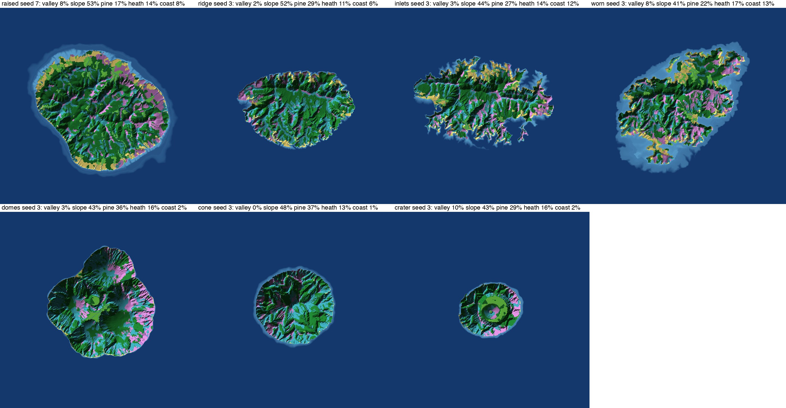
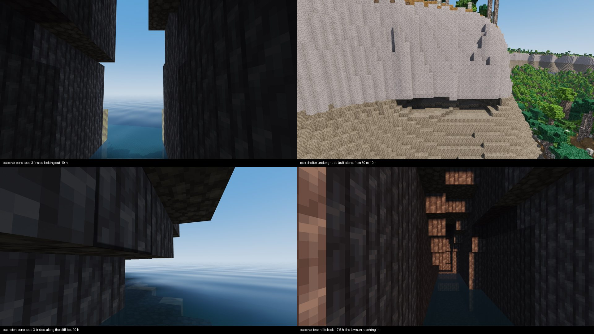
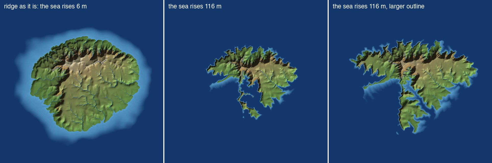

# Foundations for the wider world

A plan, 2026-11-11. Nothing here is a commitment until it is recorded in `open-decisions.md`.

The owner asked for a comprehensive plan of the systems that become the foundation of the future game, beyond the current island: a wider world whose variety matches or exceeds Dwarf Fortress and RimWorld, with each system given its own attention. While it was being written the owner named the destination: **a fantasy world grounded in realism, in the vein of The Lord of the Rings.**

How this was made: ten designers (Opus agents) each designed one system against a shared brief and the research in `interesting-world.md`. Their designs are in `foundations/` and carry the detail, the example catalogues and the sources. This document joins them: it states the decisions they share, settles where they disagreed, counts the variety, and orders the work. Numbers are marked measured, sourced or a guess; most line counts and costs are guesses.

## Summary

1. **A foundation here means a decision that is cheap now and expensive later.** There are fifteen (section 3). Everything else in this plan is catalogue rows and stages that wait for a trigger.
2. **Variety grows by adding rows of data, and each row names its cause.** A rock, a plant community, a landform piece, an animal: each is a row that says under what conditions it occurs. This is how Dwarf Fortress and RimWorld hold their variety, with one difference: here the conditions are measured from a land that was formed, so each kind can be inspected and looks different on foot.
3. **Variety comes from independent axes multiplying.** Rock story, history, climate, exposure, water, plant community, stand age, and later peoples and ages of the world. Section 6 counts them against the benchmarks.
4. **The world grows in three steps.** One island worth walking; an archipelago where each island has its own rock, history and climate; then a mainland with a long road, which the fantasy vision needs. The sea is a free seam between regions. A land seam along a drainage divide is the plan's largest untested risk and gets tested early, on today's island.
5. **Forming time bounds a region.** Today's 8 km grid forms in about 1 s, 16 km in 4.8 s and 33 km in 21.9 s on one thread (measured). A region is therefore at most about 33 km, and a larger land is formed coarsely and then refined in pieces.
6. **The fantastic enters as a cause.** A blight, an elder wood or a raised mountain adds terms to the same fields nature uses, so the simulation produces its consequences and inspection can explain it. This costs nothing to allow now and a rebuild to add later.
7. **The first phase is still one island**, sixteen changes, each ending in something the owner can look at. By the designers' guesses it roughly doubles the game, from about 2,800 to about 5,700 lines.
8. **Two findings changed earlier advice.** The land forming leaves no hollows, so lakes need events (measured: three one-cell dips on today's island). And the shader reads only four bits of a block's material, so sixteen colours is today's ceiling.
9. **Building the first four steps and measuring against real islands changed the plan again.** The generated land is the wrong shape at the coast, in its mass, in its steepest faces and at its crests, and the plan had ordered the work from a diagnosis the real data only partly supports. Section 11 holds what was learned and what it changes in how every system is designed and judged.

## 1. What this plan is, and how it avoids the last one

`lessons.md` records plans heavier than the change they described, scale fixed before anything was worth scaling, and a 200-entry catalogue of which none was accepted. This plan is large because it was asked to be comprehensive. It is kept from becoming v4 by five rules:

- **Only section 3 is fixed in advance.** Those decisions shape code that everything later stands on.
- **Nothing is built before its turn.** Every deferred part has a named trigger (section 8).
- **One change at a time**, each visible on today's island, each judged by the owner looking.
- **A kind counts only when the owner has accepted it in the game.** Targets in section 6 are ceilings to grow toward, never a ledger to fill.
- **Tools can reject a change and never accept one.** They live in the game, in one file, and write to the terminal or one picture.

## 2. The destination

From `foundations/fantasy.md`. What makes a world in this vein feel real, and who can make it:

| Property | Who makes it |
|---|---|
| A geography that comes before the story and stays consistent | The generator. This is what v5 already is. |
| The marvellous obeys the laws of its world | The generator, if the fantastic is a cause inside the same fields |
| Long journeys across lands that differ | The generator for the lands; the road between them is composed |
| Deep time, ruin over ruin | The generator: a few ages written as dated features |
| Peoples shaped by their land | The generator places them; their manner needs authorship |
| The marvellous is rare, placed and explained | The generator, under a rarity budget |
| Quiet land between the great places | A rule the generator follows |
| Plot, meaning, languages | Authorship |

What it asks of the foundations:

- **A mainland.** A mountain wall with few passes, a great river and a long road need land joined to land. An archipelago is honest (Earthsea is one) and comes first, but it cannot be the end shape.
- **Journeys sized by walking.** The player walks at 4.4 m/s (measured in `player.odin`), 3.8 minutes a kilometre. Proposed, all guesses to be judged by walking: a realm 20 to 60 km across, the road between two realms 3 to 8 hours on foot, the known lands about 300 km across inside the 1,000 km world, with far lands beyond that are real and rarely reached.
- **Great landmarks found, not placed.** The lone mountain, the gap in the wall, the falls on the great river, the ancient forest, the dead marsh: each has a natural cause the generator can search the formed land for. Only the most extreme in a region gets a name and a history.
- **Honest rock and big things.** Halls under mountains need massive rock with wide cracks. Great trees need trunks three to five blocks thick. A hold or city spans 0.5 to 2 km, beyond the 256 m block volume, so built things need a far outline as trees have.
- **Restraint as rules.** At most one marvel per region; influences on a few percent of the land; most of any road through quiet country.

## 3. The spine: fifteen decisions

Each is cheap to adopt now and expensive to change once code and catalogues stand on it. The designer's file argues each with its alternatives.

**How the world is described**

1. **Three kinds of thing.** A *field* has a value everywhere and is asked at a cell size (elevation, the rock at a point, wetness, temperature). A *feature* is a record with an identity and an extent (a river reach, a lake, a landslide, a stand of trees, a ruin). A *kind* is a catalogue row. Systems talk to each other only through fields and features.
2. **Kinds are rows of plain data, and a row never holds a formula.** Where a kind occurs is a set of ranges over named fields. A condition of a new shape becomes a new field, never a new rule type: "near a lake" is a range on the field *distance to lake*. Rows live in the Odin source for now; a build takes 2 s (measured), so editing a row costs what reloading a file would. (`kinds-and-places.md`)
3. **Every feature records its identity, its cause and its age, and the world keeps one list of dated events.** Inspection, names, plants on a landslide, ruins and later narration all read it. A cause cannot be recovered afterwards. (`kinds-and-places.md`, `living-world.md`, `fantasy.md`)
4. **Fields are a base plus terms, and there are two doors.** A cause changes a field before the land forms (extra uplift, a poisoned soil), and the simulation makes the consequences. A mark (a trail, a wall, a ruin) is laid on the formed land and expressed in blocks, as rivers are cut. Nothing edits the formed land afterwards. This is the whole reservation for the fantasy layer. (`living-world.md`, `fantasy.md`)
5. **Randomness is keyed by name, and the seed is a run-time value.** Adding a kind then changes only the places it wins. (`kinds-and-places.md`)

**How the land is made**

6. **One rock function, fixed in the finished world, read by everything.** A region's rock is a short list of bodies: stacked beds that are tilted or folded, cut by faults and intrusions. Nothing is stored per block. The land forming reads it shifted by the uplift still to come, so the beds the erosion cut are the beds a cliff shows. Coarse levels of detail read a version with thin beds merged. (`geology.md`)
7. **A region's recipe is a record, and forming is a pure function of the seed and that record.** The record holds the outline, the rock story, and a history: a short list of phases (years, uplift, sea level, rain) and events. Same inputs, same land, in any order, on any core. (`world-frame.md`, `landforms.md`)
8. **The land is left unfinished, and events happen inside the forming.** The last phase stops before gorges and hanging waterfalls have worn away. A landslide or lava flow is chosen by ranking its host conditions, applied, then eroded for its age. (`landforms.md`)
9. **Ground and water are separate, and every body of water is a feature with a level and a cause.** Lakes come from events and from rock, because the forming leaves no hollows (measured). A river changes from a traced line to a corridor of cells at about two cells wide. (`water.md`, `landforms.md`)
10. **Seams go where little crosses: the sea first, then drainage divides.** A region is at most about 33 km. A larger land is formed whole at 64 m and cut into river-basin pieces, each refined to 16 m with its edges pinned. Positions are stored relative to their region, and player edits are a layer over a world that never changes. (`world-frame.md`)

**How it reaches the player**

11. **One block function, and no detail without a cause.** The surface, the soil under it, the rock under that and any declared cave come from one function of seed and point, so what is dug matches what a face shows. Every shape below 16 m takes its size from rock or drainage. Overhangs and caves are declared records with an outline the far terrain can draw. (`ground-and-underground.md`)
12. **A block is an index into one table of materials.** Rock of each kind in four forms (solid, broken, scree, gravel), each soil, the bark and leaf of each species. One byte holds the island; the table goes to 16 bits before the archipelago, while nothing is kept compatible. (`geology.md`, `ground-and-underground.md`, `vegetation.md`; see section 5)
13. **A plant community is a flora crossed with a site slot, and stand age is a third axis.** Climate picks the flora; the same eleven slots (valley floor, ridge, exposed top, water's edge and so on) apply in every climate. Stands are features with an age; trees are recomputed, never stored; one tree grower takes about fourteen numbers per species, and each species' crown outline is what the far terrain draws. (`vegetation.md`)
14. **Climate is a few yearly numbers in real units, from one latitude and one clock.** The sun and the plants read the same latitude. Weather is a fixed result of seed, place and time. Season and weather are drawn by the renderer and never baked into the terrain. (`climate.md`)
15. **Rarity is chosen in its own pass, from candidates nature found.** A finder ranks the most extreme natural candidates; a small pass promotes a few to named places or to the source of something fantastic. Chance per cell would scatter marvels. (`fantasy.md`, `kinds-and-places.md`)

What stands from the four ADRs: all of them. Two get additions: `adr/0001` gains coarser levels (128 m to 1 km) for views across water, and `adr/0004` gains water that belongs to a cave and stands still.

## 4. The ten systems

| System | What it owns | First slice on today's island | Design |
|---|---|---|---|
| World frame | The ladder of scales, region kinds, where seams go, coordinates, edits | The island's constants become a record; four island kinds on `--kind=`; the island moved to 500 km must look identical | `foundations/world-frame.md` |
| Geology | The rock function, rock kinds, rock stories, deposits | Tilted beds with a hard cap; five rock kinds as blocks | `foundations/geology.md` |
| Landform processes | The forming loop, histories, events, what each cell's surface is made of | History as rows; then one landslide | `foundations/landforms.md` |
| Water | Rivers by discharge and style, lakes by cause, wetlands, springs, falls, the sea's edge | A slide-dammed lake and debris ponds; then falls with their own mesh | `foundations/water.md` |
| Climate, seasons, weather | Base climate, local climate from the land, the clock, weather | Sun by latitude and date, a snow line, local fields on the map, cloud shadows | `foundations/climate.md` |
| Soils and vegetation | Soil, floras, site slots, stands, species, the tree grower | Soil and five communities; then stand ages; then the grower | `foundations/vegetation.md` |
| Ground in blocks, underground | Landform pieces, detail below 16 m, caves and overhangs, materials | Ledges on hard beds; then cracked faces and fallen rock | `foundations/ground-and-underground.md` |
| Living world | Animals, crossing cost and routes, peoples, marks, history | Deer trails traced like rivers | `foundations/living-world.md` |
| Kinds, places, inspection | The row format, the field vocabulary, the survey, named places, "why is this here", tools | Today's rules rewritten as rows with identical output; `--seed=`, `--overlay=`, `--why=` | `foundations/kinds-and-places.md` |
| Fantasy | Landmark archetypes, influences, peoples' bonds to land, ages, restraint | A landmark finder that marks named candidates on the map | `foundations/fantasy.md` |

Who owns each catalogue, where the designs differed: soil belongs to vegetation; landform pieces to the ground in blocks; landscape kinds (a history through a rock story) to landform processes; region kinds to the world frame.

## 5. Where the designs disagreed, and what this plan settles

1. **The end shape of the world.** The world frame recommends an ocean with islands at about 5% land and no large landmass until a land seam is proven. The fantasy design needs a mainland. *Settled:* the end shape is a mainland with islands off its coast, inside known lands about 300 km across; the path is island, archipelago, mainland. The land-seam test moves forward to an early experiment, because it decides whether the mainland can be made this way.
2. **Cold to hot.** The world frame suggests a true slice of about nine degrees of latitude; climate recommends letting 1,000 km stand for about thirty. *Settled:* compress, as climate proposes. The known lands, 300 km of it, then span about nine degrees, as varied as Japan from south to north, and the far lands reach cold and hot.
3. **Where lakes come from.** Landform processes proposed keeping the hollows the forming makes. Water measured that there are none. I confirmed it: three cells on today's island, 11 to 17 with rock beds, the deepest 3.4 m. *Settled:* ground and water stay separate fields as both designs want, and lakes come from events and later from rock basins.
4. **Lake before rock, or after.** Water proposes placing the first landslide by relief alone so a lake appears sooner. Landform processes waits for the rock function. *Settled:* after rock, so the slide sits on its real host (a strong bed over a weak one) and is built once. This is the owner's to overturn if water matters sooner.
5. **Which height the erosion reads the rock at.** My experiment and the landform design used the current height; geology shows that puts the eroded beds up to 2.4 km from where the blocks show them. *Settled:* geology's rule (decision 6). Whether it changes the landforms the experiment showed is checked in step 1.
6. **How many bits a block needs.** Geology fits 32 rocks in four forms plus minerals in a byte; vegetation needs a bark and a leaf per species and reaches 70 to 120 plant blocks by the archipelago. Together they overflow. *Settled:* decision 12.
7. **Three names for what covers the ground.** Landforms records a deposit per cell, vegetation derives a soil, the ground design reads bareness. *Settled:* one stack. The forming records the deposit (alluvium, scree, slide debris) and how near the slope is to the rock's limit; the soil rule derives soil kind and depth from deposit, rock, wetness and climate; the block function reads both.
8. **Catalogue sizes.** Where the catalogue designer's table and an owning designer's numbers differ, section 6 uses the owner's.

## 6. The variety, counted

Targets by stage, from the owning designer; all are guesses and ceilings. A row counts only if a walker can tell it from its neighbours by shape, edge or material, and its cause differs.

| Axis | Today | One island, done | Archipelago | Wide world | Benchmarks (sourced) |
|---|---|---|---|---|---|
| Region kinds (island and landmass types) | 1 | 4 | 10 to 14 | 24 to 30 | Vintage Story 6 provinces |
| Rock stories | 0 | 1 | 8 | 12 | Dwarf Fortress: one fixed stack |
| Rock kinds | 1 | 5 | 20 | 28 | DF 25, TerraFirmaCraft 20, RimWorld 5 |
| Landscape kinds (a history through a rock story) | 1 | 3 to 5 | about 30 | 80 to 100 | TFC 125 landforms |
| Landform pieces at 1 to 50 m | 2 | 14 | 14 to 30 | 30 | RimWorld 41 landmarks; DF erodes cliffs away |
| Water kinds | 2 | 8 | 35 | 70 | DF 21 water biomes; RimWorld about 12 |
| Climate zones, plus local climates | 1 | 1 + 5 | 3 to 6 + 7 | 14 to 17 + 7 | DF 27 land biomes; RimWorld 17 |
| Floras × site slots | 1 | 1 × 11 | 3 to 4 × 11 | 13 × 11 | Minecraft 57 biomes |
| Stand ages | 1 | 4 | 4 | 4 | none of them |
| Tree species / silhouettes | 1 / 1 | 8 / 7 | 20 / 10 | 60 / 14 | DF 72 in about 6 shapes; Minecraft 10 in 19; TFC 20 |
| Soils | 1 | 8 | 10 | 13 | DF 21; TFC 8 |
| Animals | 0 | 8 to 12 | 40 to 60 | 150 to 250 | DF hundreds; RimWorld 5 to 36 per biome |
| Settlement and mark kinds | 0 | 0 | 12 to 18 | 40 to 60 | RimWorld 13 man-made landmarks |
| Landmark archetypes found | 0 | 4 to 6 | 12 | 17 | RimWorld 41 |
| Fantastic influences | 0 | 0 | 1 to 2 | 7 | DF evil regions, placed without cause |
| Deposits and minerals | 0 | 0 | about 12 | about 45 | DF 58 minerals and 127 gems |

How this compares:

- **Exceeds on the land itself.** Dwarf Fortress's surface is thin by its author's account, and a RimWorld map is two noise fields and thresholds before landmarks. Here rock stories, histories, pieces and water kinds are the main body of the catalogue, and they multiply: one young history gives scarps over tilted beds and stacked blocks over granite.
- **Exceeds on woods.** 143 communities in four ages against 17 to 57 biomes, each with a cause and an edge.
- **Matches on rock and climate**, with fewer look-alikes.
- **Deliberately below on lists.** 60 tree species against 72, about 45 deposits against 185, fewer animals. Dwarf Fortress's 72 trees read as six. These lists matter mainly to a colony game and can grow as rows when it arrives.
- **Adds axes neither has:** stand age, local climate, how a region's history left it, and causes that can be inspected.

## 7. The shape of the world

**The ladder.**

| Rung | Extent | Cells | What it holds | Cost |
|---|---|---|---|---|
| World | 1,000 km | about 2 km | A stand-in for plates, island and landmass records, base climate, sea-level history | About a second (guess) |
| Landmass pass, only for land larger than one region | up to a few hundred km | 64 m | The whole landmass formed coarsely, then cut along drainage divides | About 80 s for 80,000 km² on one thread (guess, extrapolated) |
| Region | up to 33 km | 16 m | Land formed as today, from its record | 1.0 s at 8 km, 4.8 s at 16 km, 21.9 s at 33 km, one thread (measured); 100 and 313 MB peak for the last two |
| Place | 256 m around the player | 1 m | Blocks, designed from the region's fields and the rock function | As today |

The land forming costs 32 to 43 ms of one core per square kilometre (measured by the world-frame designer, consistent with mine). A constant in absolute metres also surfaced: stretched to 33 km, today's island grows a range one kilometre wide, because the uplift pattern does not scale with the region. Step 3 fixes that.

**How much land.** At 37 ms per km² and ten threads:

| Option | Land | Time to form all of it | Note |
|---|---|---|---|
| Ocean with islands, 2% | 20,000 km² | about 1.2 min | Earthsea |
| Ocean with islands, 5% | 50,000 km² | about 3.5 min | The world frame's recommendation |
| Known lands with a mainland, 5 to 8% | a mainland of 30,000 to 50,000 km² plus islands | 2 to 5 min, most of it in the background | This plan's recommendation; needs the land seam |
| A continent, 15 to 30% | 150,000 km² or more | 11 to 20 min | Background only |

Every region within 64 km of the start is formed before the player enters; the rest form in the background and are kept as summaries of a few kilobytes, then formed again, identically, when the player comes near. Nothing far is a placeholder: beyond 64 km a region shows as a coarse outline under the horizon. The world is drawn round, so distant land sinks under the sea's curve.

**The risk.** Nobody has tested whether a divide pinned between two basin pieces leaves a visible seam. The test is small: form today's island whole, then as two pieces cut on its 64 m solution, and show the owner both maps with the seam drawn. If the seam shows, the end shape falls back to an ocean of islands, or to regions large enough to hold a whole realm at coarser cells.

## 8. The order of work

### Phase 1: one island worth walking

Each step is one change the owner can look at. Line counts are the designers' guesses. Steps 1 to 5 are the base; later steps can be reordered at the owner's wish, within the dependencies shown.

| # | Change | Needs | Lines | The owner looks at |
|---|---|---|---|---|
| 0 | A seed on the command line and field overlays on the map | | 60 | The same island on several seeds; wetness painted on the map |
| 1 | Rock beds in the land forming: the rock function, one rock story, five rock kinds as blocks, the material mask widened | | 205 | The map, a view from the air, the bands in a face |
| 2 | Cliffs in blocks: ledges on hard beds, far faces coloured by their rock; then cracked faces, scree and fallen blocks | 1 | 160 | The foot of the tallest face, and the same face from 1 km |
| 3 | The island's recipe as a record: shape, rock story and history as rows; four island kinds; positions relative to the region | 1 | 130 | Four maps; a river bank at 500 km that matches the same bank at the origin |
| 4 | Local fields from the land: facing, hollow or humped, distance to sea, sunlight, exposure, cold-air pooling | | 90 | Each field painted on the map |
| 5 | Kinds as rows, then soil and five plant communities (valley floor, slope forest, ridge pine, exposed scrub and heath, coast) | 1, 4 | 590 | First: identical screenshots after the rewrite. Then a walk from river to ridge, and `--why=` at three spots |
| 6 | One landslide: scar, hummocks, a dammed lake, ponds, young trees on the debris; features begin to carry cause and age | 1, 5 | 230 | The map; the view from the dam up the lake |
| 7 | Stands with ages: spacing by age, crowding, gaps, logs, standing dead trees, mounds | 5 | 130 | Ground level in an old wood and a young one |
| 8 | The tree grower: eight forms at true heights | 7 | 200 | Under a beech, among birch, at pine on rock |
| 9 | Ground plants and water edges: thickets, reeds in bands, plants you walk through | 6, 8 | 80 | A lake shore |
| 10 | Sky and year: sun by latitude and date, a snow line, a cloud layer and its shadows | | 125 | One view in June and December; a hillside under moving shadows |
| 11 | Falling water and springs: rivers sized by discharge, springs where beds allow, falls with their own mesh, a gorge | 1, 2 | 200 | A fall from below and from its lip |
| 12 | Trails: one cost of crossing ground, one route tracer, deer trails that meet at fords | 2, 5 | 120 | The map; a trail walked down to the river |
| 13 | Landmarks, places and names: a finder for the most extreme summits, passes, falls and lakes; eight to twelve named places; a survey of what the island contains | 6, 11 | 180 | Each named place from 1 to 2 km away |
| 14 | Shelters, sea notches and sea caves in the block volume, with light under a roof | 2 | 150 | Standing inside one |
| 15 | The coast: cliffs where the swell hits, beaches in the bays, stacks | 1, 14 | 100 | A walk along a kilometre of shore |
| 16 | Birds at cliffs, fish in pools | 2, 11 | 150 | A cliff and a pool |

About 2,900 lines in all. After each step that touches drawing, trees or the start, the two benches in `CLAUDE.md` are run.

Forming time is watched as a budget. The designers' estimates add about 0.6 to 1.2 s to today's second across rock, deposits, soil, local fields, the survey and trails. The limit proposed is 2 s for forming plus survey on today's island, with `--map` staying near one.

### After step 3: the land measured against real islands

Added 2026-11-11. Steps 0 to 3 are built. A comparison with eight real Japanese islands (`interesting-world/notes/real-islands.md`) then showed that the land forming itself is short of real land in four ways the table above does not address, and the owner set the direction: real islands are the north star, leaning toward the livable ones, with an inhospitable island kept as a rarer kind (`open-decisions.md`). What this changes in the plan (the owner said yes on 2026-11-11, and the step is built: see the next heading):

- **A land-forming step before step 4.** The sea cuts the coast back inside the forming, so exposed shores stand as cliffs 50 m and more over a platform, and the uplift no longer falls to zero at the shore. Strong rock holds steeper faces and creeps less, so crests sharpen. The kind rows are reshaped toward real masses: a broader, gentler top on the cone, a longer ridge, deeper drowning on the worn kind. The targets are the real figures: 40 to 80% of an exposed shore rising 30 m within 50 m, 1 to 3% of land over 60°, a crest fall of 0.5 to 1 m.
- **Livable ground is kept on purpose.** Cutting the coast removes the low apron that is most of today's gentle land. Gentle ground goes back where it has a cause (a bay head, a valley floor, a river-mouth flat, a terrace, a plateau top), each kind row gets a range for how much, and the draw of kinds is weighted toward the livable ones. Livable ground and sheltered landings join the figures the game prints.
- **Step 15 shrinks.** The large coast (cliffs, bays, platforms) moves into the forming. Step 15 keeps what lives in blocks: beaches, notches, stacks.
- **Step 5 gains a constraint.** The soil rule must keep forest on slopes of 35 to 45°, or a truer island turns bare.
- **Step 11 gains material.** Rivers will hang over the new sea cliffs, so falls become common.
- **A comparison tool.** A scratch build loads a real island in place of a formed one and prints the same figures. Whether it joins the game is the owner's call.

### The land-forming step, as built

Built 2026-11-11 in three parts, each checked against the figures the game now prints at start-up, with the last rise of the sea on the ridge and raised kinds enlarged the next day (below). The owner has not yet looked at it.

**Part 1, coast and steepness.** Uplift reaches the shore. A step inside the forming cuts each shore cell back by how much open sea lies round it and toward a swell whose bearing the seed draws, leaving a platform and a cliff; sheltered shores are not cut. Strong rock stands to 60° and creeps less. Soil and trees hold to about 45° on any rock, and only steeper faces are bare.

**Part 2, livable ground and inlets.** Livable ground is a field: no steeper than 20°, at least 2 m over the sea, in a patch of a hectare or more, set from where mapped buildings stand on the eight real islands. What the streams carry settles in sheltered water and builds flats at bay heads. A fifth kind, inlets, is high ground drowned by a rise of 115 to 120 m. Kinds are drawn by weight, the livable ones more often.

**Part 3, vents.** A vent builds rock (a cone or a dome, by what it erupts), its top can fall in to leave a closed dry crater, and magma swells it from inside. The cone is rewritten as a built island, and crater and domes are new kinds. Two rock stories, lava and ash, and pale lava and pumice, lay their beds over what the vents built.

Medians over the seeds tried (three to six a kind; twelve for ridge and raised, measured after their last rise was enlarged), beside the real ranges:

| Figure | Real high islands | ridge | cone | crater | domes | inlets | worn | raised |
|---|---|---|---|---|---|---|---|---|
| Height within 100 m of the shore, m | 60 to 117 | 60 | 95 | 98 | 78 | 49 | 22 | 18 |
| Shore rising 30 m within 50 m, % | 40 to 85 | 64 | 99 | 95 | 76 | 52 | 12 | 16 |
| Slope in the first 100 m, ° | 29 to 51 | 26 | 38 | 43 | 37 | 20 | 12 | 6 |
| Land under 50 m, % | 5 to 16 | 25 | 6 | 17 | 13 | 41 | 54 | 36 |
| Land steeper than 60°, % | 0.8 to 2.9 | 1.8 | 1.6 | 2.7 | 1.0 | 1.6 | 0.3 | 1.0 |
| Fall at a ridge crest, m | 0.56 to 1.25 | 0.60 | 1.89 | 2.3 | 1.25 | 0.62 | 0.56 | 0.54 |
| Height above the nearest stream, m | 54 to 130 | 57 | 102 | 74 | 137 | 51 | 29 | 36 |
| Livable ground, % of land | 15 to 46 (Kikaijima 91) | 48 | 0 | 24 | 28 | 49 | 62 | 65 |
| Sheltered landings | 0 on the cones, 7 to 14, 80 on Tsushima | 5 | 0 | 0 | 1.5 | 9 | 9 | 0.5 |

Before the step the four kinds stood at 6 to 17 m, 0 to 2%, 4 to 10° and 30 to 55% on the first four rows, and nothing was steeper than 60°. Forming takes 0.25 to 0.9 s on every kind. `src/` grew by 517 lines.

What is still short:

- **Landings.** As first built, the ridge and the raised island, which is now the default, had none. Their outlines enclose no water, and a more ragged outline was cut back smooth by the sea. Only drowning gave landings, so on 2026-11-12 the last rise of the sea was enlarged in both rows, and the ridge island was made longer: its rise is 40 to 60 m (from 5 to 10) and its outline about a tenth larger and a third longer than it is wide; the raised island's rise is 10 to 20 m (from 3 to 6). Twelve ridge seeds now have 2 to 12 landings, median 5, which is 1.8 for every 10 km of shore, where the three real high islands with natural landings have 7 to 14 and 1.3 to 1.9. The cost is at the coast: the height within 100 m of the shore fell from 79 to 60 m and the cliffed share of shore from 81 to 64%, both at the edge of the real range, the slope in the first 100 m fell from 32 to 26°, under it, and the land under 50 m rose from 13 to 25%, over it. Six of twelve raised seeds have a landing, the default among them with one, and that is as it should be: Kikaijima's twelve are harbours built behind breakwaters (section 11).
- **Volcanic crests are too sharp** (1.2 to 2.3 m against 0.19 to 0.69 on their references), and the cone has no livable ground at all where Mikurajima has 15%.
- **Craters and domes look drawn.** A crater floor is a smooth round bowl and the domes are round lobes. That is the fault `lessons.md` warns of, a shape that reads as a diagram, and it is the owner's to judge.
- **The 8 km region.** The inlets island keeps 7.6 km² of land and has 26 to 38% of its outline as sea, against 52 to 60%. On a 16 km region it formed in 4.1 to 4.9 s with 36 to 53 km² and 28 to 41 landings. Not shipped.
- **Not done:** a real island loaded into the new build to test the dressing.

### Step 4, as built

Built 2026-11-12: six fields on the 16 m cells of the land, filled once after forming by `land_local` in `land.odin` (27 ms on the default island, 12 to 20 ms on the others), each painted by `--overlay=`. Nothing reads them yet; step 5 will.

- **Facing** (`facing`): the bearing the ground falls toward, degrees from north. Read it at a cell, not interpolated, since it wraps at north.
- **Hollow or humped** (`hump`, overlay `humped`): metres the ground stands over the mean ground in a square 208 m across. A 3 × 3 neighbourhood, as `foundations/vegetation.md` proposed, shows only gullies at 16 m; 400 m turns whole valley sides into hollows. On the default island it averages −11 m on stream channels and +3 m on ground nothing drains into.
- **Distance to sea** (`inland`): metres to the middle of the nearest sea cell, exact on every cell tested against a brute-force search.
- **Sunlight** (`sun`): clear-sky sunlight through a year at the region's latitude, against the same ground lying flat; 0.15 to 1.11. On slopes of 27 to 35° it runs from 0.63 facing north to 1.10 facing south, the same east as west. Horizon shading is left out, as designed.
- **Exposure** (`exposed`): 0 to 1, from the steepest rise of the ground toward the wind within 300 m (Winstral's index), the hump, and salt off the first sea toward the wind, by how open that sea is, fading over a kilometre. Windward shores average 0.79 to 0.91 on the three islands tried, lee shores 0.09 to 0.41.
- **Cold pool** (`above`, overlay `cold`): metres over the stream a cell drains to, or over the sea where it drains straight there (height above the nearest drainage, HAND). The printed figure "height above the nearest stream" now reads it.

What the designs had wrong or left open:

- **The sun already has a latitude.** `climate.md` reads today's sun as fixed at 60° at noon and recommends 40° N. That sun is exactly the equinox sun at 30° N, so the region record now holds a latitude of 30 and `sun_dir` reads it, which leaves the sky as it was. Moving to 40° N is step 10's to decide, and changes sky and sunlight together.
- **There was no wind.** The wind shares the swell's bearing, drawn from the seed.
- **Cold air over the sea.** Measured from the sea, low coastal ground counts as a cold hollow: the raised island's terraces paint blue. Real coasts are mild, because cold air drains out over warmer water, so step 5 should read the cold pool together with distance to the sea.
- **Salt from `exposure`.** The shore openness the waves use is about 0.3 to 0.5 even on an open coast, so salt read from it hardly showed. Salt uses the share of open sea in the kilometre beyond the shore instead.
- **Temperature**, listed with these fields in `climate.md`'s growth path, is not built: it needs a base climate, which comes with step 10.

### Step 5, first half, as built

Built 2026-11-12: the rules that exist written as rows, with nothing visible changed, and `--why=`. Soil and the five plant communities are the second half.

- **Fields** (`FIELDS`, `fields.odin`): one table of nineteen, each a name, a unit, what it comes from, how to read it at a point and how the map paints it. It replaced the overlay table, so `--overlay=` paints any field; the twelve old overlays keep their names, and three of their maps (uplift, humped, cold) differ in 1 to 4 colour values of 3 million, by one level, from rounding. Thirteen fields are read from the land's 16 m grid, six from the ground the generator makes at the point.
- **Windows and hosts** (`kinds-and-places.md` D2): a window is a field, a range (over `lo`, up to `hi`) and an edge to fade over; a host's windows multiply; a row holds only names and literals.
- **The surface is five ordered rows** (`SURFACES`, `gen.odin`): river gravel, sand, loose rock, bare rock, grass. The first whose host holds wins. The generator's output is identical bit for bit: a hash over surface, height and forest density at every metre of three 512 m squares (a river bank, the steepest cell, a coast), over the whole region at 2, 8 and 64 m cells, over the trees in the squares and over `gen_columns` for 448 chunks matched before and after on the default island, the cone on seed 2 and the inlets on seed 2.
- **The two thresholds that mixed a field with patchy noise became fields**: `beach`, metres under the line the waves throw sand to (1.8 m, give or take 1.2 in patches), and `too-steep`, how much steeper the ground is than soil holds (a rise over run of 1, give or take 0.15). Each old comparison is now the sign of a field, which floating point keeps exactly. River gravel and fallen rock are fields too (`gravel`, `fallen`, the depth of rock fallen from a face).
- **The forest stayed code.** `forest_at` is a sum, 0.12 + 1.3 × wetness + 0.4 × patches, less a fall with height from 170 to 320 m, which windows that multiply cannot express. Its terms are exposed for `--why`, and it is painted as the `woods` field.
- **`--why=x,z`** forms the island and prints four to six lines: the ground; the winning row, its reason and the windows nearest their edges; what the ground would be were that row not to hold; the nearest miss among the rows that do not hold and the window that rules it out; how wooded it is, term by term.
- **Cost.** `gen_columns` over the same 448 chunks at seven cell sizes took 162.6 ms before and 166.9 ms after (medians of five interleaved runs), 2.6% or about 8 ns a column. Forming time and the three benches did not move.

What the design had wrong or left open:

- **The race (D4) cannot carry the surface.** The old `switch` is an ordered choice with hard thresholds, and rows of a race that all score 1 would be decided by their noise keys. An ordered catalogue is right where one cause overrides another (a river's gravel before sand, fallen rock before bare rock); the race is for rows that compete for ground, the plant communities. None of the race is built.
- **Open and closed ends.** A window holds over `lo` and up to `hi`, and each derived field is signed so that the old `<` or `>` falls on the right side.
- **No `Site` and no interleaved grid** (D3). A window reads its field through the table at each test, which costs about 8 ns a column with five rows. When a community catalogue reads six grid fields at every column, gathering them once per point will be worth it.
- **What the plant communities will add**: soil depth and kind as fields; a catalogue whose rows carry a weight, a patch size and up to three hosts taken at their best; the race, with each row's key drawn from noise seeded by its name; and a `--why` that names the runner-up of the race in place of "would be otherwise". Window edges are built and so far unused.

### Step 5, second half, as built

*Changed the same day, after the owner looked: the species, communities and soils below were replaced by those of the warm islands the land is measured against, the forest was closed over and given bushes, and block faces now come from an atlas of drawn tiles. What is described below is the first cast; `interesting-world/notes/real-vegetation.md` has the comparison with real islands and the table of what changed, and `open-decisions.md` the decisions. The tiles are shown in `interesting-world/real/blocks-sheet.jpg`.*

Built 2026-11-12: soil, five plant communities that compete for ground, and four species. The owner has not yet looked at it.

- **The race** (`kinds-and-places.md` D4, `race` in `fields.odin`) runs once after forming on every 16 m land cell. Each community scores its weight times its best host, draws a number u from two octaves of smooth noise at its own patch size, keyed by its name, and keeps u to the power one over its score; the highest wins. The winner is stored as one byte a cell. At a point the map is read up to about 24 m off by noise, so edges wander over 10 to 50 m and never follow the grid. No majority filter: the maps showed neither confetti nor edges along contour lines that needed one. The runner-up and margin are not stored; `--why` reruns the race on the cell.
- **The five communities** (`COMMUNITIES`, `gen.odin`), each a row with a weight, a patch size, hosts, a tree density (the share of 6 m squares with a tree), species shares and a ground cover:
  - *Valley floor wood* (weight 4, patches 150 m): within 3 m of the stream the ground drains to, fading over 3 more, on slopes under 0.2. Katsura 75% and beech 25% in half the squares, over grass.
  - *Slope forest* (weight 1, 400 m): no host, so it takes whatever nothing else wins. Beech 85%, pine 10%, katsura 5% in 70% of the squares, over litter.
  - *Ridge pine* (weight 3, 250 m): ground humped over 4 m with wetness under 0.25, or soil under 0.5 m. Pine 80%, scrub 20% in 45%, over fallen needles.
  - *Scrub and heath* (weight 4, 200 m): exposure over 0.8. Scrub 85%, pine 15% in 30%, over heather.
  - *Coast strand* (weight 5, 150 m): within 150 m of the sea and under 12 m over the shore or stream it drains to. Pine 60%, scrub 40% in 20%, over dune grass.
- **Species** (`SPECIES`): katsura, a broad flattened dome 11 to 14 m high, light yellow-green on a brown trunk; beech, a round dome 9 to 13 m, mid green on a grey trunk; pine, a flat plate 9 to 13 m up on a bare red bole, dark blue-green; scrub, a low olive bush 2 to 4 m from the ground up. Heights stay near the old 8 to 14 m until the tree grower. One function, `envelope`, gives a crown's underside and top at a distance from its trunk; the near blocks, the crowns hung at 270 m to 1.1 km and the canopy beyond all read it, and a far canopy cell takes the leaf and height of a species its community would grow.
- **Soil depth** is a field (`soil-depth`, `land_local`): one minus the hump over 12 m, held between 0.3 and 2.5, plus 1.5 times the wetness; thinned by 0.7 times the square of the slope over what soil holds; 1.3 minus 0.6 times the rock's strength, so weak rock weathers deeper; and 2 m more within a few metres of a stream, fading out by 4 m above it; at most 4 m. **Soil kind** is an ordered catalogue (`SOILS`): river silt over gravel up to 2.5 m above the stream on slopes under 0.15; shore sand within 120 m of the sea and under 10 m up; stony wash on slopes over 0.65, loam over brown earth with a third of its blocks stones broken from the bed beneath; podzol, a bleached band over rust, on dry humps (over 3 m, wetness under 0.3); brown earth, loam over brown, elsewhere. Under the cover lies one block of soil for each metre or part of one, then the rock. Bare rock is still the surface row `too-steep`, so forest holds to about 45° and steep thin soil goes to ridge pine.
- **`--why`** names the community and the window nearest its edge, the runner-up and the window that held it back (or that it held as well and lost the draw), the trees, and the soil with its depth and blocks. The overlays `plants`, `soil`, `soil-depth` and `woods` paint them, and start-up prints the shares.

Shares of the land, from start-up (seed 7 is the default; the others on seed 3):

| | raised | ridge | inlets | worn | domes | cone | crater |
|---|---|---|---|---|---|---|---|
| Valley floor wood, % | 8 | 2 | 3 | 8 | 3 | 0 | 10 |
| Slope forest | 53 | 52 | 44 | 41 | 43 | 48 | 43 |
| Ridge pine | 17 | 29 | 27 | 22 | 36 | 37 | 29 |
| Scrub and heath | 14 | 11 | 14 | 17 | 16 | 13 | 16 |
| Coast strand | 8 | 6 | 12 | 13 | 2 | 1 | 2 |
| River silt | 6 | 1 | 4 | 7 | 3 | 0 | 12 |
| Shore sand | 6 | 4 | 8 | 11 | 2 | 0 | 1 |
| Stony wash | 11 | 28 | 29 | 15 | 55 | 64 | 65 |
| Podzol | 21 | 29 | 25 | 26 | 19 | 17 | 7 |
| Brown earth | 56 | 38 | 33 | 41 | 21 | 18 | 16 |

**Cost.** The race and the soil count take 15 to 17 ms after forming on the default island and 4 to 13 ms on the others. `gen_columns` over 448 chunks at seven cell sizes took 157 to 158 ms before and 159 to 161 ms after, about 1 to 2%. The three benches' own work did not move. `src/` grew by 216 lines (312 added, 96 removed). The start moved, since the old bank on the east side now has a tree within 6 m: it is now a river bank on the south coast terrace near 170, 2,300, in the valley floor wood, and the ground bench covers 59 m.

What the designs had wrong or left open:

- **The six local fields carried five communities unchanged.** With heath over an exposure of 0.8, it takes 11 to 17% of the land on every kind, not the windward half the exposure map suggests. The cold pool's fault at the coast did no harm: no row reads it as frost, and the valley floor and coast read it for what it measures, height over the stream or shore.
- **A weight is a chance, not a rank.** Ridge pine with its host fully held still loses about one cell in four to slope forest, in patches, which mixes crests as real ones are. It first put beech on no soil at all, until soil on humps was held to at least 0.3 m.
- **Reading grid fields smoothly made the race cost 48 ms.** A field asked at the grid's own cell size now reads the cell's value, which is what the smooth curve gives at a cell's middle, and the race costs 16 ms.
- **No soil row reads the rock's chemistry.** Podzol on a basalt cone's crests is wrong; real volcanic islands have dark ash soils. It needs a field for whether the rock is acid, which the rock rows do not yet hold.
- **Still short:** the orchard look (one tree per 6 m square at most, all one age) is step 7's; from 2 to 4 km pine and heath ground shows rust and mauve through an open canopy, so pine slopes read brown more than dark green; a bush is a box of leaves; dug walls are lit as if they were the ground above, which washes out the soil layers seen from above the hole (from inside, they read).

### Step 6, as built

Built 2026-11-12: one landslide an island, the lake its debris dams and the ponds among its hummocks, and the first features with an identity, a cause and an age. The owner has not yet looked at it.

*Changed the same day, after the owner asked for its weak points to be fixed. What follows describes the first build; the changes, and what the pictures now show, are these.*

- **A breached lake drains.** A lake or pond column starts full and is then neither topped up nor dried; the stream running in keeps it at its spill. A notch 9 m wide dug through the default dam drew the level down 1 cm in four minutes: it drains, at the gentle rate the near water moves at.
- **Hollows that share a shore are one water.** Hollows within two cells of each other are one lake at the lowest of their spills, where two used to stand a metre apart at a neck.
- **A wider slide that runs out further.** The scar is 300 to 800 m long and 0.9 to 1.5 times as wide (it was 200 to 600 m and narrower than long), and the debris surface falls 0.05 to 0.1 a metre (was 0.08 to 0.14). Of 20 slides, 17 now dam a lake where 13 did; the default island's is 7.2 ha and 23 m deep.
- **Blocks of the cap lie on the debris**, 2 to 5 m across and up to as high, in about one in six of its 7 m squares where it lies thick. The hummocks themselves cannot be smaller than the 16 m cells hold, so the blocks are what breaks the ground at a walker's scale; they are whole rock, where the debris round them is its rubble.
- **Younger slides, and each kind draws its own.** Ages are 30 to 1,000 years (were 50 to 3,000), and the island's kind is in the key, so one seed no longer gives every kind the same age.
- **A young wood follows the alder**, to about 400 years and fading by 900: tabu with small evergreens and the last alders, lower and darker than the shii forest round it. On Miyakejima's lava flows of known age the tabu wood stands at about 125 years and the shii forest at 800 and more (from memory). The default island's 460-year-old slide now shows as a patch of it.
- **A young lake has the trunks of the trees it drowned**, for a hundred years, half of them fallen (a guess, after Taishō pond in Kamikōchi, dammed in 1915).
- **Deep fresh water is dark.** A lake hides its bed where it is deep and shows it in the shallows, and its far surface is drawn the same; before, the far lake was pale over a bed drawn flat a metre down, and a straight line crossed the lake where the simulated water ended. That line was the white streak.
- **The start skips a bank a lake has drowned.**

Still short: 0 to 9 ponds an island, where Jūniko has 33 on a far larger slide; three slides dam nothing and six lakes are under 0.3 ha; the outlet's fall over the dam is drawn as flat white sheets until falls have their own mesh (step 11); a lake's bed seen through clear shallows shows the risers of its steps as dark wedges; sediment does not yet fill a lake with age.

- **The host** is a row of windows, `SLIDE` in `events.odin`: a slope at 0.9 or more of the steepest its rock holds (`at-limit`), a bed at least 0.3 stronger in strength over a weaker one within 50 m of the surface (`cap`), a valley below whose stream drains 0.5 to 5 km² (`valley`), and 60 m or more of relief above that stream (`cold`), each fading over a margin and multiplied. Every land cell is scored, and the best wins, with a draw from the seed of up to 0.02 to break ties. The winning cell is the scar's head.
- **The scar** runs from the head toward the valley's stream, 200 to 600 m. It is a spoon as deep as the cap and the bed under it (12 to 50 m), steep at its head and sides, thinning to its foot. Only ground nearly as steep as the head gives way, and nothing goes below the valley floor. **The debris** comes to rest under a surface falling 8 to 14 cm a metre from the scar's foot: it fills the valley, rides up its far side and spreads up and down it, holding what slid, swollen by 15 to 30%. Hummocks are twice as wide as the slab was thick and up to that high, and are scattered beyond the front too, which breaks it into lobes. What was laid and taken is the field `slid`.
- **Where in the forming.** After the history ends, the slide is applied and the land then wears for the slide's age in three steps of routing, erosion and creep. The one change to the forming is in `erode`: during those steps a cell under standing water is left as it is, so the lake survives (landforms D1, for these steps only). Inside the history the erosion raises every hollow to its spill in one step. Keeping hollows for the whole history would change every island and leave the noise's pits as lakes without a cause. On the default island the wear stood the scar's head back by 28 to 65 m to what the sandstone holds, and cut the outlet into the debris. The age is drawn from 50 to 3,000 years, evenly in its logarithm.
- **Lakes and ponds.** Each hollow the slide made holds water at a block's top just under its lowest spill (water.md D2, one level, not the filled surface). Water a stream runs into is a lake, which leaves over its spill: the stream cut the spill during the wear, and a reach starts again at the outlet with its water held below the lake's. A hollow with no stream is a pond, which seeps away through the debris with no outlet. Hollows the slide did not make hold no water, nor does a fallen crater's floor. The rivers end where they reach a lake.
- **Near the player** a lake's water stands over its own 16 m cells and the cells beside them, wherever the 1 m ground is below its level. Beyond those cells, ground that would let it out is raised into a bank a block above the water, falling away at about 35°. **Far away** the same cells carry a quad at the level, added to the rivers' strip, with the bed on coarse cells drawn flat a metre under it. The far lake shows at the same level and outline from 450 m, 1 km and 3 km, and no sheet lies over the shore.
- **Features** (`region.features`): the slide, each lake and each pond is a record with a kind, middle, reach, size (m³ moved or m² of water), level, age, the feature that caused it, and up to three measures taken when it was made. For the slide those are its steepness against what its rock holds, the strength of the cap over the bed under it, and the valley's drainage; for a lake or pond, its deepest point and the land draining into it. `--why=` names the feature a point lies in and prints them. Start-up prints the slide, or that the island has no host.
- **Plants read the age** through the field `disturbed`: susuki grass alone under about 30 years, alder scrub to about 150, the forest back by about 300 (two community rows, one new species reusing existing blocks). Soil weathers back on the scar at 0.4 m a thousand years (a guess), and the scar is bare until it has 0.15 m. Debris starts with 0.3 m.

The ranking on seven kinds and three seeds (volume in million m³, the largest lake's area, level and depth, ponds):

| | seed 1 | seed 2 | seed 3 |
|---|---|---|---|
| ridge | 0.0; none; 0 | 0.2; 0.8 ha at 14.6 m, 5 m; 2 | 0.3; 2.3 ha at 20.5 m, 17 m; 1 |
| inlets | 0.1; 0.5 ha at 14.6 m, 6 m; 0 | 0.1; 0.9 ha at 38.5 m, 4 m; 1 | 0.3; 0.7 ha at 35.5 m, 10 m; 0 |
| cone | 0.5; 0.1 ha at 42.5 m, 2 m; 4 | 0.1; none; 0 | 0.5; 0.4 ha at 53.5 m, 9 m; 0 |
| crater | 0.2; none; 0 | no host | 0.7; none; 10 |
| domes | 0.3; 0.6 ha at 37.5 m, 12 m; 1 | 1.3; 1.3 ha at 14.6 m, 11 m; 2 | 0.2; 0.1 ha at 32.5 m, 3 m; 1 |
| worn | 0.2; 0.1 ha at 10.6 m, 3 m; 1 | 0.2; none; 4 | 0.1; 0.5 ha at 3.5 m, 2 m; 2 |
| raised | 0.2; 1.8 ha at 44.5 m, 11 m; 1 | 0.1; none; 0 | 0.2; none; 1 |

Twenty of 21 islands have a host and 13 of the slides dam a lake. The default island (raised, seed 7) has a 980-year-old slide of 0.7 million m³ off its old sea cliff. It dammed a lake of 2.6 ha at 38.5 m, 16 m deep, with a second lake of 1.9 ha up the valley and a small one below the dam, and left one pond. Its deepest closed hollow is now 17 m, over the real 2 to 10.

**Cost.** The slide, with its wear, takes 15 to 65 ms, and the land's local fields are worked out a second time afterward. Forming went from 0.90 to 1.01 s on the default island and rose 0.03 to 0.09 s on the others. The benches' own work did not move: the most for any frame was 3.7 ms on the ground bench, 3.2 on the forest flight, 4.6 on the steep flight, 5.9 over the crater, and 5.0 and 5.6 across the slides and lakes of the default island and ridge seed 3. `src/` grew by 348 lines (287 in the new `events.odin`).

**In play.** After 45 s on the default island the lake stood level at 38.55 m in every one of 23,000 columns. The debris dam was dry, and its only outflow ran down the outlet channel to the river. 809 columns were wet beside that channel at the dam's foot, where its stream overtops the banks. A notch dug 8.5 m deep through the dam drew a falling surface from 38.55 to 30.2 m along 60 m of trench within 45 s. The lake stayed at its level, since a lake column is topped up to its level as a river's is (`adr/0004`), so the lake never empties.

What the designs had wrong or left open:

- **Where the slide happens.** Landforms D4 puts events inside the forming; water.md puts the lake's events after it. Inside, the erosion fills the lake at once. After it, followed by a short wear with lakes kept, gives the head scarp standing back to its rock's limit and an outlet cut by the stream, for three extra steps and no change to the rest of the forming.
- **The scar's shape took four tries.** Centred on the best host cell, the scar cut through the crest behind it, because the steepest cells sit just below crests. Reaching to the valley floor, it dug pits in the gentle lower valley side. On Culmann's plane from under the head to the valley floor, it took almost nothing, because slopes are concave and the plane lies above their lower half.
- **A lake by what it lies on was wrong**: the debris spreads up the valley under the water it dams, so that rule called most lakes ponds. Whether a stream runs in is the test, and it also settles how the water leaves.
- **water.md's footprint grown by one cell with a crest at its edge** made straight shelves along the grid wherever a deep hollow put the true shore in the outer cell. Two rings are needed, the outer one a bank that slopes away rather than a flat crest.
- **"5 to 30 ponds among the hummocks"**: the 16 m grid holds 0 to 4 on most islands, and 10 on one. A pond smaller than about a cell cannot come from the grid, and none was faked.

What is still short:

- **The slides are small and the lakes few.** Volumes run 0.0 to 1.3 million m³, and lakes 0.1 to 2.6 ha. Seven of 20 slides dam nothing, because their debris spreads down a valley rather than across it.
- **An old slide hides.** At 980 years the default island's debris is forest and its scar is wooded below the bare head. From the dam the view is a lake in a wooded valley, and only the map and `--why` say why it is there. On a young slide (ridge, seed 3) the bare scar at the far end of the lake reads from the dam.
- **Hummocks hardly show on foot**: at their 50 m and more they are gentle swells under susuki or forest. Jūniko's are tens of metres across and steeper.
- **The lake cannot empty**, as a river cannot, so a breach pours for ever; and where two lakes touch, one stands a metre over the other at their neck.
- **Not done:** sediment filling the lake with age, drowned trunks, a seeping lake with a stream, a dam that breaches, the lake's own colour (it takes the river's look), and debris faces far away, which show the beds as if in place. One fault was seen and not traced: a thin white streak across the default island's lower lake from the air, perhaps the short stream from the upper lake falling into it.

### Step 7, as built

Built 2026-11-12: stands with ages, spacing and size by age, crowding, gaps, fallen and standing dead trunks, root mounds. The owner has not yet looked at it.

*Changed the same day by Claude on review, because the old wood stood cluttered under a ceiling at head height, which is the opposite of an old laurel forest:*

- **Canopy trees have their real heights**: shii 13 to 19 m, tabu 14 to 20, black pine 10 to 15 (they were 10 to 15 and less). Real shii and tabu stand 13 to 20 m and more (`interesting-world/notes/real-vegetation.md`). The crowns are no wider, so the trunks are longer and the old wood is a hall of boles with its leaves far overhead. Step 8 keeps the forms and the grower; the heights are no longer waiting for it.
- **A tree's leaves begin at least 3 m up**, as its lower branches die in the shade, whatever its form; and a sapling under the canopy is 4 to 6 m with its leaves over a walker's head, where it was a box of leaves at eye level. Bushes are 1 to 2 m, low enough to see over.
- **Beyond about half a kilometre only the canopy trees are drawn singly**; the smaller trees between them are narrower than a cell there. That took back a third of the faces the step added.
- **The second and third shadow cascades take turns, a frame each.** Between them they draw every tree within a kilometre, and with a 3 m grid of trees they had pushed the forest flight's frame from 9.3 to 16.4 ms (median interval, run back to back with the last commit). Taking turns brought it to 8.6 ms. Shadows looked the same standing and at 200 m/s.

- **A stand's age is a field** (`stand-age`, `land.age`, filled by `stand_draw` in `plants_init`). The land's grid is cut into stands round middles about 140 m apart, each reaching as far as its own draw says, with edges moved up to 30 m by noise. Each stand draws the years since a typhoon last threw its canopy, as a waiting time whose mean runs from 2,000 years where the exposure at its middle is 0 to 40 years where it is 1. Ground a slide laid bare takes the slide's age. The row is `STANDS` in `gen.odin`. Half the land lies in stands larger than 2.7 ha and the largest is 6.4 ha, with slivers of a cell or two along wandering edges.
- **Trees** (`trees_in`): a candidate on a 3 m grid, jittered, with a vigour drawn from the seed. It reads its stand and community from its own land cell, read up to 12 m off by its hash, so stands and communities mix along their edges. The canopy spacing runs from 2.5 m when new to 6.5 m when old, thinning over about 150 years. A candidate with no more vigorous candidate within 0.56 of the spacing is a canopy tree, so canopy trees stand about the spacing apart (after Deussen and others, 1998). One shaded only from beyond half that reach stands between them, one time in two, two-thirds as tall with a crown of 1 to 2 m. The rest are under the canopy, a sapling of the community's species or a bush as often as the community's `bushes`, or nothing. Height grows from 35% of full when new to nearly full by 100 years; crowns widen with the spacing up to the species' radius. Canopy trees of 14 m and more stand on trunks two blocks across. The community's `density` now means the share of places in the canopy a tree takes.
- **Gaps** (`gap_at`): one may open in each 24 m square, the likelier the older the stand (as the square of how old it is), so that gaps take 15% of an old stand and none of a young one. A gap is 3 to 8 m in radius and up to 50 years old. Its canopy trees fell the way the storm blew, the swell's bearing give or take 35°: three in four lie fallen and one stands dead, and all the other candidates in it are young growth, 2 m tall and a metre more for every six years. Outside gaps, 4% of an old stand's canopy trees stand dead.
- **A fallen trunk** is one high, as long as the tree was tall (6 to 13 blocks), straight from the root toward the ground at its tip and resting on any rise between, drawn half a metre at a time so a trunk lying aslant is a joined line. At its root a wall of earth three blocks across and two high stands on edge, and beside that a pit a block deep.
- **At each distance.** Near by (the block volume), everything. Out to 1.1 km, canopy trees and the trees between them, as crowns hung on trunks, the same trees. Beyond, the canopy on the columns: a cell is leaf where a draw is under the community's cover at the stand's spacing, and is raised by a tree's height times how far the stand has grown; a cell in a gap is bare.
- **`--why=`** says the stand's age and what set it (the slide, or a typhoon, with how often one comes to ground as open to the wind), the spacing and how tall its trees have grown, whether the point lies in a gap and which way it fell, and the nearest tree: species, height and its place (in the canopy, between, under a taller one, standing dead or fallen). Start-up prints the share of land in young (under 50 years), middle and old (200 and more) stands.

| | default (raised, 7) | ridge 2 | inlets 2 | cone 2 | crater 2 | domes 2 | worn 2 |
|---|---|---|---|---|---|---|---|
| Young stands, % of land | 11 | 12 | 14 | 20 | 24 | 19 | 6 |
| Middle | 19 | 17 | 19 | 16 | 26 | 19 | 22 |
| Old | 70 | 70 | 67 | 64 | 50 | 62 | 72 |

Counted over 0.36 ha of laurel forest on the default island: an old stand (about 1,600 years) has about 190 canopy trees a hectare, 290 between them, 240 small trees and bushes, 20 standing dead, with 67% of the ground under a crown; a young one (22 years) has about 790 canopy trees, 110 between and 50 small, 93% under a crown, its trees 3 to 8 m tall. `interesting-world/notes/real-vegetation.md`, "Stands", compares these with the real forest.

**Cost.** `gen_columns`, with `gen_volume` at the nearest level, over the same 64 chunks round the forest flight's start at each level, on one thread: 53.7 ms before and 62.3 after at the nearest level, 37.2 to 48.0 at 2 m cells, 57.4 to 89.5 at 4 m, 34.1 to 36.6 at 8 m, and unchanged beyond. Faces drawn: 1.37 to 1.48 million from the sea 1 km off a wooded hillside, 1.84 to 2.14 million over the forest at 40 m, 1.92 to 2.22 million at eye height in it, 0.72 million at 3 km either way. Forming is unchanged (0.94 to 0.98 s); the race and stands take 42 ms, from 23. The benches' own work did not move: the most for any frame was 4.4 ms on the ground bench, 3.1 on the forest flight, 4.1 on the steep flight and 5.9 over the crater, against 3.7, 3.0, 3.9 and 5.4 for the last commit run in the same minutes. `src/` grew by 169 lines (220 added, 51 removed).

**The start** did not move (the east coast near 2,640, -254, a stream through open grass). It now needs no canopy tree within 6 m and no small tree within 2 m, falling back to 3 m where every bank is wooded closer, since a closed wood leaves no bank with 6 m clear: the worn island on seed 2 had started at the region's middle and now starts on a bank. The ground bench from the default start covers 26 m, where it covered 55, before it runs into a bush.

What the design had wrong or left open:

- **10 to 12 m between old trees** is beech old growth. Old shii forest has some 1,100 to 1,500 stems a hectare, a tenth of them canopy trees, so 6 to 9 m; and crowns no wider than 9 blocks leave a canopy at 10 m open. 6.5 m is in use.
- **A 6 m grid cannot carry 3 m spacing**, and a finer grid of candidates is cheap only while rejecting is cheap: the thinning itself costs little, and almost all the added cost is the ground under each extra tree. Reading the community through `community_at`'s noise for each tree cost a further 7 ms in 89 at 4 m cells; trees now read it from a dithered cell.
- **Exposure as the cause** gives a mosaic with a lean, not a map of exposure: on the default island young stands are a little commoner on the windward east and on crests, most clearly on the cone's windward flank. There are no stripes along contours and no confetti, and the windy default island is not young all over.
- **Wider crowns trade the canopy for the ceiling.** With trees held under 15 m, crowns 9 blocks across closed the old canopy but brought its underside to head height. True heights in step 8 should let both stand.

Still short: the old wood at eye height is cluttered and low-ceilinged rather than the high hall of a real one, with half its real stems; the difference between young and old reads at eye height and from 30 m and only faintly from 1 km; a root plate reads as a stack of earth blocks and a trunk lying aslant as a stair of bark; the alder scrub on ridge seed 2's 46-year-old slide is now closed and hides more of the raw debris; a camellia can hold a place in the canopy beside taller shii, since vigour, not height, decides; stands younger than 50 years have no self-thinned dead poles. One fault was seen and not traced, and is older than this step: from some cameras a straight seam runs down the middle of the picture, through crowns, which the last commit shows too.

### Step 14, as built

Built 2026-11-12: sea notches, rock shelters and sea caves, the first places in the game with a roof over them. The owner has not yet looked at it.

- **Each is a feature with a host**, chosen as the slide is: the land cells are ranked by a row of `HOLLOWS` in `events.odin`, the best taken up to a number the seed draws, at least 300 to 400 m from any other. A notch wants a shore open to the swell (the new field `swell`, the waves' exposure as the coast cut it), within 24 m of the sea and a slope of 1.5 or more on the 16 m grid. A shelter wants a stronger bed over a weaker one where the two meet on the hillside (`contact`), at a face near the steepest its rock holds, 150 m or more from the sea. A cave wants a headland (`headland`, the share of sea within 48 m), open to the swell, with a slope of 1.5 and rock of strength 0.5 or more (`strength`). Each records what was measured, and a notch and a cave the years the sea has stood at its level.
- **Each keeps its outline**, a square of metres around it, each holding the floor and roof of what is carved there and the top of the ground over it. It is made once, at start-up, from `ground()` at every metre in its square (16 to 40 ms for all of them). `gen_volume` empties each column from floor to roof after filling it, so the roof and walls are the beds' own blocks; a roof thinner than 2 m has fallen in and the place is open there.
- **Shapes.** A notch and a shelter are cut back from where the open air reaches their floor, measured over the outline by two sweeps, so they follow the foot of the face as it actually stands in blocks. A notch's floor is a metre under the sea and its roof 2.5 to 4 m over that at the mouth, falling to meet the floor at the back as a quarter ellipse; it is 2.5 to 5 m deep, tapering to nothing at its ends, its back moved by noise on 5 m. A shelter's roof is the underside of the strong bed at every metre, wherever the tilted, folded bed lies; its floor rises to meet the roof at the back, 4 to 16 m in. A cave is a slot along the crack set that runs most nearly into the land (`rock_strike` or across it), from where its line first meets water 2 m deep: 18 to 40 m long, 4 to 7 m across and 8 to 14 m high at the mouth, an ellipse in section, narrowing and lowering to its end, wandering 1.5 m on 12 m and ragged on 3 to 4 m.
- **Light under a roof** (`sky_seen`, `mesh.odin`). A face whose block of air has rock above it in its column casts thirteen rays, eight 8° over the horizon, four at 50° and one straight up, each weighted by how nearly it runs the way the face looks; a ray that rises above the highest rock of a column before it meets rock has seen out. The face is lit by the square root of that share, because a cave's back is lit by its walls as well as by the sky, and by no less than 2 of 15, so the deepest faces are dim rather than black. It goes in the four spare bits of the quad, as 15 less the light, so every other face is unchanged, and such a face is lit by its own direction rather than the slope's. The sun needs nothing new: the shadow maps already hold the roof, so the evening sun reaches into a west-facing cave and lights its back. Rays that leave the chunk read the outline instead.
- **Water under a roof.** Where the sea's level, the block from −1 to 0, is air under rock, the water stands on the floor beneath it, not on the roof (`column_floor`); a column the outline carves below the sea is sea, so the sea fills a cave and a notch at once and holds there. Water under a roof is drawn dark rather than mirroring the sky, by the share of the four columns at each corner that are roofed, carried in whole twos over the falling water's value. After 45 s the sea stands 1.85 m deep on the cave's −2 floor all the way in, supplied, 19 m from the mouth to the end; with a shaft dug through the roof (`--dig=-1627,3,-106,-1623,60,-102` on the cone, seed 3) the numbers are the same.
- **From afar** (`mesh_columns`). A far column with any roofed metre in its cell, at cells of 2 to 8 m, darkens the part of its risers between the lowest floor and highest roof there, at 4 of 15 of the light and of the sun; nothing is drawn where no near roof is. From 300 m a shelter's mouth is a dark band under its face and a notch a dark line at the cliff's foot; from 1 km a shelter is a faint darker smudge. Beyond 8 m cells nothing is drawn. The near ring's edge is not closed by an unlit face, as `ground-and-underground.md` asks: a cave is 40 m long at most, so a player inside it is never near the ring's edge.
- **`--why=`** names the place and its cause, with the floor, the roof and the bed it is the underside of; **the map** rings each, orange for a notch, white for a shelter, red for a cave; **start-up** prints how many and where.

| | default (raised, 7) | ridge 3 | inlets 3 | cone 3 | crater 3 | domes 3 | worn 3 | raised 3 |
|---|---|---|---|---|---|---|---|---|
| Shore open enough to notch (swell ≥ 0.2, 6 m high, slope over 0.5), km | 2.8 of 27 | 4.7 of 28 | 8.9 of 49 | 6.4 of 14 | 5.2 of 11 | 5.4 of 20 | 2.4 of 45 | 2.9 of 24 |
| Steep cells with a strong bed on a weak one at a face | 1,229 | 1,239 | 1,650 | 1,267 | 774 | 1,796 | 943 | 830 |
| Headland cells (swell ≥ 0.2, 8 m high, sea over 55% within 48 m) | 26 | 24 | 98 | 35 | 29 | 2 | 10 | 10 |
| Notches, shelters, caves made | 0, 4, 0 | 3, 2, 2 | 3, 2, 2 | 3, 2, 2 | 3, 2, 2 | 3, 2, 2 | 3, 2, 0 | 3, 2, 1 |

The hosts were counted before anything was built, on 16 m cells with a temporary count. Shelter hosts are common on every kind. Shore that could notch is scarce on the default island, and what there is does not hold: its best is an 18 m mudstone slope at 45° with sand at its foot, where a notch carves only a bench. So the default island has no notch and no cave. The cones, the ridge and the domes have sheer basalt, grit or rhyolite cliffs straight out of the sea. The worn island's headlands are too low and weak for a cave.

**Unchanged elsewhere.** A temporary hash of the columns (top, material, water, rock base, slope), the block volume and the mesh of four chunks away from any feature (the region's middle, the forest flight's start, the default start, and -1,280, -1,280), on the parent commit and on this one: columns and blocks are the same in all four. The mesh is the same in two. In the other two it differs in 5 and 10 faces, all under the root plate of a fallen tree, the only rock-free overhang the generator made before: the light rule now dims them as it does any roof.

**Cost.** Benches against the parent commit, alternately, twice each (our work: median, and worst; no frame over 12.5 ms in either): the start 1.53/1.04 ms against 1.48/1.01, worst 9.4; the forest flight 2.07/1.74 against 1.60/1.30, then with this commit run first 1.12/1.20 against 1.30/1.41, worst 15.3 against 15.8 in the first round, a frame in each over 12.5 then and none since; the steep flight 1.06/1.13 against 1.10/1.09; along the cone's notched and caved west shore (`--kind=cone --seed=3 --bench=15 --fly --speed=120 --pos=-1665,15,300 --look=0,0`) 1.22/1.19 against 1.23/1.19, worst 16.1 against 18.4 in the first round. Four other agents were benching on the same machine, and frame intervals swung for both builds alike. `--bench=5` on seed 3 of every kind runs, worst 9.8 ms. `src/` grew by 291 lines (318 added, 27 removed).

What the premises had wrong:

- **That hosts exist** held for shelters, for notches on the steep kinds and for caves on most kinds, and failed on the default island, as above.
- **That carving reads as nature** held best for the shelter, whose roof is the bed's underside: from 30 m it is a long dark recess under a pale grit face, its floor the weak bed. The notch reads from inside as an undercut cliff foot, and from 20 m as a dark band at the waterline, because a 1 m deep first try showed only a hairline. The cave reads from inside as a slot along a crack; from outside it is still a tall, regular doorway in the cliff, the least natural of the three.
- **That the light can be told from four bits** held: the back of a cave grades from bright at the mouth to dim, with steps a block wide. Taken straight, the share of sky left everything past the first metre black, and the ceiling faces in upward pockets black too. Lowering the low rays from 20° to 8°, the square root and the floor of 2 of 15 fixed that.
- **That the water copes with a roof** did not hold until two changes: water stood on the roof, and under a roof it mirrored the open sky.

Real ones. Wave-cut notches in Ryukyu limestone are 2 to 4 m deep at most sites and 2 to 9 m across Okinawa, Miyako and Kikai, with a visor of rock over them ([Kogure and Matsukura, IntechOpen](https://intechopen.com/chapters/41066); [KAKEN report 14580103](https://kaken.nii.ac.jp/report/KAKENHI-PROJECT-14580103/145801032004kenkyu_seika_hokoku_gaiyo)). A notch's height grows with its exposure to the waves; its depth grows with time and not clearly with exposure ([Geologica Acta](https://ddd.uab.cat/pub/geoact/geoact_a2015m6v13n2/geoact_a2015m6v13n2p167.pdf)), which this step does not yet follow. On the Echizen coast the notch inside a sea cave stands at the height of the notch on the reef outside it ([Fukui](https://u-fukui.repo.nii.ac.jp/record/27124/files/ito.pdf)), and on Noto both mark a sea level about 2 m up ([JpGU 2016](https://confit.atlas.jp/guide/event/jpgu2016/subject/HGM14-P02/date)). Benches stand at about 0.5 m and 2.5 to 3 m on the Ohda coast of Shimane ([Geographical Review of Japan](https://www.jstage.jst.go.jp/article/grj1925/45/4/45_4_267/_article/-char/en)). At Dogashima on Izu the sea caves are cut in Miocene andesite tuff that the waves wear easily, and Tensōdō's skylight is where its roof fell in ([Tensodo Cave](https://en.wikipedia.org/wiki/Tensodo_Cave); [Dogashima](https://en.wikipedia.org/wiki/Dogashima)). Here a cave asks for strong rock, which is the opposite. A rock shelter forms where a hard bed lies on a thin weak one that is crushed or weathers out from under it, and ends when the overhang topples ([Rock shelter](https://www.wikipedia.org/wiki/Abri); [Ozark bluff shelters](https://archeology.uark.edu/ozarkbluffshelters/basics/geology)). No source found gives shelter depths. Nothing was found for Tsushima.

Left out: arches and skylights; a closing face at the near ring's edge; light from a hole the player digs, past the sun's (the faces round a dug shaft do brighten, since the rays read the blocks); notch depth from the years the sea has stood; a beach or boulders at a cave's back, whose floor rises above the sea only at its very end.

Still short: the cave's mouth from outside is a doorway; the notch on a basalt cliff is dark on dark and hard to see from 300 m except as a line; the far band at 2 m cells is broken into separate blocks where only some cells hold a roofed metre; the sand that the beach rule stands up as pillars at a sheer cliff's foot is still there beside a cave's mouth.

### Experiments to run early

Each is a scratch copy, folded in or deleted, as the rock experiment was.

- **The land seam** (section 7). Any time after step 1. It decides whether Phase 3 is possible as designed.
- **Reading rock in the finished frame** (decision 6). Inside step 1: do the scarps and ridges of the first experiment survive?
- **How unfinished to leave the land** (decision 8). Inside step 3: maps at three lengths of the last phase.
- **Background forming against frame pacing.** Before Phase 2: three threads forming regions while the flight bench runs.

### Phase 2: the archipelago

Starts when the owner has accepted at least steps 1, 2 and 5 on one island; an archipelago of dull islands would be v4 at a larger size. Ten to thirty islands in a sea about 150 km across.

- World frame: a small stand-in for plates (one arc, one hotspot chain, one platform), finding the region under a point, levels at 128 and 256 m, the round world, forming in the background.
- Geology and landforms: eight rock stories and six to eight histories, so no two neighbouring islands are alike; faults, intrusions and lava; volcanic events; coast kinds; deposition for islands over about 10 km.
- Water: wetlands by kind, river mouths by kind, rivers that a player's dam can raise.
- Climate: a coarse grid with rain carried on the wind, so a high island has a wet side and a dry side; weather fronts that cross from island to island; three to six climate zones.
- Vegetation: three or four floras, about twenty species; blocks widen to 16 bits.
- Ground: caves by host (limestone on one island, lava tubes on another), still water in caves.
- Living world: which animals reached which island, decided by whether they fly, swim or walk; one people in two eras, the ruins of the first among the farms of the second; names from that history.
- Fantasy: landmarks on every island; an older sea level and drowned coasts; and, at the earliest here, the first marvel. The design proposes one elder wood, because it only lifts the ceiling on age and size in a community that already exists.

### Phase 3: the mainland and the known lands

Starts when the seam test has passed and the archipelago is accepted.

- The landmass pass and the cut along divides; the 1,000 km world rung; the level at 512 m.
- Great rivers as corridors with floodplains, meanders, braids, deltas and estuaries; ranges with passes found as the lowest saddles.
- Thirteen floras, the full climate table, past ice where latitude and height allow.
- Realms, the long road, more peoples and their bonds to land, three ages of the world, the remaining influences.
- The colony game's site choice, reading the same fields: water against flood, soil against exposure, harbour against defence.

### What not to build yet

| Deferred | Trigger |
|---|---|
| A text file format for kinds | The owner asks to edit rows without building, or modding begins |
| Deposits and ores beyond a few rows | Digging has a purpose |
| Limestone cave systems | The owner decides an island has limestone and the cave design starts |
| Glaciation | A region kind with an ice history is chosen |
| A plate simulation | The stand-in makes a contradiction the owner can see |
| A disk cache of formed regions | Saves exist, or forming a region again is noticed |
| Seasons that advance during play | A year length is chosen |
| Water under a roof that flows | A cave reaches below the water table |
| Animal behaviour beyond fleeing; population numbers | The player can do something with an animal |
| A history simulation, individual figures, languages | Ruins of two ages are needed in one place; a second people exists |
| A magic system, a creature generator, fantasy biomes | Never as such: each arrives as an influence row with a source |

## 9. Decisions for the owner

Each has the plan's recommendation. Section 8 of each design holds the rest.

**Before step 1**

1. **The island's rock story.** *Layered rock, gently tilted, with a hard cap, and one limestone bed low in the stack* so it shows only in the deepest valleys and keeps springs and caves possible.
2. **The island's history.** *Young and still rising, drowned at the end, with one large landslide.*
3. **Rock before lakes?** *Yes* (section 5, item 4). The alternative gives a lake sooner and builds the slide twice.

**Before step 5**

4. **The island's climate.** *Cool-temperate and oceanic at about 40° north.* Computed caveat from the climate design: at that setting only the top 100 m whitens in midwinter. A snowy winter like Shirakami's needs a colder base.
5. **True tree heights.** *Yes: beech at 20 to 25 m*, for the enclosure in the woodland-lake photograph. Today's trees are 8 to 14 m.
6. **Small plants as cubes you walk through, or crossed planes.** *Cubes*, to stay blocky.

**Before the archipelago**

7. **The end shape of the world.** *A mainland with islands off its coast inside known lands about 300 km across, far lands beyond*, subject to the seam test.
8. **Cold to hot.** *Let 1,000 km stand for about thirty degrees of latitude.*
9. **People.** *The first island is wild; people arrive with the archipelago, first as ruins; history is a short pass over a few eras that writes dated facts*, not a simulation.
10. **The fantastic.** *Admitted only as a cause with a source, a reach and an age; at most one marvel per region; inspection gives signs first and the cause once learned.*
11. **Named places.** *Eight to twelve on an island, in plain descriptive English drawn from their causes.*
12. **Time.** *A fixed date per session until the colony game.*

## 10. Not verified, and the largest risks

- **The land seam** is untested. It is the largest risk to the end shape.
- **Reading rock in the finished frame** was run in step 1 (2026-11-11) and the landforms survive: on seeds 7, 1 and 2, 3.1%, 3.4% and 5.3% of land is steeper than 45°, with faces of 136, 129 and 235 m. The strength mapping in `geology.md` D4 lowered the island to 202 m, so `rock.odin` uses erosion (0.4/strength)² and slope limits from 35° to 55°.
- **How unfinished to leave the land** was run in step 3 (2026-11-11) on the ridge island, seed 7. A last phase of 30, 90 (today) or 450 thousand years changes mostly how finely the slopes are cut, and the longest takes 3.2 s to form; the last phase is also the only one on 16 m cells, so its length mixes "how finished" with "how resolved". A sea that falls 20 m and rises 8 gives a raised apron under the old coast but no gorges far inland. The same run showed the erosion wears land faster than the designs assumed: an island at rest for two million years is gone, so the worn kind rests for about 0.4.
- **Every cost and line count** is a designer's guess, apart from the forming times, the build time, the walking speed, the hollow counts and the facts read from the code that I checked: the four-bit material mask, the fixed sun, the 20 uses of the seed constant.
- **Whether one-metre blocks can show fourteen tree silhouettes**, and whether race-drawn community edges look right, will only be known by looking.
- **Journey sizes** (realm widths, hours of road) are guesses until walked.
- **Sources quoted from memory** by the designers are listed at the end of each design; the Tolkien and Le Guin quotations and several ecology figures are among them.
- **The size of this plan** is itself a risk. If a step cannot be shown to the owner in under a minute, the step is too large.

## 11. What the first steps taught

Added 2026-11-11, after steps 0 to 3 were built and the land was compared with eight real Japanese islands (`interesting-world/notes/real-islands.md`). These are changes to how the systems are designed and judged, beyond the reordering in section 8. Items marked *(inference)* are Claude's reading and are not yet tested.

### Two tests against the real world

A real island loaded onto the game's grid gives two separate tests, and every system falls under one of them.

- **The forming test: is our land like real land?** Form an island, measure it and a set of real islands the same way, and compare maps, figures and views. This judges geology, landform processes, water and the region kinds. It is what found the missing sea cliffs.
- **The dressing test: does the game make real land look like itself?** Load a real island in place of a formed one and compare the game's picture with photographs of the place. This judges everything laid over the land: what is bare, soil, plants, rock in blocks, water, and later people's marks. Mikurajima failed it at once: the game drew bare banded rock where the island is forest to the cliff edge, because the rule for bare ground strips anything steeper than about 36°.

The second test separates two kinds of fault that look the same on a generated island. When a generated hillside looks wrong, the land or the dressing may be at fault. On a real island the land is known to be right, so whatever looks wrong is the dressing.

What this asks for:

- The scratch option that loads a real island becomes part of the game, with the figures, if the owner agrees (question 9 in `open-decisions.md`). It is a tool that can reject a change and never accept one, which is the rule in section 1.
- A real island needs its own rock to be dressed fairly: basalt for a volcano, not the one layered story. So at least a second rock story is wanted before Phase 2, where the plan had put all of them. *(inference)*
- The dressing test needs references to compare with. Photographs can only be looked at by the owner or described from memory; the test stays a judgement by eye.

### Kinds are families of real places

The four island kinds were written from what the forming's knobs could already make. The comparison shows what that misses: a dome-and-bay volcanic island (Kōzushima), a crater island with a closed floor (Aogashima), a drowned coast of long inlets (Tsushima, Chichijima), a terrace island that is mostly flat (Kikaijima). None of ours is any of these.

- **Each kind row names the real islands it stands for, and their figures are its acceptance targets.** A kind is done when its islands fall inside the range of its references on the figures that matter, and the owner accepts it by looking. A kind with no real reference is a guess and is marked as one.
- **The catalogue is drawn from the reference set, leaning toward livable islands**, as the owner decided. The inhospitable cone after Mikurajima and Toshima stays as a rarer draw.
- **This applies down the ladder** *(inference)*: a rock story, a plant community and a coast kind can each name a real place and be judged against it. The designs already cite real places as inspiration (Jūniko, Shirakami, Trotternish, Yakushima); the change is to measure against them.

### A kind as a history, not a shape *(proposal; one test run)*

The owner asked what stops a tectonics simulator from producing the kinds, so that none is written by hand. Two answers:

- **A plate model picks and places kinds; it cannot shape one.** It works at hundreds of kilometres and millions of years and yields a setting for each island: arc or hotspot, age, uplift rate. The stand-in in `foundations/world-frame.md` D4 already does this. What separates the real islands happened on the island itself, mostly in its last few hundred thousand years. v4 had the plate model and dull ground.
- **The hand is in what a row says.** A row describes the result: the cone has `peak` and `peak_width`, the ridge has `axis` and `bend`. A cone is a bump of uplift that was drawn, not something a vent built.

The proposal is that a row becomes a list of events over a few general processes, and the shape fields mostly go. The four missing kinds as histories:

| Real island | Its history | Missing from the forming |
|---|---|---|
| Tsushima, Chichijima (long inlets) | Rivers cut valleys; the sea rises about 120 m and drowns them | Nothing |
| Kikaijima (terraces) | Rise, pause, rise, pause; the sea cuts a bench at each pause | The sea cutting the coast |
| Kōzushima (domes and bays) | Several vents of stiff lava pile up domes; the sea cuts between them | A vent building rock; the sea cutting the coast |
| Aogashima (crater) | A vent builds a cone, its top collapses, a small cone grows inside | A vent building rock, and collapse |

So two processes are missing: the sea cutting the coast, which is already the next land-forming step, and a vent that builds and collapses. That these two are enough is an inference. The test is the forming test above: give the forming each island's history and compare the figures.

**First test, run 2026-11-11.** The ridge island with the sea's last rise changed from 5–10 m to 115–120 m, seed 7, nothing else touched. The source was put back afterwards.

| | Ridge as it is | Sea rises 116 m | The same, outline radius 0.40–0.42 |
|---|---|---|---|
| Land | 18.7 km² | 6.8 km² | 11.9 km² |
| Sea inside the convex outline | 4% | 34% | 36% |
| Land steeper than 45° | 3.2% | 8.7% | 6.4% |
| Median slope | 9° | 15° | 13° |
| Highest point | 309 m | 259 m | 284 m |

Tsushima has 60% of its outline as sea and Hahajima and Chichijima 52 to 56%; the worn kind, the most embayed until now, has 20%. One changed range gets over half of the way. The same rise drowns the low apron round the shore: the pale ring is gone from the map, though the share of land under 50 m was not measured. What it leaves:

- The island loses two thirds of its land, so the outline has to be drawn larger, and an 8 km region leaves little room for that.
- The new shore is uncut, so it has no sea cliffs.
- The drowned valley floors have no fill. A real inlet's head is a flat of river sediment, which is where its village stands; that needs deposition, which the plan has left to Phase 2 *(inference)*.
- The embayment was measured from the map's land outline, checked against the earlier figure for the ridge (4% here, 5% there).

### What the land-forming step taught

- **Livable ground was not what was missing; landings were.** By a rule taken from real buildings (20° holds 85 to 93% of them on six of the eight islands), the islands were already as livable as the real ones once the coast was cut. What they lacked was a low sheltered shore to reach that ground from. Slope alone told the villages from the rest of the land; height, distance to the sea and distance to a stream did not.
- **Building and then cutting does not make a sea cliff here.** The waves break on the platform they cut and the streams grade the coast down as fast as it retreats. The cliffs on the volcanic kinds come from the cone still swelling. Whether that is the right cause is open.
- **An old step can undo a new one.** Each refinement re-read the island's first outline, which would have put back everything the sea had cut and which had been laying a strip of low land along every coast.
- **The uplift ramp was one cause of the low coast among four**: the cone's uplift was nearly all at the summit, the worn island rests while its coast wears, and the raised island's shelf is low by design.
- **A late event must be late.** A crater that fell in early was breached by streams within about 300,000 years.
- **A low stand gives coves only on an island at rest, and no more of them than a plain rise.** The real cause of coves on a cliffed coast is that valleys were cut down to an ice-age sea some 120 m lower and then flooded. Tried on the ridge row (the sea 50 to 60 m lower for the last 90,000 years, then back), it failed while the island went on rising: the shelf the sea uncovered was lifted with the land, as much as 55 m where the uplift is strongest, and stayed as a broad apron when the sea returned. With the island at rest through the low stand it works: 2 to 4 landings on six seeds, with 42 to 60 m standing within 100 m of the shore. That is no more landings than the plain rise of 25 to 45 m gives, with less cliff (50 to 73 m) and twice the forming time, so the plain rise stays. A cliff that keeps its face after the sea leaves it added only about 4 m and 6 points of cliffed shore; it was not the cause.
- **Landings follow the length of the shore.** By the game's rule the three real high islands with natural landings have 1.3 to 1.9 for every 10 km of shore (Hahajima, Kōzushima, Chichijima; none on the three cones, 3.6 on Tsushima). Those are the first comparison's counts over shore lengths from a script on the same grids; the script's own recount finds fewer landings (5, 7 and 13, and 67 on Tsushima), which gives 0.9 to 1.7 and 3.0. The real counts are high because the real shores are long and indented: Hahajima has 55 km of shore round 17 km² and Chichijima 75 km round 24 km², where a ridge island had 16 to 22 km round 6 to 12 km². The inlets and worn kinds have shores as indented as those two (26 to 48 km) and 3 to 14 landings. So the ridge row was made longer and its last rise larger (section 8), and the game now prints landings for every 10 km of shore beside the count. A ridge larger still (radius 0.38 to 0.42) gave a median of 6 landings, but the region's rim cut 0.5 to 1.9 km² off the outline on most seeds; the row shipped loses 0.2 to 0.7 km² on five seeds of twelve. More river silt changed nothing.
- **Kikaijima's landings are built.** Drawn on its grid, the places the landing rule finds are harbour basins behind breakwaters. Its natural shore is open and smooth, so a raised island with none to two landings matches it, and the real figure for that kind is not 12.
- **Tried and not shipped: more shelter in the lee.** On a shore facing away from the swell the sea still cuts everything that stands out, which leaves some lee coasts nearly straight (ridge, seed 4). Cutting less there (0.2 of the open-sea rate, from 0.3) left the lee coast a little more irregular and changed the figures of no kind by more than a few points, landings included. A round rim to the region in place of the square one changed little on islands that reach it and cut the corners off islands lying diagonally.
- **Three briefs each carried a wrong premise**, and each was caught because the brief asked for its claims to be tested.

### What the plant communities taught

- **Judge a host by painting the community, not the field.** The exposure map paints the windward half of the default island as exposed, and heath looked likely to take it. In the race, with heath over 0.8, it took 11 to 17% on every kind; the field needed no change.
- **On foot the change is underfoot and in the trunks first.** Walking from the river to the spur above the start, the grass, litter, needles and heather and the brown, grey and red trunks change before the crowns are noticed; from a high point and from 1 km the crown forms and the dark pine patches carry it.
- **A catalogue on the grid is only as cheap as reading its fields.** Five rows over seven fields cost 48 ms read smoothly and 16 ms read cell by cell.

### What the landslide taught

- **An event's host picks the place, not the shape.** The best host cell sits just under a crest, where slopes are steepest. Centring the event on it cut through the crest, and every geometry tried after that had to say what does not move as well as what does: gentle ground and the valley floor.
- **Kept hollows need be kept only while they matter.** Leaving lakes' floors alone for the few steps after the event is enough to keep the lake, and it changes nothing else on the island.
- **A rule on the 16 m grid becomes a straight line on the ground.** Every first version of the shore drew the grid: a crest one cell out, a flat bank, and a bank that also rose inside the water. Water and bank need a footprint wider than the shore and an edge that slopes.
- **A fault seen in one picture can be three faults.** The lattice over the far lake was not overlapping quads and not the coarse lake bed, both of which were changed first, but a bank rule leaking inside the water. Asking `--why` and printing a cross-section found more than the pictures did.
- **Age decides whether a slide is seen.** The same landform at 56 years is a bare scar over raw debris, and at 980 years a wooded valley with a lake whose cause only the map shows.

### What the stands taught

- **Count the stand before looking at it.** Stems a hectare by form and the share of ground under a crown, counted over a fixed square, showed the old canopy at 42% under a crown before any picture did, and settled the spacing against the real figures in two runs.
- **At eye height the ceiling decides the look, and the ceiling is tree height less crown depth.** Every change that closed the canopy from above lowered it on foot until trees can be taller.
- **A camera at eye height lands in a crown more often than not** in a closed wood. Pictures of a wood need several positions and turns, chosen by looking, and a spot inside a stand away from its edge (found by a search, not by eye on the map).
- **A rule that was right for an open wood fails in a closed one.** "No tree within 6 m" of the start held on every island until the woods closed; then a whole island had no bank to start on.
- **The cost of more trees is the ground under them**, not the rule that places them: the thinning over 25 neighbours per candidate cost about 9 ms in 89 at 4 m cells; finding each tree's ground cost most of the rest.

### Every step has target figures

The Phase 1 table says what the owner looks at after each step. It should also say what is measured, taken from the real islands, so a step can be rejected before the owner's time is spent. The targets known so far:

| Figure | Real high islands | Generated today |
|---|---|---|
| Height reached within 100 m of the shore | 60 to 117 m | 5 to 17 m |
| Shore rising 30 m within 50 m | 40 to 85% | 0 to 2% |
| Slope in the first 100 m from the sea | 29 to 51° | 3 to 10° |
| Land under 50 m | 5 to 16% | 31 to 58% |
| Land steeper than 60° | 0.8 to 2.9% | 0.0 to 0.1% |
| Fall at a ridge crest | 0.56 to 1.25 m | 0.22 to 0.30 m |
| Height above the nearest stream | 54 to 130 m | 24 to 45 m |
| Stream length per km² | 0.9 to 1.6 km | 1.0 to 1.5 km (already matches) |

The figures the game prints at start-up (slope, tallest face) grow to include these, and livable ground and sheltered landings once those are defined.

### Livable ground is a field, defined from real settlements

- **It is a named field like wetness or slope**, so kinds can host on it: a plant community, a trail, a landing and later a village all read it. Decision 2 already says a new condition becomes a new field.
- **Its definition comes from where real villages stand.** Mikurajima's one village is on ground of about 17° at about 107 m above the sea (the median under its mapped buildings), on the island's gentlest coast. A rule that calls only flat ground livable would reject it. Real settlement sites on the reference islands are the ground truth: their slope, height above the sea, distance to fresh water and to a landing, and shelter. Not yet measured.
- **Livable ground has to have a cause.** Today the gentle land is a ring of low apron round every shore, the same on every side. Real livable ground is somewhere in particular: a bay head, a valley floor, a river-mouth flat, a terrace, a plateau top, a crater floor.
- **It serves the later game.** The colony game's site choice (Phase 3) reads the same field, and an island with no site has nothing to choose between.

### Where the designs were wrong when measured

The ten designs were argued from sources. Each of these failed on first contact with a measurement or a run, so the designs' numbers are starting points and their mechanisms are to be checked before they are built on.

| Design said | Measured |
|---|---|
| Keep the hollows the forming makes, for lakes | It makes none: three one-cell dips |
| Erodibility (0.5/strength)², slope limits from 30° | The island wore down to 202 m; (0.4/strength)² and 35° are in use |
| A worn island rests for two million years | It is gone by then; about 0.4 million is in use |
| The coast is built in blocks, late (step 15) | Real sea cliffs are 50 to 500 m and belong in the forming |
| True proportions are gentle, so exaggeration may be needed | Real islands of this size are about twice as steep as ours at true scale; the land needs to be truer before it needs exaggerating |
| Uniform erosion makes every valley alike, which is why the land is dull | Valley spacing and roughness by scale already match real land; the difference is where the steepness sits |
| Cliffs need bare rock, so steep ground is bare | Only the cliff is bare. Real flanks of 30 to 45° are forested |
| A loose scree sheet covered a hillside (Claude's own reading of a screenshot) | It was bare sandstone; painting loose rock one colour showed it |

### Where the shape can be seen *(inference)*

At eye level inside the forest, a real island and a generated one are hard to tell apart. The differences show from the sea, from the air, along the coast and from open ground. Two things follow for the plan.

- **The near ground still decides the walk.** This confirms the weight the plan puts on plant communities, stand ages and the tree grower (steps 5, 7 and 8). No change to the land's shape will be felt under one kind of tree.
- **The shape pays off only where the player can see out.** Open ridges, cliff tops, a coast that can be walked, clearings, a view down a valley from a bench. Whether an island offers these is as much part of its quality as its figures, and it is not measured yet. A figure for it would be how much of a walk along the trails, ridges and shore has a view of more than a few hundred metres.

### People's marks are part of why real islands look as they do

Photographs of the reference islands show a village, a harbour, terraces and roads, and the owner's first comparison with the game's picture was partly about their absence. The plan keeps the first island wild and brings people with the archipelago, first as ruins (section 9, item 9). That is unchanged, and is the owner's to revisit: a single landing and hamlet placed by the livable-ground field would test that field and give the dressing test something to match. Raised as part of question 9.

### Region size

Most livable real islands are larger than the 8 km region: Kikaijima is about 14 km long, and Tsushima and the Oki islands are larger again, so three of the eight references had to be cut to a window. A 16 km region forms in 4.8 s on one thread and a 33 km one in 21.9 s (measured, section 7). Whether some kinds should be larger regions is open, and is cheaper to answer now that size is a field of the region record.

### Guessed and actual size of the steps

| Step | Guessed lines | Actual |
|---|---|---|
| 0 and 1: seed, overlays, rock beds | 265 | 275 |
| 2: cliffs in blocks | 160 | 131 after fallen blocks were removed |
| 3: the island's recipe as a record | 130 | about 200 |
| Fixes after step 3 | | 9 |
| The land-forming step (not in the plan) | | 517 |
| 4: local fields from the land | 90 | 107 (123 added, 16 removed) |
| 5, first half: kinds as rows, `--why=` | 590 for all of step 5 | 138 (193 added, 55 removed) |
| 5, second half: soil, five communities, four species | | 216 (312 added, 96 removed) |
| 6: one landslide, its lake and ponds, features | 230 | 348 (287 in `events.odin`; 84 added and 23 removed elsewhere) |
| 7: stands with ages, gaps, fallen and dead trunks | 130 | 169 (220 added, 51 removed) |
| 14: notches, shelters and sea caves, light under a roof | 150 | 291 (318 added, 27 removed) |

`src/` went from 3,138 to 3,751 lines over steps 0 to 3, to 4,268 with the land-forming step, to 4,377 with step 4 (4,427 with the fixes after it), to 4,565 with the first half of step 5, and to 4,781 with the second. Step 6 started from 4,463 lines, counted after the warm-island flora and the tiles, and took it to 4,811. Step 7 started from 4,839, after the fixes to step 6, and took it to 5,008. Forming time fell, from about 1.0 s to 0.25 to 0.9 s depending on the kind.

## Files

- `foundations/brief.md`: the frame all ten designers shared.
- `foundations/world-frame.md`, `geology.md`, `landforms.md`, `water.md`, `climate.md`, `vegetation.md`, `ground-and-underground.md`, `living-world.md`, `kinds-and-places.md`, `fantasy.md`: one design each, with foundational decisions, catalogues with example rows, methods, growth path, risks and open questions. Where a design and this document differ, this document's section 5 says which holds.
- `interesting-world.md` and its notes: the research underneath.
