# Foundations for the wider world

A plan, 2026-11-11. Nothing here is a commitment until it is recorded in `open-decisions.md`.

The owner asked for a comprehensive plan of the systems that become the foundation of the future game, beyond the current island: a wider world whose variety matches or exceeds Dwarf Fortress and RimWorld, with each system given its own attention. While it was being written the owner named the destination: **a fantasy world grounded in realism, in the vein of The Lord of the Rings.**

How this was made: ten designers (Opus agents) each designed one system against a shared brief and the research in `interesting-world.md`. Their designs are in `foundations/` and carry the detail, the example catalogues and the sources. This document joins them: it states the decisions they share, settles where they disagreed, counts the variety, and orders the work. Numbers are marked measured, sourced or a guess; most line counts and costs are guesses.

## Summary

1. **A foundation here means a decision that is cheap now and expensive later.** There are fifteen (section 3). Everything else in this plan is catalogue rows and stages that wait for a trigger.
2. **Variety grows by adding rows of data, and each row names its cause.** A rock, a plant community, a landform piece, an animal: each is a row that says under what conditions it occurs. This is how Dwarf Fortress and RimWorld hold their variety, with one difference: here the conditions are measured from a land that was formed, so each kind can be inspected and looks different on foot.
3. **Variety comes from independent axes multiplying.** Rock story, history, climate, exposure, water, plant community, stand age, and later peoples and ages of the world. Section 6 counts them against the benchmarks.
4. **The world grows in three steps.** One island worth walking; an archipelago where each island has its own rock, history and climate; then a mainland with a long road, which the fantasy vision needs. The sea is a free seam between regions. A land seam along a drainage divide is the plan's largest untested risk and gets tested early, on today's island.
5. **Forming time bounds a region.** Today's 8 km grid forms in about 1 s, 16 km in 4.8 s and 33 km in 21.9 s on one thread (measured). A region is therefore at most about 33 km, and a larger land is formed coarsely and then refined in pieces.
6. **The fantastic enters as a cause.** A blight, an elder wood or a raised mountain adds terms to the same fields nature uses, so the simulation produces its consequences and inspection can explain it. This costs nothing to allow now and a rebuild to add later.
7. **The first phase is still one island**, sixteen changes, each ending in something the owner can look at. By the designers' guesses it roughly doubles the game, from about 2,800 to about 5,700 lines.
8. **Two findings changed earlier advice.** The land forming leaves no hollows, so lakes need events (measured: three one-cell dips on today's island). And the shader reads only four bits of a block's material, so sixteen colours is today's ceiling.
9. **Building the first four steps and measuring against real islands changed the plan again.** The generated land is the wrong shape at the coast, in its mass, in its steepest faces and at its crests, and the plan had ordered the work from a diagnosis the real data only partly supports. Section 11 holds what was learned and what it changes in how every system is designed and judged.

## 1. What this plan is, and how it avoids the last one

`lessons.md` records plans heavier than the change they described, scale fixed before anything was worth scaling, and a 200-entry catalogue of which none was accepted. This plan is large because it was asked to be comprehensive. It is kept from becoming v4 by five rules:

- **Only section 3 is fixed in advance.** Those decisions shape code that everything later stands on.
- **Nothing is built before its turn.** Every deferred part has a named trigger (section 8).
- **One change at a time**, each visible on today's island, each judged by the owner looking.
- **A kind counts only when the owner has accepted it in the game.** Targets in section 6 are ceilings to grow toward, never a ledger to fill.
- **Tools can reject a change and never accept one.** They live in the game, in one file, and write to the terminal or one picture.

## 2. The destination

From `foundations/fantasy.md`. What makes a world in this vein feel real, and who can make it:

| Property | Who makes it |
|---|---|
| A geography that comes before the story and stays consistent | The generator. This is what v5 already is. |
| The marvellous obeys the laws of its world | The generator, if the fantastic is a cause inside the same fields |
| Long journeys across lands that differ | The generator for the lands; the road between them is composed |
| Deep time, ruin over ruin | The generator: a few ages written as dated features |
| Peoples shaped by their land | The generator places them; their manner needs authorship |
| The marvellous is rare, placed and explained | The generator, under a rarity budget |
| Quiet land between the great places | A rule the generator follows |
| Plot, meaning, languages | Authorship |

What it asks of the foundations:

- **A mainland.** A mountain wall with few passes, a great river and a long road need land joined to land. An archipelago is honest (Earthsea is one) and comes first, but it cannot be the end shape.
- **Journeys sized by walking.** The player walks at 4.4 m/s (measured in `player.odin`), 3.8 minutes a kilometre. Proposed, all guesses to be judged by walking: a realm 20 to 60 km across, the road between two realms 3 to 8 hours on foot, the known lands about 300 km across inside the 1,000 km world, with far lands beyond that are real and rarely reached.
- **Great landmarks found, not placed.** The lone mountain, the gap in the wall, the falls on the great river, the ancient forest, the dead marsh: each has a natural cause the generator can search the formed land for. Only the most extreme in a region gets a name and a history.
- **Honest rock and big things.** Halls under mountains need massive rock with wide cracks. Great trees need trunks three to five blocks thick. A hold or city spans 0.5 to 2 km, beyond the 256 m block volume, so built things need a far outline as trees have.
- **Restraint as rules.** At most one marvel per region; influences on a few percent of the land; most of any road through quiet country.

## 3. The spine: fifteen decisions

Each is cheap to adopt now and expensive to change once code and catalogues stand on it. The designer's file argues each with its alternatives.

**How the world is described**

1. **Three kinds of thing.** A *field* has a value everywhere and is asked at a cell size (elevation, the rock at a point, wetness, temperature). A *feature* is a record with an identity and an extent (a river reach, a lake, a landslide, a stand of trees, a ruin). A *kind* is a catalogue row. Systems talk to each other only through fields and features.
2. **Kinds are rows of plain data, and a row never holds a formula.** Where a kind occurs is a set of ranges over named fields. A condition of a new shape becomes a new field, never a new rule type: "near a lake" is a range on the field *distance to lake*. Rows live in the Odin source for now; a build takes 2 s (measured), so editing a row costs what reloading a file would. (`kinds-and-places.md`)
3. **Every feature records its identity, its cause and its age, and the world keeps one list of dated events.** Inspection, names, plants on a landslide, ruins and later narration all read it. A cause cannot be recovered afterwards. (`kinds-and-places.md`, `living-world.md`, `fantasy.md`)
4. **Fields are a base plus terms, and there are two doors.** A cause changes a field before the land forms (extra uplift, a poisoned soil), and the simulation makes the consequences. A mark (a trail, a wall, a ruin) is laid on the formed land and expressed in blocks, as rivers are cut. Nothing edits the formed land afterwards. This is the whole reservation for the fantasy layer. (`living-world.md`, `fantasy.md`)
5. **Randomness is keyed by name, and the seed is a run-time value.** Adding a kind then changes only the places it wins. (`kinds-and-places.md`)

**How the land is made**

6. **One rock function, fixed in the finished world, read by everything.** A region's rock is a short list of bodies: stacked beds that are tilted or folded, cut by faults and intrusions. Nothing is stored per block. The land forming reads it shifted by the uplift still to come, so the beds the erosion cut are the beds a cliff shows. Coarse levels of detail read a version with thin beds merged. (`geology.md`)
7. **A region's recipe is a record, and forming is a pure function of the seed and that record.** The record holds the outline, the rock story, and a history: a short list of phases (years, uplift, sea level, rain) and events. Same inputs, same land, in any order, on any core. (`world-frame.md`, `landforms.md`)
8. **The land is left unfinished, and events happen inside the forming.** The last phase stops before gorges and hanging waterfalls have worn away. A landslide or lava flow is chosen by ranking its host conditions, applied, then eroded for its age. (`landforms.md`)
9. **Ground and water are separate, and every body of water is a feature with a level and a cause.** Lakes come from events and from rock, because the forming leaves no hollows (measured). A river changes from a traced line to a corridor of cells at about two cells wide. (`water.md`, `landforms.md`)
10. **Seams go where little crosses: the sea first, then drainage divides.** A region is at most about 33 km. A larger land is formed whole at 64 m and cut into river-basin pieces, each refined to 16 m with its edges pinned. Positions are stored relative to their region, and player edits are a layer over a world that never changes. (`world-frame.md`)

**How it reaches the player**

11. **One block function, and no detail without a cause.** The surface, the soil under it, the rock under that and any declared cave come from one function of seed and point, so what is dug matches what a face shows. Every shape below 16 m takes its size from rock or drainage. Overhangs and caves are declared records with an outline the far terrain can draw. (`ground-and-underground.md`)
12. **A block is an index into one table of materials.** Rock of each kind in four forms (solid, broken, scree, gravel), each soil, the bark and leaf of each species. One byte holds the island; the table goes to 16 bits before the archipelago, while nothing is kept compatible. (`geology.md`, `ground-and-underground.md`, `vegetation.md`; see section 5)
13. **A plant community is a flora crossed with a site slot, and stand age is a third axis.** Climate picks the flora; the same eleven slots (valley floor, ridge, exposed top, water's edge and so on) apply in every climate. Stands are features with an age; trees are recomputed, never stored; one tree grower takes about fourteen numbers per species, and each species' crown outline is what the far terrain draws. (`vegetation.md`)
14. **Climate is a few yearly numbers in real units, from one latitude and one clock.** The sun and the plants read the same latitude. Weather is a fixed result of seed, place and time. Season and weather are drawn by the renderer and never baked into the terrain. (`climate.md`)
15. **Rarity is chosen in its own pass, from candidates nature found.** A finder ranks the most extreme natural candidates; a small pass promotes a few to named places or to the source of something fantastic. Chance per cell would scatter marvels. (`fantasy.md`, `kinds-and-places.md`)

What stands from the four ADRs: all of them. Two get additions: `adr/0001` gains coarser levels (128 m to 1 km) for views across water, and `adr/0004` gains water that belongs to a cave and stands still.

## 4. The ten systems

| System | What it owns | First slice on today's island | Design |
|---|---|---|---|
| World frame | The ladder of scales, region kinds, where seams go, coordinates, edits | The island's constants become a record; four island kinds on `--kind=`; the island moved to 500 km must look identical | `foundations/world-frame.md` |
| Geology | The rock function, rock kinds, rock stories, deposits | Tilted beds with a hard cap; five rock kinds as blocks | `foundations/geology.md` |
| Landform processes | The forming loop, histories, events, what each cell's surface is made of | History as rows; then one landslide | `foundations/landforms.md` |
| Water | Rivers by discharge and style, lakes by cause, wetlands, springs, falls, the sea's edge | A slide-dammed lake and debris ponds; then falls with their own mesh | `foundations/water.md` |
| Climate, seasons, weather | Base climate, local climate from the land, the clock, weather | Sun by latitude and date, a snow line, local fields on the map, cloud shadows | `foundations/climate.md` |
| Soils and vegetation | Soil, floras, site slots, stands, species, the tree grower | Soil and five communities; then stand ages; then the grower | `foundations/vegetation.md` |
| Ground in blocks, underground | Landform pieces, detail below 16 m, caves and overhangs, materials | Ledges on hard beds; then cracked faces and fallen rock | `foundations/ground-and-underground.md` |
| Living world | Animals, crossing cost and routes, peoples, marks, history | Deer trails traced like rivers | `foundations/living-world.md` |
| Kinds, places, inspection | The row format, the field vocabulary, the survey, named places, "why is this here", tools | Today's rules rewritten as rows with identical output; `--seed=`, `--overlay=`, `--why=` | `foundations/kinds-and-places.md` |
| Fantasy | Landmark archetypes, influences, peoples' bonds to land, ages, restraint | A landmark finder that marks named candidates on the map | `foundations/fantasy.md` |

Who owns each catalogue, where the designs differed: soil belongs to vegetation; landform pieces to the ground in blocks; landscape kinds (a history through a rock story) to landform processes; region kinds to the world frame.

## 5. Where the designs disagreed, and what this plan settles

1. **The end shape of the world.** The world frame recommends an ocean with islands at about 5% land and no large landmass until a land seam is proven. The fantasy design needs a mainland. *Settled:* the end shape is a mainland with islands off its coast, inside known lands about 300 km across; the path is island, archipelago, mainland. The land-seam test moves forward to an early experiment, because it decides whether the mainland can be made this way. *Decided by the owner on 2026-11-15:* the world is one cohesive simulation with continents and islands where the simulation makes them, never an ocean of islands. The seam test decides how a continent is formed, not whether.
2. **Cold to hot.** The world frame suggests a true slice of about nine degrees of latitude; climate recommends letting 1,000 km stand for about thirty. *Settled:* compress, as climate proposes. The known lands, 300 km of it, then span about nine degrees, as varied as Japan from south to north, and the far lands reach cold and hot.
3. **Where lakes come from.** Landform processes proposed keeping the hollows the forming makes. Water measured that there are none. I confirmed it: three cells on today's island, 11 to 17 with rock beds, the deepest 3.4 m. *Settled:* ground and water stay separate fields as both designs want, and lakes come from events and later from rock basins.
4. **Lake before rock, or after.** Water proposes placing the first landslide by relief alone so a lake appears sooner. Landform processes waits for the rock function. *Settled:* after rock, so the slide sits on its real host (a strong bed over a weak one) and is built once. This is the owner's to overturn if water matters sooner.
5. **Which height the erosion reads the rock at.** My experiment and the landform design used the current height; geology shows that puts the eroded beds up to 2.4 km from where the blocks show them. *Settled:* geology's rule (decision 6). Whether it changes the landforms the experiment showed is checked in step 1.
6. **How many bits a block needs.** Geology fits 32 rocks in four forms plus minerals in a byte; vegetation needs a bark and a leaf per species and reaches 70 to 120 plant blocks by the archipelago. Together they overflow. *Settled:* decision 12.
7. **Three names for what covers the ground.** Landforms records a deposit per cell, vegetation derives a soil, the ground design reads bareness. *Settled:* one stack. The forming records the deposit (alluvium, scree, slide debris) and how near the slope is to the rock's limit; the soil rule derives soil kind and depth from deposit, rock, wetness and climate; the block function reads both.
8. **Catalogue sizes.** Where the catalogue designer's table and an owning designer's numbers differ, section 6 uses the owner's.

## 6. The variety, counted

Targets by stage, from the owning designer; all are guesses and ceilings. A row counts only if a walker can tell it from its neighbours by shape, edge or material, and its cause differs.

| Axis | Today | One island, done | Archipelago | Wide world | Benchmarks (sourced) |
|---|---|---|---|---|---|
| Region kinds (island and landmass types) | 1 | 4 | 10 to 14 | 24 to 30 | Vintage Story 6 provinces |
| Rock stories | 0 | 1 | 8 | 12 | Dwarf Fortress: one fixed stack |
| Rock kinds | 1 | 5 | 20 | 28 | DF 25, TerraFirmaCraft 20, RimWorld 5 |
| Landscape kinds (a history through a rock story) | 1 | 3 to 5 | about 30 | 80 to 100 | TFC 125 landforms |
| Landform pieces at 1 to 50 m | 2 | 14 | 14 to 30 | 30 | RimWorld 41 landmarks; DF erodes cliffs away |
| Water kinds | 2 | 8 | 35 | 70 | DF 21 water biomes; RimWorld about 12 |
| Climate zones, plus local climates | 1 | 1 + 5 | 3 to 6 + 7 | 14 to 17 + 7 | DF 27 land biomes; RimWorld 17 |
| Floras × site slots | 1 | 1 × 11 | 3 to 4 × 11 | 13 × 11 | Minecraft 57 biomes |
| Stand ages | 1 | 4 | 4 | 4 | none of them |
| Tree species / silhouettes | 1 / 1 | 8 / 7 | 20 / 10 | 60 / 14 | DF 72 in about 6 shapes; Minecraft 10 in 19; TFC 20 |
| Soils | 1 | 8 | 10 | 13 | DF 21; TFC 8 |
| Animals | 0 | 8 to 12 | 40 to 60 | 150 to 250 | DF hundreds; RimWorld 5 to 36 per biome |
| Settlement and mark kinds | 0 | 0 | 12 to 18 | 40 to 60 | RimWorld 13 man-made landmarks |
| Landmark archetypes found | 0 | 4 to 6 | 12 | 17 | RimWorld 41 |
| Fantastic influences | 0 | 0 | 1 to 2 | 7 | DF evil regions, placed without cause |
| Deposits and minerals | 0 | 0 | about 12 | about 45 | DF 58 minerals and 127 gems |

How this compares:

- **Exceeds on the land itself.** Dwarf Fortress's surface is thin by its author's account, and a RimWorld map is two noise fields and thresholds before landmarks. Here rock stories, histories, pieces and water kinds are the main body of the catalogue, and they multiply: one young history gives scarps over tilted beds and stacked blocks over granite.
- **Exceeds on woods.** 143 communities in four ages against 17 to 57 biomes, each with a cause and an edge.
- **Matches on rock and climate**, with fewer look-alikes.
- **Deliberately below on lists.** 60 tree species against 72, about 45 deposits against 185, fewer animals. Dwarf Fortress's 72 trees read as six. These lists matter mainly to a colony game and can grow as rows when it arrives.
- **Adds axes neither has:** stand age, local climate, how a region's history left it, and causes that can be inspected.

## 7. The shape of the world

**The ladder.**

| Rung | Extent | Cells | What it holds | Cost |
|---|---|---|---|---|
| World | 1,000 km | about 2 km | A stand-in for plates, island and landmass records, base climate, sea-level history | About a second (guess) |
| Landmass pass, only for land larger than one region | up to a few hundred km | 64 m | The whole landmass formed coarsely, then cut along drainage divides | About 80 s for 80,000 km² on one thread (guess, extrapolated) |
| Region | up to 33 km | 16 m | Land formed as today, from its record | 1.0 s at 8 km, 4.8 s at 16 km, 21.9 s at 33 km, one thread (measured); 100 and 313 MB peak for the last two |
| Place | 256 m around the player | 1 m | Blocks, designed from the region's fields and the rock function | As today |

The land forming costs 32 to 43 ms of one core per square kilometre (measured by the world-frame designer, consistent with mine). A constant in absolute metres also surfaced: stretched to 33 km, today's island grows a range one kilometre wide, because the uplift pattern does not scale with the region. Step 3 fixes that.

**How much land.** How much of the world is land, and how much of that is continent, is what the simulation makes, not an option chosen (the owner, 2026-11-15). What forming it costs, at 37 ms per km² and ten threads:

| Land formed | Time to form all of it |
|---|---|
| 20,000 km² | about 1.2 min |
| 50,000 km² (a mainland of 30,000 to 50,000 km² and its islands) | about 3.5 min, most of it in the background |
| 150,000 km² or more | 11 to 20 min, in the background |

Every region within 64 km of the start is formed before the player enters; the rest form in the background and are kept as summaries of a few kilobytes, then formed again, identically, when the player comes near. Nothing far is a placeholder: beyond 64 km a region shows as a coarse outline under the horizon. The world is drawn round, so distant land sinks under the sea's curve.

**The risk.** Nobody has tested whether a divide pinned between two basin pieces leaves a visible seam. The test is small: form today's island whole, then as two pieces cut on its 64 m solution, and show the owner both maps with the seam drawn. If the seam shows, another way of forming land larger than one region has to be found; the end shape does not change. (Run as step 20: it showed, and the search for another way is step 21.)

## 8. The order of work

### Phase 1: one island worth walking

Each step is one change the owner can look at. Line counts are the designers' guesses. Steps 1 to 5 are the base; later steps can be reordered at the owner's wish, within the dependencies shown.

| # | Change | Needs | Lines | The owner looks at |
|---|---|---|---|---|
| 0 | A seed on the command line and field overlays on the map | | 60 | The same island on several seeds; wetness painted on the map |
| 1 | Rock beds in the land forming: the rock function, one rock story, five rock kinds as blocks, the material mask widened | | 205 | The map, a view from the air, the bands in a face |
| 2 | Cliffs in blocks: ledges on hard beds, far faces coloured by their rock; then cracked faces, scree and fallen blocks | 1 | 160 | The foot of the tallest face, and the same face from 1 km |
| 3 | The island's recipe as a record: shape, rock story and history as rows; four island kinds; positions relative to the region | 1 | 130 | Four maps; a river bank at 500 km that matches the same bank at the origin |
| 4 | Local fields from the land: facing, hollow or humped, distance to sea, sunlight, exposure, cold-air pooling | | 90 | Each field painted on the map |
| 5 | Kinds as rows, then soil and five plant communities (valley floor, slope forest, ridge pine, exposed scrub and heath, coast) | 1, 4 | 590 | First: identical screenshots after the rewrite. Then a walk from river to ridge, and `--why=` at three spots |
| 6 | One landslide: scar, hummocks, a dammed lake, ponds, young trees on the debris; features begin to carry cause and age | 1, 5 | 230 | The map; the view from the dam up the lake |
| 7 | Stands with ages: spacing by age, crowding, gaps, logs, standing dead trees, mounds | 5 | 130 | Ground level in an old wood and a young one |
| 8 | The tree grower: eight forms at true heights | 7 | 200 | Under a beech, among birch, at pine on rock |
| 9 | Ground plants and water edges: thickets, reeds in bands, plants you walk through | 6, 8 | 80 | A lake shore |
| 10 | Sky and year: sun by latitude and date, a snow line, a cloud layer and its shadows | | 125 | One view in June and December; a hillside under moving shadows |
| 11 | Falling water and springs: rivers sized by discharge, springs where beds allow, falls with their own mesh, a gorge | 1, 2 | 200 | A fall from below and from its lip |
| 12 | Trails: one cost of crossing ground, one route tracer, deer trails that meet at fords | 2, 5 | 120 | The map; a trail walked down to the river |
| 13 | Landmarks, places and names: a finder for the most extreme summits, passes, falls and lakes; eight to twelve named places; a survey of what the island contains | 6, 11 | 180 | Each named place from 1 to 2 km away |
| 14 | Shelters, sea notches and sea caves in the block volume, with light under a roof | 2 | 150 | Standing inside one |
| 15 | The coast: cliffs where the swell hits, beaches in the bays, stacks | 1, 14 | 100 | A walk along a kilometre of shore |
| 16 | Birds at cliffs, fish in pools | 2, 11 | 150 | A cliff and a pool |

About 2,900 lines in all. After each step that touches drawing, trees or the start, the two benches in `CLAUDE.md` are run.

Forming time is watched as a budget. The designers' estimates add about 0.6 to 1.2 s to today's second across rock, deposits, soil, local fields, the survey and trails. The limit proposed is 2 s for forming plus survey on today's island, with `--map` staying near one.

### After step 3: the land measured against real islands

Added 2026-11-11. Steps 0 to 3 are built. A comparison with eight real Japanese islands (`interesting-world/notes/real-islands.md`) then showed that the land forming itself is short of real land in four ways the table above does not address, and the owner set the direction: real islands are the north star, leaning toward the livable ones, with an inhospitable island kept as a rarer kind (`open-decisions.md`). What this changes in the plan (the owner said yes on 2026-11-11, and the step is built: see the next heading):

- **A land-forming step before step 4.** The sea cuts the coast back inside the forming, so exposed shores stand as cliffs 50 m and more over a platform, and the uplift no longer falls to zero at the shore. Strong rock holds steeper faces and creeps less, so crests sharpen. The kind rows are reshaped toward real masses: a broader, gentler top on the cone, a longer ridge, deeper drowning on the worn kind. The targets are the real figures: 40 to 80% of an exposed shore rising 30 m within 50 m, 1 to 3% of land over 60°, a crest fall of 0.5 to 1 m.
- **Livable ground is kept on purpose.** Cutting the coast removes the low apron that is most of today's gentle land. Gentle ground goes back where it has a cause (a bay head, a valley floor, a river-mouth flat, a terrace, a plateau top), each kind row gets a range for how much, and the draw of kinds is weighted toward the livable ones. Livable ground and sheltered landings join the figures the game prints.
- **Step 15 shrinks.** The large coast (cliffs, bays, platforms) moves into the forming. Step 15 keeps what lives in blocks: beaches, notches, stacks.
- **Step 5 gains a constraint.** The soil rule must keep forest on slopes of 35 to 45°, or a truer island turns bare.
- **Step 11 gains material.** Rivers will hang over the new sea cliffs, so falls become common.
- **A comparison tool.** A scratch build loads a real island in place of a formed one and prints the same figures. Whether it joins the game is the owner's call.

### The land-forming step, as built

Built 2026-11-11 in three parts, each checked against the figures the game now prints at start-up, with the last rise of the sea on the ridge and raised kinds enlarged the next day (below). The owner has not yet looked at it.

**Part 1, coast and steepness.** Uplift reaches the shore. A step inside the forming cuts each shore cell back by how much open sea lies round it and toward a swell whose bearing the seed draws, leaving a platform and a cliff; sheltered shores are not cut. Strong rock stands to 60° and creeps less. Soil and trees hold to about 45° on any rock, and only steeper faces are bare.

**Part 2, livable ground and inlets.** Livable ground is a field: no steeper than 20°, at least 2 m over the sea, in a patch of a hectare or more, set from where mapped buildings stand on the eight real islands. What the streams carry settles in sheltered water and builds flats at bay heads. A fifth kind, inlets, is high ground drowned by a rise of 115 to 120 m. Kinds are drawn by weight, the livable ones more often.

**Part 3, vents.** A vent builds rock (a cone or a dome, by what it erupts), its top can fall in to leave a closed dry crater, and magma swells it from inside. The cone is rewritten as a built island, and crater and domes are new kinds. Two rock stories, lava and ash, and pale lava and pumice, lay their beds over what the vents built.

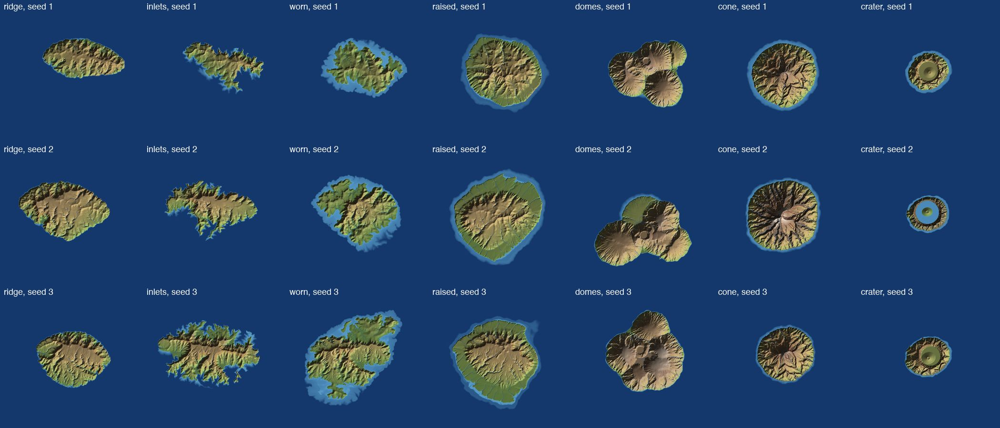

Medians over the seeds tried (three to six a kind; twelve for ridge and raised, measured after their last rise was enlarged), beside the real ranges:

| Figure | Real high islands | ridge | cone | crater | domes | inlets | worn | raised |
|---|---|---|---|---|---|---|---|---|
| Height within 100 m of the shore, m | 60 to 117 | 60 | 95 | 98 | 78 | 49 | 22 | 18 |
| Shore rising 30 m within 50 m, % | 40 to 85 | 64 | 99 | 95 | 76 | 52 | 12 | 16 |
| Slope in the first 100 m, ° | 29 to 51 | 26 | 38 | 43 | 37 | 20 | 12 | 6 |
| Land under 50 m, % | 5 to 16 | 25 | 6 | 17 | 13 | 41 | 54 | 36 |
| Land steeper than 60°, % | 0.8 to 2.9 | 1.8 | 1.6 | 2.7 | 1.0 | 1.6 | 0.3 | 1.0 |
| Fall at a ridge crest, m | 0.56 to 1.25 | 0.60 | 1.89 | 2.3 | 1.25 | 0.62 | 0.56 | 0.54 |
| Height above the nearest stream, m | 54 to 130 | 57 | 102 | 74 | 137 | 51 | 29 | 36 |
| Livable ground, % of land | 15 to 46 (Kikaijima 91) | 48 | 0 | 24 | 28 | 49 | 62 | 65 |
| Sheltered landings | 0 on the cones, 7 to 14, 80 on Tsushima | 5 | 0 | 0 | 1.5 | 9 | 9 | 0.5 |

Before the step the four kinds stood at 6 to 17 m, 0 to 2%, 4 to 10° and 30 to 55% on the first four rows, and nothing was steeper than 60°. Forming takes 0.25 to 0.9 s on every kind. `src/` grew by 517 lines.

What is still short:

- **Landings.** As first built, the ridge and the raised island, which is now the default, had none. Their outlines enclose no water, and a more ragged outline was cut back smooth by the sea. Only drowning gave landings, so on 2026-11-12 the last rise of the sea was enlarged in both rows, and the ridge island was made longer: its rise is 40 to 60 m (from 5 to 10) and its outline about a tenth larger and a third longer than it is wide; the raised island's rise is 10 to 20 m (from 3 to 6). Twelve ridge seeds now have 2 to 12 landings, median 5, which is 1.8 for every 10 km of shore, where the three real high islands with natural landings have 7 to 14 and 1.3 to 1.9. The cost is at the coast: the height within 100 m of the shore fell from 79 to 60 m and the cliffed share of shore from 81 to 64%, both at the edge of the real range, the slope in the first 100 m fell from 32 to 26°, under it, and the land under 50 m rose from 13 to 25%, over it. Six of twelve raised seeds have a landing, the default among them with one, and that is as it should be: Kikaijima's twelve are harbours built behind breakwaters (section 11).
- **Volcanic crests are too sharp** (1.2 to 2.3 m against 0.19 to 0.69 on their references), and the cone has no livable ground at all where Mikurajima has 15%.
- **Craters and domes look drawn.** A crater floor is a smooth round bowl and the domes are round lobes. That is the fault `lessons.md` warns of, a shape that reads as a diagram, and it is the owner's to judge.
- **The 8 km region.** The inlets island keeps 7.6 km² of land and has 26 to 38% of its outline as sea, against 52 to 60%. On a 16 km region it formed in 4.1 to 4.9 s with 36 to 53 km² and 28 to 41 landings. Not shipped.
- **Not done:** a real island loaded into the new build to test the dressing.

### Step 4, as built

Built 2026-11-12: six fields on the 16 m cells of the land, filled once after forming by `land_local` in `land.odin` (27 ms on the default island, 12 to 20 ms on the others), each painted by `--overlay=`. Nothing reads them yet; step 5 will.

- **Facing** (`facing`): the bearing the ground falls toward, degrees from north. Read it at a cell, not interpolated, since it wraps at north.
- **Hollow or humped** (`hump`, overlay `humped`): metres the ground stands over the mean ground in a square 208 m across. A 3 × 3 neighbourhood, as `foundations/vegetation.md` proposed, shows only gullies at 16 m; 400 m turns whole valley sides into hollows. On the default island it averages −11 m on stream channels and +3 m on ground nothing drains into.
- **Distance to sea** (`inland`): metres to the middle of the nearest sea cell, exact on every cell tested against a brute-force search.
- **Sunlight** (`sun`): clear-sky sunlight through a year at the region's latitude, against the same ground lying flat; 0.15 to 1.11. On slopes of 27 to 35° it runs from 0.63 facing north to 1.10 facing south, the same east as west. Horizon shading is left out, as designed.
- **Exposure** (`exposed`): 0 to 1, from the steepest rise of the ground toward the wind within 300 m (Winstral's index), the hump, and salt off the first sea toward the wind, by how open that sea is, fading over a kilometre. Windward shores average 0.79 to 0.91 on the three islands tried, lee shores 0.09 to 0.41.
- **Cold pool** (`above`, overlay `cold`): metres over the stream a cell drains to, or over the sea where it drains straight there (height above the nearest drainage, HAND). The printed figure "height above the nearest stream" now reads it.

What the designs had wrong or left open:

- **The sun already has a latitude.** `climate.md` reads today's sun as fixed at 60° at noon and recommends 40° N. That sun is exactly the equinox sun at 30° N, so the region record now holds a latitude of 30 and `sun_dir` reads it, which leaves the sky as it was. Moving to 40° N is step 10's to decide, and changes sky and sunlight together.
- **There was no wind.** The wind shares the swell's bearing, drawn from the seed.
- **Cold air over the sea.** Measured from the sea, low coastal ground counts as a cold hollow: the raised island's terraces paint blue. Real coasts are mild, because cold air drains out over warmer water, so step 5 should read the cold pool together with distance to the sea.
- **Salt from `exposure`.** The shore openness the waves use is about 0.3 to 0.5 even on an open coast, so salt read from it hardly showed. Salt uses the share of open sea in the kilometre beyond the shore instead.
- **Temperature**, listed with these fields in `climate.md`'s growth path, is not built: it needs a base climate, which comes with step 10.

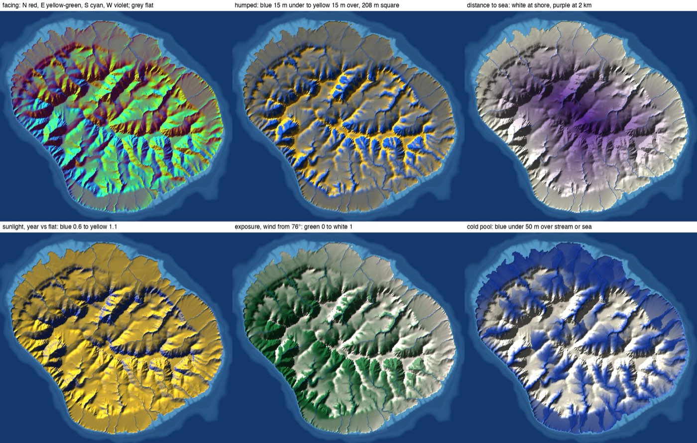

### Step 5, first half, as built

Built 2026-11-12: the rules that exist written as rows, with nothing visible changed, and `--why=`. Soil and the five plant communities are the second half.

- **Fields** (`FIELDS`, `fields.odin`): one table of nineteen, each a name, a unit, what it comes from, how to read it at a point and how the map paints it. It replaced the overlay table, so `--overlay=` paints any field; the twelve old overlays keep their names, and three of their maps (uplift, humped, cold) differ in 1 to 4 colour values of 3 million, by one level, from rounding. Thirteen fields are read from the land's 16 m grid, six from the ground the generator makes at the point.
- **Windows and hosts** (`kinds-and-places.md` D2): a window is a field, a range (over `lo`, up to `hi`) and an edge to fade over; a host's windows multiply; a row holds only names and literals.
- **The surface is five ordered rows** (`SURFACES`, `gen.odin`): river gravel, sand, loose rock, bare rock, grass. The first whose host holds wins. The generator's output is identical bit for bit: a hash over surface, height and forest density at every metre of three 512 m squares (a river bank, the steepest cell, a coast), over the whole region at 2, 8 and 64 m cells, over the trees in the squares and over `gen_columns` for 448 chunks matched before and after on the default island, the cone on seed 2 and the inlets on seed 2.
- **The two thresholds that mixed a field with patchy noise became fields**: `beach`, metres under the line the waves throw sand to (1.8 m, give or take 1.2 in patches), and `too-steep`, how much steeper the ground is than soil holds (a rise over run of 1, give or take 0.15). Each old comparison is now the sign of a field, which floating point keeps exactly. River gravel and fallen rock are fields too (`gravel`, `fallen`, the depth of rock fallen from a face).
- **The forest stayed code.** `forest_at` is a sum, 0.12 + 1.3 × wetness + 0.4 × patches, less a fall with height from 170 to 320 m, which windows that multiply cannot express. Its terms are exposed for `--why`, and it is painted as the `woods` field.
- **`--why=x,z`** forms the island and prints four to six lines: the ground; the winning row, its reason and the windows nearest their edges; what the ground would be were that row not to hold; the nearest miss among the rows that do not hold and the window that rules it out; how wooded it is, term by term.
- **Cost.** `gen_columns` over the same 448 chunks at seven cell sizes took 162.6 ms before and 166.9 ms after (medians of five interleaved runs), 2.6% or about 8 ns a column. Forming time and the three benches did not move.

What the design had wrong or left open:

- **The race (D4) cannot carry the surface.** The old `switch` is an ordered choice with hard thresholds, and rows of a race that all score 1 would be decided by their noise keys. An ordered catalogue is right where one cause overrides another (a river's gravel before sand, fallen rock before bare rock); the race is for rows that compete for ground, the plant communities. None of the race is built.
- **Open and closed ends.** A window holds over `lo` and up to `hi`, and each derived field is signed so that the old `<` or `>` falls on the right side.
- **No `Site` and no interleaved grid** (D3). A window reads its field through the table at each test, which costs about 8 ns a column with five rows. When a community catalogue reads six grid fields at every column, gathering them once per point will be worth it.
- **What the plant communities will add**: soil depth and kind as fields; a catalogue whose rows carry a weight, a patch size and up to three hosts taken at their best; the race, with each row's key drawn from noise seeded by its name; and a `--why` that names the runner-up of the race in place of "would be otherwise". Window edges are built and so far unused.

### Step 5, second half, as built

*Changed the same day, after the owner looked: the species, communities and soils below were replaced by those of the warm islands the land is measured against, the forest was closed over and given bushes, and block faces now come from an atlas of drawn tiles. What is described below is the first cast; `interesting-world/notes/real-vegetation.md` has the comparison with real islands and the table of what changed, and `open-decisions.md` the decisions. The tiles are shown in `interesting-world/real/blocks-sheet.jpg`.*

Built 2026-11-12: soil, five plant communities that compete for ground, and four species. The owner has not yet looked at it.

- **The race** (`kinds-and-places.md` D4, `race` in `fields.odin`) runs once after forming on every 16 m land cell. Each community scores its weight times its best host, draws a number u from two octaves of smooth noise at its own patch size, keyed by its name, and keeps u to the power one over its score; the highest wins. The winner is stored as one byte a cell. At a point the map is read up to about 24 m off by noise, so edges wander over 10 to 50 m and never follow the grid. No majority filter: the maps showed neither confetti nor edges along contour lines that needed one. The runner-up and margin are not stored; `--why` reruns the race on the cell.
- **The five communities** (`COMMUNITIES`, `gen.odin`), each a row with a weight, a patch size, hosts, a tree density (the share of 6 m squares with a tree), species shares and a ground cover:
  - *Valley floor wood* (weight 4, patches 150 m): within 3 m of the stream the ground drains to, fading over 3 more, on slopes under 0.2. Katsura 75% and beech 25% in half the squares, over grass.
  - *Slope forest* (weight 1, 400 m): no host, so it takes whatever nothing else wins. Beech 85%, pine 10%, katsura 5% in 70% of the squares, over litter.
  - *Ridge pine* (weight 3, 250 m): ground humped over 4 m with wetness under 0.25, or soil under 0.5 m. Pine 80%, scrub 20% in 45%, over fallen needles.
  - *Scrub and heath* (weight 4, 200 m): exposure over 0.8. Scrub 85%, pine 15% in 30%, over heather.
  - *Coast strand* (weight 5, 150 m): within 150 m of the sea and under 12 m over the shore or stream it drains to. Pine 60%, scrub 40% in 20%, over dune grass.
- **Species** (`SPECIES`): katsura, a broad flattened dome 11 to 14 m high, light yellow-green on a brown trunk; beech, a round dome 9 to 13 m, mid green on a grey trunk; pine, a flat plate 9 to 13 m up on a bare red bole, dark blue-green; scrub, a low olive bush 2 to 4 m from the ground up. Heights stay near the old 8 to 14 m until the tree grower. One function, `envelope`, gives a crown's underside and top at a distance from its trunk; the near blocks, the crowns hung at 270 m to 1.1 km and the canopy beyond all read it, and a far canopy cell takes the leaf and height of a species its community would grow.
- **Soil depth** is a field (`soil-depth`, `land_local`): one minus the hump over 12 m, held between 0.3 and 2.5, plus 1.5 times the wetness; thinned by 0.7 times the square of the slope over what soil holds; 1.3 minus 0.6 times the rock's strength, so weak rock weathers deeper; and 2 m more within a few metres of a stream, fading out by 4 m above it; at most 4 m. **Soil kind** is an ordered catalogue (`SOILS`): river silt over gravel up to 2.5 m above the stream on slopes under 0.15; shore sand within 120 m of the sea and under 10 m up; stony wash on slopes over 0.65, loam over brown earth with a third of its blocks stones broken from the bed beneath; podzol, a bleached band over rust, on dry humps (over 3 m, wetness under 0.3); brown earth, loam over brown, elsewhere. Under the cover lies one block of soil for each metre or part of one, then the rock. Bare rock is still the surface row `too-steep`, so forest holds to about 45° and steep thin soil goes to ridge pine.
- **`--why`** names the community and the window nearest its edge, the runner-up and the window that held it back (or that it held as well and lost the draw), the trees, and the soil with its depth and blocks. The overlays `plants`, `soil`, `soil-depth` and `woods` paint them, and start-up prints the shares.

Shares of the land, from start-up (seed 7 is the default; the others on seed 3):

| | raised | ridge | inlets | worn | domes | cone | crater |
|---|---|---|---|---|---|---|---|
| Valley floor wood, % | 8 | 2 | 3 | 8 | 3 | 0 | 10 |
| Slope forest | 53 | 52 | 44 | 41 | 43 | 48 | 43 |
| Ridge pine | 17 | 29 | 27 | 22 | 36 | 37 | 29 |
| Scrub and heath | 14 | 11 | 14 | 17 | 16 | 13 | 16 |
| Coast strand | 8 | 6 | 12 | 13 | 2 | 1 | 2 |
| River silt | 6 | 1 | 4 | 7 | 3 | 0 | 12 |
| Shore sand | 6 | 4 | 8 | 11 | 2 | 0 | 1 |
| Stony wash | 11 | 28 | 29 | 15 | 55 | 64 | 65 |
| Podzol | 21 | 29 | 25 | 26 | 19 | 17 | 7 |
| Brown earth | 56 | 38 | 33 | 41 | 21 | 18 | 16 |

**Cost.** The race and the soil count take 15 to 17 ms after forming on the default island and 4 to 13 ms on the others. `gen_columns` over 448 chunks at seven cell sizes took 157 to 158 ms before and 159 to 161 ms after, about 1 to 2%. The three benches' own work did not move. `src/` grew by 216 lines (312 added, 96 removed). The start moved, since the old bank on the east side now has a tree within 6 m: it is now a river bank on the south coast terrace near 170, 2,300, in the valley floor wood, and the ground bench covers 59 m.

What the designs had wrong or left open:

- **The six local fields carried five communities unchanged.** With heath over an exposure of 0.8, it takes 11 to 17% of the land on every kind, not the windward half the exposure map suggests. The cold pool's fault at the coast did no harm: no row reads it as frost, and the valley floor and coast read it for what it measures, height over the stream or shore.
- **A weight is a chance, not a rank.** Ridge pine with its host fully held still loses about one cell in four to slope forest, in patches, which mixes crests as real ones are. It first put beech on no soil at all, until soil on humps was held to at least 0.3 m.
- **Reading grid fields smoothly made the race cost 48 ms.** A field asked at the grid's own cell size now reads the cell's value, which is what the smooth curve gives at a cell's middle, and the race costs 16 ms.
- **No soil row reads the rock's chemistry.** Podzol on a basalt cone's crests is wrong; real volcanic islands have dark ash soils. It needs a field for whether the rock is acid, which the rock rows do not yet hold.
- **Still short:** the orchard look (one tree per 6 m square at most, all one age) is step 7's; from 2 to 4 km pine and heath ground shows rust and mauve through an open canopy, so pine slopes read brown more than dark green; a bush is a box of leaves; dug walls are lit as if they were the ground above, which washes out the soil layers seen from above the hole (from inside, they read).

### Step 6, as built

Built 2026-11-12: one landslide an island, the lake its debris dams and the ponds among its hummocks, and the first features with an identity, a cause and an age. The owner has not yet looked at it.

*Changed the same day, after the owner asked for its weak points to be fixed. What follows describes the first build; the changes, and what the pictures now show, are these.*

- **A breached lake drains.** A lake or pond column starts full and is then neither topped up nor dried; the stream running in keeps it at its spill. A notch 9 m wide dug through the default dam drew the level down 1 cm in four minutes: it drains, at the gentle rate the near water moves at.
- **Hollows that share a shore are one water.** Hollows within two cells of each other are one lake at the lowest of their spills, where two used to stand a metre apart at a neck.
- **A wider slide that runs out further.** The scar is 300 to 800 m long and 0.9 to 1.5 times as wide (it was 200 to 600 m and narrower than long), and the debris surface falls 0.05 to 0.1 a metre (was 0.08 to 0.14). Of 20 slides, 17 now dam a lake where 13 did; the default island's is 7.2 ha and 23 m deep.
- **Blocks of the cap lie on the debris**, 2 to 5 m across and up to as high, in about one in six of its 7 m squares where it lies thick. The hummocks themselves cannot be smaller than the 16 m cells hold, so the blocks are what breaks the ground at a walker's scale; they are whole rock, where the debris round them is its rubble.
- **Younger slides, and each kind draws its own.** Ages are 30 to 1,000 years (were 50 to 3,000), and the island's kind is in the key, so one seed no longer gives every kind the same age.
- **A young wood follows the alder**, to about 400 years and fading by 900: tabu with small evergreens and the last alders, lower and darker than the shii forest round it. On Miyakejima's lava flows of known age the tabu wood stands at about 125 years and the shii forest at 800 and more (from memory). The default island's 460-year-old slide now shows as a patch of it.
- **A young lake has the trunks of the trees it drowned**, for a hundred years, half of them fallen (a guess, after Taishō pond in Kamikōchi, dammed in 1915).
- **Deep fresh water is dark.** A lake hides its bed where it is deep and shows it in the shallows, and its far surface is drawn the same; before, the far lake was pale over a bed drawn flat a metre down, and a straight line crossed the lake where the simulated water ended. That line was the white streak.
- **The start skips a bank a lake has drowned.**

Still short: 0 to 9 ponds an island, where Jūniko has 33 on a far larger slide; three slides dam nothing and six lakes are under 0.3 ha; the outlet's fall over the dam is drawn as flat white sheets until falls have their own mesh (step 11); a lake's bed seen through clear shallows shows the risers of its steps as dark wedges; sediment does not yet fill a lake with age.

- **The host** is a row of windows, `SLIDE` in `events.odin`: a slope at 0.9 or more of the steepest its rock holds (`at-limit`), a bed at least 0.3 stronger in strength over a weaker one within 50 m of the surface (`cap`), a valley below whose stream drains 0.5 to 5 km² (`valley`), and 60 m or more of relief above that stream (`cold`), each fading over a margin and multiplied. Every land cell is scored, and the best wins, with a draw from the seed of up to 0.02 to break ties. The winning cell is the scar's head.
- **The scar** runs from the head toward the valley's stream, 200 to 600 m. It is a spoon as deep as the cap and the bed under it (12 to 50 m), steep at its head and sides, thinning to its foot. Only ground nearly as steep as the head gives way, and nothing goes below the valley floor. **The debris** comes to rest under a surface falling 8 to 14 cm a metre from the scar's foot: it fills the valley, rides up its far side and spreads up and down it, holding what slid, swollen by 15 to 30%. Hummocks are twice as wide as the slab was thick and up to that high, and are scattered beyond the front too, which breaks it into lobes. What was laid and taken is the field `slid`.
- **Where in the forming.** After the history ends, the slide is applied and the land then wears for the slide's age in three steps of routing, erosion and creep. The one change to the forming is in `erode`: during those steps a cell under standing water is left as it is, so the lake survives (landforms D1, for these steps only). Inside the history the erosion raises every hollow to its spill in one step. Keeping hollows for the whole history would change every island and leave the noise's pits as lakes without a cause. On the default island the wear stood the scar's head back by 28 to 65 m to what the sandstone holds, and cut the outlet into the debris. The age is drawn from 50 to 3,000 years, evenly in its logarithm.
- **Lakes and ponds.** Each hollow the slide made holds water at a block's top just under its lowest spill (water.md D2, one level, not the filled surface). Water a stream runs into is a lake, which leaves over its spill: the stream cut the spill during the wear, and a reach starts again at the outlet with its water held below the lake's. A hollow with no stream is a pond, which seeps away through the debris with no outlet. Hollows the slide did not make hold no water, nor does a fallen crater's floor. The rivers end where they reach a lake.
- **Near the player** a lake's water stands over its own 16 m cells and the cells beside them, wherever the 1 m ground is below its level. Beyond those cells, ground that would let it out is raised into a bank a block above the water, falling away at about 35°. **Far away** the same cells carry a quad at the level, added to the rivers' strip, with the bed on coarse cells drawn flat a metre under it. The far lake shows at the same level and outline from 450 m, 1 km and 3 km, and no sheet lies over the shore.
- **Features** (`region.features`): the slide, each lake and each pond is a record with a kind, middle, reach, size (m³ moved or m² of water), level, age, the feature that caused it, and up to three measures taken when it was made. For the slide those are its steepness against what its rock holds, the strength of the cap over the bed under it, and the valley's drainage; for a lake or pond, its deepest point and the land draining into it. `--why=` names the feature a point lies in and prints them. Start-up prints the slide, or that the island has no host.
- **Plants read the age** through the field `disturbed`: susuki grass alone under about 30 years, alder scrub to about 150, the forest back by about 300 (two community rows, one new species reusing existing blocks). Soil weathers back on the scar at 0.4 m a thousand years (a guess), and the scar is bare until it has 0.15 m. Debris starts with 0.3 m.

The ranking on seven kinds and three seeds (volume in million m³, the largest lake's area, level and depth, ponds):

| | seed 1 | seed 2 | seed 3 |
|---|---|---|---|
| ridge | 0.0; none; 0 | 0.2; 0.8 ha at 14.6 m, 5 m; 2 | 0.3; 2.3 ha at 20.5 m, 17 m; 1 |
| inlets | 0.1; 0.5 ha at 14.6 m, 6 m; 0 | 0.1; 0.9 ha at 38.5 m, 4 m; 1 | 0.3; 0.7 ha at 35.5 m, 10 m; 0 |
| cone | 0.5; 0.1 ha at 42.5 m, 2 m; 4 | 0.1; none; 0 | 0.5; 0.4 ha at 53.5 m, 9 m; 0 |
| crater | 0.2; none; 0 | no host | 0.7; none; 10 |
| domes | 0.3; 0.6 ha at 37.5 m, 12 m; 1 | 1.3; 1.3 ha at 14.6 m, 11 m; 2 | 0.2; 0.1 ha at 32.5 m, 3 m; 1 |
| worn | 0.2; 0.1 ha at 10.6 m, 3 m; 1 | 0.2; none; 4 | 0.1; 0.5 ha at 3.5 m, 2 m; 2 |
| raised | 0.2; 1.8 ha at 44.5 m, 11 m; 1 | 0.1; none; 0 | 0.2; none; 1 |

Twenty of 21 islands have a host and 13 of the slides dam a lake. The default island (raised, seed 7) has a 980-year-old slide of 0.7 million m³ off its old sea cliff. It dammed a lake of 2.6 ha at 38.5 m, 16 m deep, with a second lake of 1.9 ha up the valley and a small one below the dam, and left one pond. Its deepest closed hollow is now 17 m, over the real 2 to 10.

**Cost.** The slide, with its wear, takes 15 to 65 ms, and the land's local fields are worked out a second time afterward. Forming went from 0.90 to 1.01 s on the default island and rose 0.03 to 0.09 s on the others. The benches' own work did not move: the most for any frame was 3.7 ms on the ground bench, 3.2 on the forest flight, 4.6 on the steep flight, 5.9 over the crater, and 5.0 and 5.6 across the slides and lakes of the default island and ridge seed 3. `src/` grew by 348 lines (287 in the new `events.odin`).

**In play.** After 45 s on the default island the lake stood level at 38.55 m in every one of 23,000 columns. The debris dam was dry, and its only outflow ran down the outlet channel to the river. 809 columns were wet beside that channel at the dam's foot, where its stream overtops the banks. A notch dug 8.5 m deep through the dam drew a falling surface from 38.55 to 30.2 m along 60 m of trench within 45 s. The lake stayed at its level, since a lake column is topped up to its level as a river's is (`adr/0004`), so the lake never empties.

What the designs had wrong or left open:

- **Where the slide happens.** Landforms D4 puts events inside the forming; water.md puts the lake's events after it. Inside, the erosion fills the lake at once. After it, followed by a short wear with lakes kept, gives the head scarp standing back to its rock's limit and an outlet cut by the stream, for three extra steps and no change to the rest of the forming.
- **The scar's shape took four tries.** Centred on the best host cell, the scar cut through the crest behind it, because the steepest cells sit just below crests. Reaching to the valley floor, it dug pits in the gentle lower valley side. On Culmann's plane from under the head to the valley floor, it took almost nothing, because slopes are concave and the plane lies above their lower half.
- **A lake by what it lies on was wrong**: the debris spreads up the valley under the water it dams, so that rule called most lakes ponds. Whether a stream runs in is the test, and it also settles how the water leaves.
- **water.md's footprint grown by one cell with a crest at its edge** made straight shelves along the grid wherever a deep hollow put the true shore in the outer cell. Two rings are needed, the outer one a bank that slopes away rather than a flat crest.
- **"5 to 30 ponds among the hummocks"**: the 16 m grid holds 0 to 4 on most islands, and 10 on one. A pond smaller than about a cell cannot come from the grid, and none was faked.

What is still short:

- **The slides are small and the lakes few.** Volumes run 0.0 to 1.3 million m³, and lakes 0.1 to 2.6 ha. Seven of 20 slides dam nothing, because their debris spreads down a valley rather than across it.
- **An old slide hides.** At 980 years the default island's debris is forest and its scar is wooded below the bare head. From the dam the view is a lake in a wooded valley, and only the map and `--why` say why it is there. On a young slide (ridge, seed 3) the bare scar at the far end of the lake reads from the dam.
- **Hummocks hardly show on foot**: at their 50 m and more they are gentle swells under susuki or forest. Jūniko's are tens of metres across and steeper.
- **The lake cannot empty**, as a river cannot, so a breach pours for ever; and where two lakes touch, one stands a metre over the other at their neck.
- **Not done:** sediment filling the lake with age, drowned trunks, a seeping lake with a stream, a dam that breaches, the lake's own colour (it takes the river's look), and debris faces far away, which show the beds as if in place. One fault was seen and not traced: a thin white streak across the default island's lower lake from the air, perhaps the short stream from the upper lake falling into it.

### Step 7, as built

Built 2026-11-12: stands with ages, spacing and size by age, crowding, gaps, fallen and standing dead trunks, root mounds. The owner has not yet looked at it.

*Changed the same day by Claude on review, because the old wood stood cluttered under a ceiling at head height, which is the opposite of an old laurel forest:*

- **Canopy trees have their real heights**: shii 13 to 19 m, tabu 14 to 20, black pine 10 to 15 (they were 10 to 15 and less). Real shii and tabu stand 13 to 20 m and more (`interesting-world/notes/real-vegetation.md`). The crowns are no wider, so the trunks are longer and the old wood is a hall of boles with its leaves far overhead. Step 8 keeps the forms and the grower; the heights are no longer waiting for it.
- **A tree's leaves begin at least 3 m up**, as its lower branches die in the shade, whatever its form; and a sapling under the canopy is 4 to 6 m with its leaves over a walker's head, where it was a box of leaves at eye level. Bushes are 1 to 2 m, low enough to see over.
- **Beyond about half a kilometre only the canopy trees are drawn singly**; the smaller trees between them are narrower than a cell there. That took back a third of the faces the step added.
- **The second and third shadow cascades take turns, a frame each.** Between them they draw every tree within a kilometre, and with a 3 m grid of trees they had pushed the forest flight's frame from 9.3 to 16.4 ms (median interval, run back to back with the last commit). Taking turns brought it to 8.6 ms. Shadows looked the same standing and at 200 m/s.

- **A stand's age is a field** (`stand-age`, `land.age`, filled by `stand_draw` in `plants_init`). The land's grid is cut into stands round middles about 140 m apart, each reaching as far as its own draw says, with edges moved up to 30 m by noise. Each stand draws the years since a typhoon last threw its canopy, as a waiting time whose mean runs from 2,000 years where the exposure at its middle is 0 to 40 years where it is 1. Ground a slide laid bare takes the slide's age. The row is `STANDS` in `gen.odin`. Half the land lies in stands larger than 2.7 ha and the largest is 6.4 ha, with slivers of a cell or two along wandering edges.
- **Trees** (`trees_in`): a candidate on a 3 m grid, jittered, with a vigour drawn from the seed. It reads its stand and community from its own land cell, read up to 12 m off by its hash, so stands and communities mix along their edges. The canopy spacing runs from 2.5 m when new to 6.5 m when old, thinning over about 150 years. A candidate with no more vigorous candidate within 0.56 of the spacing is a canopy tree, so canopy trees stand about the spacing apart (after Deussen and others, 1998). One shaded only from beyond half that reach stands between them, one time in two, two-thirds as tall with a crown of 1 to 2 m. The rest are under the canopy, a sapling of the community's species or a bush as often as the community's `bushes`, or nothing. Height grows from 35% of full when new to nearly full by 100 years; crowns widen with the spacing up to the species' radius. Canopy trees of 14 m and more stand on trunks two blocks across. The community's `density` now means the share of places in the canopy a tree takes.
- **Gaps** (`gap_at`): one may open in each 24 m square, the likelier the older the stand (as the square of how old it is), so that gaps take 15% of an old stand and none of a young one. A gap is 3 to 8 m in radius and up to 50 years old. Its canopy trees fell the way the storm blew, the swell's bearing give or take 35°: three in four lie fallen and one stands dead, and all the other candidates in it are young growth, 2 m tall and a metre more for every six years. Outside gaps, 4% of an old stand's canopy trees stand dead.
- **A fallen trunk** is one high, as long as the tree was tall (6 to 13 blocks), straight from the root toward the ground at its tip and resting on any rise between, drawn half a metre at a time so a trunk lying aslant is a joined line. At its root a wall of earth three blocks across and two high stands on edge, and beside that a pit a block deep.
- **At each distance.** Near by (the block volume), everything. Out to 1.1 km, canopy trees and the trees between them, as crowns hung on trunks, the same trees. Beyond, the canopy on the columns: a cell is leaf where a draw is under the community's cover at the stand's spacing, and is raised by a tree's height times how far the stand has grown; a cell in a gap is bare.
- **`--why=`** says the stand's age and what set it (the slide, or a typhoon, with how often one comes to ground as open to the wind), the spacing and how tall its trees have grown, whether the point lies in a gap and which way it fell, and the nearest tree: species, height and its place (in the canopy, between, under a taller one, standing dead or fallen). Start-up prints the share of land in young (under 50 years), middle and old (200 and more) stands.

| | default (raised, 7) | ridge 2 | inlets 2 | cone 2 | crater 2 | domes 2 | worn 2 |
|---|---|---|---|---|---|---|---|
| Young stands, % of land | 11 | 12 | 14 | 20 | 24 | 19 | 6 |
| Middle | 19 | 17 | 19 | 16 | 26 | 19 | 22 |
| Old | 70 | 70 | 67 | 64 | 50 | 62 | 72 |

Counted over 0.36 ha of laurel forest on the default island: an old stand (about 1,600 years) has about 190 canopy trees a hectare, 290 between them, 240 small trees and bushes, 20 standing dead, with 67% of the ground under a crown; a young one (22 years) has about 790 canopy trees, 110 between and 50 small, 93% under a crown, its trees 3 to 8 m tall. `interesting-world/notes/real-vegetation.md`, "Stands", compares these with the real forest.

**Cost.** `gen_columns`, with `gen_volume` at the nearest level, over the same 64 chunks round the forest flight's start at each level, on one thread: 53.7 ms before and 62.3 after at the nearest level, 37.2 to 48.0 at 2 m cells, 57.4 to 89.5 at 4 m, 34.1 to 36.6 at 8 m, and unchanged beyond. Faces drawn: 1.37 to 1.48 million from the sea 1 km off a wooded hillside, 1.84 to 2.14 million over the forest at 40 m, 1.92 to 2.22 million at eye height in it, 0.72 million at 3 km either way. Forming is unchanged (0.94 to 0.98 s); the race and stands take 42 ms, from 23. The benches' own work did not move: the most for any frame was 4.4 ms on the ground bench, 3.1 on the forest flight, 4.1 on the steep flight and 5.9 over the crater, against 3.7, 3.0, 3.9 and 5.4 for the last commit run in the same minutes. `src/` grew by 169 lines (220 added, 51 removed).

**The start** did not move (the east coast near 2,640, -254, a stream through open grass). It now needs no canopy tree within 6 m and no small tree within 2 m, falling back to 3 m where every bank is wooded closer, since a closed wood leaves no bank with 6 m clear: the worn island on seed 2 had started at the region's middle and now starts on a bank. The ground bench from the default start covers 26 m, where it covered 55, before it runs into a bush.

What the design had wrong or left open:

- **10 to 12 m between old trees** is beech old growth. Old shii forest has some 1,100 to 1,500 stems a hectare, a tenth of them canopy trees, so 6 to 9 m; and crowns no wider than 9 blocks leave a canopy at 10 m open. 6.5 m is in use.
- **A 6 m grid cannot carry 3 m spacing**, and a finer grid of candidates is cheap only while rejecting is cheap: the thinning itself costs little, and almost all the added cost is the ground under each extra tree. Reading the community through `community_at`'s noise for each tree cost a further 7 ms in 89 at 4 m cells; trees now read it from a dithered cell.
- **Exposure as the cause** gives a mosaic with a lean, not a map of exposure: on the default island young stands are a little commoner on the windward east and on crests, most clearly on the cone's windward flank. There are no stripes along contours and no confetti, and the windy default island is not young all over.
- **Wider crowns trade the canopy for the ceiling.** With trees held under 15 m, crowns 9 blocks across closed the old canopy but brought its underside to head height. True heights in step 8 should let both stand.

Still short: the old wood at eye height is cluttered and low-ceilinged rather than the high hall of a real one, with half its real stems; the difference between young and old reads at eye height and from 30 m and only faintly from 1 km; a root plate reads as a stack of earth blocks and a trunk lying aslant as a stair of bark; the alder scrub on ridge seed 2's 46-year-old slide is now closed and hides more of the raw debris; a camellia can hold a place in the canopy beside taller shii, since vigour, not height, decides; stands younger than 50 years have no self-thinned dead poles. One fault was seen and not traced, and is older than this step: from some cameras a straight seam runs down the middle of the picture, through crowns, which the last commit shows too.

### Step 14, as built

Built 2026-11-12: sea notches, rock shelters and sea caves, the first places in the game with a roof over them. The owner has not yet looked at it.

- **Each is a feature with a host**, chosen as the slide is: the land cells are ranked by a row of `HOLLOWS` in `events.odin`, the best taken up to a number the seed draws, at least 300 to 400 m from any other. A notch wants a shore open to the swell (the new field `swell`, the waves' exposure as the coast cut it), within 24 m of the sea and a slope of 1.5 or more on the 16 m grid. A shelter wants a stronger bed over a weaker one where the two meet on the hillside (`contact`), at a face near the steepest its rock holds, 150 m or more from the sea. A cave wants a headland (`headland`, the share of sea within 48 m), open to the swell, with a slope of 1.5 and rock of strength 0.5 or more (`strength`). Each records what was measured, and a notch and a cave the years the sea has stood at its level.
- **Each keeps its outline**, a square of metres around it, each holding the floor and roof of what is carved there and the top of the ground over it. It is made once, at start-up, from `ground()` at every metre in its square (16 to 40 ms for all of them). `gen_volume` empties each column from floor to roof after filling it, so the roof and walls are the beds' own blocks; a roof thinner than 2 m has fallen in and the place is open there.
- **Shapes.** A notch and a shelter are cut back from where the open air reaches their floor, measured over the outline by two sweeps, so they follow the foot of the face as it actually stands in blocks. A notch's floor is a metre under the sea and its roof 2.5 to 4 m over that at the mouth, falling to meet the floor at the back as a quarter ellipse; it is 2.5 to 5 m deep, tapering to nothing at its ends, its back moved by noise on 5 m. A shelter's roof is the underside of the strong bed at every metre, wherever the tilted, folded bed lies; its floor rises to meet the roof at the back, 4 to 16 m in. A cave is a slot along the crack set that runs most nearly into the land (`rock_strike` or across it), from where its line first meets water 2 m deep: 18 to 40 m long, 4 to 7 m across and 8 to 14 m high at the mouth, an ellipse in section, narrowing and lowering to its end, wandering 1.5 m on 12 m and ragged on 3 to 4 m.
- **Light under a roof** (`sky_seen`, `mesh.odin`). A face whose block of air has rock above it in its column casts thirteen rays, eight 8° over the horizon, four at 50° and one straight up, each weighted by how nearly it runs the way the face looks; a ray that rises above the highest rock of a column before it meets rock has seen out. The face is lit by the square root of that share, because a cave's back is lit by its walls as well as by the sky, and by no less than 2 of 15, so the deepest faces are dim rather than black. It goes in the four spare bits of the quad, as 15 less the light, so every other face is unchanged, and such a face is lit by its own direction rather than the slope's. The sun needs nothing new: the shadow maps already hold the roof, so the evening sun reaches into a west-facing cave and lights its back. Rays that leave the chunk read the outline instead.
- **Water under a roof.** Where the sea's level, the block from −1 to 0, is air under rock, the water stands on the floor beneath it, not on the roof (`column_floor`); a column the outline carves below the sea is sea, so the sea fills a cave and a notch at once and holds there. Water under a roof is drawn dark rather than mirroring the sky, by the share of the four columns at each corner that are roofed, carried in whole twos over the falling water's value. After 45 s the sea stands 1.85 m deep on the cave's −2 floor all the way in, supplied, 19 m from the mouth to the end; with a shaft dug through the roof (`--dig=-1627,3,-106,-1623,60,-102` on the cone, seed 3) the numbers are the same.
- **From afar** (`mesh_columns`). A far column with any roofed metre in its cell, at cells of 2 to 8 m, darkens the part of its risers between the lowest floor and highest roof there, at 4 of 15 of the light and of the sun; nothing is drawn where no near roof is. From 300 m a shelter's mouth is a dark band under its face and a notch a dark line at the cliff's foot; from 1 km a shelter is a faint darker smudge. Beyond 8 m cells nothing is drawn. The near ring's edge is not closed by an unlit face, as `ground-and-underground.md` asks: a cave is 40 m long at most, so a player inside it is never near the ring's edge.
- **`--why=`** names the place and its cause, with the floor, the roof and the bed it is the underside of; **the map** rings each, orange for a notch, white for a shelter, red for a cave; **start-up** prints how many and where.

| | default (raised, 7) | ridge 3 | inlets 3 | cone 3 | crater 3 | domes 3 | worn 3 | raised 3 |
|---|---|---|---|---|---|---|---|---|
| Shore open enough to notch (swell ≥ 0.2, 6 m high, slope over 0.5), km | 2.8 of 27 | 4.7 of 28 | 8.9 of 49 | 6.4 of 14 | 5.2 of 11 | 5.4 of 20 | 2.4 of 45 | 2.9 of 24 |
| Steep cells with a strong bed on a weak one at a face | 1,229 | 1,239 | 1,650 | 1,267 | 774 | 1,796 | 943 | 830 |
| Headland cells (swell ≥ 0.2, 8 m high, sea over 55% within 48 m) | 26 | 24 | 98 | 35 | 29 | 2 | 10 | 10 |
| Notches, shelters, caves made | 0, 4, 0 | 3, 2, 2 | 3, 2, 2 | 3, 2, 2 | 3, 2, 2 | 3, 2, 2 | 3, 2, 0 | 3, 2, 1 |

The hosts were counted before anything was built, on 16 m cells with a temporary count. Shelter hosts are common on every kind. Shore that could notch is scarce on the default island, and what there is does not hold: its best is an 18 m mudstone slope at 45° with sand at its foot, where a notch carves only a bench. So the default island has no notch and no cave. The cones, the ridge and the domes have sheer basalt, grit or rhyolite cliffs straight out of the sea. The worn island's headlands are too low and weak for a cave.

**Unchanged elsewhere.** A temporary hash of the columns (top, material, water, rock base, slope), the block volume and the mesh of four chunks away from any feature (the region's middle, the forest flight's start, the default start, and -1,280, -1,280), on the parent commit and on this one: columns and blocks are the same in all four. The mesh is the same in two. In the other two it differs in 5 and 10 faces, all under the root plate of a fallen tree, the only rock-free overhang the generator made before: the light rule now dims them as it does any roof.

**Cost.** Benches against the parent commit, alternately, twice each (our work: median, and worst; no frame over 12.5 ms in either): the start 1.53/1.04 ms against 1.48/1.01, worst 9.4; the forest flight 2.07/1.74 against 1.60/1.30, then with this commit run first 1.12/1.20 against 1.30/1.41, worst 15.3 against 15.8 in the first round, a frame in each over 12.5 then and none since; the steep flight 1.06/1.13 against 1.10/1.09; along the cone's notched and caved west shore (`--kind=cone --seed=3 --bench=15 --fly --speed=120 --pos=-1665,15,300 --look=0,0`) 1.22/1.19 against 1.23/1.19, worst 16.1 against 18.4 in the first round. Four other agents were benching on the same machine, and frame intervals swung for both builds alike. `--bench=5` on seed 3 of every kind runs, worst 9.8 ms. `src/` grew by 291 lines (318 added, 27 removed).

What the premises had wrong:

- **That hosts exist** held for shelters, for notches on the steep kinds and for caves on most kinds, and failed on the default island, as above.
- **That carving reads as nature** held best for the shelter, whose roof is the bed's underside: from 30 m it is a long dark recess under a pale grit face, its floor the weak bed. The notch reads from inside as an undercut cliff foot, and from 20 m as a dark band at the waterline, because a 1 m deep first try showed only a hairline. The cave reads from inside as a slot along a crack; from outside it is still a tall, regular doorway in the cliff, the least natural of the three.
- **That the light can be told from four bits** held: the back of a cave grades from bright at the mouth to dim, with steps a block wide. Taken straight, the share of sky left everything past the first metre black, and the ceiling faces in upward pockets black too. Lowering the low rays from 20° to 8°, the square root and the floor of 2 of 15 fixed that.
- **That the water copes with a roof** did not hold until two changes: water stood on the roof, and under a roof it mirrored the open sky.

Real ones. Wave-cut notches in Ryukyu limestone are 2 to 4 m deep at most sites and 2 to 9 m across Okinawa, Miyako and Kikai, with a visor of rock over them ([Kogure and Matsukura, IntechOpen](https://intechopen.com/chapters/41066); [KAKEN report 14580103](https://kaken.nii.ac.jp/report/KAKENHI-PROJECT-14580103/145801032004kenkyu_seika_hokoku_gaiyo)). A notch's height grows with its exposure to the waves; its depth grows with time and not clearly with exposure ([Geologica Acta](https://ddd.uab.cat/pub/geoact/geoact_a2015m6v13n2/geoact_a2015m6v13n2p167.pdf)), which this step does not yet follow. On the Echizen coast the notch inside a sea cave stands at the height of the notch on the reef outside it ([Fukui](https://u-fukui.repo.nii.ac.jp/record/27124/files/ito.pdf)), and on Noto both mark a sea level about 2 m up ([JpGU 2016](https://confit.atlas.jp/guide/event/jpgu2016/subject/HGM14-P02/date)). Benches stand at about 0.5 m and 2.5 to 3 m on the Ohda coast of Shimane ([Geographical Review of Japan](https://www.jstage.jst.go.jp/article/grj1925/45/4/45_4_267/_article/-char/en)). At Dogashima on Izu the sea caves are cut in Miocene andesite tuff that the waves wear easily, and Tensōdō's skylight is where its roof fell in ([Tensodo Cave](https://en.wikipedia.org/wiki/Tensodo_Cave); [Dogashima](https://en.wikipedia.org/wiki/Dogashima)). Here a cave asks for strong rock, which is the opposite. A rock shelter forms where a hard bed lies on a thin weak one that is crushed or weathers out from under it, and ends when the overhang topples ([Rock shelter](https://www.wikipedia.org/wiki/Abri); [Ozark bluff shelters](https://archeology.uark.edu/ozarkbluffshelters/basics/geology)). No source found gives shelter depths. Nothing was found for Tsushima.

Left out: arches and skylights; a closing face at the near ring's edge; light from a hole the player digs, past the sun's (the faces round a dug shaft do brighten, since the rays read the blocks); notch depth from the years the sea has stood; a beach or boulders at a cave's back, whose floor rises above the sea only at its very end.

Still short: the cave's mouth from outside is a doorway; the notch on a basalt cliff is dark on dark and hard to see from 300 m except as a line; the far band at 2 m cells is broken into separate blocks where only some cells hold a roofed metre; the sand that the beach rule stands up as pillars at a sheer cliff's foot is still there beside a cave's mouth.
### Step 12, as built

Built 2026-11-12: one cost of crossing ground, one route tracer, and the trails of sika deer meeting at fords, on the islands that have deer. The owner has not yet looked at it.

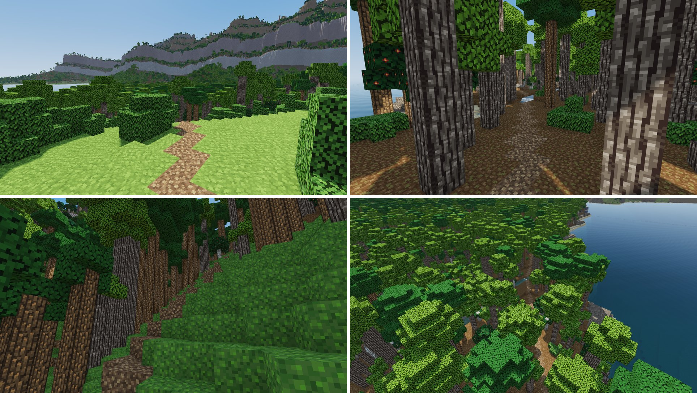

- **Which animal, and where.** Of the eight reference islands only Tsushima has a large wild animal of its own, the sika deer, at 4 to 75 a km² in its evergreen forest; the Izu and Ogasawara islands have none but what people brought (deer, muntjac, goats), and none was found for Kikaijima (`interesting-world/notes/real-animals.md`). Deer and boar reach an island that was joined to larger land while the sea stood low. So deer are a row (`DEER`, `trails.odin`) whose host is the island: the sea must have risen 100 m or more over it since it stood lowest (a new field, `risen`). Only the inlets kind, after Tsushima, has them. The default island and the ridge, cone, crater, domes, worn and raised kinds have none, and start-up says so.
- **One cost of crossing ground** (`pace`, painted as the field `crossing`, in seconds a metre): Tobler's hiking function, 0.6 s on the flat rising by e^3.5 for each unit of grade along the way; a hundred times that past 45° of slope; up to twice as slow on the wettest valley floors and 30 times in standing water; times the plants in the way (`GOING`, by community: 1.2 in laurel forest to 3 in susuki and dwarf bamboo, twice that in a stand just thrown); and a worn trail takes away the plants and is 0.7 of open ground. Wading a stream costs its width times one plus a hundred times its depth squared, and four seconds for the banks, so a lip a hand deep, just above a drop, costs a few seconds and the usual channel, a metre deep, a couple of minutes.
- **One tracer** (`trace`): least cost over the 16 m cells and their diagonals, a diagonal step paying for the steeper of the corners it cuts and never slipping between two wet ones. It stops at the first cell it wants (water, open ground, or a given bed) or after 40 minutes of a person's walking.
- **The trails.** A bed in each 500 m square, where dry, gentle, sheltered, wooded ground on a shoulder holds best. Each bed sends routes to water, to open ground to feed (woods under half the canopy) and to the bed beside it to the east or the south, as the seed says, each laid as it is found so the next is drawn to it. A stream crossed on the way is a ford, put on the lip in its cell if there is one. The network is cut into chains between junctions, ends and fords, eased (1-2-1 twice) and rounded at its corners as a river is, and filed in 64 m buckets.
- **Features.** Each route is a `.Trail` feature with its two ends, length, highest point, minutes to walk, and age: the years since the sea last moved, or the slide's age if it crosses slide ground. Each crossing is a `.Ford` with its width, depth, the land drained above it and the first trail that crossed. `--why=` says it: "at a ford, where deer cross a stream 3 m wide draining 0.7 km², 0 m off at -2407, -184: it is 0.15 m deep there and takes a person 15 s to wade. 7 deer trails meet at it; the first came from the laurel forest on a slope", and "1.0 m from the middle of a sika deer trail worn by 5 routes, about 7000 years old. The first was from the ridge wood on a spur at 123 m to the stream at 21 m, 146 m off: 401 m long, 16 minutes for a person".
- **In blocks.** A surface row, `trail`, lays bare earth within 0.75 m of the line (soil under it as under any cover) out to 2 m cells, about 512 m; and nothing grows within 2.5 m of it (one line in `trees_in`). The map draws trails red and fords white.

| inlets, seed | 1 | 2 | 3 |
|---|---|---|---|
| Beds; routes | 30; 81 | 43; 111 | 65; 154 |
| Trail, km; m a km² of land | 14.1; 2,714 | 19.7; 2,414 | 27.9; 2,367 |
| Fords (deeper than 0.6 m) | 3 | 8 | 11 (2) |

Allowed everywhere (a scratch build), the default island would carry 44.5 km, 2,320 m a km², with 33 fords, and the other kinds 1,300 to 3,700 m a km². No measured length of deer trail a km² was found; this is about twice the streams.

**Walking it.** Along every metre of the 31 km of trail lines on inlets seed 3 the ground steps two blocks or more 28 times, mostly where a trail ends at a stream's bank or crosses a boulder of slide debris. The ground bench from a junction toward the busiest ford walks 138 m, across the ford and on. It walks in a straight line, so on a winding trail it leaves the line: 90 m uphill on a 36° flank, climbing 41 m, and 35 m down from the top. Before the ford was put on the lip, the walker reached the stream and stood in it: the river's usual bed is two blocks under its banks.

**Cost.** Tracing takes 26 to 102 ms after the plants on the three inlets seeds, under load, and nothing on islands without deer; the land's forming is unchanged. `gen_columns`, with `gen_volume` at the nearest level, over 64 chunks round the busiest ford on inlets seed 3, the least of four runs alternating with the last commit: 50.1 to 55.0 ms at the nearest level, 41.3 to 41.9 at 2 m cells, 72.8 to 73.5 at 4 m, unchanged beyond; the default island's forest square is unchanged (282.4 against 282.9 ms over all levels). The benches' own work: no frame over 12.5 ms on the start, the forest flight and the steep flight in the last of two rounds against the last commit (worst 5.3, 7.4 and 9.5 ms, against 3.6, 3.4 and 8.0), nor over the inlets island's trails (worst 4.6 and 7.6 ms against 5.1 and 18.6); the first round had spikes in both builds. Every kind runs `--bench=5` without fault. The start is unchanged: 26 m. `src/` grew by 278 lines (284 added, 6 removed), from 5,034 to 5,312.

What the plan had wrong or left open:

- **Deer on every island.** The flora changed after the plan was written; on these islands deer are the exception. The default island has no trails.
- **A ford is where the cost dips.** At 16 m cells the tracer picks a cell, not the place in it, and every channel but a lip is two blocks deep: the walker stood in the stream. A ford now sits on the lip in its cell, and wading a deep channel costs enough that routes walk to one.
- **The trails as a lattice.** With routes from each bed to both its east and south neighbours the map read as a road map (3,100 m a km²); one neighbour, chosen by the seed, gives 2,300 to 2,700 m a km² and no grain.

Still short: on a diagonal a one-block trail is a staircase of blocks; under laurel forest the bare earth is only a shade off the litter, plainer in sunlight and from above; on slide rubble and bare rock the trail does not show, since what lies there wins; a fallen trunk can still lie across a trail, two blocks high where it rests on a rise; and trails at a river's mouth cross under the sea's edge. Nothing tells a walker which way a trail leads.
### Step 10, as built

Built 2026-11-12: the sun by latitude and day of the year, weather drawn from the seed through a year of real sunshine, one cloud layer with a cap on the windward heights, and the clouds' shadows on land and water. The owner has not yet looked at it.

**No snow line.** The plan's snow line was written for an island at 40° N. This one lies at 30° N, the latitude of its plants, and the default island is 347 m high. At Tanegashima (30.7° N, 25 m, the nearest low island; JMA normals 1991 to 2020) January averages 11.7 °C and its nights 8.5 °C. At 6.5 °C less a kilometre up (climate.md, "Region rung"), the top of the default island averages 9.4 °C in January and 6.2 °C at night, and a January mean of 0 °C would stand near 1,800 m. The coldest night at Yakushima since 1937 was 0.7 °C (JMA station 47836, 1991 to 2020 table), about −1.6 °C at 347 m: a few flakes at most, once in decades, and its normals list no snowfall in any month. Yakushima's snow lies on its mountains, which reach 1,936 m. The cone on seed 7, the tallest kind, tops out at 692 m and 7.2 °C in January. So nothing whitens.

**What the year changes here**, and what was built of it:

- *The sun.* `sun_dir(hour, day)` in `render.odin` takes the hour as solar time and the day of the year (0 is 1 January), with Cooper's declination at `region.latitude`. The `sunlight` field calls the same procedure, so sky and plants read one sun; the field moved by rounding only, and no plant, soil or stand share changed. `--day=` sets the day; the default, 80, is the March equinox, where the sun stood before. Start-up prints the noon sun, the daylight and the weather.

| Day | Noon sun | Daylight | Rises at |
|---|---|---|---|
| 172, the June solstice | 83° | 13.9 h | 63° (east-north-east) |
| 80, the March equinox | 60° | 12.0 h | 90° |
| 355, the December solstice | 37° | 10.1 h | 117° (east-south-east) |

- *How cloudy each month is.* The row `SKY` holds each month's mean cover as the share of its daylight without sunshine at Tanegashima: 0.66, 0.62, 0.62, 0.57, 0.62, 0.73, 0.48, 0.45, 0.54, 0.55, 0.59, 0.62 from January. June's rainy season (556 mm and 115 hours of sun) is the cloudiest month and July and August the clearest. Spells of two days each draw a cover with their month's mean (a power of a uniform draw) and a cloud base of 250 to 1,000 m, lower under heavier cover, and the weather passes smoothly from one spell to the next. `weather_at` gives both for a day and hour; the same seed, day and hour give the same sky.
- Not built: seasonal colour (Hachijō susuki is reported to keep its leaves green through winter, the atlas has no straw tile, and plumes need a plant shape); typhoons, rain and fog (events and particles for later); a seasonal tint of the light (no source; its colour already follows the sun's height). The year does not run during play.

**The clouds** are drawn, never baked (decision 14). One layer runs from the cloud base 300 m up. Over each point the cloud's top stands at a height given by four octaves of noise 1.2 km across and finer, drifting downwind from the swell's bearing at 8 m/s, and passing a level set so the noise covers the share of the sky the cover asks for (the level was fitted to the noise's measured spread). The **cap** is the other term: the field `lifted` (`land_local`, `--overlay=lifted`) is how high the sea wind has been raised by the ground it crossed in the last 400 m, falling a metre for each four it has run on since a crest. Where it passes the cloud base the cloud rises over it, so a cap stands on the windward heights and the sea round the island stays clear, and it does not drift. A ray from the camera through the layer takes 16 steps, each starting at a random point in each pixel; the light at a step is the sun dimmed by the cloud above it plus the sky, so bases are grey and tops white, and far cloud fades into the haze. The sky, every terrain face and all water march the ray where it crosses the layer, so a camera above the base sees tops over the land and sea, and hills that rise into the base vanish into it. Every terrain face and water surface reads the cloud over the point where its sunlight crosses the layer: in shadow the sun is 85% dimmer and the sky light 30%. The sea and rivers reflect the cloud above them. Under cover the sky and its light grey. `--weather=c[,b]` forces the cover and the base (1,000 m unless given, too high for a cap).

**The clock.** A running clock moved the sun every frame, and a moved sun redrew all four shadow maps every frame: with the clock at a tenth of the speed `]` turns it, all 620 frames of the forest flight were over 12.5 ms. Each map now keeps the light it was drawn with and is read with it until its turn comes round, so the clock costs nothing: run back to back, the forest flight with the clock running had a median frame interval of 10.5 ms and 252 frames over 12.5 ms in 1,180, against 10.4 ms and 215 in 1,203 with it still.

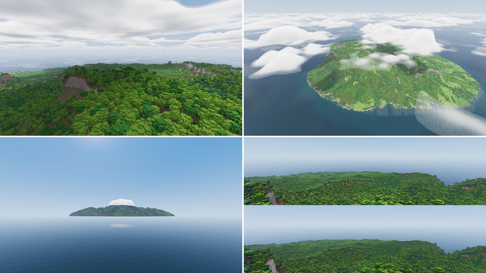

**Cost.** The machine was shared with four other agents' benches throughout, and the parent commit itself ran the forest flight at medians of 12.7 to 18.4 ms, so neither build could be shown to meet 12.5 ms on the interval. Run alternately with the parent four times each, with the drawn default weather (cover 0.77, base 347 m, so the steep flight's camera crosses the cloud layer over the upland): the forest flight's median interval was 11.6, 13.9, 14.7 and 15.2 ms against the parent's 12.7, 17.3, 15.3 and 18.4, the steep flight's 11.3, 12.7, 13.4 and 18.3 against 12.7, 17.2, 12.8 and 17.2, and the start's 11.3, 9.3, 8.6 and 12.7 against 8.4, 16.5, 9.8 and 11.0. The game's own work never went over 12.5 ms except for one frame in one steep run (and one in each of two of the parent's forest runs); its medians were 1.0 to 1.5 ms in both. No regression could be measured. Two things pay for the clouds: the sky is now drawn after the terrain, only where nothing else was, and the march runs only on rays that cross the layer. The start run still covers 26 m. Forming takes about 0.03 s longer (1.00 to 1.01 s against 0.94 to 0.97, two runs each), for the sweep that makes `lifted`. `src/` grew by 138 lines (212 added, 74 removed), from 5,411 to 5,549.

Still short, as seen: cloud edges are grainy at full size, the price of 16 steps, and the far deck at grazing angles shimmers; the clouds are smooth mounds with no cauliflower detail, and from the side the far ones flatten into stacked plates; a cap is a smooth white dome with faint vertical streaks; overcast is a flat grey lid with no texture; dawn clouds are lit pinkish white rather than gold and grey; cloud shadows on a dense far canopy are weaker than in photographs, since the canopy's own shadows and sky light carry much of its brightness; the reflections on the sea are single soft patches, not mirrored shapes. On the default island the high ground lies in the middle, behind lower ground, so from the sea to windward its cap shows only as a fringe on the skyline.
### Step 8, as built

Built 2026-11-12: the tree grower. The owner has not yet looked at it. The plan's eight cool-temperate forms became the seven species of the warm islands, and step 7 had already given the canopy trees their true heights, so the step was the shape of each tree.

- **One grower, species as rows** (`grow`, `SPECIES` in `gen.odin`). A row holds its blocks, its envelope and twelve numbers, four of them ranges: height and crown radius, stems from the ground, the share of the height where a stem forks (or, for a leader, where its tiers begin), whether it keeps a leader, limbs on each stem, how far out a limb carries its lobe, the lobe's size and squash, lean toward the open, the answer to wind, and crook. A stem is three lengths, its lean taken low and its upper knee kinked by the crook; it forks into limbs that run to lobes of leaves set at different heights through the envelope's depth, each limb forking once more near its end into a second, smaller lobe; a leader (the pine) goes on to the top and its limbs leave it in near-level tiers carrying flat plates. Trees between the canopy trees, saplings and bushes are one crown on a stem, or a dome from the ground. Dead trees keep some bare limbs.
- **The lean has causes** (`open`, `trees_in`): away from stronger candidates within twice a crown's reach, toward a gap within 8 m, down the slope, and downwind as far as the place is exposed. A pine on the windward shore leans and carries its plates downwind, with its windward limbs short; a bush does not lean, and the wind cuts it lower on its windward side.
- **Near and far agree through the envelope.** Every leaf lies inside the envelope measured from the crown's middle (`crown_at`), and the far crowns draw that envelope round the same middle, so a leaning crown is moved far off as well. The Broad envelope (tabu, hisakaki) was given a deeper, lower skirt and a flatter top, the pine's Flat envelope reaches down to 55% of the height where its tiers begin, and an Oval was added for camellia.
- **Crowns are wider**: a crown's radius is at most 0.75 of the stand's spacing (was 0.55), so 5 m in an old stand; tabu always takes the widest the stand allows. `TREE_REACH` went from 4 to 6, to hold that radius plus the lean.
- **Walking**: leaves stay 3 m over the ground beneath them as well as over the tree's own foot, the lowest third of a stem has no crook, and a bush is a dome a walker sees over and can step past at its edge.
- **Bark on every face.** The four bark rows in `tools/blocks.py` now take the artist's bark tile on their top and bottom faces too, in place of the log's cut end, which showed on every step of a limb running aslant and on the top of every fallen trunk. No tile was drawn.

What each species looks like (the line-up above): shii, a short bole forking into three to five ascending limbs under a deep crown of rounded lumps, different from tree to tree; tabu, a broad dark crown deeper at its skirt and flatter on top, on limbs that spread further out; camellia, a dark oval in flower on one to three stems; hisakaki, two or three thin pale stems under an uneven crown; black pine, a bare bole, crooked and leaning on a windward shore, with flat plates of needles in two to four tiers; alder, two or three grey stems under a rounded crown; scrub, a low dome.

| | before | after |
|---|---|---|
| Faces drawn, over the forest at 60 m | 2.09 million | 2.40 million (+14.6%) |
| Faces drawn, over the south flank at 160 m | 2.21 million | 2.53 million (+14.2%) |
| 64 near chunks round the forest flight's start (columns, blocks and mesh, one thread, best of three) | 92 ms, 561,000 faces | 110 ms, 677,000 faces |
| Forest flight, median frame interval (back to back with the last commit, twice) | 8.66 and 8.71 ms, 1 and 2 frames over 12.5 ms | 9.25 and 9.25 ms, 1 and 1 frame over, measured on nearly the final shape (crowns 0.55 of the spacing, 13.5% more faces); the final build could not be timed cleanly while other agents' runs shared the GPU |
| Ground run from the start | 26 m | 19 m, into a 3 m bush (the old ragged edge used to eat its arms) |

**Given up for cost**: the first grown crowns drew 19% more faces and added 1.0 ms to the forest flight's median. To bring that back, the trees between the canopy trees are one crown on a stem instead of grown limbs and lobes, shii and tabu have three to five limbs instead of four to six, the ragged edge of the leaves is nearly gone, and crowns are 0.75 of the spacing rather than 0.85.

Still short: tabu differs from shii by its darker leaf, its flatter, looser crown and its brown bark, but is not the dome wider than tall of an open-grown tabu, which the stand's spacing does not allow; camellia reads as an oval on a stem; alder's crown is rounded but boxy; at eye height the forks of an old wood show as steps of bark at 5 to 7 m, a limb running aslant is a stair of blocks, and the hall of boles is about as crowded as before; the old giants of 4 m through do not exist.
### Step 11, as built

*Changed when merged: a fall now stops at the top of the next strong bed under its lip, and only a stream draining 0.12 km² or more makes one, so the counts below are too high for the domes kind (now 10 over 30 m, the tallest 60 m) and a little high elsewhere; `open-decisions.md` has the reason. The start is near 527, -1,061 on the default island, and the ground bench covers 31 m.*

Built 2026-11-12 by Claude: falls as features with water of their own, a gorge below each tall one, rivers sized by discharge, and springs. The owner has not yet looked at it.

**What the generator did at a drop before.** Steep streams stood in pools a block or two apart, and the steeper the ground the taller the steps: on the default island 224 drops over 1.5 m, none over 30 m, and where a stream crossed the old sea cliff, 55 m inside 32 m of channel as a staircase of seven to twelve sheets each 7 to 12 m tall, in a notch sawn through the face. The cone (seed 3) had 710 such steps and the domes 1,341. The simulated water drew each as a flat leaning sheet. Falls were not common: they were staircases.

| Drops in the bed (before) and falls of 2.5 m and more (after) | 1.5–2.5 m | 2.5–5 | 5–10 | 10–30 | over 30 | tallest |
|---|---|---|---|---|---|---|
| default (raised, 7), before | 106 | 66 | 47 | 5 | 0 | 12 m |
| after | | 1 | 0 | 3 | 11 | 97 m |
| ridge 3, before / after | 192 / | 79 / 4 | 4 / 1 | 0 / 2 | 0 / 5 | 61 m |
| inlets 3 | 95 / | 37 / 0 | 5 / 0 | 0 / 2 | 0 / 3 | 61 m |
| cone 3 | 538 / | 156 / 5 | 16 / 1 | 0 / 6 | 0 / 6 | 124 m |
| crater 3 | 46 / | 28 / 0 | 1 / 0 | 0 / 2 | 0 / 2 | 48 m |
| domes 3 | 513 / | 707 / 5 | 121 / 10 | 0 / 16 | 0 / 65 | 322 m |
| worn 3 | 44 / | 18 / 1 | 1 / 0 | 0 / 2 | 0 / 2 | 43 m |

- **Where a stream falls** (`falls_make`, `rivers.odin`). A stream steeper than 0.3 over about 30 m holds no pools. Where such a run crosses a strong bed (strength 0.5 or more), that bed's top is a lip and the stream falls in one drop to the next strong bed's top or to the foot of the steep run, and runs from there at that level, so the drop stands where the run begins and the stream below it lies in the gorge the fall wore back through. Where the run's lowest strong bed stands on a cliff the waves undercut, it falls to the sea. A run down one bed, as on a lava flow's back, does not fall. A run with no strong bed cascades down the land as it is (the steps of a step-pool reach now stop at 0.3).
- **A fall is a feature** (`.Fall`): its lip, height, the land drained and its discharge, the rock of its lip, the length of its gorge, and the depth of its pool, from Veronese's rule for the scour under a falling jet (1.9 H^0.225 q^0.54, q the flow of a flood twenty times the mean over each metre of lip): 1 to 2.7 m of water. The bed under the fall is cut that much deeper and half again as wide; the lip is rock, not gravel. Every drop over 2.5 m is one; drops of a block or two stay the simulation's own.
- **A gorge** is where the stream below a fall runs more than six channel widths under the land it was traced on. Its banks rise from the water within a metre and lean back at about a third of their height, where an ordinary channel has a strip of valley floor. The forming does not make gorges by itself: the 16 m land is too coarse for a slot, and the pools cut a notch with a floor.
- **How a fall is drawn.** One set of quads, `rivers.falls`, built once with the strip and drawn the same near and far by the simulated water's pipeline, so nothing hands over at the edge of the simulation. Each fall is a sheet as wide as its channel, leaving the lip at the speed water crosses a lip (the cube root of g times the flow per metre) and falling freely, in 14 rows, widening as it falls; the shader streaks it in strands that run down, solid where much water crosses the lip and broken where little does. Four quads of churned white water lie on the pool where it lands, thinning outward. The strip breaks at the fall.
- **The near water at a fall.** The simulation draws no sheet into a fall's pool, nor from a film under 30 cm down a drop over 2.5 m, and no water crosses between two columns of the land's river whose levels differ by more than 2.5 m. River columns are now held at their level both ways rather than only topped up, so what crosses a lip goes over the fall and does not climb down the gorge's walls. Probed after 45 s at the 86 m fall: the pool stands at its level, 3.15 m at the deepest and 0.15 m in the channel beside it, the brook above holds 0.28 m and the cascade over the lip 0.5 to 0.9 m; films of 3 to 21 cm wet a few wall columns beside the lip. The pool neither drains nor floods.
- **Rivers by discharge** (`discharge`): 2 m of each year's rain runs off (some 3 m falls on the Izu islands; a guess), so 1 km² gives 0.063 m³/s. Width is 14 √Q and depth 2.1 (w/14)^0.8 (Leopold and Maddock's exponents, scaled to a 14 m river): a block wide and a hand deep at a stream head, to be stepped over; 3.5 m and knee deep at 1 km², to be waded; 9 m and chest deep at 7 km². Streams are narrower than before at their heads (they were 2 m) and about the same at 7 km². The field `discharge` paints the flow of the stream each point drains to.
- **Springs** (`.Spring`). Sandstone, grit, limestone, basalt, scoria and tuff pass water; mudstone, siltstone and rhyolite hold it (`PASSES`, from the ranges in Freeze and Cherry, from memory). A spring is where a bed that passes lies on one that holds, in a hollow (2 m under its surroundings) on a valley side, with at least 3 ha above it, one in 150 m; its brook runs down to the stream. The default island has 16, ridge 5, inlets 3, worn 12, domes 48, the cone and crater none (basalt and scoria both pass). A permeability field on the rock rows was not added: a set of rock kinds is all the host needs while the rule is a contact.
- **Inspection.** Start-up prints the falls by height with the tallest, and the springs. The plain map marks each fall with a white dot sized by its height and each spring with a cyan one. `--why=` near a fall says whether the point is at its lip, in its pool or in its gorge, its height, the land drained, its flow, its lip's rock and its pool; near a spring, the beds it rises between and its flow.
- **The landslide's dam.** Its outlet falls under 2.5 m at a time, so it is still the simulation's own white treads; foam on fast water is now in patches and never solid, which breaks them up a little, and nothing more was done there.

**The start moved** to a bank in valley forest near 527, -1,061, south of the slide's lake: the narrower streams brought the old bank's spot within 6 m of a tree. A bank by a fall, a cascade or in a gorge is never chosen. The ground bench covers 31 m.

**Cost.** `src/` grew from 5,034 to 5,235 lines and the shader by 18 (245 added, 30 removed). Forming is unchanged (0.89 s on the default island). The benches' own work, run alternately with the last commit twice each: worst 3.5 ms against 5.6 on the ground bench, 6.8 against 4.0 on the forest flight, 8.4 against 10.4 on the steep flight, 9.0 against 8.5 on the slide flight in a quiet round; in two later rounds under other agents' load both builds had late frames (12 and 9 for this one, 2 and 9 for the last commit) and a third was clean for both (9.2 against 6.9); `--bench=5` on seed 3 of each other kind ran, none over 6.2 ms.

Still short: from 1 km the default island's fall is a faint thread or lost in its gorge's shadow, where the cone's to the sea still shows; the sheet is a flat ribbon with no spray, and from just above the lip a few thin sheets of the simulated water hang on the wall beside it; the domes have 65 falls over 30 m, many on spring brooks down the dome flanks, and one of 322 m, which has not been looked at in the game; a spring's brook has no moss and no seep line, and looks like any stream head; a gorge's walls are smooth strips, not cracked faces; the lake outlet over the slide's dam is unchanged in kind.

### Step 15, as built

Built 2026-11-12: what lies at the water's edge. The owner has not yet looked at it. The large coast (cliffs, bays, platforms, silt flats) was already made in the forming, and notches and caves in step 14, so this step is the blocks at the shore.

**How much of each shore there is**, counted before building, on 16 m shore cells: open to the swell by `swell` (sheltered under 0.07, where the forming does not cut; moderate to 0.2; open beyond), and behind it a cliff (30 m within 48 m), a flat (under 10 m for 96 m) or a slope between. Kilometres:

| | default (raised 7) | ridge 3 | inlets 3 | worn 3 | domes 3 | cone 3 | crater 3 |
|---|---|---|---|---|---|---|---|
| Sheltered: cliff, slope, flat | 0.3, 0.7, 0 | 1.6, 1.4, 0 | 3.3, 4.9, 2.9 | 0.8, 7.3, 3.7 | 0.7, 1.2, 0 | 0.1, 0, 0 | 0, 0, 0 |
| Moderate | 0.5, 10.2, 5.4 | 5.8, 9.5, 0 | 5.3, 9.1, 0.1 | 2.0, 11.3, 3.2 | 9.9, 0.1, 0 | 7.3, 0, 0 | 5.3, 0.2, 0 |
| Open | 0.1, 7.0, 3.1 | 4.4, 4.7, 0.1 | 8.0, 14.7, 0.3 | 2.4, 12.3, 2.3 | 7.8, 0.2, 0 | 6.6, 0, 0 | 5.3, 0.1, 0 |
| Open, on rock of strength 0.5 or more | 0, 3.4, 1.9 | 2.5, 3.3, 0.1 | 6.2, 12.8, 0.3 | 1.7, 9.1, 1.3 | 7.6, 0.2, 0 | 6.6, 0, 0 | 5.3, 0.1, 0 |

A round island has almost no sheltered shore: its lee still reads 0.05 to 0.1, since the share of open sea round it stays near a half. Only the inlets and worn islands have kilometres of it. The default island's shore is low but open: it has slope and flat behind it, almost no cliff, so a platform and shingle rather than beach.

- **Two fields** (`land_local`): `surf`, the swell of the shore round each place within 48 m of it, on land or at sea, the nearest the most; and the sand the rivers bring (`land.supply`), from each mouth along 320 m of shore, as much as the square root of the km² it drains, up to 1. `sand-kept` is that less four times the surf: over 0, sand stays.
- **The shore in blocks** (`waters_edge`, `gen.odin`, called by `ground`). Where sand is kept it lies as a beach, laid over the ground the forming left wherever that is steeper than the beach: a flat berm 1.2 m over the sea, wider by up to 15 m the more sand is kept, and a face of about 1 in 16 to 2.5 m under the sea, which ends in a steeper front. Where none is kept the waves throw the island's broken rock into a bank 1.2 m high and 6 m more for each unit of surf, with a face of 1 in 4.5. Neither stands on ground steeper than 0.8 to 1.5 or where the surf passes 0.2 to 0.3, so no sand stands at a sheer cliff's foot, and the sand pillars step 14 reported are gone. Where the surf passes 0.1 to 0.2, the platform the forming cut 2 m under the sea is raised to the sea's level where it lies within 2.5 to 4.5 m of it: its top wanders a block either way along the strike of the beds, with gullies along the strike 1.3 m deeper, which the sea fills as pools. Boulders, rounded, 1 to 3 m across and up to 6 m under a cliff, lie in heaps on a 3 m grid along the foot of what rises 0.6 to 6 m over the platform, nine in ten squares filled where the heaps lie.
- **The rows** (`SURFACES`): sand (laid 0.3 m or more and sand kept), boulders (laid and surf over 0.25), shingle (laid), washed rock (surf over 0.1 and lower than 1 m and 8 m more for each unit of surf: the field `washed`), then the old rows, and sea floor (sand under 0.5 m) after bare rock. The old `beach` field, a line 1.8 m over the sea give or take 1.2 that laid pale sand round every shore and on any low ground, is now the depth the waves laid. Shingle and boulders are the loose block of the rock under them, dark on basalt and buff on sandstone. Sand is black on basalt and scoria and pale on every other rock (`SAND_OF`), and so is the shore sand soil; black sand is a new material on the artist's sand tile.
- **Stacks** (`.Stack` in `HOLLOWS`, `stack_make` and `stack_at` in `events.odin`) are ranked as notches are, on a headland (sea over half of the 48 m round it), open to the swell (0.2), in rock of strength 0.5 or more, at a slope of 1 or more, at least 250 m apart. Each stands out from where the ground first lies a metre under the sea, 5 to 40 m off, 12 to 26 m across and up to 1.8 times as long along the strike of its beds, at 40 to 90% of the height of the cliff within 48 m, with up to three skerries 2 to 4.5 m across and up to a third its height, 12 to 40 m further out. Going down a column, each bed reaches out by its strength and its own offset and the column widens toward its foot, so its sides step at the beds and its top is the last bed the waves left; rubble lies round its foot. It is a raise of the ground at every cell size, widened by a third of a cell far off, so the far rings, the map and the near water read the same column. `--why=` names it, and the map rings it yellow.
- **The map** paints the shore in its materials where it stands over the sea (the platform shows as a rim of rock off the open shores) and the stacks.

What each shore is now made of, kilometres, by the surface at the waterline walking from each shore cell to the sea:

| | default | ridge 3 | inlets 3 | worn 3 | domes 3 | cone 3 | crater 3 |
|---|---|---|---|---|---|---|---|
| Sand | 3.2 | 4.3 | 5.9 | 7.1 | 1.0 | 0.2, black | 0.2, black |
| Sand under the water to the shore | 0 | 0.1 | 0 | 3.0 | 0 | 0 | 0 |
| Shingle | 9.8 | 14.0 | 13.1 | 4.2 | 8.4 | 1.5 | 4.5 |
| Boulders | 1.2 | 1.3 | 1.3 | 0.5 | 1.1 | 0.4 | 0.7 |
| Washed rock and platform | 9.0 | 4.6 | 18.7 | 23.9 | 3.4 | 6.9 | 4.3 |
| Bare face or loose rock into deep water | 0.3 | 1.7 | 4.1 | 0.4 | 3.6 | 4.2 | 0.6 |
| Soil to the water | 3.8 | 1.5 | 5.5 | 6.3 | 2.2 | 0.7 | 0.5 |

Every island got two stacks, with one to four skerries. `src/` grew by 203 lines (222 added, 19 removed), from 5,842 to 6,045, and `tools/blocks.py` by one tile.

**Unchanged elsewhere.** A temporary hash of height, surface and water on 128 × 128 points at 1 m and at 4 m round three squares away from the shore on the default island (its middle, the forest flight's start, -1,280, -1,280) and three on the cone, on the parent commit and on this one: five of the six squares are the same. In the sixth, 2 of 32,768 points differ, at 4 m cells 16 m from the sea at the square's corner, where the old sand line made them sand.

**Cost.** Benches against the parent commit, alternately, twice each (our work, median and worst): the start 1.04/1.02 ms against 1.05/1.04, worst 5.6 against 8.1; the forest flight 1.06/0.99 against 1.03/0.99, worst 6.5 against 7.9; the steep flight, four times each, 1.02 to 1.06 against 1.04 to 1.12, with one frame over 12.5 ms in one of mine (18.4) and one in one of the parent's (17.5); along the default island's open north-east shore (`--bench=15 --fly --speed=120 --pos=900,12,-2000 --look=140,0`) 1.04/1.00 against 1.01/1.02, worst 6.6 against 4.8; down the cone's west shore past both stacks (`--kind=cone --seed=3 --bench=15 --fly --speed=120 --pos=-1500,15,1200 --look=200,0`) 0.98/1.02 against 0.97/0.98, worst 7.0 against 6.0. `--bench=5` on seed 3 of every kind runs, worst 6.6 ms. Forming is unchanged (1.00 s on the default island); the map takes about 0.05 s longer. The ground run from the start ends at 19 or 52 m on both builds, varying from run to run.

What the premises had wrong:

- **That the default island has beach to spare.** Its shore is low, but almost all of it is open to the swell: a sixteenth is sheltered. So it is mostly shingle and platform, with sand at a few mouths, as an island cut by the waves would be.
- **That stacks show from a kilometre.** They are drawn at every distance, but a stack 20 m off a cliff of the same black rock is lost against it from out at sea unless seen at an angle that puts water or sky behind it; from its own shore it reads plainly.
- **That a stack reads as a stack in blocks.** The first try, a smooth column on a wider base, read as a built pillar. Stepping its sides at the beds, a ragged outline stretched along the strike, and an uneven top fixed most of that.
- **That boulders can be scattered.** Scattered, they were the single cubes the owner rejected in step 2; only in heaps at the foot of a rise do they read.

Real ones. Miyakejima's beaches are black from its basalt, and its coast alternates black sand with lava headlands and small coves; Toga's shore is an arc of large black rocks ([Seth Lui](https://sethlui.com/visit-miyake-jima-island-tokyo/); [JNTO](https://www.japan.travel/en/spot/1620/)). Hachijōjima's best-known beach, Sokodo, is described as its only sand beach, made by people, of black sand, beside the lava shore of Nanbara Senjōjiki ([Navitime](https://japantravel.navitime.com/en/area/jp/spot/02301-1405383/); [Tokyo islands guide](https://global.shima.metro.tokyo.lg.jp/wp-content/themes/tcvb/assets/docs/island_guide.pdf)). Niijima's Maehama is white sand from its rhyolite, about 6.5 km on an open shore under cliffs ([Wikipedia](https://en.wikipedia.org/wiki/Niijima)), and Kōzushima's Maehama about a kilometre of white sand that a local account derives from the rhyolite of Mt Tenjō ([Tamashima](https://tamashima.tokyo/foreign/collaborate/article009-2.html)). Kikaijima, raised coral, has few sandy beaches, Sugira's white sand lying behind a lagoon ([Japan Experience](https://www.japan-experience.com/all-about-japan/kagoshima/attractions-and-excursions/kikaijima)); Chichijima's Kominato and Hatsuneura are white coral sand ([Go Tokyo](https://www.gotokyo.org/en/spot/535/index.html)). On Tsushima a sandy beach in a sheltered bay is called less common on a mostly rocky coast ([Only Beaches](https://onlybeaches.com/japan/nagasaki-prefecture/tsushima/aso-bay-beach-tsushima/story)). Futo, on Izu's east coast, is a beach of boulders hard to walk on, with two sea stacks with caves ([Locationscout](https://www.locationscout.net/japan/7117-futo-beach-sea-stacks)); the Sanshirō islets stand about 200 m off Dōgashima, the nearest joined at low tide by a bar ([Wikipedia](https://en.wikipedia.org/wiki/Dogashima)). Most of these are travel pages; nothing found measured beach widths or stack heights on these islands. What this corrects: sand needs more than a river. Niijima's long beach is fed by its soft pumice cliffs on an open shore, which the rule here, rivers only, cannot make; black sand is rare on a basalt cone, as on Hachijōjima, which the rule does give; and stacks 200 m out, as at Dōgashima, are further than the 40 m allowed.

Left out: surf (white water where the swell breaks), since the sea's shader is being changed in another step and nothing simple looked right; sand supplied by soft rock behind the shore (Niijima); dunes behind a beach; spits and bars; tides; stacks further out than 40 m and arches.

Still short: the sandstone platform's top tile reads as sand from eye height; the platform is still mostly flat floor; on the cone the shore under a sheer cliff is a ledge of basalt shingle a few metres wide, dark on dark; a beach under a steep wooded slope is a strip a few metres wide; the sea floor off a beach shows its 1 m steps through the water, as it did before.

### Step 9, as built

Built 2026-11-12: ground plants and the water's edge. The owner has not yet looked at it. The owner decided the same day that small plants are crossed pictures, not passable cubes, which made the engine's part most of the step.

- **A plant is two pictures crossed in an X** over a column, set off its middle, turned and sized by its hash, one or two pictures high (`vs_plant`, `fs_plant`). It is cut out by alpha to coverage, its coverage kept in the smaller copies so far plants do not thin away, and the picture's clear pixels hold its own mean colour so the far ones do not darken. It is lit by the ground's normal, as the ground it stands on is, and a little more where the picture faces the sun; it darkens toward its root, takes the light under a roof and the ground's corner shading, casts no shadow and stops nothing.
- **Only near the player**: each nearest-level chunk carries a second buffer of plants beside its faces (`Chunk.plants`), built by the block mesher from the column's plant where the ground block is still the one the plant grows on and air stands over it, so digging, building or a tree removes it. The plants thin from 70 m to 190 m, each sinking into the ground at a distance drawn from its hash, and the ground's tile carries their colour beyond; chunks out of that reach are not drawn. Water that rises over a plant past what its row stands in takes it out of the drawn buffer the next time that chunk's water surface is rebuilt.
- **Fifteen rows** (`GROUND_PLANTS`, `plants.odin`), each with what it grows on, the communities it grows in, the share of columns it takes, the size of its clumps (noise that leaves thick patches and bare ones), the water it can stand in and a host on the fields; the first row whose draw comes up wins. Two new fields: `canopy`, the share of the sky the stand's crowns hide (from the community's cover at the stand's spacing, regrowing in a gap), and `over-water`, the ground's height over a lake's level, or a slow stream's on ground under 1 in 5. Ferns thin as the canopy closes, bracken and susuki need it open, so a gap fills with bracken and the wood's edge is where the community changes; nothing grows on a trail, whose ground is earth.
- **Reeds stand in a band** from 0.8 m of water to 0.4 m over it, 2.6 to 3.2 m tall, with sedges above them to 1.4 m; on the slide lake's steep shores the band is 2 to 4 m wide, and wider only where a shore is gentle. The first plants on slide rubble are itadori and its dead stems; the dune carries kōbōmugi above the wave line and hamagō behind it. `--why=` names the ground plant at a point, or the likeliest one and its share.
- Nothing else changed: a hash of the block volumes and the far columns' faces over 3,024 chunks at every level, on the raised, ridge and cone kinds, matched the parent commit exactly.

| | before | after |
|---|---|---|
| Ground plants drawn a frame (median) | | 17 k at the start, 37 to 39 k flying low over grass, 16 k over the forest, 7 k on the steep flight |
| Forest flight, median frame interval (back to back, twice) | 10.65 and 10.71 ms, 44 and 49 frames over 12.5 | 10.81 and 10.80 ms, 62 and 50 over |
| Steep flight, median (back to back, twice, after chunks out of reach were skipped) | 9.45 ms, 7 over (a second parent run was slowed by other agents to 14.89) | 9.54 and 9.54 ms, 12 and 14 over |
| Low flight over grass, median | 8.54 and 8.54 ms | 8.57 and 8.83 ms |
| Ground run from the start | 19 to 20 m | 19 to 20 m |

**Given up**: floating leaves (the pack's water lily is credited to another author, and nothing else looks like one); susuki's plumes and the reed's plume (no picture); shadows cast by plants; plants beyond 190 m, where the ground's tile stands in. The plants are the same all year.

Still short: close to the eye a plant's pixels are larger than a block's and read flat; from straight above a dense patch reads as stars; itadori is a berry bush recoloured; on the slide lake's steep shores the reed band is narrow and mostly on the bank, since few shallows exist; the beach at the dune is mostly below the line kōbōmugi needs, so the sand is bare.
### Step 13, as built

Built 2026-11-12 by Claude: a survey of what the island holds, a finder that ranks what nature made, named places, and how a player and the owner meet them. Nothing in the land changed: start-up lines are identical on all seven kinds, and the map differs only under the new markers. The owner has not yet looked at it.

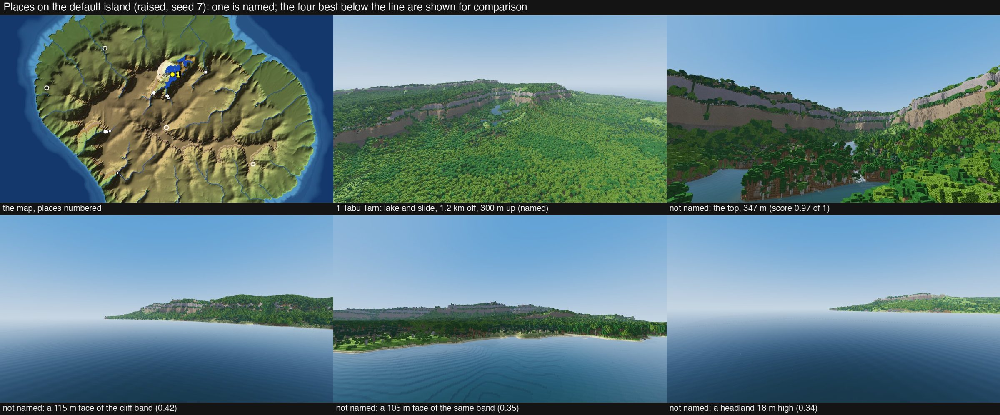

- **The survey** (`places.odin`, `--survey`): land area and 1 km squares; the highest point and the longest river; each community, rock and soil with its share of the land and whether it is absent, everywhere (in nine squares of ten) or in how many squares; how many features of each kind; the largest lake and the tallest fall; then every candidate for a place, ranked, with its score and why. It runs after the trails and is kept in `survey`.
- **The finder** gathers candidates in one pass after forming. Summits and the passes between them come from one sweep of the land's cells from the highest down, joined with union-find: where two grounds meet is the pass, and the lower summit's prominence is its height over it. A summit stands out by the lesser of its prominence and its rise over the ground 800 m round it. Faces are the drops down the drainage while steeper than 45°, 400 m apart; headlands are cells with more than half sea within 48 m, by height and swell; falls, lakes, the slide, caves, notches, shelters and springs are the features; the crater is a vent's fallen top; the wood is the oldest stand of valley or laurel forest. Each has a measure against its row's worth in `PLACE_ROWS`.
- **Seen from 1 to 2 km.** For the 48 best, lines from 120 viewpoints (24 bearings, 1 to 2 km) at the row's eye height over the ground or sea, clearing the ground and its woods by 3 m outside the thing's own body; summits and passes also need sky behind them. What stands on the ground is aimed at over its woods, a fall at its lip, a crater at its rim. The score is the measure on a log scale, over the root of how many of its kind are nearly as extreme (summits excepted), times how well seen and how large. `--place=N` stands at the viewpoint whose line clears the most, near 1.5 km, never on steep ground.
- **Places**: best first, 900 m apart, at most three of a kind and twelve in all, a score of 1 or more; each takes in the candidates within 400 m and is a feature (`.Place`) whose cause is the feature it was found from. Names come from the grammar in `place_name`.
- **Meeting them.** Start-up lists each place with where it is, why and what it took in. `--map` marks them with a numbered yellow disc. `--why=` at a place says so and why it was named; elsewhere it names the nearest place, how far and which way. The window's title shows the place the player is at, or the nearest and how far.
- **What was found.** The plan's eight to twelve are not there: over ten seeds of each kind an island has 0 to 5 places, mostly 1 or 2. On the default island the cliff bands run round the whole upland, so no one face stands apart; its top, at 347 m, is a slight rise on a forested skyline (0.91); its falls drain 0.1 to 0.4 km² and are threads invisible at 1.5 km; only the lake and its bare scar read at once. Cones name their cone, craters their crater, domes their walls and tops. From 1 to 2 km a cone's top is seen only up a valley, since the ring is its own shore; it is a landmark from farther.
- **Names over ten seeds of each kind**: about 120, none repeated on one island. Odd before fixing: trees naming craters ("the Hisakaki Pit"), "Redhead" and "Blacktop" from joined words, "North Top" for a central cone, "Windy" on a third of the summits. After: a few still read oddly ("Sliptop", "Slip Head", "Little Pike"), and "Windy Top" recurs across islands.
- **Cost.** 9 to 27 ms on top of forming (40 under other agents' load) (survey, finder and sight lines together). `src/` grew by 454 lines (428 in `places.odin`, 26 elsewhere), over the 330 ceiling set for it. Benches: our own work never over 12.5 ms on the ground bench, the forest flight or `--bench=5` on each kind; frame intervals were over on a loaded machine for the last commit too.

Still short: a cliff band round an island is a landmark as a whole ("the Edge") and is not found as one; a slide older than about 300 years is grown over and its place is named only for its lake; the cone's viewpoint is up a valley; the oldest wood is about 13,000 years old, a tail of the stand ages, which is no forest; names have no language of a people yet.

### Step 16, as built

Built 2026-11-12 by Claude: birds at cliffs and fish in pools, the first things drawn that move and are not blocks or water. The owner has not yet looked at it.

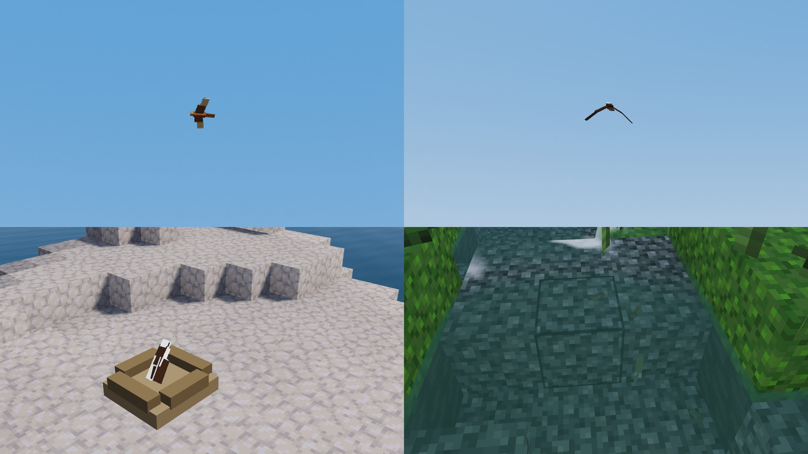

- **Four kinds, from the real islands** (`interesting-world/notes/real-creatures.md`): the black kite and the osprey, both breeding on the Kusagaki islets at our latitude, and the ayu and the yoshinobori goby, after Kano et al.'s survey of Yakushima's streams and Hirano et al.'s of its ayu. The plan's gull is not here: the black-tailed gull breeds no further south than western Kyushu.
- **Rows** (`CREATURES`, `creatures.odin`): home, host, numbers, season, what a fish climbs, its length and how much larger than life it is drawn, how it moves, and its body as three to seven boxes, each with a hinge (wing, wrist, tail, fin, leg, or a rigid pair) and two colours, the back's on its top face and the flank's on the others.
- **Homes** (`creatures_make`, under 2 ms): kites at the three tallest faces the place finder found that the wind meets at 1 m/s or more (the new field `lift`: the wind's 8 m/s times the sine of the slope times the cosine between the way the ground faces and the way the wind comes from), 500 m apart, 2 to 5 to a face; an osprey pair on the tallest stack 8 m or more high. Each is a feature (`.Haunt`). A kite's loop runs along the face, out toward the wind, raised until it clears the ground and its trees by 36 m all round; the osprey circles 75 m off the stack toward the deepest water, clear of it by 12 m. Fish live in each segment of stream and each lake their host holds in: the new field `barrier` is the tallest fall between a cell and the sea, walked down the drainage once; ayu need it at 2.5 m or less and 0.05 m³/s of flow, yoshinobori 5 m or less or, in a quarter of streams over a taller fall, drawn by that fall, got up first. Ponds no stream joins to the sea have none.
- **Nothing is kept** (`creatures_pose`, each frame). Every bird within 3 km and fish within 40 m is posed from its kind, home, number and the clock (day, hour, and seconds since start, or a picture's `--after`). Kites glide to and fro on the lift, banked by the loop's curvature, flapping a few seconds in five; by night they are not drawn. One osprey stands on the nest, upright, wings folded, facing the wind; the other circles, slowing now and then to hang on fast beating wings; by night both stand. Ayu sway in the current facing upstream and beat their tails; yoshinobori rest on the bed and turn now and then. A fish within 2 to 3.5 m of a person no higher than that over the water bolts the way it first chose, as far as the water allows (up to 1 to 3 m), and drifts back over about 8 s; that and its direction are the only things kept, and only while it is fleeing. A fish is drawn only where the simulated water at its column is as deep as it needs, so a drained pool has none.
- **One draw**: the boxes, at most 8,192, go to the GPU each frame through one transfer and are drawn as instances of a 14-corner strip (`vs_box`/`fs_box`), lit as the terrain is, dimmed by the water over a fish, fogged, casting no shadow. A bench prints the boxes drawn: 70 to 110 on the flights, up to 495 by a river.
- **Seen**: start-up says what lives where, why not, and the best pool (under the tallest fall that has fish); `--why=` names the birds of a home and the fish of a stream or lake and why the others are absent; the map rings bird homes pale blue and dots streams with fish green (dark where ayu are).

On seed 3 of every kind and on the default island every island has three kite faces and an osprey pair. Ayu live in 2.8 to 4 km of stream on the raised kinds and the ridge, about a kilometre on inlets, domes and worn, and 39 m or none on the cone and crater, whose streams are small and broken by falls; yoshinobori in 1 to 31 km and most lakes.

What the premises had wrong:

- **That birds can be seen from 1 km.** A kite's 1.6 m span is under two pixels at 1 km on a 2,560-pixel frame, and against the forest behind it nothing shows. They are specks from about 300 m, read as birds against the sky within about 60 m, and as block birds (pale head, wings with pale primaries, a crooked osprey wing) within 30 m. Three to five kites are never a flock.
- **That fish at life size read as fish.** From a bank 3 to 5 m off, through stream water drawn 62% opaque, a 20 cm ayu is a sliver six pixels wide, its true width, and a 7 cm goby a speck; drawn ten times larger they were there, so placement was right. They are now drawn twice (ayu) and 2.5 times (yoshinobori) life size and a quarter as wide as long, with silver or mottled flanks, and read as small dim shapes holding in the current, not crisply as fish. On the default day (95, early April) the ayu are 8 cm juveniles just up from the sea and hardly show; from about day 180 they are full grown.
- **That a gull stands on the stack.** No gull breeds here; the osprey does, and a pair on a nest on the tallest stack is what the real islands give.
- **That the default island has a host.** It does, for all four, but not for the reason the plan gave: its cliffs are inland bands, not sea cliffs, and the kites soar on the old upland's edge and the slide's scar where the wind meets them; its stacks are off its low east shore.

Tried and dropped: one colour on top and another beneath (fish then showed only their dark backs, and the osprey none of its white); a fish fleeing directly away from the person each frame (it swam back under them as they passed); a flat slab as the nest (it read as a box lid); the folded wing lying flat (it read as two plates).

Not done: the streaked shearwater, the best next row, which needs a dusk raft on the sea and a night return (see the note); the peregrine and the reef heron; eels and bōzuhaze; shadows of birds and fish (fish are seen by their shadows on a pale bed in clear water, which the shadow map at 6 cm a texel cannot give); skins from the artist's pack (there is no fish skin and the bird skins are a parrot and a chicken of uncertain licence); flocks; fish in the far rings.

Weak points: every island has the same birds, so they add no difference between islands; fish read only as shapes; the kites over the default island's slide scar fly 15 to 40 m over the face's top, so from the lake they are specks; the osprey's flying bird can circle over its own skerries at 12 m; the yoshinobori's quarter of streams above falls is a guess from 6 of 24 sites; the colours are from memory of the animals, not measured.

**Cost.** Benches against the parent commit, alternately (frame interval median, then our work median): the forest flight 10.76 and 10.72 ms against 10.74 (a first parent run under other agents' load gave 24.3), our work 1.05 and 1.03 against 1.04; the north-south flight 9.55 and 9.55 against 9.49 and 9.47, our work 1.07 against 1.03; the start 9.12 against 9.19, and 11.60 against 10.28 when both were slowed, the ground run 31 m on both; a slow flight 3 m over the start's river with 447 boxes, in one build with and without the draw, 9.11, 9.17 and 9.15 against 9.14, 9.28 and 9.14, and the parent 9.08 to 9.27; our work 0.87 to 1.01 against 0.86 to 1.03. The draw costs nothing measurable; the machine's load (5 to 7) moved runs by more. Forming is unchanged (0.97 to 0.99 s on the default island); homes take under 2 ms. `src/` grew by 468 lines of Odin (422 in `creatures.odin`) and 53 of Metal, three times the 150 guessed.

### Experiments to run early

Each is a scratch copy, folded in or deleted, as the rock experiment was.

- **The land seam** (section 7). Any time after step 1. It decides whether Phase 3 is possible as designed. Run on 2026-11-15 as step 20 (below; `interesting-world/notes/seam-test.md`), and it failed: the 32 m and 16 m phases move the land on a divide a median 54 to 97 m from its 64 m heights, so a divide pinned there stands as a fin or lies as a trench beside the land formed against it, with steps of up to 179 m in one 16 m cell, and the seam can be found on the map of both islands tested.
- **Reading rock in the finished frame** (decision 6). Inside step 1: do the scarps and ridges of the first experiment survive?
- **How unfinished to leave the land** (decision 8). Inside step 3: maps at three lengths of the last phase.
- **Background forming against frame pacing.** Before Phase 2: three threads forming regions while the flight bench runs. Run on 2026-11-14 as three processes forming one island after another at `nice 10` while the forest flight ran, which loads the cores as threads would but shares no memory with the game: frames over 12.5 ms 1 and 2 against 4 alone, the 99th percentile 9.38 and 9.50 ms against 9.31, the game's own work 0.97 and 1.00 ms against 1.03 (12 performance cores, load 6 to 9 from other work). Forming beside play costs nothing measurable. Checked inside the game in step 18 (2026-11-15): 24 islands formed on three low-priority threads during the forest flight cost nothing measurable in four runs of five, and the fifth was matched by the parent with nothing forming ("Step 18, as built").

### Phase 2: the archipelago

Starts when the owner has accepted at least steps 1, 2 and 5 on one island; an archipelago of dull islands would be v4 at a larger size. Ten to thirty islands near the start, as the plates make them, in one world whose plates also make a continent: the islands lie off its coast and its range shows on their horizon (`foundations/fantasy.md`, decision 4). The world is one cohesive simulation with continents and islands where it makes them, never an ocean of islands (the owner, 2026-11-15).

- World frame: a history of moving plates over the whole world that makes the continents and islands, each region's history read from it (the owner's goal, 2026-11-15; a fixed stand-in first), finding the region under a point, levels at 128 and 256 m, the round world, forming in the background; and a way to form land larger than one region with no seam, which step 20 showed the designed method does not give.
- Geology and landforms: eight rock stories and six to eight histories, so no two neighbouring islands are alike; faults, intrusions and lava; volcanic events; coast kinds; deposition for islands over about 10 km.
- Water: wetlands by kind, river mouths by kind, rivers that a player's dam can raise.
- Climate: a coarse grid with rain carried on the wind, so a high island has a wet side and a dry side; weather fronts that cross from island to island; three to six climate zones.
- Vegetation: three or four floras, about twenty species; blocks widen to 16 bits.
- Ground: caves by host (limestone on one island, lava tubes on another), still water in caves.
- Living world: which animals reached which island, decided by whether they fly, swim or walk; one people in two eras, the ruins of the first among the farms of the second; names from that history.
- Fantasy: landmarks on every island; an older sea level and drowned coasts; and, at the earliest here, the first marvel. The design proposes one elder wood, because it only lifts the ceiling on age and size in a community that already exists.

Started 2026-11-14 at the owner's word, in this order (Claude's proposal; the owner can reorder it). As in Phase 1, each step is one change the owner can look at, and steps nothing blocks run in parallel, each in its own checkout. The world frame comes first, because every later step is about what differs between islands, and that needs more than one island. The start island stays today's island at the origin, its kind drawn by the seed as now, and the archipelago is built round it, so the places and benches in `CLAUDE.md` keep their meaning.

| # | Change | Needs | The owner looks at |
|---|---|---|---|
| 17 | The islands near the start as records: a stand-in for plates over the world near the start decides where the crust is continental and where islands form (an arc, a hotspot chain, a shelf off the continent's coast), and places 10 to 30 islands within about 150 km, each a record (middle, size, setting, age, kind chosen by rules from its setting, seed), no two neighbours of a kind (a stand-in for step 22's plate story, which replaces it); the continent is a record too, its coast an outline until it can be formed; `--archipelago=out.png` forms each island in turn and draws the group with the continent's coast | | One grey map: the islands named by kind and setting, and the continent they lie off |
| 18 | Many islands in one world: everything formed for an island kept in one record per region; the generator finds the region under a point and answers the sea between; the islands within 64 km formed before entering, the rest on three low-priority threads; `--island=N` for the map, `--why` and the survey | 17 (a stub of three islands until it lands) | From a summit, the next island; flying to it, its kind differs; the benches while islands form |
| 19 | Far sight: levels at 128 and 256 m, the world drawn round (a drop of d²/2R, R ≈ 7,400 km), haze that lets land 30 to 60 km off show | | Today's island from 20 and 40 km out at sea, sinking under the curve |
| 20 | The seam test (an experiment, section 7): today's island formed whole, and as two basin pieces cut on its 64 m solution with the divide pinned | | Both maps with the seam drawn, and the largest step along it |
| 21 | Continents: a way to form land larger than one region with no seam, found by experiment (wider margins, which came closest in step 20; a forming whose finer phases refine the land rather than reshape it; pieces that trade their edges until they agree; a landmass formed whole at 16 m in less memory), then a piece of the continent formed beside the start's islands | 20 | A continent's land formed in pieces, whose joins cannot be found on the map or on foot |
| 22 | The world's plate story: plates moving over the whole world through tens of millions of years (spreading, sinking under one another, colliding, rifting, carrying continents, hotspots tracking under them), which makes the continents, the island arcs, the hotspot chains and the shelves; each region's record (outline, the uplift and sinking it went through, its vents, its rock, its sea level) read from that history at its place, and a kind becoming the name of a kind of history; replaces step 17's stand-in. The islands it gives must be at least as varied and as close to the real islands' figures as today's kinds, and forming must keep its time budget (the owner, 2026-11-15) | 17 | The world's plates as a sequence of maps through time beside real plate history at the same times, with the same measures computed for both, and the land they leave; then an island's history traced back to them with `--why` |
| 23 | Blocks widen to 16 bits | 18, 19 | Identical pictures; the benches |
| 24 | Rock stories: eight of the twelve rows in use, faults, intrusions and lava packages, about 20 rock kinds; each island's story from its setting | 17, 23 | Islands of different rock side by side; a cut face on each |
| 25 | Climate per island: base climate across the sea, rain carried on the wind so a high island has a wet side and a dry one, three to six zones | 18 | The rain on the map; the windward and lee sides on foot |
| 26 | Floras: three or four, about twenty species in ten silhouettes, chosen by climate, in the same site slots | 23, 25 | A warm island and a cooler one; a high island's belts |
| 27 | Ground and water by kind: deposition on islands over 10 km, wetlands, river mouths by kind, lava tubes on a young volcanic island, solution caves on limestone | 24 | A river mouth, a marsh and a cave on three islands |
| 28 | Who reached which island: animals by whether they fly, swim or walk, from the straits to their neighbours | 18 | `--why` on two islands |
| 29 | People: one people in two eras, the ruins of the first among the farms of the second, names from that history | 18, 25, 26 | A ruin and a farm |
| 30 | The fantastic: an older sea level and its drowned coasts, landmarks on every island, the first marvel (one elder wood) | 26, 29 | The marvel, and how it is found |
| 31 | Forming faster: the same land, bit for bit, in less time, so the islands within 64 km are formed before entering again and continents (21) and the plate story (22) keep their budget | | Entering with 64 km of islands in under 2 s; maps identical to the parent's |
| 32 | The plate history, nearer the real Earth and down to each island. First half: the gaps the comparison with the real Earth measures (`interesting-world/notes/real-plates.md`, "Through time"), in the order they reach the islands: too little high land, too few plates and too much boundary, the first ocean floor surviving, continents that hold level, one plate over half the planet. Second half: a regional history fine enough to tell one island from its neighbour (`foundations/plates.md`, D1's alternative (c)), so each island's uplift, phases and sea come from it; with step 24's rock, the start island is then read from the history and the world has one sea (`open-decisions.md`, 2026-11-15) | 22 | The comparison over eleven seeds against the real Earth; the islands' figures against the real islands; the default island read from the history |
| 33 | Forming faster again: the same land, bit for bit, in less time, so entering with the islands step 32's history puts within 64 km (nine on seed 7, where there were three) takes no longer than before it (`open-decisions.md`, 2026-11-16) | 31, 32 | Entering seed 7 in 2.8 s or less; maps and the determinism test's hashes identical to the parent's |
| 34 | Streams from the valley heads: streams begin where real ones do (0.02 km² drained, not 0.12) and run in a bed of stones sized by their floods; stream density and the largest basin at the sea printed against the real islands (`interesting-world/notes/real-hydrology.md`). From the owner's observation of 2026-11-16 that ours were sparse and all one or two blocks wide | 32 | The default island's brooks and stony beds on foot; the stream networks beside the real islands' |
| 35 | Slide lakes that fill and drain: a slide's lake shallows with what its stream brings and its outlet cuts down through the dam, over the 30 to 1,000 years since the slide (the owner, 2026-11-16) | 32 | The default island's slide and lake; the deepest closed hollow against the real islands |

Steps 17 to 20 started together; step 21 followed the seam test's failure, and step 22 the owner's goal of 2026-11-15 that every island and continent comes out of one history of moving plates. Decisions still open that later steps need: how much of the world is cold and hot (section 9, item 8) before step 25; people (item 9) before step 29; the fantastic (item 10) before step 30.

### Where the plan stands, 2026-11-16

- **Done:** steps 17, 18, 19, 20, 22, 23, 24, 28, 31, 32, 33, 34 and 35; outside the table, the reef kind and Yakushima measured for the granite massif (`interesting-world/notes/real-islands.md`). Step 17's stand-in is replaced by step 22's history and step 32's regional history.
- **Half done, now being built:** step 21. Its experiment found a method that leaves no seam (ordered pieces), but nothing of it is built. A continent of 30,000 to 50,000 km² is extrapolated at 18 to 30 minutes on three background threads. Phase 3 needs it, and so do rivers wider than about 8 m (step 34).
- **In progress:** steps 25 and 27, started 2026-11-16 once the owner decided item 8 of section 9 (cold to hot: thirty degrees). Step 21 resumed the same day, to build continents as land within the owner's goal of 10 minutes for the whole world's generation, staged coarse first and detail later if need be, with no loss of quality (`open-decisions.md`, 2026-11-16).
- **Not started:** 26 (it needs 25); 29 (it needs item 9); 30 (it needs item 10).
- **Left open in step 32:** one sea for the world, which read into each phase put 33.1% of figures far, so the islands keep their kinds' seas; and the planet's boundaries, which stay two to three times the real length, since the regional history runs the planet's plates and did not shorten them.
- **The land.**
  - Every island near the start on seeds 1 to 10, formed alone: 14.0% of figures far from the real islands, against 21.4 before the regional history, 23.6 after its first part and 16.3 before step 35; 11.4% on seeds 11 to 40.
  - The weakest kinds: raised at 66%, judged against Kikaijima, which the reef kind is built after; crater at 30% on 5 islands, whose craters are too small and shallow for Aogashima's. Step 35 brought the deepest closed hollow from far on 20 islands to 6.
  - Entering seed 7 takes 2.2 s.
  - The planet, today, median of eleven seeds against the real Earth: the largest plate 10% (real 20), 40 plates (51), land over 1 km 4.3% (5.7).
- **What the owner has seen.** None of steps 17 to 35 records the owner having looked at it, and the default island has changed since it was read from the history (an inlets island of old arc lavas, 10.2 km across). Phase 2 is accepted only when the archipelago is, so a viewing pass is due.
- **Waiting on the owner:**
  - items 8 to 10 of section 9;
  - the questions in `open-decisions.md` of 2026-11-16, chiefly:
    - a step for the crater kind;
    - real islands for the raised kind, or retiring it;
    - vents that reopen on old centres;
    - granite as gentle as Yakushima's;
    - Ikuchijima for granite against sediments;
    - the brooks and beds by eye;
    - rain growing with height while forming;
    - dry channels above the stream heads;
    - the planet's boundaries.
- **Claude's recommended order:** steps 25 and 27, now running; a viewing pass for the owner; then step 21 built.

### Step 17, as built

Built 2026-11-15 by Claude: the islands near the start, and the continent they lie off, as records. The owner has not yet looked at it.

- **A fixed stand-in for the plates near the start** (`PLATES` and `world_at`, `archipelago.odin`), and only that: it is the placeholder for step 22, the world's plate story, which replaces it. One plate goes down under another along a trench, an arc of a circle 200 to 360 km in radius. The arc's volcanic front stands 38 to 46 km behind it (100 to 250 km on real arcs, squeezed in). Between them is the forearc, rising 1.3 to 2 mm/yr along its outer ridge, two fifths of the way back. Behind the front come a trough, then a shelf 15 to 35 km wide, the drowned margin of a continent, then the continent's coast. On the plate going down, a hotspot 34 to 48 km beyond the trench builds islands that the plate carries toward the trench at 9 to 13 km a million years, 38 to 56° off straight at it; they sink as they cool. Every number is a range in the row, drawn from the seed.
- **The world's fields.** The stand-in makes seven fields, read like every other field and painted by `--overlay=`:
  - `setting`: open sea, hotspot, forearc, arc, back-arc, shelf or continent.
  - `front`: km from the volcanic front.
  - `trench`: km from the trench, below 0 on the plate going down.
  - `track`: km from the hotspot's track.
  - `age`: Myr, of a young volcano on the front, of the plate's carrying on the track, else of the crust (40 for the arc's, 60 for the ocean's, 200 for the continent's).
  - `rising`: mm/yr the crust rises.
  - `depth`: m of sea over the floor, 0 on the continent.
- **Kinds by their hosts.** Each kind row in `KINDS` gained `hosts`, windows on those fields:
  - the cone, crater and domes within 6 km of the front;
  - raised where the crust rises faster than 1 mm/yr: the forearc's outer ridge (Kikaijima);
  - ridge where it rises 0.3 to 1.2 (Hahajima);
  - inlets where it rises under 0.3 mm/yr or sinks and the land is older than 1 Myr, so the sea's rise drowned valleys already cut (Tsushima on its shelf, Chichijima in its forearc);
  - worn where it is still or sinking and older than 2.5 Myr;
  - every layered kind only on a floor shallower than 4,000 m, since nothing raises an old island off the abyssal plain.
- **How an island gets its kind.** It is the row whose host it holds best, ties broken by a draw keyed by the row's name and weighted by its weight; a kind its nearest neighbour has, or that has it as nearest, is passed over for the next best.
- **The start island** keeps the kind the seed draws, as before. The plates are put so that kind's host holds fully where it stands, at least 6 km off the continent's coast. Its record is today's (8,192 m, the world's seed, its own swell), and its map is identical bit for bit on seed 7 and on `--kind=cone --seed=3`.
- **The islands** (`archipelago`, the `Island` record step 18 reads). They are placed along the front at 10 to 31 km, across the forearc at 13 to 36 km, along the hotspot's track at 10 to 20 km from the hotspot to 10 km short of the trench, and three to six on the shelf, all within a square 150 km across round the start.
  - Each takes a region 8 to 16 km across, in steps of 2,048 m, drawn by Korčák's law: the number of islands larger than an area falls as that area to the power −0.65. The exponent is a guess, half a coast's fractal dimension of about 1.3, not measured on a real group.
  - No two regions overlap, and none reaches the continent.
  - Each records its region's middle, size, kind and seed (the world's seed hashed with its number), and its setting and age.
- **The continent** (`continent`): its coast for 300 km round the start, wandering in bays and headlands over 3 to 50 km, closed far inland through the middle of the trench's circle. Behind it lies the crest of a range 20 to 40 km inland, 1,000 to 2,200 m high, which is a guess after the coastal ranges behind the arcs of Japan and China. None of it is formed: step 21 looks for how.
- **The wind** is one bearing for every island, the start island's own drawn swell, so its swell is the one it always had.
- **Seen.** `--archipelago=out.png` forms each island in turn with today's code, writes a grey map 200 km across, and prints:
  - a line for each island;
  - what was left out and why;
  - whether each island sees its nearest neighbour's top and the continent's range over the curve (R = 7,400 km).

  The map shows the trench, the front, the shelf's edge, the hotspot's track ticked each million years, the continent's coast and range, and each island named by number, kind and setting. It takes about a second an island, 20 to 35 s in all. Start-up prints one line on where today's island stands among them.

On seeds 1 to 8 there are 17 to 22 islands: 4 to 8 on the front, 4 to 8 in the forearc, 2 to 5 on the hotspot's track and 2 to 5 on the shelf. Nearest neighbours are at most 24 to 31 km apart, and every island sees its nearest neighbour's top from its own shore. The continent's coast lies 5 to 127 km from the islands. Its range shows over the curve from every island's shore on six seeds, and from all but two on seeds 3 and 5. Forcing each kind on the start island with `--kind=` on the same eight seeds, its host holds fully every time: the volcanic kinds on the front, ridge and raised in the forearc, inlets and worn on the shelf, the hotspot's track or the forearc.

Seed 5, in the picture, shows the causes best: all three volcanic kinds alternating along a strongly curved front, ridge and raised islands across the forearc below it, a chain of inlets, worn and inlets ageing from 1.5 to 5 Myr toward the trench, and layered islands on the shelf under the continent's coast. Seed 2 is nearly as clear. The default seed, 7, is middling. Its chain runs straight at the trench, with three islands, and its shelf holds two. Seeds 1 and 4 show it worst:

- **Seed 1.** The start island is an inlets island in the back-arc trough, where nothing else stands. Its chain has two islands before the trench, and the continent lies along the bottom edge.
- **Seed 4.** The chain has three islands, the forearc has no raised island, and the continent's coast and range are cut by the map's edge.

What the premises had wrong:

- **That today's kinds can fill such a setting.** They fill the arc, forearc and shelf honestly, each by the real islands it is after. They do not fill a hotspot chain.
  - The active end needs a young shield and the middle an eroded shield, and neither kind exists. The site over the hotspot is left out and printed ("a young hotspot shield would stand here, and no kind makes one"), and the chain begins at about a million years with a drowned inlets island.
  - Inlets and worn stand in for older hotspot islands by the landforms the plates give them (sinking, then worn low), but their rock is layered, not basalt, until rock comes from the setting (step 24).
  - No atoll stands at 30° N, which is the right answer, not a gap.
  - On the arc, nothing tells a cone from a crater from domes, so they alternate by the draw and the neighbour rule, not by cause.
- **That the start island's kind can always be given a setting it belongs to.** It held on every seed and kind tried. But inlets or worn landed in the back-arc trough on three of sixteen tries, where real arcs have few islands and the stand-in places no others.
- **That regions of other sizes form islands of their kind.** A 4 km region does not:
  - the ridge, inlets and worn kinds come out as islets 120 to 150 m high of about 1 km² (the raised kind held up better, at 286 m);
  - the volcanic kinds keep their height and halve their width, so 47 to 56% of their land is steeper than 45° and their crests fall 2.5 to 2.9 m, four to five times their real islands';
  - the place finder's survey assumes an 8 km region and fails at 4 km (`places.odin`).

  Regions of 10, 12 and 16 km form their kinds, larger and with finer valleys; a 16 km cone is gentler (1,127 m, 6% of its land over 45°). So sizes run from 8 to 16 km, which is a span of four in area, too narrow for Korčák's law to show much.
- **That the islands would be seen from each other.** True at these spacings: nearest neighbours are 24 to 31 km apart at most, against horizons of 60 to 100 km. The continent's range shows too, at a guessed height.

Tried and dropped:

- **Islands with no continent beyond them.** That was the first form of this step. The owner's decision of 2026-11-15 made the shelf a continent's drowned margin and the continent a record.
- **A weighted race for each island's kind**, as the plant communities use. It put kinds where their hosts held weakly; the best host now wins.
- **Hotspot tracks up to 72° off the trench.** The chains ran along the trench instead of into it.
- **A broad swell round the hotspot.** It lifted the open ocean floor enough for the layered kinds' depth window, and seed 3 put an inlets or worn start island on open sea.
- **A worn island on the abyssal plain** (seed 8), before the depth window.
- **Labels drawn in place on the lines**, which landed on islands; the lines now have a key.

Not done:

- the islands' rock and history from their setting (steps 22 and 24);
- the forming of the continent (step 21);
- neighbours by straits and fetch, rather than by nearest middle;
- island ages that set a kind's history: a cone's history is still its row's, whatever its `age` says.

Weak points:

- **Everything in the stand-in is a fixed shape drawn from ranges.** Nothing moved to make it, and step 22 is to replace it. A plate history must give what these records give:
  - the fields the hosts read, in the same units: `front` in km, `rising` in mm/yr, `age` in Myr, `depth` in m, with `setting` for names;
  - each island's place, region size and age;
  - the continent's coast and the height of its land;
  - the wind.
- **The section from trench to shelf is squeezed to a third of real arcs' widths**, and the trench's circle, the outer ridge at two fifths of the setback and the depth profile are guesses.
- **The forearc holds 4 to 8 layered islands**, as many as the front's volcanoes on most seeds. Real forearcs hold fewer and larger ones.
- **The rule that no two nearest neighbours share a kind** is satisfied by the next best host. On the hotspot's chain that makes inlets and worn alternate mechanically, not by age.
- **The continent's range height and distance inland are guesses**, so whether it shows on the horizon is a guess too.
- **The island records' `age` is the field's**, 40 Myr for every forearc island and 200 for every shelf island: the crust's age, not when the island rose.
- **Islands' squares are kept off the continent only at their corners and edges' middles**, so a headland could cross one.
- **`--archipelago` frees and re-forms one region at a time through the game's globals** (`region_clear`). It works because forming reads nothing else, but step 18 must hold each island's results apart.

**Cost.** `archipelago_make` takes 1.25 ms at start-up. Forming today's island is unchanged (0.99 to 1.05 s), and start-up as a whole times 1.02 to 1.28 s on this build and on the parent rebuilt alike, under load 6. The start's bench against the parent, alternately: frame interval median 8.33 ms on all four runs, our work 0.83 and 0.73 ms against 1.01 and 0.76, 43 m travelled on all. `src/` grew by 506 lines of Odin (480 in `archipelago.odin`, about 200 of them the map: the forming loop, drawing, labels and a 3 by 5 letter font), twice the 200 to 300 guessed.

### Step 20, as built

Run 2026-11-15 by Claude as an experiment in a scratch copy; nothing of it is merged. The owner has not yet looked at it. The method, every number and the pictures are in `interesting-world/notes/seam-test.md`.

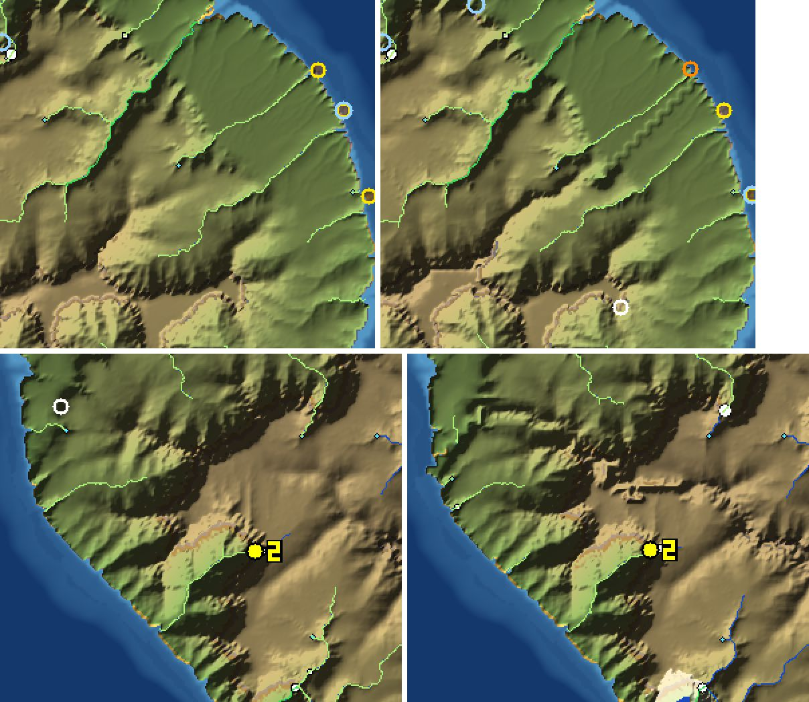

- **What was done.** The default island (raised, seed 7) and the ridge on seed 3 were each formed whole. Each was then cut on its 64 m solution along the highest divide splitting the land within 2% of evenly (49.9% and 50.3%), found among runs of basins ordered round the coast. Each piece ran the 32 m and 16 m phases alone. No water crossed the cut; the cells beyond it, and the piece's own cells along it, were held to the 64 m heights interpolated; the coast counted only its own sea. The game then played on the two joined.
- **The step across the cut is small**: at most 28 m and 14 m (median 1.7 and 1.9 m), under the island's own steps, because both sides are held to the same surface.
- **The seam is one cell in.** On the whole island, the finer phases leave the land on the divide a median 54 m and 97 m from its 64 m heights (up to 170 and 177 m).
  - On the default island the held line stands as a fin over the land formed beside it (68% of its length; steps up to 179 m in one cell).
  - On the ridge it lies as a trench (73%). 19 stream channels cross the joined seam and one runs along it.
  - Closed hollows up to 68 m deep lie on the seam; the whole islands have none.
  - Stream heads within 300 m of it moved a median 66 m and 260 m.
- **It can be seen.** On the map: a serrated ridge stepping along the 64 m cells and right-angled notches on the default island, and a straight trench along the ridge's crest, which I found half blind. From 300 m: the trench, and a line of crags. On the ground the default island's seam is a spine of bare rock over the forest; in forest elsewhere it does not show.
- **Premises.**
  - That pinning to the 64 m solution suffices: false.
  - That the 64 m divide is where the 16 m land puts it: a median of half a 64 m cell off, up to four cells.
  - That the forming's rules behave the same in a piece: creep, the coast's exposure and cliff height, silt and the refine's warp all read beyond a cell, and each needed a choice.
- **Variants.** Holding nothing on the piece's side is worse (cliffs of 136 to 142 m across the cut). Pinning to a 64 m run of the whole history is still off a median 30 to 36 m. A margin of 2 km past the cut, formed freely and discarded, made 90% of a 16 km island's seam match the whole within 5 m, but left cliffs of 100 to 160 m on 1%. On the 8 km islands a margin covers most of the other piece and says nothing.
- **What it means** *(inference)*: the last two stages reshape the land rather than refine it, so a continent cannot be made of basin pieces pinned to the 64 m solution. It needs a method that has not yet passed (the margin came closest), or each landmass formed whole at 16 m. The owner has decided the world has continents (2026-11-15), so finding that method is step 21.

Weak points: two islands of layered rock, one seed each; the cut ran along the highest divide, where the finer forming changes most; one cell held each side; one margin run at 16 km; the judge of the maps was Claude, not the owner.

### Step 18, as built

Built 2026-11-15 by Claude: many islands in one world, on the branch `step-18-regions`. Step 17 was building at the same time, so the islands are a stand-in of three (`archipelago.odin`, which step 17's file replaces): island 0, the default island at the origin; island 1, a cone 14 km east; island 2, the inlets kind 16 km south. The owner has not yet looked at it.

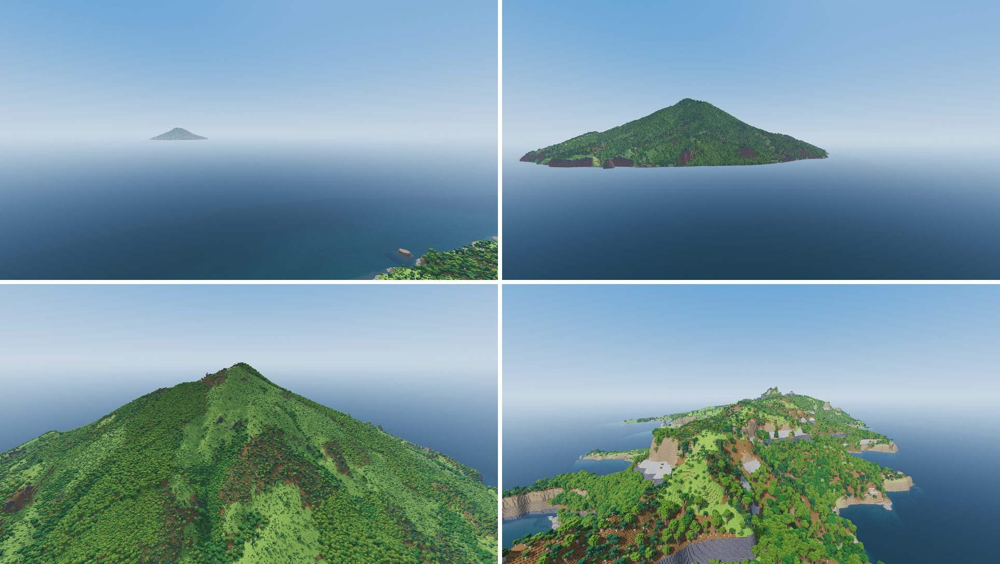

- **How the islands are held** (`regions.odin`, `docs/adr/0005-each-thread-reads-one-island-through-bound-names.md`). Everything formed for an island's region is one record, `Formed`: its region, land, rock, rivers, slide, roofed places and stacks, trails, animals, candidates, places and survey. Each system still reads its part by its old name, now a thread-local pointer that `bind` points at one island's record, with `seed` the island's seed; so the code that forms, meshes and answers for one island did not change, beyond six places that took a list's address. Forming binds its island; `gen_columns` binds per column (`bind_at`), so a far chunk that spans two regions or the open sea is right in every cell; `gen_volume` binds the island under the chunk's middle, which meshing then reads; creatures are posed for each island whose region is within 3 km; the frame thread keeps the start island bound and binds another for a scope (`bound`) when it needs one. Between the regions lies the open sea, a floor of sand at `SEA_BED`, 200 m down, as every region's rim is.
- **Shared state forming wrote**: one table, `crowns`, which every forming added to; a second island would have doubled it. It is now filled once at start. Every other package-level variable is a catalogue no code writes. Forming prints its start-up lines as it goes; rather than change some sixty print calls, standard output drops what a thread forming quietly writes (`quiet_init`), and each island formed beside another or beside play says one line.
- **Forming**: the start island first, alone, with all its start-up lines, as before; then every island within 64 km (`--near=km`) side by side on half the cores before entering; then the rest on three threads of low priority once play has begun, nearest first. A chunk over an island not yet formed is not built until it is (`waits`, `world.odin`), and nothing is drawn there meanwhile; the far rings fill it in when it is formed.
- **Drawn per island**: terrain, trees, plants and sea through the columns; each island's rivers' ribbon and falls on the GPU once it is formed and drawn relative to the eye from its own region's middle (D5); the cloud cap from the nearest island's `lifted`, a first cut (another island's cap is not seen from off it); the clouds drift from the start island's swell everywhere, so they do not jump at a crossing. The weather is drawn from the world's seed. The window's title names the island and the place nearest.
- **One island at a time**: `--map`, `--why`, `--survey`, `--place=N`, `--kind=` and the start act on the island `--island=N` names (0 by default, which behaves exactly as before); `--map`, `--why` and `--survey`, which exit at once, form only that island.

What the premises had wrong, and what held:

- **That binding leaves no state written by two threads.** It held once `crowns` was moved: the thread sanitizer (`odin build src -sanitize:thread`) reported no race, with the near islands formed side by side and with both formed in the background while chunks built and the frame thread flew toward island 1; its one report was a thread leak, the background threads never being joined, and they are now detached. Each island's `--map`, formed alone and formed side by side with the other two, is identical bit for bit, on seed 7 and on seed 3 with each forced to a crater.
- **That reading the islands through pointers is free.** Forming takes 3 to 8% longer (the default island 1.00 to 1.06 s against 0.91 to 1.02, alternating). A build with plain pointers instead of thread-local ones cost the same, so the cost is the pointer, not the thread: the compiler hoists a thread-local address out of every hot loop.
- **That today's island does not change.** Its `--map` is identical to the base build's on seed 7 and on `--kind=cone --seed=3`, and so are its start-up lines, but for forming times. Shots from the kite, osprey, fish and forest views differ from the base build's only where island 1 stands on the horizon, within what two base runs differ by. The start still walks 43 m.
- **Memory**: each formed island holds about 40 MB: the start bench's peak resident memory was 387 MB against 306 MB, and a scratch build of 25 islands held 1.24 GB. Nothing is summarised or dropped.

**Cost.** Benches against the parent commit, alternately, under a load of 6 to 10 from other work on the machine (frame interval median with the frames over 12.5 ms, base first, then new; then our work median): the forest flight 8.41 (5) and 8.50 (10), 9.48 (59) and 9.35 (115), 8.35 (62) and 8.33 (3), our work 0.90 and 0.88, 0.97 and 1.02, 1.03 and 0.94; the air flight 10.39 (175) and 11.58 (273), 12.27 (303) and 10.69 (168), 8.44 (2) and 8.47 (42), our work 0.86 and 0.87, 0.90 and 0.85, 0.87 and 0.80; the north-south flight 8.34 (9) and 8.35 (2), 8.72 (66) and 8.66 (45), our work 0.97 and 0.99, 1.06 and 0.99; the slide flight 8.48 (3) and 8.48 (1), 8.56 (31) and 8.44 (1), our work 1.08 and 1.06, 1.07 and 1.03; the crater flight 8.34 (3) and 8.40 (7), 8.33 (3) and 8.33 (3), our work 0.77 and 0.79, 0.72 and 0.76; the start 9.37 (34) and 8.34 (2), 8.33 (0) and 8.33 (1), our work 1.05 and 0.90, 0.80 and 0.85, the ground run 43 m on both; the new flight from island 0 to island 1, which the parent flies over empty sea, 8.59 (154) and 8.40 (13), 8.34 (9) and 8.36 (6), our work 0.85 and 0.87, 0.73 and 0.75. Every difference turns over from one round to the next: holding many islands costs nothing measurable at the frame. **Forming beside play**, measured in a scratch build of 25 islands on a 12 km grid, the forest flight with all formed before entering against the other 24 formed on three low-priority threads during the flight (all 24 were done before it ended): 8.42 (15) and 8.51 (68), 8.33 (2) and 8.35 (0), 8.33 (1) and 8.33 (2), and two more forming runs 8.33 (1) and 8.34 (2); our work 1.11 and 1.21, 0.94 and 1.00, 0.97 and 0.95. The one bad run, with the frame thread's own work up to 54 ms, did not recur in four more, and a run of the parent in the same hour, with nothing forming, had the same (62 over, 43 ms); each island's rivers and `lifted` take 0.4 to 0.5 ms of the frame thread to upload, once. Forming beside play costs nothing measurable. **Entering** the default start took 1.1 s longer (10.4 s to the end of `--bench=8`, against 9.3), the two near islands forming side by side in 0.84 s; 24 near islands take about 4 s on eight threads. Forming the default island takes 1.00 to 1.06 s against 0.91 to 1.02. `src/` grew by 252 lines of Odin (349 added, 97 removed; 152 in `regions.odin`, 26 in the stand-in), under the 300 to 400 guessed.

Tried and dropped: an initial value on a thread-local `seed` (Odin allows none; the world's seed is now `world_seed`). Not built: silencing each of the sixty print calls in the forming code, sixty lines in nine files where the steps building alongside would have met them; standard output filters instead.

Weak points: every formed island is held whole, so step 17's ten to thirty islands take 0.4 to 1.2 GB, and the design's summaries of distant islands are not built; within 64 km of the start most of step 17's islands are formed before entering, and 24 islands took about 4 s side by side, twice the budget of two seconds more than today; a procedure that forgets to bind reads whichever island its thread last read, silently; the cloud cap of an island is seen only from nearer it than any other, and the clouds' drift ignores each island's own wind; a chunk waiting for an island also leaves blank whatever open sea or formed island lies in its square, which at 2 km chunks is a few kilometres of sea; `--above` over an island formed in the background reads the open sea's floor; the near water simulation never reads a region, so it was not changed, and the sea across island 0's edge at x = 4,096 was probed plain (ground at -200 m, supplied) but no other edge was; a level-0 chunk that a region's edge crosses fills its border columns' buried rock from the island under its middle, which at the rim lies 200 m under the sea; with the stand-in's two islands, forming beside play is over within the two seconds a bench skips, so measuring it needed a scratch archipelago of 25; the view still ends at about 16 km, so island 2 is at its edge from the start.

### Step 19, as built

Built 2026-11-14 by Claude: far sight, on today's single island. The owner has not yet looked at it.

- **Two more levels, 128 and 256 m** (`LEVELS`, `world.odin`), so the rings reach about 33 and 65 km. The generator answers at those cells as at the others (`adr/0001`): the land's averaged grids go on to 256 m (`land.z`), and `shaped` reads the one as coarse as the cell. A column wider than 64 m (`COARSE`, `gen.odin`) has no stream cut into it and no stack on it: both are under a pixel wide 16 km off, while the river cut, widened by the cell, would have lowered every 256 m column whose middle lies within 96 m of a stream to the stream's level, and a stack within 30 m of a column's middle would have stood a 256 m tower in the sea. Under the sea such a column has no faces, since the sea is opaque past 16 km, and a chunk of them wholly outside the region is not worked out at all (`open_sea`), so open sea in the two new rings costs nothing to build or draw. In every ring beyond the block volume a run of level, alike tops along a row is one face, which draws the same.
- **The world drawn round** (`adr/0006`): `drawn` in `shaders.metal` lowers every vertex of the view by d²/2R, R 7,400 km, in the terrain, the leaves, the ground plants, the creatures' boxes and spray, the simulated water and falls, the rivers' strip and the sea. Nothing is shaded on the curve: every fragment is lit, shadowed, textured, hazed and tinted under water where it stands on the flat world, and the shadow maps are drawn flat, so shadows stay where they were without lowering the shadow passes, which the step had asked for. The view's culling boxes are widened down by the drop. The sea was one quad 120 km across, which a vertex drop cannot bend; it is now 64 × 64 quads round the eye, widening with distance out to 1.3 times the horizon's distance and never less than 80 km. The cloud layer is round too: a ray's height over it is a t² + b t, so a ray along the horizon meets the cloud base at last instead of never.
- **Haze for 30 to 60 km**: its depth grows as 10 km times ln(1 + d/10 km) (`CLEAR`), the old haze within 2 km and two fifths of its depth at 40 km, so the island 40 km off is a blue-grey skyline 10 to 17% darker than the sky over it. The sea far out keeps a roughness its flattened ripples no longer give it (from 2 to 8 km), reflecting less sky and sky from higher up, so it is darker than the sky over its horizon and the horizon shows as a line; without it sea and sky met in one colour.

What the premises had right and wrong:

- **The curve's figures hold in the picture.** Through a 4° view (a scratch build) from 10 m over the sea, the horizon lies 1.649 mrad below level (the formula gives 1.656), the island's skyline is lowered 2.67 to 2.77 mrad at 40 km against a flat build (2.70) and 1.358 at 20 km (1.351), and at fourteen columns across the island 49 to 52 m of it that the flat build shows over its shore is under the horizon (52 m by the formula; 4 m at 20 km).
- **Two more rings did not add faces; they took some away.** The rings are nearly all open sea, and the far sea floor was a face a cell. With tops merged and nothing under the sea in the new rings, the benches draw 13 to 18% fewer faces than the parent. Built first with the sea floor drawn in the new rings, faces still fell (1.22 million to 1.07 to 1.10 on the forest flight), but the game's own work rose by 0.2 to 0.4 ms a frame from a draw for every far chunk in view, and the start's run had a 30 ms frame; leaving the open sea out of them, and then not working it out, brought both back to the parent's.
- **The boundary between the 64 m ring and the 128 m one** shows no gap, seam or step from the sea at 20 km, where it crosses the island's south flank, nor from 600 m up at 30 km. The sea hides the coarser rings' sea floor entirely, and the water drawn over the boundary is one sheet.
- **Nothing near changed.** Pictures from the same cameras (the forest flight's start, a sandy shore, the start, the slide from 40 m, the summit) differ from the parent's only in the far sea, which now ends at a horizon, and by sub-pixel speckle on leaves 400 m off, about four times what moving the eye 3 mm gives, as the drop of 1.2 cm there predicts; none of it shows to the eye in the pictures side by side.

Tried and dropped: haze thinning over 15 km (`CLEAR`), which left the island at 40 km too faint to read; the far rings' sea floor drawn under a sea a few hundredths clear (above); and lowering the shadow passes with the view, which shading on the flat world makes wrong.

Not done: a 512 m level (from a summit, an island taller than 300 m beyond 65 km would be missing); a narrower view for looking far (`--fov`), so at 70° the island 40 km off is a sliver 8 pixels high; land 30 to 60 km off other than the island itself, so the haze is judged on one island across empty sea until step 18 brings neighbours.

Weak points: the haze past 2 km is a look and not an atmosphere, chosen so the near and the far could both be kept; the far sea's roughness is a constant, not the wind's; at 128 and 256 m an island is a stack of boxes about 7 pixels wide where each ring takes over, with its red soil and canopy in patches, as the 64 m ring already was; from 10 m over the sea the sea from 3 to 12 km is two rows of pixels, so the horizon is a thin dark line over a pale band of near sea that mirrors the sky as it did before; the `open_sea` test knew one region and learned every island's when step 18 was merged; the dashed line on the sea about 350 m off, where the simulated water ends, is the parent's and is still there.

**Cost.** Benches against the parent, alternately in the same minutes on a machine other agents were loading (load 6 to 11; another agent's benches overlapped some runs), two rounds each. Frame interval median, 99th percentile and frames over 12.5 ms, then our work median, then faces drawn: the forest flight 9.31 ms, 15.21, 69 and 10.69, 18.95, 306 (parent) against 9.30, 15.28, 130 and 8.58, 14.36, 72, our work 0.96 and 1.08 against 1.08 and 1.07 ms, 1,221 and 1,212 thousand faces against 1,056 and 1,031; the flight from 700 m through the clouds 8.90, 13.53, 24 and 8.93, 13.68, 24 against 8.96, 13.55, 20 and 8.54, 11.60, 4, our work 0.73 and 0.71 against 0.70 and 0.76, faces 973 against 843 thousand; north to south 8.33, 10.17, 6 and 8.33, 10.60, 2 against 8.33, 10.27, 1 and 8.33, 9.68, 3, our work 0.95 and 0.97 against 1.05 and 0.96, faces 1,130 against 960 thousand; the slide 8.44, 10.08, 0 and 8.49, 11.59, 5 against 8.45, 10.81, 1 and 8.42, 10.05, 0, our work 0.89 and 1.04 against 1.08 and 1.09, faces 1,047 against 860 thousand; the start 8.33, 9.05, 0 and 8.33, 9.15, 0 against 8.33, 9.07, 1 and 8.33, 9.04, 0, our work 0.81 and 0.80 against 0.80 and 0.80, faces 1,233 against 1,023 thousand, 43 m run on both. The paced bench cannot show headroom, so the forest flight and the flight through the clouds were each traced (Metal System Trace), the parent then this, one after the other: the forest flight's GPU time a frame fell from 5.73 ms (median, 6.23 with the far shadow map) to 4.97 (5.27), the scene pass from 3.35 to 2.90 and the clouds from 0.71 to 0.67 ms, the merged tops taking faces out of the shadow maps as well; the flight through the clouds from 5.35 (5.04) to 5.16 (4.90), the scene from 3.56 to 3.40, while the round cloud layer, whose rays near the horizon now meet it, took 0.77 ms against 0.73. The start's picture is taken 1.77 s after launch on both, and the most memory held is the same (316 to 335 MB). `src/` grew by 63 lines (94 added, 31 removed): 28 of Odin, to 7,831, and 35 of Metal, against 100 to 150 guessed.

### Step 22, first half, as built

Built 2026-11-15 by Claude on the branch `step-22-plates`, alongside step 17, which it does not yet replace; the owner has not looked at it. The design is `foundations/plates.md`, the research and every figure `interesting-world/notes/real-plates.md`.

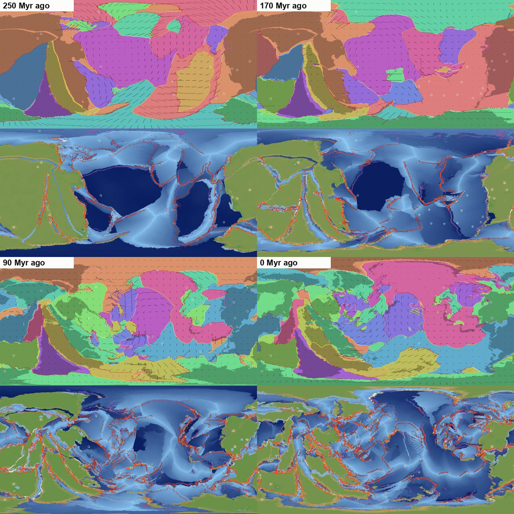

- **What it is.** A history of rigid plates over a whole planet of the Earth's size, 350 Myr on 36 km cells in steps of 2 Myr, the last 250 recorded (`plates.odin`, `--plates=DIR`, `--plates-why=x,z`). Plates move by the forces on their edges; crust is made at gaps, sinks at trenches by a polarity settled for each pair of plates, and stacks in collisions; arcs grow on the front over each slab and hotspots build chains; the ground floats and the sea fills to a fixed volume of water. Splits are four rows (`SPLITS`), settings twelve (`SETTINGS`). The known world is a 1,000 km window chosen at the end. Nothing in the game reads it yet; seed 7's map is unchanged bit for bit.
- **Scale.** A 1,000 km world cannot hold real plates, which travel 5,000 to 25,000 km in 250 Myr, so the planet is whole and the known world a window on it (`plates.md`, D1). Within 1,000 km the continent is a margin with its islands, not a whole continent. Put to the owner as one question (`open-decisions.md`, 2026-11-15).
- **Measured against the real Earth through time.** `tools/plates_compare.py` builds the real Earth's frames every 10 Myr from Müller et al. 2019 (plates, motions, ocean-floor ages) and Scotese & Wright 2018 (land), all CC BY 4.0 and kept outside the repository, and measures both with one function. On seeds 7 and 1: close on plate speeds (RMS 41 to 57 mm/yr against 44 to 74), the largest plate's share, the slope of plate sizes (−0.42 against −0.42 today on seed 7), ocean depth from age (4,550 to 4,990 m against 4,440 to 4,860), land over 1 km, the number of land masses over a million km² today (5 and 6 against 6) and their sizes (seed 7: 84.5, 31.4, 16.5, 6.1 million km² against 85, 42, 14, 7.7). Far: boundaries 1.3 to 3 times too long, the first ocean floor surviving too long (18 to 40% over 120 Myr old before 150 Ma, against 1 to 5%), continental crust shrinking from 38 to 34% where the real grows from 35 to 42, continental plates at 5 to 19 mm/yr against 22 to 30, land 1 to 4 points high.
- **What the comparison changed**, in the order the figures showed it: subduction polarity per pair of plates, not per cell (boundaries had shattered into speckle); a gap away from a spreading boundary filled from its neighbour (the grid's holes had turned continent into ocean, 38% to 18%); land wearing only toward 300 m over the sea (plains had been planed to sea level and drowned at a 60 m rise); fewer splits and joins of still boundaries (82 plates, then 3, then 27); a slab pull of 32 not 55 (ocean plates 50% too fast); rifted margins thinned into shelves (land 35% to 29%, continents now separate).
- **Speed.** 2.2 to 2.7 s for the history on seeds 7, 1, 3 and 12 on 10 threads (7.5 s on one before), 1.1 to 1.5 s to draw; at 24 km cells 5.6 s. The guess in section 7 was a second. Two runs of a seed give identical grids.
- **The known world.** Its map at 1 km blends the cells with a warp and the volcanoes as cones. Seed 1's window is an archipelago of 38 islands off a continent's range (picture below); seed 7's a continental margin with two small islands; seeds 3 and 12, 16 and 13. The islands are the weakest part, and the second half's work.

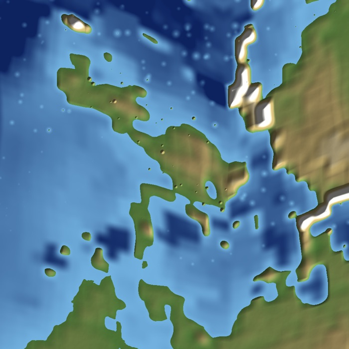

**What the second half must do** (`plates.md` section 6): find the islands of the window as regions and fill step 17's records from them; read each region's history as `Phase` rows from the crust it stands on (its height through time, the sea's level, and for the last million years the setting's own rate: a forearc rising 1.5 to 2.3 mm/yr, a hotspot island sinking as its plate cools); its vents from the volcanoes on it; its rock story from its setting; its sea's last rise from the ice ages; give each kind row a host on the record so a kind names a kind of history; replace step 17's stand-in; and form the islands on many seeds against the real islands' figures and today's kinds, within today's forming time.

Weak points: one seed's history is chaotic (seed 12 ends with nine plates, one of them 45% of the planet; at 24 km cells seed 7 ends with one of 40%); forearcs do not rise and trenches do not migrate; a window of 36 km cells cannot hold the Izu arc's dozen islands in 600 km without the regional history `plates.md` defers; `plates.odin` is 1,397 lines against a game of 7,800; the real land is drawn as today's coasts carried back, the PaleoDEMs being in another frame; the judge of every picture was Claude.

### Step 21, as built

Run 2026-11-15 by Claude as an experiment in a scratch copy; nothing of it is merged. The owner has not yet looked at it. The method, every number and the pictures are in `interesting-world/notes/continents-forming.md`.

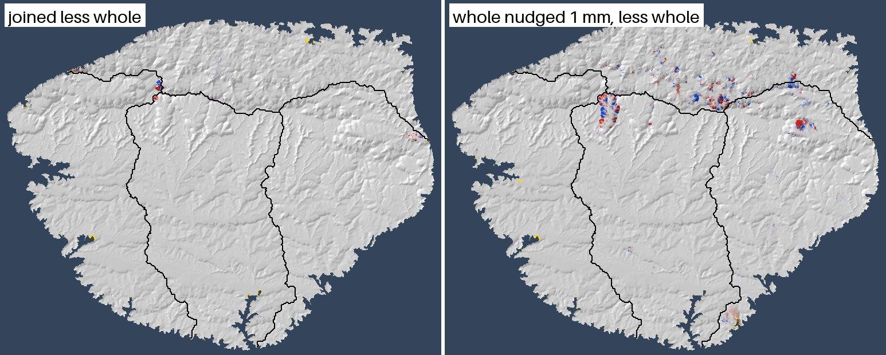

- **What was done.** Seven ways of forming land larger than one region were run and measured as step 20 measured them, against the land formed whole. The test land, one seed each:
  - the default island stretched to 16 km, in two pieces;
  - the ridge on seed 3 at 32 km, in four pieces whose seams run 10 km along the main crest and down three spurs, plus a straight cut across 38 streams and square tiles;
  - the domes on seed 3 at 24 km, in three pieces, and cut straight through a dome whose vent opens in a 16 m phase.
- **A way was found: ordered pieces.**
  - The landmass is formed whole at 64 m, as designed, and cut along its drainage.
  - The pieces take up the 32 m and 16 m phases one after another, downstream first.
  - Each holds, right at the cut, the land its formed neighbours left, through every step: heights, filled surface, drainage, land drained and rock carried, in a band 8 cells wide.
  - Toward neighbours not yet formed it forms 6 km past the cut, held beyond to the landmass pass with the water and rock that pass says come in.
  - A vent is decided once and shared.
- **On the ridge in four pieces** the joined land's steps across the cut are the whole's (largest 49.6 m against 51.9; within 48 m, p99 27.3 against 27.1). It has no closed hollow and every figure against Hahajima unchanged, with the same slide and the same seven named places. It differs from the whole by a mean 0.02 m, less than a 1 mm nudge moves the whole (0.14 m).
  - A cut across 38 streams formed downstream first is the whole's to 14 m. Formed upstream first it ponds 1,623 cells of closed hollow up to 37 m deep.
  - Cut through the young dome, the land is within 0.6 m of the whole when the vent is shared. When each piece decides the vent itself, a step of up to 54 m runs along the cut.
  - I could not find the seam. I looked at a joined map of the ridge blind and could not say where the cut ran; from 300 m and from the ground, the whole and joined pictures from the same camera differ in under 0.1% of their pixels.
- **What failed.**
  - Pinning failed at every length of finer forming: steps of up to 239 m with 96 kyr left to the pieces, and 170 m with 21 kyr.
  - Shortening the finer phases so that pinning might hold costs the raised kind its terraces (method 3, failed twice).
  - Margins in one pass left 80 to 92 m steps at 4 to 6 km on the ridge. A wrong edge's error runs up the streams that leave a piece through it, 4 to 6 km on the 16 km island and more on the ridge.
- **Pieces that trade their edges until they agree** (alternating Schwarz, 2 km margins) also leave no seam. Along divides they need one round more (2.5× the cost); on square tiles cut across rivers, three (5×). They are the fallback where an order cannot be kept.
- **The forming is chaotic.** A 1 mm nudge moves the whole island up to 45 to 95 m in patches where a stream captured another. So joined land is judged against that floor, not against zero.
- **Cost.** The ridge forms in 16.9 s on one thread (64 m phases 2.7 s, 32 m 3.5 s, 16 m 10.7 s), 54 ms a km² of land. The 64 m landmass pass of a 128 km landmass (4,970 km² of land) took 60.6 s and 1.0 GB. *(Extrapolated, a guess:)* for a continent of 30,000 to 50,000 km², the landmass pass takes 7 to 12 min of one core and the pieces 32 to 54 core-minutes, about 18 to 30 min on three background threads. Each worker holds about 0.4 GB as the grid is kept today. Forming the whole at 16 m instead costs about the same core time as one job, unless rewritten to run in parallel, and holds 2.4 to 14 GB.
- **What it changes in the plan** *(inference)*.
  - Decision 10 and `foundations/world-frame.md` D1 to D3 hold with changes. The cut's edges are not pinned to the 64 m solution but to the formed neighbour's land, and pieces are formed in drainage order.
  - A region becomes a pure function of the seed, its record, the landmass pass and the bands of the regions before it in a fixed order. Forming one again needs those bands kept: about 1 MB a kilometre of cut as recorded, about 3 GB for a large continent unless reduced (untested).
  - The plate story (step 22) must give a landmass one history over its whole extent, and fix vents and other events that read a neighbourhood once.

Weak points:
- One seed each of three kinds, on land no larger than 32 km. No Pfafstetter cut was tried; the 6 km margin was measured on a 32 km island only.
- A cut across rivers formed downstream first took the rock coming in from the 64 m pass, which was low: a silt flat 11.7 ha smaller at the largest river's mouth, 21 ha of land and sea differing against 9 ha for the nudge.
- Where a cut meets the sea, exposure and silt read past the band. On the 16 km default island that changed the slide beside it from 2.8 to 2.5 million m³.
- Continent costs are extrapolated, on a loaded machine. The recommended method's maps were not judged blind, and Claude is not the owner.

### Step 31, as built

Built 2026-11-15 by Claude: forming faster, every island coming out bit for bit as before. The owner has not yet looked at it; there is nothing new to see but the time it takes.

**Where the time went.** The default island (seed 7, 8.2 km, 19.2 km² of land) formed alone in 1.13 s, all on one core: the land 1.03 s, then the plants 44 ms, the places 29, the roofed places 22 and the rest under 3 ms each. In the land, routing the water (`route`) took 0.55 s over all its calls: the flood from the shore upward through a binary heap 352 ms, each cell's steepest way down 115, setting up 77 and the sums of land drained 10. Then `erode` 196 ms, the land's fields made twice (`land_local`, before and after the slide) 97, the figures against the real islands 41 (two more routings among them), `coast` 48, `refine` 39 and `creep` 24. Three things were not as expected:

- **The flood is serial and has to stay so.** Every later step reads the order it takes the cells in (`erode` and `coast` follow it, and the land drained and the rock the streams carry are summed in it), and where two cells flood at exactly the same height, as every shore cell under 5 cm and every silt flat at 4 m does, the heap's own arrangement decides which goes first. So the land comes out the same only if the same binary heap makes the same pushes and pops.
- **`erode` was slow from the cache, not its arithmetic.** It reads a dozen of the grid's arrays at each cell, in the flood's order. Each array, made alone, began at the same place in a 16 KB page, so one cell's values in all of them fell into one set of the processor's first cache, which holds eight: it took 100 ms in some processes and 205 in others, the same build at the same time.
- **Forming is held by its own loops, not by memory bandwidth.** Twelve copies of the parent forming the default island at once, in twelve processes, took 1.35 s each against 1.20 alone. Allocation cost 7 ms an island: a fresh megabyte table of the sea for every step of the coast.

**What changed**, none of it changing a value:

- **The heap and the flood** (`land.odin`): bounds checks off; a pop passes its hole down the smaller child, the left on a tie, with no branch on which is smaller, and puts the last item back up that path past every item no lower than it, which leaves the heap item for item as the old sift down did; the distance to a neighbour comes from its offset instead of dividing to find its row (`step`). The flood went from 352 to 293 ms.
- **The grid's arrays in one block** (`grid_make`, `carve`), each begun 20 cache lines further into a page than the one before: `erode` 196 → 65 ms, every run.
- **Work shared among threads inside an island** (`shared`, `regions.odin`): a loop in which each cell's result stands alone is cut into parts that the forming thread and any idle helper take, each helper reading the same island (`bind`). Shared: `grid_make` and `refine` (noise at every cell), the forms the vents build and the rock's drape over them, `creep`, each cell's steepest way down, the land's local fields, the plants' race, and every land cell's host for the slide and the roofed places (`hosts`, `fields.odin`). What follows the drainage stays in order on the forming thread: the flood, `erode`, `coast`, the land drained, and the height over the stream with the land it drains (`land_drained`). An island formed beside play works alone.
- **Work done once.** The figures against the real islands read the routing the land already has instead of routing it twice more, unless a crater's floor drinks its water, when the routing is put aside and back; their medians are found by selection, not by sorting all 75,000 values. Before the slide the land's fields are made only as far as its place needs (slope, height over the stream, land drained), and in full once, after it. The coast keeps its table of the sea from step to step.
- **The start** (`main.odin`): the islands within `--near=` km are formed beside the start island, on all cores but one, instead of after it on half; each says its line once all are done, in order of distance; `--near=` is 64 km again.

**Identical.** On the parent build and this one: the `--map` of island 0 on seed 7, of `--kind=cone`, `crater`, `inlets` and `domes` on seed 3, of islands 1, 2, 4, 6 (14.3 km), 7, 8 and 16 of seed 7, ten overlays, two `--survey`s and two `--why`s, every start-up line but the times, the same byte for byte; and a hash of everything forming leaves (every per-cell array of the land and its grid, the drainage order, the features, the rivers' segments, ribbon and falls, the trails, stacks, roofed places, fish and the places' candidates) the same for every island of seeds 7, 3 and 5 (17, 21 and 22 islands), each formed alone and all formed side by side. The thread sanitizer found no race forming one island, nor all 17 side by side.

**Times**, medians of five runs alternating with the parent, each island formed alone and timed inside the forming, under a load of 4 to 10 from other work:

| The default island | before, ms | after, ms |
|---|---|---|
| all forming | 1,133 | 565 |
| routing: the flood, all calls | 352 | 293 |
| routing: the steepest way down | 115 | 23 |
| routing: setting up | 77 | 15 |
| `erode` | 196 | 65 |
| `coast` | 48 | 48 |
| `refine` | 39 | 5 |
| `creep` | 24 | 20 |
| the land's fields, twice | 104 | 17 |
| the slide, with its wear | 60 | 31 |
| the figures | 57 | 8 |
| plants | 44 | 5 |
| roofed places and stacks | 22 | 9 |
| places | 29 | 30 |

By kind on seed 3 (8.2 km): ridge 807 → 402 ms, inlets 1,179 → 651, cone 487 → 205, crater 407 → 169, domes 727 → 293, worn 1,046 → 530, raised 942 → 479. By size on seed 7: island 8 (ridge, 12.3 km, 31.0 km² of land) 2,187 → 1,066 ms, island 4 (cone, 14.3 km, 28.4 km²) 1,705 → 717, island 6 (raised, 14.3 km, 37.3 km²) 2,547 → 1,222, its flood 776 → 659. No region of 16 km occurs: sizes are floored to steps of 2,048 m below 16,384, so 14.3 km is the largest on seeds 1 to 40.

On one core (every part on the forming thread, a scratch build): the default island 1.12 → 0.71 s of CPU, island 6 2.5 → 1.6 s. With helpers the default island takes 0.56 s and 0.80 s of CPU, island 6 1.21 s and 1.79 s.

**Cost per km².** On one core, all of forming: 59 → 37 ms per km² of land on the default island, 67 → 43 on island 6; with helpers, 29 and 33 ms of waiting. The world-frame design's 32 to 43 ms measured the land's forming alone on an earlier island; the parent took 54 ms per km² for that on today's.

**Extrapolated to a continent.** 30,000 to 50,000 km² of land at 37 to 43 ms of one core per km² is 1,100 to 2,200 core-seconds: 1.5 to 3 minutes on twelve cores, against 2.5 to 5 before, if a continent can be formed in pieces side by side at an island's cost. Two things will make it worse: the flood is serial and its heap grows with the coast, so a larger piece costs more per km² (island 6 costs 16% more than the default island); and how a continent is to be formed in pieces is what step 21 is finding.

**Entering**, from launch to the line beginning "sky on day", medians of four or five runs alternating with the parent: with `--near=64` 3.78 → 1.39 s, with 24 2.37 → 0.66 s, with the start island alone (`--near=0`) 1.14 → 0.57 s. 64 km fits within 2 s, so it is the default again. What holds it is island 6, 1.4 to 1.5 s beside the others, whose flood alone is 0.66 s. `--archipelago=` forms seed 7's 17 islands in 3.0 to 3.1 s against 4.2 to 4.3.

What the premises had right and wrong:

- **That forming is CPU-bound in its own loops**: right, but for one effect of memory, the cache sets above, which halved `erode` once found, and 7 ms an island of allocation.
- **How it scales side by side**: the parent's islands lost 12% each, twelve at once against one alone. This build's lose more beside each other (the default island 0.56 s alone, 0.82 to 0.90 s among the 17 of `--archipelago=`), because with every core busy an island's shared parts run on its own thread, which falls back to its one-core time.
- **That sharing inside an island does not slow islands formed side by side**: right. The 17 islands of `--archipelago=` took 3.0 to 3.1 s and 18.4 s of CPU with helpers, against 3.3 to 3.4 s and 17.6 s with every island working alone: 4% more CPU, done sooner.
- **That it does not slow play**: right, by design: islands formed beside play work alone and the helpers sleep. The forest flight with `--near=0` was level with the parent's (below).
- **What sharing gains inside one island** is less than the cores suggest. A pass shared among cores leaves its lines in the other cores' caches, and the next pass in order on the forming thread reads them back: the steepest way down fell from 69 to 23 ms shared, and the land drained and `erode` after it rose by 23 ms. Sharing the routing's setting up gained nothing and was dropped. With helpers the default island takes 0.56 s against 0.71 on one core.

Tried and dropped: a branch-free halving search for where the heap's items rise to (exact, but five dependent reads cost more than the mispredicted branches: the flood 310 → 407 ms); fetching `erode`'s cells a dozen ahead (10 to 14% before the arrays were staggered, nothing after); the land's local fields in one staggered block (no change: they cost arithmetic); flags for land beside the sea made once a step for `coast` (9 ms slower); and a queue that takes cells flooding at the same height in the order of the cells (a radix heap on fill, then cell), which changes the land wherever such ties fall (the default island's map differs) and saved only 10% of the flood, 270 against 296 ms. Not taken, being a change to the land; the owner can ask for it.

Not done: the places' sort of the cells by height (17 of their 30 ms), whose library sort decides the order of equal heights, which the sweep for summits reads; the trails on an inlets island (65 ms); `coast` and `erode` stay serial, and sharing `erode` by drainage basin was weighed and not built, since finding the basins each step costs about what `erode` does.

**Cost.** Benches against the parent, alternately, two rounds each under a load of 4.9 to 10.4 (frame interval median, 99th percentile, worst and frames over 12.5 ms, parent first; then our work median): the forest flight 8.34, 9.25, 10.57, 0 and 8.33, 9.14, 10.56, 0 against 8.33, 9.36, 11.48, 0 and 8.33, 9.32, 12.77, 1, our work 0.80 and 0.84 against 0.81 and 0.84, 1,048 thousand faces on both; again with this build's `--near=64`, 8.33, 9.13, 10.21, 0 and 8.33, 9.09, 9.94, 0 against 8.33, 9.15, 10.22, 0 and 8.33, 9.19, 9.97, 0, our work 0.84 and 0.83 against 0.77 and 0.80; with `--near=0`, every other island formed beside play, 8.33, 9.44, 10.86, 0 and 8.33, 9.18, 11.77, 0 against 8.33, 9.35, 12.89, 1 and 8.34, 9.50, 11.87, 0, our work 0.84 and 0.87 against 0.84 and 0.81; the flight from 700 m 8.35, 9.35, 10.80, 0 and 8.36, 9.86, 11.26, 0 against 8.36, 9.47, 11.07, 0 and 8.37, 9.29, 10.43, 0, our work 0.68 and 0.69 against 0.67 and 0.69, 839 thousand faces; the start 8.33 on all eight runs (with 24 km and 64 km), 99th percentile 8.88 to 9.54, none over, our work 0.81 to 0.89 against 0.79 to 0.82, 43 m walked on all; north to south 8.34 on all four, 9.79 and 9.57 against 9.52 and 9.62, none over, our work 0.96 and 0.97 against 0.97 and 0.94; across the sea 8.36, 10.28, 12.32, 0 and 8.49, 11.14, 12.92, 5 against 8.34, 9.93, 12.15, 0 and 8.45, 11.25, 15.26, 5, our work 0.72 and 0.71 against 0.73 and 0.72. Every difference turns over from one round to the next. The most memory held on the start bench, all 17 islands formed: 1,417 MB for the parent, 1,284 MB for this. The start's picture is the same to the eye. `src/` grew by 207 lines of Odin (421 added and 214 removed, most of both the loops moved into shared parts), to 8,751.

Weak points: the flood is now half of forming and cannot be shared or reordered while the land is to stay bit for bit, so the next large gain changes the land; the start island's "land formed in" line now reads its time beside the near islands (0.68 s on the default island against 0.53 alone); the near islands' lines come once all are done, in order of distance, not each as it is done; fifteen helper threads are made at the first shared loop and never end (they sleep when idle), some of them on efficiency cores, where a part runs slower and the forming thread waits for it at the loop's end, spinning with a yield; sharing gains 1.25 times inside one island beyond the one-core gains, not the cores' twelve; a median exactly at zero could come out as −0 by selection where sorting gave +0 (no island measured has one); there is no 16 km island to measure; and every time was taken under load from other agents' work, while the benches cannot show headroom, only that frames are no worse.

### Step 28, as built

Built 2026-11-15 by Claude: which animals reached which island, by whether they walk, swim, fly or drift. The owner has not yet looked at it. Nothing new is drawn; what changes is who lives where, which `--why`, the start-up lines and `--archipelago` say.

- **Decided once, from the records** (`arrivals.odin`). Every kind of animal the islands have lives on the continent, a guess while it is not formed. At world creation, after the archipelago is made and before any island forms, `arrivals_make` decides for each island and kind whether it got there. It reads the islands' records (place, region size, kind, seed), the continent's coast and the world's field `depth`, and takes 2 to 7 ms. So an island has the same animals formed alone, beside others or on any thread.
- **Whether the island keeps what reached it is still the region's**, as before: the deer's herd (`trails_make`), a bird's face or stack and a fish's stream (`creatures_make`). A kind that did not reach the island has no trail, home or fish, and its line says why.
- **The straits, as they stood when the sea was lowest over the island.**
  - No record holds an island's outline, so its shore is taken a quarter of its region's side from its middle (`ASHORE`; measured on 79 formed islands, 0.14 to 0.17 on cones and craters and 0.23 to 0.39 on the rest).
  - Its strait to the continent's nearest coast and to every other island is sounded every 500 m on `depth`, along the straight line between the shores.
  - How far the sea fell is the island's own history's: the field `risen`, read before forming by `risen_on`, which draws the same phases `region_init` does (`phase_draw`, split out of it with the same draws, so every island's land is unchanged bit for bit).
  - If no sounding is deeper than the sea fell, the strait was land, and a walker crossed it. Otherwise the stretch deeper than that is the open sea a swimmer, flier or drifter had to cross.
- **The ways across are columns of a row** (`DISPERSAL`, one row for each animal the game draws):
  - whether it walks over bared land;
  - how it crosses open sea: swimming, flying or drifting as larvae;
  - `sure`, the km it crosses in time, and `most`, the most it crosses by any chance.

  Between `sure` and `most` the chance falls evenly, and one draw from the world's seed, keyed by the island and the row's name, decides. Sika deer walk, and swim 4 km in time (Awaji's deer are 4 km from Okinoshima's) and 12 at most (the farthest reported). Black kites fly 100 and 1,000 km, ospreys 1,000 and 3,000. Ayu larvae drift 10 and 50, yoshinobori larvae 100 and 1,000. The figures and their sources are in `interesting-world/notes/real-animals.md`.
- **In rounds.** First every island takes what the continent can give it, then what islands reached in earlier rounds can, each island taking the source with the best chance and then the least open sea. A later round never gives a source to an island in the same round, so the outcome does not depend on the order.
- **Said.**
  - Start-up prints one line for the world (each kind's islands, and for deer how each was reached) and one for the island in hand ("who reached it, over the straits as they stood when the sea was lowest").
  - The deer's and creatures' lines say why a kind did not reach the island, with the source, the strait's width and depth, the sea's fall, and the chance and draw.
  - `--why=` ends with a paragraph on the island: each kind, how it came or why not, whether the island keeps it, and where its figures come from.
  - `--archipelago=` adds what lives on each island to its line, with a kind that reached it but is not kept in brackets.

What the premises had right and wrong:

- **That the inlets kind stands for islands once joined to land.** Wrong since step 17, which puts it wherever the crust is still or sinking: in the forearc and on the hotspot's track as well as on the shelf. On seeds 1 to 8 deer lived on 19 inlets islands, and only 7 of those stood on the shelf. Now they live on 22 of the 31 islands on the shelf and on none of the other 125:
  - 9 walked over shelf the sea had bared;
  - 13 swam a strait narrower than 12 km, from the continent or a neighbour;
  - the worn and ridge kinds on the shelf have them too where the coast is near.

  This matches the real islands: Tsushima, on the shelf, has deer; the Izu islands (arc), Chichijima and Hahajima (forearc) and Kikaijima have none.
- **That swimming would decide most islands.** It does so only on the shelf. Off the shelf, straits are 8 to 30 km of sea from 700 to 7,000 m deep, wider than a deer swims; the stand-in's islands, at most 25 to 31 km apart middle to middle, are too far apart for swimmers.
- **That chance matters.** It does for the ayu: on each seed 0 to 5 islands drew no ayu. Many cones and craters it reached have no stream for it, so it lives on fewer. The Izu islands have none, which is matched in outcome but not in cause.

Not done:

- Animals people carried, which waits for people (step 29).
- Boar, skinks and bats, which the real islands' notes name but nothing draws.
- An island's age in the chance: a 0.1 Myr dome has the same chance as a 3 Myr ridge.
- The shallowest path between two islands rather than the straight line.

Weak points:

- **An island a kind reached but cannot keep still passes it on**: a crater with no stream for ayu is a source for its neighbours. Keeping is known only once an island is formed.
- **Shores are guessed** from the region's size, about a kilometre either way on most islands.
- **Each island's sea is its own kind's** (2026-11-14), so a strait between two islands is judged with a different sea from each side, until step 22 gives the world one sea.
- **The record's strait differs from the land drawn**: the formed region's floor falls to 200 m at its rim, so a strait 50 m deep by the record is drawn 200 m deep.
- **The figures are guesses**: every kind is taken to live on the continent, and the kite's, ayu's and goby's figures are guesses.

**Cost.** `arrivals_make` takes 2 to 7 ms at start-up, and `src/` grew by 222 lines (208 in `arrivals.odin`).

- **Forming.** An island that now has deer forms longer by its trails, 50 to 330 ms: the worn and ridge islands on the shelf, which had none before. Islands without deer form as before, and every island's land is unchanged bit for bit (maps compared on four islands).
- **Entering.** On seed 7, island 16 (worn, on the shelf, 57 km from the start) is formed before entering and now lays trails. It formed at 0.90 to 0.97 of island 6's time against 0.82 to 0.89 before, and island 6 still holds entering. Start-up to the end of a one-second bench took 3.15, 3.20 and 2.94 s on the parent and 3.43, 2.89 and 3.14 s on this build.
- **Benches.** Run against the parent alternately, under a load of 20 to 36 from three other agents' work, thermal pressure 0 to 1. Each gives the frame interval median, then the frames over 12.5 ms, then our work's median.
  - The start: 8.33 ms, 10 and 22 frames, 1.25 and 1.11 ms on the parent; 8.33 ms, 2 and 0 frames, 1.11 and 1.06 ms on this build. Both travelled 43 m.
  - The forest flight: 8.33 ms, 31 and 51 frames, 1.15 and 1.10 ms on the parent; 8.33 ms, 13 and 35 frames, 1.05 and 1.12 ms on this build. Faces drawn are 1,038 to 1,049 thousand on both.

### Step 23, as built

Built 2026-11-15 by Claude: a block can name one of 65,536 materials instead of 256. The owner has not looked at it; there is nothing new to see, and nothing should look different.

- **A material is 16 bits wherever it is kept** (`Mat :: enum u16`, `gen.odin`), and a block volume is a list of materials, `[]Mat`, not of bytes: the generator's (`gen_volume`, `grow`), a chunk's (`Chunk.blocks`, `Built.blocks`, `build_volume`, `world_block`, `world_set`), the mesher's (`solid`, `sky_seen`, `grain`, `mesh_volume`) and the water's (`column_floor`). The player's collision and aim already read materials through `world_block`. The width is said once, by `Mat`, and the casts between a byte and a material are gone.
- **A quad carries its material in a field of its own**, `Quad.mat`, so a face is 20 bytes, not 16. Its 16 bytes had no 8 bits to spare: positions, extents, corner light, the sky and the slope fill them, and freeing 8 would have meant packing positions into odd widths and unpacking them in every vertex shader. The shader reads the material as a third attribute (`QuadIn.m`) and hands it to the fragment over the face, turn and sky in one flat word, so `fs_terrain` finds it in `in.info >> 8u` as before, now all 16 bits of it. The far rows that merge level tops into one face compare the material as well as the info word, which used to hold it.
- **What the rules ask of a material is a trait** in one table, `TRAITS` (`gen.odin`), asked by `is(m, set)`: seen through (`LEAVES`), a plant's (`PLANT_BLOCKS`), a cover over soil (`COVERS`), a rock that passes water (`PASSES`), and the grounds a ground plant grows on (Grass, Litter, Susuki, Dune, Silt, Sand and Rubble; `SOIL_COVERS`, `RUBBLE`). These were `bit_set`s of materials, and Odin's `bit_set` holds 128 kinds at most, so while one stood the table could not pass 128 materials; steps 24 and 26 between them bring more. The rows read as before: a ground plant's `on` is still `{.Litter, .Grass}` or `SOIL_COVERS + RUBBLE`, now naming grounds.
- **The atlas is unchanged**: one texture array, a layer for each tile, two tiles a material. Metal holds 2,048 layers, so the atlas holds 1,024 materials and the build stops with a message past that (`render.odin`); the plan's wide world counts about 500. `tools/blocks.py` reads `Mat` at any width and makes the committed atlas again pixel for pixel.

Adding a material is as before: its name in `Mat`, its row in `MATERIALS`, its tile in `tools/blocks.py`, and where a rule should know it (a leaf, a bark, a scree, a rock that passes water) its traits in `TRAITS` instead of a set.

**Found on the way.** A column with no crown keeps `{0, 0}` for one, and a chunk's highest point counted it, so every chunk reached up to the sea's level at least. Over the sea a near chunk held 205 layers, nearly all air over a floor 200 m down, which 16-bit blocks doubled (153 MB of blocks at the end of the flight across the sea), and no chunk was ever wholly deeper than 150 m, so the shadow maps never left one out as `DARK` says they do. The highest point now counts a crown only where one hangs (`gen_columns`): a near chunk at sea holds 5 layers and is built 3.7 times faster, and the flight across the sea draws 119 thousand faces a frame against 130, the deep sea floor gone from the shadow maps.

**Identical.** Pictures were compared pixel by pixel against the parent, from 23 cameras: the start, walking and flying, with and without weather; a forest, the canopy bench's, the old wood's gap, a sandy shore, a rocky one, the shelter under grit, Three Falls, the river with fish, the slide's lakes, the island from 20 km at sea and from its summit, the flight from 700 m, a pit dug with `--dig` that cuts a tree's trunk, the cone's stack, the crater's black sand, open sea, deep water from 40 m, island 1 across 3.5 km of sea, the young slide on `--kind=ridge --seed=2`. Plants sway and water ripples by the clock, water moves by the frames that loading took, and the walking start settles by them too, so two runs of the parent differ there (by up to 236,000 pixels); both builds were given the same test-only change, the shaders' clock at 0 and the water not stepped. Then every picture is the parent's but for 1 to 5 lone pixels in seven of them, as two runs of the parent differ by up to 27; the walking start, which two runs of the parent move by 28,000 to 48,000 pixels, was compared flying from the same place and differs by none. The default island's map, its rock overlay, the crater's map, two `--survey`s, three `--why`s and every start-up line but the times are the parent's byte for byte.

**Cost.** Memory, at the end of the start bench: the near volume's 306 chunks, 31 layers each on average, hold 22.1 MB of blocks against 11.0 (72 KB a chunk against 36), and the 8.1 million quads of all 2,669 chunks 162 MB of the GPU's memory against 130. The process holds 1,262 to 1,276 MB against 1,225 to 1,229 (`ps -o rss`, MiB), and at most 1,349 to 1,373 MB against 1,283 to 1,328 (`time -l`). At the end of the flight across the sea it holds less than the parent: 1,299 to 1,325 MB against 1,338 to 1,383, its near blocks 3.7 MB against 76.5. Building chunks on one thread, 289 round a camera, best of five: 693 to 713 ms against 711 to 717 in the forest at the nearest level and 580 to 590 against 581 to 588 over the north cliff, the same at 4 m and 16 m cells; at sea 32 to 35 against 124 to 126. The default island forms in 0.55 to 0.75 s against 0.54 to 0.82, six runs each alternating. Benches against the parent, alternately, four rounds (two before the fix and two after) under a load of 15 to 43 from other agents' work and thermal pressure 0 to 2. Rounds three and four, frame interval median, 99th percentile and frames over 12.5 ms, parent first, then our work median: the start 8.33, 8.89, 0 and 8.33, 8.91, 0 against 8.33, 8.88, 2 and 8.33, 8.90, 0, our work 1.01 and 1.05 against 0.91 and 0.93, 43 m on all; the forest flight 8.33, 9.33, 12 and 8.33, 9.23, 10 against 8.33, 8.95, 4 and 8.33, 9.02, 2, our work 1.33 and 1.22 against 1.04 and 1.21; the flight from 700 m 8.33, 9.10, 2 and 8.33, 9.03, 1 against 8.33, 9.00, 4 and 8.33, 8.95, 0; across the sea 8.33, 9.58, 39 and 8.33, 8.92, 9 against 8.33, 9.38, 22 and 8.33, 8.94, 6; the forest with `--near=0` 8.33, 9.09, 5 and 8.33, 16.53, 20 against 8.33, 9.02, 2 and 8.33, 9.06, 4; the canopy bench 8.33, 8.94, 0 twice against 8.33, 8.90, 2 and 8.33, 13.82, 14; the full-screen flight over the sea 8.33, 9.24, 9 and 8.33, 15.64, 13 against 8.33, 12.56, 12 and 8.33, 16.66, 22. North to south over the old sea cliff, which had looked worse in the first rounds, was flown 14 times on each: frames over 12.5 ms 4 to 162 on the parent, median 38, and 4 to 194 on this, median 26; a scratch build of this with 16-byte quads, 5 to 36, median 19. No difference holds from one round to the next, and none of it is measured on a quiet machine. `src/` grew by 26 lines (99 added, 73 removed): Odin by 25, to 10,282, and Metal by 1.

Weak points: a face is a quarter larger, 32 MB more of the GPU's memory at the start, and the upload's 3 MB a frame now carries a fifth fewer faces, so in fast flight chunks arrive a little more slowly (not measured); the near volume's blocks take twice the memory on land; the atlas holds 1,024 materials, and past that tiles must be shared between materials and tinted by the shader, which changes how every tile is coloured; the traits for the grounds a plant grows on carry the names of the materials they came from; a ground plant's quad carries a material it does not use; the pictures are identical only with the clock frozen, since what moves with the clock differs between any two runs; and every bench ran beside other agents' work, so the benches show only that frames are no worse, not what headroom is left.

### The reef kind, as built

Built 2026-11-15 by Claude, as the owner decided that day: a raised coral-reef island after Kikaijima, as a new kind, `reef`, with the raised kind and the island the default seed draws left as they were. The owner has not looked at it. See it with `--kind=reef` on any seed; the choices are Claude's call of 2026-11-15 in `open-decisions.md`.

- **What happens.** A bank lies drowned about 105 m deep in a warm sea and rises with the island, most along a line and in lumps 500 to 850 m across, nothing at its edge (`taper`), its sea floor with it (`bank`). The sea falls about 25 m and rises again to about where it stands today six times in 100,000 years. Wherever the water is shallower than 30 m, coral builds up toward the sea at 10 to 15 mm/yr (`reef`, `REEF_DEPTH`) to 1.5 m under it (`REEF_TOP`), in `coast`: each rise floods a band of the land the last fall left, the coral fills it to a flat in a few thousand years, and the next fall leaves that flat as a terrace over the reef's front. So the island comes up a ring at a time, a flight of terraces round the oldest and highest flat, and only a few metres of each rise reach the slowly rising shore. The rock is a story, "reef on mudstone", and reef limestone (`Reef`) has the trait `.Sinks`: 95% of the rain on it sinks in (`SOAKS`), and `route` adds only the rest to what drains, so no stream forms and nothing cuts the terraces but creep, which strong reef (0.8) hardly does.
- **What it took.** The earlier try, a row of the old machinery with a slow rise and four falls, made a dome of hills because streams cut layered rock as fast as the sea uncovered it. With the rain sinking, three more things decided whether terraces showed. The bank's edge had to stop rising, or it stood as a 35 m sea cliff. The opening drowning had to be deep enough that the first fall brought only the bank's top within the coral's reach; shallower, the whole bank was paved as one flat and the uplift tilted it into a smooth dome. And the stands had to be short and come back to the same level: with each stand lower than the last, as the real ones of the last 125,000 years were, the flanks came up during the long low stands as smooth slopes. Coral growing at 4 to 8 mm/yr left the flats unfinished; growing from 40 m it paved over the older fronts. The lumps in the uplift brought the height above the nearest stream from 25 to 45 m down to Kikaijima's range: without them the water on the dome spread out and never gathered.
- **The rest of the island.** No river, no fall, no spring, no fish: the water that sinks comes out nowhere yet. Laurel forest takes about 63%, susuki and scrub the windward side, coast strand the shore; the soil is mostly brown forest soil. The sea cuts notches and caves into the reef at its shore, and the shore is pale reef rock and boulders over a shallow fringing reef. Step 28's arrivals say the deer never reached it, across 42 km of sea up to 2 km deep. On an island with no river the start is the ground 12 to 30 m over the sea nearest the shore, facing down to it; on seed 7 that is an opening in the scrub on a low terrace. The survey says "no river".
- **Drawn.** The seed never draws it (weight 0). The archipelago's hosts put it on the forearc rising 1.2 mm/yr or more, or on the shelf rising a little; on seed 7 no island changes, on seeds 1, 2 and 3 one island each becomes a reef.

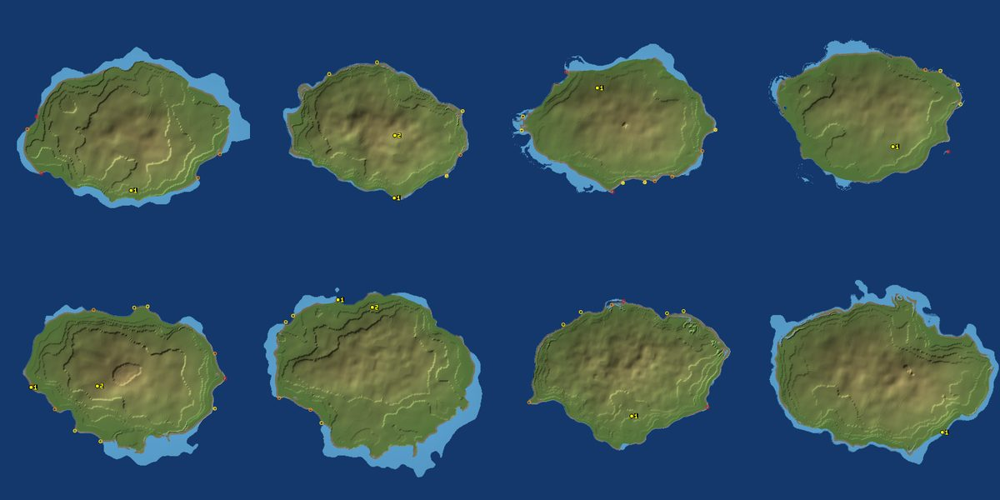

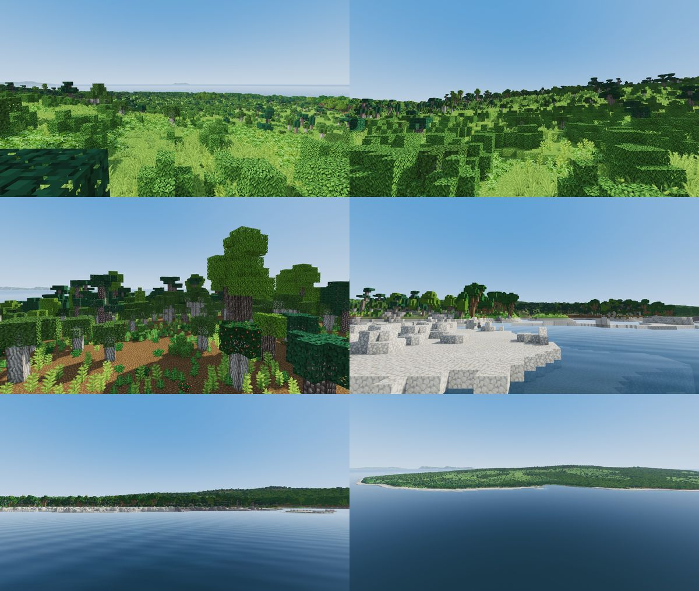

Figures, the start-up lines, on seeds 1 to 12 (median and range), beside Kikaijima's and the raised kind's on the same seeds; no figure of the reef kind is marked far outside on any seed, where the raised kind has three to eight of its eight marked on every seed. The last four rows are not printed: they were measured from the formed grid on seeds 1 to 8 as `interesting-world/notes/real-islands.md` measured them.

| Figure | Kikaijima | reef | raised |
|---|---|---|---|
| Height within 100 m of the shore, m | 4 | 5 (1 to 8) | 18 (8 to 35) |
| Shore rising 30 m within 50 m, % | 0 | 0 (0 to 0) | 17 (4 to 45) |
| Slope in the first 100 m, ° | 2 | 1 (0 to 4) | 6 (2 to 13) |
| Land under 50 m, % | 57 | 61 (55 to 70) | 37 (24 to 44) |
| Land over 60°, % | 0.0 | 0.0 (0.0 to 0.0) | 1.0 (0.0 to 2.8) |
| Fall at a crest, m | 0.05 | 0.13 (0.11 to 0.15) | 0.55 (0.44 to 0.63) |
| Height above the nearest stream, m | 10 | 17 (11 to 22) | 36 (24 to 46) |
| Deepest closed hollow, m | 1 | 0.5 (0 to 2) | 12 (2 to 24) |
| Highest point, m | 214 | 146 (115 to 201) | 404 (320 to 562) |
| Land, km² | 38.7 in an 8 km window | 13 (10.5 to 15.6) | 17.7 (13.0 to 20.7) |
| Median slope, ° | 3 | 4 (3 to 5) | 13.5 (9 to 18) |
| Land under 3°, % | 54.8 | 30 (20 to 47) | |
| Relief in 250 m, median, m | 15 | 27 (20 to 32) | |
| Relief in 1 km, median, m | 80 | 126 (102 to 146) | |
| Mean height over highest | 0.29 | 0.30 (0.25 to 0.32) | |

Forming takes 0.18 to 0.30 s (the raised kind 0.38 to 0.81 on the same seeds, the machine loaded by other work). `src/` gained 116 lines and lost 16 (`land.odin` 71 and 6, `rock.odin` 20 and 1, the start in `main.odin` 14 and 3), and `tools/blocks.py` changed one line and gained one.

Weak points: the island is a smaller Kikaijima, about a third of its land, steeper at 250 m and 1 km and with less flat ground, since in an 8 km region it rises about 150 m in 2 km where Kikaijima rises 214 m in 3 to 4; on a 12.3 km region (seed 1's island 9) it has 31 km². Under forest a riser reads only as the ground stepping up; it shows from a terrace's edge, from the air and on the open windward side. Its springs, sinkholes, dry valleys and caves are not made: `route` still fills every hollow, and the water that sinks comes out nowhere. "A warm sea" is not in its hosts, since no field says how warm the sea is. Its soil is the brown forest soil of every kind, where the Ryukyus' limestone carries a dark red clay, and its sand is the pale sand of every kind, not coral sand. The raised kind still names Kikaijima as the island it is after.

### Step 22, second half, as built

Built 2026-11-15 by Claude on the branch `t3/plates-region-history`: the islands near the start read from the plates' history in place of step 17's stand-in. The owner has not yet looked at it. The design is `foundations/plates.md`, section 6.

![The islands near the start on seed 7 (left) and seed 1 (right), 240 km across, north up, as the history makes them: on the left the start and its neighbours stand along the forearc's outer high (blue line), a cone where the volcanic front (red) comes near, land larger than a region hatched to the west and north-east; on the right the front runs down the coast of a continent with a crater on it, and the forearc between it and the outer high holds inlets, worn, ridge and raised islands by how fast each stretch rises](interesting-world/real/islands-from-the-plates.jpg)

- **What the game keeps of the history** (`known.odin`). Once the history has run and chosen its known world, `known_read` resamples that world every 2 km (500 by 500 samples): the ground's height and relief as the known world's map draws it, without its volcanoes; km past the volcanic front and the setback from the trench to it, on the plate over a slab; km before the trench, on the plate going down; the crust's age, kind and thickness; how fast it rose over the history's last step (its height over the sea against that of the cell its crust came from); its setting row; every volcano within the known world and every live hotspot. A distance to a boundary is blended only over the cells of the plate that has it. It depends only on the world's seed, so it is kept in `build/worlds/` (8 MB), named by the seed and a hash of `plates.odin` and `known.odin`, and read back in milliseconds; the land masses, the distance behind the coast of land larger than a region and the hotspots' tracks are made from it each start.
- **The world's fields from the history** (`world_at`): `setting`, `front`, `trench`, `track`, `age`, `rising` and `depth`, in the stand-in's units, so the kind rows' hosts were not changed. On the volcanic front the land is young (half a million years, the young cone's own, which steps of 2 Myr cannot tell), on a volcano's foot as old as its building, elsewhere the crust's age.
- **The forearc's outer high** (`OUTER_HIGH`), a row of the reading, since the history raises no forearc (`plates.md`, section 9): a ridge two fifths of the way back from the trench to the front, standing 2,500 m over the forearc's floor (a guess, after the Bonin ridge), its crest rising at most 1.5 to 2.3 mm/yr as Kikaijima's does, how much of that drawn for each stretch about 150 km long, from none (the Bonin ridge, drowned) to all.
- **Where islands stand**, as rows (`SITES`): on the volcanic front, 20 to 45 km apart; on the outer high, 30 to 60; on shelves (continental crust under less than 300 m of sea), 30 to 60; on the history's old volcanoes whose tops stand within 200 m of the sea; on the history's own small land. Candidates are taken nearest the start first, each its row's distance from those taken, within a square 200 km across; each takes a region 8 to 16 km across by Korčák's law and the kind whose host it holds best, never its nearest neighbour's, as in step 17.
- **The start** keeps the seed's kind and its own record, so **the default island and its start are unchanged bit for bit** (its `--map` and start-up lines identical to the parent's but for times; the cone on seed 3 too; `--bench=8` walks 43 m to the same point). It is put where its kind's host holds best in the known world; where it holds as well, on the forearc 60 km from the front, 30 km or more off land larger than a region, nearer the known world's middle. Its neighbours are new: on seed 7 there are 6 (raised and ridge islands along the outer high, a cone where the front comes near), where the stand-in had 17.
- **Land larger than a region** (over 400 km², `LARGE`) is the continent's, not formed: `continent` is the coast of such land nearest the start, traced round its samples, the crest of its range, the highest ground within 60 km of each stretch of coast, and its median height, which is the history's and no longer a guess.
- **The history's arc front is smooth.** Each stretch of trench drew its setback from a hash of its cell's index over 97, so along a trench crossing those stretches the front jumped by up to 90 km from one 36 km cell to the next, and its vents with it. It is now noise along the trench over about 1,200 km, 170 to 260 km as before. This changes every seed's history: the comparison's figures in `interesting-world/notes/real-plates.md` describe the first half's, and should be measured again; this machine lacks pygplates.
- **Seen.** `--archipelago=` draws the square and a margin, 240 km across: the history's trench, volcanic front, live and dead vents, the outer high, hotspot tracks with their volcanoes' ages, the coast and crest of land larger than a region, the history's land hatched, each island named; it prints how many sites each row gave. `--why=` ends with where the island stands in the history and why it is its kind. `--plates-why=x,z` takes a point in the world and follows its crust exactly: the history runs twice, the first time keeping, for every step, the cell each cell's crust came from (about 440 MB, 5 s). It had followed the plate under the point, which drifted at boundaries, ending up to thousands of kilometres off.

**The islands it gives**, with the reef kind merged, against step 17's stand-in on the same seeds (kinds, and where they stand):

| Seed | Known world | Islands near the start, from the history | The stand-in's |
|---|---|---|---|
| 7 | 28.8° N | 8: the start raised, 3 ridge, 2 more raised and an inlets island along the outer high; a cone on the front 90 km off | 17, every kind |
| 1 | 37.3° N | 13: the start inlets; on the forearc 4 raised, 3 ridge, 2 inlets and a worn island; an inlets island on the shelf; a crater on the front, which runs along the continent's coast | 18, every kind |
| 3 | 23.6° N | 13: the start ridge; 4 more ridge, 2 raised, a reef, an inlets and a worn island on the forearc; a crater and 2 cones on the front | 21 |
| 12 | 36.7° N | 12: the start inlets; 3 raised, a ridge and an inlets island on the forearc; 3 craters, 2 cones and domes on the front | |
| 2 | 39.7° N | 15: the start raised; 3 ridge, 3 raised, 3 reefs and a worn island on the forearc; an inlets island on the shelf; a crater, a cone and domes on the front | 20 |

**Against the real islands.** Every island on seeds 1 to 10 was formed alone and measured by the figures start-up prints (`REAL`), in both builds. A kind's islands are as close to their real islands as today's, since forming is unchanged: the share of figures marked far (!) is, history against stand-in, ridge 26% and 20, inlets 4 and 5, cone 11 and 5, crater 21 and 21, domes 25 and 20, raised 67 and 69 (the raised kind is not Kikaijima, the known gap a new kind is to fill); every median moves by less than the spread between seeds. Across the ten seeds the kinds' shares are close to the stand-in's (ridge 24% and 17, inlets 23 and 22, worn 14 and 15, raised 15 and 13, cone 8 and 10, crater 8 and 9, domes 5 and 11). What falls is how many there are round each start: 7 to 15 islands (mean 10.7) against 15 to 23 (19.4), and 3 to 7 kinds (mean 4.9) against 6 to 7 (6.6). Real island groups within 200 km hold 3 to 8 islands of one to three kinds (the Izu islands round Hachijōjima, the Bonin groups, Tsushima and Iki); the stand-in's crowded every kind round every start. All marks together: 25.8% far against 22.0%, by the mix, which holds more of the forearc's raised islands and fewer cones and domes. A square 250 km across would hold 8 to 21 (mean 14).

**With the reef kind merged** (weight 0, never drawn by the seed), reefs stand where the history puts them: on the outer high's fastest-rising stretches where the raised kind is taken by a neighbour, on seeds 2 (three) and 3 (one) of ten; forced at the start with `--kind=reef` its host holds fully on seeds 7, 1 and 3.

**What changed about the default island.** Its record, land, rivers, slide, places and start are unchanged bit for bit. Its neighbours are new, and with step 28 merged, so are its animals: the continent's nearest coast is now 59 km off, not 48, and the nearest island with ayu 33 km off, so the ayu's larvae did not reach it (chance 0.43, the seed drew 0.50). It keeps its kites, ospreys and yoshinobori. Its maps differ from the parent's only in the 521 pixels that marked streams with ayu.

**Speed.** Reading the kept world and making the archipelago takes about 20 ms. Entering seed 7, medians of five runs alternating with the parent under a load of 15 to 25 from other agents: with the start island alone 0.61 s against 0.60; with 64 km of islands 1.93 s against 1.73 before the merge and 1.99 against 2.41 after it (the parent itself ranging 1.5 to 4.4 s), held by the largest island within 64 km, here island 2, 14.3 km across, as the parent's is by one of 14.3 km. The first start of a world runs the history first: 2.54 s with the start island alone, 3.9 s with 64 km. The history itself is unchanged in cost (2.1 to 2.4 s); its rifts now make their noise once a split, not once for each way tried, which leaves it the same bit for bit. `arrivals_make` (step 28) takes 0.4 to 1.5 ms on the history's islands. Benches against the parent, alternating, under the same load (frame interval median, frames over 12.5 ms, then our work median): the start 8.33, 3 against 8.33, 2, our work 1.05 and 1.09 ms, 43 m on both; the forest flight 8.33 on every run, 13, 22, 1, 8 against 4, 87, 14, 5 over, our work 1.12 to 1.51 against 1.28 to 1.47; with `--near=0`, every other island formed beside play, 283 against 155 over, our work 2.91 against 2.11 (the parent forms 16 islands beside play, this 7); across the sea onto island 1, 8.33, 16 over, our work 0.72 (the parent's old flight to its cone 20 over, 0.92). Every difference turns over between rounds. Each world kept takes 8 MB on disk.

What the premises had wrong:

- **That the history's islands could be read as its land at 1 or 2 km.** On ten seeds its own small land never fell in the square round a start: the history is 36 km cells, and its relief only pokes over the sea along its coasts. The islands are sites the rows put on its settings, at real spacing.
- **That its forearcs would hold layered islands.** They stand 1.4 to 6.5 km deep, as the history leaves an ocean plate's edge; without the outer high's relief, seed 7's new history held 5 islands.
- **That a 150 km square holds an arc.** The stand-in squeezed the front to 40 km behind the trench; the history keeps it at 170 to 260.
- **That one rate for the outer high would do.** Every forearc island came out raised or ridge.
- **That `--plates-why` followed its crust.** It ended up to thousands of kilometres off on points at plate boundaries, in the parent too.
- **That the coast of land larger than a region closes where its trace began.** A trace can pass its first sample more than once; on seeds 1 and 2 it ran to its limit, half a million points, which `arrivals_make` searched for every island (90 to 110 ms). It now stops when it repeats its first move.

Tried and dropped: a start chosen by its host plus how many islands would stand round it, which put a forced reef where its host held 0.94 with no neighbours (the host now ranks first, to 0.02, and the rest only breaks ties); forearc sites across 30 to 70% of the way from the trench to the front (10 to 27 layered islands a seed); choosing the start as near the front as its host allowed (an inlets start 13 km from the front at the known world's edge); the outer high's stretches keyed by the game's coordinates, which move when the start is chosen, so a start could land where its kind's host no longer held; following a crust by where it formed, matched each step (each hole the grid fills by copying a neighbour shifts the copy's origin a cell, so the match wanders); running the history beside the start island's forming, which saves nothing, since the islands near the start wait for the history and take as long as the start island.

Not done:

- **The rest of a region's record** (`plates.md`, section 6, items 3 to 6): its uplift, its phases, its vents' sizes, its rock and its sea's last rise are its kind's row's, drawn from its seed. At 36 km and 2 Myr the history cannot tell one island's uplift or vent from its neighbour's, and reading them would change the default island.
- **One sea for the world.** Each kind keeps its own history of the sea (the call of 2026-11-14), so `arrivals_make` judges each strait by its island's own sea, not by one sea of the world's.
- **The volcanic kinds by cause.** Cone, crater and domes all stand on the front and alternate by the draw and the neighbour rule.
- **A young hotspot shield**, which no kind makes; it is left out, as before.
- **Latitude**: every island at 30° N, though the known world lies at 20 to 40° N (step 25).
- **The comparison with the real Earth** after the arc front was smoothed. *Rerun 2026-11-15 on eleven seeds (`interesting-world/notes/real-plates.md`, "Through time"): the smoothing moves few figures beyond the spread of the seeds. It makes more land masses of 10,000 km² to a million (149 today against 116 before; real 107), and seed 7, the default, now has one plate over 55% of the planet (the seeds' median 27%, real 20%).*

Weak points: the outer high's relief (2,500 m) and its stretches are guesses; the forearc's own rise is a row of the reading, not the history's; the history's settings come from its nearest 36 km cell, so an island's history row can name another trench than the one its front is read from (the default island's crust lies on a plate that sinks at one trench and rides over another); the start is always on the seed's kind, so a seed whose window holds no forearc puts the start where its host holds best, partly; entering depends on which islands lie within 64 km, so a seed with a 14.3 km island near the start enters in about 2 s; `src/` grew by about 380 lines of Odin: `known.odin` (307), `archipelago.odin` (446 to 572, the stand-in replaced), `plates.odin` (40 more); the judge of every picture was Claude.

### Step 24, as built

Built 2026-11-15 by Claude on the branch `t3/rock-stories`: each island near the start reads its rock story from where the plates put it, and the stories gain faults, dikes, plugs, plutons, a pile of lava laid over older rock, and the beds a pluton baked. The owner has not looked at it. The design is `foundations/geology.md`, sections 4 to 6 (stage 1); the choices are Claude's call of 2026-11-15 in `open-decisions.md`.

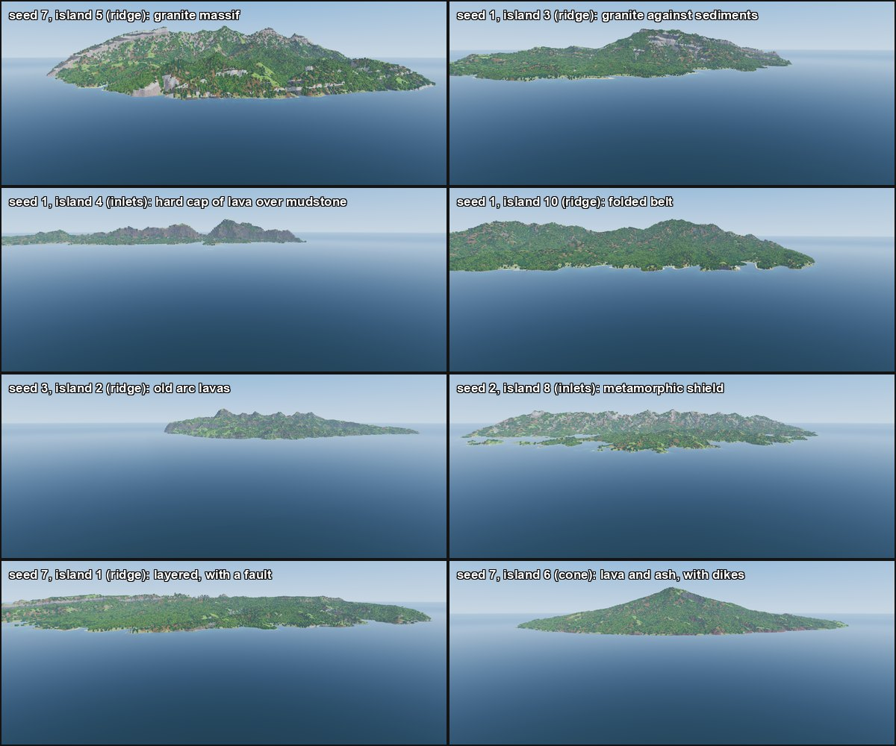

- **Which story.** A story row says what laid it (`laid`): the plates, before and as the island rose; its own vents, of runny lava or stiff; or coral. An island's kind says which by what its history does (`laid_by`: vents of a cone's form or a dome's, coral where it grows, the plates otherwise). Of the rows so laid, the island takes the first whose host holds at its middle (`story_read`, `HOLDS`), on the world's fields, three of them new: `crust` (km of crust), `offshore` (km out from the coast of land larger than a region) and `across` (the share of the way from the trench back to the volcanic front). The rows run from the most particular cause to the most common: the arc's lavas within 40 km of the front cap what lies under them (hard cap); a thick crust rising fast has its pluton unroofed (granite massif); old continental crust that barely rises is worn to its gneiss (metamorphic shield); thick crust otherwise has a pluton on one side (granite against sediments); a hotspot's track has flood lavas (lava plateau); within 120 km of a continent, whose rivers feed the trench and the basin behind it, the sediment is folded on the trench's side of the outer high (folded belt), lies flat where the crust hardly rises (flat-bedded), and is tilted where it rises (layered, gently tilted); a forearc beyond that reach is bare old arc crust (old arc lavas, after Hahajima and Chichijima). `--why` says which row held and, for each row before it, the window that did not. (Changed when step 24 met step 32's history: see "Step 24 on step 32's history" below.)
- **The start island keeps the story its kind names and its rock as it was** (`story_for`): no bodies, no cover, two forms of each rock. So the default island's land, rock, start-up lines, map and rock overlay are the parent's byte for byte, as are the start islands of seeds 3, 4 and 9; the test's hash of the start island is unchanged. Read from its setting, seed 7's start would tell the same story, layered, gently tilted, with its faults; `--why` says so. Deleting the first line of `story_for` reads it from its setting, the change that is to come with its uplift.
- **The rows.** All twelve of the design's are written, with the young volcanic island in two rows (runny and stiff lava) and two after the real islands the land is measured against: the reef (Kikaijima) and old arc lavas (Hahajima, Chichijima). Fifteen in all; eight of the design's twelve are in use, and eleven of the fifteen. On seeds 1 to 12, the 109 islands that read their rock tell: lava and ash 22, old arc lavas 19, flat-bedded 13, folded belt 12, layered 11, granite against sediments 9, pale lava and pumice 6, granite massif 6, reef on mudstone 5, hard cap over weak rock 5, metamorphic shield 1. Not in use, each for want of its setting: lava plateau (no island near the start stands on a hotspot's track), limestone platform (no site before a trench), soft coast (no shelf 300 km from a front), evaporite basin (no dry climate yet; salt joins with the wide world's rocks).
- **Bodies** (`Story_Body`, drawn in `bodies_draw`, worked out per column in `rock_base`). A fault is a steep break up to 9 km long, bent by noise, that lifts the stack on one side by up to 200 m at its middle and less toward its ends; water cuts its crushed zone up to three times faster (`rock_weak`, in the forming's `soft`), and its core a metre or a few wide is broken rock in the blocks. A dike is a wall 1 to 10 m wide that tapers to its ends: a story's dikes share one direction, or on a volcano run out from a vent. A plug is a warped pipe 60 to 300 m across. A pluton is a dome whose roof stands 150 to 1,200 m over the sea at its top and falls to 400 m under it at its edge, and it bakes the beds within 120 m over its roof (`AUREOLE`): mudstone to hornfels, sandstone to quartzite, limestone to marble (`FORMS`). Bodies narrower than half a cell drop out, as noise does, so dikes are in the blocks and not in the forming. Older bodies are crossed by younger: a dike runs through a pluton.
- **A cover**: a story may lay another's beds over its own on a surface worn across them (`cover`, `over`), as the hard cap lays the lava plateau's flows and red bole over mudstone, 90 to 190 m over the base, within 2° of flat. It lies across the faults, which are older. Its beds sit in the top half of the same table (`COVER_AT`), so a rock at a height is still one lookup.
- **Folds in ridges** (`ridges`): the folded belt and the shield fold their beds in parallel ridges 1.2 to 2.6 km apart, 250 to 700 m high, so their beds stand at 30 to 70°, rather than in domes and basins.
- **Twenty-two rocks in four forms.** Twelve new: red sandstone, chalk, coal, breccia, dolerite, granite, slate, schist, gneiss, quartzite, hornfels and marble. Each rock has its solid form, its scree, its form broken in place, and its gravel, 88 rows of 123 materials. Where the rock was read from the setting, two blocks of broken rock lie between the soil and the solid rock (`BROKEN`), a fault's core is broken, and a river's gravel is of the rock most of the land it drains is cut in, of those strong enough to stay gravel (`pebbles_make`, a majority vote carried down the drainage). `tools/blocks.py` gives every old material its tile exactly as before.
- **Tuned by the real islands' figures.** Granite at the design's 0.85 made spikes: 49 to 65% of the land steeper than 45° and 14 to 25% over 60°, where real arc islands have 0.8 to 2.9%. As a rock mass weathered deep in a wet climate it is 0.65 (0.0 to 3.4% over 60°), gneiss 0.7, and breccia 0.35, with the old arc lavas' flows two beds in five, which brought those islands' crests from a fall of 1.45 to 1.54 m to 0.9 to 1.1 (Hahajima 0.81). The hard cap's surface stood 60 to 160 m up, which left islands of 400 m of lava; at 120 to 240 m the weak rock under it was cut away and the cap was gone; at 90 to 190 the lava caps the hills, 3 to 20% of the surface.
- **Seen.** Start-up says the story and its bodies; `--why` the story, why not each row before it, the rock under the point and any body or fault near it; `--survey` each body and where it lies in the world; `--archipelago` names each island's rock; the rock overlay paints the new rocks.

**Against the real islands.** Every island on seeds 1 to 12 (121) was formed alone in this build and the parent and measured by the figures start-up prints. Figures marked far: 185 of 848 against 190. On the 109 that read their rock, by kind, this against the parent: ridge 20% and 22, inlets 4 and 4, raised 68 and 69, cone 8 and 8, crater 27 and 24, domes 19 and 21, reef 0 and 0. Islands on strong rock stand higher: old arc lavas 244 to 727 m (the same islands on layered rock 193 to 573; Hahajima is 458 m and Chichijima 320), granite massifs 649 to 814 m (250 to 393 on layered rock; Yakushima, 25 km across, is 1,936 m), the shield island 693 m (223).

**Speed.** Entering seed 7 with the islands within 64 km, five runs alternating with the parent under a load of 6 to 10 from other agents' work: 1.68 s against 1.65, held by island 2 (14.3 km), which forms its land in 1.43 s at best and 1.49 at the median against 1.40 and 1.53 (eight runs each). A first version kept each land cell's whole record of what lies under it (16 bytes where the base was 4), and erosion, which reads it every step, slowed by about 0.05 s on that island; the grids now keep the base alone and a second array only on an island whose cover, plug or pluton the 16 m cells can hold (`Grid.bodies`). Island 3, now flat-bedded, forms in 1.14 s against 0.98, the same code taking 0.95 on its old rock: the new land takes longer to wear. The start island alone: 0.58 s against 0.57. Benches against the parent, alternating, frame interval median and frames over 12.5 ms, then our work median: the forest flight 8.33, 1 and 10 against 7 and 1, our work 0.96 and 0.99 against 1.12 and 0.97; down through cloud 0 and 0 against 4 and 0, our work 0.69 and 0.75 against 0.83 and 0.77; over the cone, whose 15 dikes and 2 plugs every column reads, ten rounds: 1 to 27 over (median 15) against 0 to 21 (median 7) in the seven with the parent run first, and 5 to 8 against 3 to 10 in the three with this run first; our work 0.94 to 1.50 against 0.91 to 1.74, over 12.5 ms in one frame of the ten rounds on this and none on the parent. A sample of that flight finds `rock_base` in 57 samples, against 346 in `build` and 312 in `land_at`, and the parent busier in the same seconds. Faces drawn are the same (557 to 560 thousand against 563 to 566 thousand). `src/` grew by 639 lines (778 added, 139 removed): `rock.odin` from 234 to 728, 215 of them the fifteen rows; `gen.odin` by 122, mostly the 68 new materials' rows; and `tools/blocks.py` by 25.

**Determinism.** Forming is the same bit for bit on any thread (`./build.sh test`). Island 1 of seed 7 now has a fault, so its hash in `GOLDEN` changed on purpose; the start island's did not.

Not done:

- **The start island's rock from its setting**, waiting for its uplift (step 32), by the owner's decision.
- **The sediment source mix** beyond gravel: beach sand and shingle are still of the rock at the shore, and gravel carries one rock, not a mixture.
- **Deposits** (coal is a bed; iron, clay and galena are not features yet) and inspection by body names.
- **Faults that dip**, thrusts and drag folds: every fault is vertical. A sill is a bed, and none is drawn.
- **Volcanic kinds by cause** (still alternating on the front), and a volcano built on older rock: a cone's lavas lie over the sea floor, so no cone shows a basement.
- **The cliff and ledge rules know nothing of steep beds or bodies**: a pluton or dike stands whole with no ledges, and on beds standing at 60° the ledges, written for gently dipping beds, step as if they lay flat. The baked rock of an aureole is stepped by the strength of the bed it was, not of the hornfels.
- **Soils and plants** do not read the new rocks: granite's coarse sand, chalk's thin soil and the ash soils on old lavas wait for the soil rows.

Weak points: every host's thresholds are guesses argued from a handful of real places, and a row's place in the order decides ties (an island within 40 km of the front gets the hard cap whatever its crust); `offshore` 120 km decides between sediment and old arc lavas, so a seed far from any continent (3, 9) is all old arc lavas, and one near it (7, 8) has none; heights of 650 to 900 m on islands 8 km across are higher than any real island of their kind's set but Mikurajima; dikes 1 to 3 m wide show in a cut but hardly from 100 m; the granite reads almost white in sunlight, close to the quartzite round it; the judge of every picture was Claude.

### Step 32, first half, as built

Built 2026-11-15 and 16 by Claude on the branch `t3/earth-plate-history`: the plates' history nearer the real Earth, measured on eleven seeds (1 to 10 and 12) against Müller et al. 2019 and the PaleoDEMs. The owner has not looked at it. The full comparison and its pictures are in `interesting-world/notes/real-plates.md`, "Through time"; the design, its costs and its weak points in `foundations/plates.md`.

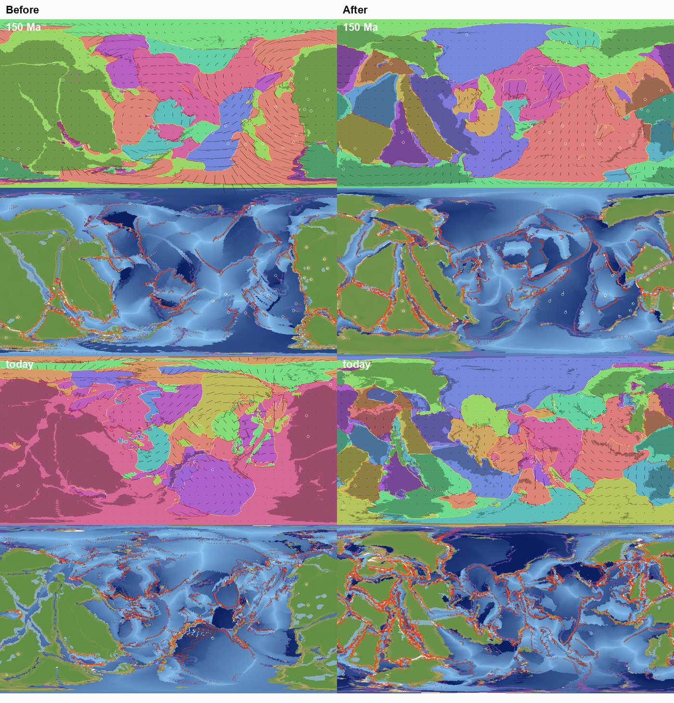

**What changed for the player.** Every seed's world is a new history, so its known world, the continent off the start and the islands round it change; the start island keeps its kind, its record and its land bit for bit (seed 7's `--map`: the same 74,907 land cells, highest point, slide, rivers, places and start). On the planet: the continent of a seed breaks into pieces of real size, no one plate holds half the world, and the continent's range behind the islands is built from collisions that last. Seed 7's start now stands on a forearc of thinned continent 25 km thick, a shallow shelf, 58 km off the continent's coast, with 21 islands in the square round it where there were 8; and, through a reading of the archipelago that this step did not touch (below), sika deer walk to the default island at the sea's low stand and lay 42.6 km of trail on it, and ayu reach its streams. Those are the only differences in its map (6,379 of 1,048,576 pixels). Entering seed 7 takes 2.64 to 2.69 s against 2.31 to 2.32 (three runs each, alternating), since 9 islands lie within 64 km of the start, not 3.

**What was traced, and what was changed**, root causes first. Each change was judged on all eleven seeds, alone and together; the medians at 250 Ma, 150 Ma and today, before, after and real:

| Figure | Before | After | Real |
|---|---|---|---|
| Largest plate, % of the planet | 41, 32, 27 (seed 7 today 55) | 17, 12, 10 (seed 7 today 10) | 36, 16, 20 |
| Plates | 11, 15, 20 | 17, 22, 40 | 11, 32, 51 |
| Largest land mass, million km² | 180, 147, 85 | 172, 81, 57 | 147, 78, 78 |
| Land over 1 km, % of the planet | 1.0, 1.1, 1.6 | 1.0, 2.4, 4.3 | 1.2, 3.3, 5.7 |
| Ocean floor older than 120 Myr, % | 37, 6, 8 (19 at 200 Ma) | 25, 7, 11 (13 at 200 Ma) | 5, 1, 13 (2 at 200 Ma) |
| Continental plates, mm/yr | 5, 19, 19 | 15, 19, 20 | 36, 19, 27 |
| Converging boundary, thousand km | 78, 114, 120 | 109, 123, 200 | 66, 70, 60 |
| Continental crust, % | 38, 38, 38 | 38, 37, 37 | 35, 37, 42 |

- **The giant plate grew by joins, not by spreading** (traced on seed 7 and others). At 64 Ma two plates of 160 million km² each "collided and joined" because 800 km of their boundary had collided for 40 Myr while the rest of it went on spreading and subducting; ocean plates split off as old ocean began to sink under a continent rejoined it 40 Myr later the same way (floating crust at the trench counting as a collision, an inference not traced); the first continent's halves rejoined 46 Myr after rifting. Plates now join only where the collision holds half or more of the boundary they share (`MERGE_SHARE`). This closed the giant plate on every seed and, with nothing rejoining, raised the plate count and the high land (collisions now last).
- **Stray cells were floating crust going down.** Seed 3 had 304 stray pieces under 60,000 km² today, four fifths of their area arc-thickened crust or continent: a plate going down carried floating crust that cannot sink, and it ploughed on into the plate over it as a stray piece of the plate going down. Floating crust that is not continent is now scraped off onto the plate over it (`accretes`): 29 such pieces on seed 3.
- **Rifts cut fingers and strips.** A rift wandered up to 700 km off its line over waves of 900 km, so its two sides interleaved, collided as they parted and rejoined, and left narrow channels of young ocean inside the continent; and of six lines through the continent's middle the most even was taken, so long continents were cut lengthwise into parallel strips. A rift now wanders up to about 380 km over 2,000 km and takes the shortest line that leaves a quarter of the continent or more on each side (the shortest rift needs the least force to break). With the joins this brought the breakup forward: the largest land mass at 150 Ma is 81 million km² against the real 78 (147 before).
- **High land was lost at the cap.** Collision stacked the crust going under onto the one cell in front, capped at 75 km, so a collision built a wall one cell wide and lost the rest. Continental crust thicker than its neighbour on its plate by more than 5 km now spreads into it, a fifth of the excess a step (`SLUMP`, `FLOW`), into a belt hundreds of km wide. With collisions that last, land over 1 km rises through the history from 1.0 to 4.3% of the planet, where it stayed at 1.0 to 1.6.
- **The old ocean was in plates' middles and on passive margins, not behind trenches.** At 250 Ma only 7 to 9% of the floor older than 120 Myr lay within 700 km behind a trench on the plate over it; where two ocean floors meet, the younger goes over two times in three. Old ocean now founders under the younger from 110 Myr, not 140, about every 30 Myr, not 60; a passive margin that turns active does so on the side of its continent where its ocean is oldest, not all round it (which made ring-shaped plates). This takes the excess down by a third to a half, not away.
- **Continental plates were held still until the history began**, so they stood at 5 mm/yr at 250 Ma. They are released 20 Myr before it (`HOLD`), and the mantle drags on continent 1.5 times as hard as on ocean floor, not twice (`KEEL` 0.5 for 1). Collisions resist a little more (`COLLIDE` 500 for 400), which keeps continents from shrinking now that collisions are not ended by joins: over the history they consume 55 to 59 million km² of continent and arcs make 18 to 22 (traced on seeds 7, 3 and 1).
- **The comparison** measures speeds in both worlds with the whole surface's net rotation taken out, as ours is made (Müller's frame has little: real speeds move by at most 6 mm/yr), and `--summary` prints the median and range over seeds, as the table above.

**The islands near the start**, every island on seeds 1 to 10 formed alone and measured by the figures start-up prints (`REAL`), against the parent:

| | Parent | Step 32 |
|---|---|---|
| Islands, all ten seeds | 108 (7 to 15 a seed, mean 10.8) | 131 (5 to 21, mean 13.1) |
| Kinds a seed | 3 to 8 (mean 5.0) | 4 to 8 (mean 5.7) |
| Figures marked far (!) | 23.3% | 21.3% |
| By kind, far | cone 9.7, crater 22.2, domes 25.0, inlets 4.0, raised 68.3, reef 0, ridge 24.0, worn 0 | cone 1.1, crater 19.6, domes 21.9, inlets 2.8, raised 68.4, reef 1.6, ridge 20.8, worn 0 |

Forming is unchanged, so each kind is as close to its real islands as before; what moves is the mix and the count. Seeds 1 and 2 have 5 islands each, as real groups that size hold 3 to 8; seeds 7 and 10 have 21. On seed 7 the cause is the reading's outer high: 2,500 m of relief two fifths of the way from the trench to the front (`OUTER_HIGH`, `archipelago.odin`, step 22's guess for oceanic forearcs) added to a forearc that the new history makes a continental shelf, so it stands at the sea's surface, takes 11 islands along it, and bares a way for deer from the continent at the low sea. It is in a file step 24 is changing, so it was left, and put to the owner.

**Cost.** The history takes 2.1 to 3.2 s (mean 2.37) against 2.0 to 2.9 (mean 2.20) for the parent, on seeds 7, 1, 3 and 12, three rounds alternating, under a load of 6 to 7.5 from other sessions: about 0.17 s more, from twice as many splits, each scanning the planet's cells on one thread, and twice as many plates. One more array of 1.6 MB. Benches against the parent under the same load (frames over 12.5 ms, our work median): the forest flank 24 and 1.62 ms against 30 and 1.85; down through cloud 4 and 1.32 ms against 10 and 1.99. Neither build meets "none over 12.5 ms" with other sessions running. `plates.odin` grew by 45 lines to 1,159; the comparison tool by 51.

**Checked.** The final code reproduces the experimental build's frames byte for byte on all eleven seeds (286 frames); `./build.sh test` passes with the start island's hash unchanged and island 1's updated (it is a new island, an inlets island where a ridge island stood); `odin check src -vet-unused` is clean.

Tried and dropped:

- **A younger first ocean** (0 to 50 Myr old at the start, not 40 to 100): only moved the old floor later (20% older than 120 Myr at 150 Ma against 7).
- **Faster arcs with stronger collision** (arc crust 0.5 km a Myr, `COLLIDE` 800): continental crust grew to 47%, but the new continent stood under the sea and took up its water, and land fell to 15%.
- **Smoothing plate boundaries over two rings of cells**: no measurable change in how ragged the plates are; the lobes are hundreds of km across.
- **Margins turning active twice as often**: more plates and old ocean a little lower, but longer boundaries, and real passive margins are stable (the Atlantic's are 180 Myr old).
- **Rifts only in plates of 35 or 50 million km² or more**: fewer plates, but old ocean back up and boundaries no shorter.

Weak points: boundaries are still two to three times the real length, now because 39 of our plates are over a million km² against the real 18 and their outlines are lobed (2.0 to 2.2 times a circle's perimeter against 1.3 to 1.5); the first ocean floor is still too old at 250 and 200 Ma; continents hold level where the real grow (partly the real model's own mapping); the whole surface is 10 to 25% slower than the real; continents are low plains that a rise of the sea drowns at once, and they make twice the real number of small land masses; the islands near the start vary more in number from seed to seed; the judge of every picture was Claude.

**What this half taught the second.**

- **The history's ground under a forearc is no longer always deep ocean.** The archipelago's reading was written against a history whose forearcs stood 1.4 to 6.5 km deep; on a continental margin its outer high and its shelf sites take most of the square. A regional history must make the forearc's relief itself, from the crust it stands on, rather than add a fixed ridge to whatever the planet's cells say.
- **A seed's known world can change completely with any change to the history**, and the start island's neighbours, animals and entering time with it, while the start island's land stays bit for bit. The regional history will be the second change of this kind; checking the default island's map and its arrivals belongs in every such step.
- **Traces answer what the comparison cannot.** Each root cause here (joins, floating crust, the rift line, the cap, where old ocean lies) was found by printing events or tallies from a scratch build, not by reading the figures; a figure moved by one change on one seed is noise.
- **The planet's cells are 36 km, and the real Earth's microplates are under a million km².** The real plate count today comes from 33 plates our grid barely holds; a regional history is where small plates (back-arc basins, a Philippine Sea) can be made at their size.

### Step 24 on step 32's history

Done 2026-11-16 by Claude on the branch `t3/tune-rock-rules-plate-history`, from `step-32a` (step 24 with step 32's first half merged on top, and the forearc's outer high kept off the shallows): step 24's rock rows made to hold on the new history. The owner has not looked at it. The choices are Claude's call of 2026-11-16 in `open-decisions.md`.

**The cause.** Step 24's hosts read two fields as signs that only the old history made true. Thick crust stood for an arc's crust, where magma pools, and an age of 250 Myr or more for a worn old shield. Under the old history the forearcs near the start stood on ocean floor or arc crust. Step 32's puts them on the thinned edge of a continent: 17 to 31 km of crust, 350 Myr old (the age every piece of the history's first continent has), 100 to 180 km in front of the volcanic front, 10 to 130 km off the coast. There:

- **Granite against sediments (crust 18 km or more)** took 23 of 131 islands, against 9 of 108. Its baked rim of hornfels and quartzite stood as faces: 5 of the 10 inlets islands on it had over 1.7% of their land over 60° (Tsushima 0.0, Chichijima 0.8).
- **Granite massif (crust 20 km, rising 0.9 mm/yr)** took every raised island on that crust, since the outer high rises that fast. Those islands stood 722 to 995 m high, with 92% of their figures far. Kikaijima's own setting, on a forearc's outer ridge rising 2 mm/yr, would read as granite wherever its crust is 20 km or more (not checked), where its rock is mudstone under reef.
- **The metamorphic shield (crust 28 km, 250 Myr old, rising 0.3 mm/yr or less)** took five islands on that forearc, against one on `main`. That one stood on a shelf no trench works (`across` 10,000), as Lewis does. The new five carry quartzite (0.95) holding 70°, so 2.3 to 5.5% of their land was over 60°, and they stood 564 to 887 m high. One of them is island 7 of seed 7: 808 m, 272,366 land cells, 2.24 to 2.29 s to form alone and 3.05 to 3.12 beside the others, which is what made entering slow.
- **The rock law ran past its 60°.** It was written when grit (0.8) was the strongest rock, and step 24's hornfels (0.85), dolerite (0.9) and quartzite (0.95) hold 63, 66 and 70°.
- **Two other rows met the same history.** Flat-bedded would take every inlets island on that forearc in place of the shield: island 7 flat-bedded is 535 m and 181,051 cells, 1.97 to 2.01 s alone, with 2.2% of its land over 60° on grit caps. Old arc lavas, the rows' fallback, took 9 of the 19 raised islands, those on young ocean floor 140 to 250 km off any continent, rising 0.8 to 1.9 mm/yr (83% of their figures far).

**What changed**, all rows and one rule in `src/rock.odin`; nothing in `plates.odin`, `known.odin` or the forming:

- **Granite massif holds only within 50 km of the volcanic front** (fading to 70), where the arc's magma rises. It is now the first row, before the hard cap, as the most particular. Yakushima stands about 20 km from Kuchinoerabujima on the front (memory). Kikaijima stands far in front of it.
- **The shield, granite against sediments and flat-bedded hold only off the forearc** (`across` 1 or more, from 0.95): behind the arc's front, as Oki-Dōgo and Tsushima, or on a margin no trench works, as Lewis and Arran. On a forearc, the crust lies under what the trench scrapes up and what the basin behind it fills with, and the trench tilts that basin's beds, as Boso's.
- **Old arc lavas holds only more than 140 km from a continent, on a high rising under 1 mm/yr**: the Bonin ridge, which stands still. A high rising as fast as Kikaijima's was deep under the sea until lately, and carries up the beds laid on it. Layered, gently tilted moves to the end of the plates' rows and holds wherever none before it does.
- **The rock law stops at 60° at strength 0.8**, as its comment and D4 say: `min((s - 0.2)/0.6, 1)`.

**The islands near the start**, every island on seeds 1 to 10 formed alone. The figures are the start-up lines from "against " on, a figure being far where it carries `!`:

| | `main` (step 24, old history), 108 islands | step 32a alone, 131 | parent (both), 131 | this, 131 |
|---|---|---|---|---|
| Figures far | 21.9% | 21.3% | 23.7% | 21.4% |
| cone | 8.3 | 1.1 | 0 | 0 |
| crater | 25.0 | 19.6 | 19.6 | 17.9 |
| domes | 25.0 | 21.9 | 21.9 | 21.9 |
| inlets | 4.0 | 2.8 | 11.1 | 4.2 |
| raised | 65.0 | 68.4 | 78.9 | 71.1 |
| reef | 0 | 1.6 | 1.6 | 1.6 |
| ridge | 20.5 | 20.8 | 16.7 | 19.2 |
| worn | 0 | 0 | 0 | 0 |

- **Inlets** (Tsushima's kind): its islands on the forearc are now layered (13) and folded belt (8), sandstone and mudstone as the Taishu group is, each 3% far. Over 60° is far on 3 islands, against 12 on the parent and 5 of 25 on `main`.
- **Raised** (Kikaijima's kind): 17 of its 19 islands are layered, the Shimajiri mudstone's row. Leaving out the deepest closed hollow, its figures are 70.7% far, against 70.5% on `main`. The hollow is far on 14 of 19, against 4 of 15 on `main`. That hollow is mostly the lake the island's landslide dams. With step 24's faults the slide is larger on five of six islands checked, 1.7 to 7.5 times the volume, and its lake deeper. Formed without their bodies, the same 19 islands have the hollow far on 7 and the kind at 67.8%. Formed with the faults but without the faster cutting along them, the hollow is far on 10. Inlets' small excess over `main` is the same figure: 5 hollows far against 2.
- **Reef** is far on one figure of one island (a crest), on step 32a alone too: the history's, not the rock's, since the reef kind's rock is its own.
- **The stories near the start:** layered 49, folded belt 21, lava and ash 18, pale lava and pumice 16, old arc lavas 14, reef on mudstone 8, lava plateau 2, hard cap 2, granite against sediments 1. On the parent: granite against sediments 23, old arc lavas 21, lava and ash 18, layered 17, pale lava and pumice 16, reef on mudstone 8, granite massif 7, folded belt 7, flat-bedded 7, metamorphic shield 5, hard cap 2. Nine stories are in use, not eleven: almost every island near the start stands on a forearc, and the plutons, shields and flat beds need ground behind the arc, on a margin no trench works, or near the front.

**Entering seed 7** (`--bench=1`, wall time, three to four rounds alternating, load 4 to 6): `main` 2.74 to 2.81 s, the parent 4.16 to 4.27, step 32a alone 3.08 to 3.09, this 3.10 to 3.35 (3.10 to 3.14 in six of seven). Island 7, now layered, forms in 1.46 to 1.50 s alone and 1.95 to 2.00 beside the others, as on step 32a alone (1.93 to 1.95). The rest over `main` is the history's: nine islands within 64 km, not three, island 7 among them 14.3 km across. Each forms about a third slower beside the others than alone. The flood that routes water over the land, one priority queue on one thread each step, takes about a third of island 7's forming (36% of the samples of a profile). Benches against the parent, alternating (frames over 12.5 ms, our work median): the forest flank 22 and 21 against 19 and 21, 1.64 and 1.69 ms against 1.68; down through cloud 10 and 9 against 5 and 11, 1.39 and 1.33 ms against 1.39 and 1.46. Neither meets "none over 12.5 ms" with other sessions running.

**Checked.** The default island's map, rock and strength overlays and start-up lines are the parent's byte for byte. `--why` on it now says that read from its setting it would be layered, gently tilted, with its bodies, as step 24 found on the old history; on the parent it said granite massif. `./build.sh test` passes: the start island's hash is unchanged. Island 1's changed on purpose: it was a metamorphic shield and is now layered. `odin check src -vet-unused` is clean. The final build reproduces the measured run's start-up lines and maps on all 131 islands.

Weak points: `across` is a blunt sign of a forearc. Real forearcs show old basement and plutons in places (Chile's coastal range; the Miocene granites of SW Japan's outer zone, of which Yakushima is one, made where a young hot plate went down, which no field says yet). Tsushima's own setting, behind the arc on old continental crust, would read as a shield if its crust is 28 km or more (not checked), where its rock is folded sediment with a granite. Old arc lavas, granite and the shield no longer appear on the raised kind, so its islands are as far from Kikaijima as plain layered rock leaves them. Every threshold is still a guess from a handful of real places. The hollow figure is one slide on each island, so a run moves it by a few islands either way (ridge's went from 2 to 5 far between two runs that changed only a dolerite plug's steepest slope). The judge was Claude, by the figures alone; no picture was taken.

### Step 33, as built

Built 2026-11-16 by Claude: forming faster again, every island coming out bit for bit as before. The owner has not yet looked at it; there is nothing new to see but the time it takes.

**Where the time went.** Entering seed 7 (`--bench=1`, launch to exit) took 3.16 to 3.28 s on the parent. About 1.15 s of that is the window's start, the second of bench and the exit; the sky line came at 2.02 to 2.13 s. Reading the known world and making the archipelago took about 20 ms. The rest was the nine islands within 64 km, formed side by side beside the start island, and entering waited for the slowest: island 7, an inlets island 14.3 km across with 216,000 land cells at 16 m until the sea's 119 m rise left 105,614. It took 2.01 to 2.05 s beside the others and 1.87 s alone, all but about 30 ms of it on its own thread. The others were done by 1.6 s; the next slowest was island 5 (raised, 12.3 km), at 1.51 to 1.58 s.

Island 7 alone spent its time as follows:

- the flood 988 ms: 13.9 million cells taken from the heap over 266 floods (150 at 64 m of 15,000 to 24,000 cells, 50 at 32 m of 54,000, 30 at 16 m of 216,000, and 8 after the rise of 106,000);
- `erode` 235 ms;
- the tracer of the deer's 377 trails 177 ms;
- `coast` 139 ms;
- the slide 49 ms, the steepest way down 48 (shared), the places 46, setting up the flood 45, the land's fields 35, summing the land drained 33, `creep` 32 (shared), the figures 17 and the roofed places 16.

Replaying the flood's 27.7 million pushes and pops on their own took 790 ms of the 988: the heap was four fifths of the flood. Three things were not as expected:

- **Beside the others island 7 lost only 7%, not a third.** Most of what it lost was in its shared loops, whose helpers were busy with other islands: the steepest way down 48 → 74 ms, `creep` 32 → 46, refining the grid 15 → 26. Its serial loops lost 2 to 8% to the caches. Entering was held by island 7's own serial work, not by the order or sharing of the islands' work.
- **The heap was slow from comparing floats, not from its depth.** A pop passes its hole down 10.8 levels on average (the heap held 4,149 cells on average, 8,372 at most). At each level the processor compared two floats and turned the result into the next index. Read as integers, the same keys took 44% less. Reading two levels at once, keeping the keys apart from the cells, and selects in place of the push's and the climb's branches gained nothing more (0 to 3.5%).
- **Half the shore loop was finding the shore.** Of `coast`'s 66 ms along the shore, 32 went on reading each land cell's eight neighbours, in the flood's order, to find the few beside the sea.

**What changed**, none of it changing a value:

- **The heap** (`erosion.odin`): keys are compared as the integers of their bits, which order a float no lower than +0 as the float does. Every key put in is one: heights over the sea in the flood, seconds in the tracer, metres to the sea in the land's fields. The items are kept from 1, so a node's children share a pair of slots, and the slot after the last holds `HIGHEST`, so a missing right child is never the smaller, with no clamp. The flood went from 988 to 660 ms. Replayed on its own, the heap went from 790 to 435 ms, with every one of the 13.9 million pops the same.
- **The flood's loop:** the neighbours not yet reached are found as eight bits, read before any is marked, with no checks for the grid's edge away from it. Setting up reads eight cells' sea at once as one word, so open sea and the land away from the shore pass eight at a time: setting up went from 45 to 25 ms.
- **`span`** tells a neighbour's row from how far on it lies, rather than dividing twice for each cell. `erode` skips `exp` where the cell it drains to has eased to a plain face, where the result is exactly 1.
- **The tracer** (`trails.odin`), 177 → 102 ms:
  - `pace` takes the way's part (`walking`, one `exp`) worked once for both cells of a step, where it worked it for each;
  - it takes each land cell's wetness and plants from a table made once per island (`going`, shared), where it worked them out at every step;
  - it passes over a neighbour already reached for no more than the cell in hand, which nothing added could improve.
- **`coast`**, 139 → 102 ms alone and 138 → 120 beside the others:
  - wearing the platform and marking the land beside the sea are one pass, shared among threads. The marks are kept in `seen`, free between floods, which rebuild it.
  - A cell the sea cuts through marks its neighbours, so the cells after it in the loop see the sea as they did.
  - Its table of where each mouth's silt has reached is kept from step to step, with the mouths numbered across the grid, so it is never cleared. Making it afresh each step, 3.2 MB at 16 m, had cost island 7 about 6 ms (silt 28 → 22 ms).
  - `erode` reads back lines of the grid the helpers wrote and loses about 20 ms of this. The same pass on the forming thread cost 94 ms.

**Identical.** On the parent build and this one:

- `./build.sh test` passes with `GOLDEN` unchanged.
- A hash of everything forming leaves is the same for every island of seeds 7 and 3 (21 and 10 islands), each formed alone and all formed side by side. It covers what step 31's hash did: every per-cell array of the land and its grid, the drainage order, the features, the rivers' segments, ribbon and falls, the trails, the stacks, the roofed places, the fish and the places' candidates. The hash changes when the heap takes the right child on a tie, so it sees the order of ties.
- The `--map` is the same byte for byte, with every start-up line but the times, for island 0 of seed 7, its islands 1, 6 and 7, and `--kind=cone`, `crater`, `inlets`, `domes`, `raised` and `reef` on seed 3.
- The thread sanitizer found no race forming island 7 alone, nor all 21 islands of seed 7 side by side.

**Times** of island 7 of seed 7, medians of six runs alternating with the parent, timed inside the forming. Formed alone under a load of 3.3 to 3.7, and beside the others on entering under 3.3 to 6.9:

| Island 7 | alone, before, ms | alone, after, ms | beside the others, before, ms | beside the others, after, ms |
|---|---|---|---|---|
| all forming | 1,874 | 1,430 | 2,006 | 1,579 |
| the flood, all floods | 988 | 660 | 1,037 | 708 |
| setting up the flood | 45 | 25 | 46 | 25 |
| the steepest way down | 48 | 42 | 74 | 74 |
| summing the land drained | 33 | 34 | 34 | 33 |
| `erode` | 235 | 256 | 255 | 265 |
| `creep` | 32 | 30 | 46 | 49 |
| `coast` | 139 | 102 | 138 | 120 |
| refining the grid | 15 | 15 | 26 | 28 |
| the slide, with its wear | 49 | 37 | 49 | 38 |
| the land's fields | 35 | 34 | 35 | 34 |
| the trails (the tracer) | 194 (177) | 120 (102) | 195 (177) | 122 (104) |
| places | 46 | 46 | 48 | 48 |

The default island alone: 0.58 → 0.47 s. Island 5 beside the others: 1.51 to 1.58 → 1.20 to 1.26 s. `--archipelago=` forms seed 7's 21 islands side by side in 2.6 to 2.7 s against 3.0 to 3.2.

**Entering**, `--bench=1` wall time, in eight rounds alternating with the parent under a load of 7.0 to 10.6:

| Seed 7 | before, s | after, s |
|---|---|---|
| launch to exit, median (range) | 3.18 (3.16 to 3.28) | 2.75 (2.72 to 2.84) |
| the sky line, median (range) | 2.04 (2.02 to 2.13) | 1.60 (1.56 to 1.68) |
| island 7 beside the others | 1.99 to 2.11 | 1.54 to 1.65 |

Before step 32's history, `main` took 2.74 to 2.81 s. A freshly built binary's first launch takes about 0.3 s more on this machine, and was left out.

What the premises had right and wrong:

- **That island 7's flood was the cause**: right. It was half of island 7's forming, not a third, and its heap was four fifths of it.
- **That islands form a third slower side by side**: not for island 7, which lost 7%. The small islands lose more (the default island 0.58 s alone, 0.65 to 0.72 beside the others), but they are done long before it.
- **That the order and sharing of the islands' work might matter as much as any loop**: wrong here. Helpers that take the largest island's work first, and island 7's thread kept on a performance core by the interactive class of service, changed nothing. What island 7 loses beside the others is helpers that cannot get a core.

**Cost.** The benches were run against the parent alternately, under a load of 4.5 to 11.7 (parent first in each pair):

| Bench | frames over 12.5 ms | our work, median ms | our work, worst ms |
|---|---|---|---|
| forest flight, three rounds | 22, 16, 20 against 10, 17, 17 | 1.59, 1.51, 1.52 against 1.46, 1.62, 1.51 | 46.0, 10.3, 37.4 against 8.5, 9.0, 7.3 |
| down through cloud, two rounds | 5, 3 against 4, 6 | 1.28, 1.30 against 1.35, 1.28 | 6.6, 6.3 against 6.5, 7.0 |

The forest flight drew 1,037 to 1,042 thousand faces and the flight through cloud 827 to 828 thousand, on both. The frame interval's median was 8.33 ms on every run. Every frame over 12.5 ms, on either build, was a missed refresh of 16.7 ms or more on a machine other agents were loading; step 31's runs of the same benches had none. The most memory held on entering was 1,066 to 1,075 MB, against 1,079 to 1,080. `src/` grew by 77 lines of Odin (138 added and 61 removed), to 11,974.

Tried and dropped:

- **Two levels of the heap a pass**, the four grandchildren read before the child is chosen: exact, the flood 671 → 647 ms, 3.5%, not worth its lines.
- **Keys and cells in separate arrays**, so a node's children's keys are one word: no gain.
- **Selects in place of branches** for the first two levels of a push and of the climb back: no gain.
- **The steepest way down passing over neighbours no lower than the cell:** slower, 44 → 66 ms. The branch it adds mispredicts half the time, which costs more than the divisions it saves.
- **Coast's pass on the forming thread, in the grid's order:** 94 ms against 21 to 38 shared, as the compiler did not vectorise it.

Not built:

- **A queue that takes cells flooding at the same height in another order.** A radix heap on the keys' bits replays island 7's floods in about 365 ms, against 435 for the heap as built: about 70 ms of island 7, or 5%. It changes the land wherever such ties fall. Step 31 found it saved 10% of the old heap's flood.
- **`erode` by drainage basin** (as step 31 weighed it), summing the land drained in parallel, and sharing the flood's setting up. Each would split a serial loop of 25 to 260 ms, but needs the basins found each step or the sums' order kept.
- **`creep` in one pass instead of two**, the copy folded into the stencil and the arrays swapped after: about 10 ms.
- **The places' sort of the cells by height**, whose library sort decides the order of equal heights.

Weak points:

- The flood is still 660 ms of island 7's 1.43 s, and still serial. The next large gain changes the land or what is formed before entering.
- The heap's integer comparison holds only while every key put in is a float no lower than +0. The heap's comment says so; nothing checks it.
- Coast's shared pass costs `erode` about 20 ms of cache traffic.
- Entering is about 0.05 s under the bar on this machine under load.
- Every time was taken under load from other agents' work, which reached 37 during the step. Parts were compared on each thread's own clock while it was heaviest.

### Step 32, second half, part one, as built

Built 2026-11-16 by Claude on the branch `t3/regional-plate-history`, from `main` at da086f9 with `main` at cbf6c03 (step 33, Yakushima, the owner's decision on the default island) merged in: a regional history of the plates fine enough to tell one island from its neighbour, and every island near the start read from it, the start island too, by the owner's decision of the same day. The owner has not looked at it. The design is `foundations/plates.md`, D1's alternative (c) and section 6; the choices are Claude's call of 2026-11-16 in `open-decisions.md`.

**The regional history** (`plates.odin`, its last section). The planet is kept as it stands 20 Myr before today (`planet_save`), run to the end, and its known world chosen; then its last 20 Myr are run again, and beside each of its steps a square 1,200 km across (the known world and 100 km round it) takes four steps of 0.5 Myr on cells of 6 km (`regional_history`). It is the same `globe_step` on a second `Globe` (`patch`): `globe` is now a pointer to the planet or the square, a step's length, a cell's size and the number of cells are the grid's own, and `cell_of` finds a point's cell on either.

- **What it takes from the planet.** Its plates are the planet's, turning as the planet's turn (`regional_before`), and they join and split as the planet's do (`regional_after`, from the planet's `changes`); a plate the planet lost without a join takes the planet's plate under it. Crust coming in from beyond the square is the planet's as it stood when the planet's step began, of the plate whose crust it is (`planet_crust`); so is the square's crust at its start. Both take the plate and kind of crust most of the four planet cells round the point have, with thickness and age blended over those cells by plain bilinear shares: taken whole from the cell a point lies in, the square inherited the planet's 36 km stairs in its coasts and ocean floor. Its sea is the planet's. Its hotspots are the planet's, and the seamounts the planet's plates carry into it come with them.
- **What it adds**, each a row or a constant in the step, used only on the square:
  - *Small plates* (`REGION_SPLITS`): behind 400 km or more of trench over slab 60 Myr old or more, an arc rifts off the plate behind it, one chance in 20 a Myr, and moves off it at 40 mm/yr, slowing to a stop over 10 Myr (`regional_spins`), opening a basin behind it (the Japan Sea, the Shikoku basin, the Mariana trough). Its plates take the slots from `MICRO` (112) up; the planet's take those under it. On seeds 1 to 10, basins opened on 3 (seeds 4, 5 twice, 9).
  - *An arc grows only over a slab that has gone down*: each crust keeps the km of slab gone down under its edge (`went`, in the padding of `Crust`), and a trench seeds the volcanic front only once that is as long as the front lies behind it; where the slab stops it breaks off at 40 km a Myr (`SLAB_GOES`). Without it a single converging cell drew a whole circle of front round itself.
  - *A boundary is told by the way it runs over 36 km* (`toward`), not by the step of the cell beside it, and a converging boundary stays so while it closes at all (a fifth of the motion), so that fronts hold still. A boundary cell takes the plate most cells within 18 km ride (`rounded`), which rounds the planet's stairs.
  - *Thickened continent spreads as far on 6 km cells as on 36* (`flow`, nine times a step), or collisions piled 6 km peaks.
  - *Vents* open on the front where no live one stands within 20 to 60 km, build to their height in their first step, and erupt for 0.3 to 2 Myr, the longer the higher they may build, then die where they stand (`VENT_APART`, `VENT_LIFE`).
  - *The forearc's outer high rises* (`OUTER`, `outer_lift`): two fifths of the way from the trench to the front, at up to 2.3 mm/yr over a slab 20 Myr old or younger, nothing over one 100 Myr or older (Uyeda & Kanamori 1979, from memory). What it lifts nearer the sea than 200 m the waves plane, so the straits between its islands stay deeper than any kind's sea ever fell, as the owner's call on the reading's guessed high kept them; the rock goes on rising under it, and that is the rise its islands read. It replaces the reading's `OUTER_HIGH`, whose relief and rising stretches were drawn from the seed.
- **What it keeps of each place**: how fast the crust now there rose over each of the last 8 steps, followed back along where it came from (`regional_past`), kept with the known world in `build/worlds/` (9.3 MB a world, from 8).

**The known world is read from it** (`known_read`): the 2 km samples blend the square's cells, its vents and its plates (each sample now names its plate). `--known=file.png` draws it, 1,000 km at 1 km a pixel, without forming anything.

**Where islands stand** (`SITES`): on the history's live vents of the volcanic front whose top stands within 200 m of the sea (not every 20 to 45 km of the front line), and on its dead volcanoes whose top still stands over it; on the forearc's outer high, 50 to 90 km apart (the Bonin groups stand 50 to 70 km apart, Kikaijima alone), where they were 30 to 60; on shelves and the history's own land as before. Back-arc and shelf islands stand where those rows find a back-arc's or a shelf's ground; no new row was needed.

**The kinds by cause** (item 7): the cone is a young vent on the front over thin arc crust (the new field `vent`, Myr since the volcano under the point began, under 1; crust under 22 km); the crater a vent long at work (0.6 Myr or more); domes a vent over crust 20 km or more, which melts to stiff lava. The others' hosts were already on the record (rising, age, depth, front).

**Each island's record** (`record_of`, `record_phases`), every island's, the start's too: its uplift at the heart is placed within its kind's range by how fast its crust rose on average over the last 4 Myr, against the window on rising its kind's host reads; on a volcano, how high it builds by how high the history's vent built, and how long the sea has cut it by the vent's age. Its rock is read from its setting, with its faults, dikes and plutons, the broken rock under its soil and the gravel of the rock upstream (`story_for` no longer sets the start apart). Its phases' lengths, cells and sea stay its kind's, for the reasons below.

**The start island is read from the history like the others** (the owner, 2026-11-16): it stands where some kind's host holds best (to 0.02), ties broken as before toward a forearc 60 km from the front, 30 km off land larger than a region and the known world's middle; its kind is the one whose host holds best there, its size drawn by Korčák's law. `--kind=` still makes the start of a kind and puts it where that kind's host holds best.

**What changed for the player.** Every seed's islands near the start are new, the default island with them: seed 7's start is an inlets island 10.2 km across, 491 m high, of old arc lavas cut by 15 dolerite dikes and a plug, its southern valleys long drowned inlets, against Tsushima and Chichijima no figure far (the raised island before had three far against Kikaijima). The forest-flank bench in `AGENTS.md` starts at `--above=-2500,60,-600`, on the flank of its range. It has 15 neighbours where it had 20. The continent's coast is 176 km off, so neither ayu nor deer reach it; the black kite does, against a chance of 0.93.

**Against the real islands**, every island near the start on seeds 1 to 10 formed alone, the start included (figures far):

| | `main`, 131 islands | this, 91 islands |
|---|---|---|
| All figures | 21.4% | 23.6% |
| cone | 0 (11 islands) | 15.6 (4) |
| crater | 17.9 (7) | 27.1 (6) |
| domes | 21.9 (16) | 12.5 (4) |
| inlets | 4.2 (27) | 5.1 (22) |
| raised | 71.1 (19) | 64.1 (16) |
| reef | 1.6 (8) | 0 (9) |
| ridge | 19.2 (30) | 26.0 (13) |
| worn | 0 (13) | 0 (17) |
| Kinds a seed | 5.7 (4 to 8) | 4.4 (2 to 7) |
| Stories a seed | 4.4 | 3.7 |
| Stories in use | 9 | 10 |
| Islands a seed | 5 to 21 | 2 to 18 |

The bar was no kind further from its real islands and at least as varied: it is met by raised, reef, worn and domes, and missed by cone, crater, inlets and ridge, and on variety. On the same 106 islands of an earlier run, the record was neutral: 21.2% far with every island's record drawn from its seed, 21.0% with its rate and volcano read from the history (cone 5.4 and 10.7, crater 25.0 and 22.9, domes 31.2 and 28.1, ridge 20.3 and 21.9, raised 68.0 and 64.1). What moved the kinds is which islands stand where: volcanic islands now stand on the history's own vents, cones on 4 to 7 islands a run, so one island's figures move the kind by 3 to 10 points; inlets' excess is the hard cap over weak rock, on 5 inlets islands (3.7% far without them), whose lava caps stand as faces over 60° on 3 to 7% of the land against 0 to 0.8, a row step 24 tuned on two islands. Granite against sediments, flat-bedded and the limestone platform are in use again, on shelves and quiet margins; the metamorphic shield was in use in an earlier run (two islands) and not the last; the granite massif in none. Variety falls because seeds whose start stands on a deep young arc (4), across a continent's coast (5) or on open sea (6) hold 2 to 4 islands, and seed 9's square is one shelf of 18 inlets and worn islands. Real groups within 200 km hold 3 to 8 islands of one to three kinds.

Tried and dropped:

- **The world's sea in every island's phases** (item 6): each phase the mean of the last ice ages' sea over its span (from memory, after Spratt & Lisiecki 2016: 125 m down 20,000 years ago, near today's 125,000 and 400,000 years ago; about 25 m down on average before 450,000). It moved every kind away from its real islands: 33.1% far against 23.2 on the same islands (ridge 42.2, inlets 18.1, raised 83.6, cone 25.0). The forming's few long phases hold the sea at one level each, and the kinds' own seas are stand-ins for where it lingered; the inlets kind's 115 to 120 m rise is the drowning of its valleys, which a phase's mean of 55 m does not give. So no one sea for the world yet: the record does not give it.
- **Each phase's share of the uplift by how fast the crust rose over it** (the whole kept): 23.9% far against 21.0 with the rate alone (ridge 25.0, raised 78.1). The regional history's steps are 0.5 Myr, so the forming's last three phases, its last 400,000 years, all fall in its last step, and the long first phase takes the rest; the rate over a step is too coarse to shape them.
- **The outer high standing up to 300 m over the sea**: it made ridges of land 200 km long, larger than a region, which counted as continent and left the square no room for islands (seeds 1 and 10 held one or two).
- **Vents building at the planet's 1.5 km a Myr**: a vent younger than about a Myr stood 1 to 3 km down, so most live vents near the starts were seamounts. **Front seeds from every converging cell**: fronts drawn as circles round one to five cells, and a quarter to two fifths of the vents lived a single step. **4 km cells**: the regional history took 0.8 s; 6 km cells tell islands 20 km apart by three cells and take 0.25 s.

**Cost.** The regional history, the planet's last 20 Myr run again included, takes 0.24 to 0.28 s (seeds 7, 1 and 3, three rounds); making a seed's known world on its first start 2.51 to 2.97 s against the parent's 2.15 to 2.63 (the planet's history 2.2 to 2.6 s of it), run alternately under a load of 6 to 9 from other sessions. Entering seed 7 with a warm cache (`--bench=1`, wall time, five rounds alternating): 2.40 to 2.42 s against the parent's 2.75 to 2.77 (the parent is `main` with step 33); the islands within 64 km are five, the largest 12.3 km. Benches against the parent, alternating, frames over 12.5 ms and our work median, each on its own default island's forest flank: 34 and 39, 1.59 and 1.57 ms, against 36 and 18, 1.52 and 1.54 ms; down through cloud 8 and 17, 1.47 and 1.51 ms, against 11 and 13, 1.31 and 1.19 ms. The new default island is larger and wooded: 1.25 million faces drawn on the flank against 1.04. Neither meets "none over 12.5 ms" with other sessions running.

**Checked.** The planet is the same bit for bit: its 26 frames and its `history.csv` are the parent's byte for byte on seeds 1 to 10 and 12, so its comparison with the real Earth stands. The known world comes out byte for byte the same when made again. `./build.sh test` passes with both hashes in `GOLDEN` changed on purpose: the start island and island 1 are read from the regional history. `odin check src -vet-unused` is clean. `src/` grew by 558 lines: `plates.odin` by 408 (the design guessed it would double, 1,159), `archipelago.odin` by 84, `known.odin` by 34, `land.odin` by 26.

What the design had wrong:

- **That a finer history answers the boundaries' length.** Its plates are the planet's, so its boundaries are the planet's lines drawn on finer cells, and on them they run as long or longer: 1,000 to 5,300 km in the known world against 800 to 4,400 on the planet's cells, the more where it opens a basin. Its own small plates are 0 to 2 in the known world. The planet's lobed outlines and its plates over a million km² are what make the length; a regional history inherits them.
- **That the history's rates can drive the forming.** The forming's uplift rates are its own, set with its erosion law and span so that its relief is the real islands'; the history says which island rises faster, not how fast the forming should lift it. The record places a rate within its kind's range.
- **That the forearc's rise is a property of the forearc.** In a smooth history a high that rises reaches its level and stops; what keeps it rising is a cause that changes (a young slab, a ridge arriving), and only rock uplift, not the surface, is what an island reads.
- **That arcs follow from converging boundaries.** A step of a boundary that closes for a step drew a front; an arc needs a slab that has gone down.

Not done:

- **One sea for the world**, and the sea of each phase: the record does not give it (above).
- **The fine phases' uplift through time**: the history's steps of 0.5 Myr cannot tell the last 400,000 years apart.
- **A young hotspot shield**, and islands on a hotspot's track: the squares near the start hold none.
- **Back-arc islands near the start**: basins opened on 3 seeds of 10, none within a start's square in the last run.
- **The planet's stairs where its crust comes in**: plate boundaries and the sea floor's depth still step at 36 km where crust comes into the square late, as the archipelago map shows to the east of seed 7's start.

Weak points: every new constant is a guess or from memory (the slab's length before an arc, a vent's life and spacing, the basin's opening, the outer high's rate and its slab ages); the start stands on a forearc on 9 seeds of 10 (an inlets island on 6), since the tie-break prefers one; the hard cap row is far on most islands it holds; the judge of every picture was Claude.

### Step 32, second half, part two, as built

Built 2026-11-16 by Claude on the branch `t3/improve-island-quality`, from `main` at 9cc0d95 with the hydrology step (5676a72) merged in: the islands' quality that part one's regional history cost, won back by finding where each island now stands and why, and changing rows and their conditions. The owner has not looked at it. The choices are Claude's call of 2026-11-16 in `open-decisions.md`.

**What changed for the player.** The default island is the same island, an inlets island 10.2 km across of basalt and breccia with 15 dikes and a plug, now told as the old volcano it stands on. Its start moved 2 km in the known world, so its land differs by a few cells and its slide fell elsewhere, a larger one that dams a small lake. Its neighbours are new: 11 islands in the square, not 16, and 4 within 64 km, not 5. On other seeds every island near the start is new. Islands stand where the history makes them, the start too. A dead volcano's island is made of that volcano. Shelf islands stand only where the sea's lowest stand left the shelf dry. Groups are often all of one or two kinds, as real ones are.

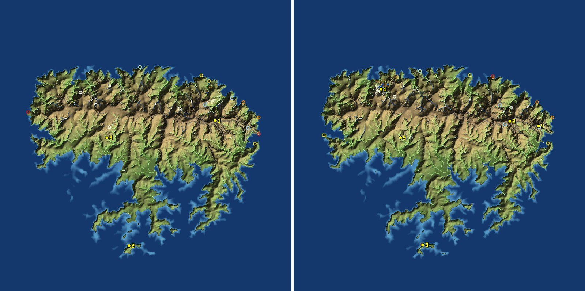

**The causes, as traced** (a scratch build printed every island's fields, its record and every kind's host at its middle on seeds 1 to 40; each change was then measured alone and together on seeds 1 to 10 and 11 to 40):

- **Cone and crater: small samples, and two rows' readings.** Their records fall in the same ranges as before: built 700 to 980 m high, rising 1.2 to 1.6 mm/yr. Their far figures are a slide's lake on two cones (23 to 45 m deep, against Toshima's and Mikurajima's 2 to 7 m) and too few faces over 60° by a few tenths of a percent. On seeds 11 to 40 the crater is 24.0% far before the regional history (36 islands) and 25.8% on `main` (15), with sharp rims and too few faces on every build; seeds 1 to 10's seven craters before were a lucky sample. One reading was inconsistent: a volcano's age set how long the sea cut it against the history's whole vent life (0 to 2 Myr), while the cone kind holds only up to 1 Myr, so every cone sat in the younger half of its range.
- **Ridge: the rock where it now stands.** Ridge islands on old arc lavas (Hahajima's rock) are 6 to 9% far; on layered sediment 26 to 48%. The regional history put most ridges near a continent, on layered rock, and many of them on the foot of one of its dead volcanoes, where an island is that volcano. The uplift read from the history pins every ridge to the floor of its range (0.55 mm/yr), since the crust under ridge sites rose mostly under 0.3 mm/yr over 4 Myr. Drawing it from the seed again left ridge at 41% on the same islands, so that was not the cause.
- **The hard cap: a flood basalt with no top.** Its cover was the lava plateau's, near-solid basalt laid from 90 to 190 m over the base to as high as anything reaches. An island that rose into it carried 400 to 650 m of lava and stood 500 to 800 m high, as cliffy mesas: 3.4 to 10.7% of their land over 60° (Tsushima and Chichijima 0 to 0.8; Iki, the row's own example, stands 213 m). Most of the islands it held stand on the foot of a dead volcano within 40 km of the front.
- **Seed 6's two islands: the start stood off every site.** It stood where some kind's host held best, which is broad. Of the ten starts, five stood on ocean floor 2.6 to 3.3 km deep, two on sunken volcanoes, two on a forearc 150 m deep off its outer high, and one on a shelf. Seed 6's stood on ocean floor 2.5 Myr old by a spreading boundary, 2.9 km deep, with one shelf site in its square. Its world has no live arc; read from sites, it still holds two.
- **Seed 9's 18 islands: a shelf 200 to 300 m deep, an island every 30 to 60 km.** The shelf row took any continental crust under less than 300 m of sea. Real shelves that deep are empty; their islands stand where the shelf was dry at the ice ages' lowest sea, as Iki's and the Gotō islands' was. A related cause showed on the smoothed history: dead volcanoes still over the sea stood 20 km apart, up to 22 in a square. The history opens a vent wherever no live vent stands within 20 to 60 km, beside dead ones, and a dead one stands for millions of years.
- **Kinds by preference.** 17 of 91 islands took a kind not their best because a nearest neighbour had theirs (one took the raised kind where its host held 0.14), and the reef kind, at weight 0, lost every tie with the raised kind. So it stood on a forearc only where a neighbour had taken the raised kind.
- **The 36 km steps.** Crust entering the regional history took its plate and kind by a vote of the four planet cells at the point's corners, by bilinear shares, which still follows the planet's cells: the deep floor's edge east of seed 7's start had 36 km teeth. When the planet split a plate, or lost one, the square restamped its cells from the nearest planet cell.

**What changed**, rows and their conditions, and the two readings made consistent:

- `rock.odin`: a row **"an old volcano"**: an island on the foot of one of the arc's volcanoes (`Vent` under 1,000 Myr, not on a hotspot's track) is that volcano's basalt and breccia, tilted, with dikes and a plug, as Hahajima and Chichijima are the Bonin arc's old volcanoes. It comes second, before the rows that read the ground under the volcano. The **hard cap's cover is "lava and ash"**, the flows and cinders the front's vents pour out, not a hotspot's flood lavas.
- `archipelago.odin`: **the start stands on a site**, chosen among every site of the known world as before (host first, then the forearc 60 km from the front, 30 km off land, the middle). **Shelf sites need ground shallower than the sea's lowest stand** (`LOW_STAND`, 120 m), not 300 m. **Dead volcanoes' sites stand as far apart as the arc's live vents** (`VENT_APART`, 20 to 60 km), not 20 km. **Each site takes the kind whose host holds best, its neighbours not counted.** `world_at`'s per-thread cache is keyed by the point in the known world and by the known world itself (its seed and its samples), so no world made after it can be answered from it.
- `land.odin`: the **reef kind's weight is 2**, the raised kind's: where both hosts hold, neither is preferred, since no field says how warm or clear the sea is. A **volcano's age is placed against the window on age its kind's host reads**, as its uplift is against the window on rising.
- `plates.odin`, the regional history only: **crust from the planet takes the plate and kind most of the nine planet cells round the point have, each counted by a bell of its distance (`SMOOTH`, 0.6 of a cell)**, and its thickness and age are blended over them. The planet's splits and lost plates restamp the square by the same vote. A hotspot's volcano laid outside the square leaves it, as one carried out already did: seed 33 crashed on `main` (an index of −1 at `plates.odin:919`) and now forms its 12 islands.

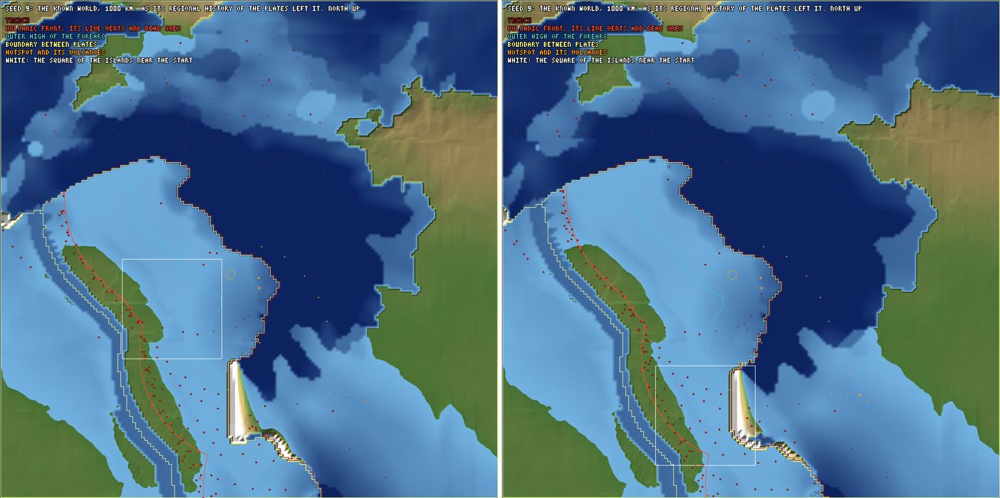

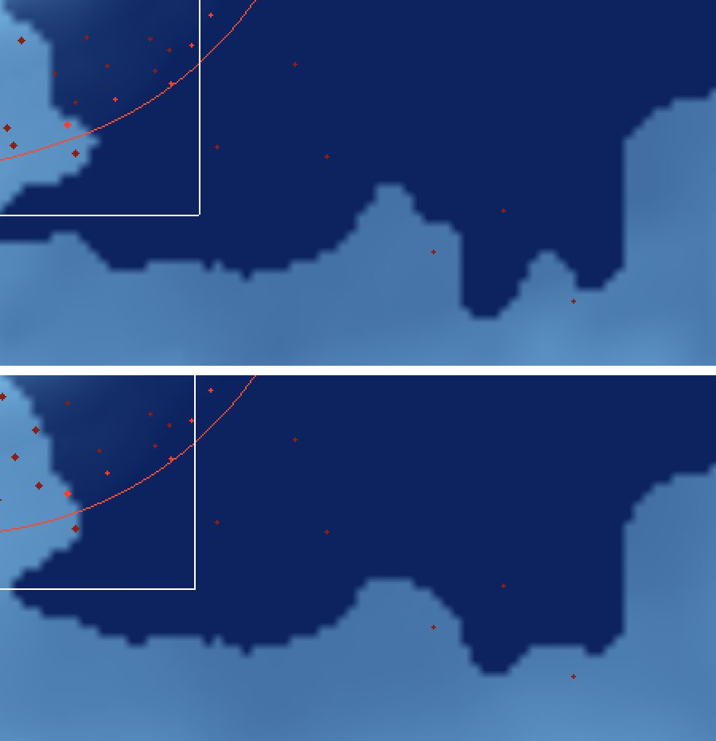

**Against the real islands**, every island near the start formed alone, figures far (`!`) among the eight figures `islands.py` counts. Before is the run before the regional history; `main` is part one with the hydrology step; this is this step:

| Seeds 1 to 10 | before | `main` | this |
|---|---|---|---|
| All figures | 21.4% (131 islands) | 23.6% (91) | 16.3% (83) |
| cone | 0 (11) | 15.6 (4) | 1.6 (8) |
| crater | 17.9 (7) | 27.1 (6) | 30.0 (5) |
| domes | 21.9 (16) | 12.5 (4) | 18.8 (4) |
| inlets | 4.2 (27) | 5.1 (22) | 5.6 (31) |
| raised | 71.1 (19) | 64.1 (16) | 71.2 (10) |
| reef | 1.6 (8) | 0 (9) | 0 (10) |
| ridge | 19.2 (30) | 26.0 (13) | 14.3 (7) |
| worn | 0 (13) | 0 (17) | 0 (8) |
| Islands a seed | 13.1 (5 to 21) | 9.1 (2 to 18) | 8.3 (2 to 16) |
| Kinds a seed | 5.7 | 4.4 | 4.2 |

| Seeds 11 to 40 | before (30 seeds) | `main` (29; seed 33 crashes) | this (30) |
|---|---|---|---|
| All figures | 23.2% (332 islands) | 21.3% (206) | 13.3% (182) |
| cone | 3.9 (42) | 5.8 (13) | 1.0 (13) |
| crater | 24.0 (36) | 25.8 (15) | 25.0 (6) |
| domes | 16.1 (55) | 29.2 (3) | 25.0 (5) |
| inlets | 3.5 (47) | 7.1 (70) | 5.7 (75) |
| raised | 72.0 (55) | 67.0 (25) | 65.4 (17) |
| reef | 1.1 (23) | 1.1 (11) | 0.5 (23) |
| ridge | 21.7 (49) | 28.5 (25) | 13.6 (22) |
| Islands a seed | 11.1 | 7.1 | 6.1 (1 to 14) |
| Kinds a seed | 5.2 | 3.5 | 2.9 |

The bar was at most 21.4% of all figures far and no kind further than before. All figures, ridge and reef meet it on both sets, and cone and raised on seeds 11 to 40. Judged one island at a time where a kind has fewer than 8 on seeds 1 to 10:

- **Ridge**, 7 islands: the five on old volcanoes have one far figure between them (a slide's lake), the two on layered rock 0 and 7. That is 8 far on 7 islands, against 46 on 30 before.
- **Domes**, 4 islands: 6 far, all too few faces over 60° or too high over the streams, the kind's own. That is 1.5 an island against 1.75 before (on seeds 11 to 40's five, 2.0 against 1.3).
- **Crater**, 5 islands: 12 far. That is 2.4 an island against 1.4 on the seven before. Three of the five stand on 8 km regions, small and low, and their far figures are the kind's (rims too sharp, too few faces over 60°, the floor too shallow), as on every build's 8 km craters on seeds 11 to 40.

Missed:

- **Cone** on seeds 1 to 10, 8 islands at 1.6%: one figure, a slide's lake 23 m deep.
- **Inlets**, 5.6% against 4.2: 10 of its 14 far figures are the deepest closed hollow, the lake a slide dams. The islands now stand on old volcanoes of basalt over breccia (102 of the slides on seeds 1 to 40 are of basalt over breccia). Without that figure inlets is 1.8% far against 2.1 before.
- **Raised** on seeds 1 to 10, 71.2% against 71.1: one figure in 80. It is 65.4% against 72.0 on seeds 11 to 40.

The slide's lake is the step the owner set for after step 32's second half; no row was tuned to it.

**The two stream figures** (the hydrology step's, printed only), medians by kind on seeds 1 to 10, `main` against this, with the islands far:

| | stream km per km² at 0.12 km² | islands far | largest basin at the sea, km² | islands far |
|---|---|---|---|---|
| cone | 1.59 / 1.40 | 0 / 0 | 1.1 / 1.2 | 0 / 0 |
| crater | 0.98 / 0.82 | 1 / 1 | 0.2 / 0.1 | 0 / 0 |
| domes | 1.07 / 1.09 | 0 / 0 | 2.6 / 2.9 | 1 / 1 |
| inlets | 1.09 / 1.25 | 0 / 0 | 1.3 / 2.1 | 0 / 0 |
| raised | 1.56 / 1.64 | 0 / 0 | 3.0 / 3.5 | 4 / 1 |
| reef | 1.41 / 1.32 | 0 / 1 | 1.6 / 1.5 | 5 / 9 |
| ridge | 1.37 / 1.51 | 1 / 1 | 2.7 / 3.3 | 4 / 3 |

The reef's largest basin is far on most reef islands on either build (Kikaijima 4.4 km², ours about 1.5): its rain sinks, and there are more reef islands now. On seeds 11 to 40 the stream density is far on 4 islands of 182, the basin on 31, 14 of them reef.

**The stories near the start**, seeds 1 to 10: an old volcano 34, layered 14, lava and ash 13, reef on mudstone 10, pale lava and pumice 4, granite against sediments 4, folded belt 2, old arc lavas 1, metamorphic shield 1. That is 9 in use, 3.4 a seed, against 10 and 3.7 on `main`. The hard cap holds no island near the start on seeds 1 to 10, and 2 on seeds 11 to 40.

Tried and dropped:

- **A cover of limited thickness under the hard cap** (60 to 150 m, then the island's own beds): 2.8% far on the cap's inlets islands against 4.3 with the arc's lavas alone, but two of 29 islands wore away under the sea, their upper mudstone weaker than any story's.
- **The uplift read from today's rate**, or **every host reading the 4 Myr mean**: ridge 42.5% and 31.5%, raised 81.9 and 78.1, against 42.5 and 70.8 with neither (both before the old volcano row). Neither was the cause.
- **Shelf sites at local highs of the shelf**: not run. The low stand says why an island stands there; a local high on a 250 m shelf does not.

**Cost.** Entering seed 7 (`--bench=1`, wall time, five rounds alternating with `main`, load about 5): 2.26 to 2.35 s against 2.44 to 2.52. The islands within 64 km are 4, the largest forming in 0.82 s, against 5 and 1.25 s. The regional history takes 0.27 to 0.32 s against 0.26 to 0.31, the nine-cell vote included (seeds 7, 1 and 3, two rounds). Benches against `main`, alternating, frames over 12.5 ms and our work median:

- The forest flank (the default island's, its coordinates unchanged): 5 and 4 against 6 and 1; 1.11 and 1.29 ms against 1.09 and 1.33.
- Down through cloud: 96 and 205 against 35 and 188, under a load that rose from 5.5 to 7; 0.92 and 1.27 ms against 1.30 and 1.37.

Drawing is unchanged. `src/` grew by 35 lines (143 added, 108 removed).

**Checked.**

- The planet is `main`'s byte for byte: the 54 frame and history files of `--plates` on seeds 1 to 10 and 12.
- `./build.sh test` passes. Both hashes in `GOLDEN` changed on purpose: the default island's land differs by a few cells, and island 1 is a new neighbour.
- `odin check src -vet-unused` is clean.
- The final build reproduces the measured run's 83 maps on seeds 1 to 10 byte for byte.

Weak points:

- Every threshold is a guess or from memory: the low stand's 120 m, the bell's 0.6 of a cell, the dead volcanoes' spacing borrowed from the live vents'.
- The history still opens a vent beside a dead one, so dead volcanoes over the sea pile up behind a front, and the spacing only caps how many become islands.
- Seed 6 and 5 of seeds 11 to 40 hold one or two islands: their known worlds have no live arc and little shelf within the low stand.
- Kinds a seed (4.2 on seeds 1 to 10) are above real groups' one to three, since the square holds a volcanic front and its forearc together.
- The raised kind is still judged against Kikaijima, which the reef kind is.
- The judge was Claude, by the figures and three pictures.

### Step 34, as built

Built 2026-11-16 by Claude on the branch `t3/measure-island-hydrology`, merged as 5676a72. The owner has not yet looked at it. The measurements, sources and pictures are in `interesting-world/notes/real-hydrology.md`; the decisions are Claude's call of 2026-11-16 in `open-decisions.md`.

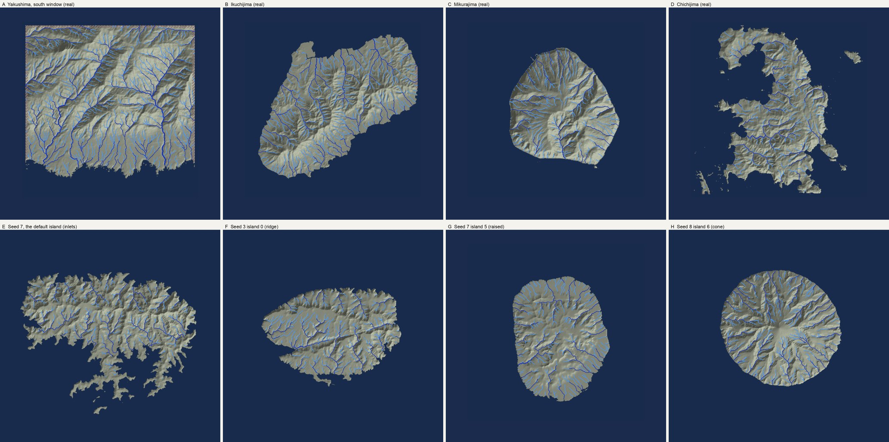

- **What the owner saw.** On the maps beside Yakushima and Ikuchijima, ours had sparse streams, and the owner had only ever met streams a block or two wide.
- **What Claude measured first, and what held.** At 0.12 km² ours had 1.1 to 1.6 km of stream per km² against Yakushima's 1.9 to 2.1. Against each kind's own real islands (0.3 to 1.8) they were already in range. Density follows an island's size on ours and on the real islands alike (Spearman 0.79 on ours), and not its slope. Yakushima, 504 km² under 4 to 10 m of rain a year, stays 20 to 40% denser more than 1 km from the sea; that part is not traced.
- **Not erosion.** Creep at a half, twice and four times, cutting at twice, three times the time on 16 m cells, the first long phase on 32 m cells and three times the starting roughness each moved density by under 15%. With the game's constants, the scale at which creep and cutting balance lies under the 16 m cell (Perron et al. 2009).
- **What looked sparse was where streams began.** At 0.12 km² a stream began about 200 m below its divide, so every valley head was dry. In humid Japanese hills a stream with water in it drains a hectare or less. A 16 m grid sees a channel down to about 0.01 km², on GSI's model and ours alike. Streams now begin at 0.02 km² (`HEAD_AREA`). `CHANNEL_AREA` stays the land's measure of a valley, so the figures and the plants do not move.
- **Width follows floods.** On 34 Japanese mountain rivers the width is about 2.5 times the root of the mean yearly highest flood (PWRI, 2012). On GSI's aerial photographs Yakushima's stony beds measure 10 to 16 m at 7.6 km², 15 to 30 at 20, and 30 to 55 at 38. Every stream now runs in a bed of stones (`river_bed`) 6.4 m across at 1 km², growing as the land drained to the 0.35, and never narrower than the water. The water is as before.
- **The default island.**

  | | Before | After |
  |---|---|---|
  | Stream per km² of land | 1.23 km | 2.91 km |
  | Stream that holds yoshinobori | 35 km | 74 km |
  | Widest stream | 4.8 m of water | a 7.9 m bed of stones |
  | Falls over 2.5 m | 42 | 58 |

- **Rivers of many sizes need larger land.** No generated basin passes 14 km², since no region is wider than 14.3 km. A river wider than about 8 m needs an island of 100 to 500 km² with a range in it, which is the plates' and step 21's work.
- **Checked by Claude on merging:**
  - `odin check` passes, and `./build.sh test` passes with `GOLDEN` unchanged: the forming is unchanged, and the streams are cut into the blocks after it.
  - The eight existing figures are identical to `main`'s on six islands of five seeds.
  - Both benches, alternating with `main` under a load of 6 to 9: our own work was never over 12.5 ms. The forest flight's median was 1.20 to 1.23 ms against 1.29 to 1.34; the cloud flight's 1.46 to 1.65 against 1.28 to 1.52.

### Step 35, as built: the slide's lake

Built 2026-11-16 by Claude on the branch `t3/landslide-lake-aging`, from `main` at e4a071e: a landslide's dammed lake that fills with what its stream brings and drains if its dam is cut, over the 30 to 1,000 years since the slide. This is the step the owner set for after step 32's second half. The owner has not looked at it. The choices are Claude's call of 2026-11-16 in `open-decisions.md`.

**What changed for the player.** A slide's lake is as deep as its age and its stream leave it. On the default island the lake behind the 360-year-old slide keeps its level (34.5 m) and its 1.7 ha. It is 4 m deep where it was 23, over 70,000 m³ of silt brought down from the 0.66 km² draining into it, and its bed shows through the water. Two of its four ponds have filled, so the place is named Great Slip, not the Four Ponds. Elsewhere about one dam in five has failed. Where a dam failed, its lake is gone and the stream runs through the debris on its old course. Start-up says whether the dam held and why. `--why` in a lake says how much silt floors it.

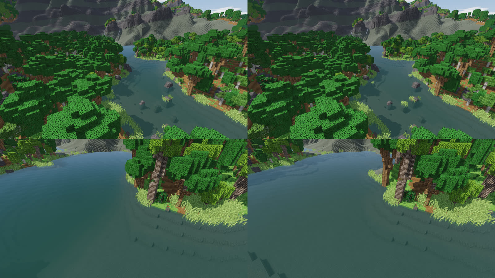

**The far hollows, as traced** (a scratch build printed where each island's deepest closed hollow lies, on seeds 1 to 10, every island formed alone):

- On every island with a slide, the deepest closed hollow is the slide's own water. Away from the slide no hollow is deeper than 8 m (0 to 8, most 1 to 4).
- Of the 20 far hollows, 2 are craters too shallow, the crater's own. The other 18 are a slide's water: 16 lakes and 2 ponds, 11 to 39 m deep, 52 to 740 years old, draining 0.07 to 3.1 km². Six are deepest in the scar, which is cut down to the valley floor and closed at its foot by the debris.
- The lake stayed as deep as the day it formed. The wear cut a dam's outlet as its cap's rock: by 0.0 to 0.4 m in the slide's age on 8 of 11 dams checked, and by 1.7, 4 and 10 m on the other three (not traced further). Nothing settled in the lake.

**What the sources say.** "Memory" marks what was not checked.

- **Most dams fail, and soon.** Costa and Schuster counted 73 landslide dams that failed: 27% within a day, about half within 10 days (USGS open-file report, 1987). Schuster and Costa (1986), on 63: 22% and half. Both figures are from a search summary; neither paper was read. Up to 85% of failures come within a year (GNS Science's DBI tool, after Costa and Schuster 1988). Overtopping is the usual way. Of 410 dams over 1 million m³ formed since 1900 (Fan et al. 2020, as summarised by Fan et al. 2021):
  - about 60% of those of loose sediment, 65% of debris flows' and 80% of complex ones' last under a year
  - rock avalanches' and rockslides' last longer
  - beyond 10 years, 30 to 40% survive, whatever made them
- **In Japan** (Swanson, Oyagi and Tominaga 1986, "Landslide dams in Japan", ASCE Geotechnical Special Publication 3, pp. 131 to 145):
  - The Totsu River flood of August 1889 made 53 dams in 70 hours, most lasting up to a few days. The only lake left is Shigesato, a pond in a 32 ha basin behind about 1 million m³: our slides' size and basins.
  - The Zenkoji earthquake's dams of 1847 with known lives failed in 4 days (2), 17 days (1), 19 days (2) and 4 months (1).
  - Short-lived dams are where small slides enter large streams. Long-lived ones are where the slide is large for its basin.
  - Most dams fail completely in the first few large floods. "For dams that do not fail, the lifetime of the lake is controlled by the rate of sediment accumulation."
  - An outlet can cut down tens of metres before a lag of large boulders armours it. Onogawa's drainage "slowed abruptly" so, and it is still a lake of 156 ha.
- **Which dams fail.** Ermini and Casagli's (2003) blockage index is log₁₀ of the m² draining to the dam times its height, over its m³. GNS Science's tool gives the chance of failure from 266 New Zealand dams (Morgenstern et al. 2023): 10% at 1.08, 25% at 1.38, 50% at 2.07, 75% at 3.10 and 90% at 3.95. Coarser and grain-supported debris lasts longer (Fan et al. 2021, citing Costa and Schuster 1988, Ermini and Casagli 2003 and Weidinger et al. 2014). Boulders falling into a spillway can stop its cutting (Fan et al. 2021, citing Plaza et al. 2011).
- **How fast a lake fills**, from what Japan's reservoirs fill with, in m³ a year for each km² draining to them:
  - 300 on average over all its mountains (Tsuruta, Kobayashi and Uchita 2005, on the Takase dam). Takase's own basin gives 4,750, and a basin of fresh slope failures within it 26,970.
  - Recorded rates run from 49 to 5,257 (the Ministry of Construction's criteria of 1976, in Sumi 2013), and some dams in Chūbu take over 2,000.
  - Hokkaido's 28 mountain reservoirs average 178. Sedimentary catchments yield eight times what volcanic ones do, and the yield grows with the catchment up to 100 km² (Marutani, Kuroki and Kasai 2019).
- **Where it settles.** Fine silt is carried to the deepest water, so a lake's floor flattens as it fills (sediment focusing; memory). The coarse part builds a delta at the inflow. In one Himalayan landslide lake, bedload was a third of the load (Pratt-Sitaula et al. 2007; a search summary, not read in full).

**What changed**, in the slide's rule in `events.odin`, nothing else:

- **Whether the dam holds** (`DAM_FAILS`):
  - The dam's blockage index is read as it is laid: its top over the stream's old course, the valley's land drained and its debris.
  - The chance is New Zealand's, held at 10% below its first point and 90% above its last. The seed draws.
  - A dam that fails is cut along the stream's old course down to the old valley floor at once, before the wear. Whatever hollow is left stands as a lake or pond, as any other.
  - A dam that holds keeps the forming's own cut of its outlet.
- **What the stream brings** (`SILT`): 300 m³ a year for each km² draining into a lake or pond, over the slide's age.
  - It settles in the hollow the deepest first, as water fills one, so the floor fills flat.
  - A hollow that fills is a flat its stream runs over, and is no longer a feature.
  - A lake's third measure is the silt in it.

**Against the real islands**, seeds 1 to 10, every island near the start formed alone, the eight figures `islands.py` counts:

| Kind (islands) | Figures far, `main` | this | Deepest closed hollow far | its median, m | real |
|---|---|---|---|---|---|
| All (83) | 16.3% | 14.0% | 20 → 6 | | |
| cone (8) | 1.6 | 0 | 1 → 0 | 8 → 1.5 | 2 to 7 |
| crater (5) | 30.0 | 30.0 | 2 → 2 | 47 → 46 | 77 |
| domes (4) | 18.8 | 18.8 | 0 → 0 | 17.5 → 8 | 10 |
| inlets (31) | 5.6 | 2.8 | 10 → 3 | 13 → 5 | 4 to 7 |
| raised (10) | 71.2 | 66.2 | 5 → 1 | 9.5 → 4 | 1 |
| reef (10) | 0 | 0 | 0 → 0 | 1 → 1 | 1 |
| ridge (7) | 14.3 | 10.7 | 2 → 0 | 10 → 3 | 9 |
| worn (8) | 0 | 0 | | | none |

- **No other figure is far on any island where it was not.** Besides the hollow, 16 figures moved: crest falls and stream density by 0.01 to 0.05, and on one island the land under 50 m by a point and the height over the stream by 1 m.
- **The hollow is nearer by metres outside the real range** on every kind with slide lakes: cone 4.9 → 1.2 m on average, domes 7.0 → 3.5, inlets 8.1 → 3.1, raised 11.2 → 5.1 and ridge 6.9 → 6.0. Crater moved 1 m further on one island, where a pond in the slide reached into the crater's floor. By ratio, cone and ridge are further. Several of their hollows now stand at 0 to 3 m, under Toshima's 2 and Hahajima's 9: their slides' lakes filled, and the hollows left are elsewhere.
- **Still far:** two craters (their own), and four slide waters:
  - three young lakes: 22 m at 52 years, 25 m at 80, and 21 m in a 12.5 ha lake at 136 years
  - one pond 21 m deep, 1.1 ha, in a 72-year-old scar draining 0.07 km²
- **The dams:** of 68 that crossed their stream, 15 failed (22%), at blockage indices of 0.91 to 2.11 (median 1.30). The other 4 slides' debris lies beside the stream. `main` left a lake behind 64 of the slides. 29 of those lakes are left, 29 have filled with silt, and the rest drained when their dam failed. The lakes left are 0 to 20 m deep, median 4, where `main`'s were 0 to 39, median 10.

**The two stream figures**, medians by kind, `main` against this (islands far): stream km per km² at 0.12 km², cone 1.40/1.40 (0/0), crater 0.82/0.82 (1/1), domes 1.09/1.10 (0/0), inlets 1.25/1.25 (0/0), raised 1.64/1.64 (0/0), reef 1.32/1.32 (1/1), ridge 1.51/1.51 (1/1). The largest basin at the sea is unchanged on every kind (far on 14 islands on both).

**Seeds 11 to 40** (182 islands, alone): 11.4% of figures far against 13.3%. The hollow is far on 10 islands against 34, and no other figure is far where it was not. By kind, far share before and after: cone 1.0 → 1.0 (13 islands), crater 25.0 → 25.0 (6), domes 25.0 → 22.5 (5), inlets 5.7 → 3.2 (75), raised 65.4 → 62.5 (17), reef 0.5 → 0.5 (23), ridge 13.6 → 11.4 (22), worn 0 → 0 (21). In metres outside the real range the hollow is nearer on cone, domes, inlets, raised and ridge, and the same on crater and reef. 35 of 149 dams failed (23%). The stream figures' medians and far islands are unchanged on every kind.

**Cost.** Entering seed 7 (`--bench=1`, wall time, four rounds alternating with `main`, load 5.5 to 7): 2.19 to 2.21 s against 2.19 to 2.21 (`main`'s first, cold run took 2.49). The slide's own time is as before (33 to 35 ms on the default island). Benches against `main` (frames over 12.5 ms, our work median):

- the forest flank: 45 against 34, 1.70 ms against 1.75
- down through cloud: 8 against 11, 1.80 ms against 1.92

Our work passed 12.5 ms on no frame of either. Drawing is unchanged. `src/` grew by 51 lines (62 added, 11 removed).

**Checked.**

- `./build.sh test` passes. Both hashes in `GOLDEN` changed on purpose: the default island's lake and ponds took silt, and so did island 1's.
- `odin check src -vet-unused` is clean.
- The final build reproduces the measured run's 83 maps on seeds 1 to 10 byte for byte.
- On the maps, a failed dam's lake is gone and its stream runs through the debris (seed 3's island 11). Elsewhere a lake keeps its outline and level, and only its depth changes.

Weak points:

- **One yield for every island.** A 1 km² basin of basalt may yield a fifth of 300 or less: Hokkaido's volcanic catchments and its small ones yield less. A raw scar above the lake may yield many times more.
- **Silt fills the deepest water first.** That is the most it can take from the deepest point. A delta building in from the inflow would leave the far end deep for longer.
- **New Zealand's chances** are held at 10% below their first point, and every dam here lies at 0.9 to 2.1. The index knows nothing of the dam's rock, which the sources say matters.
- **A dam that holds is hardly cut.** Its outlet is cut at the forming's rate for its cap's rock, under half a metre in its age on most. No partial breach was built: no source here gives how deep an outlet is cut before its blocks armour it, on streams as small as these.
- **Ponds in the scar stay deep.** The scar is a spoon cut down to the valley floor and closed by the debris at its foot, and only its own few hectares drain into it.
- **A filled lake leaves no feature.** Nothing names the flat of silt where it stood.
- The judge was Claude, by the figures and four pictures.

### Phase 3: the mainland and the known lands

Starts when the seam test has passed and the archipelago is accepted.

- The landmass pass and the cut along divides; the 1,000 km world rung; the level at 512 m.
- Great rivers as corridors with floodplains, meanders, braids, deltas and estuaries; ranges with passes found as the lowest saddles.
- Thirteen floras, the full climate table, past ice where latitude and height allow.
- Realms, the long road, more peoples and their bonds to land, three ages of the world, the remaining influences.
- The colony game's site choice, reading the same fields: water against flood, soil against exposure, harbour against defence.

### What not to build yet

| Deferred | Trigger |
|---|---|
| A text file format for kinds | The owner asks to edit rows without building, or modding begins |
| Deposits and ores beyond a few rows | Digging has a purpose |
| Limestone cave systems | The owner decides an island has limestone and the cave design starts |
| Glaciation | A region kind with an ice history is chosen |
| ~~A plate simulation~~ | Withdrawn on 2026-11-15: a history of moving plates is the goal (step 22) |
| A disk cache of formed regions | Saves exist, or forming a region again is noticed |
| Seasons that advance during play | A year length is chosen |
| Water under a roof that flows | A cave reaches below the water table |
| Animal behaviour beyond fleeing; population numbers | The player can do something with an animal |
| A history simulation, individual figures, languages | Ruins of two ages are needed in one place; a second people exists |
| A magic system, a creature generator, fantasy biomes | Never as such: each arrives as an influence row with a source |

## 9. Decisions for the owner

Each has the plan's recommendation. Section 8 of each design holds the rest.

**Before step 1**

1. **The island's rock story.** *Layered rock, gently tilted, with a hard cap, and one limestone bed low in the stack* so it shows only in the deepest valleys and keeps springs and caves possible.
2. **The island's history.** *Young and still rising, drowned at the end, with one large landslide.*
3. **Rock before lakes?** *Yes* (section 5, item 4). The alternative gives a lake sooner and builds the slide twice.

**Before step 5**

4. **The island's climate.** *Cool-temperate and oceanic at about 40° north.* Computed caveat from the climate design: at that setting only the top 100 m whitens in midwinter. A snowy winter like Shirakami's needs a colder base.
5. **True tree heights.** *Yes: beech at 20 to 25 m*, for the enclosure in the woodland-lake photograph. Today's trees are 8 to 14 m.
6. **Small plants as cubes you walk through, or crossed planes.** *Cubes*, to stay blocky.

**Before the archipelago**

7. **The end shape of the world.** *A mainland with islands off its coast inside known lands about 300 km across, far lands beyond*, subject to the seam test. *Decided by the owner on 2026-11-15:* one cohesive simulated world with continents and islands where the simulation makes them; the seam test decides only the method.
8. **Cold to hot.** *Let 1,000 km stand for about thirty degrees of latitude.* *Decided by the owner on 2026-11-16: thirty.*
9. **People.** *The first island is wild; people arrive with the archipelago, first as ruins; history is a short pass over a few eras that writes dated facts*, not a simulation.
10. **The fantastic.** *Admitted only as a cause with a source, a reach and an age; at most one marvel per region; inspection gives signs first and the cause once learned.*
11. **Named places.** *Eight to twelve on an island, in plain descriptive English drawn from their causes.*
12. **Time.** *A fixed date per session until the colony game.*

## 10. Not verified, and the largest risks

- **The land seam** was tested in step 20 (2026-11-15) and failed: on two islands a divide pinned to the 64 m solution leaves a seam the map shows, because the finer phases move the land on a divide a median 54 to 97 m. Step 21 the same day found a method that leaves none, by experiment: ordered pieces, formed in drainage order, each holding its formed neighbours' land through time at the cut, with 6 km margins toward the rest (`interesting-world/notes/continents-forming.md`). On a 32 km ridge in four pieces, a 24 km volcano and the default island at 16 km, the joined land's steps, hollows, streams and start-up figures are the whole's (on the default island, all but the slide beside where the cut meets the coast: 2.5 million m³ against 2.8), and the joined land differs from the whole less than a 1 mm nudge moves the whole. Still untested: land larger than 32 km, a Pfafstetter cut with trunks crossing, the band store a continent would keep, and the coast's exposure and silt across a cut. Continent costs are extrapolated: 7 to 12 min of one core for the 64 m landmass pass of 30,000 to 50,000 km², then 18 to 30 min on three threads. Pinning, and finer phases shortened so that pinning might hold, both failed.
- **Reading rock in the finished frame** was run in step 1 (2026-11-11) and the landforms survive: on seeds 7, 1 and 2, 3.1%, 3.4% and 5.3% of land is steeper than 45°, with faces of 136, 129 and 235 m. The strength mapping in `geology.md` D4 lowered the island to 202 m, so `rock.odin` uses erosion (0.4/strength)² and slope limits from 35° to 55°.
- **How unfinished to leave the land** was run in step 3 (2026-11-11) on the ridge island, seed 7. A last phase of 30, 90 (today) or 450 thousand years changes mostly how finely the slopes are cut, and the longest takes 3.2 s to form; the last phase is also the only one on 16 m cells, so its length mixes "how finished" with "how resolved". A sea that falls 20 m and rises 8 gives a raised apron under the old coast but no gorges far inland. The same run showed the erosion wears land faster than the designs assumed: an island at rest for two million years is gone, so the worn kind rests for about 0.4.
- **Every cost and line count** is a designer's guess, apart from the forming times, the build time, the walking speed, the hollow counts and the facts read from the code that I checked: the four-bit material mask, the fixed sun, the 20 uses of the seed constant.
- **Whether one-metre blocks can show fourteen tree silhouettes**, and whether race-drawn community edges look right, will only be known by looking.
- **Journey sizes** (realm widths, hours of road) are guesses until walked.
- **Sources quoted from memory** by the designers are listed at the end of each design; the Tolkien and Le Guin quotations and several ecology figures are among them.
- **Starting more than 64 km from the start island crashes** (`--pos` or `--above` at, for example, 61652,400,-66175 on seed 7). It does on `main` and did on every branch since step 24 at least; 42 km out works. Not traced. *(Inference:)* a player who flies past the islands formed before entering may meet the same fault in play.
- **Frames over 12.5 ms in play.** In the owner's 628 s session (2026-11-15), 659 frames took longer than 12.5 ms. The benches rarely show it on an idle machine. Not traced. A 3,130 s session on 2026-11-16 had 82,060 frames over 12.5 ms and a worst of 1,018 ms, but it ran the old checkout (`_archive/odincraft-v5`, branch `phase-2`, step 22's code: the owner's terminal was still in that directory after the repository was rebuilt) while Claude's background work held the machine's load at 6 to 19. So it says nothing of `main`, and play needs measuring again on `main` with nothing else running.
- **The benches cannot show headroom on a shared machine.** Since step 31, other agents' work has put the load at 6 to 19, and frames over 12.5 ms come and go on the parent and the change alike. Our own work per frame is the figure that has held, at no frame over 12.5 ms.
- **The size of this plan** is itself a risk. If a step cannot be shown to the owner in under a minute, the step is too large.

## 11. What the first steps taught

Added 2026-11-11, after steps 0 to 3 were built and the land was compared with eight real Japanese islands (`interesting-world/notes/real-islands.md`). These are changes to how the systems are designed and judged, beyond the reordering in section 8. Items marked *(inference)* are Claude's reading and are not yet tested.

### Two tests against the real world

A real island loaded onto the game's grid gives two separate tests, and every system falls under one of them.

- **The forming test: is our land like real land?** Form an island, measure it and a set of real islands the same way, and compare maps, figures and views. This judges geology, landform processes, water and the region kinds. It is what found the missing sea cliffs.
- **The dressing test: does the game make real land look like itself?** Load a real island in place of a formed one and compare the game's picture with photographs of the place. This judges everything laid over the land: what is bare, soil, plants, rock in blocks, water, and later people's marks. Mikurajima failed it at once: the game drew bare banded rock where the island is forest to the cliff edge, because the rule for bare ground strips anything steeper than about 36°.

The second test separates two kinds of fault that look the same on a generated island. When a generated hillside looks wrong, the land or the dressing may be at fault. On a real island the land is known to be right, so whatever looks wrong is the dressing.

What this asks for:

- The scratch option that loads a real island becomes part of the game, with the figures, if the owner agrees (question 9 in `open-decisions.md`). It is a tool that can reject a change and never accept one, which is the rule in section 1.
- A real island needs its own rock to be dressed fairly: basalt for a volcano, not the one layered story. So at least a second rock story is wanted before Phase 2, where the plan had put all of them. *(inference)*
- The dressing test needs references to compare with. Photographs can only be looked at by the owner or described from memory; the test stays a judgement by eye.

### Kinds are families of real places

The four island kinds were written from what the forming's knobs could already make. The comparison shows what that misses: a dome-and-bay volcanic island (Kōzushima), a crater island with a closed floor (Aogashima), a drowned coast of long inlets (Tsushima, Chichijima), a terrace island that is mostly flat (Kikaijima). None of ours is any of these.

- **Each kind row names the real islands it stands for, and their figures are its acceptance targets.** A kind is done when its islands fall inside the range of its references on the figures that matter, and the owner accepts it by looking. A kind with no real reference is a guess and is marked as one.
- **The catalogue is drawn from the reference set, leaning toward livable islands**, as the owner decided. The inhospitable cone after Mikurajima and Toshima stays as a rarer draw.
- **This applies down the ladder** *(inference)*: a rock story, a plant community and a coast kind can each name a real place and be judged against it. The designs already cite real places as inspiration (Jūniko, Shirakami, Trotternish, Yakushima); the change is to measure against them.

### A kind as a history, not a shape *(proposal; one test run)*

The owner asked what stops a tectonics simulator from producing the kinds, so that none is written by hand. Two answers:

- **A plate model picks and places kinds; it cannot shape one.** It works at hundreds of kilometres and millions of years and yields a setting for each island: arc or hotspot, age, uplift rate. The stand-in in `foundations/world-frame.md` D4 already does this. What separates the real islands happened on the island itself, mostly in its last few hundred thousand years. v4 had the plate model and dull ground. *(The owner, 2026-11-15: the goal is that every island and continent comes out of one history of moving plates, and that a region's own history, including those last few hundred thousand years, is read from it at its place. The ground at walking scale still comes from the region's forming, which is what v4 lacked.)*
- **The hand is in what a row says.** A row describes the result: the cone has `peak` and `peak_width`, the ridge has `axis` and `bend`. A cone is a bump of uplift that was drawn, not something a vent built.

The proposal is that a row becomes a list of events over a few general processes, and the shape fields mostly go. The four missing kinds as histories:

| Real island | Its history | Missing from the forming |
|---|---|---|
| Tsushima, Chichijima (long inlets) | Rivers cut valleys; the sea rises about 120 m and drowns them | Nothing |
| Kikaijima (terraces) | Rise, pause, rise, pause; the sea cuts a bench at each pause | The sea cutting the coast |
| Kōzushima (domes and bays) | Several vents of stiff lava pile up domes; the sea cuts between them | A vent building rock; the sea cutting the coast |
| Aogashima (crater) | A vent builds a cone, its top collapses, a small cone grows inside | A vent building rock, and collapse |

So two processes are missing: the sea cutting the coast, which is already the next land-forming step, and a vent that builds and collapses. That these two are enough is an inference. The test is the forming test above: give the forming each island's history and compare the figures.

**First test, run 2026-11-11.** The ridge island with the sea's last rise changed from 5–10 m to 115–120 m, seed 7, nothing else touched. The source was put back afterwards.

| | Ridge as it is | Sea rises 116 m | The same, outline radius 0.40–0.42 |
|---|---|---|---|
| Land | 18.7 km² | 6.8 km² | 11.9 km² |
| Sea inside the convex outline | 4% | 34% | 36% |
| Land steeper than 45° | 3.2% | 8.7% | 6.4% |
| Median slope | 9° | 15° | 13° |
| Highest point | 309 m | 259 m | 284 m |

Tsushima has 60% of its outline as sea and Hahajima and Chichijima 52 to 56%; the worn kind, the most embayed until now, has 20%. One changed range gets over half of the way. The same rise drowns the low apron round the shore: the pale ring is gone from the map, though the share of land under 50 m was not measured. What it leaves:

- The island loses two thirds of its land, so the outline has to be drawn larger, and an 8 km region leaves little room for that.
- The new shore is uncut, so it has no sea cliffs.
- The drowned valley floors have no fill. A real inlet's head is a flat of river sediment, which is where its village stands; that needs deposition, which the plan has left to Phase 2 *(inference)*.
- The embayment was measured from the map's land outline, checked against the earlier figure for the ridge (4% here, 5% there).

### What the land-forming step taught

- **Livable ground was not what was missing; landings were.** By a rule taken from real buildings (20° holds 85 to 93% of them on six of the eight islands), the islands were already as livable as the real ones once the coast was cut. What they lacked was a low sheltered shore to reach that ground from. Slope alone told the villages from the rest of the land; height, distance to the sea and distance to a stream did not.
- **Building and then cutting does not make a sea cliff here.** The waves break on the platform they cut and the streams grade the coast down as fast as it retreats. The cliffs on the volcanic kinds come from the cone still swelling. Whether that is the right cause is open.
- **An old step can undo a new one.** Each refinement re-read the island's first outline, which would have put back everything the sea had cut and which had been laying a strip of low land along every coast.
- **The uplift ramp was one cause of the low coast among four**: the cone's uplift was nearly all at the summit, the worn island rests while its coast wears, and the raised island's shelf is low by design.
- **A late event must be late.** A crater that fell in early was breached by streams within about 300,000 years.
- **A low stand gives coves only on an island at rest, and no more of them than a plain rise.** The real cause of coves on a cliffed coast is that valleys were cut down to an ice-age sea some 120 m lower and then flooded. Tried on the ridge row (the sea 50 to 60 m lower for the last 90,000 years, then back), it failed while the island went on rising: the shelf the sea uncovered was lifted with the land, as much as 55 m where the uplift is strongest, and stayed as a broad apron when the sea returned. With the island at rest through the low stand it works: 2 to 4 landings on six seeds, with 42 to 60 m standing within 100 m of the shore. That is no more landings than the plain rise of 25 to 45 m gives, with less cliff (50 to 73 m) and twice the forming time, so the plain rise stays. A cliff that keeps its face after the sea leaves it added only about 4 m and 6 points of cliffed shore; it was not the cause.
- **Landings follow the length of the shore.** By the game's rule the three real high islands with natural landings have 1.3 to 1.9 for every 10 km of shore (Hahajima, Kōzushima, Chichijima; none on the three cones, 3.6 on Tsushima). Those are the first comparison's counts over shore lengths from a script on the same grids; the script's own recount finds fewer landings (5, 7 and 13, and 67 on Tsushima), which gives 0.9 to 1.7 and 3.0. The real counts are high because the real shores are long and indented: Hahajima has 55 km of shore round 17 km² and Chichijima 75 km round 24 km², where a ridge island had 16 to 22 km round 6 to 12 km². The inlets and worn kinds have shores as indented as those two (26 to 48 km) and 3 to 14 landings. So the ridge row was made longer and its last rise larger (section 8), and the game now prints landings for every 10 km of shore beside the count. A ridge larger still (radius 0.38 to 0.42) gave a median of 6 landings, but the region's rim cut 0.5 to 1.9 km² off the outline on most seeds; the row shipped loses 0.2 to 0.7 km² on five seeds of twelve. More river silt changed nothing.
- **Kikaijima's landings are built.** Drawn on its grid, the places the landing rule finds are harbour basins behind breakwaters. Its natural shore is open and smooth, so a raised island with none to two landings matches it, and the real figure for that kind is not 12.
- **Tried and not shipped: more shelter in the lee.** On a shore facing away from the swell the sea still cuts everything that stands out, which leaves some lee coasts nearly straight (ridge, seed 4). Cutting less there (0.2 of the open-sea rate, from 0.3) left the lee coast a little more irregular and changed the figures of no kind by more than a few points, landings included. A round rim to the region in place of the square one changed little on islands that reach it and cut the corners off islands lying diagonally.
- **Three briefs each carried a wrong premise**, and each was caught because the brief asked for its claims to be tested.

### What the plant communities taught

- **Judge a host by painting the community, not the field.** The exposure map paints the windward half of the default island as exposed, and heath looked likely to take it. In the race, with heath over 0.8, it took 11 to 17% on every kind; the field needed no change.
- **On foot the change is underfoot and in the trunks first.** Walking from the river to the spur above the start, the grass, litter, needles and heather and the brown, grey and red trunks change before the crowns are noticed; from a high point and from 1 km the crown forms and the dark pine patches carry it.
- **A catalogue on the grid is only as cheap as reading its fields.** Five rows over seven fields cost 48 ms read smoothly and 16 ms read cell by cell.

### What the landslide taught

- **An event's host picks the place, not the shape.** The best host cell sits just under a crest, where slopes are steepest. Centring the event on it cut through the crest, and every geometry tried after that had to say what does not move as well as what does: gentle ground and the valley floor.
- **Kept hollows need be kept only while they matter.** Leaving lakes' floors alone for the few steps after the event is enough to keep the lake, and it changes nothing else on the island.
- **A rule on the 16 m grid becomes a straight line on the ground.** Every first version of the shore drew the grid: a crest one cell out, a flat bank, and a bank that also rose inside the water. Water and bank need a footprint wider than the shore and an edge that slopes.
- **A fault seen in one picture can be three faults.** The lattice over the far lake was not overlapping quads and not the coarse lake bed, both of which were changed first, but a bank rule leaking inside the water. Asking `--why` and printing a cross-section found more than the pictures did.
- **Age decides whether a slide is seen.** The same landform at 56 years is a bare scar over raw debris, and at 980 years a wooded valley with a lake whose cause only the map shows.

### What the stands taught

- **Count the stand before looking at it.** Stems a hectare by form and the share of ground under a crown, counted over a fixed square, showed the old canopy at 42% under a crown before any picture did, and settled the spacing against the real figures in two runs.
- **At eye height the ceiling decides the look, and the ceiling is tree height less crown depth.** Every change that closed the canopy from above lowered it on foot until trees can be taller.
- **A camera at eye height lands in a crown more often than not** in a closed wood. Pictures of a wood need several positions and turns, chosen by looking, and a spot inside a stand away from its edge (found by a search, not by eye on the map).
- **A rule that was right for an open wood fails in a closed one.** "No tree within 6 m" of the start held on every island until the woods closed; then a whole island had no bank to start on.
- **The cost of more trees is the ground under them**, not the rule that places them: the thinning over 25 neighbours per candidate cost about 9 ms in 89 at 4 m cells; finding each tree's ground cost most of the rest.

### What the tree grower taught

- **Look at one tree alone before looking at a wood.** In a wood every crown hides behind another; a single tree drawn alone on open ground, from the side at 25 m, showed at once that the first shii and tabu were umbrella acacias, a thin lid on long bare uprights, and that the first pines were lightning bolts.
- **The crown's depth decides whether it reads as a tree.** Lobes placed against the envelope's top made a lid; set anywhere in its depth, and rounded underneath, they made a crown. A small tree's 3 m of clear bole leaves too little depth, and it becomes a lollipop or a table unless its single crown is no wider than it is deep.
- **Clipping makes boxes.** A lobe whose middle stands near the envelope's edge is cut flat by it, and a crown of cut lobes is a box with vertical walls; a lobe has to fit inside.
- **A limb's cut end shows on every step.** A line of bark running aslant is a stair, and each step showed the log's end-grain tile until bark took its side tile on every face.
- **Every change to a tree's shape is a change to walking.** Wider bushes, splayed clumps, a kinked bole and thicker trunks each shortened the ground runs from the start, on three kinds, before any picture showed it; the ground runs on every kind found them.
- **The cost is the shape, not the number of trees.** Wider crowns, more twigs and the ragged edge were each worth 1 to 4% of the faces; the lumps and limbs themselves were the rest.

### Every step has target figures

The Phase 1 table says what the owner looks at after each step. It should also say what is measured, taken from the real islands, so a step can be rejected before the owner's time is spent. The targets known so far:

| Figure | Real high islands | Generated today |
|---|---|---|
| Height reached within 100 m of the shore | 60 to 117 m | 5 to 17 m |
| Shore rising 30 m within 50 m | 40 to 85% | 0 to 2% |
| Slope in the first 100 m from the sea | 29 to 51° | 3 to 10° |
| Land under 50 m | 5 to 16% | 31 to 58% |
| Land steeper than 60° | 0.8 to 2.9% | 0.0 to 0.1% |
| Fall at a ridge crest | 0.56 to 1.25 m | 0.22 to 0.30 m |
| Height above the nearest stream | 54 to 130 m | 24 to 45 m |
| Stream length per km² | 0.9 to 1.6 km | 1.0 to 1.5 km (already matches) |

The figures the game prints at start-up (slope, tallest face) grow to include these, and livable ground and sheltered landings once those are defined.

### Livable ground is a field, defined from real settlements

- **It is a named field like wetness or slope**, so kinds can host on it: a plant community, a trail, a landing and later a village all read it. Decision 2 already says a new condition becomes a new field.
- **Its definition comes from where real villages stand.** Mikurajima's one village is on ground of about 17° at about 107 m above the sea (the median under its mapped buildings), on the island's gentlest coast. A rule that calls only flat ground livable would reject it. Real settlement sites on the reference islands are the ground truth: their slope, height above the sea, distance to fresh water and to a landing, and shelter. Not yet measured.
- **Livable ground has to have a cause.** Today the gentle land is a ring of low apron round every shore, the same on every side. Real livable ground is somewhere in particular: a bay head, a valley floor, a river-mouth flat, a terrace, a plateau top, a crater floor.
- **It serves the later game.** The colony game's site choice (Phase 3) reads the same field, and an island with no site has nothing to choose between.

### Where the designs were wrong when measured

The ten designs were argued from sources. Each of these failed on first contact with a measurement or a run, so the designs' numbers are starting points and their mechanisms are to be checked before they are built on.

| Design said | Measured |
|---|---|
| Keep the hollows the forming makes, for lakes | It makes none: three one-cell dips |
| Erodibility (0.5/strength)², slope limits from 30° | The island wore down to 202 m; (0.4/strength)² and 35° are in use |
| A worn island rests for two million years | It is gone by then; about 0.4 million is in use |
| The coast is built in blocks, late (step 15) | Real sea cliffs are 50 to 500 m and belong in the forming |
| True proportions are gentle, so exaggeration may be needed | Real islands of this size are about twice as steep as ours at true scale; the land needs to be truer before it needs exaggerating |
| Uniform erosion makes every valley alike, which is why the land is dull | Valley spacing and roughness by scale already match real land; the difference is where the steepness sits |
| Cliffs need bare rock, so steep ground is bare | Only the cliff is bare. Real flanks of 30 to 45° are forested |
| A loose scree sheet covered a hillside (Claude's own reading of a screenshot) | It was bare sandstone; painting loose rock one colour showed it |

### Where the shape can be seen *(inference)*

At eye level inside the forest, a real island and a generated one are hard to tell apart. The differences show from the sea, from the air, along the coast and from open ground. Two things follow for the plan.

- **The near ground still decides the walk.** This confirms the weight the plan puts on plant communities, stand ages and the tree grower (steps 5, 7 and 8). No change to the land's shape will be felt under one kind of tree.
- **The shape pays off only where the player can see out.** Open ridges, cliff tops, a coast that can be walked, clearings, a view down a valley from a bench. Whether an island offers these is as much part of its quality as its figures, and it is not measured yet. A figure for it would be how much of a walk along the trails, ridges and shore has a view of more than a few hundred metres.

### People's marks are part of why real islands look as they do

Photographs of the reference islands show a village, a harbour, terraces and roads, and the owner's first comparison with the game's picture was partly about their absence. The plan keeps the first island wild and brings people with the archipelago, first as ruins (section 9, item 9). That is unchanged, and is the owner's to revisit: a single landing and hamlet placed by the livable-ground field would test that field and give the dressing test something to match. Raised as part of question 9.

### Region size

Most livable real islands are larger than the 8 km region: Kikaijima is about 14 km long, and Tsushima and the Oki islands are larger again, so three of the eight references had to be cut to a window. A 16 km region forms in 4.8 s on one thread and a 33 km one in 21.9 s (measured, section 7). Whether some kinds should be larger regions is open, and is cheaper to answer now that size is a field of the region record.

### Guessed and actual size of the steps

| Step | Guessed lines | Actual |
|---|---|---|
| 0 and 1: seed, overlays, rock beds | 265 | 275 |
| 2: cliffs in blocks | 160 | 131 after fallen blocks were removed |
| 3: the island's recipe as a record | 130 | about 200 |
| Fixes after step 3 | | 9 |
| The land-forming step (not in the plan) | | 517 |
| 4: local fields from the land | 90 | 107 (123 added, 16 removed) |
| 5, first half: kinds as rows, `--why=` | 590 for all of step 5 | 138 (193 added, 55 removed) |
| 5, second half: soil, five communities, four species | | 216 (312 added, 96 removed) |
| 6: one landslide, its lake and ponds, features | 230 | 348 (287 in `events.odin`; 84 added and 23 removed elsewhere) |
| 7: stands with ages, gaps, fallen and dead trunks | 130 | 169 (220 added, 51 removed) |
| 14: notches, shelters and sea caves, light under a roof | 150 | 291 (318 added, 27 removed) |
| 12: trails, the crossing cost and the tracer | 120 | 278 (284 added, 6 removed) |
| 10: sun by latitude and date, weather, a cloud layer, its cap and shadows (no snow line) | 125 | 138 (212 added, 74 removed) |
| 8: the tree grower | 200 | 166 (209 added, 43 removed), and three lines in `tools/blocks.py` |
| 11: falls, gorges, rivers by discharge, springs | 200 | 215 (245 added, 30 removed, 18 of them in the shader) |
| 15: the shore in blocks, platforms with pools, stacks (no surf) | 100 | 203 (222 added, 19 removed), and one tile in `tools/blocks.py` |
| 9: ground plants as crossed pictures, reeds, the water's edge | 80 (as cubes) | 313 (362 added, 49 removed; 73 of them in the shaders), and 57 lines in `tools/blocks.py` |
| 13: survey, finder, named places | 180 | 454 (457 added, 3 removed; 428 in `places.odin`) |
| 18: many islands in one world | 300 to 400 | 252 (349 added, 97 removed; 152 in `regions.odin` and 26 in the stand-in `archipelago.odin`) |

`src/` went from 3,138 to 3,751 lines over steps 0 to 3, to 4,268 with the land-forming step, to 4,377 with step 4 (4,427 with the fixes after it), to 4,565 with the first half of step 5, and to 4,781 with the second. Step 6 started from 4,463 lines, counted after the warm-island flora and the tiles, and took it to 4,811. Step 7 started from 4,839, after the fixes to step 6, and took it to 5,008. Step 8 started from 5,034, after the change to unseen picture and bench runs, and took it to 5,200. Forming time fell, from about 1.0 s to 0.25 to 0.9 s depending on the kind.

## Files

- `foundations/brief.md`: the frame all ten designers shared.
- `foundations/world-frame.md`, `geology.md`, `landforms.md`, `water.md`, `climate.md`, `vegetation.md`, `ground-and-underground.md`, `living-world.md`, `kinds-and-places.md`, `fantasy.md`: one design each, with foundational decisions, catalogues with example rows, methods, growth path, risks and open questions. Where a design and this document differ, this document's section 5 says which holds.
- `interesting-world.md` and its notes: the research underneath.
