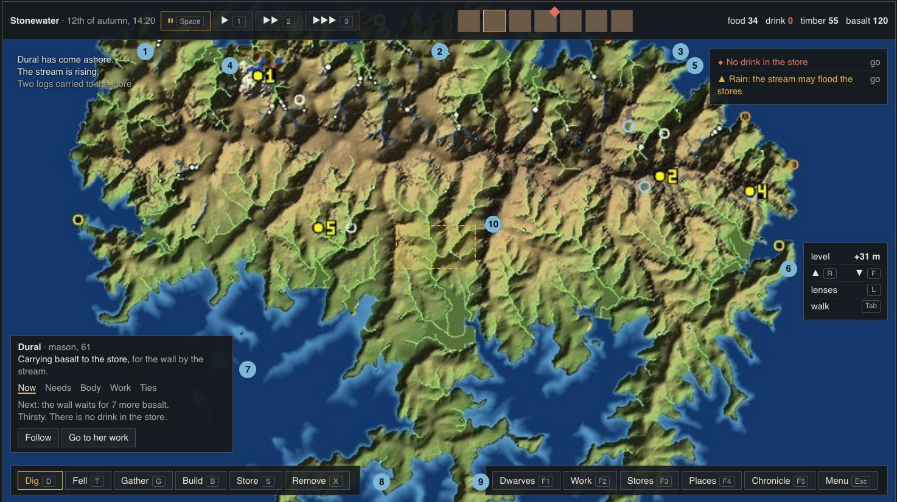
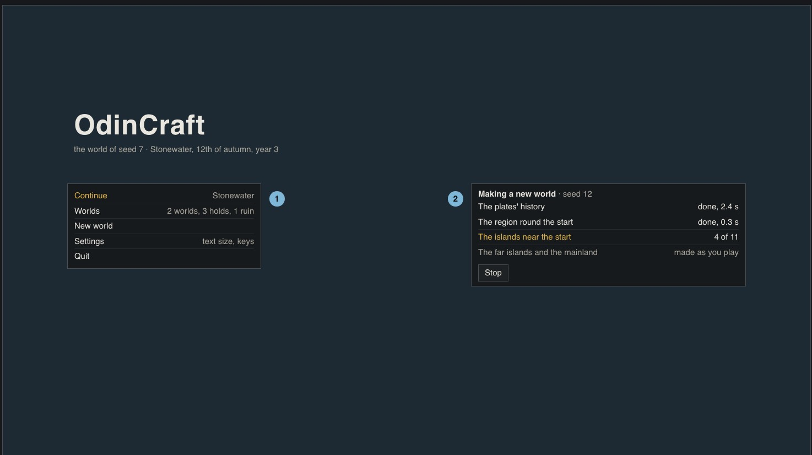

# The interface: menus, the play screen, expedition planning

A design for OdinCraft v5, written 2026-11-16 by Claude at the owner's word: the interface is part of the early play steps, and "needs a lot of effort and attention to detail and overall well-founded plan, and UI that is purposeful and thought has gone into where everything lands" (`../open-decisions.md`).

It is a plan, not a decision. Section 8 holds what is the owner's. Pictures of the three main screens are in `interface-wireframes.html` beside this file.

The evidence is a survey of Dwarf Fortress's Steam interface, RimWorld's, and what the makers of Factorio, Victoria 3, Crusader Kings 3 and others have written about theirs, made by a research agent on 2026-11-16 that fetched each page. Its sources are listed at the end. Claude did not re-check its quotations. *(Memory)* marks what neither checked.

## 1. What it gives the player

The player looks down on the land and always knows four things without asking: what day and hour it is, who their dwarves are, what is wrong, and what they are holding in their hand. Anything on the screen can be clicked and answers in a sentence what it is and why. Every order is given with the game paused or running, by mouse or by key, and the key is written on the button. Nothing moves: a thing learned once is in the same place a hundred hours later.

## 2. Where the game stands

There is no interface. The game draws a crosshair and writes its figures in the window's title. There is no text on screen, no panel, no menu. The world is entered straight from the command line. What exists and can be shown: every block, plant, stream and place answers `--why` in plain sentences; a survey names what an island holds; fields paint as overlays on the map (`--overlay=`); the known world and the islands draw as maps (`--known`, `--archipelago`).

So the interface has more to say than most games' on its first day, and nothing to say it with.

## 3. Foundational decisions

Each is cheap to adopt now and expensive to change once screens stand on it.

**I1. The screen has four fixed regions, each with one job.**

| Region | Job | Why there |
|---|---|---|
| Top, a thin strip | **What is constant**: the hold and the clock at the left, the seven dwarves in the middle, the stores at the right | The first place the eye lands. It is true whatever the player is doing |
| Left, lower | **The hand**: the thing selected, or the tool in use, and under it the orders | Acting on the world is one place. The pointer travels little between an order and what it is given to |
| Right | **What to know**: alerts at the top, how the world is seen in the middle (the cut's level, lenses, the walk), the lists at the bottom | Knowing is kept apart from doing |
| Centre | **The world**. No panel covers it in play | The land is what the game is about |

*Evidence.* Dwarf Fortress's Steam interface was praised for the mouse and faulted for placement: "The new interface feels scattered... More things are clickable and accessible, but without any real logic regarding where they're placed", where the classic one kept "the visual playspace cleanly delineated from menu information" (PC Gamer's review). Victoria 3's makers name three pillars: "The right information at the right time / Clear feedback about cause and effect / Clearly separate Actions from Information".

*Alternatives.* RimWorld's single row of tabs across the bottom, with orders inside one of them: it works, but mixes doing and knowing in one row. Windows the player drags about: flexible, and then nothing has a place.

*Why expensive later.* Every screen after this is built into a region. Moving one moves all.

**I2. One grammar: select, read, order.**

Click a thing and it is selected: a dwarf, a block, a tree, a stream, a store, a workshop. Its card opens in the hand: a line saying what it is, a line saying what it is doing or why it is there, then tabs for depth, then what can be done with it. Orders that are not about one thing (dig here, build that) begin from the orders bar, and their options appear in the same hand. A click on empty air clears the hand.

*Evidence.* Tarn Adams on the Steam dwarf sheet: "The full data and options can be found in tabs, with a short summary at the top level", and it "can still run unpaused". "Hovering over anything on the map will now show a tool-tip popup."

**I3. Everything says why, and why not.**

The card's second line is a cause. A job not being done says what it waits for. A build that cannot be afforded says what is missing and how much is in store. This is the project's own rule (`plan.md`, "Everything can be asked why") brought to the screen, and the game's sentences already exist.

*Evidence.* Adams: "Now we add in a 'why isn't this job being done' functionality." A preview of Prison Architect: "often tough to work out why an inmate or guard isn't doing what you'd like him to." Victoria 3: an empty list should "let the player know what's happening, why it's happening, and what to do about it".

**I4. Every alert and every row leads to its place.**

Clicking an alert, a message, a dwarf's row, a store's row or a named place moves the view there and selects the thing. No list is a dead end.

*Evidence.* Adams on the Places list: "The most important part is the recenter button." RimWorld's messages "instantly center the camera on their subject".

**I5. Standing problems and passing news are two things in two places.**

An **alert** is a problem that is still true ("no drink in store"). It stays at the right edge until it stops being true. A **message** is something that happened ("Dural has come ashore"). It shows at the left under the top strip, fades, and is kept in the chronicle.

*Evidence.* Crusader Kings 3 splits "alert flags, signifying urgent problems, and an Issues tab". A preview of Timberborn: "If you aren't specifically looking for an icon or alert, chances are you are going to miss it completely."

**I6. The keyboard is whole, and so is the mouse.**

Every action has a key, and the key is written on its button. Every action can also be reached by the mouse alone. Keys can be changed. Escape always closes the topmost thing, and with nothing open it opens the menu.

*Evidence.* Three years after Dwarf Fortress's mouse interface, Bay 12 wrote of "many of you who have been asking for classic keyboard controls". Factorio keeps close buttons "for the newcomer", with "tooltips explaining shortcuts".

**I7. Paused is a place to think, not a stop.**

Every order can be given while paused. The clock and its speed are always in view, top left. Space pauses.

**I8. Words before numbers.**

A dwarf is "hungry", not 34%. Work is given in three words, not a grid of numbers (section 5, the work list). A number is shown where the thing is a count (twelve logs) or on demand, in a tooltip.

*Evidence.* Adams: "being as anti-numeric as possible is ideal, since numbers usually make for poor stories." RimWorld's grid of priorities 1 to 4 was called "a complex number assignment system" where Going Medieval copied it, and Oxygen Not Included's runs the other way, 9 highest.

**I9. Text is read at arm's length, at any size of screen.**

The interface is drawn on a grid of 4-pixel modules and scales in steps from 75% to 200%. Body text is no smaller than 24 pixels at 2560 × 1440 at the standard scale. No fact is told by colour alone. Text is drawn from an atlas made at the exact pixel size of each scale, so it is sharp.

*Evidence.* Factorio: "1 module is 4 pixels in standard scale", scales in "multiples of 25% (from 75% to 200%)". Xbox's guidelines give 18 px at 1080p as the floor for a PC, which is 24 px at 1440p. The game accessibility guidelines: "Ensure no essential information is conveyed by a fixed colour alone." Dwarf Fortress crashed at 2560 × 1440 at launch, by a user's report in its FAQ, from "out of bounds UI elements at higher resolutions".

**I10. Plain panels, a plain typeface, our own.**

Flat dark panels with one border, a clear sans-serif typeface, and small pictures only where a picture is the thing itself (a block of basalt for basalt). No frame art, no parchment, nothing taken from Dwarf Fortress's or RimWorld's look.

*Evidence.* Against the Storm's makers called their first interface "pretty, but a bit unreadable in places", replaced it with a minimal one that "met with mixed responses", and went back to add character. Factorio: "when the GUI tells you about some element, it always tries to use this very element, not a representation of it."

*Alternatives.* A pixel typeface to match the 16-pixel block tiles. It suits the blocks and tires the eye over the paragraphs this game answers in.

**I11. Lessons come when they are needed, and are learned by doing.**

No tour on rails. The first time a thing matters, one line says so beside the thing, and goes when the player has done it. All such lines can be read again in the menu.

*Evidence.* RimWorld's first tutor "ran on a rail and told you the same things every game"; its later lessons are "automatically marked as learned when the player does the necessary interaction". Songs of Syx's maker asked 4,500 players how they learned: "70% said trial and error and 64% said tooltips. About half used the tutorial."

**I12. The interface can be seen and tested without a window.**

`--shot` draws the interface with the world, in a state given by options (a thing selected, a list open), so the owner and agents can look at any screen without opening one. Screens are data: a list of what is shown where. So a test can ask what the screen says.

**I13. Each piece arrives with the play step that needs it, into a frame that is fixed now.**

The four regions and the grammar are built once (step I-1 below). After that a play step ships its own cards, lists and orders into them. No step builds a screen for a system that does not exist.

*Evidence.* Factorio's interface rewrite took four years: "we underestimated the complexity of the GUI." Bay 12 brought in a specialist "later than we should have".

## 4. The play screen

At 2560 × 1440, standard scale. `interface-wireframes.html` draws it, with a note on each part:



The same in text:

```
┌──────────────────────────────────────────────────────────────────────────────────────────────┐
│ Stonewater · 12th of autumn, 14:20 · ⏸ ▶ ▶▶ ▶▶▶ │ ① ② ③ ④ ⑤ ⑥ ⑦ │ food · drink · wood · stone │
├──────────────────────────────────────────────────────────────────────────────────────────────┤
│ Dural has come ashore.                                                       ┌─────────────┐ │
│ The stream is rising.                                                        │ ! No drink  │ │
│                                                                              │ ! Rain: the │ │
│                                                                              │   stream    │ │
│                                                                              └─────────────┘ │
│                                      THE WORLD                                               │
│                                                                                     level ▲  │
│                                                                                     +31 m ▼  │
│ ┌────────────────────────┐                                                          lenses   │
│ │ Dural, mason           │                                                          walk     │
│ │ carrying basalt to the │                                                                  │
│ │ store, for the wall    │                                                                  │
│ │ Now  Needs  Body  Work │                                                                  │
│ │ [Follow]  [Go to work] │                                                                  │
│ └────────────────────────┘                                                                  │
│ Dig  Fell  Gather  Build  Store  Remove         Dwarves  Work  Stores  Places  Chronicle  Menu │
└──────────────────────────────────────────────────────────────────────────────────────────────┘
```

- **Top strip, left: the hold and the clock.** The hold's name, the date in words, the hour, and pause and three speeds. The season shows in the date. Clicking the date opens the chronicle at today.
- **Top strip, middle: the seven.** A small picture of each dwarf, with a mark when one is hurt, hungry or idle (a shape, not only a colour). Click selects, a second click goes to them. Seven fit; a larger hold later shows its newest and its troubled, and the rest in the list.
- **Top strip, right: the stores, in a few words.** Food, drink, and the two or three materials the hold is using, each a small picture of the thing and a count. Click opens the stores list.
- **Left, under the strip: messages.** The last few things that happened, newest lowest, fading after a while.
- **Left, lower: the hand.** The selected thing's card, or the tool's choices. Above the orders bar, so an order and its target are a short reach apart.
- **Bottom left: the orders bar.** Dig, Fell, Gather, Build, Store, Remove. Each shows its key. Choosing one puts its choices in the hand and changes the pointer; the world shows what will be marked before the click is let go. Escape or the right button puts it down.
- **Right, top: alerts.** Problems that are true now, the worst first. Each says the problem and, opened, its cause and what would end it.
- **Right, middle: how the world is seen.** The cut's level, with up and down. Lenses: the land's fields painted over it (rock, water in the ground, rain, livable ground, and later ore and danger), which exist today as `--overlay=`. The walk: into first person where the view looks.
- **Bottom right: the lists.** Dwarves, Work, Stores, Places, Chronicle, Menu. A list opens as a panel down the right side, a third of the screen wide, with the world still in view. Only the world's map and the menu take the whole screen, and they pause the game.

Lists, in the order they arrive:

- **Dwarves.** A row each: picture, name, trade, what they are doing, how they are (a word), how they are hurt (a word). Sorted by whatever the player clicks.
- **Work.** Trades down the side, dwarves across. Each cell is one of three: *does not*, *does*, *does first*. The cell shows how good the dwarf is at it, in a word.
- **Stores.** What the hold has, by kind, and where it lies.
- **Places.** The island's named places and features (they exist: `--survey`) and the hold's rooms. Each row goes there.
- **Chronicle.** What happened, by day. Later, the world's history and the journal of what has been found (`plan.md`, P9).

## 5. Before play: the front door, the world, the expedition

**The front door.** One screen, centred, over a slow view of the last world. Continue (the last hold), Worlds, New world, Settings, Quit. Nothing else.



**New world.** A name and a seed. Then honest progress: each stage named as it runs (the plates, the region, the islands near the start), with what is done and what is left, and a way to stop. The whole world is made within the owner's 10 minutes, and the screen says what is still being made behind the player.

**The world.** The known world's map, with the islands near the start. Its lenses are the world's fields. Three doors: **Found a hold** (expedition planning), **Walk the world** (first person, anywhere, as the game is today), and later **Read its history**. A world lists the holds and ruins made in it.

**Expedition planning.** Three questions, one after another, with what has been chosen so far kept in view down the right side. The player can go back.


1. **Where.** The map of the islands. Choosing an island shows its map; choosing ground on it shows a **site card** in words, from what the land already knows:
   - fresh water, and how near
   - a landing, and how sheltered
   - timber, and of what trees
   - the rock under it and what it is good for
   - ground gentle enough to build on
   - what the land may do: a stream that floods, a slope that slid, a vent
   - the climate: the year's warmth, its rain, its storm season
   - what lives there
   Each line says why, as the land does now. What the site lacks is said as plainly as what it has. Dangers are named before the player commits.
2. **Who.** The seven, as the seed drew them: name, age, trade, and later temper and ties. Any one can be drawn again, or all. A party is ready from the start, so a player who wants to begin can.
3. **What they bring.** With materials (P5): a few ready loads, and a careful list for those who want it.

Then **Set out**. The game opens paused, above the landing, with the seven in the boat and one line of advice.

*Evidence.* Dwarf Fortress's embark: region, then local view, then a warning of "any notable dangers", then "Play Now!" or a careful preparation. Its old screen gave "no indication... that both of these lists scroll... The bottom options are a random jumble". Its tutorial offers to "pick a spot in the world you've made where it can do a more traditional tutorial".

## 6. Growth path

The interface steps sit in the play track (`plan.md`, section 5).

| Step | What is built | The owner does |
|---|---|---|
| **I-1. The interface's ground and the play screen's frame** (after P1) | Text, panels on the module grid, the pointer shared between the world and the panels, scale, `--shot` with the interface. The four regions. The clock and speeds. The hand, answering what any block, tree, stream or place is and why. Messages. The level control, lenses and the walk | Clicks a bed of rock in a cut hillside and reads why it is there; paints the rain over the island |
| **With P2. The seven on screen** | Their pictures in the top strip, the dwarves list, a dwarf's card, sending them | Clicks a dwarf in the strip and is taken to her |
| **I-2. The front door and the world** | The front door, a new world with honest progress, the world's map, Walk the world, settings for text size and keys | Makes a world from the menu and walks it |
| **E-1. Expedition planning** | Where, with the site card; who, with drawing again; set out | Chooses a hard site on purpose |
| **With P3. Orders** | The orders bar, marking ground by dragging, the build choices, what an order waits for | Has a room dug |
| **With P4. Needs and the year** | Needs on the card, alerts, the date | Is warned before a dwarf starves |
| **With P5. Materials** | Stores, what a build needs and has, a workshop's card, what the expedition brings | Builds from the island's stone |
| **With P6. The kept world** | Continue, the list of worlds with their holds and ruins, the chronicle | Opens the last game's world |
| **Later** | The map in a corner, the world's history and journal, trade, fighting, mind control | |

## 7. Risks and known failures

- **It is more work than it looks.** Factorio's took four years and 800 styles. The answer here is the fixed frame, the one grammar, and shipping a screen only with its system.
- **Text.** Sharp text at every scale needs an atlas per scale. A typeface must be found whose licence allows shipping it; none is in the repository.
- **The view from above and panels share the pointer.** A drag that begins on the world and ends on a panel, a wheel over a list: each needs a rule, written once.
- **Frame time.** The interface is drawn every frame. It must add nothing to notice: the target is still no frame of our own work over 12.5 ms.
- **The game's sentences are long.** `--why` answers in paragraphs. A card needs the first sentence, with the rest a click away, and some sentences will need rewriting to lead with the point.
- **Seven portraits are easy; seventy are not.** The strip is designed for a party. A larger hold is a later problem, and is said so.
- **Nobody has used it.** Every placement here is argued, and none is tested. The owner's first hour with it will find what is wrong.

## 8. Decisions for the owner

1. **The look: plain dark panels and a clear sans-serif typeface, or a pixel typeface and textured panels to match the blocks?** *Recommendation: plain and clear.* The wireframes show it. The game answers in sentences, and they have to be easy to read.
2. **Work given in three words (does not, does, does first), or in numbered priorities as RimWorld does?** *Recommendation: three words.* Seven dwarves do not need a grid of numbers, and numbers were the part reviewers found hard.
3. **Does "Walk the world", the game as it is today, stay as a door on the world's screen?** *Recommendation: yes.* It costs nothing, the owner asked that first person exist, and it is how a ruin will be visited.

## 9. Not verified

- The survey's quotations were fetched by a research agent and not re-checked by Claude.
- RimWorld's start flow, its letters, and how its drag-marking behaves are from memory.
- No typeface has been chosen or its licence read.
- No placement has been tried on a screen. The wireframes are drawings.

## Sources

From the survey; the numbers are its own.

- Dwarf Fortress: [the wiki's Interface page](https://dwarffortresswiki.org/index.php/Interface), [Embark](https://dwarffortresswiki.org/index.php/Embark); Bay 12's Steam news posts on the information screens, hovering, the dwarf sheet, workshops, work orders, places and the embark screen (read through Steam's news API); [PC Gamer's review](https://www.pcgamer.com/dwarf-fortress-review/); [Game Developer on the Steam release](https://www.gamedeveloper.com/programming/how-tarn-adams-upgraded-and-optimized-dwarf-fortress-for-its-official-steam-release); [PC Gamer on tutorials and the mouse](https://www.pcgamer.com/tutorials-and-mouse-support-could-make-dwarf-fortress-on-steam-vastly-easier-to-play).
- RimWorld: the wiki's [User interface](https://rimworldwiki.com/wiki/User_interface), [Work](https://rimworldwiki.com/wiki/Work), [Learning helper](https://rimworldwiki.com/wiki/Learning_helper), [Alpha 1](https://rimworldwiki.com/wiki/Alpha_1); [Ludeon on Alpha 15's tutorial](https://ludeon.com/blog/2016/08/alpha-15-tutorial-and-drugs-released/); [a review of Going Medieval](https://www.cgmagonline.com/review/game/going-medieval-pc/).
- Factorio's Friday Facts [238](https://www.factorio.com/blog/post/fff-238), [277](https://www.factorio.com/blog/post/fff-277), [289](https://www.factorio.com/blog/post/fff-289), [348](https://www.factorio.com/blog/post/fff-348).
- Victoria 3's developer diary 29 on user experience (read through Steam's news API); [PC Gamer on Crusader Kings 3](https://www.pcgamer.com/the-crusader-kings-3-team-is-working-hard-to-make-the-game-easier-to-learn).
- [Against the Storm's interface update](https://eremitegames.com/interface-update/) and [its hotfix](https://eremitegames.com/interface-hotfix-we-hear-you/); [a preview of Prison Architect](https://www.pcgamer.com/prison-architect-preview-2); [a preview of Timberborn](https://gameblur.net/previews/game-previews/timberborn-pc-early-access-preview/); Songs of Syx's Steam post "What the survey told me".
- [Game accessibility guidelines, basic](https://gameaccessibilityguidelines.com/basic/); [Xbox accessibility guideline 101](https://learn.microsoft.com/en-us/gaming/accessibility/xbox-accessibility-guidelines/101).
- Text in a small engine: [libGDX on distance-field fonts](https://libgdx.com/wiki/graphics/2d/fonts/distance-field-fonts); [Dear ImGui on fonts](https://github.com/ocornut/imgui/blob/master/docs/FONTS.md); [microui](https://github.com/rxi/microui); [Odin's vendor folder](https://github.com/odin-lang/Odin/tree/master/vendor).
