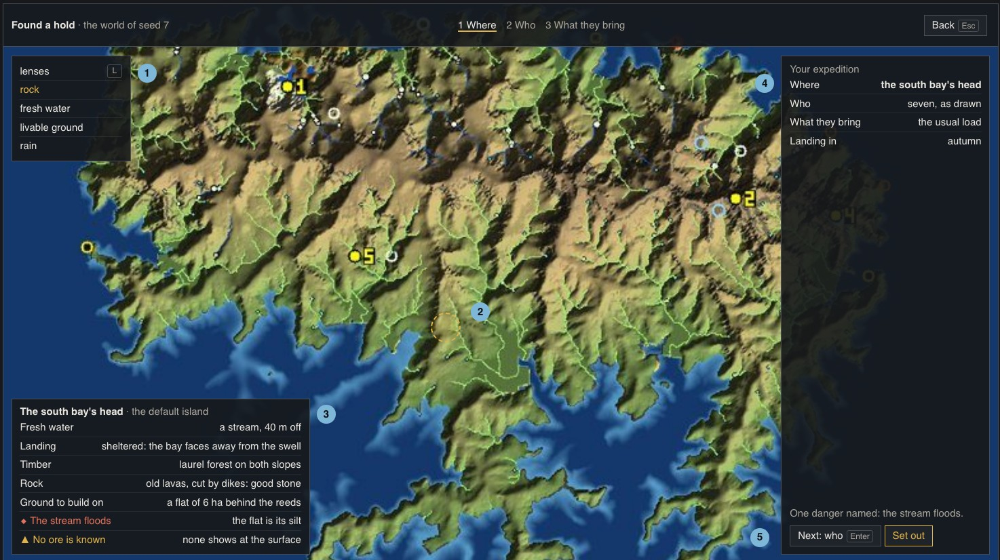

# The interface: menus, the play screen, expedition planning

A design for OdinCraft v5, written 2026-11-16 by Claude at the owner's word: the interface is part of the early play steps, and "needs a lot of effort and attention to detail and overall well-founded plan, and UI that is purposeful and thought has gone into where everything lands" (`../open-decisions.md`).

It is a plan, not a decision. Section 8 holds what is the owner's. Pictures of four screens are beside this file (`interface-*.jpg`, drawn by `interface-wireframes.html`).

**Step I-1 is built** (`../plan.md`, section 10, "I-1, as built"): the ground and the play screen's frame. Section 10 below says what building it changed in this design. The drawings beside this file are still the design's; pictures of the built screen are in `../interesting-world/real/i1-*.jpg`.

**Goods are built** (`../plan.md`, section 10, "Goods you can see, as built"; `../adr/0012`): things lying in the world, the Store order, the stores at the top right. Section 13 below says what building them settled. Pictures: `../interesting-world/real/play/g-*.jpg`.

**The dwarves on screen are built** (`../plan.md`, section 10, "The dwarves on screen, as built"): their place at the top, their list, several in the hand, and the alerts that count them. Section 11 below says what building them changed. Pictures: `../interesting-world/real/crowd-*.jpg`.

**Step I-2 is built** (`../plan.md`, section 10, "I-2, as built" and "I-2, as played"): the front door, a new world with honest progress, the world's screen, and settings. Section 14 below says what building it changed, and section 15 what playing it changed. Pictures: `../interesting-world/real/play/i2-*.jpg`.

**Step E-1 is built** (`../plan.md`, section 10, "E-1, as built"): expedition planning, between the world's screen and play. Section 16 below says where everything on it lands and why, as it was designed before it was drawn, and what playing it changed. Pictures: `../interesting-world/real/play/e1-*.jpg`.

Revised the same day after the owner's two criticisms of the first pass: a hold will grow past seven dwarves, and the first drawings were ugly and immature. The placement and the grammar stand. The look is redone (I10), and the design now grows with the hold (I14).

The evidence is a survey of Dwarf Fortress's Steam interface, RimWorld's, and what the makers of Factorio, Victoria 3, Crusader Kings 3 and others have written about theirs, made by a research agent on 2026-11-16 that fetched each page. Its sources are listed at the end. Claude did not re-check its quotations. *(Memory)* marks what neither checked.

## 1. What it gives the player

The player looks down on the land and always knows four things without asking: what day and hour it is, who their dwarves are, what is wrong, and what they are holding in their hand. Anything on the screen can be clicked and answers in a sentence what it is and why. Every order is given with the game paused or running, by mouse or by key, and the key is written on the button. Nothing moves: a thing learned once is in the same place a hundred hours later.

## 2. Where the game stands

There is no interface. The game draws a crosshair and writes its figures in the window's title. There is no text on screen, no panel, no menu. The world is entered straight from the command line. What exists and can be shown: every block, plant, stream and place answers `--why` in plain sentences; a survey names what an island holds; fields paint as overlays on the map (`--overlay=`); the known world and the islands draw as maps (`--known`, `--archipelago`).

So the interface has more to say than most games' on its first day, and nothing to say it with.

## 3. Foundational decisions

Each is cheap to adopt now and expensive to change once screens stand on it.

**I1. The screen has four fixed regions, each with one job.**

| Region | Job | Why there |
|---|---|---|
| Top, three small panels | **What is constant**: the hold and the clock at the left, the dwarves in the middle, the stores and what is wrong at the right | The first place the eye lands. It is true whatever the player is doing. The land shows between them |
| Left, lower | **The hand**: the thing selected, or the tool in use, and under it the orders | Acting on the world is one place. The pointer travels little between an order and what it is given to |
| Right | **What to know**: the stores and alerts at the top, the ground under the view in the middle (its beds, the cut's level, lenses, the walk), the lists at the bottom | Knowing is kept apart from doing |
| Centre | **The world**. No panel covers it in play | The land is what the game is about |

*Evidence.* Dwarf Fortress's Steam interface was praised for the mouse and faulted for placement: "The new interface feels scattered... More things are clickable and accessible, but without any real logic regarding where they're placed", where the classic one kept "the visual playspace cleanly delineated from menu information" (PC Gamer's review). Victoria 3's makers name three pillars: "The right information at the right time / Clear feedback about cause and effect / Clearly separate Actions from Information".

*Alternatives.* RimWorld's single row of tabs across the bottom, with orders inside one of them: it works, but mixes doing and knowing in one row. Windows the player drags about: flexible, and then nothing has a place.

*Why expensive later.* Every screen after this is built into a region. Moving one moves all.

**I2. One grammar: select, read, order.**

Click a thing and it is selected: a dwarf, a block, a tree, a stream, a store, a workshop. **The hand then says what it is in one line, and opens no card**: a click is not a question. The card is asked for, by its key (I), by More on the line or by a second click on the thing: a line saying what it is, a line saying what it is doing or why it is there, then tabs for depth, then what can be done with it. It stays open or shut as the player last left it, and a click on bare ground shuts it. A dwarf, and ground with an order on it, show a short card at once, since that is what the click was for: who it is and what it is doing, or what is left of the work and what it waits for. Orders that are not about one thing (dig here, build that) begin from the orders bar, and their options appear in the same hand; with a tool held a click opens nothing. A click on empty air clears the hand.

*Changed on 2026-11-16, after the owner played it:* "whenever i click on anything i get that bottom left popup menu which is annoying, i might want to see it sometimes but everytime i click anything it shows." RimWorld's inspect pane is 432 by 165 pixels and opens only on a thing selected, never on bare ground, which it reads out as a line of text under the pointer with no click (`../interesting-world/notes/colony-sim-reference.md`, section 8).

*Evidence.* Tarn Adams on the Steam dwarf sheet: "The full data and options can be found in tabs, with a short summary at the top level", and it "can still run unpaused". "Hovering over anything on the map will now show a tool-tip popup."

**I3. Everything says why, and why not.**

The card's second line is a cause. A job not being done says what it waits for. A build that cannot be afforded says what is missing and how much is in store. This is the project's own rule (`plan.md`, "Everything can be asked why") brought to the screen, and the game's sentences already exist.

*Evidence.* Adams: "Now we add in a 'why isn't this job being done' functionality." A preview of Prison Architect: "often tough to work out why an inmate or guard isn't doing what you'd like him to." Victoria 3: an empty list should "let the player know what's happening, why it's happening, and what to do about it".

**I4. Every alert and every row leads to its place.**

Clicking an alert, a message, a dwarf's row, a store's row or a named place moves the view there and selects the thing. No list is a dead end.

*Evidence.* Adams on the Places list: "The most important part is the recenter button." RimWorld's messages "instantly center the camera on their subject".

**I5. Standing problems and passing news are two things in two places.**

An **alert** is a problem that is still true ("no drink in store"). It stays at the right edge until it stops being true. A **message** is something that happened ("Dural has come ashore"). It shows at the left under the top strip, fades, and is kept in the chronicle.

*Evidence.* Crusader Kings 3 splits "alert flags, signifying urgent problems, and an Issues tab". A preview of Timberborn: "If you aren't specifically looking for an icon or alert, chances are you are going to miss it completely."

**I6. The keyboard is whole, and so is the mouse.**

Every action has a key, and the key is written on its button. Every action can also be reached by the mouse alone. Keys can be changed. Escape always closes the topmost thing, and with nothing open it opens the menu.

*Evidence.* Three years after Dwarf Fortress's mouse interface, Bay 12 wrote of "many of you who have been asking for classic keyboard controls". Factorio keeps close buttons "for the newcomer", with "tooltips explaining shortcuts".

**I7. Paused is a place to think, not a stop.**

Every order can be given while paused. The clock and its speed are always in view, top left. Space pauses.

**I8. Words before numbers.**

A dwarf is "hungry", not 34%. The stores say "food for 12 days". Work is given in words, by trade, not in a grid of numbers (section 4, the work list). A number is shown where the thing is a count (twelve logs) or on demand, in a tooltip.

*Evidence.* Adams: "being as anti-numeric as possible is ideal, since numbers usually make for poor stories." RimWorld's grid of priorities 1 to 4 was called "a complex number assignment system" where Going Medieval copied it, and Oxygen Not Included's runs the other way, 9 highest.

**I9. Text is read at arm's length, at any size of screen.**

The interface is drawn on a grid of 4-pixel modules and scales in steps from 75% to 200%. Body text is no smaller than 24 pixels at 2560 × 1440 at the standard scale. No fact is told by colour alone. Text is drawn from an atlas made at the exact pixel size of each scale, so it is sharp.

*Evidence.* Factorio: "1 module is 4 pixels in standard scale", scales in "multiples of 25% (from 75% to 200%)". Xbox's guidelines give 18 px at 1080p as the floor for a PC, which is 24 px at 1440p. The game accessibility guidelines: "Ensure no essential information is conveyed by a fixed colour alone." Dwarf Fortress crashed at 2560 × 1440 at launch, by a user's report in its FAQ, from "out of bounds UI elements at higher resolutions".

**I10. The look comes from the game's own matter: dressed stone, bronze, and the column of rock.**

The first drawings used flat translucent panels, a system typeface and a yellow accent, and the owner called them ugly and immature. The second pass takes its look from what the game is about.

| | What | Why |
|---|---|---|
| **Basalt** `#222a31`, with **slab** `#2d363e` and **edge** `#46525c` | Panels: opaque, cool dark stone, one fine edge | The land behind is bright and busy, so text needs a calm, solid ground. A blue-grey reads as stone, where black reads as a void |
| **Chalk** `#ede8dd`, **ash** `#9fa8ad` | Text, and quieter text | Chalk on slate |
| **Brass** `#cda85f` | What is live: the thing selected, the tool held, the cut, the one main action | One metal, three states: bright brass is in use |
| **Verdigris** `#6db3a2` | What is well: a thing the site offers, a stage made | Bronze that has settled |
| **Cinnabar** `#d4513b` | What is wrong | The red of a seal, kept for trouble alone |

- **Two typefaces.** What has a name is set in an inscription face (Marcellus in the drawings): the hold, a dwarf, a place, a screen. Everything else is set in a face made to be read (Atkinson Hyperlegible in the drawings). Names look carved; sentences look written.
- **Signs are shapes.** Trouble is a diamond, caution a triangle, well a disc, each in its colour, so none is told by colour alone (I9).
- **A dwarf's picture is a small bust of blocks**, as the world is blocks: hood, face, beard. A mark on its corner says it needs you.
- **A material is shown as a block of itself**, never an invented icon.
- **Keys are small stone tabs** on the buttons they press.
- **The column.** The one thing only this game has: the ground drawn bed by bed, as a geologist draws a column. It stands at the right of the play screen as the ground under the view, with the cut marked on it in brass, and in the site card as what the dwarves would dig through. It is the level control and the game's signature at once.
- Nothing is taken from Dwarf Fortress's or RimWorld's look. No parchment, no frame art, no carved-stone textures.

*Evidence.* Against the Storm's makers called their first interface "pretty, but a bit unreadable in places", replaced it with a minimal one that "met with mixed responses", and went back to add character. Factorio: "when the GUI tells you about some element, it always tries to use this very element, not a representation of it."

*Alternatives.* A pixel typeface to match the 16-pixel block tiles: it suits the blocks and tires the eye over the paragraphs this game answers in. Light panels like a map's margin: handsome on a page, glaring over the land for hours.

*Settled in I-1.* Both typefaces are under the SIL Open Font License 1.1, read from the files and from where they were taken, and both are in the repository with their licences (`../../assets/LICENSE.md`). The game draws them itself from an atlas made for each scale (I9). It runs none of a face's own instructions for fitting to pixels, so its text is a little softer than the browser's in the drawings, most at the 75% scale. *The owner has not yet judged the look in the game.*

**I11. Lessons come when they are needed, and are learned by doing.**

No tour on rails. The first time a thing matters, one line says so beside the thing, and goes when the player has done it. All such lines can be read again in the menu.

*Evidence.* RimWorld's first tutor "ran on a rail and told you the same things every game"; its later lessons are "automatically marked as learned when the player does the necessary interaction". Songs of Syx's maker asked 4,500 players how they learned: "70% said trial and error and 64% said tooltips. About half used the tutorial."

**I12. The interface can be seen and tested without a window.**

`--shot` draws the interface with the world, in a state given by options (a thing selected, a list open), so the owner and agents can look at any screen without opening one. Screens are data: a list of what is shown where. So a test can ask what the screen says.

**I13. Each piece arrives with the play step that needs it, into a frame that is fixed now.**

The four regions and the grammar are built once (step I-1 below). After that a play step ships its own cards, lists and orders into them. No step builds a screen for a system that does not exist.

*Evidence.* Factorio's interface rewrite took four years: "we underestimated the complexity of the GUI." Bay 12 brought in a specialist "later than we should have".

**I14. Built for a hold that grows.**

The party is seven. The hold will be thirty, then more (the owner, 2026-11-16). Nothing on the screen may work only for seven.

- **The top shows who needs you, not everyone.** First the dwarves in trouble, worst first; then the ones the player chose to keep in view; then how many there are in all, which opens the list. At seven that is nearly everyone. At seventy it is the same width.
- **Lists find, group and sort.** The dwarves list finds by name, trade or place, and groups by need, by trade or by place. A long group folds to its count.
- **Work is given by trade, not by dwarf.** Each trade says who does it: everyone, no one, or the dwarves named. A grid of every dwarf against every trade grows in both directions; a list of trades grows in one.
- **Alerts count.** "Three dwarves are thirsty" is one alert that opens the three, not three alerts.
- **Many can be in the hand.** Several dwarves selected show as a group: who they are, what they share, and the orders that fit them all.

*Evidence.* Dwarf Fortress sets its work details to "Only selected do this", "Everybody does this" or "Nobody does this", and keeps one hub where citizens are sorted, "one click away". RimWorld's row of portraits is made for a handful.

## 4. The play screen

At 2560 × 1440, standard scale. `interface-wireframes.html` draws it, with a note on each part:

- **Top left: the hold and the clock.** The hold's name, the date in words, and one control for the clock: paused at its hour, or running at one of three speeds. Clicking the date opens the chronicle at today.
- **Top middle: the dwarves.** Those in trouble first, each with a mark on its picture (a diamond for trouble, a triangle for caution); then those the player keeps in view; then the count of all, which opens the list (I14). Click selects, a second click goes there, and with Shift a click adds to the hand. *Built; section 11.*
- **Top right: the stores, then what is wrong.** What the hold is living on, in a few words, each beside a block of the thing. Under it the alerts, worst first, each saying the problem and going to its cause. *Built; section 13.*
- **Left, under the hold: messages.** The last few things that happened, newest lowest, each one short line, fading after a while. The whole of it is said beside the pointer that rests on it, and a click leads to where it happened.
- **Left, lower: the hand.** The selected thing in a line, its card when asked for, or the tool's choices (I2). Above the orders bar, so an order and its target are a short reach apart.
- **Bottom left: the orders bar.** Dig, Fell, Gather, Build, Store, Remove. Each shows its key. Choosing one puts its tool in the hand: its name, its few choices as buttons, and one live line. The world shows what will be marked, under the pointer before the press and through the drag. Escape puts it down. *Built and put right; section 12.*
- **Right, middle: the ground here.** The column of the beds under the view's middle, named, with the cut marked on it. Dragging the mark, or its keys, moves the cut. Under it: lenses, the land's fields painted over it (rock, water in the ground, rain, livable ground, and later ore and danger), which exist today as `--overlay=`; and the walk, into first person where the view looks.
- **Bottom right: the lists.** Dwarves, Work, Stores, Places, Chronicle, Menu. A list opens as a panel down the right side, a third of the screen wide, with the world still in view. Only the world's map and the menu take the whole screen, and they pause the game.

Lists, in the order they arrive:

- **Dwarves.** A row each: picture, name, trade, what they are doing and why, and a word for how they are. Found by name, trade or place; grouped by need, by trade or by place (I14).
- **Work.** A row for each trade, saying who does it: everyone, no one, or the dwarves named, shown as their pictures with a word for how good each is. A dwarf's own card says which trades are hers and which she does first.
- **Stores.** What the hold has, by kind, and where it lies.
- **Places.** The island's named places and features (they exist: `--survey`) and the hold's rooms. Each row goes there.
- **Chronicle.** What happened, by day. Later, the world's history and the journal of what has been found (`plan.md`, P9).

## 5. Before play: the front door, the world, the expedition

**The front door.** One screen, centred, over a slow view of the last world. Continue (the last hold), Worlds, New world, Settings, Quit. Nothing else. *Built; section 12. Until holds are kept (P6) the first choice is "Enter the last world".*

**New world.** A name and a seed (*built with a seed alone; section 12*). Then honest progress: each stage named as it runs (the plates, the region, the islands near the start), with what is done and what is left, and a way to stop. The whole world is made within the owner's 10 minutes, and the screen says what is still being made behind the player.

**The world.** The known world's map, with the islands near the start. Its lenses are the world's fields. Three doors: **Found a hold** (expedition planning), **Walk the world** (first person, anywhere, as the game is today), and later **Read its history**. A world lists the holds and ruins made in it.

**Expedition planning.** Three questions, one after another, with what has been chosen so far kept in view down the right side. The player can go back.

*Built as one screen with where and who side by side; section 16. What they bring comes with P5.*

1. **Where.** The map of the islands. Choosing an island shows its map; choosing ground on it shows a **site card** in words, from what the land already knows:
   - fresh water, and how near
   - a landing, and how sheltered
   - timber, and of what trees
   - the rock under it and what it is good for
   - ground gentle enough to build on
   - what the land may do: a stream that floods, a slope that slid, a vent
   - the climate: the year's warmth, its rain, its storm season
   - what lives there
   Each line says why, as the land does now. What the site lacks is said as plainly as what it has. Dangers are named before the player commits.
2. **Who.** The seven, as the seed drew them: name, age, trade, and later temper and ties. Any one can be drawn again, or all. A party is ready from the start, so a player who wants to begin can.
3. **What they bring.** With materials (P5): a few ready loads, and a careful list for those who want it.

Then **Set out**. The game opens paused, above the landing, with the seven in the boat and one line of advice.

*Evidence.* Dwarf Fortress's embark: region, then local view, then a warning of "any notable dangers", then "Play Now!" or a careful preparation. Its old screen gave "no indication... that both of these lists scroll... The bottom options are a random jumble". Its tutorial offers to "pick a spot in the world you've made where it can do a more traditional tutorial".

## 6. Growth path

The interface steps sit in the play track (`plan.md`, section 5).

| Step | What is built | The owner does |
|---|---|---|
| **I-1. The interface's ground and the play screen's frame** (after P1; built) | Text, panels on the module grid, the pointer shared between the world and the panels, scale, `--shot` with the interface. The four regions. The clock and speeds. The hand, answering what any block, tree, stream or place is and why. Messages. The level control, lenses and the walk | Clicks a bed of rock in a cut hillside and reads why it is there; paints the rain over the island |
| **After I-1. The dwarves on screen** (built) | Their pictures at the top: who needs you, who you keep in view, the count of all. The Dwarves list, which finds, groups and folds. Several in the hand as a group. Alerts that count. Messages that lead to their place. A dwarf's card finished: name, trade and age, what it is doing and what it waits for, and tabs for its trade and itself | Clicks a dwarf's picture and is taken to her |
| **I-2. The front door and the world** (built) | The front door, a new world with honest progress, the world's map, Walk the world, settings for text size and keys | Makes a world from the menu and walks it |
| **E-1. Expedition planning** (built) | Where, with the site card; who, with drawing again; set out | Chooses a hard site on purpose |
| **With P3. Orders** | The orders bar, marking ground by dragging, the build choices, what an order waits for | Has a room dug |
| **With P4. Needs and the year** (first half built: section 17) | Needs on the card, alerts, the date | Is warned before a dwarf starves |
| **With P5. Materials** | Stores, what a build needs and has, a workshop's card, what the expedition brings | Builds from the island's stone |
| **With P6. The kept world** | Continue, the list of worlds with their holds and ruins, the chronicle | Opens the last game's world |
| **Later** | The map in a corner, the world's history and journal, trade, fighting, mind control | |

## 7. Risks and known failures

- **It is more work than it looks.** Factorio's took four years and 800 styles. The answer here is the fixed frame, the one grammar, and shipping a screen only with its system.
- **Text.** *Built in I-1:* an atlas for each scale, and two typefaces under the Open Font License in the repository.
- **The view from above and panels share the pointer.** *Built in I-1, as one rule:* a press belongs to what lies under it, and so does everything until that button is let go; the wheel belongs to what the pointer is over. No one has tried it by hand.
- **Frame time.** The interface is drawn every frame. It must add nothing to notice: the target is still no frame of our own work over 12.5 ms.
- **The game's sentences are long.** `--why` answers in paragraphs. A card needs the first sentence, with the rest a click away, and some sentences will need rewriting to lead with the point.
- **A hold of seventy is designed for and not drawn.** I14 says how each part grows. Only the hold of thirty-four is drawn. *Built for the dwarves' place at the top, their list, the hand and the alerts, and pictured with thirty-four and a hundred (`../interesting-world/real/crowd-34.jpg`, `crowd-100.jpg`); work by trade is still to come.*
- **Nobody has used it.** Every placement here is argued, and none is tested. The owner's first hour with it will find what is wrong.

## 8. Decisions for the owner

1. **The look, as redrawn** (I10): stone-dark panels, brass for what is live, names in an inscription face, pictures of dwarves as busts of blocks, and the column of the ground. *It is the owner's to judge by looking.* The first pass was rejected as ugly and immature.
2. **Work by trade** (everyone, no one, or the dwarves named), in place of a grid of dwarves against trades or numbered priorities. *Recommendation: by trade*; it is what still reads at seventy dwarves.
3. **"Walk the world", the game as it is today, stays as a door on the world's screen.** *Taken as agreed* ("that sounds good", 2026-11-16) unless the owner says otherwise.

## 9. Not verified

- The survey's quotations were fetched by a research agent and not re-checked by Claude.
- RimWorld's start flow, its letters, and how its drag-marking behaves are from memory.
- The Braille Institute's own page for Atkinson Hyperlegible was not read; the licence was read from Google Fonts' repository and from inside the files.
- No placement has been tried by hand. The play screen is built and has been looked at only in pictures taken with no window: no one has moved a pointer over it.

## 10. What building I-1 changed

The four regions and the grammar stood. These are the places where the built screen differs from sections 3 and 4, and why.

- **The ground's panel has more on it** than the drawing's three buttons. The cut has to be turned on and off by the mouse, so its title carries a small switch, Cut, with its key. Up and Down are two buttons, since one button with two keys cannot be clicked. The third control P1 asked for is there as **Follow the ground**. Dragging the mark above the column's top makes the world whole again, and the wheel over the column moves the cut a block.
- **The column says more than the drawing's.** Each bed is drawn in its own block's picture, so it is the stuff the cut shows. The soils are named together as "soil" where each is a block thick. What stands over the cut is dimmed, since it is not drawn in the world. Where water stands in the ground, its level is marked and named. The column shows 120 m, or more by doubling when the cut is deeper than that, and holds still while the mark is dragged.
- **Lenses open beside the ground's panel**, not inside it, so that nothing in the panel moves. While a lens is on and its choices are shut, the key to its colours stays there. A lens of rock uses colours of its own, the island's first rock in one and its second in another: painted in the map's colours, basalt and breccia could not be told apart over the land.
- **A card is as deep as its longest tab**, within limits, so that changing tabs moves nothing. For a block of ground the first tab is Rock, with the column the block lies in beside the words. For anything else the first tab is the thing's own.
- **The card's depths are Rock, Ground, Plants, Near and World**: what `--why` says, by part. Its first lines are written for the card and lead with the point; the rock's lines are rewritten; **the other tabs are still the game's sentences as `--why` prints them**, long and full of figures. They need the same rewriting, part by part.
- **Places stand on the land as names**, so that a place can be clicked in the world, as I2 asks of everything. The Places list holds the named places, then whatever else is remarkable on the island, by kind, each kind folded to its count.
- **Escape's order** (I6) is: the field being typed in, the menu, the mouse (in first person), the lenses, the list, a box being marked, the hand; with nothing open it opens the menu. It no longer leaves the game: Quit is in the menu.
- **The list narrows before it covers anything.** At 175% and 200% on a screen 2,560 wide, a list a third of the screen wide lay over the place's panel. It is now never wider than the room beside the hand and the place. The test that found this checks every scale.
- **The top left names where the view is**: the named place under it, or which way it lies from the nearest ("North of East Top"), until a hold has a name. The date is the day of the season ("16th of spring"); there is no year yet.
- **Clicking the date does nothing**: there is no chronicle to open. The messages are kept for it.
- **Lessons can be read again in the menu** (I11), which also holds the interface's size until settings exist (I-2). *They exist; the menu keeps the size too, since it is where a player in play looks for it.*
- **A message need not have a place.** The hold's log has none to give yet, so its lines are told and cannot be followed (I4). Anything told with a place leads there.
- **A picture can leave the interface out** (`--plain`), since pictures of the land are how the natural world is judged, and can say what the screen says (`--say`), which I12 did not name.

## 11. What building the dwarves on screen changed

The design stood: who needs you, then who you keep, then the count; a list that finds, groups and folds; several in the hand; alerts that count. These are the places where the built screen differs from sections 3 and 4, or settles what they left open, and why.

- **"Needs you" is a table of causes** (`NEEDS`, `crowd.odin`), worst first, each with its word, its sentence for one dwarf and for several, what such a dwarf waits for, and its sign. Before needs and wounds exist (P4) there are three, which the hold can tell of where a dwarf stands: it has no ground under it or within six steps (a diamond); it has stopped on ground closed all round, a pit or a ledge of no more than 64 floors (a diamond); it has stopped on open ground with no way to where it was sent (a triangle). Hunger and hurt will be rows. **Idle is not one**: the drawing marks an idle dwarf with a triangle, but until there is work every dwarf that stands is waiting for word, and seven triangles would say nothing.
- **Those who came in the first boat are kept in view from the start.** The design's top at seven dwarves is "nearly everyone" only if someone keeps them; with nothing wrong and nothing kept it would be a count and no pictures. The player lets any of them go, and keeps others, with K, on a card or on a row.
- **The top has ten places at most**, fewer where the picture is narrow, and is as wide at a hundred dwarves as at thirty-four. Where more need you than there are places, the last place says how many more and opens the list on them; so does the last of those kept. **Those kept hold a third of the places against a crowd in need**, or a dwarf the player chose to watch would vanish whenever many were in trouble.
- **The count is set in the reading face**, not the inscription face the design gives a name: Marcellus's 1 and 0 are an I and an O, and a hundred read as "IOO".
- **A second click on a picture takes the view to the dwarf once; Enter follows it** as it walks, and Enter again lets go. With Shift a click on a picture or a row adds the dwarf to the hand, or takes it out.
- **A box dragged over dwarves takes the dwarves**, not the blocks under them; over ground with no dwarf it still takes the blocks. When P3 gives orders their tools, a drag with a tool in the hand marks ground, and with none selects.
- **A row leads with what is wrong.** The hold's own sentence for a stopped dwarf runs to forty words. A row, a card and an alert say it in the table's words, and the card adds where the dwarf was sent and what it waits for.
- **A row has a word for how the dwarf is and a small Keep.** Until P4 the word is what the dwarf needs, or "well".
- **The list groups by need as the drawing does**: Need you, then by what they are doing: Walking, Waiting for word, Coming ashore. By trade it is a group a trade, and by place a group for each named place the dwarves are nearest. A group of more than eight shows its first five and folds the rest to their count ("Twenty-nine more, show all"); its head folds it away whole. **Kept in view** beside the three is a switch that leaves only those.
- **The list finds by what a dwarf needs too**, as well as by name, trade and place.
- **A dwarf's card has two tabs, Trade and Self**: what its trade does and who shares it; its age, its height, whether it came in the first boat and how far it has walked. The drawing's Needs, Body, Work, Ties and Past name things that do not exist yet. What it needs stands under its name with its sign.
- **Several in the hand** say how many and of what trades, show a picture of each, name them, and say what they share: what they are doing, and what any of them needs. The orders that fit them all come with P3.
- **An alert that counts dwarves takes them in the hand and puts the view over them.** For one dwarf it names it. It is raised again only when those it counts change.
- **A message leads to where it happened and takes the dwarf it is about in the hand.** The hold says where each line of its log happened: the block of an order, the place of the dwarf it names, or where the errand leads.
- **A sign stands over a dwarf that needs you, on the land**, so the mark at the top can be found in the world, and a brass square round each dwarf in the hand.
- **A list stands where the alerts do**, so they are not drawn while one is open; the Dwarves list by need says the same. Sections 3 and 4 give both the top right.
- **The alerts narrow to leave the dwarves their count**, down to a least width. On a screen 2,560 wide that is enough up to 150%. At 175% with an alert standing the top is the count alone, with no pictures; at 200% it has no room at all, and two alerts are deep enough to take the ground's panel's place until they clear, though its keys still work. At 175% and 200% with a list open the top has no room for the dwarves either. The lists' button and F1 lead to them at every size.
- **E in first person takes the dwarf aimed at in the hand**, and where none is aimed at the block, as Y does. It is a row of `BINDS`. G and the right click are still P2's, for P3.

## 12. What putting the orders right changed

The owner played P3 on 2026-11-16 and called it terrible (`../open-decisions.md`). These are the places where the screen now differs from sections 3, 4 and 11, and why. Each was played by script from the player's seat before it was kept (`../plan.md`, "P3, as put right"; pictures in `../interesting-world/real/play/`).

- **The hand has two states** (I2, above): a line, and the card asked for. The line is a block of the thing, its name, where it lies, and More with its key. A dwarf's short card is its picture, name, trade and age, what it is doing and what it waits for, with Follow, Keep and Put down; its tabs are the card's.
- **A tool's card is its name, its choices and one live line**, and is as high whatever the line says. P3's card held three paragraphs and grew and shrank with what the pointer was on, so its buttons moved from under the pointer as it came to them: a click on a choice after a click on the world missed. Nothing on a card may move because the pointer moved.
- **The choices are named for what the player gets.** Dig: Dig out, with how deep (1 to 4); Stair down; Stair up. Build: Wall, with how high (1 or 2); Floor; Stair up; of stone or timber, each with what is in store written on it. What each leaves is the tip on its button.
- **The live line** says, with nothing pressed, what a click here would do ("Basalt: hard rock, 10 s a block. Here: 2 blocks."; "Tabu tree, 7 m: 3 timber."), and through a drag what the drag would ("5 by 9, 2 deep: 90 blocks."; no block is added to what is dragged). It is the hold's own rule asked of the blocks the frame draws.
- **A drag is flat.** It is a rectangle on the level of the block the press took, its far corner where the pointer's ray comes down on that level; a stair and a wall are lines. A tool takes the ground under the pointer through any leaf or limb, and a click on any part of a tree fells that tree.
- **What is marked shows where the player looks**: the blocks to dig tinted, the ground over them tinted faintly where they lie under a hillside, a tree to fell with a brass band at its foot and a brass cap on its crown, which is what shows from above.
- **An order's card is short**: what it is, how much is left and how many dwarves are at it, what it waits for, and Go there, Take it back, More.
- **Remove trims**: it takes back the marks in the columns dragged over and no others, and says how many before the button is let go.
- **Messages are one line.** "Marked to dig: 90 blocks." "Dug: 89 blocks, 61 basalt. 1 left as the step out." Who took up what, each tree felled and each arrival are the log's alone. They fade after eight seconds.
- **The cut draws a dwarf whole or not at all** (ADR 0007): one whose feet stand under the level keeps its head, one standing at the level or over it is not drawn, and its picture at the top still leads to it.
- **The clock's speeds are 1, 3 and 6 times**, the buttons' names as they were.
- **The key I** asks for the card and shuts it. It is a row of `BINDS`.

## 13. What building the goods settled

The owner asked for a place for what is gathered, and to see it (`../open-decisions.md`, 2026-11-16). Section 4 gave the stores the top right and the bar a Store order; these are the places where building them settled what was open, and why.

- **The stores say what lies in stockpiles, and say that what lies loose is not counted.** A row a kind, each beside a block of itself: the stones by their rock, the timber together, the five there are most of. Under them one small line: "21 lie loose, not counted", or, with no stockpile marked, "21 loose: no stockpile". RimWorld counts only what is in storage and says nothing of the rest; here the line is the way a new player learns that a stockpile is wanted. The panel is not drawn while there is nothing dug, nothing stored and no stockpile.
- **Store (S) is a tool like the others**: its name, what it takes (Everything, Stone, Timber) as buttons, and one live line ("4 by 3: 12 places for stone."). The drag is a rectangle on the ground, and takes the places a dwarf can stand in it near the level it began on, so on a slope it follows the slope. Over a stockpile the line says what it takes and how full it is. Dragging beside one that takes the same makes it larger.
- **A stockpile's ground is tinted verdigris**, the colour of what is well, where marked work is brass.
- **Things are drawn as what they are**: stone as a heap of small pale stones of its rock's colour, up to eight in a cell; timber as logs laid across each other. A dwarf carrying holds a stone or a log over its head.
- **A click on a heap says what and how many, and whether it is counted**: "Basalt  8, in a stockpile" or "Basalt  3, lying loose: not counted". A click on a stockpile's bare ground says "Stockpile  stone and timber; 3 of 12 full". A click on a block the dwarves laid says what it was laid as: "Wall of basalt  built by the hold".
- **Remove (X) does the first of three things that applies** where it is dragged, and its line says which before the button is let go: marks are taken back; with none there, built blocks are taken down, and what they are of lies where they stood; with none, the ground is taken out of its stockpile, and what lies there lies loose. Both games give each its own tool; one tool keeps the bar short, and the line keeps it from surprising.
- **A block marked to be laid shows which of three states it is in**: a small block of its stuff while that is still to be brought, nearly a whole block once it lies at the order, and the block itself once laid. An order's card says how much is left and what it waits for; "their stone or timber has not been brought" is no trouble, and only "no stone anywhere" is an alert.
- **A stair the tool would mark says how deep it goes**: a figure on the ground over each step, "-1" to "-4".
- **The Build tool's buttons count what lies anywhere**, stored or loose, since a block is laid of the nearest.

## 14. What building I-2 changed

Section 5 stood: a front door over the last world, a new world whose making is told stage by stage, a world's screen with the doors on it. These are the places where the built screens differ from it, or settle what it left open, and why.

- **The first choice is "Enter the last world"**, and it goes straight into play. The drawing's "Continue at Stonewater" names a hold and a year; neither is kept yet (P6). The line under the game's name says what the world in hand is, in the land's words.
- **The last world is formed as soon as the door is up**, with the panel of its making at the lower right, as the drawing has a new world's. So the fast way in is one key, and the wait the game used to make before it showed anything is spent at the door.
- **Enter pressed too soon waits, and says so.** The choice's note counts the islands made and says the player goes in when they are; Escape takes the wish back.
- **A new world goes to its own screen, not back to the door.** The drawing shows the making beside the front door. Built, the player who has just asked for a world wants to see it: the map is empty while the plates' history runs, then the known world is drawn, then each island arrives. The same panel says the stages on both screens.
- **A new world has a seed and no name.** A name comes with what it would name, a kept world with holds in it (P6).
- **The panel of a world being made says more than the drawing's**: under the stage that is running, what that stage makes, or which islands are in hand; beside one that is done, how long it took, or that it was kept from an earlier run. The drawing's "the far islands and the mainland" is "the far islands": the mainland is not made as you play, it is not made at all yet.
- **Stop finishes what is in hand.** Forming has no place to stop inside an island, and the plates' history none inside its run. The button's words and the panel's say so, and the button turns to "Go on making it".
- **The doors are on the island's card**, in the hand, since both act on the island chosen (I2). The drawing's world screen names three doors and no place for them. **Read its history** is the world's, and will stand in the world's own panel at the top left; nothing is drawn there now.
- **A door waits for the island and its neighbours**, and the card says what is still to be formed. The design did not say when an island can be entered.
- **The world's regions follow the play screen's** (I1): what is constant at the top left (the world, and how much the picture shows), what to know at the right (the lenses), the hand at the lower left, the ways elsewhere at the bottom right.
- **The map is the known world as the plates left it**, with land that is known and not formed drawn pale, and each island drawn as its own map once it is formed and ringed until then. The design said only "the known world's map, with the islands near the start".
- **The mainland can be clicked**, and its card says it is not formed and cannot be landed on.
- **A lens of the world paints the sea, and tints an island whole** by its own figure where it has one. The pointer on the map says what the lens says there, which the design did not ask and a ramp of colours needs.
- **Settings stand in the front door's place**, as Worlds and a new world do, under the game's name: nothing on the door moves. A key is changed by clicking its row and pressing the key. The keys that move the view and the walker are named there as not yet rows.
- **The game's name is three quarters the drawing's size**, and set in letters alone: the atlas has no room for every glyph of a style that large at 200% (I9).
- **Where the picture is small for the interface's size, the parts give way in an order**: the world's panel says less, then the making is told in brief, and a lens's key goes first of all. At the front door a screen's own panel has the room before the making's.
- **Play's menu has the two ways out** the design did not draw: to the world, and to the front door.

## 15. What playing I-2 changed

I-2 was held out of `main` because nobody had played it (`../open-decisions.md`, 2026-11-16). It was then read against what a player of Dwarf Fortress and RimWorld expects of these screens (`../interesting-world/notes/colony-sim-reference.md`, section 12), played by script from the player's seat through every door, and every picture looked at (`../interesting-world/real/play/i2-*.txt` and their pictures). These are the places where the screens now differ from section 14, and why.

- **An island has a name of its own, and its kind is the second thing said.** "North Back, a ridge island". Section 14's map named islands by their kind, and four were "drowned valleys". The name is made by the rule the places on an island are named by: a word from a cause the world knows before the island is formed (an animal that reached it and few others, where it lies among the islands and toward the wind, its size among them, the age of its land, the colour of the rock its kind is built of), then a word of its own kind (`names_make`, `making.odin`). A fish in its streams names no island: a sailor names what is seen from the sea.
- **The world's screen opens framed on the islands there are to choose from**, between the hand's side and the list, with the start in the hand. Section 14's picture was a fixed 384 km across. The wheel zooms by a share about the pointer, a drag and the arrows move, Home shows all the islands again.
- **An island taken in the hand is gone to**: it comes to fill the part of the picture no panel stands on, over a third of a second, so its relief, its streams and its coast can be read, and **its own named places are written on it**. A click on the sea puts it down; Escape puts it down and goes back to all of them. RimWorld jumps the camera to a tile it chooses for you; here the choice is the player's and the journey follows it.
- **The islands are a list at the right**, where what there is to know stands (I1): a row an island, with its picture, its name, its kind and how far it lies, and two figures down two columns, its land and its highest ground, so that two can be compared without leaving the row. A row takes its island in the hand and the view to it (I4). The mainland is the last row. Eleven islands a few pixels across cannot be compared on a map; DF's embark lists what a site has for the same reason.
- **The island's card is rows**: a thing, then a word or a figure. Section 14's card answered in sentences, and its Life was five of them. Six depths, in the order a founder asks: Land (kind, land, highest ground, ground to live on, steep ground, the landing its shore offers, how old, its crust, its setting), Water, Rock, Climate, Life, Places. **The why is asked for**: it is said beside the pointer on a row, and stands under the row as a second line when the row is clicked. A rock or a wood is a block of its own colour on the map; a disc marks what is well, a triangle what a founder should look at twice. The card stands as tall whichever depth is shown. No row may be a sentence, which the test holds it to.
- **What to look at twice is said in a line over the doors**, each a row of the card with its why: an open shore, little ground to live on, no stream. DF lists its warnings on Embark; here they are in view before the door is taken.
- **The door says what is done today: "Land the party here"**, and its tip that the seven the seed drew land where the shore best lets a boat in, and that choosing who comes, what they bring and where is not built. Section 14's "Found a hold" promised an expedition (E-1). "Walk it" is the other.
- **The lenses stand behind their button** (L), as the play screen's do, two across, under the list: eight choices open took the place the islands need. A lens paints the sea and the known land; an island keeps its own colours unless it has a figure of its own under that lens (rain), since a flat tint on an island gone to left nothing to read.
- **The world's panel is its seed and one line**: how many islands, and how far the mainland. How far the picture reaches is a scale bar at its foot, as on a map.
- **Every land larger than an island is said as it stands**, on the map, in a row of its own under the islands' and on its card (step N1's second part, 2026-11-17; `n1-04`, `n1-06`, `n1-11`): *known, not formed*, pale, with why (it lies beyond the 80 km of the start within which a world's large lands are formed when it is made, with how far it is and about how long forming it takes here; or it was left by the player); *being formed*, with how far; *formed on 64 m cells*, drawn from that coarse stage under today's sea with its relief and the rivers of its larger valleys, with how many of its pieces are formed down to ground that can be walked; *under the sea*, where its coarse stage left nothing over it. The nearest the start is the mainland; the others are called by where they lie from the start ("The west land") until peoples name them. No door leads onto one yet.
- **The mainland is a stage of the making**, named in the panel between the region and the islands. Every large land whose coarse stage is kept is read back in it; one that lies within 80 km of the start and is not kept is formed, which is long the first time (half a minute to minutes) and read back after: the panel says how far it has come and about how long is left (`n1-01`, `i2-53`), the world can be looked at meanwhile, and **Leave it as known** stops it and goes on to the islands. The button stands in the panel's brief form too, since on a world with many rows that is the form the world's screen shows. RimWorld cautions when the whole planet is asked for; DF lets a world's making be stopped and used as far as it came.
- **The front door stands over land from its first frame.** The start island's picture is kept beside its world when it is painted, and shown until this run's takes its place. Section 14's door was an empty sea for the seconds the island took to form. The first choice names where it leads: "East Firths, seed 7". On a machine's first run there is nothing kept and the door stands over the sea's dark, with its choices and the making told beside them.
- **Worlds is rows too**: a world's seed, then its start, its islands and its mainland, a thing and a few words each, and when it was kept.
- **A new world lists the stages it will go through**, each with how long it took on this machine last time, in place of a paragraph.
- **The right side of the world's screen is one column**: the islands, the lenses, the world being made, the ways out. The world being made was 760 pixels wide and lay over the islands' names.
- **Names on the map give way to each other**: a name that would lie on another stands over its island, or is left to the list.
- **A click on an island's name on the map takes the island**, as a click on its land does. Played, the name was what the hand went to: the land under it is a few pixels across.
- **The depth of the card that is open stays open from island to island**, so that two can be compared in it, as RimWorld keeps a tile's tab open; the mainland opens on its Land.
- **A tip stands beside its part, toward the picture's middle**, and over a part at the picture's foot. It stood over the part, where it hid the rest of the part's own panel.
- **While one world is put down for another the panel says so**, and none of the old world's stages under the new one's name.
- **In play the island's name stands before the day**, top left: "North Back, 16th of spring". The name made for the map is the place's name wherever it is spoken of.
- **The world's screen has nothing to draw for the seconds a new world's plates' history runs**, and says that nothing of it is known yet. That screen is then its two panels on the sea's dark.

## 16. Expedition planning: where everything lands

Step E-1 (`../plan.md`). Written before the screen was drawn, from what a player of Dwarf Fortress and RimWorld expects of it (`../interesting-world/notes/colony-sim-reference.md`, section 13), then corrected by playing it (`../interesting-world/real/play/e1-plan.txt`, `e1-danger.txt` and their pictures). The last part says what playing changed.

**What it is for.** The player has an island in the hand and wants a hold on it. Two questions are theirs: where on its shore the boat comes in, and who is in the boat. The screen answers both before it is asked: a landing is chosen and a party drawn when it opens, so Enter alone sets out. Everything else on it is for the player who wants better, or worse on purpose.

**One screen, not three.** Section 5 drew three questions one after another. With two to ask (what they bring is P5), each is small enough to stand beside the other, and neither hides the other: a player who draws the party again can still see where it lands.

**Where each thing is, and why there.** The regions are the world's screen's (section 15), so that coming from that screen nothing moves but the panels: the island stays where it was.

| Where | What | Why there |
|---|---|---|
| Top left | The expedition's name: "An expedition to North Back", and under it the island's kind and where it lies | What is constant (I1). It stands where the world's panel stood, so the player knows which screen this is before reading anything else |
| The picture | The island, filling the part no panel stands on, as on the world's screen. Its shore is marked where it has a landing: verdigris where a boat lies sheltered with fresh water a short walk off, pale where it lies sheltered and water is further. The landings offered stand on it as a ring each with its number on a tab; the one chosen is larger, brass, with a dark line round it. A chalk ring follows the pointer along the shore | The choice is made on the land itself (colony-sim-reference, 13.2). The numbers join a row of the list to its place without a click (I4) |
| Lower left | The place: the landing chosen, or while the pointer is on the shore the place under it. A line saying which of the two it is, the place's name, what landing it is; then the beds of the ground the party would gather on, drawn as a column with their names, and beside them the rows | The hand (I2): what is held or pointed at. It stands where the island's card stood, one scale down. The column is this game's own (I10): it is what the dwarves would dig through |
| Right, the whole height | The expedition, read from its top to the one button at its foot: **1 Where**, the landings offered, a row each with its number, the game's own first; **2 Who**, the party, a row a dwarf, then the two ways to draw again, then what work the party has hands for; at the foot what to look at twice in the place chosen, by name, and Back and Set out | What is chosen so far, in the order it is decided, ending at the thing to do (section 5's drawing). Knowing is at the right (I1). The button is at the foot so that nothing chosen above can move it |

**What the eye does.** It lands on the island, the largest and brightest thing. The brass ring on its shore is the one mark in the live colour, so the eye goes there next, and from there to the card at the lower left, which says in a name and a line what that place is. Then the right column from the top: where, who, what to look at twice, Set out in brass. A player who wants only to begin has read the place's name and the button; one who wants to choose moves the pointer to the shore.

**The place's card.** Rows, as the island's card is: a thing, a word or a figure, a sign. Their order is a founder's: Shelter, Fresh water, Ground to live on, Slope, Timber, Rock, Under it. Then what the land may do there, a row each and only where it is so: a slide's lake above, ground that slid, a stream's fan. A disc marks what the place offers, a triangle what it lacks, a diamond a danger (I10). The why is asked for: beside the pointer on a row, and under the row as a second line when the row is clicked. Every row is a row of `SHORE` (`landing.odin`): windows on the land's fields read round the place, with the word for what they find. Four fields were made for it: hectares of ground to live on within 300 m, the mean slope within 150 m, the share of the canopy within 300 m that is timber, and metres to the stream that comes down from a lake a slide dammed. The card is as tall whatever it says: nine rows' room, so that it does not move as the pointer goes along the shore.

**The pointer and the click.** The pointer takes the low shore within seven modules of it. The card says that place at once, with no wait and no click, and goes back to the place chosen when the pointer leaves the shore. A click chooses. The boat is then brought in at the nearest low shore a boat can come in to, which is asked of the ground by the rule the hold lands by (`landing_near`); where that is not where the player pointed, the card's first line says how far off. **Only a shore that stands too high for a boat is refused**, and the pointer on it says why and how high. An open shore, a dry one, a steep one, one with no tree near is chosen like any other: its cautions stand by name over Set out, each with its why beside the pointer, and Set out is as bright as ever.

**The party.** A row a dwarf: its picture, its name, its trade and its age. One is in focus, in brass; a click on a row or the arrows move the focus. Under the rows are the two ways to draw again, each with its key: "Draw Bramik again" (D), which names the dwarf it acts on, and "All" (A). Under them, what work the party has hands for, a row for each kind of work there is (`WORKS`): who digs, who fells, who builds, by name, and "no one's trade" with a triangle where it is so. That is the reason to draw again, as RimWorld's team skills are. A dwarf has a trade and nothing else to choose yet, so there is no card for the one in focus: the row is the whole of it, and what its trade does is said beside the pointer.

**Nothing counts on seven** (I14). The party's rows are a box that scrolls: twelve dwarves show ten and a thumb. The kinds of work are rows of a table. The landings offered are four at most.

**Keys**, each a row of `BINDS` in a view of its own, and each on its button: Enter sets out, Escape goes back to the world's map with the island still in the hand, 1 to 4 choose a landing offered, Up and Down move among the party, D and A draw again, Home shows the island whole, = and - zoom. A drag moves the map and the wheel zooms about the pointer, as on the world's screen.

**What is kept.** The place and the party stay as they were left when the player goes back and comes in again, and when a game is left for the world's screen. Another island begins with its own landing and keeps the party; another world begins with its own party.

**Where the picture is small for the interface's size** the right column gives way in an order, so that the party keeps three rows and the buttons their place: first the work it has hands for is left out, then the landings that are not chosen, which still stand on the island by their numbers and answer their keys.

**What playing it changed.** Each was found by the script and its pictures, reproduced, and put right.

- *The party's line ran out of its panel and across the map* once the party had been drawn again ("seven dwarves, the seed's party drawn again once, and then two of them one at a time"). It is a few words: "seven, drawn again".
- *A row's why was cut off at the card's foot.* A row chosen is scrolled whole into view, once, when it is chosen.
- *The seventh dwarf was half hidden* at the standard size once a place of the player's own and four cautions stood in the column. The rows are a little lower, and the whole party shows.
- *The landing chosen was a thin brass ring among thin chalk rings.* It is larger, with a dark line round it and a dot at its middle, and its number's tab is brass.
- *A click on a landing's ring chose the shore beside it*, sixteen metres off, as a place of the player's own. The pointer on a ring is on that landing.
- *"Draw Bramik again" was cut to "Draw Bramik ag..."* beside a second button that said "Draw all". The second says "All".
- *The words beside the pointer on a cliff lay over the party's rows.* On the island they stand on the side away from the column.
- *Rows that are only sometimes true stood always*: "Slid ground: 100000 years ago" on ground that never slid. What the land may do is a row only where it is so.
- *"Steep ground" was cautioned at the game's own best landing* (31° round it, with 4.5 hectares of flat beside it). Dwarves dig into hillsides: the caution is kept for ground over 35°, and under that the row says "hilly" with no sign.
- *The why of a danger ended "Here: dam below 97.3 m."* A danger says its figure in its own words, and the field's name is left out.

**Not built, and no place left for it**: what the party brings (P5), the home hold it leaves (P9, P10), a finder of sites, the season it lands in.

## 17. What building needs and the year settled

Step P4's first half (`plan.md`, "P4, first half, as built"; `adr/0014`), built 2026-11-16 and played by `interesting-world/real/play/p4-play.txt`. Nothing new was given a region: every part landed in a place this design already had, which is what the regions are for.

- **The date is the clock's, top left, where it was.** "East Firths, 3rd of spring", and the hour on the pause button: both now move. The hour said is the one the dwarves live by, whatever the sun was turned to for a picture. From the second year the date says which year.
- **Night is lit.** A hold is kept through the night, so the land at night is lit as by a full moon, about a third of the day's light, cold in colour. A true night was tried first: black, and for eight of every twenty-four hours nothing could be seen or ordered.
- **What a dwarf feels is three meters on its card**, under what it is doing: Drink, Food and Sleep, each a name, a word and a bar that empties (I3, I9: never a colour alone). The word is the row's own (`WANTS`): not thirsty, thirsty, very thirsty, parched, dying of thirst. Chalk and verdigris while it is met, brass while it wants, cinnabar when nothing is left. They stand on the short card and the open one alike, since they are the first thing a click on a dwarf is for. A tip on each says how a dwarf sees to it. A dead dwarf has none: its card says what it died of and when.
- **Who needs you first gains four causes** (`NEEDS`), ahead of the three it had: dying of thirst and starving (trouble), and thirsty or hungry with no way to water or no food in reach (caution). A dwarf that is only thirsty and walking to the stream needs nobody and is not among them.
- **The Dwarves list groups by what they are at**: need you; seeing to themselves; at work; walking; idle; coming ashore; dead. "Seeing to themselves" is where the answer to "why is nobody digging" stands at night. The word at a row's right is now how the dwarf is, worst first: parched, starving, thirsty, hungry, tired, asleep, well, dead.
- **The count at the top is of the living.** The dead keep a row in the list, under their own group, and are not kept in view.
- **A death is an alert that stands until it is looked at**, with the trouble sign: "Yrsa Coalsleeve has died of thirst." A click goes to the body and takes it in the hand, and the alert is gone. The stages before it are messages and the dwarf's place among those who need you.
- **A hold living from hand to mouth is one alert that says what to do**: "No food in store: the dwarves forage as they hunger. Gather (G) or fish (N), and store it." It stands while a hungry dwarf has marked food for itself within a day and nothing is stored.
- **The stores say how long the food lasts**, under the stone and timber: "Food for two days", then each food with a swatch of its own colour and its count. Brass under a day and a half, cinnabar at none. It is the figure a player of either game looks at each morning. A thing that is no block has no tile, so its swatch is a plain square.
- **Gather and Fish are two tools on the orders bar**, after Store, with G and N. Each drags a rectangle of ground, whatever its height, as Fell does. What it would take stands up as pale pins while it is dragged and as pins with a verdigris head once marked; a tree wears the band and cap of one to be felled, in verdigris. A flat tile was tried first and was lost under the tint of the ground dragged over.
- **The tool's one line says what the drag would bring, or why nothing**: "13 plants and trees: 13 bracken shoots."; "Nothing here bears food a dwarf eats."; "Nothing to gather here now: shii nuts come in autumn."; "No fresh water here to fish."; "This water was fished: it holds fish again in a few days."
- **A stockpile takes Everything, Stone, Timber or Food.**
- **The orders bar wraps to two rows where the text is set large.** Eight tools no longer fit beside the lists' buttons at 175%; the hand stands a row higher there.
- **An order's card says when it waits on the dwarves' own needs**: "Waits while the dwarves see to themselves: seven asleep."
- **The hand says what is food**: a plant's ground says the plant on it and when it is gathered, a shii tree says its nuts, a heap of food says how far one goes, and a stream still says which fish live in it and why not the others.
- **The landing's card has a Food row** (section 16), read on the ground the party would gather on by the rule the hold's first word is read by: "through the year", "in spring and autumn", "none a party could live on", with the seasons one by one in its why.

## Sources

From the survey; the numbers are its own.

- Dwarf Fortress: [the wiki's Interface page](https://dwarffortresswiki.org/index.php/Interface), [Embark](https://dwarffortresswiki.org/index.php/Embark); Bay 12's Steam news posts on the information screens, hovering, the dwarf sheet, workshops, work orders, places and the embark screen (read through Steam's news API); [PC Gamer's review](https://www.pcgamer.com/dwarf-fortress-review/); [Game Developer on the Steam release](https://www.gamedeveloper.com/programming/how-tarn-adams-upgraded-and-optimized-dwarf-fortress-for-its-official-steam-release); [PC Gamer on tutorials and the mouse](https://www.pcgamer.com/tutorials-and-mouse-support-could-make-dwarf-fortress-on-steam-vastly-easier-to-play).
- RimWorld: the wiki's [User interface](https://rimworldwiki.com/wiki/User_interface), [Work](https://rimworldwiki.com/wiki/Work), [Learning helper](https://rimworldwiki.com/wiki/Learning_helper), [Alpha 1](https://rimworldwiki.com/wiki/Alpha_1); [Ludeon on Alpha 15's tutorial](https://ludeon.com/blog/2016/08/alpha-15-tutorial-and-drugs-released/); [a review of Going Medieval](https://www.cgmagonline.com/review/game/going-medieval-pc/).
- Factorio's Friday Facts [238](https://www.factorio.com/blog/post/fff-238), [277](https://www.factorio.com/blog/post/fff-277), [289](https://www.factorio.com/blog/post/fff-289), [348](https://www.factorio.com/blog/post/fff-348).
- Victoria 3's developer diary 29 on user experience (read through Steam's news API); [PC Gamer on Crusader Kings 3](https://www.pcgamer.com/the-crusader-kings-3-team-is-working-hard-to-make-the-game-easier-to-learn).
- [Against the Storm's interface update](https://eremitegames.com/interface-update/) and [its hotfix](https://eremitegames.com/interface-hotfix-we-hear-you/); [a preview of Prison Architect](https://www.pcgamer.com/prison-architect-preview-2); [a preview of Timberborn](https://gameblur.net/previews/game-previews/timberborn-pc-early-access-preview/); Songs of Syx's Steam post "What the survey told me".
- [Game accessibility guidelines, basic](https://gameaccessibilityguidelines.com/basic/); [Xbox accessibility guideline 101](https://learn.microsoft.com/en-us/gaming/accessibility/xbox-accessibility-guidelines/101).
- Text in a small engine: [libGDX on distance-field fonts](https://libgdx.com/wiki/graphics/2d/fonts/distance-field-fonts); [Dear ImGui on fonts](https://github.com/ocornut/imgui/blob/master/docs/FONTS.md); [microui](https://github.com/rxi/microui); [Odin's vendor folder](https://github.com/odin-lang/Odin/tree/master/vendor).

## 18. A stockpile in the hand

The owner asked (2026-11-16) to select a stockpile, remove it, and see what lies in it, as Dwarf Fortress does.

- **A click on a stockpile's ground takes the whole stockpile**, not the block. Its ground is lit brighter than the other stockpiles', with one outline.
- **Its card stands where an order's card does**, in the hand at the lower left, and is read afresh each frame: the title; how many places and how many in use; what lies in it, a row a kind as the stores have them, the most first; what lies there that it does not take, in brass, since that is on its way out; what it takes, as three chips; and three buttons.
- **The buttons are what is done to a stockpile and nothing else**: Go there, Make larger (Store taken up with what it takes), Remove (the whole of it). Remove says in its tip that what lies there stays, loose.
- **It is put down** by Escape, by a click elsewhere, or when the ground it was taken by is no longer a stockpile's.

## 19. What building shelter and warmth settled

Step P4's second half (`plan.md`, "P4, second half, as built"; `adr/0015`), built 2026-11-16 and played by `interesting-world/real/play/p4-shelter-play.txt`. Again nothing was given a region of its own.

- **The weather is one line under the date, top left**: "Rain, 9 °C, strong wind from the east". It lands there because it is of the same kind as the date: what the world is doing now, read by a glance at the corner every player looks at for the hour. RimWorld puts the weather's name and the outdoor temperature in its corner readout for the same reason. It is chalk while rain falls and ash otherwise. The pointer resting on it is told why: the island's mean for the year, what the season, the hour and the height each take or add, how often rain falls on this ground and from how much a year, the wind, and whether the ground is wet.
- **Rain is drawn falling, over the world and under the interface**, leaning the way the wind blows it across the picture, the more streaks the harder it falls; under rain the land is lit by its sky alone, and ground the sky is over is darker while it is wet. Ground under a roof stays as it was, which is how a roof shows in the rain. Rain is laid over the picture, not stood in it: a cut hill's rooms have streaks before them, as RimWorld's roofed rooms do.
- **What is sheltered is a lens, Shelter**, with the others beside the ground (L): ground under a roof in straw, ground under a roof inside walls in ember orange, and a key of two rows. It is a lens and not a line of each block's card because the question is asked of an area ("where can they sleep dry?"), and both games answer it with an overlay; the block's card says it too, in its own line, for the one place the pointer is on ("A dwarf standing on it is under a roof, walled on two sides: dry, and half out of the wind"). It is read from the blocks round the view's middle and drawn on the map of marked blocks, so it lies on the floors themselves, under what is marked to be worked and over what is set aside. To see a room's floor the view is cut under its roof, as for everything indoors.
- **Sleep is a tool on the orders bar, after Store, on Z.** It is dragged, shown, joined, taken in the hand and removed as a stockpile is, because it is the same kind of thing: ground set aside. Its one line says what the drag would mark and what that is worth: "3 by 3: 9 places to sleep, all under a roof."; "none under a roof: they will lie in the open". Its ground is dusk blue, a stockpile's verdigris.
- **A sleeping place's card stands where a stockpile's does**: its title; how many places; how they are sheltered, a row a kind with the lens's own colours (indoors, under a roof, open to the sky); who lies there now; a caution in brass when it has fewer places than the hold has dwarves, or no roof at all; and Go there, Make larger (Sleep taken up), Remove.
- **A fire is one of Build's choices, with Roof**: Wall, Floor, Roof, Stair up, Fire. It is built, by the hands that build, of timber brought to it, so it is where building is. The tool's line says what a fire there would warm: "A fire, of a log. In the open: it warms 2 steps round it, and burns three times as fast in rain."
- **A fire on the land is three logs and its flames**, which shine by themselves and light the ground and the dwarves about them at night, warm in colour, to nine metres. Burnt out it is its logs, black. A fire about to go out burns small.
- **A click on a fire takes it in the hand**, before what lies behind it. Its card: whether it burns and for how long ("Burning: timber for a day and a half."), its timber as a length and a figure, where it stands and what that makes of its warmth, rain falling on it in brass, who is by it; and Go there, Let it go out or Keep it fed, Remove.
- **What a dwarf feels is four meters, two to a row**: Drink, Food, Sleep, Warmth. Three across had no room for a fourth with its word ("numb with cold"). Warmth's words are warm, chilled, cold, numb with cold, dying of cold; "wet" where a warm dwarf is wet. Its tip says what the dwarf feels in degrees, where it stands and whether it is wet or by a fire. Tips on a meter, on the stores' food line and on the weather are now shown: a part with something to say and nothing to do was never told to the pointer before this step.
- **A dwarf's line says where it sleeps and warms itself**: "Asleep indoors.", "Asleep by a fire.", "Asleep in the rain, on open ground.", "Warming itself by a fire."
- **Two more causes for needing the player** (`NEEDS`): numb with cold (trouble), and cold with no fire burning and no roof within reach (caution). The second is the alert the step asked for: "Three dwarves are cold: no fire burns and no roof stands within their reach."
- **A fire that is out, or all but, with no timber lying anywhere is an alert** that says what to do: "A fire is out and no timber lies anywhere: fell trees (T)."
- **The dawn's line says the day that was and the night**: "The day had nine hours of rain, 9 to 12 °C. Last night five slept indoors, two in the open."
- **A sleeping place no way leads to is said**, once a night: a hut whose doorway a bush fills looks finished from above.
