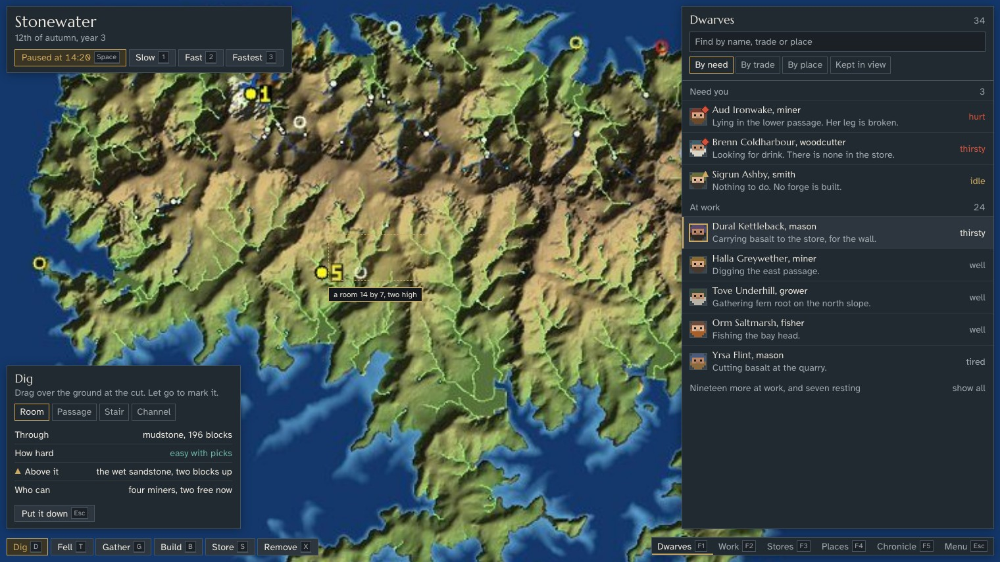

# The interface: menus, the play screen, expedition planning

A design for OdinCraft v5, written 2026-11-16 by Claude at the owner's word: the interface is part of the early play steps, and "needs a lot of effort and attention to detail and overall well-founded plan, and UI that is purposeful and thought has gone into where everything lands" (`../open-decisions.md`).

It is a plan, not a decision. Section 8 holds what is the owner's. Pictures of four screens are beside this file (`interface-*.jpg`, drawn by `interface-wireframes.html`).

**Step I-1 is built** (`../plan.md`, section 10, "I-1, as built"): the ground and the play screen's frame. Section 10 below says what building it changed in this design. The drawings beside this file are still the design's; pictures of the built screen are in `../interesting-world/real/i1-*.jpg`.

**Goods are built** (`../plan.md`, section 10, "Goods you can see, as built"; `../adr/0012`): things lying in the world, the Store order, the stores at the top right. Section 13 below says what building them settled. Pictures: `../interesting-world/real/play/g-*.jpg`.

**The dwarves on screen are built** (`../plan.md`, section 10, "The dwarves on screen, as built"): their place at the top, their list, several in the hand, and the alerts that count them. Section 11 below says what building them changed. Pictures: `../interesting-world/real/crowd-*.jpg`.

Revised the same day after the owner's two criticisms of the first pass: a hold will grow past seven dwarves, and the first drawings were ugly and immature. The placement and the grammar stand. The look is redone (I10), and the design now grows with the hold (I14).

The evidence is a survey of Dwarf Fortress's Steam interface, RimWorld's, and what the makers of Factorio, Victoria 3, Crusader Kings 3 and others have written about theirs, made by a research agent on 2026-11-16 that fetched each page. Its sources are listed at the end. Claude did not re-check its quotations. *(Memory)* marks what neither checked.

## 1. What it gives the player

The player looks down on the land and always knows four things without asking: what day and hour it is, who their dwarves are, what is wrong, and what they are holding in their hand. Anything on the screen can be clicked and answers in a sentence what it is and why. Every order is given with the game paused or running, by mouse or by key, and the key is written on the button. Nothing moves: a thing learned once is in the same place a hundred hours later.

## 2. Where the game stands

There is no interface. The game draws a crosshair and writes its figures in the window's title. There is no text on screen, no panel, no menu. The world is entered straight from the command line. What exists and can be shown: every block, plant, stream and place answers `--why` in plain sentences; a survey names what an island holds; fields paint as overlays on the map (`--overlay=`); the known world and the islands draw as maps (`--known`, `--archipelago`).

So the interface has more to say than most games' on its first day, and nothing to say it with.

## 3. Foundational decisions

Each is cheap to adopt now and expensive to change once screens stand on it.

**I1. The screen has four fixed regions, each with one job.**

| Region | Job | Why there |
|---|---|---|
| Top, three small panels | **What is constant**: the hold and the clock at the left, the dwarves in the middle, the stores and what is wrong at the right | The first place the eye lands. It is true whatever the player is doing. The land shows between them |
| Left, lower | **The hand**: the thing selected, or the tool in use, and under it the orders | Acting on the world is one place. The pointer travels little between an order and what it is given to |
| Right | **What to know**: the stores and alerts at the top, the ground under the view in the middle (its beds, the cut's level, lenses, the walk), the lists at the bottom | Knowing is kept apart from doing |
| Centre | **The world**. No panel covers it in play | The land is what the game is about |

*Evidence.* Dwarf Fortress's Steam interface was praised for the mouse and faulted for placement: "The new interface feels scattered... More things are clickable and accessible, but without any real logic regarding where they're placed", where the classic one kept "the visual playspace cleanly delineated from menu information" (PC Gamer's review). Victoria 3's makers name three pillars: "The right information at the right time / Clear feedback about cause and effect / Clearly separate Actions from Information".

*Alternatives.* RimWorld's single row of tabs across the bottom, with orders inside one of them: it works, but mixes doing and knowing in one row. Windows the player drags about: flexible, and then nothing has a place.

*Why expensive later.* Every screen after this is built into a region. Moving one moves all.

**I2. One grammar: select, read, order.**

Click a thing and it is selected: a dwarf, a block, a tree, a stream, a store, a workshop. **The hand then says what it is in one line, and opens no card**: a click is not a question. The card is asked for, by its key (I), by More on the line or by a second click on the thing: a line saying what it is, a line saying what it is doing or why it is there, then tabs for depth, then what can be done with it. It stays open or shut as the player last left it, and a click on bare ground shuts it. A dwarf, and ground with an order on it, show a short card at once, since that is what the click was for: who it is and what it is doing, or what is left of the work and what it waits for. Orders that are not about one thing (dig here, build that) begin from the orders bar, and their options appear in the same hand; with a tool held a click opens nothing. A click on empty air clears the hand.

*Changed on 2026-11-16, after the owner played it:* "whenever i click on anything i get that bottom left popup menu which is annoying, i might want to see it sometimes but everytime i click anything it shows." RimWorld's inspect pane is 432 by 165 pixels and opens only on a thing selected, never on bare ground, which it reads out as a line of text under the pointer with no click (`../interesting-world/notes/colony-sim-reference.md`, section 8).

*Evidence.* Tarn Adams on the Steam dwarf sheet: "The full data and options can be found in tabs, with a short summary at the top level", and it "can still run unpaused". "Hovering over anything on the map will now show a tool-tip popup."

**I3. Everything says why, and why not.**

The card's second line is a cause. A job not being done says what it waits for. A build that cannot be afforded says what is missing and how much is in store. This is the project's own rule (`plan.md`, "Everything can be asked why") brought to the screen, and the game's sentences already exist.

*Evidence.* Adams: "Now we add in a 'why isn't this job being done' functionality." A preview of Prison Architect: "often tough to work out why an inmate or guard isn't doing what you'd like him to." Victoria 3: an empty list should "let the player know what's happening, why it's happening, and what to do about it".

**I4. Every alert and every row leads to its place.**

Clicking an alert, a message, a dwarf's row, a store's row or a named place moves the view there and selects the thing. No list is a dead end.

*Evidence.* Adams on the Places list: "The most important part is the recenter button." RimWorld's messages "instantly center the camera on their subject".

**I5. Standing problems and passing news are two things in two places.**

An **alert** is a problem that is still true ("no drink in store"). It stays at the right edge until it stops being true. A **message** is something that happened ("Dural has come ashore"). It shows at the left under the top strip, fades, and is kept in the chronicle.

*Evidence.* Crusader Kings 3 splits "alert flags, signifying urgent problems, and an Issues tab". A preview of Timberborn: "If you aren't specifically looking for an icon or alert, chances are you are going to miss it completely."

**I6. The keyboard is whole, and so is the mouse.**

Every action has a key, and the key is written on its button. Every action can also be reached by the mouse alone. Keys can be changed. Escape always closes the topmost thing, and with nothing open it opens the menu.

*Evidence.* Three years after Dwarf Fortress's mouse interface, Bay 12 wrote of "many of you who have been asking for classic keyboard controls". Factorio keeps close buttons "for the newcomer", with "tooltips explaining shortcuts".

**I7. Paused is a place to think, not a stop.**

Every order can be given while paused. The clock and its speed are always in view, top left. Space pauses.

**I8. Words before numbers.**

A dwarf is "hungry", not 34%. The stores say "food for 12 days". Work is given in words, by trade, not in a grid of numbers (section 4, the work list). A number is shown where the thing is a count (twelve logs) or on demand, in a tooltip.

*Evidence.* Adams: "being as anti-numeric as possible is ideal, since numbers usually make for poor stories." RimWorld's grid of priorities 1 to 4 was called "a complex number assignment system" where Going Medieval copied it, and Oxygen Not Included's runs the other way, 9 highest.

**I9. Text is read at arm's length, at any size of screen.**

The interface is drawn on a grid of 4-pixel modules and scales in steps from 75% to 200%. Body text is no smaller than 24 pixels at 2560 × 1440 at the standard scale. No fact is told by colour alone. Text is drawn from an atlas made at the exact pixel size of each scale, so it is sharp.

*Evidence.* Factorio: "1 module is 4 pixels in standard scale", scales in "multiples of 25% (from 75% to 200%)". Xbox's guidelines give 18 px at 1080p as the floor for a PC, which is 24 px at 1440p. The game accessibility guidelines: "Ensure no essential information is conveyed by a fixed colour alone." Dwarf Fortress crashed at 2560 × 1440 at launch, by a user's report in its FAQ, from "out of bounds UI elements at higher resolutions".

**I10. The look comes from the game's own matter: dressed stone, bronze, and the column of rock.**

The first drawings used flat translucent panels, a system typeface and a yellow accent, and the owner called them ugly and immature. The second pass takes its look from what the game is about.

| | What | Why |
|---|---|---|
| **Basalt** `#222a31`, with **slab** `#2d363e` and **edge** `#46525c` | Panels: opaque, cool dark stone, one fine edge | The land behind is bright and busy, so text needs a calm, solid ground. A blue-grey reads as stone, where black reads as a void |
| **Chalk** `#ede8dd`, **ash** `#9fa8ad` | Text, and quieter text | Chalk on slate |
| **Brass** `#cda85f` | What is live: the thing selected, the tool held, the cut, the one main action | One metal, three states: bright brass is in use |
| **Verdigris** `#6db3a2` | What is well: a thing the site offers, a stage made | Bronze that has settled |
| **Cinnabar** `#d4513b` | What is wrong | The red of a seal, kept for trouble alone |

- **Two typefaces.** What has a name is set in an inscription face (Marcellus in the drawings): the hold, a dwarf, a place, a screen. Everything else is set in a face made to be read (Atkinson Hyperlegible in the drawings). Names look carved; sentences look written.
- **Signs are shapes.** Trouble is a diamond, caution a triangle, well a disc, each in its colour, so none is told by colour alone (I9).
- **A dwarf's picture is a small bust of blocks**, as the world is blocks: hood, face, beard. A mark on its corner says it needs you.
- **A material is shown as a block of itself**, never an invented icon.
- **Keys are small stone tabs** on the buttons they press.
- **The column.** The one thing only this game has: the ground drawn bed by bed, as a geologist draws a column. It stands at the right of the play screen as the ground under the view, with the cut marked on it in brass, and in the site card as what the dwarves would dig through. It is the level control and the game's signature at once.
- Nothing is taken from Dwarf Fortress's or RimWorld's look. No parchment, no frame art, no carved-stone textures.

*Evidence.* Against the Storm's makers called their first interface "pretty, but a bit unreadable in places", replaced it with a minimal one that "met with mixed responses", and went back to add character. Factorio: "when the GUI tells you about some element, it always tries to use this very element, not a representation of it."

*Alternatives.* A pixel typeface to match the 16-pixel block tiles: it suits the blocks and tires the eye over the paragraphs this game answers in. Light panels like a map's margin: handsome on a page, glaring over the land for hours.

*Settled in I-1.* Both typefaces are under the SIL Open Font License 1.1, read from the files and from where they were taken, and both are in the repository with their licences (`../../assets/LICENSE.md`). The game draws them itself from an atlas made for each scale (I9). It runs none of a face's own instructions for fitting to pixels, so its text is a little softer than the browser's in the drawings, most at the 75% scale. *The owner has not yet judged the look in the game.*

**I11. Lessons come when they are needed, and are learned by doing.**

No tour on rails. The first time a thing matters, one line says so beside the thing, and goes when the player has done it. All such lines can be read again in the menu.

*Evidence.* RimWorld's first tutor "ran on a rail and told you the same things every game"; its later lessons are "automatically marked as learned when the player does the necessary interaction". Songs of Syx's maker asked 4,500 players how they learned: "70% said trial and error and 64% said tooltips. About half used the tutorial."

**I12. The interface can be seen and tested without a window.**

`--shot` draws the interface with the world, in a state given by options (a thing selected, a list open), so the owner and agents can look at any screen without opening one. Screens are data: a list of what is shown where. So a test can ask what the screen says.

**I13. Each piece arrives with the play step that needs it, into a frame that is fixed now.**

The four regions and the grammar are built once (step I-1 below). After that a play step ships its own cards, lists and orders into them. No step builds a screen for a system that does not exist.

*Evidence.* Factorio's interface rewrite took four years: "we underestimated the complexity of the GUI." Bay 12 brought in a specialist "later than we should have".

**I14. Built for a hold that grows.**

The party is seven. The hold will be thirty, then more (the owner, 2026-11-16). Nothing on the screen may work only for seven.

- **The top shows who needs you, not everyone.** First the dwarves in trouble, worst first; then the ones the player chose to keep in view; then how many there are in all, which opens the list. At seven that is nearly everyone. At seventy it is the same width.
- **Lists find, group and sort.** The dwarves list finds by name, trade or place, and groups by need, by trade or by place. A long group folds to its count.
- **Work is given by trade, not by dwarf.** Each trade says who does it: everyone, no one, or the dwarves named. A grid of every dwarf against every trade grows in both directions; a list of trades grows in one.
- **Alerts count.** "Three dwarves are thirsty" is one alert that opens the three, not three alerts.
- **Many can be in the hand.** Several dwarves selected show as a group: who they are, what they share, and the orders that fit them all.

*Evidence.* Dwarf Fortress sets its work details to "Only selected do this", "Everybody does this" or "Nobody does this", and keeps one hub where citizens are sorted, "one click away". RimWorld's row of portraits is made for a handful.

## 4. The play screen

At 2560 × 1440, standard scale. `interface-wireframes.html` draws it, with a note on each part:

- **Top left: the hold and the clock.** The hold's name, the date in words, and one control for the clock: paused at its hour, or running at one of three speeds. Clicking the date opens the chronicle at today.
- **Top middle: the dwarves.** Those in trouble first, each with a mark on its picture (a diamond for trouble, a triangle for caution); then those the player keeps in view; then the count of all, which opens the list (I14). Click selects, a second click goes there, and with Shift a click adds to the hand. *Built; section 11.*
- **Top right: the stores, then what is wrong.** What the hold is living on, in a few words, each beside a block of the thing. Under it the alerts, worst first, each saying the problem and going to its cause. *Built; section 13.*
- **Left, under the hold: messages.** The last few things that happened, newest lowest, each one short line, fading after a while. The whole of it is said beside the pointer that rests on it, and a click leads to where it happened.
- **Left, lower: the hand.** The selected thing in a line, its card when asked for, or the tool's choices (I2). Above the orders bar, so an order and its target are a short reach apart.
- **Bottom left: the orders bar.** Dig, Fell, Gather, Build, Store, Remove. Each shows its key. Choosing one puts its tool in the hand: its name, its few choices as buttons, and one live line. The world shows what will be marked, under the pointer before the press and through the drag. Escape puts it down. *Built and put right; section 12.*
- **Right, middle: the ground here.** The column of the beds under the view's middle, named, with the cut marked on it. Dragging the mark, or its keys, moves the cut. Under it: lenses, the land's fields painted over it (rock, water in the ground, rain, livable ground, and later ore and danger), which exist today as `--overlay=`; and the walk, into first person where the view looks.
- **Bottom right: the lists.** Dwarves, Work, Stores, Places, Chronicle, Menu. A list opens as a panel down the right side, a third of the screen wide, with the world still in view. Only the world's map and the menu take the whole screen, and they pause the game.

Lists, in the order they arrive:

- **Dwarves.** A row each: picture, name, trade, what they are doing and why, and a word for how they are. Found by name, trade or place; grouped by need, by trade or by place (I14).
- **Work.** A row for each trade, saying who does it: everyone, no one, or the dwarves named, shown as their pictures with a word for how good each is. A dwarf's own card says which trades are hers and which she does first.
- **Stores.** What the hold has, by kind, and where it lies.
- **Places.** The island's named places and features (they exist: `--survey`) and the hold's rooms. Each row goes there.
- **Chronicle.** What happened, by day. Later, the world's history and the journal of what has been found (`plan.md`, P9).

## 5. Before play: the front door, the world, the expedition

**The front door.** One screen, centred, over a slow view of the last world. Continue (the last hold), Worlds, New world, Settings, Quit. Nothing else.

**New world.** A name and a seed. Then honest progress: each stage named as it runs (the plates, the region, the islands near the start), with what is done and what is left, and a way to stop. The whole world is made within the owner's 10 minutes, and the screen says what is still being made behind the player.

**The world.** The known world's map, with the islands near the start. Its lenses are the world's fields. Three doors: **Found a hold** (expedition planning), **Walk the world** (first person, anywhere, as the game is today), and later **Read its history**. A world lists the holds and ruins made in it.

**Expedition planning.** Three questions, one after another, with what has been chosen so far kept in view down the right side. The player can go back.

1. **Where.** The map of the islands. Choosing an island shows its map; choosing ground on it shows a **site card** in words, from what the land already knows:
   - fresh water, and how near
   - a landing, and how sheltered
   - timber, and of what trees
   - the rock under it and what it is good for
   - ground gentle enough to build on
   - what the land may do: a stream that floods, a slope that slid, a vent
   - the climate: the year's warmth, its rain, its storm season
   - what lives there
   Each line says why, as the land does now. What the site lacks is said as plainly as what it has. Dangers are named before the player commits.
2. **Who.** The seven, as the seed drew them: name, age, trade, and later temper and ties. Any one can be drawn again, or all. A party is ready from the start, so a player who wants to begin can.
3. **What they bring.** With materials (P5): a few ready loads, and a careful list for those who want it.

Then **Set out**. The game opens paused, above the landing, with the seven in the boat and one line of advice.

*Evidence.* Dwarf Fortress's embark: region, then local view, then a warning of "any notable dangers", then "Play Now!" or a careful preparation. Its old screen gave "no indication... that both of these lists scroll... The bottom options are a random jumble". Its tutorial offers to "pick a spot in the world you've made where it can do a more traditional tutorial".

## 6. Growth path

The interface steps sit in the play track (`plan.md`, section 5).

| Step | What is built | The owner does |
|---|---|---|
| **I-1. The interface's ground and the play screen's frame** (after P1; built) | Text, panels on the module grid, the pointer shared between the world and the panels, scale, `--shot` with the interface. The four regions. The clock and speeds. The hand, answering what any block, tree, stream or place is and why. Messages. The level control, lenses and the walk | Clicks a bed of rock in a cut hillside and reads why it is there; paints the rain over the island |
| **After I-1. The dwarves on screen** (built) | Their pictures at the top: who needs you, who you keep in view, the count of all. The Dwarves list, which finds, groups and folds. Several in the hand as a group. Alerts that count. Messages that lead to their place. A dwarf's card finished: name, trade and age, what it is doing and what it waits for, and tabs for its trade and itself | Clicks a dwarf's picture and is taken to her |
| **I-2. The front door and the world** | The front door, a new world with honest progress, the world's map, Walk the world, settings for text size and keys | Makes a world from the menu and walks it |
| **E-1. Expedition planning** | Where, with the site card; who, with drawing again; set out | Chooses a hard site on purpose |
| **With P3. Orders** | The orders bar, marking ground by dragging, the build choices, what an order waits for | Has a room dug |
| **With P4. Needs and the year** | Needs on the card, alerts, the date | Is warned before a dwarf starves |
| **With P5. Materials** | Stores, what a build needs and has, a workshop's card, what the expedition brings | Builds from the island's stone |
| **With P6. The kept world** | Continue, the list of worlds with their holds and ruins, the chronicle | Opens the last game's world |
| **Later** | The map in a corner, the world's history and journal, trade, fighting, mind control | |

## 7. Risks and known failures

- **It is more work than it looks.** Factorio's took four years and 800 styles. The answer here is the fixed frame, the one grammar, and shipping a screen only with its system.
- **Text.** *Built in I-1:* an atlas for each scale, and two typefaces under the Open Font License in the repository.
- **The view from above and panels share the pointer.** *Built in I-1, as one rule:* a press belongs to what lies under it, and so does everything until that button is let go; the wheel belongs to what the pointer is over. No one has tried it by hand.
- **Frame time.** The interface is drawn every frame. It must add nothing to notice: the target is still no frame of our own work over 12.5 ms.
- **The game's sentences are long.** `--why` answers in paragraphs. A card needs the first sentence, with the rest a click away, and some sentences will need rewriting to lead with the point.
- **A hold of seventy is designed for and not drawn.** I14 says how each part grows. Only the hold of thirty-four is drawn. *Built for the dwarves' place at the top, their list, the hand and the alerts, and pictured with thirty-four and a hundred (`../interesting-world/real/crowd-34.jpg`, `crowd-100.jpg`); work by trade is still to come.*
- **Nobody has used it.** Every placement here is argued, and none is tested. The owner's first hour with it will find what is wrong.

## 8. Decisions for the owner

1. **The look, as redrawn** (I10): stone-dark panels, brass for what is live, names in an inscription face, pictures of dwarves as busts of blocks, and the column of the ground. *It is the owner's to judge by looking.* The first pass was rejected as ugly and immature.
2. **Work by trade** (everyone, no one, or the dwarves named), in place of a grid of dwarves against trades or numbered priorities. *Recommendation: by trade*; it is what still reads at seventy dwarves.
3. **"Walk the world", the game as it is today, stays as a door on the world's screen.** *Taken as agreed* ("that sounds good", 2026-11-16) unless the owner says otherwise.

## 9. Not verified

- The survey's quotations were fetched by a research agent and not re-checked by Claude.
- RimWorld's start flow, its letters, and how its drag-marking behaves are from memory.
- The Braille Institute's own page for Atkinson Hyperlegible was not read; the licence was read from Google Fonts' repository and from inside the files.
- No placement has been tried by hand. The play screen is built and has been looked at only in pictures taken with no window: no one has moved a pointer over it.

## 10. What building I-1 changed

The four regions and the grammar stood. These are the places where the built screen differs from sections 3 and 4, and why.

- **The ground's panel has more on it** than the drawing's three buttons. The cut has to be turned on and off by the mouse, so its title carries a small switch, Cut, with its key. Up and Down are two buttons, since one button with two keys cannot be clicked. The third control P1 asked for is there as **Follow the ground**. Dragging the mark above the column's top makes the world whole again, and the wheel over the column moves the cut a block.
- **The column says more than the drawing's.** Each bed is drawn in its own block's picture, so it is the stuff the cut shows. The soils are named together as "soil" where each is a block thick. What stands over the cut is dimmed, since it is not drawn in the world. Where water stands in the ground, its level is marked and named. The column shows 120 m, or more by doubling when the cut is deeper than that, and holds still while the mark is dragged.
- **Lenses open beside the ground's panel**, not inside it, so that nothing in the panel moves. While a lens is on and its choices are shut, the key to its colours stays there. A lens of rock uses colours of its own, the island's first rock in one and its second in another: painted in the map's colours, basalt and breccia could not be told apart over the land.
- **A card is as deep as its longest tab**, within limits, so that changing tabs moves nothing. For a block of ground the first tab is Rock, with the column the block lies in beside the words. For anything else the first tab is the thing's own.
- **The card's depths are Rock, Ground, Plants, Near and World**: what `--why` says, by part. Its first lines are written for the card and lead with the point; the rock's lines are rewritten; **the other tabs are still the game's sentences as `--why` prints them**, long and full of figures. They need the same rewriting, part by part.
- **Places stand on the land as names**, so that a place can be clicked in the world, as I2 asks of everything. The Places list holds the named places, then whatever else is remarkable on the island, by kind, each kind folded to its count.
- **Escape's order** (I6) is: the field being typed in, the menu, the mouse (in first person), the lenses, the list, a box being marked, the hand; with nothing open it opens the menu. It no longer leaves the game: Quit is in the menu.
- **The list narrows before it covers anything.** At 175% and 200% on a screen 2,560 wide, a list a third of the screen wide lay over the place's panel. It is now never wider than the room beside the hand and the place. The test that found this checks every scale.
- **The top left names where the view is**: the named place under it, or which way it lies from the nearest ("North of East Top"), until a hold has a name. The date is the day of the season ("16th of spring"); there is no year yet.
- **Clicking the date does nothing**: there is no chronicle to open. The messages are kept for it.
- **Lessons can be read again in the menu** (I11), which also holds the interface's size until settings exist (I-2).
- **A message need not have a place.** The hold's log has none to give yet, so its lines are told and cannot be followed (I4). Anything told with a place leads there.
- **A picture can leave the interface out** (`--plain`), since pictures of the land are how the natural world is judged, and can say what the screen says (`--say`), which I12 did not name.

## 11. What building the dwarves on screen changed

The design stood: who needs you, then who you keep, then the count; a list that finds, groups and folds; several in the hand; alerts that count. These are the places where the built screen differs from sections 3 and 4, or settles what they left open, and why.

- **"Needs you" is a table of causes** (`NEEDS`, `crowd.odin`), worst first, each with its word, its sentence for one dwarf and for several, what such a dwarf waits for, and its sign. Before needs and wounds exist (P4) there are three, which the hold can tell of where a dwarf stands: it has no ground under it or within six steps (a diamond); it has stopped on ground closed all round, a pit or a ledge of no more than 64 floors (a diamond); it has stopped on open ground with no way to where it was sent (a triangle). Hunger and hurt will be rows. **Idle is not one**: the drawing marks an idle dwarf with a triangle, but until there is work every dwarf that stands is waiting for word, and seven triangles would say nothing.
- **Those who came in the first boat are kept in view from the start.** The design's top at seven dwarves is "nearly everyone" only if someone keeps them; with nothing wrong and nothing kept it would be a count and no pictures. The player lets any of them go, and keeps others, with K, on a card or on a row.
- **The top has ten places at most**, fewer where the picture is narrow, and is as wide at a hundred dwarves as at thirty-four. Where more need you than there are places, the last place says how many more and opens the list on them; so does the last of those kept. **Those kept hold a third of the places against a crowd in need**, or a dwarf the player chose to watch would vanish whenever many were in trouble.
- **The count is set in the reading face**, not the inscription face the design gives a name: Marcellus's 1 and 0 are an I and an O, and a hundred read as "IOO".
- **A second click on a picture takes the view to the dwarf once; Enter follows it** as it walks, and Enter again lets go. With Shift a click on a picture or a row adds the dwarf to the hand, or takes it out.
- **A box dragged over dwarves takes the dwarves**, not the blocks under them; over ground with no dwarf it still takes the blocks. When P3 gives orders their tools, a drag with a tool in the hand marks ground, and with none selects.
- **A row leads with what is wrong.** The hold's own sentence for a stopped dwarf runs to forty words. A row, a card and an alert say it in the table's words, and the card adds where the dwarf was sent and what it waits for.
- **A row has a word for how the dwarf is and a small Keep.** Until P4 the word is what the dwarf needs, or "well".
- **The list groups by need as the drawing does**: Need you, then by what they are doing: Walking, Waiting for word, Coming ashore. By trade it is a group a trade, and by place a group for each named place the dwarves are nearest. A group of more than eight shows its first five and folds the rest to their count ("Twenty-nine more, show all"); its head folds it away whole. **Kept in view** beside the three is a switch that leaves only those.
- **The list finds by what a dwarf needs too**, as well as by name, trade and place.
- **A dwarf's card has two tabs, Trade and Self**: what its trade does and who shares it; its age, its height, whether it came in the first boat and how far it has walked. The drawing's Needs, Body, Work, Ties and Past name things that do not exist yet. What it needs stands under its name with its sign.
- **Several in the hand** say how many and of what trades, show a picture of each, name them, and say what they share: what they are doing, and what any of them needs. The orders that fit them all come with P3.
- **An alert that counts dwarves takes them in the hand and puts the view over them.** For one dwarf it names it. It is raised again only when those it counts change.
- **A message leads to where it happened and takes the dwarf it is about in the hand.** The hold says where each line of its log happened: the block of an order, the place of the dwarf it names, or where the errand leads.
- **A sign stands over a dwarf that needs you, on the land**, so the mark at the top can be found in the world, and a brass square round each dwarf in the hand.
- **A list stands where the alerts do**, so they are not drawn while one is open; the Dwarves list by need says the same. Sections 3 and 4 give both the top right.
- **The alerts narrow to leave the dwarves their count**, down to a least width. On a screen 2,560 wide that is enough up to 150%. At 175% with an alert standing the top is the count alone, with no pictures; at 200% it has no room at all, and two alerts are deep enough to take the ground's panel's place until they clear, though its keys still work. At 175% and 200% with a list open the top has no room for the dwarves either. The lists' button and F1 lead to them at every size.
- **E in first person takes the dwarf aimed at in the hand**, and where none is aimed at the block, as Y does. It is a row of `BINDS`. G and the right click are still P2's, for P3.

## 12. What putting the orders right changed

The owner played P3 on 2026-11-16 and called it terrible (`../open-decisions.md`). These are the places where the screen now differs from sections 3, 4 and 11, and why. Each was played by script from the player's seat before it was kept (`../plan.md`, "P3, as put right"; pictures in `../interesting-world/real/play/`).

- **The hand has two states** (I2, above): a line, and the card asked for. The line is a block of the thing, its name, where it lies, and More with its key. A dwarf's short card is its picture, name, trade and age, what it is doing and what it waits for, with Follow, Keep and Put down; its tabs are the card's.
- **A tool's card is its name, its choices and one live line**, and is as high whatever the line says. P3's card held three paragraphs and grew and shrank with what the pointer was on, so its buttons moved from under the pointer as it came to them: a click on a choice after a click on the world missed. Nothing on a card may move because the pointer moved.
- **The choices are named for what the player gets.** Dig: Dig out, with how deep (1 to 4); Stair down; Stair up. Build: Wall, with how high (1 or 2); Floor; Stair up; of stone or timber, each with what is in store written on it. What each leaves is the tip on its button.
- **The live line** says, with nothing pressed, what a click here would do ("Basalt: hard rock, 10 s a block. Here: 2 blocks."; "Tabu tree, 7 m: 3 timber."), and through a drag what the drag would ("5 by 9, 2 deep: 93 blocks. With the way in, 3 of them."). It is the hold's own rule asked of the blocks the frame draws.
- **A drag is flat.** It is a rectangle on the level of the block the press took, its far corner where the pointer's ray comes down on that level; a stair and a wall are lines. A tool takes the ground under the pointer through any leaf or limb, and a click on any part of a tree fells that tree.
- **What is marked shows where the player looks**: the blocks to dig tinted, the ground over them tinted faintly where they lie under a hillside, a tree to fell with a brass band at its foot and a brass cap on its crown, which is what shows from above.
- **An order's card is short**: what it is, how much is left and how many dwarves are at it, what it waits for, and Go there, Take it back, More.
- **Remove trims**: it takes back the marks in the columns dragged over and no others, and says how many before the button is let go.
- **Messages are one line.** "Marked to dig: 93 blocks, 3 of them the way in." "Dug: 93 blocks, 65 basalt." Who took up what, each tree felled and each arrival are the log's alone. They fade after eight seconds.
- **The cut draws a dwarf whole or not at all** (ADR 0007): one whose feet stand under the level keeps its head, one standing at the level or over it is not drawn, and its picture at the top still leads to it.
- **The clock's speeds are 1, 3 and 6 times**, the buttons' names as they were.
- **The key I** asks for the card and shuts it. It is a row of `BINDS`.

## 13. What building the goods settled

The owner asked for a place for what is gathered, and to see it (`../open-decisions.md`, 2026-11-16). Section 4 gave the stores the top right and the bar a Store order; these are the places where building them settled what was open, and why.

- **The stores say what lies in stockpiles, and say that what lies loose is not counted.** A row a kind, each beside a block of itself: the stones by their rock, the timber together, the five there are most of. Under them one small line: "21 lie loose, not counted", or, with no stockpile marked, "21 lie loose: no stockpile yet". RimWorld counts only what is in storage and says nothing of the rest; here the line is the way a new player learns that a stockpile is wanted. The panel is not drawn while there is nothing dug, nothing stored and no stockpile.
- **Store (S) is a tool like the others**: its name, what it takes (Everything, Stone, Timber) as buttons, and one live line ("4 by 3: 12 places for stone."). The drag is a rectangle on the ground, and takes the places a dwarf can stand in it near the level it began on, so on a slope it follows the slope. Over a stockpile the line says what it takes and how full it is. Dragging beside one that takes the same makes it larger.
- **A stockpile's ground is tinted verdigris**, the colour of what is well, where marked work is brass.
- **Things are drawn as what they are**: stone as a heap of small pale stones of its rock's colour, up to eight in a cell; timber as logs laid across each other. A dwarf carrying holds a stone or a log over its head.
- **A click on a heap says what and how many, and whether it is counted**: "Basalt  8, in a stockpile" or "Basalt  3, lying loose: not counted". A click on a stockpile's bare ground says "Stockpile  stone and timber; 3 of 12 full". A click on a block the dwarves laid says what it was laid as: "Wall of basalt  built by the hold".
- **Remove (X) does the first of three things that applies** where it is dragged, and its line says which before the button is let go: marks are taken back; with none there, built blocks are taken down, and what they are of lies where they stood; with none, the ground is taken out of its stockpile, and what lies there lies loose. Both games give each its own tool; one tool keeps the bar short, and the line keeps it from surprising.
- **A block marked to be laid shows which of three states it is in**: a small block of its stuff while that is still to be brought, nearly a whole block once it lies at the order, and the block itself once laid. An order's card says how much is left and what it waits for; "their stone or timber has not been brought" is no trouble, and only "no stone anywhere" is an alert.
- **A stair the tool would mark says how deep it goes**: a figure on the ground over each step, "-1" to "-4".
- **The Build tool's buttons count what lies anywhere**, stored or loose, since a block is laid of the nearest.

## Sources

From the survey; the numbers are its own.

- Dwarf Fortress: [the wiki's Interface page](https://dwarffortresswiki.org/index.php/Interface), [Embark](https://dwarffortresswiki.org/index.php/Embark); Bay 12's Steam news posts on the information screens, hovering, the dwarf sheet, workshops, work orders, places and the embark screen (read through Steam's news API); [PC Gamer's review](https://www.pcgamer.com/dwarf-fortress-review/); [Game Developer on the Steam release](https://www.gamedeveloper.com/programming/how-tarn-adams-upgraded-and-optimized-dwarf-fortress-for-its-official-steam-release); [PC Gamer on tutorials and the mouse](https://www.pcgamer.com/tutorials-and-mouse-support-could-make-dwarf-fortress-on-steam-vastly-easier-to-play).
- RimWorld: the wiki's [User interface](https://rimworldwiki.com/wiki/User_interface), [Work](https://rimworldwiki.com/wiki/Work), [Learning helper](https://rimworldwiki.com/wiki/Learning_helper), [Alpha 1](https://rimworldwiki.com/wiki/Alpha_1); [Ludeon on Alpha 15's tutorial](https://ludeon.com/blog/2016/08/alpha-15-tutorial-and-drugs-released/); [a review of Going Medieval](https://www.cgmagonline.com/review/game/going-medieval-pc/).
- Factorio's Friday Facts [238](https://www.factorio.com/blog/post/fff-238), [277](https://www.factorio.com/blog/post/fff-277), [289](https://www.factorio.com/blog/post/fff-289), [348](https://www.factorio.com/blog/post/fff-348).
- Victoria 3's developer diary 29 on user experience (read through Steam's news API); [PC Gamer on Crusader Kings 3](https://www.pcgamer.com/the-crusader-kings-3-team-is-working-hard-to-make-the-game-easier-to-learn).
- [Against the Storm's interface update](https://eremitegames.com/interface-update/) and [its hotfix](https://eremitegames.com/interface-hotfix-we-hear-you/); [a preview of Prison Architect](https://www.pcgamer.com/prison-architect-preview-2); [a preview of Timberborn](https://gameblur.net/previews/game-previews/timberborn-pc-early-access-preview/); Songs of Syx's Steam post "What the survey told me".
- [Game accessibility guidelines, basic](https://gameaccessibilityguidelines.com/basic/); [Xbox accessibility guideline 101](https://learn.microsoft.com/en-us/gaming/accessibility/xbox-accessibility-guidelines/101).
- Text in a small engine: [libGDX on distance-field fonts](https://libgdx.com/wiki/graphics/2d/fonts/distance-field-fonts); [Dear ImGui on fonts](https://github.com/ocornut/imgui/blob/master/docs/FONTS.md); [microui](https://github.com/rxi/microui); [Odin's vendor folder](https://github.com/odin-lang/Odin/tree/master/vendor).
