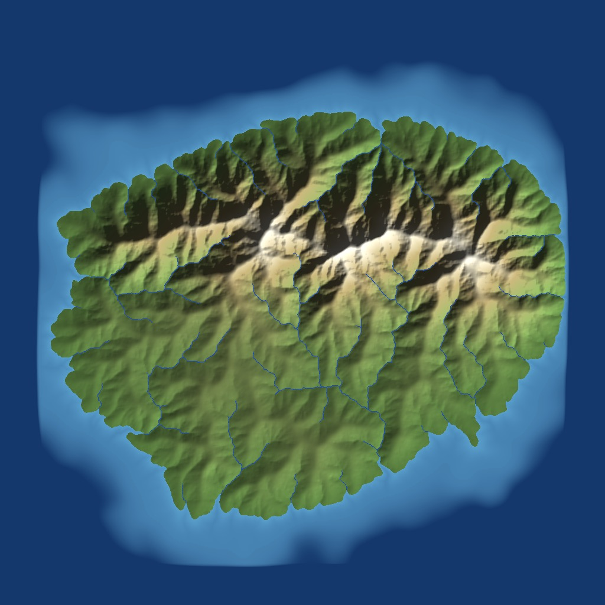
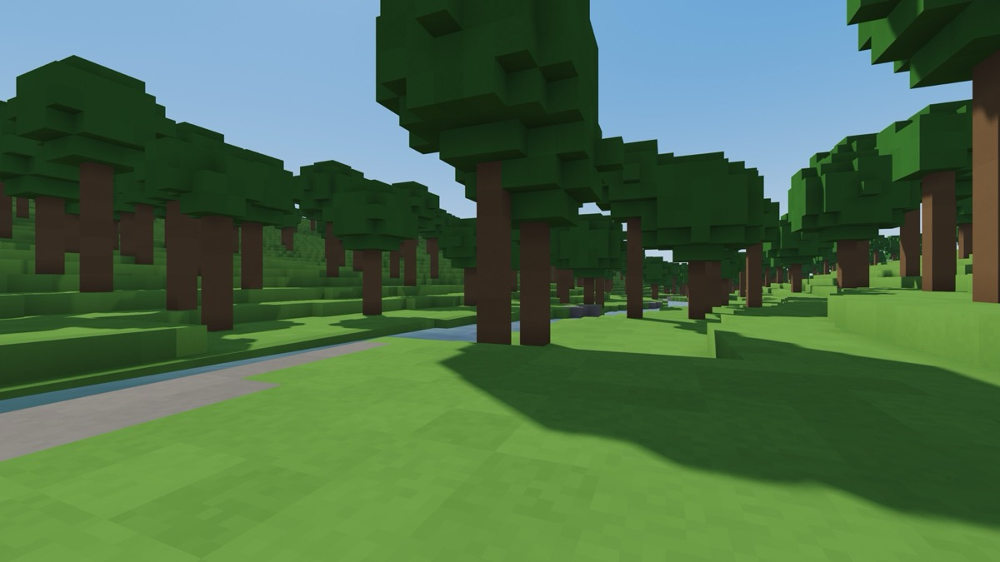
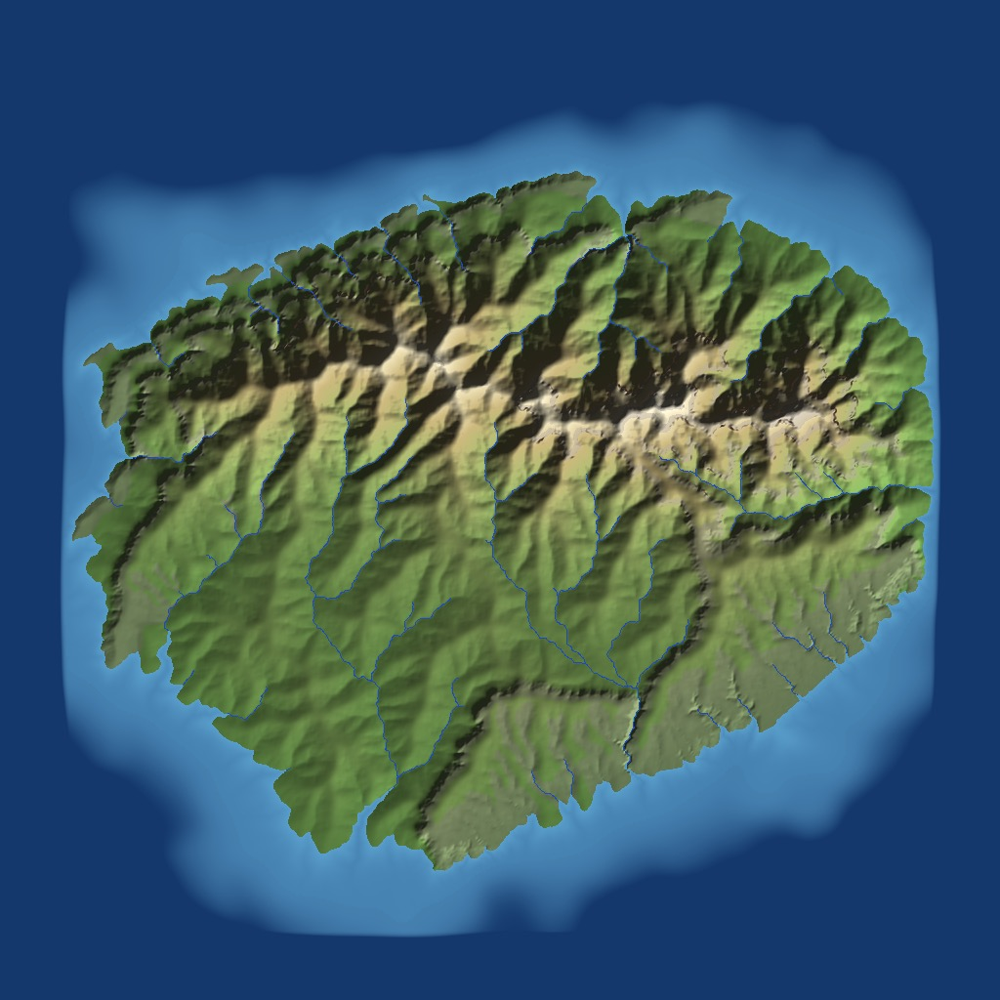
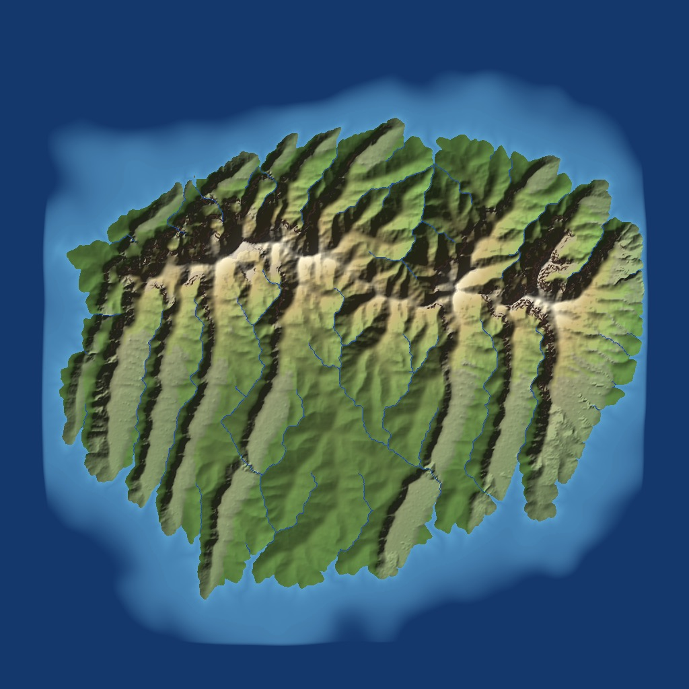
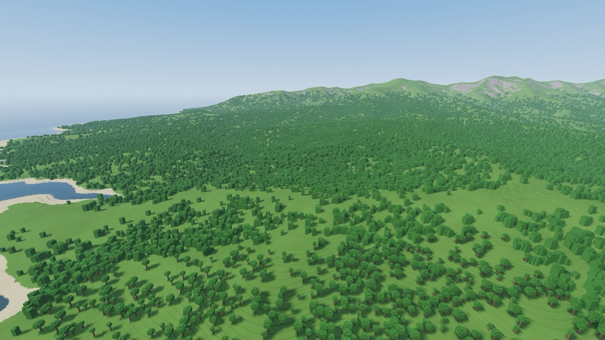
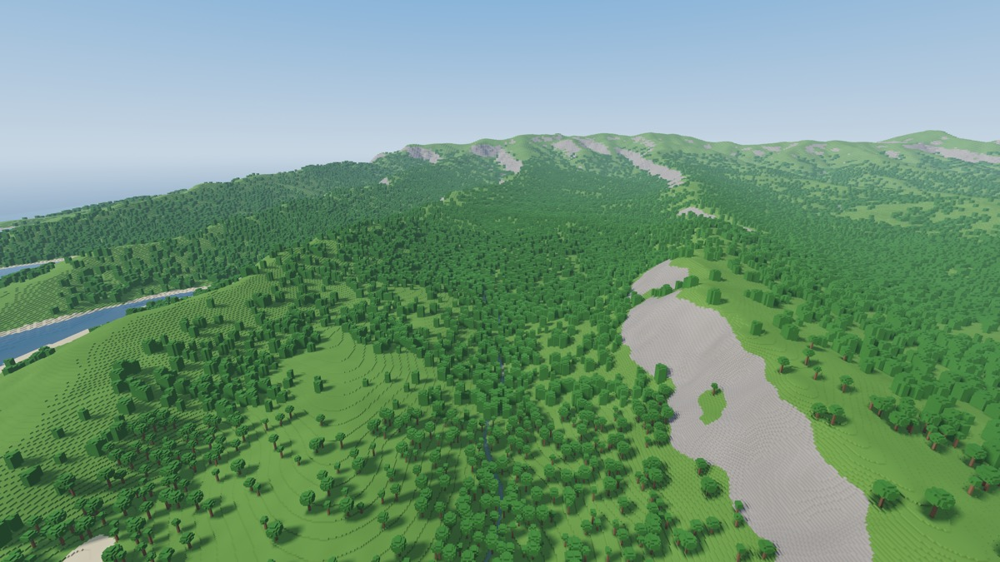
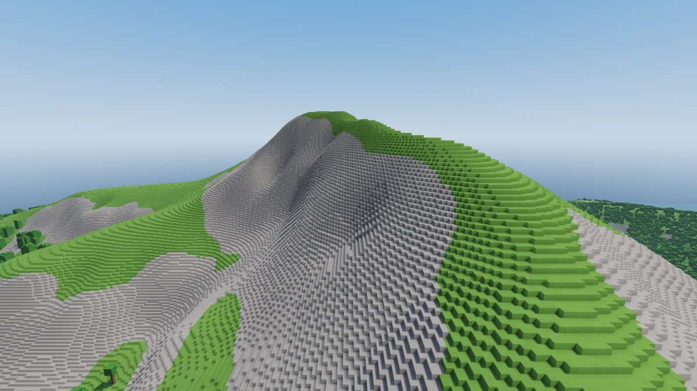

# What would make the island interesting

Research, 2026-11-11. Nothing here is decided; the choices it raises are listed at the end and in `open-decisions.md`.

The owner asked why the last world was realistic and still dull, what the pieces of an interesting world are (down to how many kinds of tree), how they fit a world formed by causes, and how the generator could make cliffs, caves and striking rock.

How this was made: six background agents each researched one topic against primary sources and wrote sourced notes, kept in `interesting-world/notes/`. Claude measured the current island, ran one experiment in a scratch copy of the game, and wrote this synthesis. Statements marked *(inference)* are a reading of the sources, and the last section lists what could not be verified.

## Summary

1. **The island is dull for a measurable reason: it has one of everything.** One rock, one limit on how steep a slope can be, one tree, one ground cover. No point on it is steeper than 45°. Six ground-level screenshots from different parts of the island show the same picture.
2. **Erosion under uniform conditions makes every valley a copy of the last.** The result matches real statistics and reads as oatmeal: each bowl unique, all of them the same. Kate Compton, who named the problem, also names the cure: people like to see "evidence of process and forces".
3. **The games that solved this all did the same thing, and it is the rule v5 already adopted.** Measured context picks a designed piece. TerraFirmaCraft chooses among 125 landforms this way. RimWorld's 2025 expansion added 41 landmarks this way, to fix maps that felt alike.
4. **The variable the island is missing is the structure of its rock.** In the real world, where the hard and soft rock lie decides where almost every cliff, ledge, waterfall, gorge, headland and cave is.
5. **An experiment confirms it.** Giving the existing erosion tilted beds of hard and soft rock, in about 20 lines, produced escarpments with bare faces 65 to 125 m high, ridges with rivers running along their feet, and a coast of headlands and bays. Forming the land took 1.5 s instead of 1.0 s.
6. **That alone changes the map and not the walk.** Under the trees the experimental island looks the same as today's. The ground within a few tens of metres carries most of what a walker judges, so the forest floor matters as much as the mountains.
7. **Variety is a matter of shapes and edges more than counts.** Dwarf Fortress has 72 tree species in about six shapes. A real cool-temperate hectare has about four tree species. About eight tree forms in eleven plant communities, each tied to a kind of ground, is a defensible cast.
8. **Places nobody forgets come from events.** Jūniko, the owner's reference, is one landslide: 33 ponds in its debris beside the bare scar it left.
9. **Caves need a reason in the rock.** Without limestone or young lava, the realistic caves on an island are sea caves, rock shelters and gaps among fallen blocks. Whether the island has limestone is the owner's choice.

The recommended order of work is in section 8.

## 1. The island today



Measured on the 16 m grid the land is formed on (`--map`, plus statistics added in a scratch copy):

| | |
|---|---|
| Land | 28.2 km², highest point 407 m |
| Elevation | 36% under 50 m, 39% from 50 to 150 m, 20% from 150 to 300 m, 4% higher |
| Steepest slope to a neighbouring cell | median 12°, nine tenths under 29°, the steepest anywhere 45° |
| Height range within 96 m of a point | median 48 m |
| Kinds of surface | grass, sand, gravel in river beds, stone painted on slopes over about 33° |
| Kinds of plant | one tree: a trunk of 5 to 10 m under a ball of leaves |
| Standing water | none: every hollow is filled as the land forms |

Three things in the code explain the sameness.

- **The rock has no structure.** How easily each cell erodes is a smooth pattern about 1 km across multiplied by a random number per cell. The random part is the larger of the two, so no body of hard rock holds together long enough to make a landform (`land.odin`, `g.soft`).
- **One slope limit applies everywhere.** No hillside may stand steeper than 39° toward the cell it drains to (`REPOSE`), and soil creep then rounds what is left. A cliff cannot form.
- **Everything the player sees is drawn from two inputs.** Wetness decides how many trees; slope decides stone or grass.

From the ground it looks like this, wherever you stand:



## 2. Why a realistic world is dull

These seven mechanisms are a synthesis *(inference)* from the sources in `notes/interest-design.md`.

1. **Self-similar valleys.** One uplift rate and one rock give valleys with the same proportions and the same branching at every size. Compton's wording: "I can easily generate 10,000 bowls of plain oatmeal ... mathematically speaking they will all be completely unique. But the user will likely just see a lot of oatmeal" ([Compton](https://www.tumblr.com/galaxykate0/139774965871/so-you-want-to-build-a-generator)).
2. **No contrast of materials.** A change of rock is what makes a cliff, a ledge or a bare scar. With one rock every slope is the same soil-covered curve.
3. **No edges.** Smooth inputs blend. A small study of two walking games found that what players recalled were landmarks and edges ([Boakye et al. 2025](https://cs.wellesley.edu/~pmwh/mvmap/papers/open_world_elements/open_world_elements.html); three participants, weak evidence).
4. **No events.** Erosion run toward balance erases the landslide, the lava flow and the dammed valley, which are what one-off places are made of.
5. **Nothing far away that differs when reached.** Nintendo built Breath of the Wild's land from shapes that hide and reveal: large ones are landmarks, middle-sized ones block the view so you wonder what is behind, small ones change your pace ([translated summary of the CEDEC 2017 talk](https://gist.github.com/idbrii/e39fe96279aa1670319bfa521d907399)). A hill that hides more of the same promises nothing.
6. **A uniform canopy hides the land.** In one alpine study the ground near the viewer carried about 64% of perceived beauty, the middle distance 22% and the far distance 14% ([Schirpke et al. 2013](https://www.mdpi.com/2071-1050/5/3/1080); figures read from excerpts). A view that promises more is attractive in open country and unattractive in dense forest with poor sightlines ([van der Jagt et al. 2014](https://eprints.whiterose.ac.uk/99427/)).
7. **True proportions are gentle.** At one metre a block, real valley walls are hundreds of metres apart. Firewatch and Breath of the Wild were both sized by how far a person walks.

Two findings are strong enough to design on. Water raises preference with consistently large effects ([White et al. 2010](https://researchportal.plymouth.ac.uk/en/publications/blue-space-the-importance-of-water-for-preference-affect-and-rest/)). Partial concealment with open sightlines draws people on. The rest of landscape-preference theory has mixed support and is useful as vocabulary only.

Trail builders describe the same thing from the other side. A good trail is "a sequence of events" routed between control points: views, waterfalls, lakes, outcrops ([American Trails](https://www.americantrails.org/resources/criteria-for-trail-placement-control-points-and-layout), [Vermont trail guide](https://fpr.vermont.gov/sites/fpr/files/doc_library/FPR-VT-Town-Forest-trail-design-guide.pdf)). A walk is interesting when the ground offers such points close together. The only first-party figure found for how close: Sucker Punch judged something new every three minutes too rare and every ten seconds too much ([Game Informer 2021](https://www.gameinformer.com/2021/05/20/more-than-just-dots-on-a-map-the-challenges-behind-open-world-game-creation)).

## 3. How other games get variety

Counts are from the games' own data files where the notes say so (`notes/minecraft-family.md`, `notes/df-rimworld.md`, `notes/procedural-techniques.md`).

| Game | What it has | The rule that places it | What to take |
|---|---|---|---|
| Minecraft 1.18 and later | 52 surface and 5 cave biomes, 299 placed features, 10 tree species in 19 shapes | Land shape comes from three noise fields. The biome is chosen separately from climate fields. | At eye level a biome is 10 to 15 decorations of its own on top of about 37 shared ones: a tree mix, a flower list, a grass, a signature item such as boulders. |
| TerraFirmaCraft | 125 landforms, 20 rocks, 20 trees, about 158 plants, 8 soils | A regional pass measures plate edges, climate, rock and rivers. Explicit rules then pick the landform: limestone at the surface with enough rain becomes karst, a spreading plate edge becomes a rift valley ([`ChooseBiomes.java`](https://github.com/TerraFirmaCraft/TerraFirmaCraft/blob/1.21.x/src/main/java/net/dries007/tfc/world/region/ChooseBiomes.java)). | The closest shipped match to "simulate the why, design the what". Each tree species also brings its own forest floor: twigs, fallen leaves, a fallen log, a dead tree, a patch of its soil. |
| Vintage Story | 16 trees, about 20 rocks in ordered layers, landforms defined as data | A tree is grown by one routine from about ten numbers per level of branching. Species are picked by temperature, rain, fertility and elevation. | One tree grower, one row of numbers per species ([tree modding page](https://wiki.vintagestory.at/index.php/Modding:Trees)). |
| ReTerraForged (the owner's visual reference) | 16 designed land types, plus water and island types | Types are laid out by region and blended in pairs, then droplet erosion runs over the result. Surface material goes by slope: scree, then dirt, then rock. | The slope bands. Its erosion adds nothing to ours. |
| Terralith | about 95 biomes; cliffs, arches, spikes, dunes, craters | Each landform is one small shape function with its own mask. | One small function per landform. Our masks would be causes. |
| Dwarf Fortress 53.17 | 225 plants, 72 of them trees; 25 layer stones; 21 soils; 58 minerals; 127 gems; 3 cavern layers | Every item declares where it may occur. The rock layers stack in a fixed order. | 51 of the 72 trees share one branching shape. Cliffs are eroded away by default, and Tarn Adams names missing "canyons and mesas" as the gap. Catalogues do not make a surface interesting. |
| RimWorld 1.6 with Odyssey | 17 biomes with 0 to 4 tree species each; 41 landmarks; about 70 map features | The base map is two noise fields and thresholds. Odyssey added landmarks gated by biome, hilliness, coast and river, with further features stacked by chance: a grove of one species, fog, an animal habitat, a border with a second biome. | Ludeon's stated fix for maps that felt alike: "over 85 dynamic map features" and "over 45 landmarks", and "Multiple features can be combined together on one map" ([Ludeon, June 2025](https://ludeon.com/blog/2025/06/odyssey-preview-1-map-features-landmarks-and-biomes)). |
| Veloren | A world formed by an erosion simulation | The simulation knows rock strength and slope limits. | Its block-scale cliffs are still banded noise (altitude modulo 200), because the simulated rock never reaches the blocks. This is the opening v5 can take. |

Two lessons from Mojang's 1.18 development also apply ([snapshot notes](https://www.minecraft.net/en-us/article/new-world-generation-java-available-testing)). Variety has to come in coherent patches: small scattered ones read as errors. And valleys that connect, with passes between them, mattered to the team as much as spectacle.

## 4. The pieces

### 4.1 Rock

A body of rock is described by few numbers *(inference from `notes/real-geology.md`)*: its thickness, its strength, which way it tilts and how steeply, how far apart its cracks are and which way they run, and whether water passes through or dissolves it. The real rules those numbers drive:

- **Soil-covered slopes stop steepening near 30°.** Beyond that, faster erosion exposes rock ([DiBiase et al. 2012](https://www.public.asu.edu/~aheimsat/publications/DiBiase%20et%20al%20ESPL%2012.pdf)). Loose fallen rock lies at 33° to 35°.
- **A cliff is a strong bed over a weaker one**, or ground cut down faster than its sides can lie back. Its height is the thickness of the strong bed. From the top: a rounded soil edge, the bare face, then an apron of fallen rock.
- **Tilt decides the family.** Level beds give flat-topped hills and stepped valley sides. A gentle tilt gives a long back slope ending in a scarp. A steep tilt gives narrow ridges with rivers running along the soft beds between them.
- **Cracks set the grain.** Their spacing is the width of the columns, fins and blocks a face breaks into: about 0.4 to 0.5 m for the columns at the Giant's Causeway.
- **Waterfalls collect at a size of stream.** In one New Zealand basin about 70% of 236 falls sat where 0.1 to 1 km² drains past ([Crosby & Whipple 2006](https://core.ac.uk/download/4403051.pdf)). On this island that means small side streams dropping into a main valley or over a sea cliff.
- **A strong cap over weak rock slides.** The slide leaves a fresh scarp, hummocky debris with ponds in its hollows, and sometimes a dammed lake. Trotternish on Skye and Jūniko are both this.
- **The coast follows the weak lines.** Sea caves, narrow inlets, arches and stacks open along cracks and soft beds on exposed headlands. Hard and soft beds meeting the shore end-on give alternating headlands and bays.

What these give, and what each needs from the generator. "Simulation" means the 16 m land forming has to know about it, "height" means it fits one height per column, and "volume" means it needs the true block volume near the player.

| Landform | What causes it | Typical size | Needs |
|---|---|---|---|
| Stepped valley side, bench | Level hard and soft beds cut by a valley | A step per hard bed, 10 to 30 m | Simulation, height |
| Scarp with a long back slope | A hard bed tilted under 20° | Scarp as tall as the bed, kilometres long | Simulation |
| Narrow parallel ridges | Hard beds tilted steeply | Tens of metres high | Simulation, height |
| Bare face over a fallen-rock apron | Slope past the limit in strong rock | The bed's thickness | Simulation for where, height and volume for the face |
| Ledges and broken blocks on a face | Thin beds and cracks within a cell | 1 to 5 m | Height, volume |
| Overhang, rock shelter | A soft or seeping bed receding under a hard one | 2 to 20 m deep | Volume |
| Gorge | A river cutting strong rock below a waterfall | A few channel widths across | Simulation, volume |
| Waterfall, plunge pool | A hard bed in the stream's path, or a side stream left hanging | The height of the step | Simulation, volume |
| Landslide scar, hummocks, pond cluster | A strong cap over weak rock, undercut | Scar tens of metres, debris up to 1 km² | Simulation |
| Rock stacks on a summit, boulder field | Massive rock with wide cracks, soil stripped | Blocks 1 to 5 m | Volume |
| Wall or trench across country | A thin sheet of intruded rock, harder or softer than its host | 1 to 3 m wide, walls to 30 m | Volume |
| Sea cliff, notch and rock platform | An exposed shore in strong rock | The height of the land at the shore | Simulation, height, volume for the notch |
| Sea cave, narrow inlet, arch, stack | A crack or soft bed meeting an exposed headland | Tens of metres | Volume |
| Headlands and bays | Hard and soft beds meeting the shore | The spacing of the beds | Simulation |
| Limestone cave, sinkhole, spring | Limestone, with a stream running onto it | Passages 1 to 10 m | Simulation, volume |

Forms that need a history the island does not have: glacial hollows and U-shaped valleys need a past ice age, raised beaches need the land to have risen (ours was drowned), cinder cones need recent eruptions.

### 4.2 Water

- **Lakes.** Three kinds fit: ponds in landslide debris, a valley dammed by a slide, and a hollow in hard rock. All need something to make the hollow. Correction of 2026-11-11: the land forming leaves none to keep. Today's island has three cells standing more than 0.3 m under their filled level, none deeper than 0.45 m; with rock beds added there are 11 to 17 such cells, the deepest 3.4 m (measured in the scratch copy). A lake therefore needs an event, such as a landslide across a valley, and then a record of its level.
- **Lake edges.** Plants band by depth: floating leaves, reeds, sedge, then wet woodland of alder and willow. The width of the bands follows from how gently the shore shelves, so it costs nothing to vary.
- **Waterfalls and gorges.** These follow from rock (4.1). The river design already drops streams from pool to pool on steep ground, in steps of a metre or so.
- **Springs.** Water appears where a bed that carries it meets a valley side. This is the honest way to start a stream or feed a pond.

### 4.3 Caves

Real caves need a host ([NPS](https://www.nps.gov/subjects/caves/solution-caves.htm)). Long passages form only in rock that dissolves: limestone, dolomite, marble. Lava tubes need young basalt flows. Everywhere else caves are short and near the surface: sea caves along cracks, shelters under hard caps, gaps among fallen blocks, open cracks behind slipped rock.

For an island that has a limestone bed, a published method builds the passages as shortest paths through the rock that prefer bedding surfaces and cracks, running from where streams sink to where the bed meets a valley wall lower down ([Paris et al. 2021](https://aparis69.github.io/public_html/phd/axel-paris-phd-thesis.pdf), chapter 7). Entrances then have reasons: a stream disappears here, a spring emerges there.

Minecraft's caves are three scales of 3D noise with noise-placed entrances. They are everywhere and ignore the rock, which is the generic look this project is trying to leave. One of its lessons carries over regardless: below the water level a cave floods unless something decides it is dry, and `adr/0004` already says water cannot stand under a roof.

### 4.4 Plants

**How many kinds.** A hectare of forest at 50° latitude holds about four tree species. The beech forest of Shirakami, where Jūniko lies, is close to one canopy species over dwarf bamboo, with more than 500 plant species in the whole reserve. Variety at walking scale comes from which community you are in and how the wood is built (`notes/vegetation.md`).

**What decides which community grows where**, as rules the generator can evaluate from fields it has or can derive:

| Driver | Real pattern | Rule *(inference)* |
|---|---|---|
| Ridge to valley floor | In one Japanese basin: wingnut, katsura and ash on the valley floor, beech on the slopes, hemlock on the ridges | Wetness together with whether the ground is hollow or humped |
| Sun | Denser forest on shaded slopes | Treat steep sun-facing ground as one class drier |
| Exposure | On small oceanic islands wind and salt limit trees well below where cold would | Height, humped ground, nearness to the sea and facing the wind; past a threshold forest becomes scrub, then heath |
| Rock and soil | Thin soil on hard steep rock carries stunted pine | Hard rock with steep slope means open rocky ground |
| River banks | Valley-floor trees need the openings floods make | Within a few channel widths and about 2 m above the water |
| Lake edge | Bands by depth | Height above or below the lake level |
| Coast | Beach plants, dune grass, rose scrub, then wind-cut pine growing taller inland | Distance from the sea |
| Disturbance | Landslides and floods reset patches to birch, alder and willow | A patch with an age: young, mixed, old |

Boundaries between communities should blend over 10 to 50 m with some raggedness, and a forest edge carries a band of shrubs.

**A cast for a cool-temperate island** *(proposal; the full table with species is in `notes/vegetation.md`)*:

| Community | Where | What you see |
|---|---|---|
| Beech slope forest | Most slopes | Tall broad crowns on grey trunks, dwarf bamboo underneath, mossy logs |
| Valley-floor forest | Wet, gentle, near a river | Fewer and larger trees leaning over water, big-leaved herbs, bare gravel bars |
| Wet woodland | Just above lake or slow water | Clumps of many-stemmed alder and willow over dark wet ground |
| Reed and sedge | The water's edge | A band of reeds two blocks tall, floating leaves beyond |
| Young birch and alder | Landslide tongues, scar feet, windthrow | Thickets of thin white stems with old fallen trunks among them |
| Ridge pine and hemlock | Dry humped ground, hard steep rock | Flat-topped pines and dark spires on bare stone, boulders |
| Sun-slope oak | Dry sun-facing slopes | Crooked wide trees over grass and bracken |
| Wind scrub | Exposed shoulders and summits | Crowns two to four blocks tall, leaning downwind |
| Heath and moor | Exposed tops; boggy where flat | No trees, low purple and brown cover, pools |
| Dune and pine belt | Low ground near the sea | Bare sand, grass tufts, rose scrub, then bent pines |
| Sea-cliff turf | Steep ground at the shore | Short grass and flowers over bare faces |

That is about 8 canopy tree forms, 4 smaller trees, 5 shrubs, 6 kinds of ground cover and 4 water plants.

**How a wood is built.** These numbers are what make one hundred metres differ from the next:

- Stems thin about twentyfold with age: roughly 1,480 a hectare young, 490 at fifty years, 75 in old growth. One fixed spacing everywhere is the main reason a generated wood looks uniform *(inference)*.
- Old beech forest is 13 to 16% gap, mostly openings under 500 m².
- Unmanaged beech forest averages 130 m³ of dead wood a hectare, more of it lying than standing. Mounds left by uprooted trees can stay over a metre tall for fifty years.

**Tree shapes.** The split that reads at a distance is a tree that keeps one leading stem (spruce, fir, cedar, young pine) against one that loses it into a dome (beech, oak, old pine, willow). About a dozen numbers separate recognisable kinds at one-metre resolution *(inference)*: height, lean, how much trunk is bare, how many branches and how far apart, whether they rise, lie flat or droop, whether the leader is kept, the outline of the crown, how solid the leaves are, and when the trunk becomes two blocks thick.

**Placing them.** Horizon Zero Dawn turns maps of conditions into a density for each layer of plants and spaces each layer by the size of the plant, so trees and clearing plants exclude one another ([van Muijden, GDC 2017](https://www.guerrilla-games.com/media/News/Files/GDC2017_VanMuijden_GPUBasedProceduralPlacementInHorizonZeroDawn.pdf)). One pass in which the larger of two crowded plants wins, after [Deussen et al. 1998](https://algorithmicbotany.org/papers/ecosys.sig98.html), adds clumps, gaps and mixed ages. The losers become saplings, standing dead trees or logs.

### 4.5 Small things underfoot

These are the cheapest pieces and the ones nearest the eye: boulders on hard rock, fallen logs and standing dead trees, mounds and pits where trees fell, leaf litter, ferns and big-leaved herbs in damp hollows, berry bushes at forest edges, reeds, driftwood on beaches, fallen blocks under cliffs. Each needs one placement rule read from fields the generator already has.

## 5. How the pieces fit the generator

*(Proposal.)* The principle stays as it is: the simulation answers why, a designed piece answers what. The change is in what the simulation knows and how many designed pieces read from it.

**One description of the rock, read by everything.** A single function answers "what rock is at this point in the ground": tilted beds of unequal thickness, gently folded. It is read by:

1. the land forming, for how fast the ground erodes and how steep it may stand;
2. the surface, for whether a slope is bare rock or soil, by comparing the slope with the rock's strength, and for scree below a face;
3. the blocks themselves, so that beds show as bands in a cut face and when digging;
4. ground detail finer than a cell, so that ledges fall on hard beds and benches on soft ones, and only where the simulation already made the ground steep;
5. overhangs and caves in the block volume, where soft beds recede under hard ones;
6. plants, through soil depth.

Reading the same function everywhere is what keeps the layers in a cliff face consistent with why the cliff is there. v4 recorded "artificial banding" where bands were not tied to a cause, and Veloren's cliffs have the same fault.

**A handful of derived fields.** Slope, wetness and distance to a river exist. Still to derive, each cheap: whether the ground is hollow or humped, which way it faces, exposure to wind and sea, distance to the sea, the rock at the surface, and soil depth. A plant community is then a rule over these fields, and a "biome" is the name of a rule, as `ideas.md` already says.

**Three scales, each with its own job.**

| Scale | What gives it character | Where it lives |
|---|---|---|
| The island, kilometres | Districts: scarp country, ridge-and-vale, a lake basin, a cliffed coast, a sheltered coast | The land forming, through rock structure |
| A place, 10 to 100 m | Faces, ledges, benches, fallen-rock aprons, lakes and their edges, gorges, clearings | Designed pieces read from the simulation |
| Underfoot, 1 to 10 m | Tree shapes and ages, undergrowth, logs, boulders, ground cover | Placement rules over the derived fields |

Today only the first scale has any content, and that content is one district.

**A few events.** One to three landslides on an island this size, each placed where a strong bed lies over a weak one above a valley, each leaving a scar, hummocks, ponds and a patch of young trees. These are the one-off places.

**The limits already recorded.**

- The far terrain is one height and one material per column (`adr/0001`). Anything that should be seen from a distance (a scarp, a bench, bare rock, the outline of a forest edge) has to exist in the height and material. Overhangs and caves exist only within 256 m, which suits them.
- Water cannot stand under a roof (`adr/0004`), so a cave below the water level needs a decision.
- A shape stamped onto finished land reads as a diagram (`lessons.md`). Every piece above has a host in the rock or the drainage for that reason.

## 6. The experiment: beds of hard and soft rock

The question was whether rock structure inside the existing land forming produces different country at 16 m cells, before any design work. It is the method of [Cordonnier et al. 2018](https://www.cs.purdue.edu/homes/bbenes/papers/Cordonnier18TVCG.pdf): give each point on the surface the rock layer it has been cut down to, with a high erosion rate and a 30° slope limit for weak layers and a low rate and 50° for hard ones.

In a scratch copy of the game, `land.odin` was changed in three places:

```odin
// The rock at a point in the ground: beds of unequal strength, tilted and gently folded.
rock_hard :: proc(x, z: f64, y: f32) -> bool {
	s := (f64(y) + DIP.x*x + DIP.y*z + 70*f64(fbm(x, z, 2400, 1, 2, SEED + 30)))/THICK
	return hash01(i32(math.floor(s)), 0, SEED + 31) < 0.38
}
```

- In `erode`, a cell on hard rock erodes at 0.3 times the normal rate and may stand at 50°; on soft rock it erodes at 1.5 times and keeps the present 39° limit. The rock is looked up at the cell's current height, so the ground meets new beds as it is cut down.
- In `creep`, hard rock moves a tenth as much, so its edges stay sharp.
- Nothing else changed: the rivers, the trees and the game ran on the result unaltered.

Two settings were tried on seed 7. "Gentle" is 30 m beds tilted about 5°. "Steep" is 60 m beds tilted about 15°.

| | Today | Gentle beds | Steep beds |
|---|---|---|---|
| Time to form the land | 1.0 s | 1.5 s | 1.5 s |
| Land steeper than 45° | none | 0.7% | 3.0% |
| Tallest continuous face | none | 65 m | 126 m |
| Median height range within 96 m | 48 m | 46 m | 63 m |

Gentle beds. A scarp runs across the south-east with the hard bed sloping away behind it to the sea, and rivers have moved to run along its foot:



Steep beds. Parallel ridges with rivers between them, and a coast of headlands where hard beds reach the sea and bays where soft ones do. Grey marks hard rock at the surface and dark brown marks ground steeper than 45°:



From the air in the game, today and with steep beds, same camera:




What the experiment shows, and what it does not:

- **The land forming is expressive.** Two numbers, tilt and bed thickness, gave two different islands. The same handle should give flat-topped country at no tilt.
- **The faces are smooth ramps.** The game interpolates between 16 m cells and paints steep ground grey. Ledges, cracks and fallen rock are the missing designed layer:

  

- **Under the trees nothing changed.** A ground-level frame in the steep-bed island is the same picture as today's (`interesting-world/ground-steep-beds.jpg`).
- **Limits.** One seed. No walk on foot, no check of the river design on the new land, no frame pacing run. Straight walls of hard rock and round plugs were also tried and read as ruled lines on the map; they would need to be thinner and less regular, and were not pursued. The scratch copy is not in the repository: the lines above are enough to repeat it.

## 7. How to tell whether it is working

No published measure of how interesting terrain is to walk exists (`notes/interest-design.md`). The owner's eye remains the test. The questions below are prompts for looking, with starting numbers that are guesses *(inference)*:

1. From most places, is something worth heading for in sight, partly hidden by nearer ground?
2. Does a walk of 500 m always cross an edge: forest to open, soil to rock, a shore, a break of slope?
3. Does something new turn up every 150 to 400 m, with quiet stretches between?
4. Can five to eight districts be told apart in a grey screenshot, by shape alone?
5. Does each valley differ from its neighbour in floor width, wall, floor or stream?
6. Is bare rock reachable in every square kilometre?
7. Is water in view within 300 m of most places?
8. Are there about three places that occur once, each with a cause you can point to?
9. Do high points pay: a wide view over something from questions 5 to 8?
10. Does the forest open often enough to show the land?
11. Does a distant view keep its promise on arrival?

Several of these could be computed along simulated walks: how much ground is visible and how that changes, how often a landmark comes into view, how many kinds of landform lie within 150 m. Such counts could reject a change and could never accept one.

## 8. Recommended order

One change at a time, each ending in something the owner can look at. The first two are a pair: without the second the first changes only the map.

1. **Beds of hard and soft rock in the land forming.** The experiment, done properly: the rock function, slope limit by rock, and two or three colours of stone so the beds show. Judge from the map and from the air.
2. **Cliffs in blocks.** Where the simulation made strong rock steep: ledges on the hard beds from the same rock function, broken into blocks along cracks, bare rock by slope against strength, an apron of scree and fallen blocks below. Judge standing at the foot of a face.
3. **Plant communities, three or four to begin.** Valley floor, slope forest, ridge and exposed top, each with its own tree form and ground, with open ground on exposed tops and rock so that the land shows. Judge on a walk from a river to a ridge.
4. **Lakes.** One landslide: scar, hummocks, a dammed lake, a cluster of ponds, young trees. This is the Jūniko piece. (The land forming leaves no hollows to keep; see 4.2.)
5. **The forest floor.** Ages and gaps, logs, boulders, undergrowth, lake-edge bands.
6. **A tree grower.** One routine, about eight species as rows of numbers.
7. **Waterfalls and a gorge** where streams cross hard beds, which needs the river design to drop more than a metre at a time.
8. **Overhangs, rock shelters and sea caves** in the block volume.
9. **The coast.** Cliffs on the exposed side, beaches in the bays, stacks.
10. **Limestone caves**, if the island is to have limestone.

Small things underfoot (4.5) can ride along with whichever step creates their host.

## 9. Decisions for the owner

1. **Confirm that measured context picks designed pieces** (option B in `open-decisions.md`, question 1). Every source here supports it.
2. **What is the island made of?** The rock story decides which landforms and caves are honest. Options: layered rock with a hard cap over soft beds, which gives scarps, benches and landslide lakes, as at Trotternish; two domains split by a fault, such as granite upland and layered lowland, which doubles the variety, as on Arran; lava flows, which give columns, sea caves and stepped hillsides, as on Staffa and the Faroes. *Recommendation: layered rock first, since the experiment already shows it working, with a second domain later.*
3. **Is there limestone?** It is the only honest route to long caves, sinkholes and springs.
4. **What climate?** *Recommendation: cool-temperate and oceanic, after Shirakami and Jūniko*, which sets the plant cast in 4.4. It also rules out ice-age landforms unless the owner wants that history.
5. **Should the land be exaggerated?** Firewatch and Breath of the Wild were sized by feel. *Recommendation: leave true proportions alone until steps 1 to 3 have been walked.*
6. **Named places.** RimWorld's landmarks carry names, at almost no cost. Worth deciding when the first one-off place exists.

## What could not be verified

- Talks that could not be read: Henrik Kniberg on Minecraft 1.18, Sean Murray on No Man's Sky, the Breath of the Wild talk itself (a translated summary was used), the A Short Hike postmortem.
- Papers read only as abstracts: Roering 1999, Forte 2016, Yuan 2019, Braun & Willett 2013, Schott 2023 and 2024, and the full texts behind several landscape-preference figures.
- Real-world numbers found only in secondary sources: typical waterfall height by stream size, cave passage sizes and how common cave entrances are, tree counts for small cool-temperate islands, stem density and gap sizes for Japanese beech old growth.
- The block-scale densities, the lake-edge depths and every threshold in section 7 are estimates.
- RimWorld's data came from a third-party mirror of the shipped files, and its map code from a decompile of version 1.5.
- Checked directly by Claude against the source: the Compton quotation, the Ludeon post, TerraFirmaCraft's `ChooseBiomes`, and the rock-layer passage of Cordonnier 2018. Everything else rests on the agents' reading; each note ends with its own list of gaps.

## Sources

The six notes in `interesting-world/notes/` carry a source link for every claim:

- `interest-design.md`: why generated worlds bore and what designers and researchers say about interest on foot.
- `real-geology.md`: what causes cliffs, rock forms and caves, with a table of 27 landforms and their conditions.
- `procedural-techniques.md`: published and shipped methods, with a ranked shortlist for this generator.
- `vegetation.md`: how many kinds, what decides where they grow, forest structure, tree shapes, placement.
- `minecraft-family.md`: Minecraft, ReTerraForged, Terralith, TerraFirmaCraft, Vintage Story.
- `df-rimworld.md`: the pieces of a Dwarf Fortress site and a RimWorld map, with counts and placement rules.

Earlier research this builds on: `reference/odincraft-v4/exploration-diversity-research.md`, `reference/odincraft-v4/explorable-places-design.md`, `reference/zigcraft/dwarf-fortress-worldgen-research.md`.
