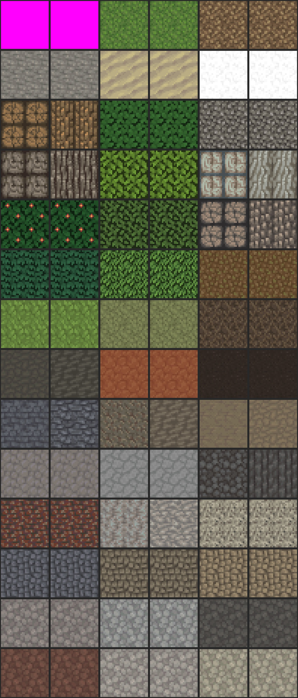

# Block textures beside Minecraft's

Written 2026-11-12. The owner found the first atlas too noisy, contrasty and gritty, and asked for it to be compared with Minecraft's current textures and the best texture packs. Thirty-two of Minecraft's own block tiles (the set drawn since version 1.14) were measured beside ours with one script; they were looked at and measured, and nothing of them is in this repository. No texture pack was examined: what is said of packs below is from memory.

The picture that set the two side by side was made outside the repository, since their tiles are not ours to keep here.

## What Minecraft's tiles do

- **Few colours, close together.** A tile has 5 to 8 colours (median 6). Neighbouring tones are a small step apart, so the eye reads a surface before it reads pixels.
- **Every pixel takes part.** There is no flat field with marks on it. The whole tile is a soft pattern in those few tones, and features (a pebble in dirt, a knot in bark) sit only a step or two off it.
- **The pattern runs with the material.** Stone streaks along, bark runs up the trunk, andesite flows on a slant.
- **Contrast is set by the material.** The spread of brightness within a tile, as a share of its mean: sand 0.05, stone 0.09, gravel 0.13, dirt 0.22, logs 0.19 to 0.25. Only leaves are strong (0.6 to 0.8), because the gaps between leaves are near black.

## What ours did wrong

| | Minecraft | Ours, first atlas | Ours now |
|---|---|---|---|
| Gravel, contrast | 0.13 | 0.34 | 0.09 |
| Log bark, contrast | 0.19 to 0.25 | 0.30 to 0.37 | 0.13 to 0.17 |
| Log end, contrast | 0.25 | 0.39 to 0.42 | 0.29 to 0.32 |
| Forest floor (podzol / litter), contrast | 0.19 | 0.28 | 0.13 |
| Share of pixels the same as a neighbour, median | 0.27 | 0.50 | 0.39 |
| Median contrast of all tiles | 0.21 | 0.21 | 0.13 |

The median contrast was the same as Minecraft's, which hid the fault: it was in the wrong places. Bark, gravel, rubble and the forest floor were half again to twice as contrasty as theirs, with a darkest tone 42% under the colour used for every furrow and gap, while stone and soil were flat fields with a few stark marks on them. Half our pixels matched a neighbour, against a quarter of theirs: big flat areas, then hard edges.

## What changed, twice

First each tile was rebuilt in code the way theirs read: five tones a small step apart, every pixel in a soft pattern along the material's grain ("ours now" in the table). The owner judged the result better but still very bad overall. Tiles made by rule have no drawing in them: no leaf shapes, no plates of bark, nothing an artist chose.

So the tiles are now an artist's. The atlas is built from Pixel Perfection by XSSheep (CC BY-SA 4.0, `assets/LICENSE.md`), each tile recoloured to one of our materials by `tools/blocks.py`. The code that drew tiles is gone, and the table's last column describes tiles no longer in the game.

What is weak in it: thirty tiles serve forty-one materials, so the rocks share four tiles in different colours and turns, the soils three, and the three grasses one; a rock's bedding no longer shows on its side; and no tile was drawn for these species. Each of those is a tile to draw by hand or find.

## Still different, on purpose or not

- **Ours are darker and less saturated.** Their tiles are the final colour; ours are multiplied by sunlight in the game. Whether the game as a whole should be brighter is a question about the lighting, not the tiles.
- **Their leaves have holes** you can see through; ours are solid, with the gaps drawn dark.
- **Texture packs** (from memory): the well-liked ones either keep Minecraft's shapes at twice the size (Faithful) or go further toward flat colour and fewer tones (Bare Bones). Both point the same way as this change.
