# Forming land larger than one region

## Step 21 continued, 2026-11-16: the known world's continents, staged

Written 2026-11-16 for step 21 (the plan's N1), after the owner's goals of the same day: continents formed as land with no seam; the whole world's generation within 10 minutes, staged if need be (a coarse stage first, then the detail once the player is in the game or chooses a site, the rest later); no method that sacrifices the quality of the land. The section below this one is the experiment of 2026-11-15 that this continues. Every number was measured on this machine (an M3 Max, 12 performance cores and 4 efficiency, 128 GB), with other agents' work on it (load 5 to 12), unless it is marked as a guess or an inference.

### The problem, measured

**How much land is larger than a region.** Seeds 1 to 10 and 12, every land mass in the known world (1,000 km) over 400 km², which no region can hold:

| Seed | All of it, km² | The landmass nearest the start: km² of land, its coast from the start, the history's highest ground | Land of it within 64 km of the start |
|---|---|---|---|
| 1 | 307,968 | 44,832; 51 km; 2,374 m | 404 km² |
| 2 | 244,336 | 1,264; 128 km; 6,738 m | 0 |
| 3 | 386,908 | 379,668; 82 km; 7,366 m | 0 |
| 4 | 199,240 | 3,392; 114 km; 2,844 m | 0 |
| 5 | 234,164 | 4,548; 112 km; 3,164 m | 0 |
| 6 | 348,128 | 317,748; 171 km; 2,358 m | 0 |
| 7 | 336,328 | 317,108; 175 km; 2,845 m | 0 |
| 8 | 363,872 | 363,404; 31 km; 2,382 m | 1,476 km² |
| 9 | 245,372 | 34,824; 42 km; 555 m | 2,600 km² (two masses) |
| 10 | 118,080 | 2,184; 99 km; 2,551 m | 0 |
| 12 | 193,524 | 187,312; 31 km; 7,375 m | 2,620 km² |

So a known world holds 118,000 to 387,000 km² of land larger than a region, eight to twelve times the 30,000 to 50,000 km² the experiment below priced. Its largest mass is 28,000 to 380,000 km², and on seven seeds of eleven it runs off the known world's edge. On seven seeds no land larger than a region lies within 64 km of the start; on four it does, 400 to 2,600 km² of it.

**What the history says of it.** The regional history's rise over the last 4 Myr, mean of its eight steps, on the large masses: medians of −0.01 to 0.84 mm/yr, 95th percentiles of 0.04 to 2.1. Most of a continent's land is old ground that hardly rises, worn from the height the plates floated it to (a median of 184 to 2,259 m on the 2 km samples, with the history's 350 m of relief noise in it).

**What forming costs today** (after steps 31 and 33):

| | Measured |
|---|---|
| The 64 m phases, a ridge island stretched to 131 km (7,250 km² of land, 159 steps) | 49.4 s alone, 42.0 s with helpers: 171 and 145 ns a land cell a step; 266 MB |
| All phases, the ridge at 32 km (382 km² of land) | 12.8 s alone, 10.5 s with helpers: 34 and 27 ms a km² of land |
| The finer phases alone (32 and 16 m) on the same | 8.6 s with helpers: 22 ms a km² |
| The coarse stage of seed 1's landmass (39,433 km² of land on a lattice 385 km across, 64 m phases) | 251 to 260 s with helpers, before its rebound (below); 394 to 403 s with it, two formed at once; kept on disk, 941 MB, and read back in 1 to 2 s |

*(Extrapolated.)* The whole known world's land at full detail, at those rates, is 13 to 44 core-minutes of 64 m phases and 45 to 140 core-minutes of finer phases, before the pieces' margins: over the 10 minutes on this machine however it is shared, so it has to be staged, as the owner allowed.

### What the experiments found

The method of the section below, ordered pieces, was rebuilt in the game's own code (`continents.odin`) and tested again, and then tested one level up, where it would have to work for the staging to be cheap: pieces that form the long 64 m phases themselves from a coarser pass.

| Test (one seed each, seed 3) | Closed hollow over 2 m within 100 m of a cut (the whole) | Largest step across the cut (the whole) | Joined less whole, mean (a 1 mm nudge) | Verdict |
|---|---|---|---|---|
| **E2.** The 32 km ridge, the 64 m phases whole, ten ordered pieces (20 to 72 km²) taking up the 32 and 16 m phases, 6 km margins | 1 cell, 2.1 m (9, 3.4 m) | 47.2 m (51.9) | 0.12 m (0.16) | **No seam: the experiment of 2026-11-15 holds** |
| **E3.** The ridge at 131 km, its 64 m phases at 256 m whole, ten ordered pieces (380 to 920 km²) forming the 64 m phases, 16 km margins held beyond to the 256 m pass through time | 5,528 cells, 325 m (56, 8.3 m) | 313 m (145) | 28 m (26) | **Seam** |
| **E3, oracle.** The 32 km ridge, ten pieces forming the 64 m phases, held beyond their 6 km margins to the whole itself through time | 138 cells, 105 m (0) | 147 m (128) | 21 m (16) | **Seam** |
| **E4.** The 32 km ridge, its long phase at 128 m whole, ten pieces forming 64, 32 and 16 m phases (0.7 Myr), 6 km margins | 703 cells, 78 m (0) | 135 m (43) | 1.2 m (0.25) | **Seam** |

**Pieces cannot form the long phases.** Even held to the land formed whole beyond their margins, pieces that form the 64 m phases leave closed hollows 100 m deep along their cuts. *(Inference.)* Over 3 Myr on 64 m cells the forming is chaotic at the scale of whole valleys: a 1 mm nudge moves the 32 km ridge's 64 m land a mean 16 m and up to 379 m, and the 131 km ridge's a mean 26 m and up to 491 m. Its divides wander kilometres as streams capture each other, so a cut fixed in advance is crossed by streams both ways, and the piece formed second meets the first's land where its water ponds: the upstream-first failure of the section below, at every crossing the wandering made. Over the 0.4 Myr of the 32 and 16 m phases the divides move a cell or two, the cut stays a divide, and ordered pieces work.

So **a landmass is formed whole through its long phases, and only its finer phases in pieces.** That fixes the coarse stage: it is the landmass pass at 64 m, over each landmass whole, which no decomposition can stand in for.

### The design

1. **The plates** (built, 2.5 s a seed, kept on disk): the known world.
2. **The coarse stage, at world creation, kept on disk: every landmass formed whole through its 64 m phases** (`mainland_pass`). It starts from the history's ground at each place, lowered by the uplift still to come, roughened so the coast does not follow the 2 km samples; it rises at the history's own rate there; its rock is one story laid over the whole landmass; its history is the inlets kind's, since the sea rose 120 m on every coast at the end of the last ice age (row `mainland` in `KINDS`). It is then cut along its drainage into pieces of about 300 km² of land, ordered. This is the coarse world the plan's history (P9) can run on: a map at 64 m of real drainage, ranges and coasts.
   *Its rebound.* A continent that the history barely raises is planed flat by the islands' erosion in the 64 m phases' 3 Myr: seed 1's, from the history's median of 1,156 m to 73 m (its top 225 m), so that the sea's last rise of 120 m drowned 82% of it. What holds a real continent up is that it floats: as rock is worn off, the crust rises by about 0.82 of it, the worn rock's weight over the mantle's (Airy). So the coarse stage rebounds (`rebound`), by that share of the rock worn off in a square 24 km across (the width is a guess). With it, seed 1's continent holds 39,433 km² of land before the sea's last rise, with a median of 462 m, a 90th percentile of 752 m and a top of 1,740 m, and 82% of it stays over that rise. Islands are too small for it to matter; the finer phases wear too little to need it.
3. **The detail, on demand: pieces** formed by the ordered method (`piece_form`), each taking up the 32 and 16 m phases from the coarse stage in its window, then made a region as an island is, with its rivers, plants, trails, places and animals (`piece_finish`).
4. **One world whatever the order.** The cut and the order come from the coarse stage alone, a pure function of the seed. A piece's land is a pure function of the coarse stage and the bands of its neighbours earlier in the order, which are pure functions in turn. To form any piece, the pieces it waits on (its earlier neighbours, and theirs) are formed first, in order (`mainland_form`). The order is: downstream first (a piece through which another's water leaves comes first); among pieces as many steps from the sea, by a colouring of their borders, so that no chain of neighbours at one depth waits on itself. On seed 1's landmass (171 pieces, up to 9 steps from the sea) a piece waits on a median of 6 others, 90% on 39 or fewer, at most 66. A site inland, chosen by the player, is formed with its drainage down to the sea and the neighbours its order puts first; nothing about it depends on what was visited before.
5. **Never unformed ground.** A chunk over a piece not yet formed waits, as over an island not yet formed. The pieces within 16 km of the start (or of `--site=x,z`) are formed before entering, with what they wait on; the rest within 40 km of it on a thread of low priority beside play, nearest first (16 and 40 km, not the 64 km of the islands, for memory: below).
6. **Rain on a piece is the coarse stage's.** Rain reads the ground 15 km upwind (`land_rain`), past a piece's cut; a piece reads it from the coarse stage's 64 m ground, which every piece shares, so the rain is the same on both sides of a cut. The climate (its latitude and the sea's temperature) is read once for the landmass, at its middle.
7. **A site that stays formed** (the plan's holds): a formed piece is kept whole while the game runs. Keeping it on disk, and forming the far pieces again identically from the coarse stage and the kept bands when the player comes back, is the next part.

**Why not trade edges (Schwarz) instead of ordering**, which needs no order and so has a fixed, small set of dependencies? Along divides it needs a second forming (2.5 times the cost) and across rivers four (5 times); and since the long phases cannot be pieced either way (the oracle above), it would only replace the finer level's ordering, at twice the cost, for a smaller set of pieces to form round an inland site. It stays the fallback where an order cannot be kept.

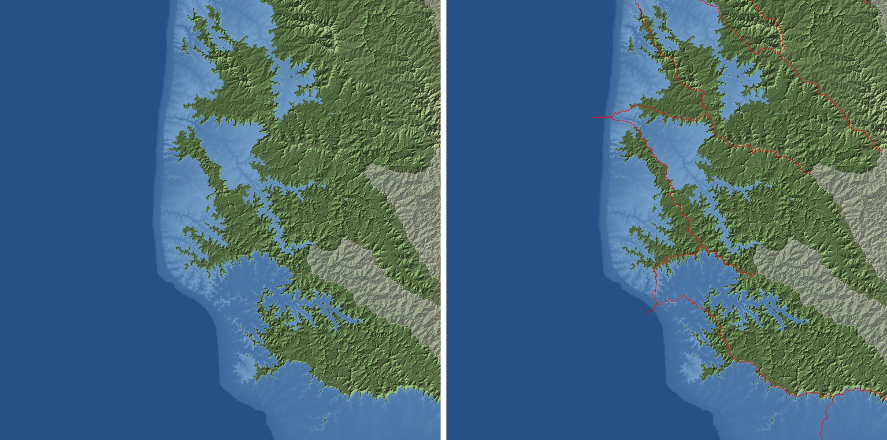

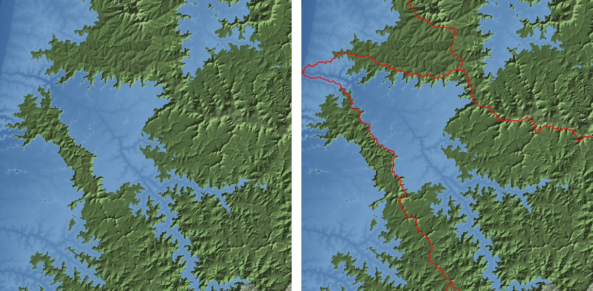

### The time and memory budget

**Entering**, measured under a load of 4 to 10 from other agents:

| | Time |
|---|---|
| Seed 7, the default (its continent stays a record) | 2.29 to 2.36 s, against 2.27 to 2.30 for `main`, three rounds alternating |
| Seed 1, its first run: the plates, then the coarse stage | 2.7 s, then 394 to 403 s (two formed at once; 283 s alone before a fault in its seed was fixed, below) |
| Seed 1 once the coarse stage is kept: no piece lies within 16 km of the start (its coast is 54 km off) | 4.6 s |
| Seed 1, two windows on its coast: 11 pieces, 2,110 km² of their own land | 595 s (18 to 95 s a piece), on one thread with helpers |

*(Extrapolated:)* at that rate, 0.28 s a km² of a piece's own land, all of seed 1's continent at full detail is about 3 h on one thread; pieces that do not wait on each other could form side by side, which is not built.

**The coarse stage of the whole world.** Measured on seed 1's nearest landmass, 37,555 km²: 251 to 260 s on the main thread with helpers. *(Extrapolated:)* the largest landmasses (317,000 to 380,000 km²) take 35 to 42 min the same way and 8 to 16 GB as a square grid over their extent. So **the goal of the whole world's coarse stage within 10 minutes is not met today**, and the game forms a landmass's coarse stage only where it is under 8 minutes and 2.5 GB (seeds 1, 2, 4, 5 and 10 of the eleven); elsewhere it stays a record, as before, and start-up says why. What meets it without touching the land's quality is engineering, not a different land: the flood that routes the water (two thirds of a 64 m step) made to run in parallel over tiles with exact results (Barnes 2016), the erosion run by drainage basin in parallel, and a grid of 25 bytes a land cell kept in tiles of land only. *(A guess:)* 3 to 6 min and about 2 GB for 380,000 km² on twelve cores.

**Memory**, measured: the coarse stage's grid of seed 1's landmass, 36 million cells of 64 m on a square 385 km across, holds about 3.6 GB in the game (4.4 GB at most while it forms; its file 941 MB). A finished piece is kept whole at 16 m on a square round its own land, about 590 MB for each 1,000 km² of that square, which on seed 1's coast is 2 to 5 times the piece's own land (and up to 12 times for its long, narrow basins on a first forming): 9 pieces held the game at 18.6 GB at its peak on that first forming. The bands kept between pieces were estimated at 1 MB a km of cut; they held up to 520 MB while 11 pieces formed, and a piece's bands are let go once no piece still to form reads them. So the pieces are formed within 16 km of the start before entering and 40 km beside play, not the 64 km of the islands, until they are kept on disk.

### No seam, and one world whatever the order

Four windows of 8 km on seed 1's coast, each across cuts between two or three pieces, measured as the experiments were. No land formed whole can be set against them at this size, so a step across a cut is set against the land's own steps away from any cut, at the same slope (the experiment's measure: a step over the largest step elsewhere at that slope):

| | a, 9.2 km² of land, to 51 m | b, 15.1 km², to 187 m | c, 29.1 km², to 145 m | d, 30.3 km², to 187 m |
|---|---|---|---|---|
| Cut on land | 7.2 km | 15.3 km | 30.6 km | 22.0 km |
| Closed hollow over 2 m, near a cut or away from one | none | none | none | none |
| Steps across the cut: 99th percentile, largest | 8.4, 9.1 m | 40.3, 50.3 m | 12.2, 19.9 m | 40.3, 50.3 m |
| Steps more than 300 m from any cut | 8.3, 32.1 m | 25.7, 76.9 m | 9.4, 47.4 m | 15.7, 53.0 m |
| Steps across the cut over the largest elsewhere at that slope | 0 of 251 | 0 of 531 | 0 of 1,023 | 1 of 760 |

Windows b and d cross the same cut, along a steep crest. **One world whatever the order**: two runs that reached the windows' 11 pieces in opposite orders formed every one of them bit for bit the same (a hash of each piece's land), and the windows the same byte for byte. The first run of that check, on the way, failed: a piece held whatever cells of formed pieces lay in its window, so it depended on which had happened to form first; a piece now holds only its neighbours earlier in the order, and keeps its band for every later neighbour, whatever is formed. **The coarse stage is formed the same every time**: two formings of seed 1's, side by side, byte for byte. Its first version was not: the landmass's record was bound before it had its seed, so the forming thread drew its noise and phases from seed 0 and the helper threads from the landmass's, and each cell depended on which thread took it.

### Weak points

- **The coast near seed 1's start is far from the real stretches.** Measured as the real windows were (windows c and d, 29 and 30 km² of land, to 145 and 187 m), 75% of its land is under 50 m (Bōsō, Kii and Muroto 14 to 24%), its largest basin at the sea is small (5.3 and 4.6 km², real 11.8 to 26.2), its streams sparse in one (0.94 km a km², real 1.75 to 1.83) and its faces over 60° too many in the other (0.8%, real 0.0). Its shore's height, rise and slope, its crests and its closed hollows are within theirs. The history makes this coast an old, low margin that hardly rises, which the sea's last rise drowned into rias; the three real stretches rise fast on a forearc. Whether a low drowned coast should be judged against other real land, or the history should raise this one, is a question for the owner.
- **One landmass, on one seed, formed in part**: 11 of seed 1's 171 pieces. The coarse stage of the largest landmasses (seven seeds of eleven) is not formed: 35 to 42 min today.
- **No whole to judge the pieces against** at a continent's size: the seam is judged by closed hollows and steps against the land's own away from cuts, and by E2 on a 32 km ridge, where the whole could be formed.
- **The rebound's square (24 km) is a guess**, and only the coarse stage rebounds.
- **Square windows**: a piece forms on a square round its own land and 6 km of margin, 4 to 13 times its own land (a 70 km² piece on 30 km, a 251 km² one on 49 km), which is the cost of time and memory above.
- **What reads past a cut**: the coast's exposure and a mouth's silt read the held band and the coarse stage beyond it, as in the experiment (approximate there); every field of the land is worked out on the piece's own window with its earlier neighbours' land in it, but its margin's land where its later neighbours are not yet formed; the climate is one for the landmass.
- **The judge was Claude**, by the figures and the pictures.

## The experiment of 2026-11-15

Written 2026-11-15 for step 21 of Phase 2 (`foundations.md` section 8). Step 20 (`seam-test.md`) showed that basin pieces with their divides pinned to the 64 m solution leave a seam the map shows. The owner decided the same day that the world has continents where the plates make them, and that their story must not cost the land its quality. So the question here is how to form land larger than one region at 16 m with no seam, at a cost the game can bear, without making the land duller or less real.

The experiment ran in a scratch copy of `src/`: a new file of 655 lines, about 160 changed lines in `land.odin` and 30 in `main.odin`, and about 400 lines of Python to measure. None of it is merged. Every number here was measured, unless it is marked as a guess or an inference.

## The result

**A method that leaves no seam was found: ordered pieces.**
- **The landmass pass.** The landmass is formed whole at 64 m, as designed.
- **The cut.** It is cut into pieces along its drainage.
- **One pass.** The pieces take up the 32 m and 16 m phases one after another, in drainage order: a piece through which another's water leaves comes first.
- **The held band.** Each piece holds, as its edge right at the cut, the land its already-formed neighbours left, through every step of the history. That is their heights at each stage of each step, their filled surface, where each cell drains, how much land drains through it and how much rock it carries, in a band 8 cells wide.
- **The wide margin.** Toward a neighbour not yet formed, the piece forms a margin of 6 km past the cut. It is held beyond that to the landmass pass, and takes the water and rock the landmass pass says come in.
- **Vents.** A vent's top and crater floor are decided once, by the first piece that forms the vent, and shared.

Each piece is formed once. The joined land then measures as the land formed whole:
- **The 32 km ridge in four pieces.** Its seams run 10 km along the main crest, down two long spurs to the south coast and down the east side: 38 km of cut on land.
  - The largest step across the cut is 49.6 m, against the whole's 51.9 m. Within 48 m of the cut, the 99th percentile is 27.3 m against 27.1 m.
  - There is no closed hollow, against 87 cells with a 2 km margin.
  - 11 stream channels cross the cut where the whole has 10. 103 of the 105 stream heads within 300 m of it stay where they are, and two move 45 m.
  - The land differs from the whole by a mean 0.02 m, under the 0.14 m by which a 1 mm nudge moves the whole.
  - Every start-up figure against Hahajima is the whole's. The same slide, lake and seven named places come out.
- **A straight cut across 38 stream channels**, formed downstream first, gives the whole's steps exactly: the largest step across the cut is 32.0 m in both. No hollow, no channel lost, no head moved.
- **The domes cut straight through the young dome** whose vent opens in a 16 m phase: the land is within 0.6 m of the whole.

**I could not find the seam.** I looked at the 32 km ridge's joined map blind, before I had seen where the cut ran, and found nothing (the map formed by the second method below, which differs from the recommended one only at the level of chaos). Knowing where the cut runs, I cannot see it on a map at 8 m a pixel. From 300 m up and from the ground, pictures of the whole and the joined land from the same camera differ in 0.05 to 0.09% of their pixels.

**Pieces that trade their edges until they agree (alternating Schwarz) also work**, at two to five times the cost:
- **Along divides**, with a 2 km margin, one round more converges.
- **On square tiles** cut straight across 46 stream channels, three rounds more converge, with no care for order.

**A premise failed: finer phases that refine rather than reshape do not make pinning work** (the brief's method 3).
- **Pinning fails at every length of finer forming tried.** With the landmass held whole through the 32 m phase and only 96 kyr at 16 m left to the pieces, steps of up to 239 m stand within 48 m of the pinned divide on the 16 km default island. With only 21 kyr, up to 170 m.
- **Shortening the 16 m phase costs the land its character.** On the raised island it turns the low terraced coast into high steep shores, and every coastal figure moves away from Kikaijima.

**The whole is not a fixed target.** The forming is chaotic. Nudging the whole island's land by up to 1 mm at the start of its 32 m phase moves the final land of the layered kinds by a mean 0.13 to 0.16 m and up to 45 to 95 m, in patches at valley heads where a stream captured another (the gentler domes: 0.01 m and up to 24 m). So no method can match the whole exactly, and "joined less whole" is judged here against that floor. A seam is something the whole and the nudged whole do not have: steps, fins, trenches, closed hollows, streams cut off at a line.

## The candidates

| Method | What it is | Measured | Verdict |
|---|---|---|---|
| Pinned divide (step 20's design), landmass held to 64 m | the cut's own cells held to the 64 m solution | (step 20: steps up to 179 m one cell in) | fails |
| Pinned divide, landmass held to 32 m, cut on the 32 m land | the same, with only the 16 m phases left to the pieces | on the 16 km default island: 239 m steps within 48 m, 8 channels crossing where the whole has none, 64 hollow cells | fails |
| **1. Margins**, one pass | each piece forms past the cut and is held to the landmass pass beyond | on the 32 km ridge, 2 km: 83 m step, 87 hollow cells, a 40 m hollow; 4 km: 92 m step; 6 km: 80 m step, 1 hollow cell | fails up to 6 km; the margin needed grows with the land |
| **2. Schwarz**, along divides | margins, re-formed with the neighbours' last round as the edge | on the ridge, 2 km, 1 round more: steps and figures the whole's, no hollow | works, 2.5× the cost |
| **2. Schwarz**, square tiles | the same, the cut ignoring the drainage | on the ridge, 2 km, 3 rounds more: steps the whole's, 46 of 46 channels | works, about 5× the cost |
| **3. Refine, don't reshape** | most of the history at 64 m, the 32 and 16 m phases short, then pinning | on the 16 km default island, pinning still fails (170 m steps with 21 kyr); at 8 km the raised kind loses its terraces | fails on both counts |
| **4. Whole at 16 m** | the whole landmass formed at 16 m | (not run beyond 33 km) | no seam by construction; about 4 to 14 GB and an hour of one core for 50,000 km² (extrapolated) |
| **Ordered pieces** | one pass in drainage order, each piece held to its formed neighbours' land at the cut, 6 km margins toward the rest | on the ridge, the default island and the domes: steps and figures the whole's, no hollow; the default island's slide, beside where the cut meets the coast, 10% smaller | **works, about 1.4× the cost of forming the land once (guess for region-sized pieces)** |

Blending the pieces across the cut was built and tried once (256 m either side, Schwarz with a 1 km margin on the 16 km island). It smoothed the remaining steps to the whole's, but it hides disagreement rather than removing it, and the recommended method needs none.

## How the experiment ran

**Forming.** The scratch copy runs the island's history whole first, as the game does. When the forming leaves the 64 m cells it keeps that grid as the landmass pass and takes the cut on it. Each piece then takes up the history from the landmass pass on the full region grid, so every cell's randomness is keyed as in the whole, with a mask for the cells it forms. Cells beyond the mask are held in a band 8 cells wide (128 m at 16 m, 256 m at 32 m).

Held cells are where the piece's water leaves. Their height is its base level, and their filled surface starts the flood. Water and rock coming in from the band are added where they enter. The boundary data at each stage of each step are one of:
- the landmass pass, interpolated and shifted by the sea's changes since: "coarse";
- the whole's own values: "oracle", a check of the machinery;
- the neighbour's last round: "Schwarz";
- the formed neighbours' values from this pass: "ordered".

Every rule that reads beyond a cell was handled:

| Rule | What it reads | In a piece |
|---|---|---|
| Drainage (`route`) | where water goes | the band's filled surface seeds the flood; the band's land draining in is added |
| Erosion (`erode`) | the cell downstream | the band's height after the neighbour's erosion that step; its load of rock comes in with its water |
| Creep | four neighbours | the band's height before creep |
| The coast's cliff | the highest ground within 100 m | inside the band |
| The coast's exposure | sea within 500 m and toward the swell | the band, then the landmass pass's sea beyond it (approximate) |
| Silt at a mouth | sea cells out from the mouth | spreads into the band, which is reset after (approximate) |
| The refine's warp | the coarser land within 51 m | inside the band |
| A vent's top and crater floor | the ground at its middle and round its rim | decided by the first piece to form it, then shared |

**Checks.**
- With the experiment off, the scratch copy forms the default island's map byte for byte as the game does.
- Keeping the landmass pass does not change the whole.
- Held to the whole's own band data (the oracle), a piece reproduces the whole to the forming's chaos floor: a mean of 0.13 m over all land against 0.13 m for a 1 mm nudge, and at most 50 m against 45 m. Its error first came from water entering the margin from beyond it (270 ha in two streams on the default island). That was then carried in.

**Measures**, as step 20 took them, on the forming's output before the slide:
- **Steps.** Steps between neighbouring 16 m cells across the cut, and between all neighbours within 48 m of it, which is step 20's "one cell in". Each is also counted against the largest step elsewhere on the whole island at the same 64 m slope.
- **Difference.** Joined less whole by distance from the cut.
- **Streams and land.** Closed hollows over 2 m within 100 m of the cut; stream channels (12 ha or more) crossing it; stream heads within 300 m moved; cells that are land in one and sea in the other.
- **Figures.** The start-up figures against the real islands on the game's final land.

**Test land.** One seed each:
- **The default island stretched to a 16 km region** (raised, seed 7), cut in two along its highest even divide as in step 20.
- **The ridge on seed 3 at 32 km**, 311 km² of land: four pieces along divides (runs of basins round the coast, the set with the highest divides). Also a straight east–west cut across the south slope's rivers, and square tiles through the land's middle.
- **The domes on seed 3 at 24 km**: three pieces along divides, and a straight cut through the young dome. Its vent opens in a 16 m phase and its top falls in to a crater 1.2 km across.

## The chaos floor

| The whole formed again, its land nudged by up to 1 mm after the 64 m phases | Default island, 8 km | Default island, 16 km | Ridge, 32 km | Domes, 24 km |
|---|---|---|---|---|
| Nudged less whole on land: mean / p99 / largest | 0.13 / 3.6 / 45 m | 0.16 / 3.5 / 63 m | 0.14 / 3.1 / 95 m | 0.01 / 0.07 / 24 m |
| Land in one and sea in the other | | 0.1 ha | 9.0 ha | 0 |

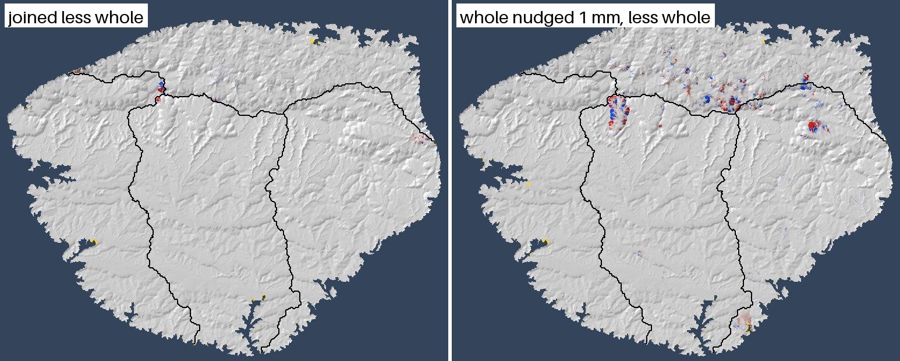

## How far a wrong edge reaches

How a piece held to the landmass pass at its edge differs from the whole, by how far inside the edge (one pass, no iteration):

| Metres inside the held edge | 0–250 | 250–500 | 500–1,000 | 1–1.5 km | 1.5–2 km | 2–3 km | 3–4 km | 4–6 km | over 6 km |
|---|---|---|---|---|---|---|---|---|---|
| 16 km island, pieces from 64 m: p99 / largest | 86 / 96 | 58 / 96 | 29 / 80 | 26 / 72 | 19 / 79 | 11 / 88 | 5 / 52 | 0.01 / 19 | 0 / 1.5 |
| 16 km island, pieces from 32 m | 282 / 302 | 215 / 290 | 24 / 107 | 6.7 / 85 | 0.07 / 17 | 0.02 / 21 | 0 / 1.2 | | |
| 32 km ridge, pieces from 64 m | 228 / 283 | 212 / 279 | 181 / 203 | 84 / 173 | 45 / 208 | 38 / 212 | 16 / 189 | 15 / 93 | 0.08 / 68 |

*(Inference.)* A wrong edge's error runs up the streams that leave a piece through it: in 384 kyr of finer forming, a knickpoint climbs about 5 km up a stream draining 1 km². So the margin a one-pass piece needs grows with the size of the streams its edge crosses. It is 4 to 6 km on the 16 km island and more than 6 km on the 32 km ridge, where even 6 km left an 80 m step. Holding the landmass to 32 m shortens the reach to about 2 km but makes the error at the edge larger.

## The methods, measured

The 32 km ridge in four pieces along divides, unless named:

| Method | Step across the cut, largest (whole) | Within 48 m: p99 / largest (whole 27.1 / 51.9) | Pairs over the island's largest step at that slope | Joined less whole: mean / largest | Hollow cells within 100 m (whole 0); deepest | Channels crossing (whole) | Heads within 300 m moved, largest | Land↔sea |
|---|---|---|---|---|---|---|---|---|
| Margins 2 km | 83.0 (51.9) | 28.4 / 83.0 | 28 | 0.17 / 144 m | 87; 40 m | 12 (10) | 279 m | 9.3 ha |
| Margins 4 km | 92.4 | 27.9 / 92.4 | 14 | 0.04 / 78 m | 3; 9 m | 11 | 218 m | 3.6 ha |
| Margins 6 km | 80.2 | 27.5 / 80.2 | 3 | 0.02 / 68 m | 1; 4 m | 11 | 45 m | 4.2 ha |
| Schwarz 1 km, converged after 2 rounds | 51.9 | 27.3 / 51.9 | 0 | 0.005 / 61 m | 4; 11 m | 9 | 23 m | 3.6 ha |
| Schwarz 2 km, converged after 1 round | 51.9 | 27.2 / 51.9 | 0 | 0.002 / 34 m | 0 | 9 | 48 m | 3.3 ha |
| Square tiles, Schwarz 2 km, 3 rounds | 46.4 (46.4) | 20.2 / 52.8 (20.2 / 52.8) | 0 | 0.000 / 16 m | 0 | 46 (46) | 0 | 7.1 ha |
| Square tiles, ordered, no margin toward formed pieces | 46.4 | 20.2 / 47.1 | 0 | 0.24 / 37 m | **920; 32 m** | 54 (46) | 125 m | 88 ha |
| Ordered, wide margin 1.5 km | 54.5 | 28.8 / 54.5 | 8 | 0.29 / 182 m | **1,061; 150 m** | 14 | 369 m | 23 ha |
| Ordered, wide margin 3 km | 92.2 | 27.7 / 92.2 | 7 | 0.14 / 80 m | 1; 8 m | 11 | 45 m | 10 ha |
| **Ordered, wide margin 6 km** | **49.6** | **27.3 / 52.7** | **0** | **0.02 / 60 m** | **0** | **11** | **45 m (2 of 105)** | **9.4 ha** |
| Straight cut across 38 channels, upstream first | 32.0 (32.0) | 14.6 / 41.2 (14.5 / 41.2) | 0 | 0.30 / 57 m | **1,623; 37 m** | 34 (38) | 253 m | 65 ha |
| **The same, downstream first** | **32.0** | **14.5 / 41.2** | **0** | **0.003 / 14 m** | **0** | **38** | **0** | 21 ha |

The other land, by ordered pieces:

| | Default island, 16 km, 2 pieces | Domes, 24 km, 3 pieces | Domes, cut through the young vent |
|---|---|---|---|
| Step across the cut, largest (whole) | 48.5 (48.5) | 14.4 (14.4) | 35.2 (35.2) |
| Within 48 m: p99 / largest (whole) | 33.5 / 48.8 (33.5 / 48.8) | 8.7 / 25.7 (8.7 / 25.7) | 17.1 / 39.3 (17.1 / 39.3) |
| Joined less whole: mean / largest | 0.01 / 42 m | 0.000 / 0.8 m | 0.000 / 0.6 m |
| Hollow cells within 100 m; channels crossing (whole) | 0; 2 (2) | 0; 16 (16) | 0; 16 (16) |
| Heads within 300 m moved, largest | 16 m | 0 | 0 |

On the domes cut through the vent, **each piece deciding the vent for itself** gives a step of 41 to 54 m along the cut through the dome (90th percentile 42 m), 83 pairs over the island's largest step, a closed hollow of 63 m at start-up against 25 m, and two named places lost. **Schwarz** with the vent decided in its first, coarse round has no seam (the pieces agree within 0.01 m), but its crater floor and dome differ from the whole's by up to 28 m.

**Schwarz converges**, measured as joined less whole on land, mean / largest, by round (round 0 is held to the landmass pass):

| | Round 0 | 1 | 2 | 3 |
|---|---|---|---|---|
| 16 km island, 512 m margin | 1.96 / 215 m | 0.26 / 73 | 0.012 / 49 | 0.003 / 24 |
| 16 km island, 1 km | 1.26 / 227 | 0.048 / 78 | 0.035 / 68 | 0.035 / 68 (a fixed point that is not the whole) |
| 16 km island, 2 km | 0.61 / 116 | 0.000 / 2.6 | | |
| Ridge, 1 km | 0.73 / 203 | 0.016 / 78 | 0.005 / 61 | 0.005 / 61 (the fixed point leaves an 11 m hollow on the cut) |
| Ridge, 2 km | 0.18 / 144 | 0.002 / 34 | 0.002 / 34 | |
| Ridge, square tiles, 2 km | 1.09 / 199 | 0.17 / 89 | 0.025 / 32 | 0.002 / 32 |
| Domes, 2 km | 0.002 / 19 | 0.000 / 0.0 | | |

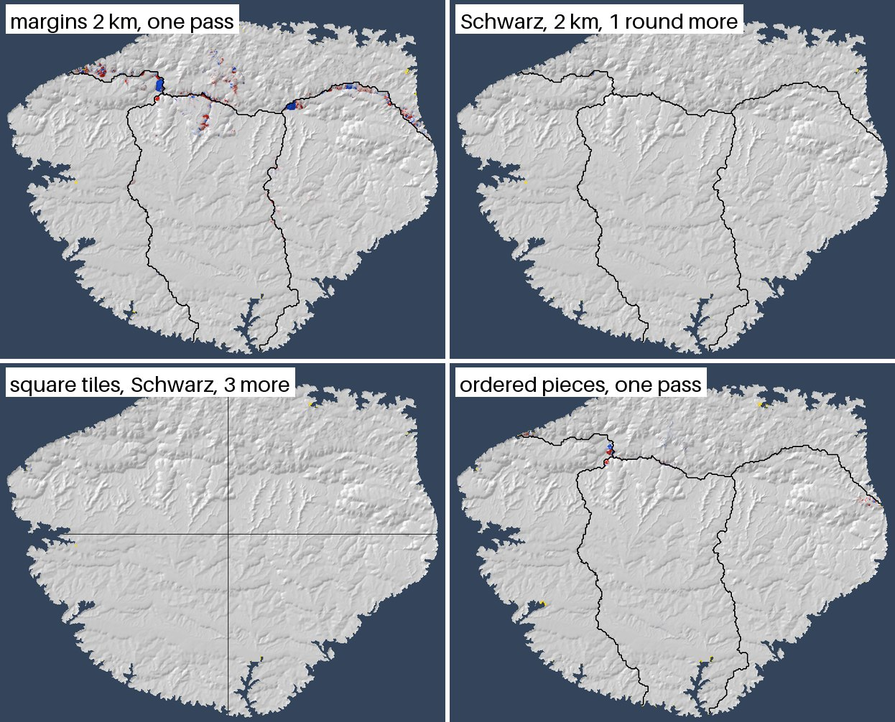

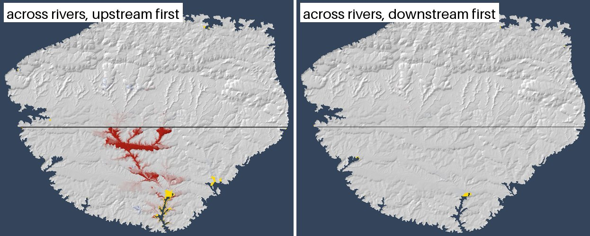

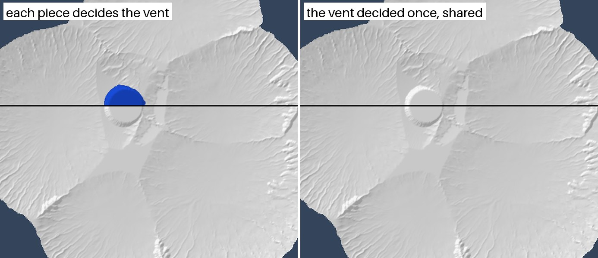

**Why order matters** *(inference from the above)*:
- A stream's base level comes from downstream and its water and rock from upstream.
- Where no stream crosses a cut (along a divide), any order works. The later piece holds the earlier one's land at the cut and adapts to it, and creep and the heads are all that cross.
- Where a stream crosses, the downstream piece formed first takes the land and rock coming in from the landmass pass. The upstream piece then takes the true base level from it.
- Formed the other way, the upstream piece cuts its valley to a base level guessed 6 km downstream. The downstream piece then meets it at a different height, and water ponds at the cut.
- Square tiles have streams crossing both ways, so no order works for them, and only Schwarz does.

## Can the seam be found?

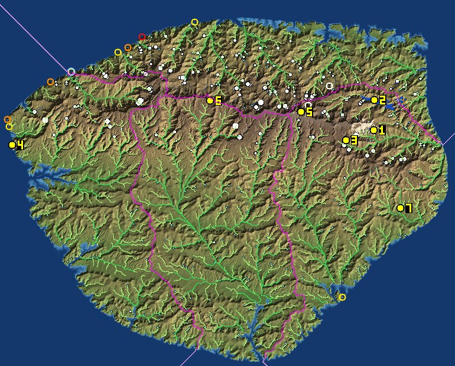

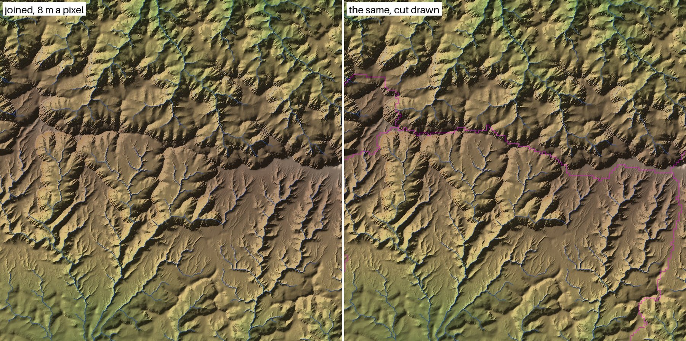

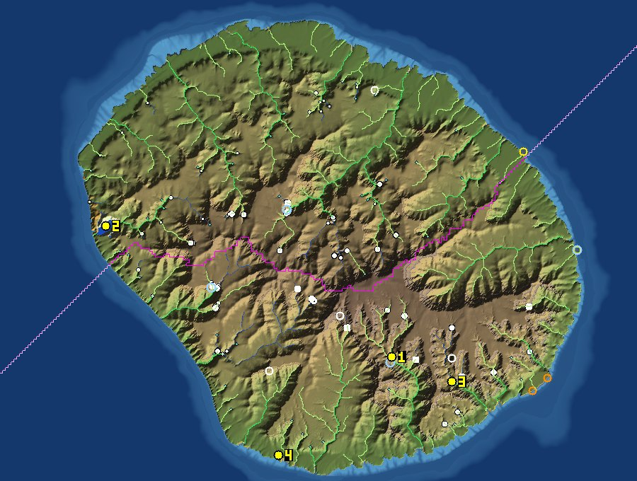

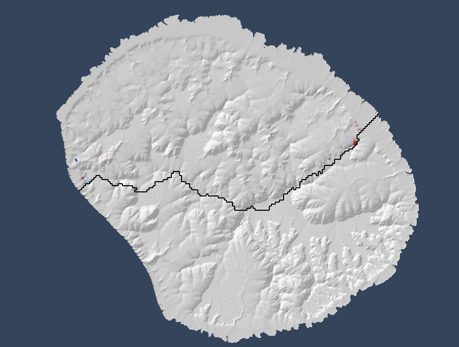

**On the map.**
- **The ridge.** I made the joined map by Schwarz with 2 km margins and looked for the seam in four quadrants before drawing the cut or reading where its largest steps lay. I found nothing seam-like: no straight or stepped line, no trench, no fin, no stream ending at a line. I could not guess where the cut ran. I did know the rule that chooses it (runs of basins round the coast, highest divides), as in step 20. By the time I made the recommended method's map I had seen the cut, so that look was not blind. Knowing the cut follows the main crest, I cannot see it at 8 m a pixel, where three pieces meet twice.
- **The 16 km default island.** I knew the cut from step 20. I cannot see it on the joined map.
- **Where the failing methods do show.** The difference maps show them: blotches along the crest with 2 km margins, a whole drainage raised with the wrong order. On the plain map at 8 m a pixel even the 2 km margins' 83 m step and 40 m hollow were not obvious to me. The measures catch more than my eye on a map.

**From 300 m and the ground.** Each picture is the whole above and the joined below, from the same camera:
- **From 300 m**, looking north across the crest seam between two pieces 3 km off, at −700, −300: 0.09% of pixels differ by more than a little.
- **On the ground**, on the forested slope under a crag the crest seam crosses, at −2,016, −3,230, looking north: 0.05%.
- **On the crest itself**, on the seam at −1,056, −3,040, the joined land lies a metre or two off the whole for a few cells, so the camera, set 2 m over the ground, sat lower in the canopy. The same trunks, bushes and steps stood in both.
- **From the sea**, off the south coast where a seam reaches it, looking up along it (820, 11,000): 0.24% differ, in the shore's rock at the seam's end.

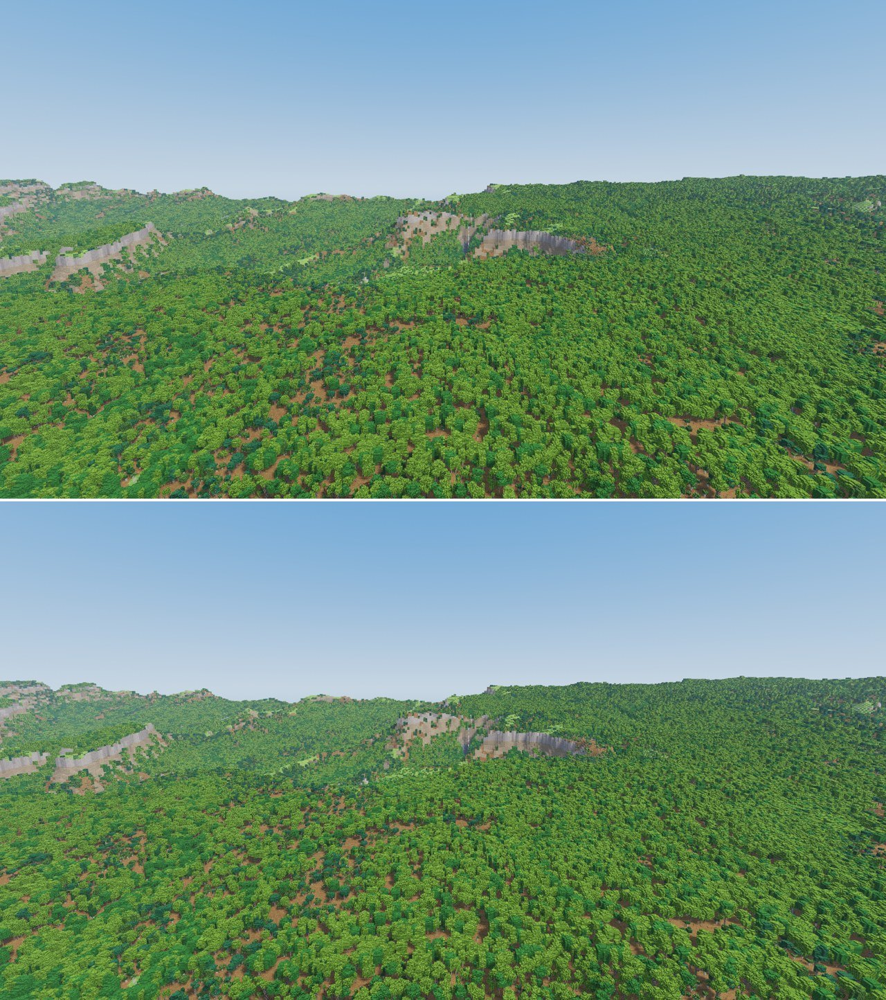

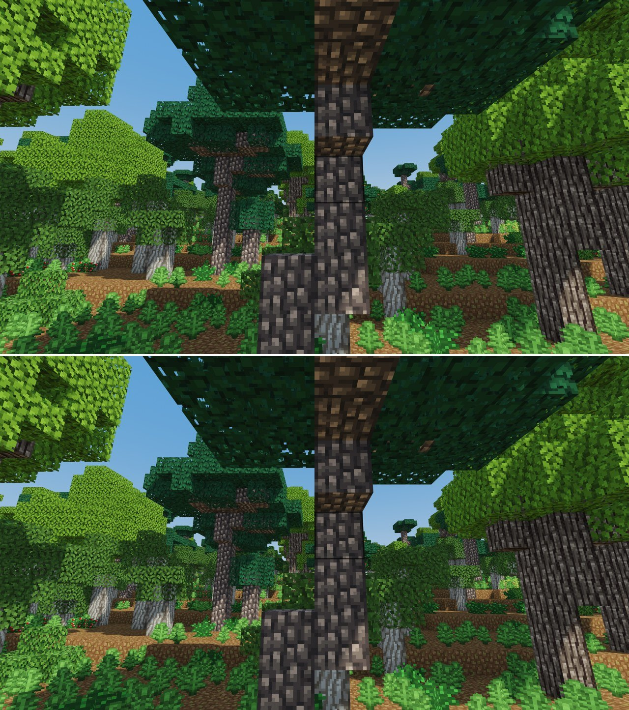

## The land's quality

The recommended method and Schwarz change no rule of the forming and no row of the history. So they cost the land nothing but the chaos-level differences above. The start-up figures on the game's final land, whole against joined by ordered pieces:

| | Ridge, 32 km | Default island, 16 km | Domes, 24 km |
|---|---|---|---|
| Shore height within 100 m; rising 30 m in 50 m; slope in the first 100 m | 36 m, 33%, 17° in both | 13 m, 9% and 10%, 5° | 45 m, 31%, 23° in both |
| Land under 50 m; over 60°; fall at a crest; above the nearest stream | 20%, 0.4%, 0.49 m, 35 m in both | 24%, 1.9%, 0.47 m, 30 m in both | 5%, 0.1%, 0.46 m, 44 m in both |
| Livable; largest patch; landings; deepest closed hollow | 67%; 14,072 and 14,070 ha; 117 and 118; 26 m in both | 65%; 4,571 ha; 4; 9 and 7 m | 73%; 9,129 ha; 1; 25 m in both |
| The slide; named places | the same; the same seven | the same place, **2.5 million m³ against 2.8**, "the Five Ponds" for "the Seven Ponds"; the same four | the same; the same seven |

The failing methods show in these figures. The 2 km margins make the ridge's deepest closed hollow 38 m against 26 m. Vents decided by each piece make the domes' 63 m against 25 m, and lose two named places.

**Method 3's cost to the land**, the 8 km islands of today against two shortened histories:
- moving the 32 m phase to 64 m ("64"),
- shortening the first 16 m phase from 30 steps to 5 ("short 16"),
- both.

A ! marks a figure far from the real islands the kind is after:

| | Raised: today / 64 / short 16 / both | Ridge | Inlets |
|---|---|---|---|
| Shore height within 100 m | 14 / 14 / **46!** / **45!** (Kikaijima 4) | 41 / 35 / 39 / 43 (Hahajima 85) | 32 / 48 / 42 / 61 (39–60) |
| Shore rising 30 m in 50 m | 4 / 3 / **38!** / **37!** % | 43 / 33 / 40 / 40 | 34 / 46 / 41 / 58 |
| Land under 50 m | 41 / 52 / **20!** / **25!** % (57) | 29 / **36!** / **32!** / **40!** (16) | 42 / 43 / 41 / 41 |
| Livable, largest patch | 1,318 / 1,448 / 516 / 438 ha | 274 / 154 / 242 / 64 ha | 134 / 94 / 112 / 72 ha |

Shortening the 16 m phase removes the raised kind's low terraced coast, its one likeness to Kikaijima. Moving the 32 m phase to 64 m brings the inlets closer to their islands and the ridge further from Hahajima. Neither lets pinning work (above). So method 3 fails twice.

## Cost

**Measured, on one thread** of an Apple M3 Max with other agents' runs on it (load 7 to 9; timings ±20%):

| | Time | Notes |
|---|---|---|
| The 32 km ridge formed whole | 16.9 s: 64 m phases 2.7 s, 32 m 3.5 s, 16 m 10.7 s | drainage 68% of it, erosion 25%; 311 km² of land, so 54 ms a km² of land, 46 ms for the finer phases |
| The landmass pass alone: the ridge at 128 km, 64 m only | 60.6 s for 161 steps | 4,970 km² of land: 311 ns a land cell a step; 1.0 GB peak for the whole game at that size |
| Ordered pieces on the ridge, four | 34.5 s for the finer phases | 2.0× the land formed (the first pieces' 6 km margins cover up to 2.7× their own land; these pieces are small, 63 to 94 km²) |
| Schwarz 2 km on the ridge, divides | 31 s a round, 2 rounds needed | |
| Schwarz 2 km, square tiles | 28 s a round, 4 rounds needed | |

The pieces ran on the full region grid with a mask, so their times include loops over cells outside them. Their cost on a grid of their own is estimated from their area, not measured.

**A continent of 30,000 to 50,000 km² of land** *(extrapolated from the rates above; a guess)*:

| | 30,000 km² | 50,000 km² | Memory |
|---|---|---|---|
| The landmass pass at 64 m, one thread (it is one job) | about 7 min | about 12 min | 7 to 12 million cells: about 0.5 to 0.9 GB as the grid is kept today, under 0.3 GB lean |
| Ordered pieces, the finer phases: 46 ms a km² × about 1.4 for 6 km margins on region-sized pieces (32 km; overhead a guess) | 32 core-min | 54 core-min | per worker, a 38 km square at 16 m: 5.6 million cells, 0.4 GB today, about 0.1 GB lean |
| **Ordered pieces in all, on 3 background threads** | **about 18 min** | **about 30 min** | |
| On 8 threads | about 11 min | about 19 min | |
| Schwarz along divides (2 formings, 2 km margins: ×2.5) | 58 core-min + the pass | 96 core-min + the pass | as above |
| Schwarz on square tiles (4 formings: ×5) | 2 core-h | 3.2 core-h | as above |
| The whole landmass at 16 m (method 4), one job | about 35 min of one core | about 1 h | 120 to 195 million cells: 8 to 14 GB as kept today, 2.4 to 3.9 GB at about 20 bytes a cell |

Method 4 has no seam by construction. But it is one job of an hour on one core unless the drainage and the erosion are rewritten to run in parallel; the flood can be tiled (Barnes 2016), and erosion is ordered along each flow path. It also needs gigabytes held for the whole time. Ordered pieces cost about the same core time and run in pieces of bounded memory. They run in parallel wherever two pieces are not neighbours and neither waits on the other.

**What a piece must keep for its later neighbours.** The band is about 1 MB a kilometre of cut as recorded here: 8 values a step, 32-bit, 8 cells deep at 32 m and at 16 m. A continent of 50,000 km² cut into about 50 region-sized pieces has about 3,000 km of cut *(guess)*, so about 3 GB if every band is kept. Halving the precision, narrowing the band to the 6 cells the rules read and dropping stages could cut that four- to eightfold, but none of these was tested. Kept only until the neighbour is formed, it is tens of megabytes at a time. But then forming a region again later, as D3 plans, needs the bands of the pieces before it, kept on disk or formed again in order.

**The first piece near the start waits for the landmass pass** (7 to 12 min on one thread for a large continent) and then about a minute of its own. That is the time a world with a continent near the start costs before play, unless the landmass pass runs in parallel or is kept.

## What it needs from the plate story (step 22) and the region record

*(Inference from the experiment.)*
- **A landmass is one record formed whole at 64 m.** The plate story must give the whole landmass its history at once: its outline, its uplift as a field over it, its sea, its rock story and its vents. It is not one record per region. The landmass pass runs the 64 m phases (about 3 Myr here) over all of it.
- **Events that read a neighbourhood are decided once and shared.** A vent's top and crater floor, and any later event of that kind, are records fixed by the first piece that forms them, or by the landmass pass.
- **The pieces and their order come from the landmass pass's drainage.**
  - Pieces are cut along divides where they can be. A basin larger than a region is cut across its trunk (Pfafstetter units), and its pieces are formed downstream first: a tree from the mouth upward, siblings in parallel.
  - Square tiles would need Schwarz.
- **A region's record grows:**
  - its piece of the cut;
  - its place in the order;
  - the 6 km margin toward the pieces after it, with the landmass pass's land, water and rock coming in there;
  - and, as input, the held bands of the pieces before it.
- **D3 changes.** A region is no longer a pure function of the seed and its record alone. It is a pure function of the seed, its record, the landmass pass and the bands of the regions before it in a fixed order. That is still deterministic and independent of the number of threads, but forming one region again needs those bands kept.
- **The coast across a cut.** The coast's exposure reads the sea 500 m and more beyond a piece, and silt spreads across a cut. Both are approximate across a cut today. The band should carry the sea a kilometre out (bits, cheap) and the silt should be shared.
- **Events ranked over all the land** (the slide, named places, and later others) need a landmass-wide pass after the pieces, or per-region ranking. Here the slide and places ran on the joined land of one region.

## Recommendation

**Form land larger than one region by ordered pieces:**
1. The landmass pass at 64 m, as designed.
2. The cut along the 64 m drainage, across trunks only where a basin is larger than a region.
3. The pieces formed one after another, downstream first.
4. Each piece forms the 32 m and 16 m phases holding its formed neighbours' band, through time, at the cut, with no margin on that side.
5. A 6 km margin toward pieces not yet formed, held beyond to the landmass pass, with its water and rock coming in.
6. Vents decided once.
7. The pieces joined hard at the cut.

On the land tested, the joined land cannot be told from the land formed whole, and its figures are the whole's. It costs about 1.4 times forming the land once (a guess for region-sized pieces), and the landmass pass about 7 to 12 minutes of one core for a large continent.

**Keep alternating Schwarz as the fallback** where order cannot be kept: square tiles, or cuts that streams cross both ways. Use a 2 km margin and expect one round more along divides and three across rivers.

**Do not pin, and do not shorten the finer phases.**

What it needs before it is built:
- step 18's one record per region;
- the band store (where it lives, how much is kept);
- the parallel schedule;
- a test on a landmass larger than 32 km, cut by Pfafstetter units with trunks crossing;
- the coast's exposure and silt carried across a cut.

## Weak points

- **One seed each, three kinds**: raised, ridge and domes, at 16, 32 and 24 km. No landmass larger than 32 km was formed in pieces, and no Pfafstetter decomposition was tried: only runs of basins round the coast, one straight cut and square tiles. The 6 km margin was measured on a 32 km island only. On a continent the streams crossing a margin's far edge may be larger and need more (untested).
- **A cut across rivers formed downstream first** takes the water and rock coming in from the landmass pass. The water is right. The rock (from the last 64 m step, per year) was low: the silt flat at the mouth of the ridge's largest river, 5.7 km below the cut, came out 11.7 ha smaller, and 21 ha in all differ against 9 ha for the nudge. It is not a seam, but it is land different from the whole's.
- **Where a cut meets the sea**, exposure and silt read beyond the band. On the 16 km default island a few metres' difference there changed the slide beside it from 2.8 to 2.5 million m³, and its name from the Seven Ponds to the Five Ponds.
- **The first-formed pieces' margins are expensive on small land** (2.0× the land on the 32 km ridge, up to 2.7× for a piece). The 1.4× for a continent is a guess from square geometry.
- **The cost of a continent is extrapolated**, from a 32 km island and a 128 km pass at 64 m, on a loaded machine. Pieces ran on full region grids with masks. Method 4 was not run beyond 33 km, and its parallel speed and lean memory are guesses.
- **The band store** (about 1 MB a kilometre of cut, about 3 GB for a large continent if all kept) was not reduced; narrower bands, fewer stages and 16-bit values were not tested. The exactness bought by recording 8 stages a step was measured only against the oracle, and fewer stages might be enough.
- **Chaos.** "Joined less whole" cannot reach zero. I judged seams by steps, hollows, channels, heads and land/sea against the whole and the nudged whole. A different order or method gives land that differs from the whole as the nudge does: equally natural, but not the same island.
- **Not fully blind.** I looked at the ridge's map blind only for the Schwarz result. I had seen the cut before looking at the recommended method's maps, and I knew the cut rule. I am not the owner; the owner's own look is the test.
- **The ground pictures are mostly forest**, where step 20 also found little shows. From the sea the camera was 300 m out.
- **Schwarz can settle on a fixed point that is not the whole**: with a 1 km margin it left an 11 m closed hollow on the ridge's cut and pieces disagreeing by up to 68 m on the 16 km island. 2 km did not. Whether 2 km is always enough is untested.
- **The scratch code is unreviewed.** Its checks are the byte-for-byte map with the experiment off, the whole unchanged by keeping the landmass pass, and the oracle at the chaos floor. Its code and grids are in `<agent scratch folder, not kept>/phase2/step21/`.
