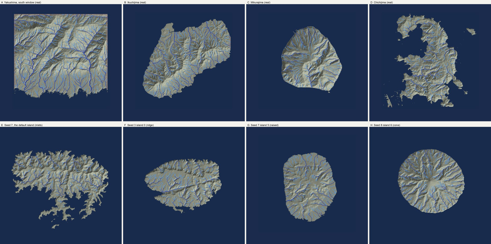
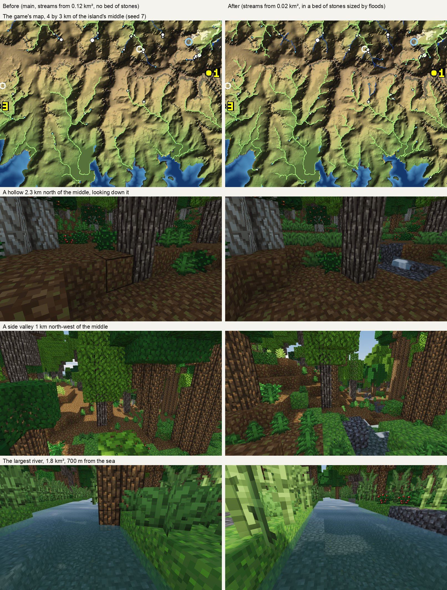
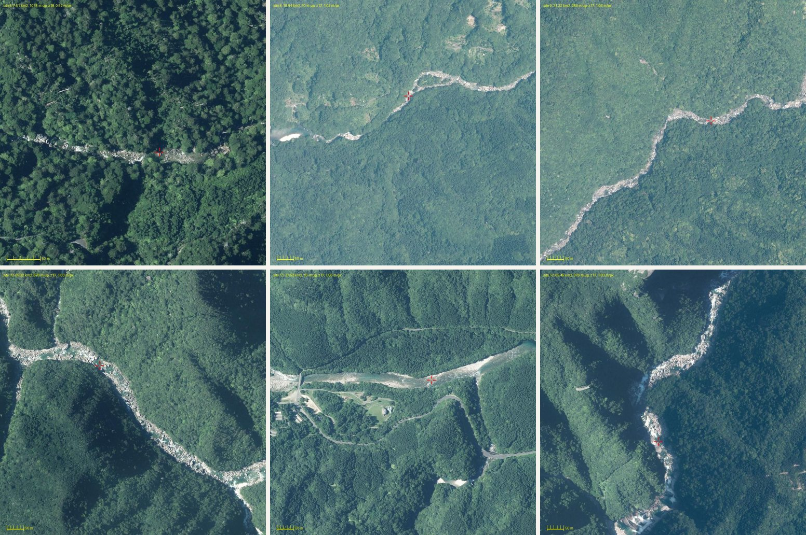

# Streams and rivers on real Japanese islands against the generated ones

Research notes for OdinCraft v5, 2026-11-16, written while the change they led to was built (the section "What was built"). The owner noticed two things on the maps of `../real/yakushima-granite.jpg`:

- The real islands' streams form dense networks that branch and run from the crests to the sea, and ours look sparse.
- Real islands have streams and rivers of many sizes, and on ours the owner has only seen streams a block or two wide.

This note measures the streams of the ten real islands in `real-islands.md` and the 91 islands near the start of seeds 1 to 10, the same way on both. It finds the causes by experiment and reads what the sources say about channel width. "Memory" marks what I could not check against a source.

## Key takeaways

1. **Valleys are spaced right; streams started too far down.**
   - At the threshold the game used for a stream, 0.12 km², our kinds have 1.1 to 1.6 km of stream per km² (medians by kind), within the range of the real islands each kind stands for (0.3 to 1.8).
   - Only Yakushima is denser: 1.9 to 2.05.
   - What the owner saw as sparse is where a stream begins. In humid Japanese hills a stream with water in it drains a hectare or less. Here it began at 12 hectares, about 200 m below the divides, so every valley head was dry.
   - Streams now begin at 0.02 km². That more than doubles the streams on the default island, from 1.23 to 2.91 km per km².
2. **Island size, not erosion, sets most of the difference in density.**
   - On our islands, density follows land area: Spearman's ρ is 0.79 against land area and 0.00 against median slope.
   - Small islands have a wide fringe of short slopes that reach the sea before they gather a stream.
   - None of the forming candidates moved density by more than 15% either way:
     - the balance of creep and stream cutting, at ×0.5, ×2 and ×4;
     - three times the time on 16 m cells;
     - the 3 Myr phase on 32 m cells instead of 64 m;
     - three times the seed roughness.
   - So the forming is left as it was.
3. **Rivers of many sizes need larger islands.**
   - Yakushima's largest basins are 86, 63 and 51 km², by Kagoshima Prefecture's list and by this grid alike.
   - Real islands of 17 to 38 km² have largest basins of 1.9 to 4.4 km², and ours of the same size 1 to 5 km².
   - No generated basin passes 14 km², and the default island's largest is 1.8 km².
   - A river 15 to 30 m across needs a basin of 10 to 90 km², and so an island of roughly 100 to 500 km² with a range in it. That is the plates' and the archipelago's work, not the streams'.
4. **A mountain river's width follows its floods.**
   - On 34 Japanese mountain rivers the width is about 2.5 times the root of the mean yearly highest flow (PWRI, 2012).
   - Yakushima's beds of bare stones, measured here on GSI's aerial photographs:
     - 10 to 16 m wide at 7.6 km²;
     - 15 to 30 m at 19 to 21 km²;
     - 30 to 55 m at 37 to 39 km²;
     - 30 to 45 m at 65 to 83 km².
   - The game's width rule, 14 times the root of mean flow, already gives about that at 7 km² and more. It is narrower than a flood bed only on small streams, where floods are largest for the land drained.
   - Every stream now runs in a bed of stones sized by that rule, 6.4 m across at 1 km² growing as the area to the power 0.35, with the water in it as before.
5. **16 m of land can show a stream's valley down to about 0.01 km².** A real stream's head is finer than the data, on Japan's 10 m model as on our grid.
   - On the real grids, 51 to 70% of the cells a stream draining 0.01 to 0.03 km² would run in lie in a hollow across its flow, and below 0.01 km² 32 to 48% do.
   - Our land is the same: 44 to 79% and 25 to 52%, and 76% and 45% on the default island.
   - So 0.02 km² is as far up as a stream can start and still run in a valley.

## The data

**Real grids.** The eight islands of `real-islands.md` were rebuilt by its method:

- GSI `dem_png` (DEM10B) tiles at zoom 14, 8,192 m windows round the same centres, sampled at 4 m into 16 m cells, row 0 north.
- Where a window cuts land, its outer 160 m is set to sea and the land within 112 m of that is left out of every figure (`cut.u8`).

The rebuilt areas agree with the note's to within 0.6 km². The other grids:

- Yakushima's four windows and the whole island (2,048 cells a side) are the grids of the Yakushima comparison.
- So is Ikuchijima's.
- Each grid was routed by the game's own `route` through a scratch `--real=` option.

GSI's tiles: 国土地理院 (GSI) elevation tiles, resampled and processed for this note. 180 more `dem_png` tiles were requested for the seven islands not already cached, and 126 seamless photo tiles for the widths. All went with a generic user agent and were kept outside the repository.

**Generated.** Every island near the start of seeds 1 to 10 was formed alone (`--island=N --near=0`), 91 islands, on `main` with step 32b's regional history. The scratch build adds only `--dump`. The default island is seed 7's inlets island, 10.2 km across, 27.1 km² of land, 491 m.

**One script for both** (`hydro.py`, kept outside the repository):

- A stream is every cell draining at least a threshold, followed down the game's routing: 0.12 km² (`CHANNEL_AREA`), 0.03 and 0.01 km², and 0.02 km² (where streams now start).
- Lengths are a cell, or a diagonal for a diagonal step.
- A head is a stream cell nothing feeds.
- An outlet is a stream cell that drains to the sea.
- "Divide to stream" is the median distance from a land cell, down its flow, to the first stream cell. It is measured from every hillside cell, so it is longer than the crest-only figure in `real-islands.md`.
- Widths are by the game's rule (`river_half`, 14 √(mean flow), at 2 m of runoff a year) and by the new bed (`river_bed`).
- A steep run is a stretch steeper than 0.3 over about 48 m, the slope at which the tracer stops making pools (`FALL_STEEP`). Runs are counted per km of stream.

**What 16 m data can see.** DEM10B is coarser than a stream's head (memory: DEM10B is drawn from 1:25,000 contours, which smooth small valleys).

- The median slope against drainage area turns over at 560 to 2,200 m² on every real grid. That is 2 to 9 cells, so the turn is set by the grid, not the land.
- The hollow test (takeaway 5) asks whether the cells a stream would run in lie lower than both cells 32 m to either side across the flow, by 0.5 m or more. It puts the limit of what the grid shows at about 0.01 km².
- No 5 m data (`dem5a`) was compared. How much stream above 0.01 km² the 10 m model hides is not known.

## Figures

**Real islands**, at 0.12 km² unless named:

| | Toshima | Mikurajima | Aogashima | Kōzushima | Hahajima | Chichijima | Kikaijima | Tsushima | Ikuchijima | Yakushima, south | Yakushima, 4 sides | Yakushima, whole |
|---|---|---|---|---|---|---|---|---|---|---|---|---|
| Land, km² | 4.1 | 20.5 | 6.0 | 18.5 | 16.6 | 24.3 | 37.5 | 23.4 | 30.8 | 50.1 | 42.0–50.7 | 504.2 |
| Highest, m | 506 | 848 | 420 | 570 | 458 | 320 | 210 | 173 | 471 | 1,731 | 1,228–1,731 | 1,930 |
| Stream km per km², at 0.12 km² | 0.49 | 1.58 | 0.99 | 1.26 | 0.92 | 1.19 | 1.83 | 0.32 | 1.56 | 2.05 | 1.89–2.05 | 1.97 |
| at 0.03 km² | 3.70 | 3.58 | 3.63 | 3.27 | 2.51 | 2.64 | 4.37 | 1.32 | 3.86 | 4.22 | 3.95–4.22 | 4.00 |
| at 0.02 km² | 5.27 | 4.47 | 4.88 | 4.14 | 3.22 | 3.36 | 5.57 | 1.79 | 4.71 | 5.13 | 4.83–5.13 | 4.86 |
| at 0.01 km² | 9.17 | 6.66 | 7.62 | 5.93 | 4.83 | 4.97 | 8.60 | 3.04 | 6.45 | 7.12 | 6.61–7.12 | 6.73 |
| Heads per km² | 1.7 | 2.1 | 2.2 | 2.0 | 1.5 | 1.8 | 2.3 | 1.1 | 2.5 | 2.4 | 2.2–2.4 | 2.2 |
| Streams reaching the sea per km of coast | 0.93 | 1.55 | 0.53 | 0.78 | 0.46 | 0.57 | 1.71 | 0.14 | 1.47 | 1.25 | 1.25–1.83 | 1.23 |
| Divide to stream, median, m | 316 | 225 | 277 | 216 | 184 | 173 | 277 | 109 | 235 | 241 | 219–241 | 222 |
| Largest basins at the sea, km² | 0.2, 0.2 | 2.6, 1.6, 1.5 | 0.2 (and the crater's 2.4) | 1.9, 1.3, 0.9 | 1.9, 0.6 | 3.5, 1.6, 1.0 | 4.4, 2.8, 2.4 | 0.7, 0.4 | 3.2, 2.5, 2.5 | 11.7, 10.8, 3.1 | 7.6–29.0 | 85.9, 62.6, 51.0 |
| Stream wider than 4 m by the game's rule, % of length | 0 | 7.0 | 2.5 | 4.1 | 1.2 | 8.9 | 14.1 | 0 | 13.2 | 20.3 | 20.3–24.9 | 26.7 |
| Widest by the rule, m | 1.6 | 5.7 | 5.4 | 4.9 | 4.8 | 6.6 | 7.4 | 2.9 | 6.3 | 12.1 | 9.7–19.0 | 28 (its cap) |
| Bed of stones wider than 4 m, % of the streams from 0.02 km² | 0 | 19.9 | 10.0 | 16.3 | 14.5 | 21.4 | 19.2 | 4.4 | 17.3 | 25.3 | 25.3–25.8 | 27.3 |
| Steep runs per km of stream | 3.0 | 3.8 | 0.9 | 1.6 | 1.5 | 1.1 | 0.2 | 0 | 0.2 | 2.0 | 1.3–2.2 | 1.9 |

Notes on the table:

- **The windows' basins are cut by the window.** Kikaijima's, Tsushima's, Hahajima's and Yakushima's windows cut their islands, so their basins are those within the window.
- **Aogashima's crater** holds its own 2.4 km² basin, but its water sinks there and never reaches the sea.
- **Kikaijima's streams are what the routing would trace.** The real island has few surface streams (memory), since its rain sinks into the reef.

**Generated islands**, seeds 1 to 10, by kind: median (range).

| | cone | crater | domes | inlets | raised | reef | ridge | worn | default island |
|---|---|---|---|---|---|---|---|---|---|
| Islands | 4 | 6 | 4 | 22 | 16 | 9 | 13 | 17 | seed 7 |
| Land, km² | 18 (5–23) | 8 (2–12) | 18 (12–45) | 15 (4–35) | 25 (15–63) | 19 (12–49) | 20 (9–47) | 14 (6–62) | 27.1 |
| Stream km per km², at 0.12 km² | 1.59 (1.07–2.13) | 0.98 (0–1.36) | 1.07 (0.79–2.06) | 1.09 (0.12–1.42) | 1.56 (1.38–1.87) | 0 (0–0.10) | 1.37 (0.90–1.58) | 1.08 (0.27–1.49) | 1.23 |
| at 0.03 km² | 3.32 | 3.28 | 3.70 | 2.34 | 3.36 | 0.21 | 2.78 | 2.27 | 2.35 |
| at 0.02 km² | 4.00 | 4.29 | 5.01 | 2.89 | 4.07 | 0.44 | 3.47 | 2.74 | 2.91 |
| at 0.01 km² | 5.84 | 6.78 | 7.19 | 4.27 | 5.64 | 1.00 | 5.03 | 3.95 | 4.26 |
| Heads per km² | 2.0 | 2.6 | 2.2 | 2.0 | 2.1 | 0 | 2.2 | 1.8 | 2.0 |
| Streams reaching the sea per km of coast | 1.84 | 1.09 | 1.31 | 0.50 | 1.51 | 0 | 0.76 | 0.46 | 0.40 |
| Divide to stream, median, m | 201 | 265 | 252 | 159 | 193 | 742 | 180 | 155 | 148 |
| Largest basin at the sea, km² | 1.1 (0.5–1.7) | 0.3 (0.1–0.5) | 2.6 (1.5–6.5) | 1.3 (0.2–4.5) | 3.0 (1.4–14.0) | 0.1 | 2.7 (0.7–5.2) | 1.9 (0.3–6.5) | 1.8, 1.6, 1.6 |
| Stream wider than 4 m by the game's rule, % | 0 (0–3) | 2 (0–28) | 7 (3–13) | 1 (0–15) | 9 (1–22) | 0 | 10 (0–24) | 4 (0–25) | 8.4 |
| Widest by the rule, m | 3.7 | 5.7 | 5.5 | 4.1 | 6.1 (4.2–13.2) | 0 | 5.8 (3.0–8.0) | 4.9 | 4.8 |
| Bed of stones wider than 4 m, % of the streams from 0.02 km² | 24 | 9 | 11 | 19 | 25 | 0 | 22 | 20 | 24.1 |
| Steep runs per km of stream | 4.3 (2.1–6.5) | 1.7 | 2.1 | 0.8 | 0.5 | 0 | 1.0 | 0 | 1.05 |

Against the real islands each kind stands for:

- **Density at 0.12 km².** The cone (1.59) lies between Toshima and Mikurajima (0.49 and 1.58). The ridge (1.37) is above Hahajima (0.92). The inlets (1.09) lie between Tsushima and Chichijima (0.32 and 1.19). The domes (1.07) are near Kōzushima (1.26). The raised kind (1.56) is near Kikaijima (1.83). The crater (0.98) matches Aogashima (0.99).
- **Heads per km²** are 1.8 to 2.6 on every kind and 1.1 to 2.5 on every real island.
- **Streams reaching the sea per km of coast** are 0.4 to 0.8 on the drowned and embayed kinds (inlets, worn, ridge), as on Hahajima, Chichijima and Tsushima (0.14 to 0.57). The rounder kinds have 1.1 to 1.8, as on the volcanic islands.
- **Steep runs** are as many on the cones as on Mikurajima and Toshima (3 to 4 per km), and as few on the worn and raised kinds as on Ikuchijima and Kikaijima.

Of the start-up lines Claude read before this note:

- **Ayu** depend on which islands the fish reached, and on seed 7 they now reached none.
- **The game's falls** are drawn on the island's beds, so on a real grid they follow the game's seeded rock and are not the real island's.

## Pictures

1. **Stream networks drawn the same way.** Four real islands, and four generated ones of the median density of their kind, at 10 m to the pixel:

   

   How to read it:
   - Dark blue: streams draining 0.12 km² or more, where streams began before.
   - Light blue: those from 0.02 to 0.12 km², which the game now adds.
   - Each line is three times as wide as the bed of stones round it, and at least 20 m.
   - Hatching marks land cut by a window.

   What it shows:
   - Yakushima's south window is the densest, with long parallel streams running from 1,700 m to the sea.
   - Ikuchijima, Mikurajima and Chichijima are much like the generated islands.
2. **The default island before and after.** The game's map, and the game from 3 m up, at the same cameras on `main` and on this branch:

   

   - A hollow 2.3 km north of the middle had no stream and now has a brook of grey stones stepping down it.
   - At the largest river (1.8 km²), the water is as before, with a bank of stones beside it.
   - The river's line moved by a few metres. Its wander is keyed by where its reach begins, and new tributaries split the reaches.
3. **Yakushima's beds on GSI's aerial photographs** (seamless photo tiles at zoom 17 to 18). The six sites where the bed could be seen, from 7.6 to 83 km², each with a 50 m scale bar:

   

   Under 3 km² the forest closes over every stream, as it does in the game.

## The causes, by experiment

The candidates were run in a scratch build on eight islands of the parent of step 32b:

- seed 7's start island (then a raised island);
- seed 7, islands 15 and 6; seed 8, island 5; seed 6, island 3; seed 9, island 6; seed 10, island 6;
- seed 253's island 5 formed as a ridge island of granite.

The figures are the median change on the eight, with the range.

| Change | Stream km per km² at 0.12 | at 0.03 | Fall at a crest | Height above the nearest stream | Highest point | Forming time |
|---|---|---|---|---|---|---|
| Creep × 0.5 | +1% (−11 to +6) | +2% | ×1.55 | ×0.99 | ×0.95 | ×1.09 |
| Creep × 2 | −2% (−10 to +1) | −5% | ×0.60 | ×1.02 | ×1.06 | ×1.11 |
| Creep × 4 | −8% (−15 to −2) | −13% | ×0.33 | ×1.09 | ×1.16 | ×1.02 |
| Cutting × 2 (`ERODE`) | −11% (−90 to +5) | −10% | ×1.24 | ×0.66 | ×0.62 | ×0.94 |
| Three times the steps on 16 m cells | −1% (−9 to +5) | +3% | ×1.06 | ×1.10 | ×1.11 | ×1.81 |
| The first phase on 32 m cells, not 64 m | +1% (−15 to +7) | −1% | ×1.11 | ×1.09 | ×1.01 | ×1.24 |
| Three times the roughness a refined grid starts from | 0% (−3 to +1) | 0% | ×1.00 | ×1.00 | ×1.00 | ×1.00 |

- **The balance of creep and cutting.**
  - Perron, Kirchner and Dietrich (2009, *Nature* 460: 502–505, read) give the length at which creep and stream cutting take equal time:
    - L_c = (D/K)^(1/(2m+1));
    - valley spacing is 6.4 to 12.7 L_c;
    - L_c² is about the drainage area at which a hillside becomes a valley.
  - With the game's `CREEP` (0.012 m²/yr) and `ERODE` (1.3e-5), L_c is about 30 m, and L_c² about 900 m², under four 16 m cells. The real grids' slope-area turn, at 560 to 2,200 m², is the same.
  - So on 16 m cells the grid, not the balance, sets the finest valleys.
  - The experiment agrees. Halving creep sharpens crests by half and adds no streams. Quadrupling it rounds them to a third and removes 8%.
  - **Not the cause.**
- **The time on the finest cells.** Three times the steps changed density by −9 to +5%, at 1.8 times the cost. **Not the cause.**
- **The cell sizes.** The 3 Myr phase run on 32 m cells changed density by −15 to +7%. **Not the cause.**
- **Island size.**
  - Across the 76 generated islands of the kinds with streams, density at 0.12 km² follows land area (ρ = 0.79, p < 0.001) and the highest point (ρ = 0.61). It does not follow median slope (ρ = 0.00) or relief for the island's size (ρ = 0.11).
  - Median density by land area:
    - 0.92 under 15 km²;
    - 1.41 from 15 to 30 km²;
    - 1.49 over 30 km².
  - The real islands run the same way, from Toshima (4 km², 0.49) to Yakushima.
  - Counting only land more than 1 km from the sea:
    - Yakushima's windows: 1.90 and 1.94;
    - Mikurajima and Ikuchijima: 1.09 and 1.21;
    - ours: 0.64 to 1.81 (ridge 1.52, raised 1.37, worn 1.66).
  - So size explains the most, and Yakushima stays 20 to 40% denser even inland.
  - What makes up the rest is not traced. It rains 4,400 to 10,000 mm a year there (UNEP-WCMC, in `real-islands.md`), and the game's forming lets every cell drain the same, and its mountain is 1,900 m. **Island size: the main cause. The rest: open.**
- **Where streams start.**
  - Real heads lie far below 0.12 km² in humid Japanese hills:
    - **Hitachi Ohta:** first-order catchments of 0.84 and 2.48 ha, beside a zero-order basin of 0.25 ha (Sidle et al. 2000; Tsuboyama et al.; search summary, not read in full).
    - **Granite hills:** a second-order catchment of 2.3 ha holding seven zero-order catchments of 0.1 to 0.5 ha, each with its baseflow (Fujimoto et al. 2016, *Transactions, Japanese Geomorphological Union* 37(4): 493–510; the abstract read).
    - **Steep humid land elsewhere:** the area above a channel head falls as the valley steepens, and is larger in drier regions (Montgomery and Dietrich 1988, *Nature* 336: 232–234; the abstract read). Their source areas run from about 10² to 10⁴ m² (memory).
    - **The Akaishi Mountains:** heads in a steep catchment set by surface and subsurface flow (Imaizumi, Hattanji and Hayakawa 2010, *Geomorphology*; search summary).
  - At 0.12 km² a stream began some 200 m below its divide, and every hollow above it was dry. **This was the cause of the sparse network the player meets.**

## River width: what the sources say

- **A mountain river's width follows its floods.**
  - Sakurai, Miyawaki and Hakoishi (Public Works Research Institute, 2012, "山地河川の流量と川幅の関係について", read in full) measured 34 Japanese mountain rivers at dam sites, of 35 to 3,827 km². They gave each river's width at its mean yearly highest flow, against Yamamoto's regime lines of 2 to 5 √Q for alluvial rivers.
  - From their table:
    - width / √(mean yearly highest flow): median 2.52 (quartiles 2.0 to 3.7);
    - the mean yearly highest flow per km²: median 1.35 m³/s (0.47 to 5.92);
    - width against basin area: 11.3 A^0.28.
  - Their mountain rivers are narrower than the alluvial ones at the same flow, and more scattered.
- **Width against basin area.** Bedrock and alluvial channels widen as the basin area to the power 0.3 to 0.5 (Montgomery and Gran 2001, *Water Resources Research* 37(6): 1841–1846; the abstract, via a search summary).
- **Bankfull geometry.** Parker et al. (2007, *JGR Earth Surface* 112, F04005) relate bankfull width to bankfull flow in gravel rivers. The paper could not be fetched. Memory: width grows as about the 0.4 to 0.5 power of the bankfull flow, which recurs every year or two.
- **Measured here.** On GSI's aerial photographs (credit: 国土地理院 seamless photo tiles, processed for this note), the bed of bare stones and water on six reaches of Yakushima:

  | Site | Drainage area | Bed |
  |---|---|---|
  | 1,078 m up | 7.6 km² | 10–16 m |
  | 70 m up | 18.8 km² | 15–25 m |
  | 289 m up | 21.3 km² | 20–30 m |
  | 576 m up | 39.3 km² | 30–45 m |
  | near the mouth | 37.5 km² | 45–55 m, the water about 30 m |
  | 376 m up | 65.5 km² | 30–45 m |
  | in a gorge | 82.6 km² | 30–40 m |

  - Eight more sites of 0.4 to 7.5 km² were all hidden under forest.
  - The widths are read by eye against a scale bar, to about a fifth.
  - The drainage areas are from the 16 m grid. Its basins match Kagoshima Prefecture's list: Anbō 86.1, Miyanoura 62.8 and Kurio 51.4 km² ([Kagoshima Prefecture](https://www.pref.kagoshima.jp/ap08/documents/59490_20191219174457-1.pdf), against 85.9, 62.6 and 51.0 here).
- **What follows** *(inference)*:
  - The visible channel should follow a flood.
  - The game's rule (14 √ of the mean flow) has a flood channel's coefficient. At 7 to 90 km² it gives 9 to 28 m, near Yakushima's beds.
  - For small streams it is too narrow, since a small basin's floods are larger for its land. The bed rule built here (below) widens as A^0.35, between the PWRI fit and Montgomery and Gran's range.
  - It fits Yakushima's beds and the PWRI widths of 35 to 170 km². At 35, 89 and 168 km² it gives 22.7, 30.8 and 38.2 m, against measured widths of 19.4, 44.3 and 38.9 m.
- **Not found.** No open data giving channel widths for small streams on these islands. GSI's base map draws rivers wider than about 5 m as two lines (memory), which could be measured another time.

## Rivers of many sizes

- **Islands of 4 to 6 km²** (Toshima, Aogashima): largest basins of 0.2 km², and no stream wider than 2 m by the game's rule.
- **Islands of 17 to 38 km²** (Mikurajima, Kōzushima, Hahajima, Chichijima, Ikuchijima, Kikaijima's window): 1.9 to 4.4 km², and streams to 5 to 7 m.
- **Yakushima, 504 km² and 1,936 m**, by [Kagoshima Prefecture](https://www.pref.kagoshima.jp/ap08/documents/59490_20191219174457-1.pdf): the Anbō 86.1, Miyanoura 62.8, Kurio 51.4, Nagata 36.3 and Isso 14.5 km².
- **Tanegashima, a long low island** of about 445 km² (memory), on the same list: no river over 20.6 km².
- So the largest basin is a twentieth to a sixth of a high island's area. It also needs a divide far from the sea: by Hack's law a stream's length grows as about the 0.6 power of its basin (memory), so a 50 km² basin needs a divide 8 to 12 km inland.
- **Ours.** The largest generated basin is 14 km², on a raised island of 62 km², and the median by kind is 1 to 3 km². The default island's is 1.8 km².
- **What the plates must make:**
  - For beds of 15 m and more (10 km² and more): islands of about 60 to 100 km² with a divide 5 km or more inland.
  - For Yakushima's 30 to 50 m rivers: islands of 300 to 500 km² with a range near their middle, in regions about 25 to 35 km across.
  - At 16 m cells, a region 32 km across holds 16 times the cells of an 8 km one. So forming such an island would take several seconds by today's rates, and step 33's work on forming's speed matters there.

## What was built

The forming is unchanged, so the land is bit for bit the same: `./build.sh test` passes with `GOLDEN` as it was, since it hashes the land and not the rivers.

The changes are in `rivers.odin`:

- **Streams start at 0.02 km² (`HEAD_AREA`)**, not at `CHANNEL_AREA`.
  - `CHANNEL_AREA` stays the land's measure of a valley, used for the height above the nearest stream, the plants' wetness, the bay heads' silt and the start-up figures, as the real islands were measured.
  - Springs need 0.005 km² above them (`SPRING_AREA`, a guess, a quarter of a head's). At 0.03 km² they could no longer begin a stream above where one begins anyway.
- **A bed of stones round every stream (`river_bed`).**
  - Its width is 6.4 m × (A / 1 km²)^0.35, and at least the channel's: 1.6 m at a head, 3 m at 0.12 km², 6.4 m at 1 km² and 13 m at 7 km².
  - It widens and narrows by a fifth along the stream, and a third more on the inside of a bend.
  - It lies at the bank top's level, one block over the water, as gravel of the rock upstream, so no tree or soil plant stands on it.
  - The water's width and depth are as before.
  - A fall's gorge keeps its walls at the water.
  - The map draws the bed where it is wider than the map's 8 m stream line.
- **Two start-up figures, printed only.**
  - Stream km per km² at `CHANNEL_AREA`, and the largest basin at the sea, each against the real islands the island is judged against.
  - They are on a line of their own, so the far-figure count of the existing eight is unchanged.
  - `REAL` carries both for the nine real islands.

**On the default island** (seed 7, against `main` at 9cc0d95):

- Stream from its head: 1.23 → 2.91 km per km² of land. Stream with yoshinobori: 35.1 → 74.1 km.
- Stream whose bed of stones is wider than 4 m: 8.4% (of water) → 24.1% (of bed).
- Widest: 4.8 m of water → a 7.9 m bed with up to 4.8 m of water in it.
- Springs: 38 → 59. Falls over 2.5 m: 42 → 58, most of the new ones 2.5 to 5 m steps on small steep streams.
- The start-up line: `streams draining over 0.12 km² 1.23 (0.32-1.19) km per km²; the largest basin at the sea 1.8 (0.7-3.5) km²`.

**Across seeds 1 to 10** (91 islands, each formed alone):

- The eight start-up figures are identical to `main`'s on every island (23.6% far, as `main`).
- The two new figures, on the 74 islands judged against a real island (the worn kind has none):
  - Density is far on 2 (a crater and a ridge island).
  - The largest basin is far on 14: four ridge, four raised, five reef and one domes island, all larger than the real island they are judged against.

**Cost:**

- Entering seed 7 with a one-second bench: 2.35 to 2.37 s on `main`, 2.36 to 2.38 s here (three runs each).
- The two benches, run one after the other on each build, on a machine shared with other agents:
  - The game's own work: median 1.15 to 1.58 ms on both builds.
  - No frame over 12.5 ms, except one frame of 14.7 ms in one of three runs of the cloud bench on this branch.
  - The frame interval was over 12.5 ms on 1 to 28 frames per run, on both builds alike.

## What I recommend next

Most noticeable first:

1. **Look at it in the game.**
   - The owner judges whether the new brooks and beds read as streams in a stony bed or as gravel paths.
   - The bed's coefficient (6.4 m at 1 km²) is fitted to Yakushima, an island with two to three times the rain of the Izu islands.
   - If the beds look too wide on the drier kinds, scale them by the island's rain once rain is a field.
   - Judged by the owner looking, and by the "bed wider than 4 m" share against the real islands' 10 to 27%.
2. **Larger islands, for larger rivers.**
   - The one change that gives rivers 15 to 50 m across. It belongs to the archipelago and the plates (step 21; step 32's later parts), with forming's speed for regions of 25 to 35 km.
   - Judged by the largest basin at the sea against Yakushima's 86 km² and Ikuchijima's 3 km² at their sizes.
3. **Rain that grows with height, in the forming**, to test the rest of Yakushima's density.
   - Weight each cell's runoff by its height and the wind.
   - Changes the land everywhere, at almost no cost in time.
   - Judged by density more than 1 km from the sea, against Yakushima's 1.9.
4. **A dry bed above the water.**
   - Real heads at 0.001 to 0.01 km² carry water only after rain (memory). A stony channel with no water from the hollow down to 0.02 km² would carry the valley's line up to the crest.
   - A small change to the tracer. Judged by the owner looking.
5. **Fold `--real=` and `--dump=` into the game**, as recommended in `real-islands.md`. Every comparison since has rebuilt them in a scratch copy.

## What I could not judge

- **The 5 m model.** Whether DEM10B hides streams above 0.01 km² was not tested against `dem5a`.
- **Small streams' widths.** Under 3 km² the forest hides them from the air, and no survey of them was found.
- **Flood frequencies on these islands.** The PWRI rivers are on the main islands. No flood record of a stream on an island under 100 km² was found.
- **Rain.** Every generated island drains as if wet alike, and the real islands range from Ikuchijima's Inland Sea to Yakushima.
- **Below the eye.** The stones are blocks of gravel. Boulders of a metre and more, which make a Yakushima bed what it is, are not drawn.

## How this was made

In a scratch copy of `src/` outside the repository:

- `--real=` and `--dump=` were rebuilt as for the Yakushima comparison, and four options set creep, cutting, fine-cell time and roughness for the experiments.
- `hydro.py` measures every grid the same way; `hollow.py` the hollows; `networks.py` draws the network picture.
- The photo sites were chosen by a rule from the whole-island grid, before any was looked at: gentle reaches 300 m or more from the sea in seven bins of drainage area, at least 2.5 km apart.
- The pictures of the game were taken with the window hidden, at the same cameras on both builds.
