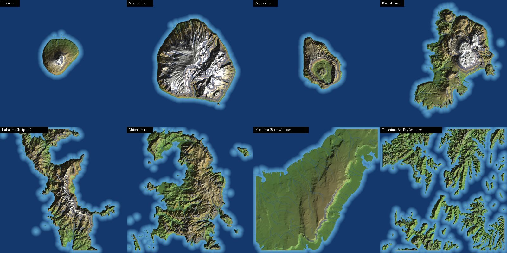
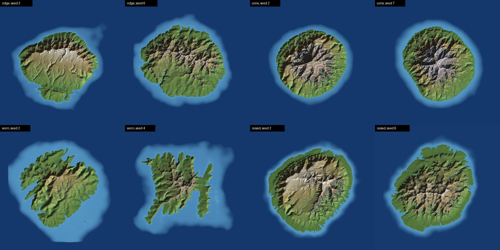
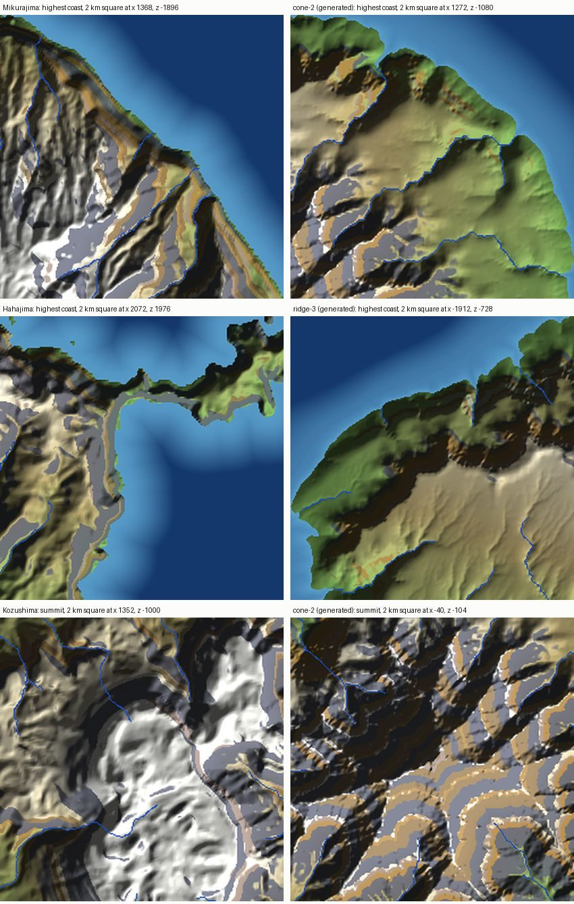
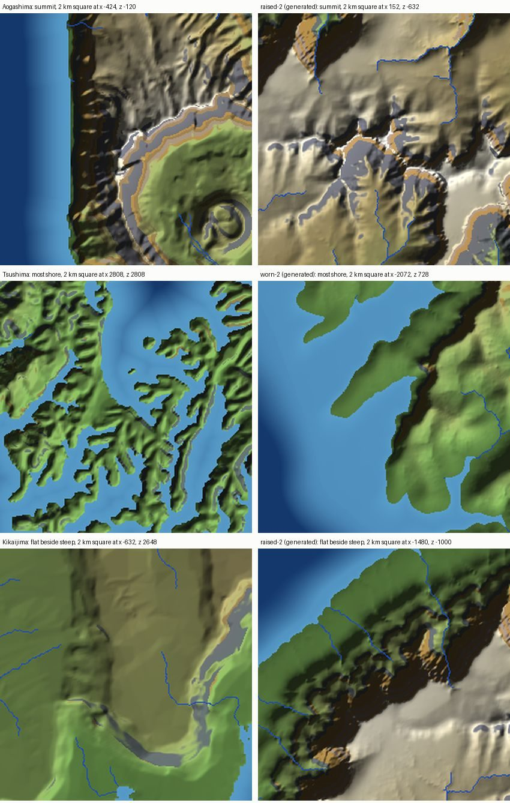
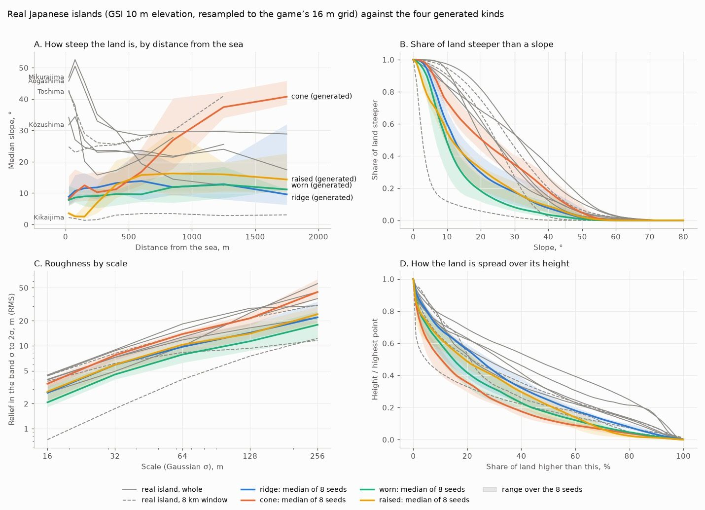
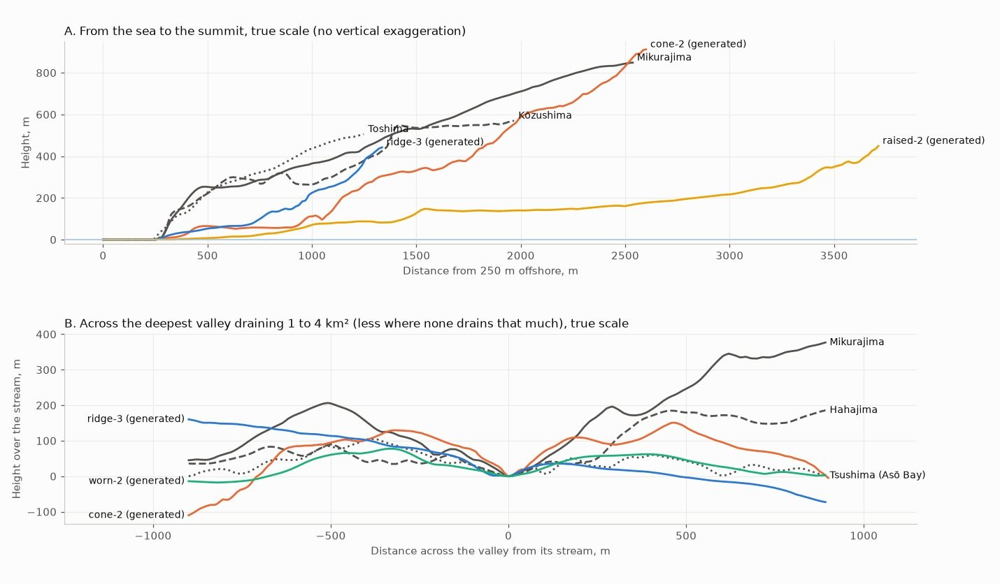
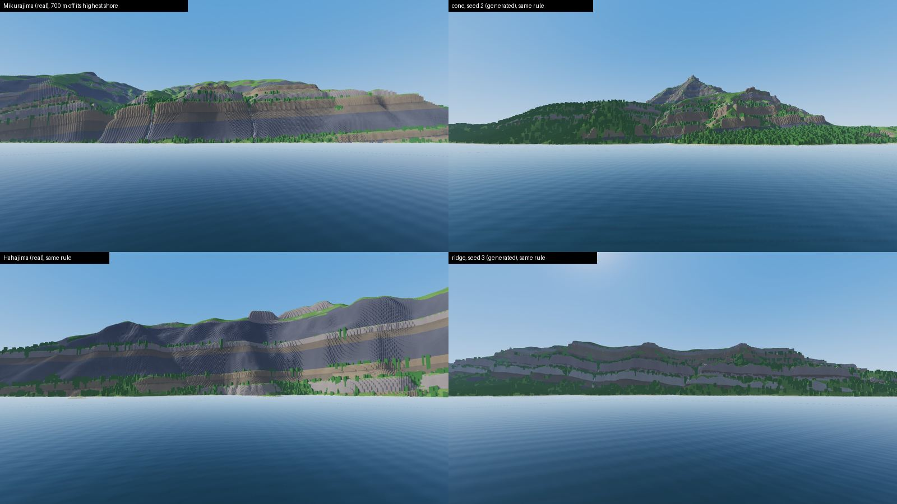
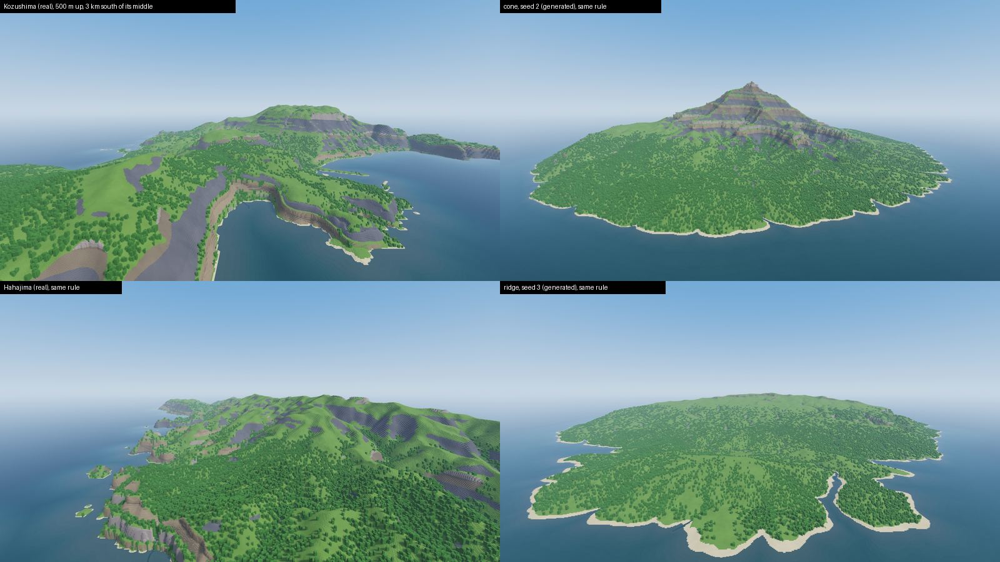
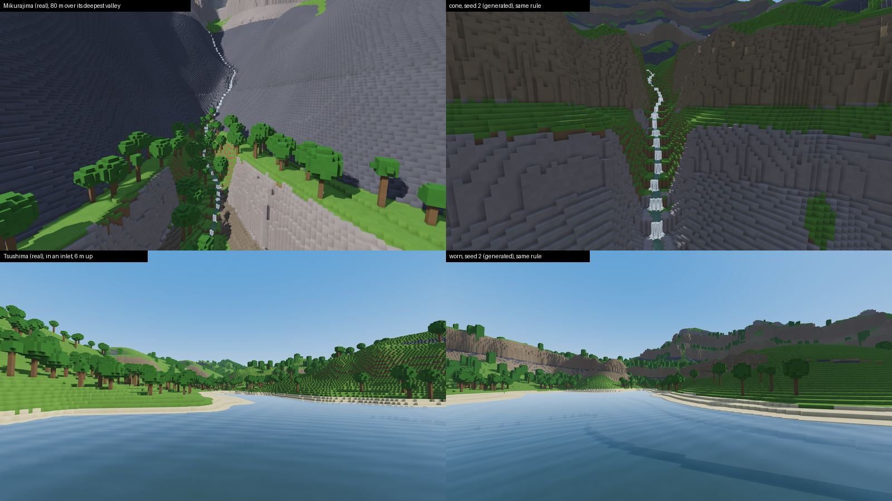

# Real Japanese islands against the generated ones

Research notes for OdinCraft v5, 2026-11-11. The owner decided that real Japanese islands are the north star for the land (`open-decisions.md`, 2026-11-11) and, after reading these findings, that the references should lean toward livable islands; the section "Livable ground" near the end records that. Eight real islands from the Geospatial Information Authority of Japan's elevation model were resampled onto the game's 16 m grid. Each was run through the game's own river tracing, map and renderer, and measured beside 32 generated islands (four kinds on eight seeds each). Every figure below was computed the same way on both. "Memory" marks what I could not check against a source.

## Key takeaways

1. **The coast is the largest gap, and the plan covers it too late and at the wrong scale.** Real islands of this size rise straight out of the sea. On the six whole islands a median 60–117 m stands within 100 m of the shore, and on every island but Kikaijima 40–85% of the shore rises 30 m within 50 m. On the generated islands the medians by kind are 5–17 m and 0–2%, and no seed reaches 30 m or 17%. They sit on an apron of gentle lowland, ringed by beach. The slope profile is reversed (picture 3, panel A). Real islands are steepest at the sea (median 29–51° in the first 100 m on the six whole islands) and gentler inland. Generated ones are gentlest at the sea (3–10°). The cause is in the land forming: uplift grows from zero at the shore (`grid_make`, `smoothstep(0, sh.coast, s)`, "The coast barely rises"), and nothing cuts at sea level. `foundations.md` step 15 builds the coast as blocks on formed land. The landforms design already proposes coast retreat in the forming, but stages it for the archipelago.
2. **The whole island is the wrong shape: a low apron with a peak, not a steep-sided loaf.** On five of the six whole islands 5–16% of the land lies under 50 m (28% on Chichijima); on the generated ones the medians by kind are 31–58%. Mean height over highest is 0.33–0.46 against 0.17–0.31. The generated cone is steepest at its summit (median 41° in its top fifth), where real volcanic islands are gentlest (17–27°). Their tops are lava domes, plateaus and calderas, made by eruption, not by erosion.
3. **Nothing in the formed land is a cliff.** The six islands of volcanic and arc rock have 0.8–2.9% of their land over 60° even at 16 m; every generated island has 0.0–0.1%. The game's own "tallest face" figure is 206–382 m on the real volcanic islands and 61–217 m on generated ones. The rock law caps a slope at 36–52° (`rock.odin`, `rocks.law`), so the forming cannot hold a face steeper than that. Step 2's ledges add steps at the block scale but not faces 100 m high.
4. **Ridges are sharper and valleys deeper.** At a ridge crest the ground falls a median 0.56–1.25 m to its neighbours on six of the eight real islands, against 0.22–0.30 m on every generated kind. The young cone Toshima (0.19 m) and the terrace plain of Kikaijima (0.05 m) are the exceptions. The median height above the nearest stream is 54–130 m on the real high islands and 24–45 m on generated ones. Creep (`CREEP`) rounds every crest. No step in the plan targets relief or ridge sharpness.
5. **The generator already gets two things right.** Valleys are spaced like real ones: 1.0–1.5 km of stream per km² against 0.9–1.6 on five of the six whole islands (0.5 on young Toshima), and 160–200 m from divide to stream against 170–230 m on the larger real islands. And roughness falls off with scale the same way on both (picture 3, panel C): the lines are parallel, and the real ones on the steep islands sit up to about twice as high. So the difference is not texture or "oatmeal" in the spectral sense. It is where the steepness is: at the coast, on the flanks, at crests.
6. **At eye level, inside the forest, the two are hard to tell apart.** Looking down a valley from 80 m, a generated cone's gorge is as dramatic as Mikurajima's. In an inlet of Tsushima's ria and of the generated worn island, the views are much alike (picture 7). The gaps show from the sea, from the air, along the coast and on the map. That matches `interesting-world.md`, which found rock changed the map and not the walk.
7. **Real-island steepness collides with the game's rule for bare ground.** Loaded into the game, a real island turns largely bare grey. A third to a half of its land is steeper than 30°, and the seeded mudstone sheds its soil above about 36°. JMA's photographs of Mikurajima and Toshima show forest over the flanks and bare rock only in the sea cliffs. Steepening the land therefore needs the soil rule of step 5 to keep forest on slopes of 35–45°.

## The islands and the data

**Data.** GSI's `dem_png` elevation tiles (DEM10B), zoom 14, from `https://cyberjapandata.gsi.go.jp/xyz/dem_png/{z}/{x}/{y}.png`. The layer list gives zoom 1–14 for `dem_png` (DEM10B) and 1–15 for the 5 m sets `dem5a_png`/`dem5b_png`/`dem5c_png` ([GSI tile list](https://maps.gsi.go.jp/development/ichiran.html)). Each tile is a 256 × 256 PNG whose pixel encodes x = 2¹⁶R + 2⁸G + B, with height x·0.01 m below 2²³, (x − 2²⁴)·0.01 m above it, and no data at exactly 2²³, which is RGB (128, 0, 0) ([GSI on PNG elevation tiles](https://maps.gsi.go.jp/development/demtile.html); the exponents were checked against real tiles: Toshima decodes to 506 m against the surveyed 508 m). Terms: GSI content falls under the Public Data License 1.0. It may be processed if the source is credited and the processing stated ([GSI terms](https://www.gsi.go.jp/kikakuchousei/kikakuchousei40182.html)). Credit: 国土地理院 (GSI) elevation tiles, resampled and processed for this note. 200 `dem_png` tiles were requested once and cached; 114 held land and the rest were open sea. 21 more of the 5 m sets were requested for the check below.

**Resampling.** Each island was cut from an 8,192 m square around a chosen centre and projected properly. A point's east and north metres became latitude and longitude through the WGS84 radii of curvature at that latitude, and then Web Mercator tile pixels. The model was sampled bilinearly at 4 m and averaged into 16 m cells, row 0 north as on the game's map. Nothing was stretched. A cell is sea where most of it has no data. GSI's land model has no sea bed, so the depth offshore is made up as the game's is: about 1 m at the shore to 46 m some 600 m out. Where a window cuts land, the outermost 160 m is set to sea and left out of every coast figure.

**How 10 m data understates cliffs.** DEM10B is coarser than the cliffs it shows (memory: it is derived from 1:25,000 contours). On a 2 km square of Mikurajima's west coast, GSI's 5 m model (`dem5a`) gives 6.6% of the land over 60° and 1.6% over 70°. The 10 m model gives 5.0% and 1.0%, and the same 10 m model averaged to 16 m gives 4.4% and 0.6%. So the coarse grid loses about a third of the ground over 60° and two thirds of that over 70°, but keeps every face more than a few tens of metres high. All the cliff figures below are therefore lower bounds.

| Island | Window centre | Land in the window | Highest (data / surveyed) | Rock | Kind it answers |
|---|---|---|---|---|---|
| Toshima | 34.518 N 139.282 E | 4.1 km², 2.4 × 2.7 km | 506 / 508 m | Basalt stratovolcano, aa lava layers and dikes exposed in its sea cliffs ([JMA](https://www.data.jma.go.jp/svd/vois/data/tokyo/STOCK/souran_eng/volcanoes/059_toshima.pdf)) | cone (young) |
| Mikurajima | 33.875 N 139.600 E | 20.5 km², 5.1 × 5.6 km | 848 / 851 m | Basalt–andesite stratovolcano, "surrounded by sea cliff that rises as high as 500 m", "little of the original topography remains" ([JMA](https://www.data.jma.go.jp/svd/vois/data/tokyo/STOCK/souran_eng/volcanoes/063_mikurajima.pdf)) | cone (old) |
| Aogashima | 32.458 N 139.764 E | 5.9 km², 2.5 × 3.4 km | 420 / 423 m | Basalt; a crater 1.5–1.7 km across with a small caldera and the Maruyama cone inside ([JMA](https://www.data.jma.go.jp/svd/vois/data/tokyo/STOCK/souran_eng/volcanoes/065_aogashima.pdf)) | none |
| Kōzushima | 34.212 N 139.140 E | 18.4 km², 5.6 × 6.9 km | 570 / 572 m | Rhyolite lava domes and pyroclastic rocks; Tenjōsan formed in the 9th century ([JMA](https://www.data.jma.go.jp/svd/vois/data/tokyo/STOCK/souran_eng/volcanoes/061_kozushima.pdf)) | none |
| Hahajima | 26.669 N 142.155 E | 16.9 km² in the window; the north tip is cut | 458 / 462 m (memory) | Eocene submarine andesite with basalt and dacite ([Sasakawa Peace Foundation](https://www.spf.org/islandstudies/info_library/ogasawara/ogasawara-02-geography-0204.html)) | ridge |
| Chichijima | 27.071 N 142.210 E | 24.1 km² with Anijima's south tip | 320 / 319 m (memory) | Boninite pillow lavas, the type locality (search summary, not read in full) | worn, drowned |
| Kikaijima | 28.318 N 129.972 E | 38.7 km² in an 8 km window of a 57 km² island (memory) | 210 / 214 m (memory) | Raised coral reef limestone on older rock; uplift about 2 mm a year over 100,000 years ([IUGS geoheritage](https://iugs-geoheritage.org/geoheritage_sites/holocene-coral-reef-terraces-of-kikaijima-island/), which gives 2.1–2.3 "m/ky") | raised |
| Tsushima, Asō Bay | 34.340 N 129.300 E | 24.2 km² of land in an 8 km window | 173 m in the window | Folded Eocene–Miocene sandstone and mudstone of the Taishu Group (search summary of GSJ papers) | worn, drowned |

The window centres are mine. The surveyed heights for the four volcanic islands are JMA's. Every area and extent above is measured from the data, and agrees with GSI's published areas where I remember them: Mikurajima 20.5, Kōzushima 18.6, Aogashima 6.0 and Toshima 4.1 km² (memory). Mikurajima, Kōzushima and Aogashima nearly fill the square, and Toshima and Aogashima are smaller than any generated island.

Generated islands: every kind on seeds 1 to 8, formed by the game's code unchanged.

## Figures

All on the 16 m grid. Slope is by central differences, as `land.slope`, on land not next to the sea. Generated columns are the median over eight seeds, with the range in brackets. "Relief in 250 m" is highest less lowest in a 240 m square. "Ridge crest" cells are those nothing drains into, steeper than 5°. "Height above nearest stream" follows the game's own drainage down to the first cell draining 0.12 km² (`CHANNEL_AREA`). The roughness rows are the RMS of the difference between Gaussian smoothings a factor of two apart, on land only.

| | Toshima | Mikurajima | Aogashima | Kōzushima | Hahajima | Chichijima | Kikaijima | Tsushima | ridge | cone | worn | raised |
|---|---|---|---|---|---|---|---|---|---|---|---|---|
| Land, km² | 4.1 | 20.5 | 5.9 | 18.4 | 16.9 | 24.1 | 38.7 | 24.2 | 17.4 (12.3–20.9) | 15.2 (12.7–18.4) | 14.5 (12.1–19.9) | 21.5 (16.2–25.5) |
| Highest point, m | 506 | 848 | 420 | 570 | 458 | 320 | 210 | 173 | 365 (309–459) | 763 (694–912) | 207 (166–334) | 422 (344–554) |
| Median slope, ° | 20 | 31 | 32 | 24 | 28 | 24 | 3 | 24 | 12 (9–15) | 20 (17–25) | 10 (7–11) | 11 (9–13) |
| Land over 30°, % | 26 | 54 | 53 | 36 | 46 | 33 | 2 | 27 | 17 (10–28) | 35 (27–41) | 8 (6–18) | 18 (11–24) |
| Land over 45°, % | 9 | 17 | 24 | 9 | 11 | 6 | 0 | 0 | 4 (2–14) | 11 (6–19) | 2 (1–8) | 5 (2–11) |
| Land over 60°, % | 1.2 | 2.5 | 2.9 | 1.8 | 1.9 | 0.8 | 0.0 | 0.0 | 0.0 (0.0–0.1) | 0.0 (0.0–0.1) | 0.0 (0.0–0.0) | 0.0 (0.0–0.1) |
| Tallest face, the game's own start-up figure, m | 215 | 382 | 255 | 206 | 345 | 262 | 70 | 80 | 129 (64–216) | 139 (116–212) | 102 (61–189) | 131 (92–217) |
| Land under 3°, % | 0.0 | 0.1 | 3.9 | 1.9 | 0.5 | 2.1 | 54.8 | 1.2 | 2.4 (0.6–4.1) | 1.3 (0.6–2.5) | 5.9 (4.1–13.8) | 15.9 (10.2–19.4) |
| Median slope 0–100 m from the sea, ° | 40 | 51 | 50 | 34 | 39 | 29 | 2 | 24 | 10 (7–14) | 9 (7–17) | 8 (7–12) | 3 (2–4) |
| Median slope 300–700 m from the sea, ° | 19 | 29 | 25 | 23 | 26 | 23 | 3 | 26 | 14 (9–20) | 14 (11–17) | 10 (7–12) | 13 (10–21) |
| Median slope, highest fifth of the height, ° | 27 | 24 | 22 | 17 | 27 | 19 | 3 | 27 | 11 (9–40) | 41 (39–43) | 11 (9–30) | 19 (13–41) |
| Land under 50 m, % | 14 | 5 | 9 | 14 | 16 | 28 | 57 | 74 | 33 (28–35) | 31 (21–38) | 58 (53–68) | 39 (33–44) |
| Mean height / highest | 0.35 | 0.46 | 0.41 | 0.33 | 0.33 | 0.36 | 0.29 | 0.21 | 0.31 (0.23–0.33) | 0.20 (0.17–0.21) | 0.24 (0.20–0.29) | 0.27 (0.22–0.30) |
| Relief in 250 m, median, m | 112 | 155 | 162 | 107 | 120 | 96 | 15 | 63 | 62 (46–88) | 94 (83–111) | 44 (30–56) | 64 (43–75) |
| Relief in 1 km, median, m | 416 | 499 | 332 | 293 | 289 | 234 | 80 | 105 | 213 (152–278) | 313 (265–384) | 131 (95–158) | 213 (174–255) |
| Height above nearest stream, median, m | 130 | 122 | 96 | 72 | 79 | 54 | 10 | 29 | 32 (26–44) | 45 (34–53) | 24 (17–26) | 26 (21–29) |
| Streams draining over 0.12 km², km per km² | 0.5 | 1.6 | 1.0 | 1.3 | 0.9 | 1.2 | 1.8 | 0.3 | 1.4 (1.2–1.5) | 1.5 (1.4–1.6) | 1.0 (0.7–1.1) | 1.4 (1.3–1.5) |
| Divide to stream, median, m | 420 | 170 | 311 | 182 | 226 | 192 | 163 | 298 | 171 (160–187) | 159 (148–170) | 198 (182–226) | 165 (158–173) |
| Divide to stream, spread (std/mean) | 0.57 | 0.65 | 0.62 | 0.60 | 0.85 | 0.80 | 0.71 | 0.99 | 0.58 (0.56–0.64) | 0.60 (0.59–0.63) | 0.64 (0.60–0.83) | 0.60 (0.56–0.65) |
| Ridge crest: fall to the four neighbours, median, m | 0.19 | 0.69 | 0.63 | 0.56 | 0.81 | 0.73 | 0.05 | 1.25 | 0.24 (0.22–0.29) | 0.30 (0.27–0.41) | 0.22 (0.17–0.25) | 0.26 (0.22–0.29) |
| Deepest closed hollow, m | 2 | 7 | 77 | 10 | 9 | 7 | 1 | 4 | 1 (0–2) | 0 (0–3) | 0 (0–1) | 0 (0–2) |
| Coast length at 16 m / at 256 m | 1.23 | 1.18 | 1.17 | 1.75 | 1.73 | 1.94 | 1.99 | 2.99 | 1.43 (1.33–1.48) | 1.35 (1.26–1.49) | 1.77 (1.64–1.86) | 1.69 (1.64–2.01) |
| Coast / circle of the same area | 1.26 | 1.23 | 1.26 | 2.46 | 3.07 | 3.74 | – | – | 1.52 (1.41–1.58) | 1.38 (1.28–1.54) | 2.52 (2.28–3.50) | 1.89 (1.77–2.36) |
| Sea inside the convex outline, % | 4 | 4 | 5 | 26 | 56 | 52 | – | – | 5 (3–8) | 2 (1–3) | 20 (15–39) | 6 (4–15) |
| Outline length / width (principal axes) | 1.19 | 1.11 | 1.53 | 1.71 | 2.94 | 1.55 | – | – | 1.21 (1.12–1.49) | 1.09 (1.03–1.13) | 1.25 (1.03–1.49) | 1.18 (1.05–1.33) |
| Height within 100 m of the shore, median, m | 82 | 117 | 107 | 70 | 85 | 60 | 4 | 39 | 17 (12–25) | 16 (11–30) | 14 (11–23) | 5 (4–6) |
| Shore rising 30 m within 50 m, % | 65 | 81 | 85 | 48 | 85 | 67 | 0 | 40 | 2 (0–5) | 0 (0–5) | 2 (0–17) | 0 (0–1) |
| Shore rising 100 m within 100 m, % | 38 | 66 | 63 | 24 | 37 | 14 | 0 | 0 | 0 (0–0) | 0 (0–0) | 0 (0–0) | 0 (0–0) |
| Shore under 10 m for 100 m inland, % | 5 | 2 | 1 | 8 | 2 | 6 | 100 | 1 | 24 (11–37) | 21 (1–42) | 33 (18–46) | 89 (80–97) |
| Roughness, σ 16–32 m, m | 2.7 | 4.3 | 4.4 | 3.9 | 4.3 | 3.9 | 0.7 | 3.7 | 2.7 (2.2–3.7) | 3.5 (3.1–4.0) | 2.1 (1.8–3.2) | 2.8 (2.1–3.4) |
| Roughness, σ 64–128 m, m | 9.9 | 15.6 | 18.3 | 12.7 | 13.8 | 11.7 | 3.9 | 8.3 | 9.7 (8.1–12.9) | 13.8 (12.0–14.9) | 7.8 (6.2–10.3) | 10.3 (7.8–12.3) |
| Roughness, σ 128–256 m, m | 25 | 27 | 28 | 22 | 22 | 16 | 7 | 9 | 14 (12–19) | 21 (18–24) | 11 (9–16) | 14 (12–19) |

Measures that separate the two sets cleanly: the height within 100 m of the shore, the share of shore rising 30 m in 50 m, and the slope in the first 100 m from the sea, each of which puts every real island but Kikaijima outside the range of all 32 generated islands. Two more do so for most of them: the share over 60° (all but Kikaijima and Tsushima) and the fall at a ridge crest (all but Kikaijima and Toshima). Measures that do not separate them: stream density, spacing from divide to stream, and the shape of the roughness spectrum.

## Pictures

1. **Whole islands on the game's map, at the same scale (8.2 km squares).** Real islands:

   

   Generated, two seeds of each kind:

   

   The real high islands are dark relief to a sharp shore. Every generated island has a pale green ring of low ground between its relief and the sea. Its coast is scalloped evenly all round by one wavelength of noise and by stream mouths. The volcanic islands' outlines are smoother than any generated one; Hahajima, Chichijima and Tsushima are far more embayed. The map's colours go by height and the seeded beds, the same for both; above about 225 m the map turns white.

2. **2 km crops, real beside the most similar generated ground, chosen by the same rule on both.** The rules are the most height at the shore, the summit, the most shore, and flat ground beside steep:

   
   

   Mikurajima's coast is a wall cut by short hanging valleys; the generated cone's is a green apron. Kōzushima's summit is a smooth dome plateau in a crater rim, and Aogashima's is a crater with a cone inside. The generated summits are fully dissected. Tsushima's inlets branch at every scale; worn-2's inlet is one smooth bay.

3. **Figures as curves.** Panel A is the main result.

   

4. **Cross-sections at true scale.** From 250 m offshore to the summit, and across the deepest valley:

   

   The real islands climb 200–250 m in their first 200 m from the shore. The generated ones climb about 50 m in their first 300 m, and the cone then steepens toward a point. Across valleys the shapes are alike, and the real ones are deeper.

5. **In the game, from the sea:** 700 m off the stretch of shore with the most height within 100 m, 15 m up, on each island:

   

6. **In the game, from the air:** 500 m up, 3 km south of each island's middle, looking north:

   

7. **In the game, close in, where the difference is smallest.** Looking down the deepest valley from 80 m, and in an inlet at 6 m:

   

In the game shots a real island wears the game's seeded rock beds, so its colours and banding are not the island's. Judge the shape only. A real island also looks barer than it is (takeaway 7).

## The gaps, most noticeable first

For each gap: what the real islands have, the evidence, the scale, the real process, the likely cause in `src/`, and where `foundations.md` section 8 stands.

### 1. The island meets the sea in cliffs

- **Real.** Every island of volcanic or old arc rock rises from the water. A median 60–117 m stands within 100 m of the shore, and 14–66% of the shore rises 100 m within 100 m. Mikurajima's sea cliffs reach 500 m (JMA). Rivers reach the sea by falling over the cliff (picture 5, Mikurajima; the game's own traced rivers do this on real land). Beaches are rare: on every real island but Kikaijima 1–8% of the shore stays under 10 m for 100 m inland, against medians of 21–89% by kind on generated ones.
- **Evidence.** The figures table: the shore rows and "slope 0–100 m from the sea". Pictures 1, 3A, 4A, 5 and 6.
- **Scale.** The whole island, seen from everywhere. It is the first thing seen on arrival by sea and the frame of every view outward.
- **Process.** Waves cut a notch at sea level, the face above falls, and the coast retreats while the island rises or grows. The land behind keeps its height, so the edge becomes a wall. Streams that cannot cut down as fast as the coast retreats are left hanging over it.
- **Cause in the generator.** Uplift is zero at the shore and grows over the first 10–35% of the way inland (`grid_make`: `smoothstep(0, f32(sh.coast), s)`, with `coast` ranges 0.1–0.35 in `KINDS`; the comment reads "The coast barely rises"). Erosion then grades that low ground to the sea. Nothing acts at sea level: `erode` and `creep` work on land only, and sea cells are fixed. The sea bed `-1 - 45*smoothstep(0, 0.35, -s)` is a gentle shelf, so no deep water lies off a cliff.
- **Plan.** Phase 1 step 15, "The coast: cliffs where the swell hits, beaches in the bays, stacks", at about 100 lines after step 14, is block-scale work on formed land. `foundations/landforms.md` already lists coast retreat in the forming loop: "shore cells retreat by exposure over strength to a platform 2 m down". Its "Exposed cliffed coast" row describes exactly this, but it is staged for the archipelago. **Covered by the design, scheduled too late and at the wrong level.** The real cliffs are 50–500 m: a change to the land forming, not a decoration of it.

### 2. The island is a low apron with a peak, not a steep-sided mass

- **Real.** The land stands high. On five of the six whole islands 5–16% of the land is under 50 m (28% on Chichijima), and the mean height is a third to a half of the highest point. The steepness is on the flanks; the tops are gentler (17–27° in the highest fifth) because they are constructional surfaces: Kōzushima's dome plateau, Mikurajima's summit, Aogashima's rim and floor.
- **Generated.** 21–68% of the land is under 50 m, and the mean height is a fifth to a third of the highest. The cone kind is a pyramid, steepest at the top (39–43° in the highest fifth), because uplift peaks in a Gaussian there and erosion grades it to a point.
- **Evidence.** Pictures 3A, 3D, 4A and 6 (the generated cone from the air), and the table.
- **Scale.** The whole island and its skyline.
- **Process.** Volcanic islands are built by eruption, then cut. Uplifted arc islands keep a high, dissected mass behind a retreating coast.
- **Cause.** The uplift pattern (`peak`, `peak_width`, `floor` and `coast` in `Shape`) and the absence of gap 1. Land can only be raised by uplift, never built.
- **Plan.** Step 3 made the kinds rows, which is where a flatter-topped, steeper-edged uplift would go. Volcanic building is Phase 2: "volcanic events", with the cone, crater and lava-flow rows of `landforms.md`. **Partly covered**: the uplift shape is a row change today; building is late.

### 3. No face in the formed land is steeper than about 52°

- **Real.** 0.8–2.9% of the land is over 60° even at 16 m, and more at 5 m. The tallest faces by the game's own measure run 206–382 m on the volcanic islands and 345 m on Hahajima. Inland faces include crater and caldera walls and valley sides.
- **Generated.** 0.0–0.1% over 60°; the tallest faces are 61–217 m.
- **Evidence.** The table, panel 3B (every generated curve reaches zero by about 55°) and the crops.
- **Scale.** 16 m to a few hundred metres. A face seen from anywhere near it.
- **Process.** Strong, jointed rock stands near vertical where it is undercut by the sea, a stream or a collapse.
- **Cause.** `rocks.law[m].limit = tan(35° + (strength − 0.2)/0.7 × 20°)`, at most about 52° for grit (`rock.odin`), enforced in `erode` by `clamp(z, ..., below + law.limit*run)`.
- **Plan.** Step 2 (accepted) shows faces as ledges on beds at the block scale. Nothing in the plan raises what the forming can hold. **Not covered.**

### 4. Ridges are knife-edged and valleys deeper

- **Real.** Ridge crests fall a median 0.56–1.25 m to their four neighbours. Toshima is the exception: a young cone whose crests are round, at 0.19 m. The median height above the nearest stream is 54–130 m; relief within 250 m is 96–162 m.
- **Generated.** The crest fall is 0.22–0.30 m, the height above the stream 24–45 m, and relief within 250 m 44–94 m. The valley spacing is right (gap 9), so the valleys are as many but shallower, with rounder divides between them.
- **Evidence.** The table, picture 4B, and the crops (Hahajima against ridge-3).
- **Scale.** 50 to 500 m: what a walker on a ridge feels underfoot, and the depth of the valley beside them.
- **Process.** Fast incision in strong rock, with landslides rather than creep keeping the slopes at their limit, leaves crests sharp.
- **Cause.** `CREEP` (0.012 m²/yr, scaled by `1.25*(1 - strength)`) rounds every crest. The ridge, worn and raised kinds rise at only 0.5–0.7 mm/yr, which gives modest relief.
- **Plan.** **Not covered.** "Exaggeration" (open decision 7) is related but is a different question: real islands already have this relief at true scale.

### 5. Volcanic forms: craters, calderas, domes, closed hollows

- **Real.** Aogashima holds a closed crater 77 m deep over 23% of the island, with a cone inside. Kōzushima's summit is a dome plateau with hollows up to 10 m. Every generated island has none over 3 m.
- **Evidence.** The table ("deepest closed hollow") and picture 2 (the Aogashima and Kōzushima crops).
- **Scale.** 200 m to 1.5 km: one-off landmarks.
- **Process.** Eruption, explosion and collapse.
- **Cause.** The forming only raises land and cuts it, and `route` fills every hollow.
- **Plan.** Phase 2 ("volcanic events"); `landforms.md` has cinder cone, crater and lava-flow rows. **Covered, late.** Two of the eight real islands match no kind of ours because of this.

### 6. Coasts are either smooth and cliffed or deeply drowned; generated ones are evenly scalloped

- **Real.** The volcanic islands have smooth outlines: coast length over the circle's is 1.23–1.26, and the coast at 16 m is only 1.17–1.23 times its length at 256 m. The old arc islands are drowned: Hahajima and Chichijima have 52–56% of their convex outline as sea, and Tsushima's ria has 60%, with inlets branching at every scale (ratio 3.0 at 16/256 m). Hahajima is a long thin ridge, 2.9 times as long as wide.
- **Generated.** Every kind falls between the two, with one evenly scalloped edge: ratio 1.26–2.01 and 1–39% hull sea. The ridge kind is a round island with a range on one side, never longer than 1.5 times its width.
- **Evidence.** The table, pictures 1 and 2 (Tsushima against worn-2).
- **Scale.** 200 m to 8 km: the map and the sea views.
- **Process.** Volcanic coasts are cut evenly by waves. Drowned coasts are river valleys flooded by the sea's rise after the last glaciation, which was over 100 m (memory).
- **Cause.** The outline is one noise (`shore`: `ragged` 0.15–0.5 at `ragged_wave` 2.5–3.5 km). The stretch ranges `xx`/`zz` stay close to round. The "worn" sea rise is only 4–8 m, which floods mouths, not valleys; `landforms.md` itself says a drowned coast needs "sea rises 30 m or more".
- **Plan.** Drowned coasts are in `landforms.md` and Phase 2 "an older sea level and drowned coasts". **The worn row can take a larger sea rise and a longer outline today.**

### 7. Real steepness would leave the island bare under today's rule

- **Real.** Forest covers slopes of 30–45°, and bare rock is confined to sea cliffs and fresh scars (JMA's photographs of Mikurajima and Toshima, looked at, not measured).
- **In the game,** real land turns largely grey (pictures 5 and 6), because `surface_at` leaves rock bare above the bed's own limit: about 36° for mudstone.
- **Scale.** Every slope.
- **Plan.** Step 5 (soil and five communities). **Covered, but it must be designed for land as steep as this,** or gaps 1 to 4, once fixed, will produce a grey island.

### 8. Raised terraces are wide flat steps, not one bench round a dissected island

- **Real.** Kikaijima is 55% flat (<3°): reef terraces in flights with low risers, a limestone plateau and few surface streams. Every shore cell stays under 10 m for 100 m inland.
- **Generated.** The raised kind keeps one coastal shelf (89% of its shore is low, the closest match any kind makes to a real one), but behind it lies an ordinary dissected island. Only 10–19% of it is flat.
- **Evidence.** The table, picture 2 (Kikaijima against raised-2).
- **Process.** Reefs grow at each high stand and are lifted at about 2 mm a year. Water sinks into limestone.
- **Cause.** One fall of the sea in the history, no reef growth, no limestone island, and routing that makes surface streams everywhere. The game traced streams across Kikaijima's plateau that the real island lacks (memory).
- **Plan.** **Not covered.** Karst waits until "an island has limestone".

### 9. What the generator gets right

- **Valley spacing.** Stream density is 1.0–1.5 km/km² generated against 0.9–1.6 on the real high islands; the median distance from divide to stream is 159–198 m against 170–420 m.
- **The shape of the roughness spectrum.** In panel 3C the generated curves run parallel to the real ones, up to about half as high as the steep islands'.
- **Valley cross-sections** are similar in shape (picture 4B).

The real valley spacing is less even: the spread is 0.57–0.99, against 0.56–0.65 on 30 of the 32 generated islands (two worn seeds reach 0.80 and 0.83). That confirms the "oatmeal" diagnosis of `interesting-world.md` section 2, but only weakly. The stronger reading is that what the eye calls oatmeal here is the arrangement: steepness spread evenly across the island instead of gathered at its edge, its crests and its constructional forms.

### Against `interesting-world.md`, sections 1 to 3

- **Confirmed.** "No edges" (mechanism 3): the generated land has no faces over 52° and no cliffed coast.
- **Confirmed and sharpened.** "True proportions are gentle" (mechanism 7) holds for the generated islands but not for real ones. Real islands of this size are about twice as steep at true scale (median 20–32° on the six whole islands, against 10–12° for three of the four kinds and 20° for the cone). The island needs to be truer before it needs exaggerating.
- **Contradicted in part.** "Self-similar valleys" (mechanism 1) is not where the difference lies. Real islands are about as self-similar by scale; they differ in where the steepness sits.
- **Added.** The coast as the single largest landform, and volcanic building as a whole class of land that erosion alone cannot make.

## Livable ground

Added by Claude on 2026-11-11, after the owner looked at the comparison. The owner's reading: real islands are a good north star but not the only reference. Mikurajima, the most dramatic island in the set, has nowhere to live. The references should lean toward livable real islands, the generated islands should have both drama and ground a person could settle, well balanced, and the variance should still allow an inhospitable island as a rarer kind.

**What the figures already say.** Land under 3°, from the table above:

| Toshima | Mikurajima | Aogashima | Kōzushima | Hahajima | Chichijima | Kikaijima | Tsushima | ridge | cone | worn | raised |
|---|---|---|---|---|---|---|---|---|---|---|---|
| 0.0% | 0.1% | 3.9% | 1.9% | 0.5% | 2.1% | 54.8% | 1.2% | 2.4% | 1.3% | 5.9% | 15.9% |

- The steep real islands have almost no flat ground. Kikaijima is the other end of the range, more than half flat. Where the little flat ground on the steep islands lies was not measured. Read off the maps and from memory, it is gathered in one or two places per island (a crater floor on Aogashima, low ground between the domes and behind the bays on Kōzushima, bay heads on Chichijima); the next comparison should measure it.
- The generated kinds already hold more gentle ground than the steep real islands. It is in the wrong place: a ring of low apron round the whole shore (key takeaways 1 and 2), the same on every side, belonging to no bay or valley in particular.
- From memory, not checked: the real islands in this set with the most people are the ones with gentle ground and a sheltered landing. Kikaijima has several thousand people, Kōzushima and Chichijima about two thousand each, and Mikurajima, Toshima and Aogashima a few hundred each, in one village.

**What follows** *(inference)*:

- **Take the coast, the mass, the steepness and the crests from the real islands, and keep the livable ground on purpose.** Cutting the coast into cliffs (the first change below) removes the apron, which today is most of the gentle land. Something has to put gentle ground back where it has a cause: the head of a bay, a valley floor wide enough to build on, the flat at a river mouth, a raised terrace, a plateau top, a caldera floor. Exposed coasts get the cliffs; sheltered ones get the landings.
- **Livability is a property of a kind.** Each row in `KINDS` gets a range for how much livable ground it holds, from almost none (a sea-cliffed cone after Mikurajima) to most of the island (a terrace island after Kikaijima). The draw of kinds is weighted toward the livable ones, and the inhospitable kind stays in the table at a low weight.
- **Lean the reference set the same way.** The next comparison should add livable islands of this size (candidates from memory, to be checked: Shikinejima, Niijima, Awashima, the Oki islands, an inhabited part of the Gotō or Amami groups) and treat Mikurajima and Toshima as the references for the rare kind only.
- **Measure it.** Only "under 3°" was measured here, which is too strict for building and says nothing about water or shelter. A livable-ground figure would count ground that is gentle (under about 8°, a guess), above the sea's reach, within a short walk of fresh water, and in patches large enough for a hamlet (about a hectare, a guess); beside it, the number of sheltered landings. Both belong next to the slope and face figures the game prints, on real and generated islands alike. Not computed yet.
- **This also serves the plan's later stages.** The colony game's site choice (`foundations.md`, Phase 3) reads water against flood, soil against exposure and harbour against defence. An island with no site has nothing to choose between.

## What I would change first

In order, each judged by the figures above and a map before anything else. Every change is also judged by the livable-ground figure, so the island gains its cliffs without losing its places to live:

1. **Cut the coast in the forming.** Add the coast-retreat pass `landforms.md` already designs (shore cells cut back by exposure over strength, with a platform just below sea level), and stop the uplift falling to zero at the shore: shrink `coast` in every row, or let the uplift reach the shore at its full share. Target: 40–80% of the shore rising 30 m in 50 m, and panel A's curves turned the right way. Expect rivers to hang over the cliffs, so step 11's falls become frequent, and the start on a river bank to move.
2. **Let strong rock stand steeper, and creep less on it.** Raise the top of the rock law toward 70–80° for the strongest beds, and scale creep down harder with strength. Target: about 1–3% of land over 60°, and a crest fall of 0.5–1 m.
3. **Re-shape the kinds.** Give the cone a flatter, broader top and a steeper flank (or a crater as a history event). Make the ridge kind long and thin (stretch ranges toward Hahajima's 2.9). Give "worn" a sea rise of 30 m or more so its valleys drown.
4. **Design step 5's soil rule for slopes of 30–45°**, so the steeper island stays green where real ones are.
5. **Bring one volcanic event forward from Phase 2,** a crater or caldera with its rim, if the owner wants Aogashima or Kōzushima kinds on the first island.

## What I could not judge

- **Bathymetry.** GSI's model has no sea bed, so offshore depths are made up for both sets. Whether deep water lies off the cliffs, as it must, is not tested here.
- **Rock.** Real islands carry the game's seeded beds, which is wrong for every one of them. Shape was judged, not rock colour or banding.
- **Plants.** The game's single tree covers both sets alike. How much forest on 35–45° slopes would hide the shape is unknown.
- **Below 16 m.** The 5 m check covers one 2 km square only. DEM10B's derivation is from memory.
- **Windows.** Kikaijima, Tsushima and Hahajima are cut by the 8 km square. Their area, hull and outline figures are for the window, not the island.
- **Eight seeds per kind.** The generated ranges might widen with more seeds; none of the gaps above is close to the edge of its range.
- **Whether steeper land stays walkable.** A 30° median slope in one-metre blocks is a staircase everywhere. The `--bench=8` start was not run on real land.
- **Interest.** That the real islands are more interesting is the owner's judgement, which this note takes as given. The figures say how they differ, not that every difference matters to a player.

## How this was made

In a scratch copy of `src/`, outside the repository, two options were added: `--real=file` loads a 512 × 512 grid of heights in place of forming the land and then runs the game's routing, river tracing, start-up figures, map and renderer unchanged, and `--dump=file` writes the grid with its drainage. The figures come from one Python script run identically on all forty grids. The camera placements for the game shots were chosen by rules applied identically to both sets: from the air, on a ridge, on a valley floor, and from the sea toward the highest shore. Screenshots were taken with the window hidden.
