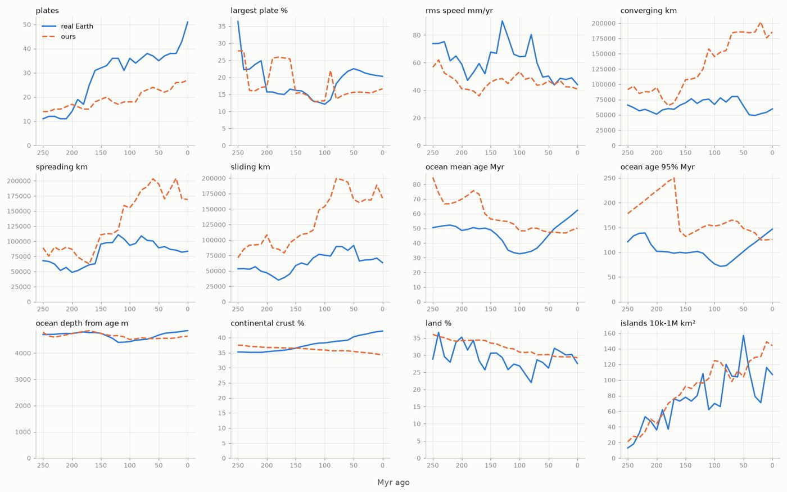

# The real Earth's plates, and what a plate story must match

Research notes for OdinCraft v5, 2026-11-15, written for step 22 (`foundations.md` section 8; the design is `foundations/plates.md`). The owner's goal of the same day is that every island and continent comes out of one history of moving plates, and that the history be measured against the real Earth's through time so the simulation's faults can be seen and fixed. This note says what the real Earth does at the sizes and rates that matter, what real history can honestly be compared against and under what licence, how others have simulated plates cheaply, and what the first comparison found. Sources are linked inline; "memory" marks what I could not check against a source this session. Every figure in the tables of "Through time" was computed by one script on the same grid for the real Earth and for ours.

## Key takeaways

1. **There is a real reference through time, and it is open.** Müller et al. 2019's plate model (plates, their boundaries and motions from 250 Ma to today in a mantle frame) and its ocean-floor age grids at every Myr are under CC BY 4.0, as are Scotese & Wright 2018's PaleoDEMs (land and sea floor at 1° every 5 Myr back to 540 Ma) and Merdith et al. 2021's model back to 1 Ga. `pygplates` reconstructs the plates at any time in 0.1 s. Nothing of it is kept in the repository; the figures computed from it are.
2. **Real plates are large, few and unequal**, which a 1,000 km world cannot hold. Today's 52 plates (Bird 2003) range from 18,000 km² to 100 million km²; the largest takes a fifth of the surface; 18 of them exceed a million km². Plates move 20 to 100 mm/yr, so over 250 Myr a plate travels 5,000 to 25,000 km. A plate story that makes continents needs the whole planet: the known world is a window on it (`foundations/plates.md`, D1).
3. **Plates that pull slabs are fast; continents are slow.** Real ocean plates move a median 40 to 85 mm/yr, plates mostly of continent 22 to 30 (Müller 2019, measured here). A plate model driven by slab pull with drag on continental keels reproduces that ordering (ours: 60 to 85 and 5 to 20; the continents are too slow).
4. **The ocean floor is young, and its age has a shape.** The mean age of today's ocean crust is 64.2 Myr (Seton et al. 2020); its area falls off roughly linearly with age to about 180 Myr (the "triangular" distribution, Parsons 1982, Cogné & Humler 2004). Its age sets its depth (GDH1) and so the sea's level: young ocean floor stands high and floods the continents, as in the Cretaceous.
5. **The reference islands sit in four settings the story must produce**: a young intra-oceanic arc whose subduction began 51–52 Ma (the Izu islands; Chichijima and Hahajima on its oldest forearc, boninites 46–48 Ma), a forearc rising 1.5–2.3 mm/yr (Kikaijima on the Ryukyu arc), continental crust in a strait between a back-arc basin and an older continent (Tsushima, sediments of 17.9–15.9 Ma folded about 15 Ma as the Japan Sea opened), and hotspot chains whose volcanoes age with distance at the plate's speed (57 km/Myr along the central Hawaiian chain).
6. **Measured the same way, our first history is close on half the figures and far on the rest.** Close: plate speeds, the largest plate's share, the slope of plate sizes, ocean depth from age, land over 1 km, the number and size of land masses today (seed 7: 84.5, 31.4, 16.5, 6.1 million km² against 85, 42, 14, 7.7), islands of 10,000 km² to a million. Far: our boundaries are twice to three times as long, our oldest ocean floor survives too long early on, continental crust shrinks where the real grows, continents move too slowly, and land runs a few points high.

## Sizes and rates

**Plates.** Bird's PB2002 has 52 plates: 14 large, whose motions come from NUVEL-1A, and 38 small ones, outlined by 6,048 points in 229 boundary segments; their cumulative number against area follows a power law between 0.002 and 1 steradian ([Bird 2003, G³ 4(3) 1027](https://doi.org/10.1029/2001GC000252)). At the Earth's radius that range is about 81,000 km² to 41 million km² (`zigcraft-neo-v3` notes, arithmetic). Sornette & Pisarenko 2003 read the same data as one power law cut off by the planet's size. MORVEL gives the motion of 25 plates covering 97% of the surface ([DeMets, Gordon & Argus 2010, GJI 181, 1–80](https://doi.org/10.1111/j.1365-246X.2009.04491.x)); NNR-MORVEL56 adds Bird's other 31 in a frame with no net rotation ([Argus, Gordon & DeMets 2011](https://www.eps.mcgill.ca/~courses/c350/ProbSets/Argus_2011_G3.pdf)). Measured here on Müller 2019 at half a degree: 51 plates today, 18 of them over a million km², the largest 20% of the surface, and the cumulative count falls as area to the power −0.42; 11 plates at 250 Ma, 14 at 200, 32 at 150. More plates in recent times is partly real and partly that young boundaries are better known.

**Speeds.** Area-weighted root-mean-square speed of the surface in Müller 2019's mantle frame: 44 mm/yr today, 50 to 74 between 250 and 50 Ma (measured here). That slab pull is the main driving force, and that plates attached to long slabs are fastest, is Forsyth & Uyeda 1975 (memory).

**Boundaries.** By the relative motion across them, classed the same way as ours (converging where more than half the motion closes, spreading where more than half opens, else sliding), Müller 2019 has today about 60,000 km converging, 84,000 spreading and 63,000 sliding, on the half-degree grid (measured here; a stepped raster lengthens any line by up to 4/π, and does so for both worlds). Syracuse & Abers 2006 count 839 volcanic centres along about 33,000 km of active arc ([G³](https://doi.org/10.1029/2005GC001045)), a centre every 40 km.

**Arcs.** The slab lies a global average of 105 km under the volcanic front, 72 to 173 km by arc segment (Syracuse & Abers 2006). The front lies a mean 240 km from the trench, standard deviation 62 km (Syracuse et al. 2010, as cited by Perrin et al. 2018). Arcs grow their crust by some 20 to 40 km³ for each km of arc every Myr (Reymer & Schubert 1984, memory); the Izu-Bonin arc's crust is about 20 km thick after 50 Myr (memory). Volcano spacing along arcs is fairly uniform and larger than lithospheric flexure predicts ([ten Brink 1991, via USGS](https://pubs.usgs.gov/publication/70190668)).

**The ocean floor.** Mean age 64.2 Myr today; slow (20–55 mm/yr) and fast (75–180 mm/yr) spreading made 33% and 39% of the preserved crust, intermediate 20%, ultraslow 5%, superfast 3% ([Seton et al. 2020, G³ 21](https://doi.org/10.1029/2020GC009214)). Area per unit age falls roughly linearly, C₀(1 − t/t_m), with production about 2.7–3 km²/yr and t_m about 180 Myr ([Becker et al. 2009, summarising Parsons 1982, Rowley 2002, Cogné & Humler 2004 and 2006](https://www-udc.ig.utexas.edu/external/becker/preprints/bcbm08.pdf)); Coltice et al. 2013 argue the shape is a passing state that follows ridge length. Depth from age: 2,600 + 365√t m to 20 Myr, then 5,651 − 2,473e^(−0.0278t) (GDH1, Stein & Stein 1992, memory). Today's oldest crust is about 180–200 Myr (memory); in Müller 2019's age grid 95% of the ocean floor is younger than 147 Myr (measured here).

**Continents, land and margins.** Continental crust, with its drowned margins, covers 210.4 million km², 41% of the surface, as 14 continental masses ([Cogley 1984, Rev. Geophys. 22](https://doi.org/10.1029/RG022i002p00101)); land above the sea is 29.2% ([Britannica](https://www.britannica.com/science/hypsometric-curve)), so about a third of continental crust is under the sea. The 0–200 m band covers about 5.4% of the planet, roughly the shelves (Britannica). Shelves average 88 km wide on passive margins and 31 km on active ones, slopes 46 and 36 km ([Harris et al. 2014, Marine Geology 352](https://doi.org/10.1016/j.margeo.2014.01.011)). The ocean holds about 1.335 billion km³ of water (Charette & Smith 2010, memory). In the PaleoDEMs land is 27.5% today and 22 to 37% since 250 Ma, lowest near 80 Ma (measured here).

**Islands.** Island areas follow Korčák's power law, its exponent about 0.65 and 0.5 to 0.75 by region (Mandelbrot, as cited in [arXiv 1303.1610](https://arxiv.org/pdf/1303.1610)). Depraetere's database holds 1,085 islands of 100 km² to a million (IRD record; the exponent was not reached). On the 1° PaleoDEM grid, land masses of 10,000 km² to a million number 107 today and 13 to 157 since 250 Ma (measured here).

**Cycles.** Supercontinents gather and break up every 400–600 Myr (the Wilson cycle, memory); Pangaea was whole about 300–200 Ma and the central Atlantic opened about 180 Ma (memory); India met Asia about 50 Ma (memory). In Müller 2019 the plates number 11 at 250 Ma and 51 today.

## The reference islands' settings

| Island | Setting | Dates and rates | Source |
|---|---|---|---|
| Toshima, Mikurajima, Aogashima, Kōzushima | Volcanic front of the Izu arc, an intra-oceanic arc where the Pacific plate sinks under the Philippine Sea plate | Subduction began 51–52 Ma; forearc basalts 51.9–51.3 Ma, boninites from 51.3 Ma; the forearc spreading lasted under 2 Myr | [IODP Expedition 352 prospectus](https://publications.iodp.org/scientific_prospectus/352/352sp_6.htm), [a 2021 Nature Communications paper](https://www.nature.com/articles/s41467-021-21980-0) |
| Chichijima, Hahajima | The Bonin ridge: the arc's first, Eocene forearc, now an outer high 200 km before the front | Boninites on Chichijima 46–48 Ma (Ishizuka et al. 2006), 44–45 Ma for the youngest | IODP 352 prospectus |
| Kikaijima | Forearc of the Ryukyu arc, over the subducting Amami Plateau | Rising 1.5–2.0 mm/yr over 130 kyr (Nakata et al. 1978), 2.1–2.3 over 100 kyr (Inagaki & Omura 2006), about 1.8 from the last interglacial terrace; coseismic steps of 1–2 m every 1,500–2,000 years (Sugihara et al. 2003) | [IUGS geoheritage](https://iugs-geoheritage.org/geoheritage_sites/holocene-coral-reef-terraces-of-kikaijima-island/), [CiNii](https://cir.nii.ac.jp/crid/1390001204334661504?lang=en), JpGU 2025 abstracts |
| Tsushima | Continental crust in the Korea Strait, between the Japan Sea back-arc basin and the Eurasian margin | Taishu Group deposited 17.9–15.9 Ma (SHRIMP U–Pb) in a pull-apart graben, folded and intruded by granite about 15 Ma as the Japan Sea opened and southwest Japan turned clockwise | [Curtin record of the 2014 dating](https://espace.curtin.edu.au/handle/20.500.11937/7991), [Kyoto University repository](https://repository.kulib.kyoto-u.ac.jp/dspace/bitstream/2433/265523/1/iar.12392.pdf) |
| (Hawaii, for the chains) | Hotspot under the Pacific plate | 57 ± 2 km/Myr along the central chain 57–25 Ma, faster since about 15–27 Ma; the bend began ≥47.5 Ma | [O'Connor et al. 2013, G³](https://epic.awi.de/id/eprint/35519/) |

What follows for the story *(inference)*: an intra-oceanic arc needs subduction to begin inside an ocean (old ocean floor foundering, or at a transform), not only at continents; a forearc island needs the ground between trench and front to rise, which our story does not yet do; a Tsushima needs a back-arc basin to open behind an arc on a continent's margin, leaving thinned continent in the strait; a chain's islands must age at the plate's speed and sink as the plate cools.

## What can be compared, and its licence

| Reference | What it gives through time | Span and step | Licence | Used |
|---|---|---|---|---|
| Müller et al. 2019, plate model ([EarthByte](https://www.earthbyte.org/muller-et-al-2019-deforming-plate-reconstruction-and-seafloor-age-grids-tectonics/), [paper](https://doi.org/10.1029/2018TC005462)) | Plate polygons, boundaries by type, rotations (so velocities), continental polygons, coastlines, hotspots, deforming zones | 250 Ma to today, any time | CC BY 4.0 (`License.txt` in its data folder) | Yes: plates, boundaries, speeds, continental crust |
| Its ocean-floor age grids | Age of the ocean floor at 0.1° | Every Myr, 250 Ma to today, 7.6 MB each | CC BY 4.0 | Yes, every 10 Myr |
| Scotese & Wright 2018 PaleoDEMs ([EarthByte](https://www.earthbyte.org/paleodem-resource-scotese-and-wright-2018/)) | Land and sea-floor heights at 1° | 540 Ma to today, about every 5 Myr, 8.9 MB in all | CC BY 4.0 (`License.txt`) | Yes: land, hypsometry, land masses. Its frame (PALEOMAP) is not Müller's, so it is measured, not drawn |
| Merdith et al. 2021 ([Zenodo 4320873](https://zenodo.org/records/4320873)) | Plate model to 1 Ga | 1,000 Ma to today | CC BY 4.0 | Downloaded; for a longer comparison later |
| Seton et al. 2020 age grid | Today's ocean-floor age and spreading rates | Today | Open (G³) | Its figures, quoted |
| PB2002, MORVEL | Today's plates and motions | Today | As published | Figures quoted |

The tool (`tools/plates_compare.py`) fetches these into a folder outside the repository on its first run through `plate-model-manager` and the EarthByte server. Attribution: Müller, R.D. et al. 2019, Tectonics 38, 1884–1907; Scotese, C.R. & Wright, N. 2018, PALEOMAP Paleodigital Elevation Models for the Phanerozoic. Only figures computed from them are kept here.

## How others simulate plates cheaply

- **Cortial, Peytavie, Galin & Guérin 2019, "Procedural Tectonic Planets"** ([CGF 38](https://doi.org/10.1111/cgf.13614)): crust samples on a sphere carried by rigid plates, with subduction, collision and rifting written as procedures rather than physics, and the coarse result amplified with procedural or real elevation. The user steers the plates. Its timings were not reached this session.
- **Viitanen 2012, PlaTec** ([plate-tectonics fork](https://github.com/Mindwerks/plate-tectonics), LGPL): a flat wrapped map split into plates moved across it; colliding continents fold into ranges, subducting ocean makes coastal ranges or island chains. The basis of WorldEngine.
- **Tectonics.js** ([blog](https://davidson16807.github.io/tectonics.js/blog)): a 3D sphere; plates are found by segmenting the velocity field.
- **v4 (`../odincraft-v4/src/terrain/crust.odin`)**: an Eulerian crust grid carrying area, continental and oceanic volume, age and strain per plate, with the rifting of one plate. Its record: the crust model gave the relief its cause, but walking-scale ground came from noise, and one orogenic strike ran across the world (`reference/odincraft-v4/relief-compare-findings.md`).
- **zigcraft-neo-v3's research** ranked a finite, precomputed coarse tectonic history "best large-scale history among practical graphics methods, only after a deliberate finite-world decision", and warned against shrinking plates to fit a small world (`../zigcraft-neo-v3/docs/worldgen-landmass-tectonics-research.md`).

## Through time: the real Earth and ours, measured the same way

`build/odincraft --plates=DIR` writes each frame on half-degree cells; `tools/plates_compare.py` builds the same cells for the real Earth from the references above, measures both with one function and draws them side by side. Ours here is the history as built in step 22's first half, seeds 7 and 1.

| Figure | | 250 Ma | 200 | 150 | 100 | 50 | today |
|---|---|---|---|---|---|---|---|
| Plates | real | 11 | 14 | 32 | 36 | 35 | 51 |
| | seed 7 / 1 | 14 / 10 | 17 / 11 | 19 / 14 | 18 / 13 | 23 / 18 | 27 / 19 |
| Largest plate, % | real | 36 | 16 | 16 | 12 | 23 | 20 |
| | seed 7 / 1 | 28 / 27 | 17 / 18 | 15 / 25 | 13 / 17 | 16 / 28 | 17 / 21 |
| Plate size slope | real | −0.37 | −0.27 | −0.43 | −0.39 | −0.43 | −0.42 |
| | seed 7 / 1 | −0.88 / −0.37 | −0.69 / −0.35 | −0.42 / −0.53 | −1.3 / −0.41 | −0.66 / −0.45 | −0.42 / −0.63 |
| RMS speed, mm/yr | real | 74 | 59 | 68 | 64 | 50 | 44 |
| | seed 7 / 1 | 57 / 44 | 41 / 46 | 46 / 55 | 54 / 44 | 47 / 47 | 41 / 56 |
| Ocean plates / continent plates, mm/yr | real | 84 / 30 | 66 / 28 | 56 / 22 | 71 / 30 | 39 / 25 | 62 / 27 |
| | seed 7 | 86 / 5 | 69 / 11 | 66 / 17 | 80 / 12 | 66 / 15 | 61 / 19 |
| Converging km (thousands) | real | 66 | 51 | 70 | 67 | 65 | 60 |
| | seed 7 / 1 | 91 / 49 | 95 / 70 | 108 / 93 | 145 / 82 | 186 / 116 | 186 / 121 |
| Spreading km (thousands) | real | 68 | 49 | 95 | 93 | 89 | 84 |
| | seed 7 / 1 | 89 / 65 | 87 / 65 | 111 / 92 | 155 / 83 | 195 / 125 | 169 / 118 |
| Ocean floor, mean age Myr | real | 51 | 49 | 49 | 33 | 45 | 62 |
| | seed 7 / 1 | 85 / 88 | 70 / 90 | 56 / 49 | 48 / 60 | 47 / 55 | 50 / 57 |
| Ocean floor, 95% younger than, Myr | real | 121 | 102 | 99 | 76 | 102 | 147 |
| | seed 7 / 1 | 178 / 175 | 224 / 220 | 132 / 148 | 153 / 161 | 148 / 151 | 126 / 169 |
| Ocean depth from age, m | real | 4,709 | 4,743 | 4,753 | 4,439 | 4,686 | 4,862 |
| | seed 7 / 1 | 4,793 / 4,994 | 4,748 / 4,950 | 4,754 / 4,547 | 4,519 / 4,781 | 4,559 / 4,664 | 4,642 / 4,670 |
| Continental crust, % | real | 35 | 35 | 37 | 38 | 40 | 42 |
| | seed 7 / 1 | 38 / 39 | 37 / 38 | 37 / 38 | 36 / 37 | 35 / 37 | 34 / 37 |
| Land, % | real (PaleoDEM) | 29 | 35 | 31 | 27 | 26 | 28 |
| | seed 7 / 1 | 36 / 38 | 34 / 35 | 34 / 34 | 31 / 33 | 30 / 32 | 29 / 31 |
| Land over 1 km, % | real | 1.2 | 3.2 | 3.3 | 4.8 | 3.5 | 5.7 |
| | seed 7 / 1 | 1.4 / 1.1 | 2.1 / 1.7 | 2.8 / 1.4 | 2.2 / 2.1 | 3.4 / 1.6 | 4.5 / 1.8 |
| Land masses over a million km² | real | 1 | 1 | 4 | 8 | 7 | 6 |
| | seed 7 / 1 | 1 / 2 | 2 / 3 | 8 / 4 | 5 / 5 | 9 / 6 | 5 / 6 |
| Largest land mass, million km² | real | 147 | 177 | 78 | 60 | 44 | 78 |
| | seed 7 / 1 | 183 / 191 | 164 / 165 | 57 / 138 | 83 / 58 | 78 / 61 | 82 / 87 |
| Land masses of 10,000 km² to a million | real | 13 | 36 | 78 | 70 | 157 | 107 |
| | seed 7 / 1 | 21 / 34 | 44 / 57 | 92 / 56 | 125 / 62 | 104 / 67 | 144 / 93 |

What the comparison says, and what it does not:

- **Both start as one supercontinent and break it up**, ours by rifts drawn from the seed after 30 Myr, the real one from the mid-Jurassic. The real world goes from 1 land mass over a million km² to 6–8; ours to 5–9.
- **Our boundaries are too long.** With 27 plates against 51, seed 7 has three times the converging boundary. Most of it is cells of one plate left inside another along converging edges, and continents stretched into stripes along rifts; seed 1, with fewer plates, is within 1.3 to 2 times. A boundary length is the best single test of how clean the plates are.
- **Our first ocean floor survives too long.** Ours starts with old ocean round the first continent, and until about 150 Ma 18–40% of our ocean floor is older than 120 Myr against 1–5%. Old ocean founders only by a row's chance; on the real Earth it is all subducted by about 180 Myr.
- **Our continents shrink; the real ones grow.** 38% to 34% against 35% to 42%. Collisions stack crust and lose area, and arcs mature into continent too slowly. Part of the real growth is the model's own: more continental fragments are mapped in recent times *(inference)*.
- **Continental plates are too slow** (5 to 19 mm/yr against 22 to 30): ridge push and trench suction are the only forces on a plate without slabs.
- **Real land is the PaleoDEMs'** in another reconstruction's frame; it measures the land and its heights but is not drawn on Müller's plates. The real map's green is today's coastlines carried back, which is not the land of the time.
- The real model's plate count rises toward today partly because recent plates are better known *(inference)*; our count is the history's own.

## Not verified

- Forsyth & Uyeda 1975, Reymer & Schubert 1984, GDH1's constants, Charette & Smith's ocean volume, the Wilson cycle's length, Pangaea's dates and the Izu arc's crustal thickness are from memory.
- Cortial et al.'s timings, Depraetere's exponent and MORVEL's global speed were not reached.
- Kikaijima's rates and Tsushima's dates come from abstracts and repository records, not the papers.
- The comparison's boundary lengths are raster lengths on a half-degree grid, lengthened by up to 4/π for both worlds alike; its velocities are each plate's motion over the Myr before the frame (after it, at 250 Ma, where the model begins).
