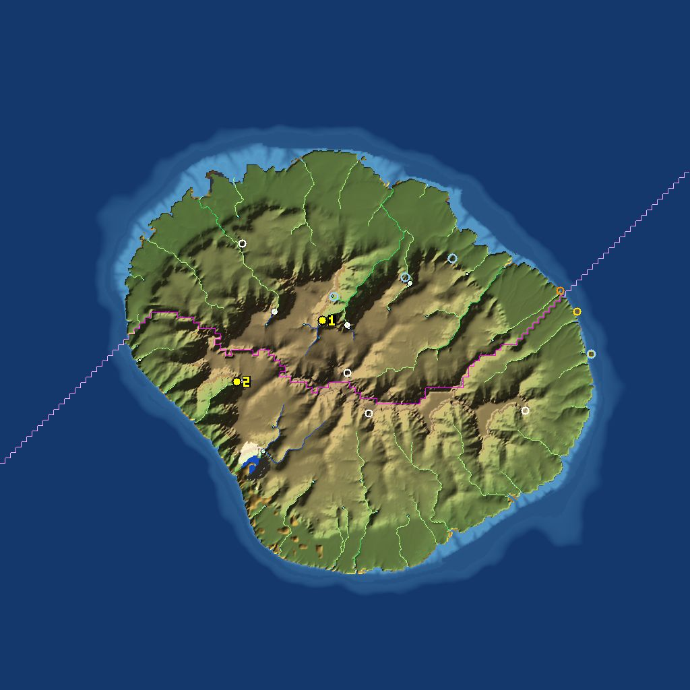
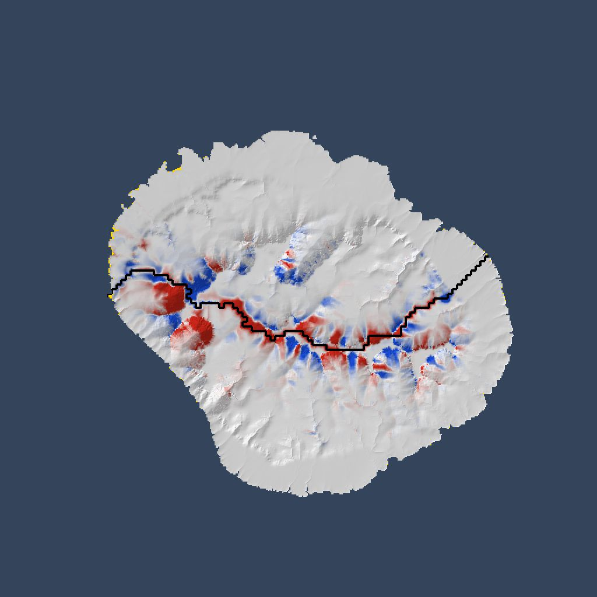
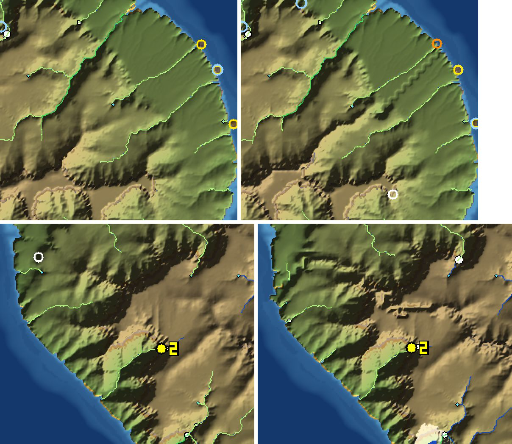
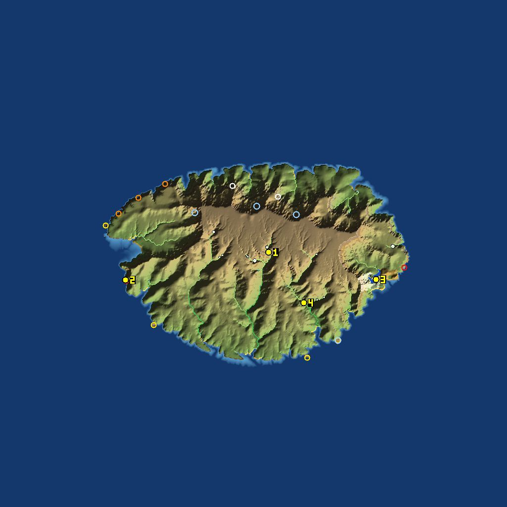
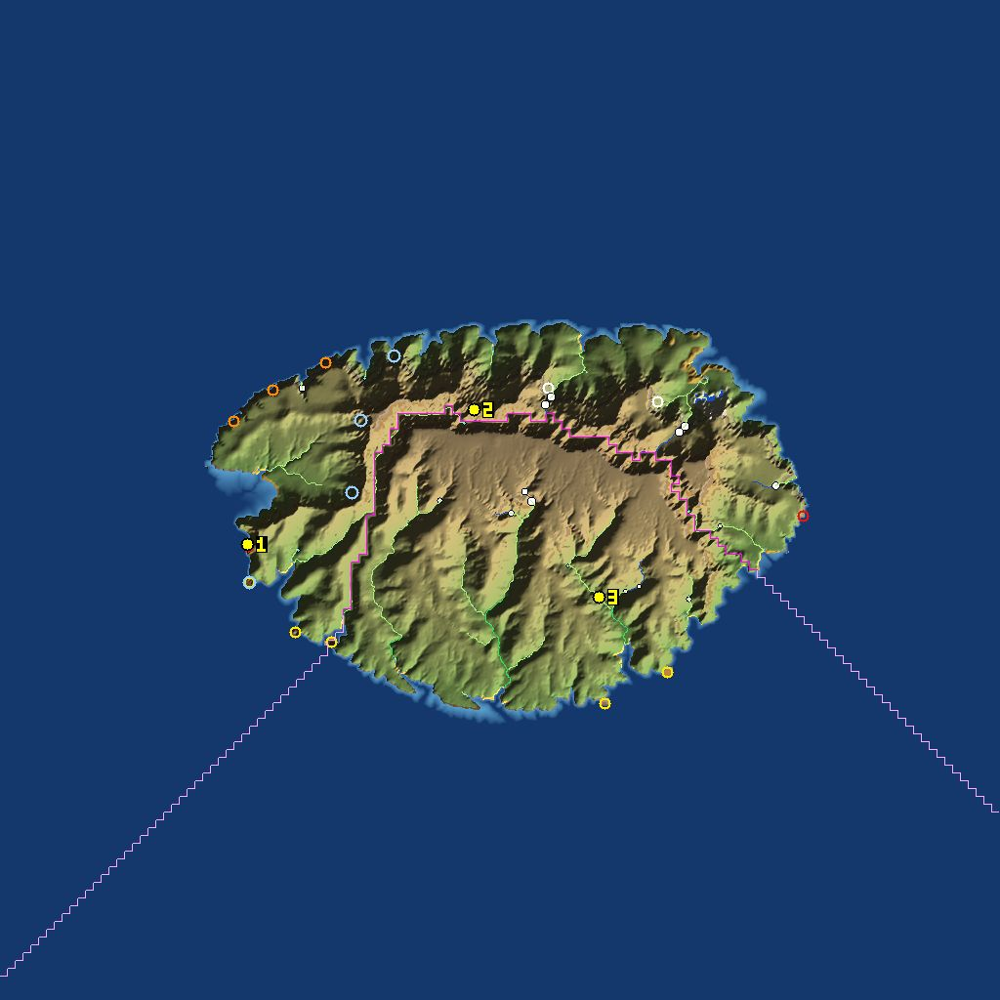
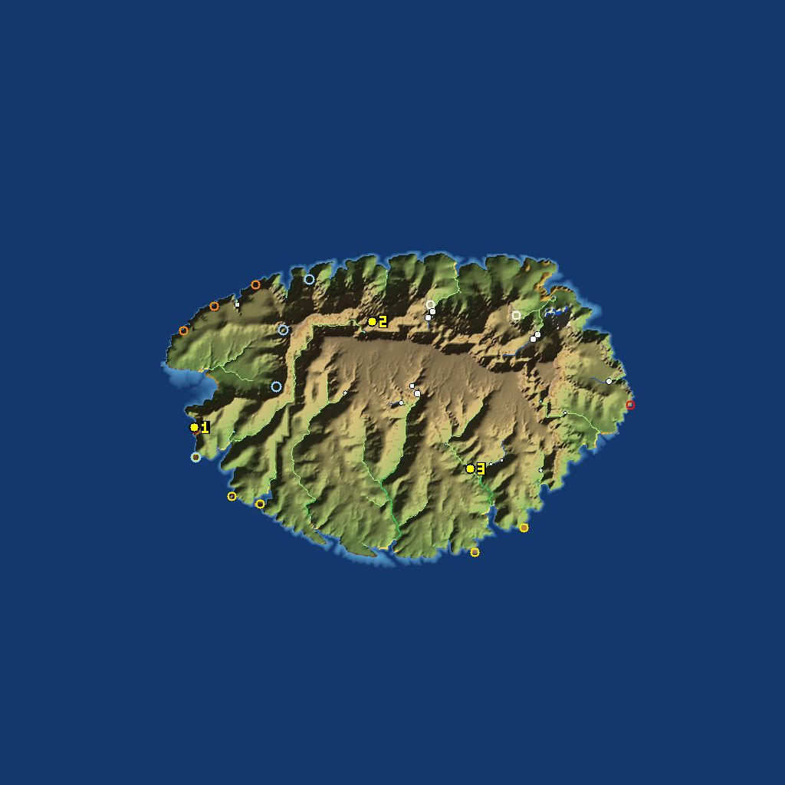
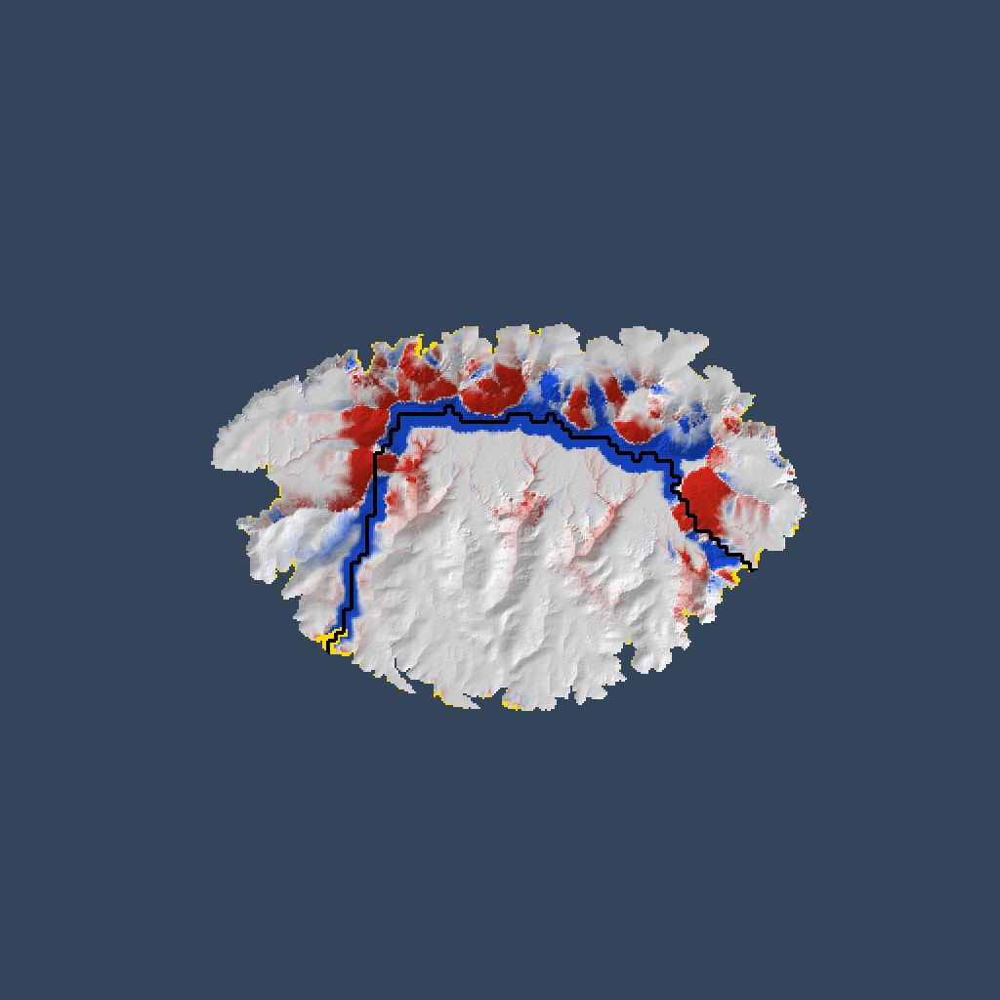
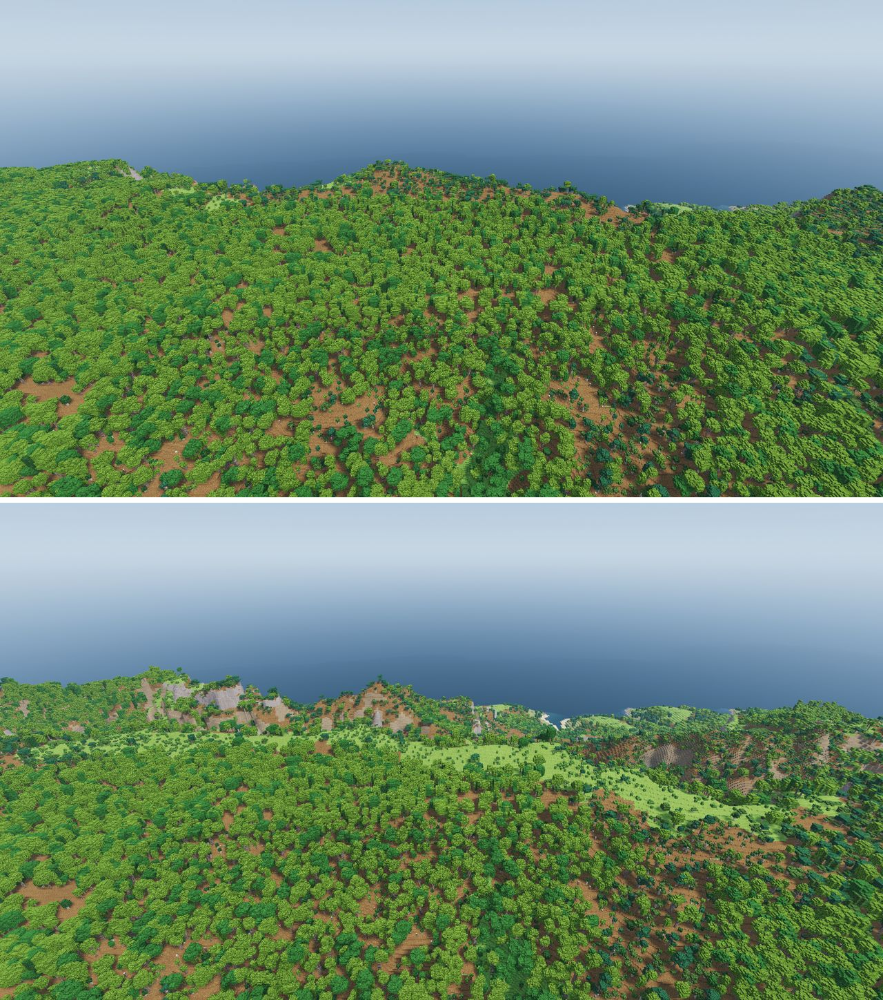
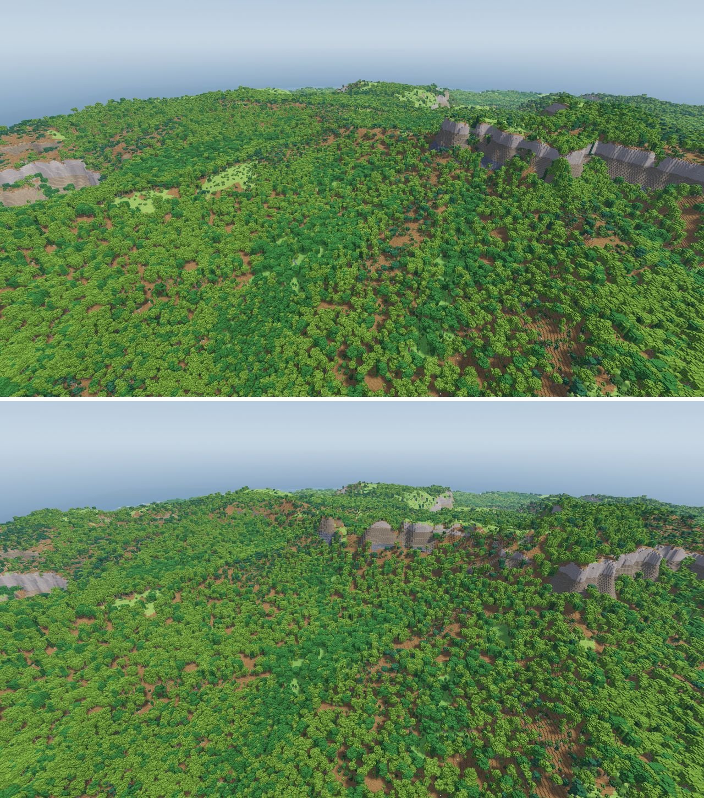
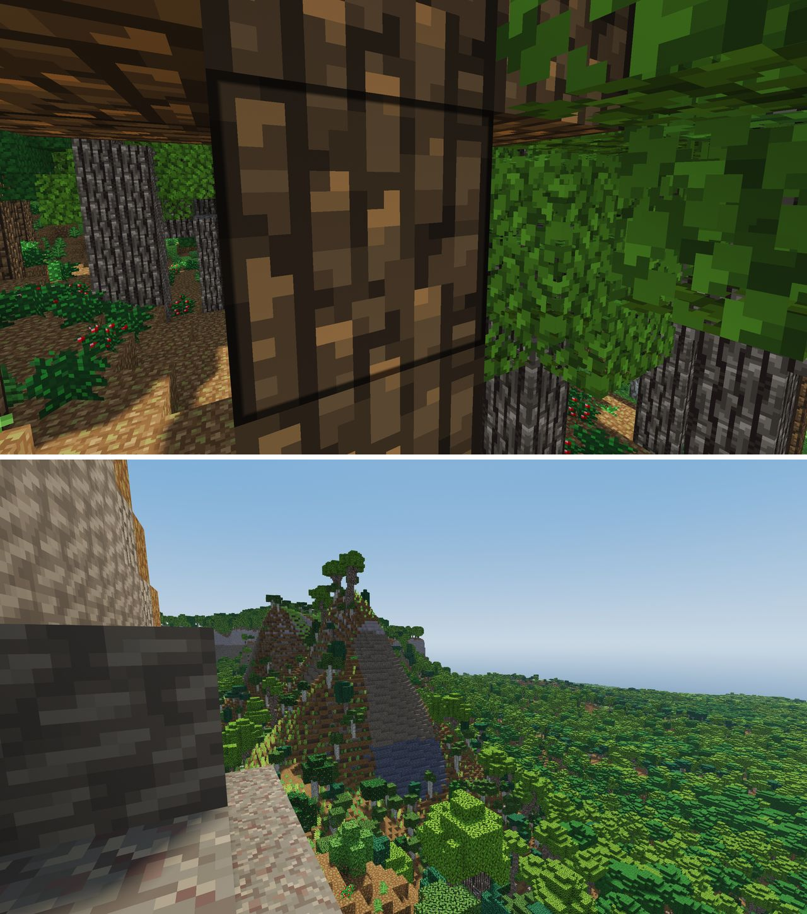

# The land seam test

Written 2026-11-15 for step 20 of Phase 2 (`foundations.md` section 8; the test is the one `foundations/world-frame.md` states in D2 and Stage 2). The question: if an island is formed whole at 64 m, cut into two basin pieces along a drainage divide, and each piece is refined through the 32 m and 16 m phases alone with its divide pinned to the 64 m solution, can the joined land be told from the island formed whole? The answer decides whether Phase 3's mainland can be made as designed.

The experiment ran in a scratch copy of `src/`: a new file of 375 lines, about 35 lines changed in `land.odin` and 8 in `main.odin`, and about 300 lines of Python to measure. None of it is merged. Every number here was measured, unless it is marked as a guess or an inference.

## The result

**The premise failed: the 32 m and 16 m phases are not a small refinement of the 64 m land.** The design guessed that a seam could disagree "only by what the last two stages cut: tens of metres". On the island formed whole, the last two stages move the land along the divide a median 54 m (default island) and 97 m (ridge, seed 3) from its 64 m heights, and up to 170 and 177 m. A divide held at the 64 m heights therefore stands as a fin where the finer forming would have lowered the crest (68% of the default island's seam), or lies as a trench where it would have raised it (73% of the ridge's).

**The seam can be found on the map without being drawn, on both islands.** On the default island it shows as a serrated ridge stepping along the 64 m cells and as right-angled notches on the upland. On the ridge island it shows as a straight trench along the main crest, carrying a stream. I found most of the ridge island's seam before looking at where it was, though not blind to how it was chosen (below). From the ground, the default island's seam is a narrow spine of rock standing over the forested upland where the whole island has only forest.

**The step across the cut itself is small** (largest 28 m and 14 m, smaller than the island's own steps), because both sides are held to the same surface. **The seam is one cell in**, between the held line and the land formed beside it: steps of up to 179 m in one 16 m cell, against at most 50 to 66 m anywhere else on the island.

**A margin helped but did not cure it.** The best variant formed each piece 2 km past the cut and kept only its own cells. On the default island stretched to a 16 km region, 90% of its seam then matched the whole within 5 m, but 1% still had steps of 100 to 160 m.

## Method

**Forming.** The scratch copy splits `land_form` so the same history can run for the whole island or for one piece (`form_land`). With `--seam=joined`, it forms the island whole, then each piece, then joins them and plays on the join. A piece runs every phase on the full region grid, so each cell's randomness (jitter, softness, roughness, the refine's warp) is keyed exactly as in the whole. Both pieces re-form the 64 m phases from scratch and reproduce the whole's 64 m land to 0.000000 m: forming is pure. Each piece's seed and record are the island's own.

**The divide.** On the land after the last 64 m phase:
- I routed the land with the game's own `route` and found each cell's outlet.
- I ordered the basins of the main landmass round the coast by the bearing of their outlets from its middle (244 basins on the default island, 256 on the ridge).
- Every run of consecutive basins is a candidate piece whose edge with the rest is a divide, cell by cell. I kept the runs holding within 2% of half the land and whose two sides were each one patch: 2,162 and 2,480 of them.
- Of these I chose the cut along the highest divide (mean height of the cells either side), taking that as the main divide.
- The sea and any islets go to the piece of the nearest land.

| | Default island (raised, seed 7) | Ridge, seed 3 |
|---|---|---|
| Piece 1's share of the land | 49.9% | 50.3% |
| Divide at 64 m | 6.8 km long, mean height 284 m | 7.4 km, 201 m |
| The most even cut, for comparison | 49.98%, 7.0 km at 273 m | 50.02%, 6.8 km at 180 m |
| Where it meets the sea | the west coast near −2,270, −380, and the east-north-east coast (the 64 m coast near 1,980, 0; the final coast near 2,550, −650) | the east coast near 2,110, 610 and the south-west coast near −1,410, 1,180 |

**The pinning.** In each piece, the cells across the cut are outside its domain. Water never reaches or enters them. They hold the 64 m solution's heights, interpolated bilinearly to the finer cells, so creep and the refine can read them. The piece's own cells within one cell of the cut (32 m wide in the 32 m phase, 16 m in the 16 m phases) are held at the same heights. This applies only where the 64 m solution had land; at sea nothing is held. Held cells neither erode nor creep. They follow the sea's changes, so they keep their height over the sea as it then stood: the default island's sea falls 10 m and 9 m, then rises 19 m; the ridge's rises 57 m. They do not rise with the uplift. A held cell the waves cut away is let go. After forming, each piece's own cells are put together on one grid, and the game runs everything after the forming on it: rivers, the slide, plants, places.

**Rules that read beyond a piece's edge** (the third premise):

| Rule | What it reads | How the piece handles it |
|---|---|---|
| Drainage (`route`) | where water goes | cells beyond the cut are never reached and never drained into: no water crosses |
| Erosion (`erode`) | only the cell downstream, which is always inside | unchanged; held cells skip it |
| Creep | four neighbours | reads the held heights beyond the cut; held cells skip it |
| The sea's cutting (`coast`) | the share of open sea within 500 m and toward the swell; the highest ground and deepest water within 100 m | both counted over the piece's own cells only; where no cell of the piece lies toward the swell, the share round the shore cell stands in for it |
| Silt in sheltered bays | sea cells out from a river mouth | spreads only over the piece's own sea |
| The refine to finer cells | the coarser land through a warp of up to 0.8 coarse cells (51 m, then 26 m) | near the cut it reads across, which is the held 64 m heights |
| The slide (after forming) | the whole land, to choose its place | ran on the joined land; on both islands it moved (below) |

No other forming rule reads beyond a cell's neighbours. The two kinds tested have no vents.

**Measuring.** The game writes the grids: the 64 m solution, the whole's and the join's final 16 m heights before the slide, where each cell drains, and the land as the game finally has it after the slide's wear. A Python script measures them:
- **Steps.** A step is the height difference between neighbouring 16 m cells (four ways). Steps across the cut are compared with steps between neighbours more than 160 m from it on the whole island, in bins of the 64 m solution's slope, so a step is set against the same steepness.
- **Streams.** A channel is a cell draining 12 ha or more, where the forming counts a stream (`CHANNEL_AREA`).
- **Divides.** The 16 m divide is the edge between land draining to one piece's outlets and the other's.
- **Pictures.** The maps are the game's own `--map` (the cut drawn in magenta with `--seam-line`). The difference map is drawn by the script at the same 8 m a pixel.

## The numbers

Default island (raised, seed 7) and ridge (seed 3), as designed (one cell held on each side):

| | Default island | Ridge |
|---|---|---|
| **Step across the cut**, the forming's output: median / p90 / p99 / largest | 1.7 / 11.1 / 24.6 / **28.2 m** | 1.9 / 6.2 / 11.8 / **13.9 m** |
| The same pairs on the whole island | 2.8 / 12.3 / 35.1 / 45.9 m | 2.9 / 15.3 / 35.9 / 42.0 m |
| Neighbours elsewhere on the whole island | 1.6 / 7.4 / 22.6 / 50.2 m | 3.7 / 12.1 / 28.3 / 66.3 m |
| Seam steps over the 99th percentile of steps elsewhere at the same 64 m slope | 13 of 525 (12 of them on ground steeper than 0.75) | 0 of 431 |
| **Step between a held cell and the free cell beside it**: median / p90 / p99 / largest | **31 / 110 / 159 / 179 m** | **14 / 26 / 42 / 52 m** |
| Held cells standing over 10 m above / below the land beside them | 68% / 14% (a fin) | 5% / 73% (a trench) |
| The whole's 16 m land on the divide less the 64 m height it was pinned to: median (p10 to p90), largest either way | −46 m (−143 to +29), 170 m | +97 m (−15 to +154), 177 m |
| The same over all land, as a size: median / p90 / largest | 56 / 122 / 201 m | 64 / 157 / 216 m |
| **Joined less whole**, size, within 20 m of the cut: median / p90 / largest | 29 / 126 / 170 m | 88 / 149 / 177 m |
| — piece 1 / piece 2, medians within 20 m | 30 / 27 m | 96 / 82 m |
| — 250 to 500 m from the cut | 1.2 / 14 / 91 m | 2.1 / 21 / 130 m |
| — 1 to 2 km from the cut | 0.01 / 0.4 / 30 m | 0.02 / 0.8 / 16 m |
| — over all land; share changed by over 1 m | median 0.2 m, p90 9.9 m; 32% | median 1.1 m, p90 42 m; 51% |

On the land as the game has it, after the slide and 460 or 260 years of its wear:

| | Default island | Ridge |
|---|---|---|
| Step across the cut: median / p90 / largest | 7.3 / 15.5 / 43.4 m | 1.9 / 6.7 / 23.4 m |
| Largest step within 48 m of the cut (the whole there) | 75.5 m (48.8) | 48.0 m (50.9) |
| Ground steeper than 45° within 48 m of the cut: joined / whole / whole island | 13.5 / 9.6 / 4.7% | 30.2 / 21.2 / 12.9% |
| Joined less whole within 20 m: median / p90 / largest | 19 / 49 / 100 m | 87 / 150 / 177 m |

The slide's wear is the forming's own erosion run for the slide's age over the whole land. On the default island it knocked the fin down to the steepest slope its rock holds: 341 m held against 224 m on the whole island became a slope of 40 to 59° at 255 m. The game's land therefore differs from the forming's output along a fin. A trench is not filled by it.

Streams (routed at 16 m on the forming's output):

| | Default island | Ridge |
|---|---|---|
| Closed hollows over 2 m deep within 100 m of the cut; the deepest | 88 cells; 68.5 m at −1,416, 136 | 182 cells; 23.2 m at 1,160, −312 |
| The same on the whole island | none | none |
| Deepest closed hollow at start-up (the whole) | 68 m (24 m, the slide's lake) | 23 m (11 m) |
| Land on the joined island draining across the cut; the largest single crossing; stream channels crossing | 137 ha; 11 ha; 0 | 659 ha; 37 ha; **19** |
| Channel cells within 32 m of the cut (the whole) | 0 (0) | 121 (0): a stream runs along the trench |
| Stream heads within 300 m of the cut, moved: median / largest | 66 / 182 m | 260 / 387 m |
| Heads over 1 km from the cut, moved: median / largest | 19 / 66 m | 0 / 0 m |

Water crosses the cut on the joined land although neither piece let it. Each piece formed its side on its own, and the trench and the fin do not agree with the land beside them.

**Where the 16 m land puts the divide** (the second premise). On the whole island at 16 m, the divide between the two pieces' outlets lies a median 36 m from the 64 m cut (p90 113 m, farthest 256 m) on the default island, and 19 m (p90 102 m, farthest 176 m) on the ridge. Land draining across the cut on the whole island: 44 ha, 2.3% (the largest patch 29 ha, at −1,271, 23), and 31 ha, 2.8% (15 ha at 1,456, 42). The finer forming does move divides, by half a 64 m cell or less at the median and up to four cells. That is smaller than the error in height, and it is what makes the variant without held cells fail (below).

**Ground that was sea at 64 m.** The default island's sea falls 19 m after the 64 m stage and uncovers a platform. 18% of its seam's length (the east-north-east stretch, from about 1,980, 0 to the coast) crosses that ground. There the cut is only the line between the nearest land of the two pieces, not a divide, and nothing is held. The joined land shows a dip of about 4 m along it, which on the map is a serrated line of shading. None of the ridge's seam crosses such ground.

**The slide moved.** On the default island the joined land's slide falls at −1,070, 1,442 instead of 75, −760, so Tabu Tarn is not there and the named places change. On the ridge it falls at 1,677, −924 instead of 1,980, 419. Neither is near the seam; the ranking that picks the host was changed by land near the seam.

## Can the seam be seen?

**On the map.**
- **Default island.** I was not blind: I had seen the cut before I looked. At full size, the joined map without the cut has a serrated line in the east-north-east, a ridge stepping diagonally in 64 m stairs where the whole island has a stream. On the upland in the west there are straight-sided, right-angled notches, and a sharp crest runs through the middle. Any one of these could pass for a landform. Together, and with their staircase, they read as made.
- **Ridge island.** I made the joined map first and looked for the seam before drawing the cut or seeing the whole island. I guessed it lay along the crisp straight step on the north edge of the upland and down a straight north-south edge on its west side to the south coast. The cut follows both, which is about three quarters of its length. The south-east leg I noticed but left out of the guess. I knew the cut is chosen along the highest even divide, which on a ridge island is near the crest, so this was half blind at best.

**From 300 m up.** Each picture is the whole island above and the joined below, from the same camera. On the ridge (looking north across the crest at 264, −700), the joined land has a long grassy trench along the crest, with bare faces stepping down into it, where the whole island has an unbroken forested crest. On the default island (looking north at −648, 376), the joined land has a line of crags along the upland that the whole island lacks. Alone it could pass for a natural line of bluffs.

**From the ground.** On the default island, standing on the held line at −700, 350 and looking along it, the joined land is a narrow spine of bare rock and ridge wood running away over the forest, its sides at the rock's limit. At the same place the whole island is forest on a slope of 22°, 86 m lower. On the ridge, two places at eye level in the forest near the trench showed trunks and slope in both, so from there the seam does not show. In forest a walker sees it only where it makes bare rock.

## The three premises

1. **Pinning a divide to the 64 m solution is enough: false.** The 64 m solution is not near the final land: over all land the whole island's 16 m heights differ from it by a median 56 m and 64 m, and on the divide 54 m and 97 m. A held divide disagrees with the land the finer forming makes beside it by that much, as a fin or a trench a cell or two wide.
2. **The 64 m divide is where the 16 m land puts it: roughly.** Half a 64 m cell off or less at the median (19 and 36 m) and up to four cells (256 m), and 2 to 3% of the land drains across the cut on the whole island.
3. **The forming's rules behave the same in a piece: only with choices.** Creep, the coast's exposure and cliff height, silt, and the refine's warp read beyond a cell. The table above says how each was handled. The coast's choice, counting the sea over the piece's own cells only, changes the cutting near the seam's two ends. The sea, split by nearest land, cuts the later platform along a line that is not a divide.

## Variants tried

Each was run to learn whether the failure is in how the divide is held or deeper.

| Variant | Default island | Ridge | What it says |
|---|---|---|---|
| **Nothing of the piece held**, only the cells beyond the cut (read by creep and the refine) | step across the cut median 14.5, p90 84, largest 136 m; no closed hollows | 8.7, 57, 142 m; 5 channels cross | worse: where the 16 m divide lies off the cut, a valley head on one side meets a crest on the other |
| **Pinned to a 64 m run of the whole history** (uplift and sea changes included; only the error measured, not run as pieces) | the whole's 16 m divide less it: size median 36 m, p90 82 m, largest 136 m | 30, 82, 176 m | closer, still not tens of metres: the 64 m and 16 m formings make different land |
| **A margin of 1 km** past the cut, formed freely, its outer edge held and letting water out, then discarded | seam step p90 31, largest 75 m | p90 66, largest 149 m | the margin already covers 83 to 96% of the other piece's land |
| **A margin of 2 km** | matches the whole but for one spot of 16 m | matches exactly | trivial here: the margin covers all of the other piece, so each piece formed the whole island |
| **The default island stretched to a 16 km region**, as designed | held line against the land beside it: median 48, p90 126, largest 204 m; 16 channels cross; within 20 m of the cut the join is a median 70 m off | | the same failure, larger |
| **The same 16 km region, margin 2 km** (it covers 70 to 74% of the other piece's land) | step across the cut median 2.4, p90 23, p99 116, largest 160 m (elsewhere at most 74 m); within 20 m of the cut p90 5 m; heads within 300 m moved at most 45 m; 2 channels cross | | 90% of the seam is the whole island's land; 1% has cliffs of 100 to 160 m |

At 8 km, three formings (whole and two pieces) take 2.3 to 2.5 s against the whole's 1.0 s. At 16 km they take 29 s, and 34 s with the 2 km margin.

## What it means

*(Inference from the measures above.)* The 32 m and 16 m phases reshape the land rather than refine it: they run about 385 thousand years with the uplift still going, on cells whose drainage and steepness differ from 64 m. So no 64 m solution holds a divide at the height the 16 m forming would give it, and a piece formed against a pinned divide makes a seam that a map shows. The forming is also not local. Changing the land at a divide moves stream heads 66 to 260 m (median, within 300 m of the cut) and alters land up to a kilometre away. A margin wide enough for that influence to die out before the seam came close on a 16 km region, but left a few cliffs of 100 to 160 m. Whether a wider margin, or a margin on a larger landmass, would leave none is untested.

For the end shape (`open-decisions.md`, question 8): the owner decided it on 2026-11-15, after this note first offered an ocean of islands as the answer, which was wrong: the world is one cohesive simulation with continents and islands where the simulation makes them. What the test rules out is a method, basin pieces with their divides pinned to the 64 m solution. A continent needs another: a seam method that has not yet passed (the margin came closest), or each landmass formed whole at 16 m. The world frame guesses about 45 minutes of one core for a 300 km landmass, and today's forming keeps about 70 bytes a cell.

## Weak points

- **Two islands, one seed each,** both of layered rock; no volcanic kind (the domes' last vent opens in a 16 m phase and would straddle a seam). One run at 16 km, one margin width there.
- **The highest near-even divide was chosen.** That is where the 16 m forming changes the land most, on the crest. A lower divide between tributary basins, as most of a Pfafstetter cut would be, might show less; it was not tried. On the default island the most even cut ran along much the same crest (273 m mean against 284 m).
- **The basins were ordered by the bearing of their outlets.** That finds coast-to-coast cuts on these compact islands; on a long or ragged landmass it would miss some.
- **One cell held each side, bilinear and unwarped.** Wider held bands were not tried, since they would widen what the finer forming disagrees with. The refine warps the coarse land by up to 51 m, so the held line is a smooth surface beside warped land.
- **Held heights stood still apart from the sea's changes.** "Pinned to the 64 m solution" was read literally. A held line rising with the uplift was not run: the whole island's divide fell on one island and rose on the other, so no one rule fits both.
- **The coast's exposure counted over the piece's own cells only.** Counting the 64 m solution's sea across the cut would have given the coast more sea near the seam's ends.
- **The default island's later platform is cut along a line that is not a divide.** That is inherent in cutting at 64 m an island the sea later uncovers.
- **Two sets of figures.** The forming's output and the game's final land differ along a fin, because the slide's wear knocks it down. Both are given.
- **Not fully blind.** I saw the default island's cut before judging its map. The ridge test was half blind (I knew the rule that chooses the cut). I am not the owner; the owner's own look is the test.
- **The ground shots.** Only one place showed the seam from the ground; forest hides it elsewhere at eye level, and I tried only two places on the ridge.
- **The code.** The scratch code is unreviewed. Its checks: with no seam it forms the default island's map byte for byte as the game does; both pieces reproduce the whole's 64 m land exactly; and the variant flags off reproduce the joined land exactly.
