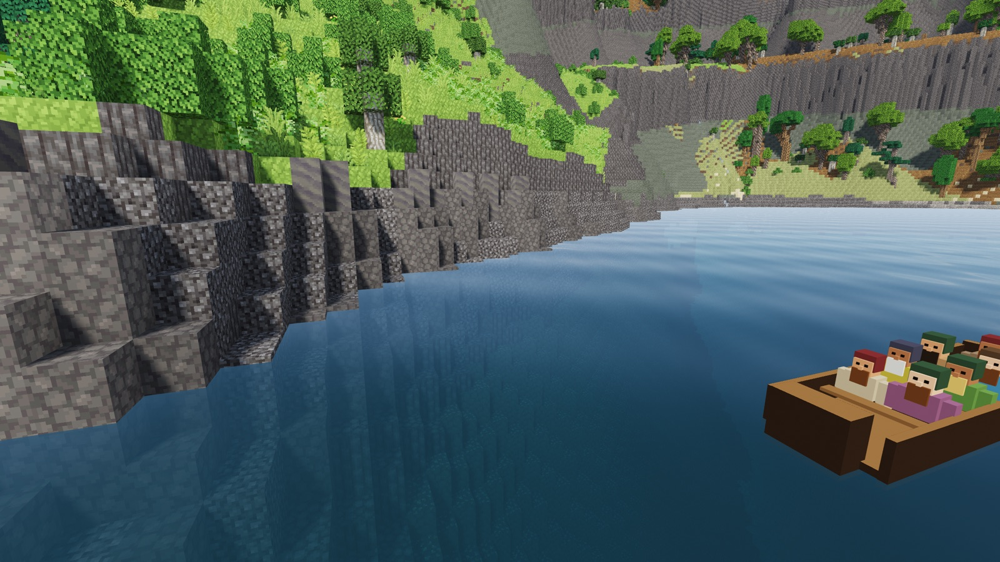
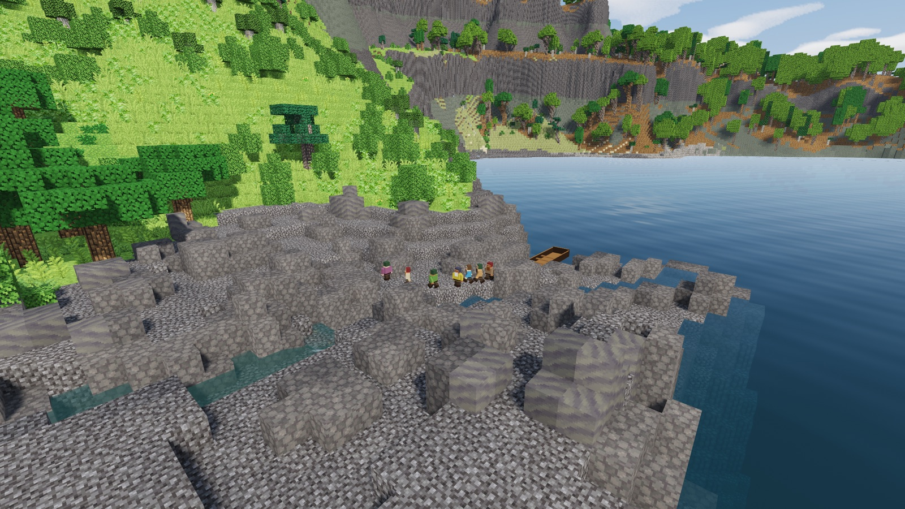
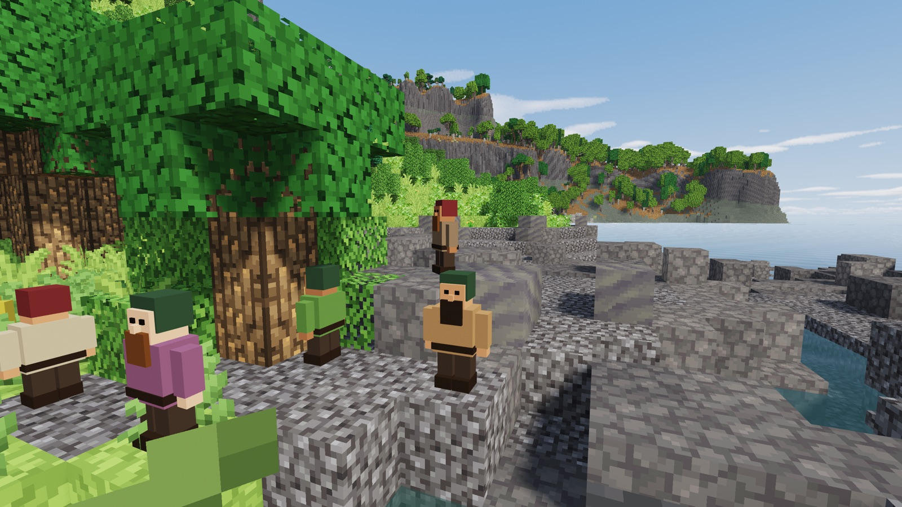

# The plan

Written 2026-11-16 by Claude, after the owner set the direction and answered its questions the same day (`open-decisions.md`, "2026-11-16, by the owner"). It replaces the order of work in `foundations.md` section 8 from here on, and the first proposal in `direction.md`. What is built stays described in `foundations.md`.

The research behind it is in `interesting-world/notes/df-rimworld-ideas.md`, with every source.

## 1. What the game is

A generated world with a past, in which the player founds and keeps a hold of dwarves, and which keeps what happened there. The natural world is the foundation: land, rock, water and living things formed from causes and judged against real land. On it a history of peoples runs, and the player's game is the next part of that history. A hold that falls stays in the world as a ruin, and the next game can walk into it.

Dwarf Fortress is the first source of the ideas and RimWorld the second. The content is our own: dwarves, humans and beasts are common fantasy stock, and no name, creature, text or picture is taken from either game or from anyone's setting.

## 2. Decided by the owner

1. The world is a story generator, and founding and keeping a place is the main game.
2. A thin thread of play comes first. **The natural world's generation is the foundation and must not lack effort or attention**: play is built in one worktree while the natural world carries on in its own thread.
3. History has particular people, and they are alive now.
4. The player's people are dwarves. Humans can exist. Enemies, fantastic creatures among them, are very important.
5. The party is led from above, and that is the primary camera. Controlling one dwarf by hand ("mind control") is a later feature. A first-person camera must exist.
6. No AI agents or narration now.
7. Dwarf Fortress is always the primary inspiration; RimWorld is the second.

Standing from before: the land's quality is never traded away; the whole world is generated within 10 minutes, staged if need be; the default island may change as much as a change needs.

## 3. What checking the first proposal changed

`direction.md` was written from memory and the project's earlier notes. Reading the makers' own words, and a survey of games that tried this on the ground, changed ten things.

1. **Play before the kept world and before history.** The proposal began with saving the world and a first people's history. Tarn Adams's first principle is "get something running as soon as you can and then work from there", and RimWorld first sold with no stockpiles, no animation and no traders who walk. So the thread now begins with dwarves the owner can order about, and each later step adds one thing to a game already being played.
2. **History runs on the coarse world.** Dwarf Fortress raises settlements, routes and wars on its world map, and makes a site in tiles only where the player goes *(the second half from memory)*. Ours runs on the known world's map, which exists, and forms a settlement in blocks only where it is seen. So history does not wait for continents to be formed as land, and it fits the 10 minutes and the staging the owner set.
3. **The underground moves to the front of the natural track.** Dwarves live in the rock. Today the rock has stories, faults and intrusions, and almost nothing to find: no ore to speak of, no water under the ground, few caves. That is now the natural track's next new work after what is running.
4. **The land is an actor.** Our land was formed by things happening for reasons: streams sized by their floods, a slope that slid, a dam that held or failed, vents with dates, weather through a year. In play the same rules can make events: a flood, a slide, an eruption, each with a cause the player can ask about. This is what the foundation gives the direction, and where we can go past both games, whose land is thin by comparison (`df-rimworld.md`).
5. **Trouble comes from the world, and a pacing rule says when.** In Dwarf Fortress trouble has a source in the world: a neighbour, a beast with a past. In RimWorld a storyteller keeps "a rising and falling pacing curve". We take both: who comes and why is the world's; when, among what the world makes possible, follows a pacing rule the player can choose.
6. **Few dwarves, known well, and nothing hidden.** "Anything in the Game Model that doesn't copy into the Player Model is worthless." A party of seven. Every dwarf can be asked what it is doing and why, as every rock can now. A new system works "at the level of what the player sees or one layer below".
7. **Stories are written first.** Bay 12 wrote stories and took the low-hanging fruit from them. Section 4 holds ours. A step is chosen because a story needs it, and its note says what can now happen.
8. **First person is a view of the hold, not yet a game of its own.** Dwarf Fortress's maker says its adventure mode has "never been good", because the player does not feel they changed the world. So first person is how the owner stands in their own halls and walks into a ruin. Being one person in the world gets its own design later, with mind control. Bay 12's own answer is to make finding things out the task, which suits a world where everything can be asked why.
9. **The simulation runs without a window.** The dwarves' world advances from a seed and a list of orders, with no window, the same every time. Agents may not open a window, and the stories in section 4 become tests.
10. **History is met as things.** Caves of Qud's makers wanted "players' engagement with history as an artifact": it sits on shrines and in relics that lead somewhere, and a journal keeps what was found. So our history is not a text beside the game. It is a grave, a carved lintel, a ruin, what a trader says, each pointing at a place, and the player's own hold goes into the same record.

Two things the proposal had right were confirmed: the ruin is where Dwarf Fortress began ("you'd bring an adventurer to find the ruins of this civilization"), and its persistent world comes from the wish to meet your last game in your next one.

## 4. The stories the plan is for

Six stories of the game as it should be able to go. They are ours, and each names what it needs.

1. **The first storm.** Seven dwarves land in autumn below a volcano and set their stores by the stream, where the ground is flat. The season's first typhoon raises the stream over its stony bed. One dwarf goes back for the seed and is not seen again. *Orders, needs, the year, weather that acts.*
2. **The hall under the cap.** They dig in under the lava cap, where the mudstone cuts easily and the cap holds the roof. Water comes through the sandstone bed. Where a dike crosses the beds they find the ore. *Rock that matters; the underground.*
3. **The ruin.** Years later another party lands on the same shore. The player walks into the old hall on foot: the fallen roof, the stores, the name of the drowned dwarf cut over the door. *The kept world; first person.*
4. **What slept in the crater.** The humans across the strait tell of a harbour burned two centuries ago. The miners break into a cave under the old vent. *History; a singular beast; caves.*
5. **The mason's wall.** A mason whose brother the stream took will not leave the sea wall she is raising against it. She works through hunger. She finishes a work the hold is named for, or dies at it. *Temper and memory.*
6. **The traders who did not come.** The hold the party left was besieged in the spring. No traders come in autumn. Three families arrive instead, with the news. *A world that goes on.*

## 5. The work, in two tracks

Each step is one change on one branch that the owner can look at, as before. The tracks run side by side and meet where the table says.

### The natural world (the foundation)

| # | Step | State | Play needs it for |
|---|---|---|---|
| N1 | Continents as land, with no seam, inside the 10 minutes (old step 21) | Running | Rivers of real size; peoples' homelands seen on foot |
| N2 | Climate per island (old 25): temperature by season, rain on the wind, six zones | Built | Farming; the storm |
| N3 | Ground and water by kind (old 27). River mouths, bay-head flats and reed marsh are built. Caves are left: a lava tube on a cone island, a solution cave in limestone | Half built | Harbours; lairs |
| N4 | **The underground.** Deposits placed by the rock's story (ore where a dike or pluton baked the beds, clay, coal, salt); water under the ground and where it comes out; caves that connect; heat under a volcano | New, next | Digging with a purpose; story 2 |
| N5 | Floras by climate (old 26) | After N2 | Timber, food, the look of a homeland |
| N6 | **The land acts in play.** Flood, slide, dam failure, eruption and storm as dated events during play, by the rules that formed the land | New | Stories 1 and 5 |
| N7 | The land's open questions (`open-decisions.md`): the crater and raised kinds, granite as gentle as Yakushima's, rain that grows with height, dry channels, vents on old centres | Open | The foundation's quality |
| N8 | The mainland and the known lands at full size (old Phase 3) | Later | The wide world |

### Play

| # | Step | The owner does | Story |
|---|---|---|---|
| P1 (built) | **The view from above.** The primary camera: over the land, cut at a chosen level so the ground under trees and inside hills shows; a cursor on blocks; pause and speed. First person stays, a key away | Looks down on the default island and into a hillside | |
| I-1 | **The interface's ground and the play screen's frame** (`foundations/interface.md`). Text and panels; the screen's four fixed regions; the clock and speeds; the hand, which answers what any block, tree, stream or place is and why; messages; the cut's level, lenses and the walk | Clicks a bed of rock in a cut hillside and reads why it is there | |
| P2 | **Seven dwarves.** Named, drawn simply, walking the block ground by a path they find. Any one can be asked who it is and what it is doing | Watches them come ashore and follow where they are sent | |
| I-2 | **The front door and the world.** The menu; a new world with honest progress; the world's map; Walk the world, which is the game as it is today; settings for text size and keys | Makes a world from the menu and walks it | |
| E-1 | **Expedition planning.** Where, with a site card that says what the ground offers and lacks and names its dangers; who, with the seven drawn again at will; set out. What they bring comes with P5, and a home hold with P9 | Chooses a hard site on purpose | |
| P3 | **Orders.** Mark ground to dig, trees to fell, blocks to build. Dwarves take the work themselves. Goods go to a store without being carried at first, as RimWorld's first version did; carrying follows in P5, since Bellwright's makers found that work done in the abstract "didn't feel inspiring" | Has a first room dug and roofed | 2 |
| P4 | **Needs and the year.** Food, drink, sleep, shelter, warmth. Days and seasons pass. A dwarf can die. What each feels is shown | Gets through a first season, or does not | 1 |
| P5 | **Materials and making.** What the rock and the woods give is what can be built and made: stone by its kind, timber, clay, a first metal. Goods are carried and stored. A workshop | Builds from the island's own stone | 2 |
| P6 | **The world is kept.** A world is saved and reopened with what was dug and built. Leaving or losing a hold writes it into the world. A new party can land in the same world and walk into it | Finds the last game's hall | 3 |
| P7 | **Trouble.** Dangerous animals, then a hostile band, then one great beast with a lair. Fighting and wounds. The pacing rule | Loses a dwarf to something with a name | 4 |
| P8 | **Temper.** Each dwarf's nature, ties, grudges and memories of what happened, and what they do at the end of their rope | Watches a dwarf do something stubborn | 5 |
| P9 | **Peoples and their history.** On the known world's map: dwarven holds and human settlements placed by the land, a few centuries of particular people and events, kept abstract. It is met on the ground as graves, carvings and ruins that point at places, and gathered in a journal | Follows a carving to the place it tells of | 4, 6 |
| P10 | **Embark, deepened.** Expedition planning (E-1) gains the home hold the party leaves, its neighbours and what history says of the site | Chooses whose dwarves they are | |
| P11 | **The world goes on.** Migrants, traders by season, news, and attacks from real neighbours, by the rules history ran on | Waits for traders | 6 |
| P12 | **Mind control.** Take one dwarf and act through it, in first person | Fights a beast by hand | |

**Each play step ships its part of the interface** into the frame I-1 fixes, as `foundations/interface.md` section 6 lists: the dwarves' pictures, list and card with P2; the orders bar and build choices with P3; needs and alerts with P4; stores with P5; Continue and the list of worlds with P6. The owner asked on 2026-11-16 that the interface be part of the early steps and well founded, so it has a design of its own and expedition planning comes early.

After these, deepened by what the stories ask for: singular beasts and made things with histories, more peoples, trade and law, magic, being one person in the world.

### Where the tracks meet

- P5 reads the rock stories (built) and is deepened by N4.
- P4's farming reads N2. Until N2 lands, food is gathered and fished.
- P7's lair wants N3's caves.
- P9 reads the known world's map (built) and N2's climate at that scale. It does not wait for N1.
- N6 needs P4's passing time.

## 6. Rules

Carried over:

- The land is judged against real land, by its figures and by the owner looking. Nothing here lowers that bar.
- What is on an island is never a preference. Dwarves and humans follow it: a people is where it could reach, where the land keeps it, and where history put it.
- Rules are rows on named fields. A people, a need, a job, a kind of event and a material are rows.
- Everything can be asked why.
- One step per branch, merged with what changed for the player and how it was checked. The owner runs `./build.sh run` in `~/Programming/odincraft-v5` on `main`.
- Never open a window unless asked.

New:

- **Stories decide.** Where simulation and story pull apart, the story wins, as RimWorld's maker settles it. It never wins by making the land less real: a correction for play is a rule laid over the natural result, in the open.
- **Thin, then deeper.** A step ships the least that lets its story happen. Bay 12's warning is the rabbit hole: taverns became instruments, music, poetry and dance.
- **Play is judged by playing.** The owner plays each step. The benches still hold: no frame of our own work over 12.5 ms, with dwarves on screen.
- **The dwarves' world is deterministic**, as forming is: the same seed and orders give the same events, on a thread of its own, with or without a window.
- **Numbers stay behind words** where a word will do. "Numbers usually make for poor stories."

## 7. Risks

- **Play could starve the land, or the land play.** The owner named this. Each report covers both tracks.
- **Many walkers in a block world.** Dwarf Fortress's maker says they are "at the edge of what we can currently support in terms of agents and map complexity", on one thread, with a check that a path exists before searching for it. We begin with seven and measure before promising more.
- **A site is small beside an island.** The ground kept as true blocks is 256 m round the camera. A hold's ground has to stay real when the camera leaves. How large a site can be is measured in P3.
- **Drowning in complexity**, the genre's "characteristic design danger". The answer is rule 6 of section 3 and the stories.
- **The engine overshadowing the game.** Stonehearth's makers named "technical things" crowding out the game's systems, and their own engine, when it ended short of its goals. Bay 12's 3D predecessor "was floundering under its own weight". We have our own engine and a deep natural simulation. The play track exists so that the game is never the part that waits.
- **The view from above in real relief.** An island rises 500 m under forest. Dwarf Fortress cuts its world one level at a time. v4 built such a view; this engine has none.
- **History's cost.** Bay 12 once reported about 27 minutes for 1,000 years of a medium world. Ours is short and abstract first, measured against the 10 minutes.
- **The essay on what makes a story** (Adams, "Characterization and Emergent Narrative in Dwarf Fortress") was not read, only summarised second-hand. It should be read before P8.

## 8. Decisions ahead for the owner

None blocks P1. Each has a recommendation and is asked when its step is reached.

1. **How long a day and a year last in play** (P4). *Recommendation: a day of about 20 minutes at normal speed and a year of 48 days, with faster speeds.* It is a guess to be changed by playing.
2. **How tall a dwarf is in metre blocks** (P2), which sets how high a tunnel must be. *Recommendation: under one and a half blocks, so a tunnel two blocks high is roomy and one block high is a crawl.*
3. **Where the first hold stands** (P2). *Recommendation: the default island, until embark (P10) chooses.*
4. **What the first great beast is** (P7). The owner called fantastic creatures very important, so its nature is the owner's.

## 9. What became of the old plan

| Old | Now |
|---|---|
| Steps 21, 25, 27 | N1, N2, N3, unchanged and running |
| Step 26, floras | N5 |
| Step 29, people as ruins from a short pass | P9, with living people, and P6 for ruins the player makes |
| Step 30, the fantastic | P7 first, then deepened |
| Phase 3, the mainland | N8 |
| "What not to build yet": saves, seasons that advance, deposits, individual figures | P6, P4, N4, P9 |
| "First person" as the only view | P1 leads; first person stays |

## 10. Play, as built

What each play step built, what was tried and dropped, what it costs and where it is weak, as `foundations.md` section 8 does for the land.

### P1, as built: the view from above (2026-11-16)

**What can now happen that could not before:** the owner looks down on the island, cuts a hillside open at any level and reads its beds, marks a box of blocks in it, asks why, pauses the world, and walks into the same place on foot.

**What was built**

- **The camera** (`above.odin`). It looks down on a point of the ground and pans, turns, tilts and zooms about it, from 24 m across to 24 km: a hold's ground to the island whole and beyond. Tilted 50° at the start, through a lens of 30°, in perspective. The game starts in it, over the start, facing downstream.
- **The cut** (`adr/0007`). Nothing from the level up is drawn. Where it passes through solid blocks the cut face is the blocks' own material: soil at the rim, then the broken rock, then the beds, ruled block by block; a trunk shows its rings. The level moves a block or eight at a time, or holds 3 blocks over the ground under the view's middle as the view moves. What is cut away casts no shadow, and a room under a roof is lit as if open.
- **Leaves left out**: the ground under the whole wood, with the stems standing on it, at any scale.
- **The cursor**: the block under the pointer, picked through the cut, outlined; a box of blocks marked by dragging, tinted and outlined, and said in the terminal. `pick`, `pick_far` and `box_of` are what later steps mark ground through. Asking why prints the block and what `--why=` says of its ground.
- **The clock** (`adr/0008`, `clock.odin`): pause and three speeds, read by the water, the animals, the clouds' drift, the ripples and the wind in the plants.
- **First person a key away**: Tab puts the player at the place under the view's middle, on the cut where the world is cut there, and Tab again lifts the view from where the player stands.
- **Without a window**: `--over`, `--span`, `--tilt`, `--turn`, `--cut`, `--bare`, `--cursor`, `--why` and `--pace` with `--shot`, and `--bench` with `--over` (`AGENTS.md`).
- **For the interface** (I-1): the view's state is one record (`Above`), the clock another, and each key sets a field or calls a procedure a panel can call (`cut_set`, `cut_move`, `cut_follow`, `mark_begin`, `mark_end`, `mark_box`, `walk_down`, `walk_up`, `why_words`). `over_world` is the one place that says whether the pointer is over the world, and every click, drag and turn of the wheel asks it. It answers yes everywhere until panels exist.

**Keys.** From above: arrows pan (Shift faster), middle drag pans, right drag turns and tilts, Q E turn, Page Up and Page Down tilt, the wheel and = - zoom, R F raise and lower the cut (Shift by eight), C cuts or not, H holds the cut to the ground, V leaves, Space pauses, 1 2 3 set the speed, left click and drag mark. In either view: Tab changes view, P pauses, Y asks why, [ ] turn the hour, backslash saves a picture, Escape puts down a mark, then quits. First person is as it was.

**What was tried and dropped**

- **Straight down, a wide lens, and orthographic** (`interesting-world/real/above-camera-alternatives.jpg`, taken with an option for the lens that was then taken out; top row straight down, bottom row tilted 50°, lenses of 70°, 30° and 5° from the left). See `open-decisions.md`.
- **A hatched tone for the far cut.** At some scales the hatching beat against the pixels. It is plain.
- **The cloud's shade on the ground from above.** With no cloud drawn it read as stains on the land and the sea.
- **A wider block volume**, measured and not kept (below).
- **A marked box tinted strongly.** It hid the rock it marked.

**The cut beyond the block volume.** The far rings are columns with no inside. A column over the level is lowered to it and its top drawn in one plain dark tone; a canopy over the level gives way to the ground's own material. So at any scale everything above the level is gone, and the island cut at 150 m is the plan of its ground at 150 m (`above-island-cut.jpg`), but only the block volume shows what the ground is made of.

**How far the block volume has to reach.** At the usual tilt everything in the picture lies within 0.8 of its width from the middle (0.57 straight down, 1.16 at the lowest tilt). The volume reaches 256 m, so a hold's ground is shown cut in blocks, whole, while the picture is under about 320 m across. Measured on the forest flank, the cut following the ground, 200 m across, other agents loading the machine (8 to 13):

| Reach | Chunks | Blocks kept | Faces meshed | To a first picture | Our work, still | Panned at 120 m/s | Frames over 12.5 ms in 15 s |
|---|---|---|---|---|---|---|---|
| 256 m (kept) | 289 to 306 | 24 to 29 MB | 3.7 to 4.2 M | 2.0 s | 0.9 ms median | 1.7 ms median | 0 |
| 384 m | 625 to 650 | 56 to 67 MB | 8.1 to 8.7 M | 2.4 s | 1.2 ms | 4.5 ms | 28 |
| 448 m | 841 to 870 | 78 to 88 MB | 10.6 to 11.7 M | 2.8 s | 2.1 ms | 5.2 ms | 90 |

The water's window is 32 chunks wide, so 448 m is the widest that could be tried. The cost is the chunks coming in at the edge as the view moves, and it grows with the reach's length. A hold a kilometre across shown whole in blocks would need about nine times the chunks. So the reach stays, and a wide hold is seen in blocks only round the view's middle. How large a site can be kept real when the view leaves is P3's to measure.

**Costs**

- Moving the level remakes the caps: one pass over a layer of the volume, about 0.7 ms a frame while it moves every frame (median 1.5 ms of our work against 0.8 uncut), 2.8 ms at worst in a quiet run.
- Each nearest-level chunk keeps 18 KB more, 5 MB in all.
- From above about 230,000 faces are drawn a frame at a hold's scale, against 1.26 million in first person on the same ground: the picture is narrow.
- Benches, alternating with the parent, three times: twice with the machine's load at 8 to 12 from other agents, and once at 6.5 to 9. Our work in ms, median / 99% / worst, and frames over 12.5 ms:

| Bench | Parent | This step |
|---|---|---|
| Forest flank, first person | 1.25 / 4.6 / 16.0 (2), 1.19 / 3.7 / 6.1 (0); quieter 1.17 / 3.7 / 7.1 (0) | 1.26 / 4.1 / 15.3 (1), 1.13 / 4.4 / 10.3 (0); quieter 1.18 / 3.7 / 5.3 (0) |
| Down through cloud, first person | 1.29 / 3.9 / 6.4 (0), 1.03 / 4.4 / 12.3 (0); quieter 1.13 / 4.0 / 8.6 (0) | 1.36 / 4.3 / 12.4 (0), 1.21 / 5.1 / 16.1 (1); quieter 1.05 / 3.1 / 6.7 (0) |
| From above, cut following the ground | | 1.69 / 6.0 / 17.5 (5), 1.60 / 5.0 / 9.9 (0); quieter 1.64 / 4.4 / 12.3 (0) |

  Under the heavier load both builds lose a frame now and then; a timer round each part of the frame showed the late frames late in every part at once, the input handling among them, which is the machine and not the work. Of twelve runs of the new bench, eight had no frame over 12.5 ms; its worst frame in those ran from 5.3 to 12.3 ms, so it has less room than first person and should be run again on a quiet machine.
- The clock, over the bay head at 300 m across: paused, the world's clock ran 0.0 s in 10 and our work was 0.85 ms median, 1.8 at the 99th hundredth; at 4 times it ran 40.0 s in 10, at 0.78 median, 2.7 at the 99th, 7.4 worst.
- `odin check src -vet-unused` passes; `./build.sh test` passes with `GOLDEN` unchanged; the start island's map is the parent's byte for byte.

**Weak points**

- **The far cut shows no rock** (asked, `open-decisions.md`).
- **Ground within a tree's height under the level stands level with the cut beyond the volume**, a shelf up to 35 m wide on a 30° slope, since a canopy that is part of a column cannot be lifted off it.
- **A wood without leaves is a thicket of stems and limbs.** It reads, and it is not handsome. Stems cut to a stump everywhere would need each stem's foot.
- **Ground plants look thinner from above than on foot** (`above-bay-head.jpg` against `above-bay-head-on-foot.jpg`): each is two upright pictures, and from above the silt shows between them.
- **Seen from above for the first time:** the bay-head flats have straight sides and square corners at the scale of the land's 16 m cells, and where calm sea lies over a shelving flat the simulated water is drawn deep, with a straight edge at the chunk's side. Both are the natural track's and the water's, not this step's.
- **The view's middle follows the generated ground**, not what has been dug or built there.
- **Why prints in the terminal** until the interface has a hand to show it in.
- **Pause and speed are checked by the bench's count of the world's time** (`--pace`), not by looking: a picture's animals are posed from `--after`, and nobody has watched the world stop.
- **The window was never opened**: no key or mouse path has been tried by hand. The owner's first minutes will find what is wrong with them.

**For the interface's design** (`foundations/interface.md`)

- **The middle the view needs clear.** The view turns, tilts and zooms about the picture's exact middle; the cut follows the ground there and the walk lands there. A small mark stands on it. It needs the middle third of the width and the middle half of the height clear, which the four regions leave. A list a third of the screen wide leaves the middle visible but off the centre of what is left of the world; if that feels wrong in play, the view's middle should move to the middle of the uncovered world, which is one offset in `above_camera`.
- **The tilt puts distance at the top.** The far ground is under the top strip and the alerts, the near ground under the orders bar. Nothing the player marks is likely to be at the very top; the alerts cover the least useful corner.
- **The level in the design reads "+31 m".** The level here is a height over the sea, and can hold to the ground; the panel can show either, and wants a third control beside up and down: hold to the ground.
- **Leaves left out is a lens** in the design's sense, how the world is seen, and belongs under L with the fields.
- **D and S are orders**, so the pan is not under the left hand (asked, `open-decisions.md`).
- **A drag that leaves the world**: a box being marked keeps its last block while the pointer is off the world, and ends where the button is let go.

### P2, as built: seven dwarves (2026-11-16)

**What can now happen that could not before:** a party lands where the land says a boat can, and goes where it is sent by ways of its own; any of them says who it is and what it waits for; and the same morning can be played again from its log.

**What the owner sees.** The game opens from above on a sheltered inlet of the default island, the stones at a stream's mouth in the middle of the picture. A boat with seven hooded, bearded dwarves comes in from 60 m out, grounds, and they step over the bow one at a time and walk up to the grass above. Right-click a block: the seven walk there in file, each by its own way, round trees and boulders, through the stream where it is shallow. Click a dwarf: it says who it is, what it is doing and what it waits for, in the terminal and for a few seconds in the window's title. Space pauses them with the world, and 1, 2 and 3 run them at its speeds. Tab walks down among them. The terminal keeps a log of what happens.

**What was built**

- **The dwarves' world** (`hold.odin`, `adr/0009`): a simulation in ticks of a tenth of a second, on a thread of its own, from the world's seed and a list of orders. The same orders give the same log with a window or without, paused or hurried. It reads the game's one clock (`adr/0008`) only for how far it may run. `--dwarves=seconds --orders=file` runs it with no window and prints the log, its hash and what it cost.
- **The dwarves** (`dwarves.odin`): each has a given name of a stem and an ending, a byname of an earth and something worn, a trade, an age, a height from 1.25 to 1.45 m and its colours, all drawn from the world's seed. Trades are twelve rows, no trade twice until every trade has come. Each is sixteen boxes: boots, legs, tunic, belt, arms, hands, head, hood, nose, eyes, beard. Legs and arms swing with the metres walked. The boat is eight.
- **The landing** (`landing.odin`): three rows on the land's fields, the first that holds anywhere deciding, read at every cell of land beside the sea. Three fields were made for them (`sea-round`, `fresh-water`, `livable-near`), which paint as overlays and answer `--why` like the rest. On seed 7 the first row holds on 180 of 5,847 shore cells and best at 2702, -1778: a stream's mouth in a bay the land shuts in.
- **Walking ground and ways** (`paths.odin`): a chunk's true blocks, the generator's with the session's edits, are read once into floors (ground with two blocks of air over it, under no more than half a metre of water) and the steps between them, a block up or down at most, no corner cut. Floors joined inside a chunk are a room. A way is searched first over rooms, which says whether one exists, then over the floors of those rooms.
- **A dwarf's card**: who it is, what it is doing and why, and what comes next, as three lines of data (`dwarf_card`) that `--why`, a click and the interface to come all read (`foundations/interface.md`, I2, I3, I8).
- **More than seven.** Seven come in the first boat, and nothing else counts on seven: the party, the dwarves and what the frame is shown are lists of any length. `--party=N` brings N, to measure with.

**Keys.** In either view: G sends the party to the block under the pointer, or aimed at. From above: a right click sends it too (a right drag still turns the view), and a left click on a dwarf selects it, and it says who it is. In first person: E selects the dwarf aimed at. Space or P pauses them with the world; 1, 2, 3 set its speed.

**From Dwarf Fortress.** It keeps which ground is joined to which, so that a search for a way that does not exist is never begun. A whole island cannot be flooded so here: its ground is made only when asked for. So joined ground is kept a chunk at a time, as rooms, and rooms are joined as a search crosses them. Before a search sets out, the goal's ground is followed back through 24 rooms: a ledge, a boulder's top or a rock in the sea is found whole and the order is refused at once, in 4 ms. Ground closed off behind more rooms than that costs a search of 400 chunks before it is given up.

**From the deer's trails** (`trails.odin`). Reused: Tobler's walking cost (`walking`), what a cell's wetness and plants make of the pace (`going`), the rule that a worn trail is quicker, and the cost of wading by depth. Not reused: `pace` whole, whose thirty-fold cost of standing water is for a 16 m cell where at 1 m the water is in the blocks; and the tracer (`trace`), which runs on 16 m cells to the deer's own wants and limit, in scratch arrays that are let go once the trails are laid.

**What was tried and dropped**

- *The 16 m land's slope as the grade of a step.* A walk of 25 m up a beach rising 3 m cost 184 s, because the cell behind the beach is steep. The grade is now read from the floors themselves, two blocks either way.
- *The land cell's plants slowing every floor in it.* The stones at the stream's mouth lie in a cell of susuki scrub, six times slower than open ground. Plants now slow only a floor that plants cover.
- *Rooms searched by distance alone.* Five of the seven took a way of 2,270 s where two found one of 1,300 s. Rooms now carry the mean pace of their floors.
- *Every dwarf looking for its way in the tick the order comes.* Seven searches cost 0.2 to 0.5 s in one tick; a hundred would cost seconds. One dwarf now tries the order, and the rest look as their turns in the file come.
- *The first shore cell the row liked.* It had 10 m of open water in front. A boat now needs 30 m to come in along.
- *Gathering on the nearest soil.* It was tall grass, which hid them. They stand clear of plants over their heads.
- *A second test.* Odin's runner frees what a test made when it ends, and forming cannot be run twice in one process, so the dwarves' check runs inside the forming test.

**Costs**, on an M-series machine that other agents kept at a load of 5 to 8:

| What | Cost |
|---|---|
| A tick of seven dwarves | 0.3 µs with no window; 2.5 µs beside the frame, with the thread's waking |
| A tick of thirty, and of a hundred | 0.5 µs and 1.0 µs: about 10 ns a dwarf |
| Reading a chunk's blocks into floors, the first time it is searched or walked | about 3 ms, and 39 KB kept; 8.2 MB for the 210 chunks of the run below |
| A way across 100 m of forested slope (46°, valley forest), over ground not yet read | 74 to 79 ms, 26 chunks read; each dwarf's own way after it 4 to 5 ms |
| A way across 570 m of forested slope (27°, laurel forest), over ground not yet read | 371 to 413 ms, 137 chunks read; each dwarf's own way after it 13 to 25 ms |
| A way back across 600 m, most of it read already | 69 to 87 ms, 23 to 28 chunks read |
| All the looking for ways in the run below: 7, 30 and 100 dwarves | 32 ways, 0.8 s; 124 ways, 1.7 s; 354 ways, 3.7 s; never more than one dwarf's in a tick after the first |
| Refusing an order to the open sea | at once: no floor within three steps |
| Refusing an order to the top of a sea stack 670 m off | 4 ms, 3 chunks read |
| Choosing the landing at start-up | 20 to 34 ms |
| The whole run below, 70 minutes of the dwarves' time | 2.0 s with seven, 2.9 s with thirty, 4.9 s with a hundred |

A search stalls the dwarves' world, not the frame: it runs on the hold's thread.

**Frame times**, our own work, the worst frame and the frames over 12.5 ms, `main` at 4649d5b then this branch, alternating, two rounds each. The load was 5 to 8 from other agents, and each build went over once, in a different bench. No difference shows.

| Bench | `main` | This branch |
|---|---|---|
| Forest flank | 7.1, 4.5 ms; 0 over | 6.2, 15.1 ms; 0, 1 over |
| Down through cloud | 3.4, 4.3 ms; 0 over | 3.9, 3.4 ms; 0 over |
| From above, the cut following the ground | 11.3, 17.4 ms; 0, 2 over | 4.9, 8.5 ms; 0 over |
| From above over the landing, still, 40 s (`--over=2696,-1760 --span=80 --cut=ground`) | 6.4, 6.0 ms; 0 over | the seven on screen and sent 5 s in: 4.9, 6.3 ms; 0 over. A hundred on screen and sent: 4.5, 8.7 ms; 0 over |

The seven and the boat are 120 of the frame's boxes, a hundred dwarves 1,608; the frame's median work was 0.66 ms with seven and 0.70 ms with a hundred. A search of 80 ms ran on the hold's thread during each of those runs. Beside the frame a tick of seven took 2.9 µs and of a hundred 4.7 µs, the thread's waking in it. Before the merge, on the first-person benches against the parent of that time, three rounds at a load of 8 to 13 gave the same answer.

**Determinism.** The run below printed the same hash every time (`29dcaec9cdfdc6eb`, 39 events), before and after the merge with the view from above, and before and after the dwarves were made to look for their ways in turn. Beside the frame thread, started 95 s in and run live for 230 s, the log was the no-window log line for line, times and all, as far as it went. `./build.sh test` runs the hold twice, once beside a thread that reads it and moves its clock in fits, and compares the logs; `GOLDEN` is unchanged.

**The run**, `build/odincraft --dwarves=4200 --orders=out/orders.txt`, with five orders: to 2620, -1720; to 2300, -1380; to 2760, -1700; to the sea at 2690, -1820; to a sea stack's top at 2239, -2267.

```
[0:00.0] A boat with seven dwarves stands 60 m off the shore, to the north, and pulls for the landing.
[0:42.8] The boat grounds at 2702, -1778, on blocks at a mouth.
[0:46.2] Bramik Tuffelbow, a weaver of 45 years, steps ashore.
[0:47.7] Jorris Chalkheel, a cook of 29 years, steps ashore.
[0:49.2] Vesket Chalkback, a woodcutter of 26 years, steps ashore.
[0:50.7] Yrsa Coalsleeve, a grower of 102 years, steps ashore.
[0:52.2] Oddum Peatshank, a fisher of 27 years, steps ashore.
[0:53.7] Esken Tuffheel, a herder of 35 years, steps ashore.
[0:55.2] Ardet Sootboot, a miner of 27 years, steps ashore.
[1:40.7] The seven stand on the ground above the landing, and wait for word.
[2:00.0] The hold says "go 2620 16 -1720": the party is sent to the valley forest a short walk south-west of the landing.
[4:38.7] Esken Tuffheel is there.
[4:41.2] Vesket Chalkback is there.
[4:47.1] Oddum Peatshank is there.
[5:02.7] Bramik Tuffelbow is there.
[5:04.2] Jorris Chalkheel is there.
[5:08.9] Yrsa Coalsleeve is there.
[5:26.3] Ardet Sootboot is there.
[5:26.3] All seven stand at the valley forest a short walk south-west of the landing.
[6:40.0] The hold says "go 2300 76 -1380": the party is sent to the laurel forest a long walk south-west of the landing.
[27:07.5] Esken Tuffheel is there.
[27:23.7] Vesket Chalkback is there.
[27:30.0] Oddum Peatshank is there.
[27:40.8] Bramik Tuffelbow is there.
[27:42.9] Jorris Chalkheel is there.
[27:52.0] Ardet Sootboot is there.
[27:52.7] Yrsa Coalsleeve is there.
[27:52.7] All seven stand at the laurel forest a long walk south-west of the landing.
[35:00.0] The hold says "go 2760 2 -1700": the party is sent to the blocks at a mouth a short walk south-east of the landing.
[54:39.6] Yrsa Coalsleeve is there.
[54:45.2] Esken Tuffheel is there.
[54:46.2] Bramik Tuffelbow is there.
[54:46.9] Jorris Chalkheel is there.
[54:51.3] Vesket Chalkback is there.
[54:55.6] Oddum Peatshank is there.
[55:50.0] Ardet Sootboot is there.
[55:50.0] All seven stand at the blocks at a mouth a short walk south-east of the landing.
[61:40.0] The hold says "go 2690 -39 -1820": there is no ground to stand on within three steps of it, so no one sets out.
[62:40.0] The hold says "go 2239 19 -2267": no way leads to the bare rock a long walk north-west of the landing: water too deep to wade, or a drop or a rise of more than a block, lies all round it or all round the walker, so no one sets out.
```

Asked with `--why` where one stands, 1:55 in: "Bramik Tuffelbow, a weaver of 45 years, who spins and weaves. Standing on the ground above the landing, where the party gathers. Waits for word from the hold."

**Pictures**










**Weak points**

- **Pathless ground is slow, as the trails' cost says.** 570 m with 60 m of climb through young wood and scrub takes the party 21 minutes, five at the clock's fastest. It is what Naismith's rule gives a walker with a load.
- **Dwarves pass through each other** and through the player. They walk in file because each sets out 0.8 s after the one before, and nothing else keeps them apart. A hundred sent together take 80 s to set out.
- **A way is the best through the rooms the first search chose**, not the best there is. A cheaper way through rooms off the line is missed.
- **Ground cut off behind more than 24 rooms costs a full search** (400 chunks, a second or more) before it is refused. The frame does not wait for it, but every dwarf stands still meanwhile.
- **A dwarf's own way over 600 m costs 13 to 25 ms**, though the ground is read: the second search looks at most of the floors of its rooms. A hundred dwarves sent far cost 2 s of the hold's thread, spread over the 80 s they take to set out.
- **The hold wades by the land's water, not the simulated water** (`adr/0009`): a dug channel or a drained pool is not seen.
- **A block placed on a dwarf, or dug from under one that stands, is not noticed** until it is next sent.
- **The boat stays where it grounded** and seats seven; `--party` puts the rest in the same seats.
- **The landing is a boulder shore**, because the row's fields are read on 16 m cells and the stream's mouth it liked best is one the floods have laid with blocks. A dwarf climbs them a block at a time.
- **From above the cut can hide a dwarf**: it stands 3 blocks over the ground under the view's middle, and a dwarf on higher ground at the picture's edge is cut with the hill it stands on.
- **Selecting and ordering by the pointer were checked with no window only as far as `--cursor --send` goes**: the order from a picked block. The clicks themselves (a right click that is not a drag, a left click on a dwarf) have not been tried by hand.
- **What a dwarf says is in the terminal and the title**, as there is no text on screen yet (step I-1).
- **Past about 500 dwarves the boxes run out**: each is sixteen of the 8,192 a frame draws.

**For the interface's design** (`foundations/interface.md`)

- **The card is data**: `hold_card(i)` gives a dwarf's three lines from what the hold last showed, and `hold_count()` how many there are, for the top strip, the list and the hand.
- **Select, and go to**: `hold_select(i)`, `hold_selected()`, and `hold_where(i)`, where its feet are, for a row or a picture to take the view to. `hold_aimed` says which dwarf a ray from the pointer meets.
- **Order**: `hold_send(x, y, z)` sends the party to a block; it is what the right click and G call.
- **Messages are not passed out yet.** The log is the hold's own, printed as it happens. The messages strip (I5) needs its new lines handed to the frame as `Shown` is.
- **The right button is now two things from above**: held and moved it turns the view, clicked it orders. If the interface gives orders their own tool in the hand, the click can go back to being nothing.
