# The plan

Written 2026-11-16 by Claude, after the owner set the direction and answered its questions the same day (`open-decisions.md`, "2026-11-16, by the owner"). It replaces the order of work in `foundations.md` section 8 from here on, and the first proposal in `direction.md`. What is built stays described in `foundations.md`.

The research behind it is in `interesting-world/notes/df-rimworld-ideas.md`, with every source.

## 1. What the game is

A generated world with a past, in which the player founds and keeps a hold of dwarves, and which keeps what happened there. The natural world is the foundation: land, rock, water and living things formed from causes and judged against real land. On it a history of peoples runs, and the player's game is the next part of that history. A hold that falls stays in the world as a ruin, and the next game can walk into it.

Dwarf Fortress is the first source of the ideas and RimWorld the second. The content is our own: dwarves, humans and beasts are common fantasy stock, and no name, creature, text or picture is taken from either game or from anyone's setting.

## 2. Decided by the owner

1. The world is a story generator, and founding and keeping a place is the main game.
2. A thin thread of play comes first. **The natural world's generation is the foundation and must not lack effort or attention**: play is built in one worktree while the natural world carries on in its own thread.
3. History has particular people, and they are alive now.
4. The player's people are dwarves. Humans can exist. Enemies, fantastic creatures among them, are very important.
5. The party is led from above, and that is the primary camera. Controlling one dwarf by hand ("mind control") is a later feature. A first-person camera must exist.
6. No AI agents or narration now.
7. Dwarf Fortress is always the primary inspiration; RimWorld is the second.

Standing from before: the land's quality is never traded away; the whole world is generated within 10 minutes, staged if need be; the default island may change as much as a change needs.

## 3. What checking the first proposal changed

`direction.md` was written from memory and the project's earlier notes. Reading the makers' own words, and a survey of games that tried this on the ground, changed ten things.

1. **Play before the kept world and before history.** The proposal began with saving the world and a first people's history. Tarn Adams's first principle is "get something running as soon as you can and then work from there", and RimWorld first sold with no stockpiles, no animation and no traders who walk. So the thread now begins with dwarves the owner can order about, and each later step adds one thing to a game already being played.
2. **History runs on the coarse world.** Dwarf Fortress raises settlements, routes and wars on its world map, and makes a site in tiles only where the player goes *(the second half from memory)*. Ours runs on the known world's map, which exists, and forms a settlement in blocks only where it is seen. So history does not wait for continents to be formed as land, and it fits the 10 minutes and the staging the owner set.
3. **The underground moves to the front of the natural track.** Dwarves live in the rock. Today the rock has stories, faults and intrusions, and almost nothing to find: no ore to speak of, no water under the ground, few caves. That is now the natural track's next new work after what is running.
4. **The land is an actor.** Our land was formed by things happening for reasons: streams sized by their floods, a slope that slid, a dam that held or failed, vents with dates, weather through a year. In play the same rules can make events: a flood, a slide, an eruption, each with a cause the player can ask about. This is what the foundation gives the direction, and where we can go past both games, whose land is thin by comparison (`df-rimworld.md`).
5. **Trouble comes from the world, and a pacing rule says when.** In Dwarf Fortress trouble has a source in the world: a neighbour, a beast with a past. In RimWorld a storyteller keeps "a rising and falling pacing curve". We take both: who comes and why is the world's; when, among what the world makes possible, follows a pacing rule the player can choose.
6. **Few dwarves, known well, and nothing hidden.** "Anything in the Game Model that doesn't copy into the Player Model is worthless." A party of seven. Every dwarf can be asked what it is doing and why, as every rock can now. A new system works "at the level of what the player sees or one layer below".
7. **Stories are written first.** Bay 12 wrote stories and took the low-hanging fruit from them. Section 4 holds ours. A step is chosen because a story needs it, and its note says what can now happen.
8. **First person is a view of the hold, not yet a game of its own.** Dwarf Fortress's maker says its adventure mode has "never been good", because the player does not feel they changed the world. So first person is how the owner stands in their own halls and walks into a ruin. Being one person in the world gets its own design later, with mind control. Bay 12's own answer is to make finding things out the task, which suits a world where everything can be asked why.
9. **The simulation runs without a window.** The dwarves' world advances from a seed and a list of orders, with no window, the same every time. Agents may not open a window, and the stories in section 4 become tests.
10. **History is met as things.** Caves of Qud's makers wanted "players' engagement with history as an artifact": it sits on shrines and in relics that lead somewhere, and a journal keeps what was found. So our history is not a text beside the game. It is a grave, a carved lintel, a ruin, what a trader says, each pointing at a place, and the player's own hold goes into the same record.

Two things the proposal had right were confirmed: the ruin is where Dwarf Fortress began ("you'd bring an adventurer to find the ruins of this civilization"), and its persistent world comes from the wish to meet your last game in your next one.

## 4. The stories the plan is for

Six stories of the game as it should be able to go. They are ours, and each names what it needs.

1. **The first storm.** Seven dwarves land in autumn below a volcano and set their stores by the stream, where the ground is flat. The season's first typhoon raises the stream over its stony bed. One dwarf goes back for the seed and is not seen again. *Orders, needs, the year, weather that acts.*
2. **The hall under the cap.** They dig in under the lava cap, where the mudstone cuts easily and the cap holds the roof. Water comes through the sandstone bed. Where a dike crosses the beds they find the ore. *Rock that matters; the underground.*
3. **The ruin.** Years later another party lands on the same shore. The player walks into the old hall on foot: the fallen roof, the stores, the name of the drowned dwarf cut over the door. *The kept world; first person.*
4. **What slept in the crater.** The humans across the strait tell of a harbour burned two centuries ago. The miners break into a cave under the old vent. *History; a singular beast; caves.*
5. **The mason's wall.** A mason whose brother the stream took will not leave the sea wall she is raising against it. She works through hunger. She finishes a work the hold is named for, or dies at it. *Temper and memory.*
6. **The traders who did not come.** The hold the party left was besieged in the spring. No traders come in autumn. Three families arrive instead, with the news. *A world that goes on.*

## 5. The work, in two tracks

Each step is one change on one branch that the owner can look at, as before. The tracks run side by side and meet where the table says.

### The natural world (the foundation)

| # | Step | State | Play needs it for |
|---|---|---|---|
| N1 | Continents as land, with no seam, inside the 10 minutes (old step 21) | Running | Rivers of real size; peoples' homelands seen on foot |
| N2 | Climate per island (old 25): temperature by season, rain on the wind, six zones | Built | Farming; the storm |
| N3 | Ground and water by kind (old 27). River mouths, bay-head flats and reed marsh are built. Caves are left: a lava tube on a cone island, a solution cave in limestone | Half built | Harbours; lairs |
| N4 | **The underground.** Deposits placed by the rock's story (ore where a dike or pluton baked the beds, clay, coal, salt); water under the ground and where it comes out; caves that connect; heat under a volcano | New, next | Digging with a purpose; story 2 |
| N5 | Floras by climate (old 26) | After N2 | Timber, food, the look of a homeland |
| N6 | **The land acts in play.** Flood, slide, dam failure, eruption and storm as dated events during play, by the rules that formed the land | New | Stories 1 and 5 |
| N7 | The land's open questions (`open-decisions.md`): the crater and raised kinds, granite as gentle as Yakushima's, rain that grows with height, dry channels, vents on old centres | Open | The foundation's quality |
| N8 | The mainland and the known lands at full size (old Phase 3) | Later | The wide world |

### Play

| # | Step | The owner does | Story |
|---|---|---|---|
| P1 (built) | **The view from above.** The primary camera: over the land, cut at a chosen level so the ground under trees and inside hills shows; a cursor on blocks; pause and speed. First person stays, a key away | Looks down on the default island and into a hillside | |
| I-1 (built) | **The interface's ground and the play screen's frame** (`foundations/interface.md`). Text and panels; the screen's four fixed regions; the clock and speeds; the hand, which answers what any block, tree, stream or place is and why; messages; the cut's level, lenses and the walk | Clicks a bed of rock in a cut hillside and reads why it is there | |
| P2 (built) | **Seven dwarves.** Named, drawn simply, walking the block ground by a path they find. Any one can be asked who it is and what it is doing | Watches them come ashore and follow where they are sent | |
| The dwarves on screen (built) | **Their place at the top, their list, and several in the hand** (`foundations/interface.md`, I14). Who needs you first, then who you keep in view, then the count of all; a list that finds, groups and folds; alerts that count; messages that lead to their place. Made for a hold that grows | Clicks a dwarf's picture and is taken to her | |
| I-2 | **The front door and the world.** The menu; a new world with honest progress; the world's map; Walk the world, which is the game as it is today; settings for text size and keys | Makes a world from the menu and walks it | |
| E-1 | **Expedition planning.** Where, with a site card that says what the ground offers and lacks and names its dangers; who, with the seven drawn again at will; set out. What they bring comes with P5, and a home hold with P9 | Chooses a hard site on purpose | |
| P3 (built) | **Orders.** Mark ground to dig, trees to fell, blocks to build. Dwarves take the work themselves. Goods go to a store without being carried at first, as RimWorld's first version did; carrying follows in P5, since Bellwright's makers found that work done in the abstract "didn't feel inspiring" | Has a first room dug and roofed | 2 |
| P4 | **Needs and the year.** Food, drink, sleep, shelter, warmth. Days and seasons pass. A dwarf can die. What each feels is shown | Gets through a first season, or does not | 1 |
| P5 | **Materials and making.** What the rock and the woods give is what can be built and made: stone by its kind, timber, clay, a first metal. Goods are carried and stored. A workshop | Builds from the island's own stone | 2 |
| P6 | **The world is kept.** A world is saved and reopened with what was dug and built. Leaving or losing a hold writes it into the world. A new party can land in the same world and walk into it | Finds the last game's hall | 3 |
| P7 | **Trouble.** Dangerous animals, then a hostile band, then one great beast with a lair. Fighting and wounds. The pacing rule | Loses a dwarf to something with a name | 4 |
| P8 | **Temper.** Each dwarf's nature, ties, grudges and memories of what happened, and what they do at the end of their rope | Watches a dwarf do something stubborn | 5 |
| P9 | **Peoples and their history.** On the known world's map: dwarven holds and human settlements placed by the land, a few centuries of particular people and events, kept abstract. It is met on the ground as graves, carvings and ruins that point at places, and gathered in a journal | Follows a carving to the place it tells of | 4, 6 |
| P10 | **Embark, deepened.** Expedition planning (E-1) gains the home hold the party leaves, its neighbours and what history says of the site | Chooses whose dwarves they are | |
| P11 | **The world goes on.** Migrants, traders by season, news, and attacks from real neighbours, by the rules history ran on | Waits for traders | 6 |
| P12 | **Mind control.** Take one dwarf and act through it, in first person | Fights a beast by hand | |

**Each play step ships its part of the interface** into the frame I-1 fixes, as `foundations/interface.md` section 6 lists: the dwarves' pictures, list and card with P2; the orders bar and build choices with P3; needs and alerts with P4; stores with P5; Continue and the list of worlds with P6. The owner asked on 2026-11-16 that the interface be part of the early steps and well founded, so it has a design of its own and expedition planning comes early.

After these, deepened by what the stories ask for: singular beasts and made things with histories, more peoples, trade and law, magic, being one person in the world.

### Where the tracks meet

- P5 reads the rock stories (built) and is deepened by N4.
- P4's farming reads N2. Until N2 lands, food is gathered and fished.
- P7's lair wants N3's caves.
- P9 reads the known world's map (built) and N2's climate at that scale. It does not wait for N1.
- N6 needs P4's passing time.

## 6. Rules

Carried over:

- The land is judged against real land, by its figures and by the owner looking. Nothing here lowers that bar.
- What is on an island is never a preference. Dwarves and humans follow it: a people is where it could reach, where the land keeps it, and where history put it.
- Rules are rows on named fields. A people, a need, a job, a kind of event and a material are rows.
- Everything can be asked why.
- One step per branch, merged with what changed for the player and how it was checked. The owner runs `./build.sh run` in `~/Programming/odincraft-v5` on `main`.
- Never open a window unless asked.

New:

- **Stories decide.** Where simulation and story pull apart, the story wins, as RimWorld's maker settles it. It never wins by making the land less real: a correction for play is a rule laid over the natural result, in the open.
- **Thin, then deeper.** A step ships the least that lets its story happen. Bay 12's warning is the rabbit hole: taverns became instruments, music, poetry and dance.
- **Play is judged by playing.** The owner plays each step. The benches still hold: no frame of our own work over 12.5 ms, with dwarves on screen.
- **The dwarves' world is deterministic**, as forming is: the same seed and orders give the same events, on a thread of its own, with or without a window.
- **Numbers stay behind words** where a word will do. "Numbers usually make for poor stories."

## 7. Risks

- **Play could starve the land, or the land play.** The owner named this. Each report covers both tracks.
- **Many walkers in a block world.** Dwarf Fortress's maker says they are "at the edge of what we can currently support in terms of agents and map complexity", on one thread, with a check that a path exists before searching for it. We begin with seven and measure before promising more.
- **A site is small beside an island.** The ground kept as true blocks is 256 m round the camera. A hold's ground has to stay real when the camera leaves. How large a site can be is measured in P3.
- **Drowning in complexity**, the genre's "characteristic design danger". The answer is rule 6 of section 3 and the stories.
- **The engine overshadowing the game.** Stonehearth's makers named "technical things" crowding out the game's systems, and their own engine, when it ended short of its goals. Bay 12's 3D predecessor "was floundering under its own weight". We have our own engine and a deep natural simulation. The play track exists so that the game is never the part that waits.
- **The view from above in real relief.** An island rises 500 m under forest. Dwarf Fortress cuts its world one level at a time. v4 built such a view; this engine has none.
- **History's cost.** Bay 12 once reported about 27 minutes for 1,000 years of a medium world. Ours is short and abstract first, measured against the 10 minutes.
- **The essay on what makes a story** (Adams, "Characterization and Emergent Narrative in Dwarf Fortress") was not read, only summarised second-hand. It should be read before P8.

## 8. Decisions ahead for the owner

None blocks P1. Each has a recommendation and is asked when its step is reached.

1. **How long a day and a year last in play** (P4). *Recommendation: a day of about 20 minutes at normal speed and a year of 48 days, with faster speeds.* It is a guess to be changed by playing.
2. **How tall a dwarf is in metre blocks** (P2), which sets how high a tunnel must be. *Recommendation: under one and a half blocks, so a tunnel two blocks high is roomy and one block high is a crawl.*
3. **Where the first hold stands** (P2). *Recommendation: the default island, until embark (P10) chooses.*
4. **What the first great beast is** (P7). The owner called fantastic creatures very important, so its nature is the owner's.

## 9. What became of the old plan

| Old | Now |
|---|---|
| Steps 21, 25, 27 | N1, N2, N3, unchanged and running |
| Step 26, floras | N5 |
| Step 29, people as ruins from a short pass | P9, with living people, and P6 for ruins the player makes |
| Step 30, the fantastic | P7 first, then deepened |
| Phase 3, the mainland | N8 |
| "What not to build yet": saves, seasons that advance, deposits, individual figures | P6, P4, N4, P9 |
| "First person" as the only view | P1 leads; first person stays |

## 10. Play, as built

What each play step built, what was tried and dropped, what it costs and where it is weak, as `foundations.md` section 8 does for the land.

### P1, as built: the view from above (2026-11-16)

**What can now happen that could not before:** the owner looks down on the island, cuts a hillside open at any level and reads its beds, marks a box of blocks in it, asks why, pauses the world, and walks into the same place on foot.

**What was built**

- **The camera** (`above.odin`). It looks down on a point of the ground and pans, turns, tilts and zooms about it, from 24 m across to 24 km: a hold's ground to the island whole and beyond. Tilted 50° at the start, through a lens of 30°, in perspective. The game starts in it, over the start, facing downstream.
- **The cut** (`adr/0007`). Nothing from the level up is drawn. Where it passes through solid blocks the cut face is the blocks' own material: soil at the rim, then the broken rock, then the beds, ruled block by block; a trunk shows its rings. The level moves a block or eight at a time, or holds 3 blocks over the ground under the view's middle as the view moves. What is cut away casts no shadow, and a room under a roof is lit as if open.
- **Leaves left out**: the ground under the whole wood, with the stems standing on it, at any scale.
- **The cursor**: the block under the pointer, picked through the cut, outlined; a box of blocks marked by dragging, tinted and outlined, and said in the terminal. `pick`, `pick_far` and `box_of` are what later steps mark ground through. Asking why prints the block and what `--why=` says of its ground.
- **The clock** (`adr/0008`, `clock.odin`): pause and three speeds, read by the water, the animals, the clouds' drift, the ripples and the wind in the plants.
- **First person a key away**: Tab puts the player at the place under the view's middle, on the cut where the world is cut there, and Tab again lifts the view from where the player stands.
- **Without a window**: `--over`, `--span`, `--tilt`, `--turn`, `--cut`, `--bare`, `--cursor`, `--why` and `--pace` with `--shot`, and `--bench` with `--over` (`AGENTS.md`).
- **For the interface** (I-1): the view's state is one record (`Above`), the clock another, and each key sets a field or calls a procedure a panel can call (`cut_set`, `cut_move`, `cut_follow`, `mark_begin`, `mark_end`, `mark_box`, `walk_down`, `walk_up`, `why_words`). `over_world` is the one place that says whether the pointer is over the world, and every click, drag and turn of the wheel asks it. It answers yes everywhere until panels exist.

**Keys.** From above: arrows pan (Shift faster), middle drag pans, right drag turns and tilts, Q E turn, Page Up and Page Down tilt, the wheel and = - zoom, R F raise and lower the cut (Shift by eight), C cuts or not, H holds the cut to the ground, V leaves, Space pauses, 1 2 3 set the speed, left click and drag mark. In either view: Tab changes view, P pauses, Y asks why, [ ] turn the hour, backslash saves a picture, Escape puts down a mark, then quits. First person is as it was.

**What was tried and dropped**

- **Straight down, a wide lens, and orthographic** (`interesting-world/real/above-camera-alternatives.jpg`, taken with an option for the lens that was then taken out; top row straight down, bottom row tilted 50°, lenses of 70°, 30° and 5° from the left). See `open-decisions.md`.
- **A hatched tone for the far cut.** At some scales the hatching beat against the pixels. It is plain.
- **The cloud's shade on the ground from above.** With no cloud drawn it read as stains on the land and the sea.
- **A wider block volume**, measured and not kept (below).
- **A marked box tinted strongly.** It hid the rock it marked.

**The cut beyond the block volume.** The far rings are columns with no inside. A column over the level is lowered to it and its top drawn in one plain dark tone; a canopy over the level gives way to the ground's own material. So at any scale everything above the level is gone, and the island cut at 150 m is the plan of its ground at 150 m (`above-island-cut.jpg`), but only the block volume shows what the ground is made of.

**How far the block volume has to reach.** At the usual tilt everything in the picture lies within 0.8 of its width from the middle (0.57 straight down, 1.16 at the lowest tilt). The volume reaches 256 m, so a hold's ground is shown cut in blocks, whole, while the picture is under about 320 m across. Measured on the forest flank, the cut following the ground, 200 m across, other agents loading the machine (8 to 13):

| Reach | Chunks | Blocks kept | Faces meshed | To a first picture | Our work, still | Panned at 120 m/s | Frames over 12.5 ms in 15 s |
|---|---|---|---|---|---|---|---|
| 256 m (kept) | 289 to 306 | 24 to 29 MB | 3.7 to 4.2 M | 2.0 s | 0.9 ms median | 1.7 ms median | 0 |
| 384 m | 625 to 650 | 56 to 67 MB | 8.1 to 8.7 M | 2.4 s | 1.2 ms | 4.5 ms | 28 |
| 448 m | 841 to 870 | 78 to 88 MB | 10.6 to 11.7 M | 2.8 s | 2.1 ms | 5.2 ms | 90 |

The water's window is 32 chunks wide, so 448 m is the widest that could be tried. The cost is the chunks coming in at the edge as the view moves, and it grows with the reach's length. A hold a kilometre across shown whole in blocks would need about nine times the chunks. So the reach stays, and a wide hold is seen in blocks only round the view's middle. How large a site can be kept real when the view leaves is P3's to measure.

**Costs**

- Moving the level remakes the caps: one pass over a layer of the volume, about 0.7 ms a frame while it moves every frame (median 1.5 ms of our work against 0.8 uncut), 2.8 ms at worst in a quiet run.
- Each nearest-level chunk keeps 18 KB more, 5 MB in all.
- From above about 230,000 faces are drawn a frame at a hold's scale, against 1.26 million in first person on the same ground: the picture is narrow.
- Benches, alternating with the parent, three times: twice with the machine's load at 8 to 12 from other agents, and once at 6.5 to 9. Our work in ms, median / 99% / worst, and frames over 12.5 ms:

| Bench | Parent | This step |
|---|---|---|
| Forest flank, first person | 1.25 / 4.6 / 16.0 (2), 1.19 / 3.7 / 6.1 (0); quieter 1.17 / 3.7 / 7.1 (0) | 1.26 / 4.1 / 15.3 (1), 1.13 / 4.4 / 10.3 (0); quieter 1.18 / 3.7 / 5.3 (0) |
| Down through cloud, first person | 1.29 / 3.9 / 6.4 (0), 1.03 / 4.4 / 12.3 (0); quieter 1.13 / 4.0 / 8.6 (0) | 1.36 / 4.3 / 12.4 (0), 1.21 / 5.1 / 16.1 (1); quieter 1.05 / 3.1 / 6.7 (0) |
| From above, cut following the ground | | 1.69 / 6.0 / 17.5 (5), 1.60 / 5.0 / 9.9 (0); quieter 1.64 / 4.4 / 12.3 (0) |

  Under the heavier load both builds lose a frame now and then; a timer round each part of the frame showed the late frames late in every part at once, the input handling among them, which is the machine and not the work. Of twelve runs of the new bench, eight had no frame over 12.5 ms; its worst frame in those ran from 5.3 to 12.3 ms, so it has less room than first person and should be run again on a quiet machine.
- The clock, over the bay head at 300 m across: paused, the world's clock ran 0.0 s in 10 and our work was 0.85 ms median, 1.8 at the 99th hundredth; at 4 times it ran 40.0 s in 10, at 0.78 median, 2.7 at the 99th, 7.4 worst.
- `odin check src -vet-unused` passes; `./build.sh test` passes with `GOLDEN` unchanged; the start island's map is the parent's byte for byte.

**Weak points**

- **The far cut shows no rock** (asked, `open-decisions.md`).
- **Ground within a tree's height under the level stands level with the cut beyond the volume**, a shelf up to 35 m wide on a 30° slope, since a canopy that is part of a column cannot be lifted off it.
- **A wood without leaves is a thicket of stems and limbs.** It reads, and it is not handsome. Stems cut to a stump everywhere would need each stem's foot.
- **Ground plants look thinner from above than on foot** (`above-bay-head.jpg` against `above-bay-head-on-foot.jpg`): each is two upright pictures, and from above the silt shows between them.
- **Seen from above for the first time:** the bay-head flats have straight sides and square corners at the scale of the land's 16 m cells, and where calm sea lies over a shelving flat the simulated water is drawn deep, with a straight edge at the chunk's side. Both are the natural track's and the water's, not this step's.
- **The view's middle follows the generated ground**, not what has been dug or built there.
- **Why prints in the terminal** until the interface has a hand to show it in.
- **Pause and speed are checked by the bench's count of the world's time** (`--pace`), not by looking: a picture's animals are posed from `--after`, and nobody has watched the world stop.
- **The window was never opened**: no key or mouse path has been tried by hand. The owner's first minutes will find what is wrong with them.

**For the interface's design** (`foundations/interface.md`)

- **The middle the view needs clear.** The view turns, tilts and zooms about the picture's exact middle; the cut follows the ground there and the walk lands there. A small mark stands on it. It needs the middle third of the width and the middle half of the height clear, which the four regions leave. A list a third of the screen wide leaves the middle visible but off the centre of what is left of the world; if that feels wrong in play, the view's middle should move to the middle of the uncovered world, which is one offset in `above_camera`.
- **The tilt puts distance at the top.** The far ground is under the top strip and the alerts, the near ground under the orders bar. Nothing the player marks is likely to be at the very top; the alerts cover the least useful corner.
- **The level in the design reads "+31 m".** The level here is a height over the sea, and can hold to the ground; the panel can show either, and wants a third control beside up and down: hold to the ground.
- **Leaves left out is a lens** in the design's sense, how the world is seen, and belongs under L with the fields.
- **D and S are orders**, so the pan is not under the left hand (asked, `open-decisions.md`).
- **A drag that leaves the world**: a box being marked keeps its last block while the pointer is off the world, and ends where the button is let go.

### P2, as built: seven dwarves (2026-11-16)

**What can now happen that could not before:** a party lands where the land says a boat can, and goes where it is sent by ways of its own; any of them says who it is and what it waits for; and the same morning can be played again from its log.

**What the owner sees.** The game opens from above on a sheltered inlet of the default island, the stones at a stream's mouth in the middle of the picture. A boat with seven hooded, bearded dwarves comes in from 60 m out, grounds, and they step over the bow one at a time and walk up to the grass above. Right-click a block: the seven walk there in file, each by its own way, round trees and boulders, through the stream where it is shallow. Click a dwarf: it says who it is, what it is doing and what it waits for, in the terminal and for a few seconds in the window's title. Space pauses them with the world, and 1, 2 and 3 run them at its speeds. Tab walks down among them. The terminal keeps a log of what happens.

**What was built**

- **The dwarves' world** (`hold.odin`, `adr/0009`): a simulation in ticks of a tenth of a second, on a thread of its own, from the world's seed and a list of orders. The same orders give the same log with a window or without, paused or hurried. It reads the game's one clock (`adr/0008`) only for how far it may run. `--dwarves=seconds --orders=file` runs it with no window and prints the log, its hash and what it cost.
- **The dwarves** (`dwarves.odin`): each has a given name of a stem and an ending, a byname of an earth and something worn, a trade, an age, a height from 1.25 to 1.45 m and its colours, all drawn from the world's seed. Trades are twelve rows, no trade twice until every trade has come. Each is sixteen boxes: boots, legs, tunic, belt, arms, hands, head, hood, nose, eyes, beard. Legs and arms swing with the metres walked. The boat is eight.
- **The landing** (`landing.odin`): three rows on the land's fields, the first that holds anywhere deciding, read at every cell of land beside the sea. Three fields were made for them (`sea-round`, `fresh-water`, `livable-near`), which paint as overlays and answer `--why` like the rest. On seed 7 the first row holds on 180 of 5,847 shore cells and best at 2702, -1778: a stream's mouth in a bay the land shuts in.
- **Walking ground and ways** (`paths.odin`): a chunk's true blocks, the generator's with the session's edits, are read once into floors (ground with two blocks of air over it, under no more than half a metre of water) and the steps between them, a block up or down at most, no corner cut. Floors joined inside a chunk are a room. A way is searched first over rooms, which says whether one exists, then over the floors of those rooms.
- **A dwarf's card**: who it is, what it is doing and why, and what comes next, as three lines of data (`dwarf_card`) that `--why`, a click and the interface to come all read (`foundations/interface.md`, I2, I3, I8).
- **More than seven.** Seven come in the first boat, and nothing else counts on seven: the party, the dwarves and what the frame is shown are lists of any length. `--party=N` brings N, to measure with.

**Keys.** In either view: G sends the party to the block under the pointer, or aimed at. From above: a right click sends it too (a right drag still turns the view), and a left click on a dwarf selects it, and it says who it is. In first person: E selects the dwarf aimed at. Space or P pauses them with the world; 1, 2, 3 set its speed.

**From Dwarf Fortress.** It keeps which ground is joined to which, so that a search for a way that does not exist is never begun. A whole island cannot be flooded so here: its ground is made only when asked for. So joined ground is kept a chunk at a time, as rooms, and rooms are joined as a search crosses them. Before a search sets out, the goal's ground is followed back through 24 rooms: a ledge, a boulder's top or a rock in the sea is found whole and the order is refused at once, in 4 ms. Ground closed off behind more rooms than that costs a search of 400 chunks before it is given up.

**From the deer's trails** (`trails.odin`). Reused: Tobler's walking cost (`walking`), what a cell's wetness and plants make of the pace (`going`), the rule that a worn trail is quicker, and the cost of wading by depth. Not reused: `pace` whole, whose thirty-fold cost of standing water is for a 16 m cell where at 1 m the water is in the blocks; and the tracer (`trace`), which runs on 16 m cells to the deer's own wants and limit, in scratch arrays that are let go once the trails are laid.

**What was tried and dropped**

- *The 16 m land's slope as the grade of a step.* A walk of 25 m up a beach rising 3 m cost 184 s, because the cell behind the beach is steep. The grade is now read from the floors themselves, two blocks either way.
- *The land cell's plants slowing every floor in it.* The stones at the stream's mouth lie in a cell of susuki scrub, six times slower than open ground. Plants now slow only a floor that plants cover.
- *Rooms searched by distance alone.* Five of the seven took a way of 2,270 s where two found one of 1,300 s. Rooms now carry the mean pace of their floors.
- *Every dwarf looking for its way in the tick the order comes.* Seven searches cost 0.2 to 0.5 s in one tick; a hundred would cost seconds. One dwarf now tries the order, and the rest look as their turns in the file come.
- *The first shore cell the row liked.* It had 10 m of open water in front. A boat now needs 30 m to come in along.
- *Gathering on the nearest soil.* It was tall grass, which hid them. They stand clear of plants over their heads.
- *A second test.* Odin's runner frees what a test made when it ends, and forming cannot be run twice in one process, so the dwarves' check runs inside the forming test.

**Costs**, on an M-series machine that other agents kept at a load of 5 to 8:

| What | Cost |
|---|---|
| A tick of seven dwarves | 0.3 µs with no window; 2.5 µs beside the frame, with the thread's waking |
| A tick of thirty, and of a hundred | 0.5 µs and 1.0 µs: about 10 ns a dwarf |
| Reading a chunk's blocks into floors, the first time it is searched or walked | about 3 ms, and 39 KB kept; 8.2 MB for the 210 chunks of the run below |
| A way across 100 m of forested slope (46°, valley forest), over ground not yet read | 74 to 79 ms, 26 chunks read; each dwarf's own way after it 4 to 5 ms |
| A way across 570 m of forested slope (27°, laurel forest), over ground not yet read | 371 to 413 ms, 137 chunks read; each dwarf's own way after it 13 to 25 ms |
| A way back across 600 m, most of it read already | 69 to 87 ms, 23 to 28 chunks read |
| All the looking for ways in the run below: 7, 30 and 100 dwarves | 32 ways, 0.8 s; 124 ways, 1.7 s; 354 ways, 3.7 s; never more than one dwarf's in a tick after the first |
| Refusing an order to the open sea | at once: no floor within three steps |
| Refusing an order to the top of a sea stack 670 m off | 4 ms, 3 chunks read |
| Choosing the landing at start-up | 20 to 34 ms |
| The whole run below, 70 minutes of the dwarves' time | 2.0 s with seven, 2.9 s with thirty, 4.9 s with a hundred |

A search stalls the dwarves' world, not the frame: it runs on the hold's thread.

**Frame times**, our own work, the worst frame and the frames over 12.5 ms, `main` at 4649d5b then this branch, alternating, two rounds each. The load was 5 to 8 from other agents, and each build went over once, in a different bench. No difference shows.

| Bench | `main` | This branch |
|---|---|---|
| Forest flank | 7.1, 4.5 ms; 0 over | 6.2, 15.1 ms; 0, 1 over |
| Down through cloud | 3.4, 4.3 ms; 0 over | 3.9, 3.4 ms; 0 over |
| From above, the cut following the ground | 11.3, 17.4 ms; 0, 2 over | 4.9, 8.5 ms; 0 over |
| From above over the landing, still, 40 s (`--over=2696,-1760 --span=80 --cut=ground`) | 6.4, 6.0 ms; 0 over | the seven on screen and sent 5 s in: 4.9, 6.3 ms; 0 over. A hundred on screen and sent: 4.5, 8.7 ms; 0 over |

The seven and the boat are 120 of the frame's boxes, a hundred dwarves 1,608; the frame's median work was 0.66 ms with seven and 0.70 ms with a hundred. A search of 80 ms ran on the hold's thread during each of those runs. Beside the frame a tick of seven took 2.9 µs and of a hundred 4.7 µs, the thread's waking in it. Before the merge, on the first-person benches against the parent of that time, three rounds at a load of 8 to 13 gave the same answer.

**Determinism.** The run below printed the same hash every time (`29dcaec9cdfdc6eb`, 39 events), before and after the merge with the view from above, and before and after the dwarves were made to look for their ways in turn. Beside the frame thread, started 95 s in and run live for 230 s, the log was the no-window log line for line, times and all, as far as it went. `./build.sh test` runs the hold twice, once beside a thread that reads it and moves its clock in fits, and compares the logs; `GOLDEN` is unchanged.

**The run**, `build/odincraft --dwarves=4200 --orders=out/orders.txt`, with five orders: to 2620, -1720; to 2300, -1380; to 2760, -1700; to the sea at 2690, -1820; to a sea stack's top at 2239, -2267.

```
[0:00.0] A boat with seven dwarves stands 60 m off the shore, to the north, and pulls for the landing.
[0:42.8] The boat grounds at 2702, -1778, on blocks at a mouth.
[0:46.2] Bramik Tuffelbow, a weaver of 45 years, steps ashore.
[0:47.7] Jorris Chalkheel, a cook of 29 years, steps ashore.
[0:49.2] Vesket Chalkback, a woodcutter of 26 years, steps ashore.
[0:50.7] Yrsa Coalsleeve, a grower of 102 years, steps ashore.
[0:52.2] Oddum Peatshank, a fisher of 27 years, steps ashore.
[0:53.7] Esken Tuffheel, a herder of 35 years, steps ashore.
[0:55.2] Ardet Sootboot, a miner of 27 years, steps ashore.
[1:40.7] The seven stand on the ground above the landing, and wait for word.
[2:00.0] The hold says "go 2620 16 -1720": the party is sent to the valley forest a short walk south-west of the landing.
[4:38.7] Esken Tuffheel is there.
[4:41.2] Vesket Chalkback is there.
[4:47.1] Oddum Peatshank is there.
[5:02.7] Bramik Tuffelbow is there.
[5:04.2] Jorris Chalkheel is there.
[5:08.9] Yrsa Coalsleeve is there.
[5:26.3] Ardet Sootboot is there.
[5:26.3] All seven stand at the valley forest a short walk south-west of the landing.
[6:40.0] The hold says "go 2300 76 -1380": the party is sent to the laurel forest a long walk south-west of the landing.
[27:07.5] Esken Tuffheel is there.
[27:23.7] Vesket Chalkback is there.
[27:30.0] Oddum Peatshank is there.
[27:40.8] Bramik Tuffelbow is there.
[27:42.9] Jorris Chalkheel is there.
[27:52.0] Ardet Sootboot is there.
[27:52.7] Yrsa Coalsleeve is there.
[27:52.7] All seven stand at the laurel forest a long walk south-west of the landing.
[35:00.0] The hold says "go 2760 2 -1700": the party is sent to the blocks at a mouth a short walk south-east of the landing.
[54:39.6] Yrsa Coalsleeve is there.
[54:45.2] Esken Tuffheel is there.
[54:46.2] Bramik Tuffelbow is there.
[54:46.9] Jorris Chalkheel is there.
[54:51.3] Vesket Chalkback is there.
[54:55.6] Oddum Peatshank is there.
[55:50.0] Ardet Sootboot is there.
[55:50.0] All seven stand at the blocks at a mouth a short walk south-east of the landing.
[61:40.0] The hold says "go 2690 -39 -1820": there is no ground to stand on within three steps of it, so no one sets out.
[62:40.0] The hold says "go 2239 19 -2267": no way leads to the bare rock a long walk north-west of the landing: water too deep to wade, or a drop or a rise of more than a block, lies all round it or all round the walker, so no one sets out.
```

Asked with `--why` where one stands, 1:55 in: "Bramik Tuffelbow, a weaver of 45 years, who spins and weaves. Standing on the ground above the landing, where the party gathers. Waits for word from the hold."

**Pictures**


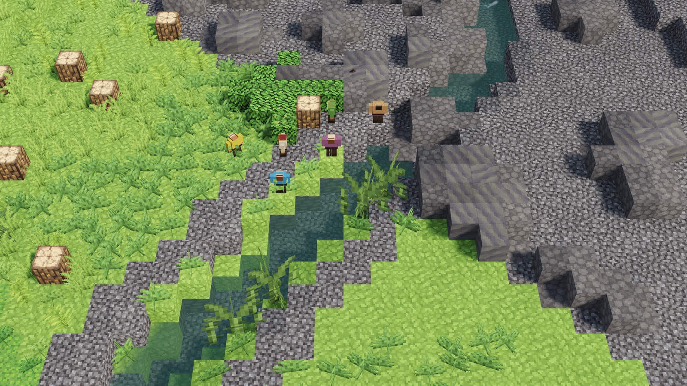

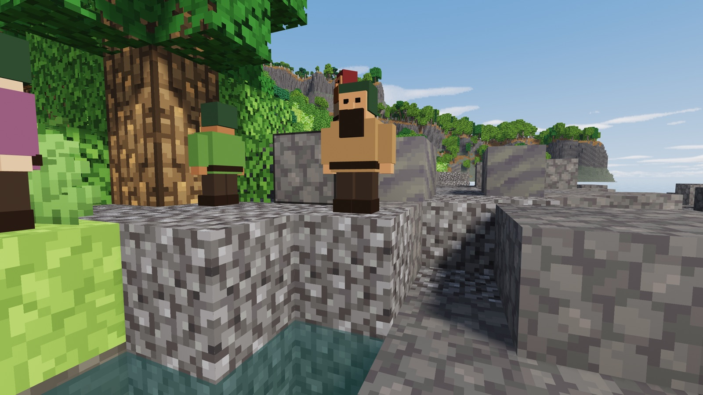

**Weak points**

- **Pathless ground is slow, as the trails' cost says.** 570 m with 60 m of climb through young wood and scrub takes the party 21 minutes, five at the clock's fastest. It is what Naismith's rule gives a walker with a load.
- **Dwarves pass through the player**, though no longer through each other (below). A hundred sent together take 80 s to set out, each 0.8 s after the one before.
- **A way is the best through the rooms the first search chose**, not the best there is. A cheaper way through rooms off the line is missed.
- **Ground cut off behind more than 24 rooms costs a full search** (400 chunks, a second or more) before it is refused. The frame does not wait for it, but every dwarf stands still meanwhile.
- **A dwarf's own way over 600 m costs 13 to 25 ms**, though the ground is read: the second search looks at most of the floors of its rooms. A hundred dwarves sent far cost 2 s of the hold's thread, spread over the 80 s they take to set out.
- **The hold wades by the land's water, not the simulated water** (`adr/0009`): a drained pool is still waded, and water let into a dug pit is not seen. A pit dug in dry ground is dry (below).
- **The boat stays where it grounded** and seats seven; `--party` puts the rest in the same seats.
- **The landing is a boulder shore**, because the row's fields are read on 16 m cells and the stream's mouth it liked best is one the floods have laid with blocks. A dwarf climbs them a block at a time.
- **From above the cut can hide a dwarf**: it stands 3 blocks over the ground under the view's middle, and a dwarf on higher ground at the picture's edge is cut with the hill it stands on.
- **Selecting and ordering by the pointer were checked with no window only as far as `--cursor --send` goes**: the order from a picked block. The clicks themselves (a right click that is not a drag, a left click on a dwarf) have not been tried by hand.
- **What a dwarf says is in the terminal and the title**, as there is no text on screen yet (step I-1).
- **Past about 500 dwarves the boxes run out**: each is sixteen of the 8,192 a frame draws.

**Two faults, found by the owner playing, and their fixes** (2026-11-16)

*A dwarf did not fall, and was then stuck for good.* The owner broke the block under a standing dwarf: it stayed in the air and took no order after. A changed block reached the hold, but only dwarves whose way passed it looked again; a standing dwarf kept a floor that was gone, every way looked for from it failed, and where it was the first of the party it let every order through unchecked.

- A dwarf whose floor is gone, standing or in mid-step, **falls to the first ground below**, faster as it goes, and lands (`settle`, `hold.odin`). One on an errand looks for its way again from where it landed. **A fall of any height is only a fall**: hurt comes with needs in P4.
- **A block laid where a dwarf stands moves it** to the nearest floor no dwarf holds, the block's own top if that is free.
- **A dwarf with no floor within six steps** stays, says so on its card and in the log, and is settled again whenever a block changes or an order comes.
- **An order is asked of one dwarf from each stretch of joined ground the party stands on**, so a dwarf in a pit neither refuses an order for the rest nor lets one through. It takes the order and says it has no way.
- **A pit dug in dry ground is dry to the dwarves**, as it is in the world drawn. The first pit of the test, dug by the stream, had "deep water" in it by the stream's level and no floor to land on.

*Dwarves got stuck on each other.* They had no bodies: they walked through one another, and where the ground had too few standing places the rest were sent to one block.

- **A dwarf takes up its floor**: the one it stands on or is stepping onto, which no other steps onto (`held`, `held_off`).
- **A walker's way goes round those who stand**; it follows one walking ahead; it steps round one in its way by a free floor beside it; and where there is none, in a passage one block wide, **the two change floors, each keeping to its right, and take two and a half times as long**. Whoever is held up moves within eight ticks of the other standing still, so no two wait on each other for ever.
- **No two end on one floor**: standing places are always different floors, in water, in plants or side by side where the ground is short of better, and one whose place is taken ends on the nearest free floor.
- **What is seen matches**: the frame draws where the hold says, and two that squeeze past are drawn side by side.

*Tried and dropped:* a walker set back by one squeezing past it looking for its way again. A hundred sent together looked for 1,326 ways where 252 had served; its way now begins with the floor it gave up, and they look for 344.

*Checked.* `./build.sh test` plays the game the blocks can spoil, a stretch at a time, giving each order from where the dwarves have come to, then plays its orders again from the file, alone and beside a reader: three logs with one hash, and at the end every dwarf waiting on a floor of its own. Its orders are left in `build/hold_test_orders.txt` and run with no window (`--dwarves=900 --orders=build/hold_test_orders.txt`), which prints the test's hash. `GOLDEN` is unchanged; `odin check src -vet-unused` passes. From that run:

```
[2:10.0] The hold says "block 2693 2 -1747 Air": the ground is changed there.
[2:10.7] Bramik Tuffelbow falls 3 m and lands on susuki grass and scrub.
[2:15.0] The hold says "block 2691 3 -1747 Sandstone": the ground is changed there.
[2:15.0] Jorris Chalkheel is in the way of a block laid where it stood, and is moved to the nearest ground.
[2:30.0] The hold says "go 2705 2 -1738": the party is sent to the blocks at a mouth a short walk south of the landing.
[2:30.0] Bramik Tuffelbow stops: no way leads to the blocks at a mouth a short walk south of the landing: water too deep to wade, or a drop or a rise of more than a block, lies all round it or all round the walker.
[2:38.7] Ardet Sootboot falls 3 m and lands on blocks at a mouth.
[3:08.5] 5 of the seven stand at the blocks at a mouth a short walk south of the landing; 2 found no way.
```

The pits are then filled under the two, which lifts each out, and the seven are sent to the shut end of a passage one block wide and nine long, and then to its mouth: four stood in it, and they squeezed past each other five times on the way back.

*Costs*, the machine at a load of 11 to 17 from other agents throughout:

| What | Parent | With the fixes |
|---|---|---|
| A tick of seven, and of a hundred, with no window | 0.2 µs; 1.6 µs | 0.3 µs; 2.0 µs |
| A hundred sent 100 m and back, 15 minutes of their time: ways looked for | 252 | 344; they went round each other 845 times and squeezed past 1,521 times, and all arrive 53 s later (12:16 against 11:23) |
| The bench at the landing, the seven sent 5 s in, 40 s, three rounds alternating: our work's median, worst, frames over 12.5 ms | 0.82, 17.0 ms, 1; 0.87, 8.8, 0; 1.29, 43.9, 19 | 0.82, 8.6 ms, 0; 0.97, 17.9, 5; 1.33, 34.6, 11 |
| The same with a hundred on screen | 1.49, 46.0 ms, 15 | 1.39, 33.5 ms, 14 |

No difference shows between the builds; at this load both lose frames, in every part of the frame at once, and the bench should be run again on a quiet machine.


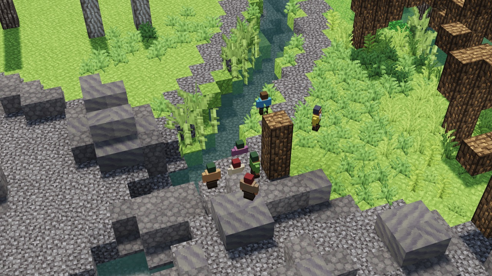

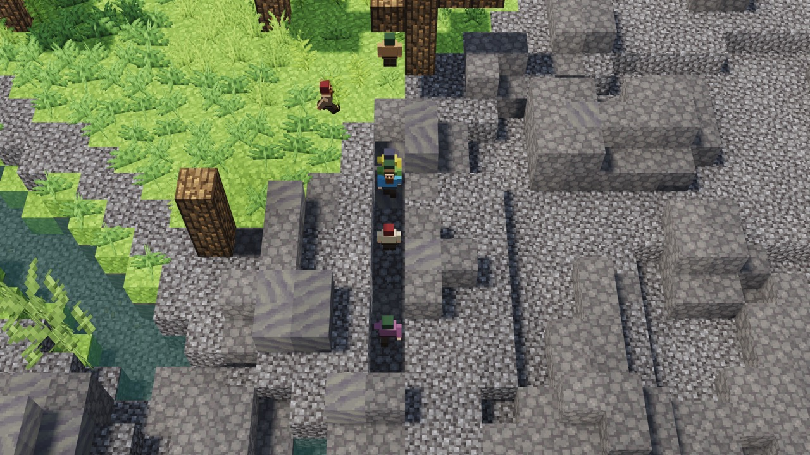

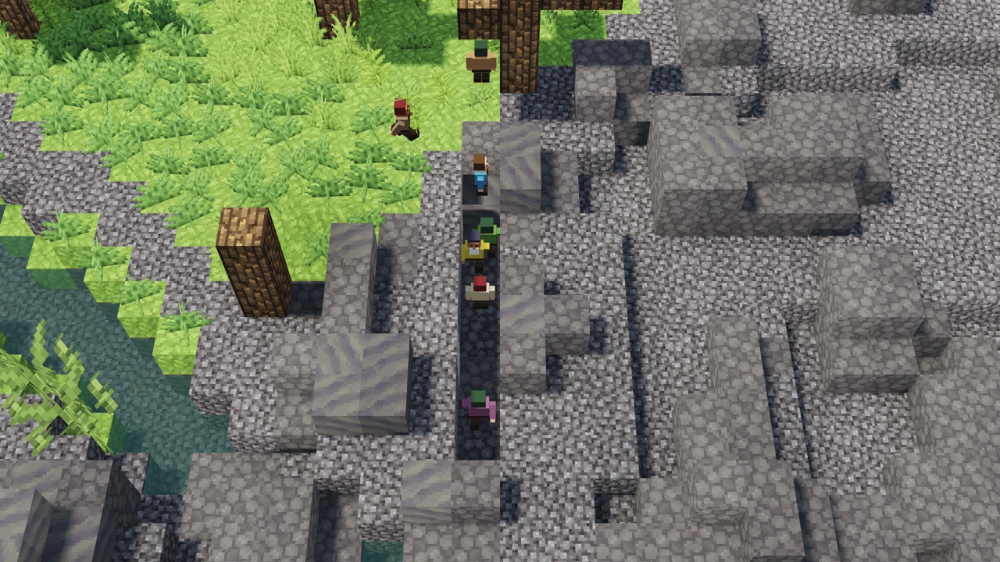


The trench's orders are `interesting-world/real/p2-trench-orders.txt`.

*Weak points.* A dwarf that is squeezed past is left a floor from where it stood. A file on a narrow way moves at the pace of its slowest. A dwarf in a pit deeper than one block cannot leave it until a way is dug or laid: orders (P3) are what will let it out. A dwarf adrift is drawn where it last stood, which may be inside a block. The player still walks through dwarves. Nobody has watched any of this in a window.

**For the interface's design** (`foundations/interface.md`)

- **The card is data**: `hold_card(i)` gives a dwarf's three lines from what the hold last showed, and `hold_count()` how many there are, for the top strip, the list and the hand.
- **Select, and go to**: `hold_select(i)`, `hold_selected()`, and `hold_where(i)`, where its feet are, for a row or a picture to take the view to. `hold_aimed` says which dwarf a ray from the pointer meets.
- **Order**: `hold_send(x, y, z)` sends the party to a block; it is what the right click and G call.
- **Messages are not passed out yet.** The log is the hold's own, printed as it happens. The messages strip (I5) needs its new lines handed to the frame as `Shown` is.
- **The right button is now two things from above**: held and moved it turns the view, clicked it orders. If the interface gives orders their own tool in the hand, the click can go back to being nothing.

### I-1, as built: the interface's ground and the play screen's frame (2026-11-16)

**What can now happen that could not before:** the owner clicks a bed of rock in a cut hillside and reads on the screen what it is and why, with the column it lies in beside the words; drags the cut down that column; paints the rock or the rain over the island; opens the list of places and is taken to one; clicks a dwarf and reads its day; and does all of it by key or by mouse, with the key written on each button.

Pictures: `interesting-world/real/i1-*.jpg` (the bed and the Places list at 2,560 × 1,440; the rest at 1,600 × 900, with the full pictures made by the commands in `AGENTS.md`). `i1-beside-drawing.jpg` puts the built screen beside the design's drawing.

**What was built**

- **The ground** (`ui.odin`, `type.odin`, `ui.metal`; `adr/0010`). A screen is a list of parts made each frame; one file draws it, says which part the pointer is on, and says the screen in words. Text comes from an atlas made for each of six scales, 75% to 200%, each glyph drawn at the exact pixel size it is shown at and set on whole pixels; body text is 24 pixels at the standard scale on 1,440. Panels, buttons with their key on them, lists that scroll, tabs, a tooltip, a field to type in, the three signs. Every colour, typeface, size and spacing is one table, `LOOK`.
- **The typefaces**: Marcellus for names and Atkinson Hyperlegible, regular and bold, for the rest, as the drawings have. Both are under the SIL Open Font License 1.1 and are in `assets/fonts/` with their licences (`assets/LICENSE.md`).
- **One pointer** for the world and the panels, by one rule (`play.odin`, top): a press belongs to what lies under it until that button is let go; the wheel belongs to what the pointer is over. `over_world` asks the screen.
- **Keys are rows** (`BINDS`): a button shows the key of the row that does its act. Escape closes the topmost thing and, with nothing open, opens the menu.
- **Top left**: where the view is ("East Top", or "North of East Top"), the day of the season, and the clock: paused or running at its hour, and three speeds.
- **Right: the ground here.** The column of the beds under the view's middle, each bed in its own block's picture and named, the soils named together, the water in the ground marked, and what is over the cut dimmed. The brass mark is dragged to move the cut; the wheel over the column moves it a block; R, F, C and H still work, and each is on a button: Up, Down, Cut, Follow the ground. Then Lenses and Walk here.
- **Lenses**: leaves off, and six of the land's fields painted over the ground and the woods from above: rock, water in the ground, rain, livable ground, plants, soil. Each has the key to its colours beside the ground's panel.
- **Lower left: the hand.** A click takes up a block of ground, a tree, a stream, a lake, the sea, a named place, an animal or a dwarf; a drag takes up a box of blocks. The card says what it is in a line and why in the next, in sentences written for it, then the rest of what `--why` says under tabs: Rock, Ground, Plants, Near, World. A block of ground opens on Rock, with the column it lies in. A dwarf's card is P2's three lines with its picture as a bust of blocks, and Follow. What is in the hand is marked in the world.
- **Messages** under the top left, with `tell(words, place)`, callable from any thread. The hold's log reaches them (`say`, `hold.odin`): who stepped ashore, where the party was sent. They fade after 14 seconds and are kept.
- **Top right**: the place for the stores and for alerts, with `alert_raise(id, words, sign, place)` and `alert_clear(id)`. Nothing raises one, so nothing is drawn.
- **Bottom right**: Places, and Menu. The Places list holds the island's named places and whatever else is remarkable on it by kind, each kind folded to its count; it finds by name or kind, sorts by kind or by how near, and each row takes the view there and puts the place in the hand. The places' names also stand on the land and can be clicked. The menu has back to the game, the interface's size, the lessons, and quit.
- **Bottom left**: the orders bar's place, empty. The hand stands over it.
- **Lessons**: three lines, one at a time, each beside its thing and gone when the thing is done once: click to ask, drag to cut, Tab to walk. They are kept between games and can be read again in the menu.
- **Without a window**: `--shot` draws the interface, and options put it in a state (`AGENTS.md`). `--say` prints what the screen says. `--plain` leaves the interface out. `src/play_test.odin` makes the screen with no window, presses its buttons by pointer and by key, and checks what it says and that it lies inside the picture at every scale.

**Keys.** As P1's, and: L lenses, F4 the Places list, Enter go to what is in the hand (or follow a dwarf), Y take what is under the pointer (or aimed at) in the hand, Escape close the topmost thing and then the menu, Q quit from the menu. The wheel over a list scrolls it and over the column moves the cut. P2's keys stand: G and a right click send the party, E selects a dwarf in first person.

**What was tried and dropped**

- **Odin's own stb truetype.** It links a compiled library that Homebrew's Odin keeps where the binding does not look, so the build failed on this machine before any text was drawn. The reader and glyph drawer are our own (`type.odin`, 295 lines).
- **Messages for islands forming far off.** They are the engine's news, not the world's, and three of them filled the strip at the start.
- **The map's own colours for the rock lens.** Basalt and breccia are both dark there, and the island looked like a darker picture of itself. The lens has colours of its own.
- **A card that fits each tab's words.** Its top moved every time a tab was changed.
- **A shadow under words on the land.** A place's name could not be read over the woods; it stands on a dark plate.

**Costs**

- **The interface's own work**, listing the parts and making the rectangles: 0.02 to 0.03 ms a frame at the median, 0.08 ms at the 99th hundredth, with the play screen at rest (29 to 34 parts, about 600 rectangles); 0.12 ms and 0.26 ms with the list, a card and a lens all open (92 parts, 1,300 rectangles). Drawing them is one buffer and one draw.
- **Benches**, alternating with the parent (`main` with P2), interface on, our work in ms as median / 99% / worst, and frames over 12.5 ms. The machine was never quiet: other agents held its load between 6 and 16.

| Bench | Parent | This step |
|---|---|---|
| Forest flank, first person | 1.20 / 4.1 / 5.9 (0), 1.38 / 4.3 / 6.3 (0), 1.51 / 6.0 / 21.1 (2) | 1.16 / 3.5 / 4.7 (0), 1.34 / 4.1 / 6.8 (0), 1.47 / 4.6 / 8.4 (0) |
| Down through cloud, first person | 1.15 / 3.3 / 6.9 (0), 1.28 / 4.7 / 9.7 (0), 1.30 / 3.7 / 4.8 (0) | 1.16 / 3.2 / 4.7 (0), 1.27 / 3.5 / 10.1 (0), 1.49 / 4.5 / 10.1 (0) |
| From above, cut following the ground | 1.51 / 5.0 / 18.6 (2), 1.51 / 4.6 / 7.3 (0), 1.66 / 5.1 / 15.7 (1) | 1.63 / 5.0 / 10.4 (0), 1.76 / 5.7 / 18.9 (1), 1.77 / 5.0 / 7.0 (0) |

  Those three rounds ran at loads of 6 to 11. In four more at 11 to 16 both builds lost frames in every bench, up to 82 in one run of this step and 28 in one of the parent's, in no steady order; the interface's own share in those runs was still 0.03 to 0.06 ms at the median and 3.2 ms at its worst. From above with everything open: 1.92 / 5.1 / 6.8 (0). The benches should be run again on a quiet machine.
- **A lens** is read over the island on a thread of its own in 60 to 180 ms (1,024 texels across, 10 m each) and is 4 MB on the GPU. The fields it paints are the land's 16 m fields, so a finer picture would show no more, except of rock.
- **The atlas** is 2,048 pixels square, 4 MB: the text takes 347 rows of it at the standard scale and 1,124 at 200%. Making it takes 4 to 6 ms, at the start and when the scale is changed.
- The binary grew from 2.4 to 2.8 MB, the three font files among it.
- `odin check src -vet-unused` passes; `./build.sh test` passes with `GOLDEN` unchanged; the start island's map, plain and with three overlays, and `--why` are the parent's byte for byte.

**Weak points**

- **Nobody has used it.** No window was opened. Every picture was drawn unseen, and the pointer's rule, the drags, the wheel, the typing in the list's field and the keys have been run only by the test, through the same procedure the window's events go through. The owner's first minutes will find what is wrong.
- **The look has not been judged in the game.** It is the design's second pass, drawn as the drawings are. Against the drawing (`i1-beside-drawing.jpg`): the top middle and the top right are empty, and the orders bar's place is an empty strip under the hand, so the screen is barer; the column's beds are the blocks' own pictures, which on this island are two grey-green rocks that sit closer together than the drawing's flat colours; the ground's panel has four rows of buttons where the drawing has three; the text is a little softer than the browser's, most at 75%; and a card's tabs hold small grey paragraphs where the drawing has a few short lines.
- **The card's other tabs are `--why` as it prints.** The first lines and the rock's are written for the card. Ground, Plants, Near and World are the game's own long sentences, with their figures and windows, capitals mended. They need rewriting part by part, in `fields.odin` and beside.
- **A lens paints the ground and the trees, not the ground plants**, which stand in their own green over it at a hold's scale; and from far off it shows the fields at 10 m, so at a hold's scale a lens is soft.
- **The hold's messages lead nowhere.** `say` has no place to give, so a click on "Jorris steps ashore" does nothing (I4). The call takes a place.
- **A dwarf in the hand is marked by a brass square round it**, drawn over the land, not in it: it shows through a hill.
- **The Places list is of the island under the view** and its find field has never been typed in by hand.
- **Three keys are P2's and not rows**: G, E and the right click are read from the keyboard and the mouse inside `hold_frame`, so no button can show them. G is the letter the design gives Gather. They should become acts when P3 brings the orders bar.
- **Lessons and the scale are kept in `build/interface.txt`**, beside the binary, until the game has settings (I-2).
- **At 200% on a screen 2,560 wide** the list narrows to 126 modules and the card's depth to about 24: usable, and tight.
- **The step is 2,900 lines** in five files, more than any step before it. The play screen is 1,335 of them.

**For the steps that follow**

- **The top middle and the Dwarves list** (the design's I14) have their places and are not built: `bust`, `hold_count`, `hold_card` and `hold_where` are what they need, and a row's click is `hand_take`.
- **The orders bar** (P3) is a place on the screen, `Area.Orders`, under the hand. An order is an `Act` with a row in `BINDS`; a tool in the hand is a card with choices.
- **A system that has news** calls `tell(words, place)`; one with a standing problem calls `alert_raise` and `alert_clear`.
- **A new screen** (the front door, expedition planning) is a procedure that lists parts, as `play_frame` does.

### The dwarves on screen, as built (2026-11-16)

**What can now happen that could not before:** the owner sees at the top of the screen which dwarves need them and why, clicks a dwarf's picture and is taken to it, keeps the ones they care about in view, opens the list of all of them and finds one by name, trade or place, takes several in the hand at once, and follows an alert or a message to where it is about. It is the same screen for seven dwarves, thirty-four or a hundred.

Pictures, each 2,560 × 1,440: `interesting-world/real/crowd-*.jpg`. `crowd-beside-drawing.jpg` puts the built screen beside the design's drawing. The pit and the ditch in them are dug by `interesting-world/real/crowd-orders.txt`.

**What the owner sees and does**

- **Top middle.** The seven of the first boat stand there as small busts, with the count of all beside them. A dwarf that needs you moves to the front with a sign on its corner: a red diamond for one with no ground or one shut in, a brass triangle for one that found no way. Click a bust: the dwarf is in the hand and edged in brass. Click it again: the view goes to it. Enter follows it as it walks. Shift and a click adds it to the hand, or takes it out. The count opens the list.
- **Top right.** An alert for each thing that is wrong: "Yrsa Coalsleeve is shut in: no way leads out of where it stands", or "Nine dwarves are stopped: they found no way to where they were sent". A click takes those dwarves in the hand and the view to them. It goes when it stops being true.
- **On the land.** The sign stands over the dwarf that needs you, and a brass square round each dwarf in the hand. A box dragged over dwarves takes them all.
- **F1, the Dwarves list**, down the right side. A row each: bust, name, trade, what it is doing, a word for how it is, and Keep. Type to find by name, trade, place or need. Group by need, by trade or by place; show only those kept in view. A group over eight shows five and "Twenty-nine more, show all". A click on a row takes the view to its dwarf and puts it in the hand; with Shift it is added to the hand.
- **K** keeps the dwarf in the hand in view at the top, or lets it go. It is on the card's button and on each row.
- **The card** of one dwarf: its name, "woodcutter, twenty-six", what it is doing and why, what it waits for, and under Trade and Self what its trade does, who shares it, its age and height and how far it has walked. Of several: how many and of what trades, a bust of each, their names, and what they share.
- **Messages** under the top left can be clicked: "Jorris Chalkheel is there" takes the view to where that was and Jorris in the hand.
- **In first person**, E takes the dwarf aimed at in the hand.

**What was built**

- **Who needs you, as rows** (`NEEDS`, `crowd.odin`): three causes today, each with its word, its sentences, what the dwarf waits for and its sign. The hold says which holds for a dwarf (`Plight`, `plight_of`, `hold.odin`), by following its joined ground out from where it stands: ground that ends within 64 floors is shut. P4 adds hunger and hurt as rows.
- **The top-middle panel** (`crowd_build`): those in need, worst first; then those kept; then the count. Ten places at most, fewer where the picture is narrow; where more need you or are kept than there is room, the last place counts the rest and opens the list on them. Those kept hold a third of the places.
- **Busts** (`bust`): eight by eight, a rectangle for each run of one colour. Hood, skin and beard are the dwarf's own colours, the shoulders its trade's cloth, and one of three hoods and four beards comes of its name, so a bust is the same at the top, in a row and on the card.
- **The Dwarves list** (`dwarves_build`), on the same head, scroll and fold as the Places list (`list_head`, `list_top`, `list_foot`, which the Places list now uses too). Only the rows in view are listed.
- **Several in the hand** (`dwarves_take`, `dwarf_take`, `several_build`): one dwarf is the card as before; several are a group.
- **Alerts that count** (`crowd_read`): one a cause, raised through `alert_raise` and cleared through `alert_clear`, and raised again only when those it counts change.
- **Messages with a place** (`about`, `hold.odin`): each line of the hold's log reaches the screen with where it happened and which dwarf it is about.
- **Keys as rows**: F1, K, and E in first person. `BINDS` has a fourth kind of row, one that holds only on foot.
- **Without a window**: `--list=dwarves`, `--group=`, `--find=`, `--who=`, `--keep=` (`AGENTS.md`). `src/play_test.odin` puts a hold of seven, thirty-four and a hundred on the screen, presses the pictures, the rows, the alerts and a message, drags a box, and checks every panel at every scale.

**Keys.** F1 the Dwarves list; K keep in view; Enter follow the dwarf in the hand, or go to the middle of several; Shift with a click or a drag adds to the hand; E in first person takes the dwarf aimed at. G and the right click still send the party, and are P3's to move.

**How it holds at thirty-four and a hundred.** With the pit and the ditch of the pictures and thirty-four dwarves, ten need you: the top shows six and "+4", two of the five others kept and "+3", and "34". With a hundred, fourteen need you: six and "+8", two and "+3", and "100", one figure wider. The alerts are two at every size: one names the dwarf in the pit, the other counts the rest. The list by need shows the first five who need you and "Nine more", five of the seventy-three walking and "Sixty-eight more", then those waiting. The test holds the panels inside the picture and off each other at six scales for each size, with a fifth of the hold in need and thirty kept.

**What was tried and dropped**

- *The hold's own sentence on a row and at the head of a card.* "Stopped where it stands: no way leads to the blocks at a mouth a short walk south of the landing: water too deep to wade, or a drop or a rise of more than a block, lies all round it or all round the walker." A row cut it after ten words. The need's own sentence leads, and the card adds where the dwarf was sent.
- *The count in the names' typeface.* A hundred read "IOO".
- *Every place at the top to those in need.* At thirty-four with ten in need, none of the dwarves kept in view was left.
- *A brass "Kept" on every row.* Seven brass boxes down a list of seven. It is the word alone, in brass.
- *P2's click on a dwarf, read inside `hold_frame`.* It let go of the selection on every press over the world. The hand takes the click.
- *"Put it down" beside Follow and Keep in view.* The three do not fit the card; with a dwarf in the hand it reads "Put down".
- *An alert a dwarf.* Never built: the design said one that counts.

**Costs**

- **The interface's own work**, listing the parts and making the rectangles, with seven dwarves and nothing open: 0.02 to 0.04 ms a frame at the median and 0.05 to 0.11 ms at the 99th hundredth (the parent 0.01 to 0.03 and 0.03 to 0.08). The seven busts at the top are most of the parts: 189 parts and 686 rectangles in first person where the parent had 12 and 485, and 212 and 817 from above against 35 and 616. **With a hundred dwarves, their list open and ten places at the top**: 0.07 to 0.08 ms at the median, 0.18 to 0.29 at the 99th hundredth, 584 parts and 2,438 rectangles; the parent with a hundred and its Places list open took 0.11 and 0.26 to 0.29 ms for 68 parts and 1,470 rectangles. Only the rows in view are listed, so the list costs the same at a hundred as at thirty-four.
- **Benches**, alternating with the parent (`main` at 95e14dd), three rounds, our work in ms as median / 99% / worst, and frames over 12.5 ms. Other agents kept the machine's load between 6.6 and 11.4 throughout.

| Bench | Parent | This step |
|---|---|---|
| Forest flank, first person | 1.37 / 5.0 / 8.0 (0), 1.92 / 6.7 / 12.3 (0), 1.25 / 4.9 / 6.9 (0) | 1.51 / 5.0 / 8.8 (0), 1.32 / 5.1 / 12.6 (1), 1.32 / 4.4 / 12.3 (0) |
| Down through cloud, first person | 1.24 / 3.7 / 7.2 (0), 2.46 / 11.6 / 22.3 (6), 1.23 / 3.4 / 5.9 (0) | 1.65 / 5.7 / 8.9 (0), 1.39 / 4.1 / 4.5 (0), 1.20 / 3.2 / 3.6 (0) |
| From above, cut following the ground | 1.85 / 5.9 / 9.8 (0), 1.87 / 7.1 / 17.3 (1), 1.69 / 5.1 / 22.4 (1) | 1.80 / 6.3 / 21.2 (1), 1.61 / 5.2 / 12.3 (0), 1.76 / 5.2 / 7.3 (0) |
| Over the landing, still, 25 s, a hundred dwarves, a list open (the parent's: Places) | 0.98 / 3.8 / 8.3 (0), 0.94 / 3.7 / 7.8 (0), 0.87 / 3.0 / 6.3 (0) | 0.95 / 3.7 / 9.7 (0), 0.87 / 3.1 / 6.2 (0), 0.86 / 3.0 / 4.9 (0) |

  No difference shows between the builds. Each lost a frame or more to the load in some run: the parent seven in one run through cloud and one in each of two runs from above, this step one on the forest flank (12.6 ms) and one from above. The interface's own share was never over 0.6 ms in a frame, but for one of 3.0 ms in the first run with a hundred. The benches should be run again on a quiet machine, as before.

- **The hold**: asking what is wrong with where a dwarf stands costs a stopped dwarf one walk over at most 64 floors every sixteenth tick, and the rest a glance. The run of `--dwarves=900 --orders=build/hold_test_orders.txt` prints the parent's hash, `2aecf46ead36c677`, and `./build.sh test` gives it three times.
- **The atlas**: the new text style takes 30 more rows at the standard scale (377 of 2,048).
- The step is 590 lines in `crowd.odin`, 120 more in `play.odin`, 50 more in `hold.odin`, and 240 of test.
- `odin check src -vet-unused` passes; `./build.sh test` passes with `GOLDEN` unchanged; P2's long run (`p2-orders.txt`, 70 minutes) prints the parent's hash, `373694d348ebf2b3`; the start island's map is the parent's byte for byte.

**Weak points**

- **Nobody has used it.** No window was opened. The clicks, Shift, the drag and the keys were run by the test through the procedure the window's events go through, and Shift there is a field the test sets: `sdl.GetModState` has never been asked in a window.
- **The look has not been judged**, and beside the drawing (`crowd-beside-drawing.jpg`) it falls short in these ways: the busts are flatter than the drawing's, with no shading, and at 52 pixels seven of them are told apart by hood and beard colour more than by face; the top right has alerts and no stores, so it is a narrower, barer panel; the hand stands a third shorter than the drawing's, with two short tabs where the drawing has six and a row of chips; the orders bar's place under it is still empty; the messages are the hold's log, plain and repetitive ("is there", five times), where the drawing's are a story; and the ground's panel is I-1's, deeper than the drawing's.
- **The three causes are thin.** They are what a block dug or laid can do to a dwarf. Until P3 and P4 nothing else can be wrong, and on untouched ground the panel never shows a sign.
- **"Shut in" is a count of floors**, 64. A dwarf walled into a yard of 65 floors has "no way". A dwarf on ground not yet read beyond its own chunk is called "no way" until it is read.
- **A block changed near a stopped dwarf can turn "shut in" to "no way"** until something walks or searches there again: the hold lets go of what it read of a chunk when a block in it changes, and asking what is wrong reads nothing anew, so that it can never change what the dwarves do.
- **A dwarf in a pit is hidden by the pit** from above: its sign stands over the hole and the dwarf cannot be seen or clicked on the land. Its picture at the top and its row can.
- **The brass square and the sign are drawn over the land, not in it**: they show through a hill and through a tree.
- **Alerts go when a list opens.** On a screen 2,560 wide the top is whole up to 150%. At 175% with an alert standing it is the count alone; at 200% with two alerts it is gone and so is the ground's panel, until they clear; and at both with a list open the dwarves have no place at the top. F1 and the lists' button still lead to them (measured with `--scale=175` and `--scale=200`).
- **The list by place groups by the nearest named place**, which on the default island puts the whole party under one name. It will mean more when the hold has rooms.
- **A box dragged over dwarves cannot take the blocks under them**, and a dwarf in a pit under the box's lower corner is missed if it stands more than two blocks under it.
- **Kept in view is kept for the session only**, and a message's dwarf is taken in the hand even when the player held something else.
- **`hold_said` and `dwarf_words` in `hold.odin` are now unused**, left alone because P3 is changing that file.
- **Frame times were measured on a loaded machine**, as before.

**For the steps that follow**

- **A new cause** (hunger, hurt, nothing to do) is a row of `NEEDS` with a test on what the hold shows of a dwarf. The top, the list, the card, the alert and the sign on the land follow from the row.
- **Orders for several** (P3): the dwarves in the hand are `play.several`, in the party's order, one or more. The group's card has room under what they share.
- **Another list** (Work, Stores) is a procedure that calls `list_head`, lists its rows between `list_top` and `list_foot`, and has a row in `BINDS` and in `lists_build`.
- **A message with a place** is `tell(words, place, dwarf)`.

**Pictures**

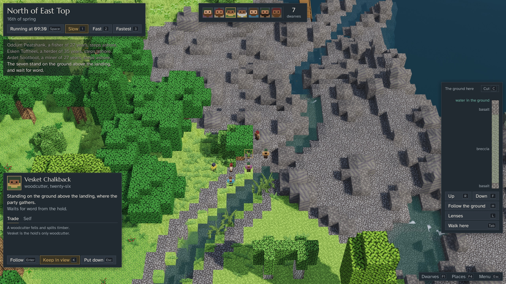

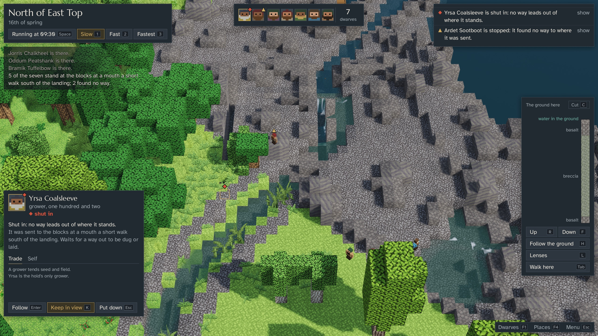

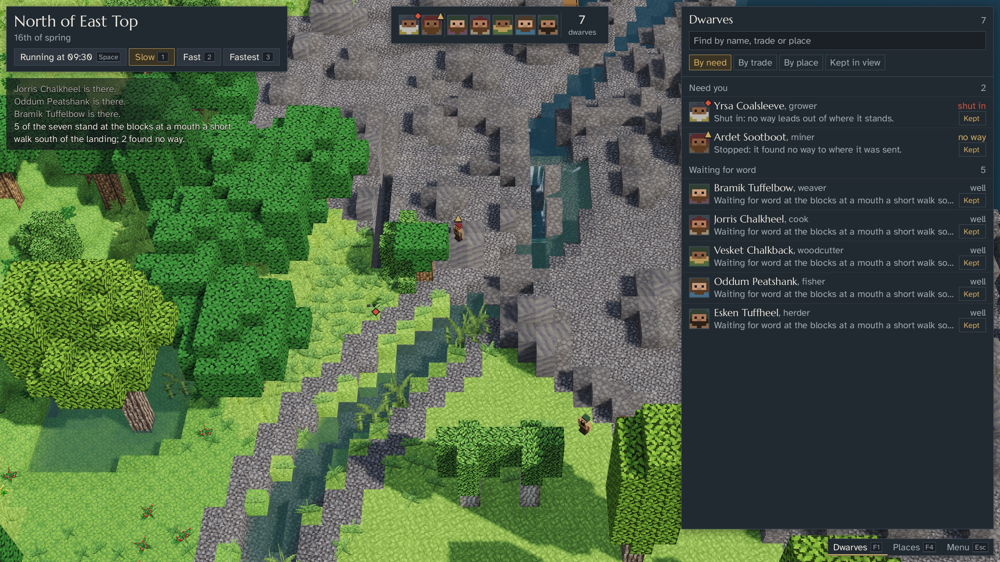

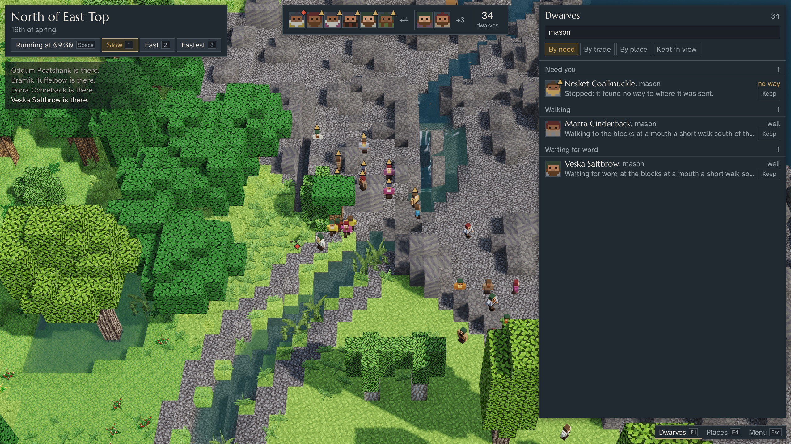

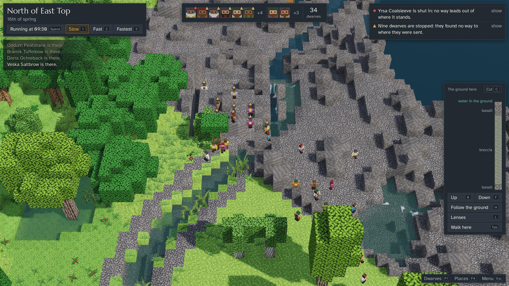

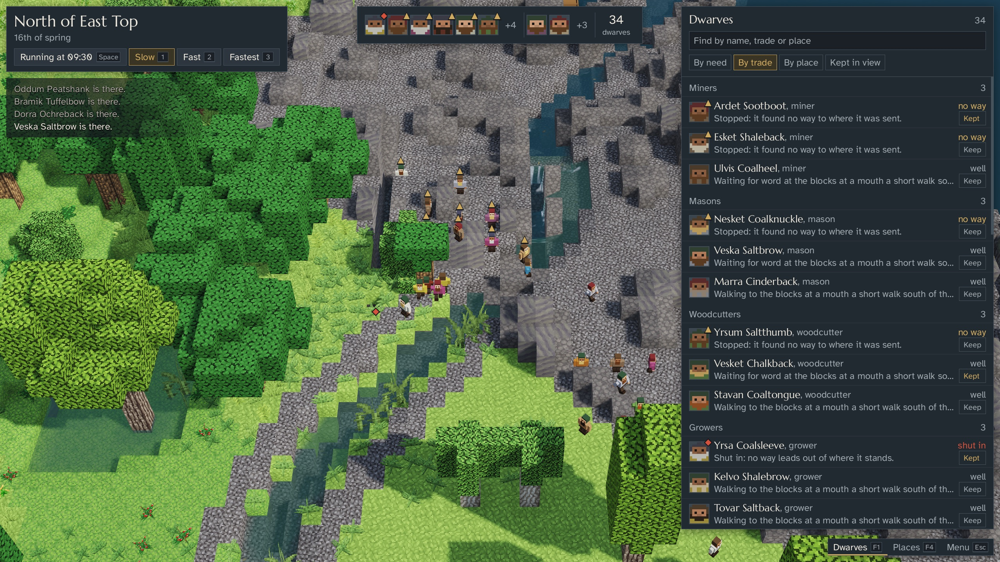

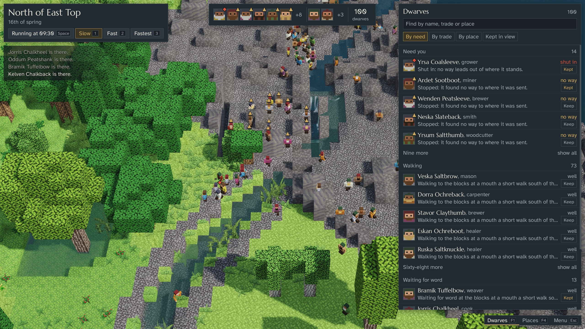

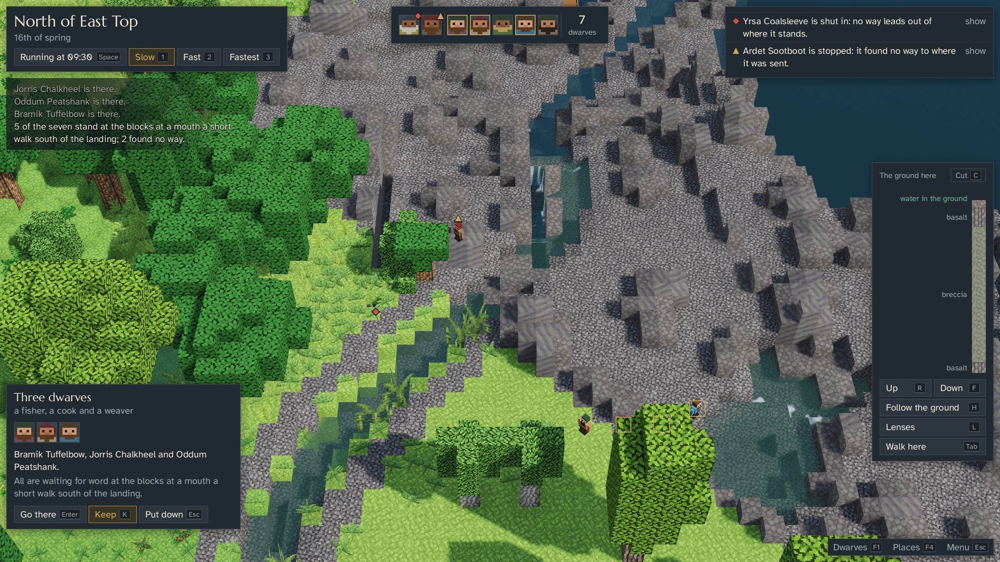

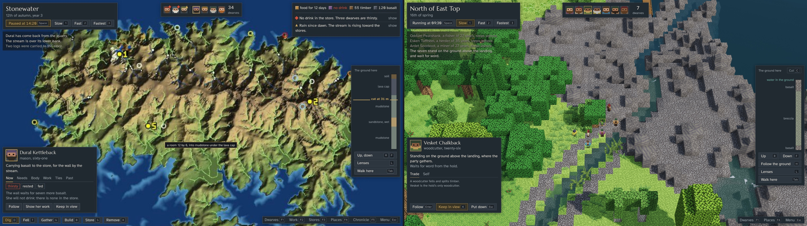

### P3, as put right: orders (2026-11-16)

P3 was merged unplayed, and the owner, playing it, called it terrible (`open-decisions.md`, 2026-11-16). This section says what is true after it was put right. The first part of the work (A) made what existed right and is written here; the second (B) gives goods a place and is noted at the section's end. What P3 first was is in this file's history.

**What can now happen that could not before:** the owner drags a rectangle over a hillside and a room is dug under it, while watching, with its own way in; clicks any part of a tree, or drags over a wood, and has timber; builds a wall of sawn timber that is a wall; and is shown, before letting go, exactly what will be marked.

**What the owner does and sees.** From above, the orders stand at the bottom left: **Dig (D), Fell (T), Build (B), Send (M), Remove (X)**. Taking one puts its tool in the hand: its name, its few choices as buttons, and one live line. Under the pointer the world shows what a click would mark, and through a drag what the drag would; letting go gives the order. Marked ground is tinted brass, and the ground over it faintly where it lies under a hill; a tree to fell wears a brass band and a brass cap on its crown; a block to lay stands as a small block of what it will be. The dwarves go to it at once and work. A click on marked ground shows the order's short card: what is left, who is at it, what it waits for, Go there, Take it back. A click on anything else says what it is in one line; its card is asked for with I, with More, or with a second click.

**The orders**

| Order | The drag | What it leaves |
|---|---|---|
| **Dig out**, 1 to 4 deep | A rectangle on the level of the block the press took | Every block of ground in it gone, from that level down: into a hillside a room under the hill, on flat ground a pit. With it, where it needs one, the way in and out |
| **Stair down**, **Stair up** | A line; a click is three steps the way the view faces | A block down, or up, for each block along, with room over each step to walk it |
| **Fell** | A rectangle on the ground, read through leaf and limb; a click on any part of a tree | Every tree whose trunk stands in it felled; its timber in the store |
| **Wall**, 1 or 2 high | A line | A wall standing on the ground along the line, following it where it steps, of stone or of timber |
| **Floor** | A rectangle | One layer at that level wherever it is open: over a space, its roof |
| **Stair up** (built) | A line | Steps built up from that level |
| **Send** | A click | The party goes to stand there |
| **Remove** | A rectangle | Every mark in its columns taken back, and no other |

An orders file says them as `dig out`, `dig stair-down`, `dig stair-up`, `fell`, `build wall|floor|stair stone|timber`, `unmark`, each with the two corners of its box (`AGENTS.md`).

**What was wrong, and what it was** (each found by playing it, before anything was changed)

| The owner saw | The cause | Now |
|---|---|---|
| Work at a snail's pace, even at the fastest speed | A dwarf walked 0.3 to 1.3 m a second; a block took 5 to 39 s, twice that for six of the seven; a dwarf that found no work rested 3 s; the fastest speed was four times | Figures below, from RimWorld's. The room of the old run, 48 blocks with 33 of basalt, took 7 min 46 s of the dwarves' time; a room of 93 blocks with 65 of basalt takes about 1 min 40 s, 17 s at the fastest speed |
| "No dwarf can reach three orders", for blocks beside the dwarves | A mark one dwarf could not come at was hidden from all of them for five seconds, over and over; idle dwarves stood on the floors the work is done from, and on the marked blocks, and nothing moved them; the three highest floors only were tried | Why a mark waits is that dwarf's own; idle dwarves are woken or step off; eight floors are tried; every dig gets a way in |
| A click on a log said no tree was there; a drag went vertical | Only a tree whose foot stood in the columns between the two blocks picked was marked, and the box ran between blocks picked on crowns | A click on any part of a tree is that tree; a drag is a rectangle on the ground |
| A timber wall turned into a tree, and two laid logs grew moss | Timber was laid as the tree's bark block, which the mesher draws as a trunk | `Mat.Timber`, sawn boards, a block of its own |
| The cut took off heads and bodies | Every box of a body was clipped where the level fell | A body is drawn whole if its feet stand under the level, and not at all if not |
| "A room" that digs two blocks, "A stair down" that digs one | Orders were named for how they were built; a click with the stair gave one step | Dig out with its depth; a stair is three steps at the least |
| Cards full of sentences | Three paragraphs a tool, and the card moved under the pointer | A name, the choices, one live line; the card holds still |
| Long messages down the left | The log's sentences were the messages | One short line each; the sentence is the log's |
| A card at every click | The hand had one state | A line; the card when asked for |

**The speeds**, a common hand's (one whose trade it is works half again as fast):

| | Was | Is | From |
|---|---|---|---|
| The clock | 1, 2, 4 times | 1, 3, 6 times | RimWorld's `TickManager` |
| Walking, flat open ground | 1.3 m/s | 4 m/s; at most half that on a slope, in plants or on wet ground, a third in half a metre of water | 4.6 cells a second, on soil |
| A block of earth or loose rock | 5 s | 1.5 s | "soil a third of rock" |
| A block of rock | 9 s mudstone, 12 breccia, 39 basalt | 4.4, 5.2, 9.8 s | sandstone 8.3 s to granite 20 s for a cell two blocks high |
| A tree | 15 s and 3 a metre | 4 s and 0.8 a metre: 13.6 s at 12 m | 800 ticks, 13.3 s |
| A block laid | 8 s | 1.5 s of timber, 5 s of stone | a wall of wood 0.9 s, of granite 9.3 s, two blocks high |
| Looking for work again | after 3 s; a failed mark hidden 5 s | after 1 s; 2 s, and from that dwarf alone | 2.5 to 3 s |
| The boat, and stepping ashore | 1.4 m/s; one every 1.5 s | 3 m/s; one every 0.6 s: all ashore and gathered in 40 s, where it took 2 min 10 s | |

**Played** (`docs/interesting-world/real/play/p3-play.txt`, run as `build/odincraft --play=... --dwarves=60`; the pictures are in that folder). Each case is what the owner did.

| The case, as the owner did it | Before | Now | Pictures |
|---|---|---|---|
| Fell: a click on a log, on leaves and on a limb | "Nothing there to fell" for the leaves and the limb | Each click marks its tree; the three are felled 34 s later | [hover](interesting-world/real/play/p3-01-fell-hover.jpg), [marked](interesting-world/real/play/p3-02-fell-clicks.jpg) |
| Fell: a drag across a stand on a slope, 16 m down to 2 m, from above at a tilt | The box ran between two crowns and went vertical | Eleven trees marked, each with a brass cap on its crown, and felled in 52 s, 9 s at the fastest speed | [drag](interesting-world/real/play/p3-03-fell-drag.jpg), [marked](interesting-world/real/play/p3-04-fell-marked.jpg), [felled](interesting-world/real/play/p3-05-fell-done.jpg) |
| Dig out: a drag on flat ground; the order's card; part taken back | "A room", two blocks whatever was meant; Remove took the whole order | 3 by 2, 2 deep: 11 blocks, one of them the step out. The card is three lines. Remove takes six marks back and the five left are dug in 27 s | [hover](interesting-world/real/play/p3-06-dig-hover.jpg), [drag](interesting-world/real/play/p3-07-dig-flat-drag.jpg), [card](interesting-world/real/play/p3-08-order-card.jpg), [remove](interesting-world/real/play/p3-09-remove-drag.jpg), [dug](interesting-world/real/play/p3-10-dig-flat-done.jpg) |
| Dig out: a drag from the foot of a rise into the hillside | The box climbed the hill with the pointer | A flat rectangle, 5 by 9: 93 blocks under the hill, 3 of them the way in, the ground over it tinted. Dug in 97 s, 16 s at the fastest | [drag](interesting-world/real/play/p3-11-dig-hill-drag.jpg), [marked](interesting-world/real/play/p3-12-dig-hill-marked.jpg), [dug, cut open](interesting-world/real/play/p3-13-dig-hill-done-cut.jpg) |
| Dig out: at a cut level, a room inside the hill | "No dwarf can reach" it: reproduced, seven idle over it | 5 by 4: 43 blocks, 3 of them the way in, shown before the button is let go. Dug in 65 s | [hover](interesting-world/real/play/p3-14-dig-inside-hover.jpg), [drag](interesting-world/real/play/p3-15-dig-inside-drag.jpg), [marked](interesting-world/real/play/p3-16-dig-inside-marked.jpg), [dug](interesting-world/real/play/p3-17-dig-inside-done.jpg) |
| Build: a timber wall, a stone wall, two timber blocks side by side | The timber wall was a tree's trunk, and two logs grew moss | Sawn boards and basalt, built in 43 s; no moss, no rings, no leaves | [drag](interesting-world/real/play/p3-18-build-timber-drag.jpg), [from above](interesting-world/real/play/p3-19-walls-above.jpg), [on foot](interesting-world/real/play/p3-20-walls-afoot.jpg) |
| Dig: a stair down, then marks beside and above it with the dwarves in and about it | "No dwarf can reach three orders" | Four steps dug in 22 s; the marks beside it dug in 9 s | [drag](interesting-world/real/play/p3-21-stair-drag.jpg), [dug](interesting-world/real/play/p3-22-stair-done.jpg), [marked beside](interesting-world/real/play/p3-23-beside-marked.jpg), [dug](interesting-world/real/play/p3-24-beside-done.jpg) |
| The cut over a pit with the party in it: over their heads, at their chests, at their feet | Heads and bodies cut off | Whole at every level that leaves their feet under it; at their feet, gone | [no cut](interesting-world/real/play/p3-25-pit-whole.jpg), [over heads](interesting-world/real/play/p3-26-cut-over-heads.jpg), [at chests](interesting-world/real/play/p3-27-cut-at-chests.jpg), [at feet](interesting-world/real/play/p3-28-cut-at-feet.jpg) |
| Ten clicks about the world, then the card asked for | A card at every click | A line at the foot of the hand's place; I opens the card; a click on bare ground shuts it; a second click on a tree opens it | [ten clicks](interesting-world/real/play/p3-29-ten-clicks.jpg), [asked](interesting-world/real/play/p3-30-card-asked.jpg), [ground](interesting-world/real/play/p3-31-click-on-ground.jpg), [second click](interesting-world/real/play/p3-32-second-click.jpg) |
| A small room, 3 by 5 and 2 deep (33 blocks with its way in), at each clock speed, from the mark to the last block (`p3-speed-1.txt` to `-3`) | 7 min 46 s of the dwarves' time for 48 blocks, at four times at best | 52 s at 1, 17 s at 3, 9 s at 6 | [1](interesting-world/real/play/p3-speed-1.jpg), [3](interesting-world/real/play/p3-speed-2.jpg), [6](interesting-world/real/play/p3-speed-3.jpg) |

The seconds are the dwarves' time unless said. The script found faults of its own that no test had: the tool card's buttons moving from under the pointer; a pit by the stream whose way out the first search took through the water; a way out laid under a tree's leaves; a wall on stepping ground left a block too high for its mason; a way in that ended on a shelf of the sea cliff; a tree rooted a block under its foot left standing in a pit. Each is put right and played again.

**The hold's ground stays real**, as P3 built it (`adr/0011`): the hold keeps the blocks of every chunk it has changed, about 155 KB each; a changed block is one block written and the chunk's floors read again from memory; each change is passed to the frame, which records it in the session's edits and rebuilds the chunk if it is near. Nothing bounds a hold but memory, and nothing is written to disk (P6).

**Determinism and checks.** `odin check src -vet-unused` passes. `./build.sh test` passes with `GOLDEN` unchanged: the land is as it was (the timber block is the last of the materials, so no figure of the land moved). The dwarves' world gives the same result from the same orders, as played, from its orders alone and beside a reader: its log's hash is now `ca7a788652bf9de4` (170 events) and its ground's `12e2778945593c69` (140 blocks), **changed on purpose**, since the speeds, the order's forms and the marks are new. The screen's test presses the bar, reads the tool's live line through a drag and checks the card does not move, clicks ground and reads the one line, asks for the card, and checks every panel inside the picture at each scale with a tool held.

Frame times, our own work, each bench run once on the finished build, on a machine with other work on it (a build ran during the third):

| Bench | Median / 99% / worst | Over 12.5 ms |
|---|---|---|
| Forest flank | 1.99 / 6.31 / 9.87 ms | 0 |
| Down through cloud | 2.01 / 5.57 / 8.93 ms | 0 |
| From above, the cut following the ground | 2.10 / 6.59 / 9.19 ms | 0 |
| Over the landing for 40 s, the seven digging a room of 93 blocks | 1.43 / 4.52 / 10.50 ms | 0 |

A tick of seven at that dig took 57 µs on average, where P3's took 3.8: the marks' boxes are made again at every block dug, and whether a block would shut a dwarf in is now asked twice. The worst tick was 11.9 ms, a way looked for. Neither was chased.

**Left out, on purpose**: needs (P4), workshops (P5), cave-ins and any weight, tools that wear, scaffolds and so walls over two blocks, ramps, a shaft stair, a felled tree lying where it fell (part B makes it logs), orders with a rank among them.

**What still feels wrong**

- **Four metres a second is a run.** From above it reads as brisk; on foot beside them the dwarves hurry. It is RimWorld's figure and one constant.
- *(Mended in part B, below.)* **Many hands at one face still waste themselves.** Seven dwarves dig 93 blocks in about 100 s where the work in them is about 95 s for each of seven: they get in each other's way at a face, and the same room took 97 to 215 s as the order fell a moment sooner or later.
- **A stair's preview shows its top and not its depth.** The tint lies on the ground over it; the line says how many steps.
- **A dwarf standing above the cut is gone**, with only its picture at the top to lead to it.
- **The ground over a mark tints the tree over it too**, leaf and all.
- **A way in is found only within about ten blocks of open ground** (8,000 cells searched). A room marked deeper waits, and its card says no dwarf can come at it.
- **The preview asks the frame's blocks, the order the hold's.** They agree where the frame has the block volume; a way in can differ where a shelf the frame takes for open ground is no ground the dwarves walk.
- **A wall follows the ground**, so on a slope its top steps. A level top needs level ground.
- **A dig trims badly round trees**: the tree on its ground is felled with it, but a crown over it is not, and a way in will not pass under leaves.
- **The store is still a count nobody sees but on the Build tool** (part B).
- **A click on a built block says "basalt", not "a wall".** A block does not yet remember it was built.
- **Nobody has used it.** It was played by script, each case as the owner met it, and every picture looked at; no hand has moved a pointer over it.

**Part B** is the next section: what is dug and felled lies where it fell, the bar's Store order marks a place for it, the dwarves carry, the stores count what lies in stockpiles, and building takes real things. It also mends three of the faults listed above: a stair's preview says its depth, hands at one face no longer waste themselves, and a room marked deep gets its way in.

### Goods you can see, as built (2026-11-16)

The owner, on playing P3: "unlike in dwarf fortress or rimworld i dont define a region where materials i gathered, it goes who knows where and i cant see it." The plan had put carrying off to P5 and P3 counted what was dug into a store with no place. That is reversed (`adr/0012`). It was built from how the real games do it (`interesting-world/notes/colony-sim-reference.md`, sections 6 and 7, and RimWorld's `StoreUtility`, `Frame` and `WorkGiver_ConstructDeliverResources` read beside it).

**What can now happen that could not before:** the owner digs a room and sees its stone lying in it; drags a stockpile on the shore and watches the dwarves carry the stone there, a block on each head; reads at the top right what the hold has; orders a wall with nothing to build it of, is told so, digs, and sees the wall go up of the stone that was dug; takes the wall down and has the stone back.

**What the owner does and sees**

- **Things.** A block of rock dug is a stone of that rock lying in the cell it was dug from; a tree felled is its logs lying where it stood (half its height, as before). Up to eight of a kind lie in a cell, as a heap of small stones or logs laid across each other, and a heap that overflows spreads to the cells beside it. Earth, sand and brush leave nothing. A click on a heap says what, how many and whether it is counted.
- **Store (S)** on the bar: drag a rectangle on the ground and it is a stockpile, tinted verdigris, for everything, for stone or for timber. It takes the places a dwarf can stand in the rectangle near the level the drag began on, so it follows a slope. Dragging beside one that takes the same makes it larger. A click on it says what it takes and how full it is.
- **Carrying.** A dwarf with no marked work it can take carries: the nearest heap that does not lie in a stockpile that takes it, four things at a time, to the nearest place for it. It is seen carrying, a stone or a log held over its head.
- **The stores, top right.** A row a kind beside a block of itself: what lies in stockpiles. Under them, small: how many things lie loose, "not counted"; or, before any stockpile is marked, "no stockpile yet".
- **Building takes real things.** A block marked to be laid stands as a small block until its stone or timber is brought, as a nearly whole one once it lies at the order, and is then laid of that very thing. The nearest is fetched, stored or loose. With none to be had anywhere an alert says so: "No stone anywhere for the wall: dig rock."
- **A built block remembers it.** A click on a wall says "Wall of basalt, built by the hold". Remove (X) dragged along it takes it down, and the stone lies where it stood.
- **Remove** does the first of three things that applies, and its line says which: marks taken back; built blocks taken down; ground taken out of a stockpile, where what lies there then lies loose and is no longer counted.

An orders file says a stockpile as `store all|stone|timber x y z x y z`.

**Three faults of part A, mended**

- **Hands at one face.** The real games' answer is that friends do not block: RimWorld's pawns and Ingnomia's gnomes pass through one another. So a dwarf now takes up a floor only where it stands still, and a walker goes by whoever is on its way; it still goes round a stander where there is room, and no two come to rest on one floor. The room of 93 blocks, given at six different moments, took 97 to 215 s before and takes 75 to 98 s now. P2's stepping round and squeezing past, which the owner asked for when dwarves stuck on each other, is gone: they can no longer stick.
- **A stair's preview says how deep it goes**: a figure on the ground over each step, "-1" to "-4".
- **A room marked deep gets its way in.** Where the search every way at once finds none within about ten blocks, a straight stair or passage is tried the four ways from each cell stood in, rising, level and falling, up to 64 blocks. Where none is found, the message, the mark and the order's card say: dig a stair or a passage to it first.

**Played** (`docs/interesting-world/real/play/goods-play.txt` and `goods-thirty.txt`; the pictures are beside them)

| The case | Before | Now | Pictures |
|---|---|---|---|
| A wall ordered with nothing to build it of | It waited on a count nobody saw | It stands marked as small blocks, and an alert says "No stone anywhere for the wall: dig rock." | [waiting](interesting-world/real/play/g-01-wall-waiting.jpg) |
| A dig whose stone lies loose, then is used | The stone went to an unseen store | 27 stones lie in the room they were dug from; the stores say "20 loose: no stockpile"; the wall's six are fetched from there and it is built 24 s after the dig ends. A click on it says "Wall of basalt, built by the hold" | [loose](interesting-world/real/play/g-02-stone-loose.jpg), [built](interesting-world/real/play/g-03-wall-built.jpg), [clicked](interesting-world/real/play/g-04-click-wall.jpg) |
| A stockpile dragged on flat ground, and the stone carried | No such thing | 4 by 3: 12 places for stone; 21 stones carried 30 m to it in 52 s, 9 s at the fastest speed, and the stores read Basalt 21 | [drag](interesting-world/real/play/g-05-store-flat-drag.jpg), [carrying](interesting-world/real/play/g-06-carrying.jpg), [stored](interesting-world/real/play/g-07-stored.jpg) |
| A click on a pile and on a stockpile | | "Basalt  8, in a stockpile"; "Stockpile  stone; 3 of 12 full" | [pile](interesting-world/real/play/g-08-click-pile.jpg), [stockpile](interesting-world/real/play/g-09-click-zone.jpg) |
| A wood felled and its logs carried to a stockpile on a slope | The timber went to the unseen store | 75 logs lie where the twelve trees stood, "75 lie loose, not counted"; a stockpile of 50 places follows the slope; all are carried in 26 s; Timber 75 | [loose](interesting-world/real/play/g-10-logs-loose.jpg), [drag](interesting-world/real/play/g-11-store-slope-drag.jpg), [carrying](interesting-world/real/play/g-12-logs-carrying.jpg), [on foot](interesting-world/real/play/g-13-logs-carrying-afoot.jpg), [stored](interesting-world/real/play/g-14-logs-stored.jpg) |
| Remove on a built wall | Remove knew only marks | Its line says "6 built blocks taken down; what they are of lies there"; it is taken down in 50 s and five of the six stones are carried back to the stockpile | [drag](interesting-world/real/play/g-15-wall-remove-drag.jpg), [down](interesting-world/real/play/g-16-wall-down.jpg) |
| A stockpile removed with things in it | | "12 places taken out of the stockpile"; the stores drop Basalt 26 and read "27 lie loose, not counted" | [drag](interesting-world/real/play/g-17-zone-remove-drag.jpg), [gone](interesting-world/real/play/g-18-zone-gone.jpg) |
| A stair's preview | Showed its top only | A figure over each step: -1 to -4 | [depth](interesting-world/real/play/g-19-stair-depth.jpg) |
| Thirty dwarves, a room of 93 blocks, a wood of twelve trees and a stockpile for each (`goods-thirty.txt`) | | Dug, felled and all 140 things stored in 88 s of their time, 15 s at the fastest speed | [carrying](interesting-world/real/play/g-20-thirty-carrying.jpg), [close](interesting-world/real/play/g-21-thirty-close.jpg), [done](interesting-world/real/play/g-22-thirty-done.jpg) |

The seconds are the dwarves' time. Playing it found: idle dwarves standing in the stockpile on top of the heaps (they now step off it, as off marked ground); a heap of stones that read as one grey block (the stones are now paler than the weathered rock, apart, and no two of one shade); a wall that could not be taken down by dragging along it, because a drag begun on its top lay in the air (Remove now takes the column under the pointer); an on-foot picture taken from inside a tree, which was mine.

**Determinism and checks.** `odin check src -vet-unused` passes. `./build.sh test` passes with `GOLDEN` unchanged. The dwarves' world gives the same result as played, from its orders alone and beside a reader: the log's hash is `8c5e885fd39409b` (171 events) and the ground's `3239cea40e0c1fc9`, **changed on purpose** (things, carrying, the new way of passing). The hold's test now marks a stockpile before the room's door and asks that what is dug is carried to it, and that the room is roofed and walled of things brought; the passage test asks that dwarves go by each other and none is held up.

Frame times, our own work, each bench once on the finished build:

| Bench | Median / 99% / worst | Over 12.5 ms |
|---|---|---|
| Forest flank | 1.91 / 6.04 / 8.89 ms | 0 |
| Down through cloud | 2.13 / 5.40 / 9.61 ms | 0 |
| From above, the cut following the ground | 2.31 / 6.51 / 9.15 ms | 0 |
| Over the landing, 40 s: seven digging, felling and carrying | 1.99 / 5.64 / 12.45 ms | 0 |
| The same with thirty | 1.98 / 5.89 / 14.81 ms | 4 |

**Four frames over the target with thirty dwarves, the worst 14.8 ms: written down, not chased.** A tick of seven costs 101 µs on average and of thirty 183 µs (57 µs for seven in part A): the goods' picture for the frame is made again whenever a thing moves, and a stockpile's best place is looked for over every cell of every stockpile. The worst tick was 45 ms, a way looked for; ticks run beside the frame and do not hold it.

**Left out, on purpose**: a priority among stockpiles and a finer filter (basalt and not breccia; one tree's timber); a haul order for one thing, and forbidding one; how much a dwarf can lift, wheelbarrows and carts; earth as a thing; things that spoil, burn or wash away; a workshop that turns a log into boards (timber is sawn as it is laid); a Stores list; goods kept on disk (P6).

**What still feels wrong**

- **Thirty idle dwarves gather in a knot beside the stockpile** they last carried to. Nothing sends an idle dwarf anywhere.
- **Taking a wall down is slow**: 50 s for six blocks of basalt, each cut as rock is. A built block should come down faster than rock is dug.
- **A heap in shadow is dark on dark rock.** Stone on stone reads from the stockpile's tint more than from the stones.
- **The alert "idle: no stone or timber lies anywhere" stands a moment too long** after stone begins to lie about, until the dwarf it counts looks again.
- **One stone of the wall taken down was left loose** beside it: a heap of one waits its turn like any other.
- **Dwarves pass through each other while walking**, which from close shows two bodies in one place for a moment.
- **A stockpile takes what a dwarf can stand on**, so it will not cover water or a tree's foot, and its tint on a slope is in steps.
- **No Stores list**: the top right shows the five kinds there are most of.
- **Timber is one row at the top right but three kinds in the world** (tabu, shii, sawn), and a wall of timber is always sawn boards whatever tree it came from.
- **Still unplayed by a hand.** Every case was played by script and every picture looked at.
