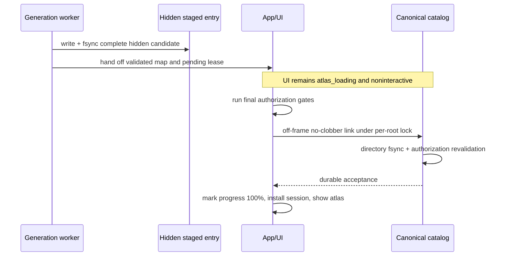

# Zigcraft Neo V3 — Current Work, Remaining Work, and Phase 6→7 Roadmap

**Status date:** 2026-07-13

**Repository:** `zigcraft-neo-v3`

**Scope:** the Phase 6 physical-world foundation, its honest slice reconstruction, and the Phase 7 living-world roadmap

## Executive summary

We are doing two related but distinct jobs in parallel:

1. **Reconstructing Phase 6 honestly, slice by slice, from the last accepted checkpoint.** The cumulative physical-world implementation exists, but the project contract requires each reset slice—6R2, 6R3, 6R4, 6R5a, and 6R5b—to be independently buildable, accepted, committed, and revert-tagged. We are not backdating or pretending that a final cumulative tree proves those intermediate gates.
2. **Repairing the cumulative physical terrain before it can become the final 6R4/6R5b candidate.** The prior river implementation passed many structural and persistence tests but failed the blocking visual gate: rivers looked like ruler-straight trenches or painted strips rather than terrain-integrated landforms. The current v11 work attacks the actual hydraulic, terrain-sampling, and evidence-selection causes.

The honest status is:

- **Closed and tagged:** 6R0, 6R1a, and 6R1b.
- **6R2 automated implementation:** code-complete and independently reviewed, but **not phase-complete** because the real windowed flows, blind-map/human approval, screenshots, play note, report, commit, and tag are still outstanding.
- **6R3, 6R4, 6R5a, and 6R5b:** their cumulative product families exist in the preserved physical-world candidate, but they have **not yet been reconstructed and accepted as honest sequential slices**.
- **Cumulative v11 river/landscape repair:** numerically much better and able to build real v11 roots, but the final tree has not received its complete post-fix suite, the visual matrix is incomplete, and the current ground capture is not human-approved.
- **Phase 6 overall:** open.
- **Phase 7:** not started. It must not start until Phase 6 closes.

The shortest accurate statement is: **the core engineering is far along, but the project is deliberately refusing to convert “code exists” into “phase finished” until the exact persistence, windowed, evidence, and human-quality gates pass.**

## Why this work is more than “make rivers look better”

The player-facing goal is a reproducible finite world whose visible forms have causes:

- landmasses come from a bounded macro/geologic model;
- drainage follows persisted basins, outlets, lakes, losses, and reaches;
- rivers cut and occupy terrain rather than being painted over it;
- profile refinements add detail without changing the underlying world;
- the atlas, near terrain, far terrain, collision, saves, and reopened roots all read the same immutable truth;
- later climate, soil, ecology, subsurface resources, habitats, and viable sites refine that same world instead of inventing disconnected overlays.

This is the dependency chain we are building and certifying:

```mermaid
flowchart LR
    A["Canonical request<br/>seed + finite extent + recipe + profile"] --> B["6R2<br/>topobathymetry + geology + deposit parents"]
    B --> C["6R3<br/>basins + lakes + preliminary runoff + HydroSkeleton"]
    C --> D["6R4<br/>landscape evolution + final HydroGraph + river terrain"]
    D --> E["6R5a<br/>profile layers + physical SiteIndex"]
    E --> F["6R5b<br/>internal physical-prefix certification"]
    F --> G["7A<br/>seasonal ClimateAtlas"]
    G --> H["7B<br/>soils + vegetation + EcoAtlas + water reconciliation"]
    H --> I["7C<br/>SubsurfaceAtlas + deposit bodies"]
    I --> J["7D<br/>habitats + species ranges + design pass + complete sites"]
    J --> K["7E<br/>shipping certification + normal profile exposure"]
```

Every arrow is a real contract boundary. A downstream product must cite and conserve its upstream parents; it cannot silently replace them.

## What is already closed

| Slice | Git state | What it established |
|---|---|---|
| 6R0 | Tagged `phase-6r0` | Reset the finite-world direction, archived the rejected 6a–6h prototype, and froze the new contracts. |
| 6R1a | Tagged `phase-6r1a` | Home/New World/progress/result shell, collision-checked reproducible `u64` seeds, durable unlisted roots, truthful progress, cancellation, and cold reopen. |
| 6R1b | Tagged `phase-6r1b`; current accepted HEAD `926a1f1` | Catalog-backed Worlds/Continue, expedition selection, root-backed runtime, mutable saves, pause/save/return/quit, and process-restart load. |

The existing New World screen is the front door for this work:

The important detail is not the UI styling. It is that the seed, recipe, profile, extent, and versions form a canonical request whose output can be reproduced, deduplicated, durably reopened, and safely saved.

## The two active workstreams

### Workstream A — honest Phase 6 slice reconstruction

The accepted branch stops at 6R1b. A separate worktree at `/tmp/zigcraft-phase6-sliced` is rebuilding the remaining slices from that exact base. This prevents a cumulative final tree from erasing the evidence that each intermediate slice really worked.

Current branch/worktree state:

| Location | Base | Purpose | Current status |
|---|---|---|---|
| Main worktree | `926a1f1` / `phase-6r1b` | Preserves the cumulative physical candidate and existing user work | Dirty; no destructive cleanup performed. |
| `refs/codex/phase6-v9-automated-green` | Internal commit `de335f3` | Safety reference for the cumulative automated-green v9 candidate | Preserved, not a phase tag. |
| `/tmp/zigcraft-phase6-sliced` | `926a1f1` | Honest 6R2→6R5b sequential reconstruction | 6R2 automated code slice complete; unstaged and uncommitted. |
| `/tmp/zigcraft-phase6-visual` | `de335f3` | Isolated cumulative river/terrain visual repair | Dirty v11 candidate; no commit or tag. |

To make the implementation scale concrete:

| Worktree | Tracked delta | New source modules | Interpretation |
|---|---:|---:|---|
| Main cumulative candidate | 22 files; +7,539 / −990 lines | 25 | The preserved, broad physical-world implementation and its app/runtime integration. |
| Honest 6R2 slice | 17 files; +4,465 / −888 lines | 19 | The independently reconstructed macro-geology slice and its persistence/acceptance machinery. |
| Isolated v11 repair | 9 files; +1,961 / −286 lines | 0 | The focused landscape, river realization, survey, validator, and screenshot-selector changes. |

Git also lists a detached Codex-managed worktree at `../zigcraft-neo-v3`, on the older Phase 5 commit `d7dce477`. No current agent owns it, it is not part of the Phase 6/7 workstream, and its local changes remain untouched.

The unrelated `zig-pkg/` tree remains user-owned, untracked, and untouched in every worktree.

### Workstream B — cumulative v11 river and landscape repair

The final physical candidate needs a river model that is structurally valid **and** visually integrated. The v10 screenshots proved that the old approach still failed.

The rejected ground view:

The rejected aerial view makes the same defect clearer:

The lowland selector was also choosing a tiny creek and presenting it as the meander example:

Those images were not dismissed as “just tuning.” Numeric diagnostics found four specific causes:

1. **Synthetic bank walls.** Three-to-five metres of visible water could be surrounded by 12–17-block artificial rises.
2. **Implausible channel hydraulics.** Some reaches had depth far larger than width and declared conveyance several times to more than thirty times the bankfull discharge it was supposed to represent.
3. **Wrong host-terrain sampling.** Interior channel profiles interpolated only from segment endpoints while runtime terrain used a two-dimensional four-cell surface plus local residual. Some persisted channels therefore floated as much as 18 blocks above the actual ground.
4. **Biased screenshot evidence.** The runner selected the first or lowest qualifying feature, which produced a one-edge ocean cliff for “confined mountain” and a tiny creek for “lowland meander.”

The v11 changes therefore include all of the following, not just a width constant:

- one shared two-dimensional host sampler used by build, validation, and runtime;
- runtime protection against local residuals producing hanging water;
- real bed incision below the sampled host;
- style-dependent minimum width-to-depth ratios;
- bounded bank height and bounded artificial dry-bank rise;
- terrain-aware sub-cell centerline curvature;
- graph-wide junction reconciliation with shared beds and downstream monotonic propagation;
- a fixed forced-incision ceiling of 32 elevation quanta;
- exact RegionTile cross-section checks across tile boundaries and along the local channel normal;
- representative feature filters and corpus-wide scoring instead of first-hit evidence.

## Phase 6R2 status: automated code complete, external acceptance open

6R2 owns finite topobathymetry, macro geology, causal geologic events/units, hydrologic substrate, stable hydrogeologic parents, protected primary deposit parents, and Detailed/Deep refinement layers. It does **not** own rivers, ecology, complete deposits, caves, or player-visible final profiles.

### What the 6R2 slice now contains

- `GeologyAtlas` and macro topobathymetry.
- Ordered geologic events, provinces, units, structures, and material provenance.
- Stable `HydrogeologicParentId` records for later aquifer refinement.
- Tagged `DepositRecord.parent` envelopes with genetic prerequisites and conserved quantity/grade bounds.
- A candidate bakeoff between analytic causal synthesis and bounded phenomenological evolution; evolution is the selected v2 recipe.
- Strict profile shapes: Limited has four product frames; Detailed and Deep have the same common prefix plus two refinement frames.
- Exact base and layer identity, deterministic bytes across worker counts, bounded work, and capped retained memory.
- Runtime queries that consume the root-backed geology/topography instead of regenerating macro truth.
- Crash-safe staged catalog publication.

The atlas view below illustrates the kinds of physical products already being generated. It is a diagnostic map, not a finished player-facing atlas:

### 6R2 automated evidence

| Gate | Result |
|---|---|
| Debug `zig build check` / `zig build test` | PASS |
| ReleaseFast `zig build check` / `zig build test` | PASS |
| `world_session_jobs` Debug and ReleaseFast | 210/210 PASS in each mode |
| Durable progress tests Debug and ReleaseFast | 41/41 PASS in each mode |
| Full deterministic corpus matrix | 72/72 cases PASS |
| Independent Standards review | PASS, no actionable findings |
| Independent Spec review | PASS, no actionable code/spec findings |
| Formatting and diff hygiene | PASS |

The 72-case matrix is six seeds × three profiles × worker counts 1 and 4 × two repeats. It checks byte identity, root/base/build IDs, reuse, runtime authority, and profile prefixes.

Measured worst cases from that final 6R2 matrix:

| Profile | Slowest measured case | Slice ceiling |
|---|---:|---:|
| Limited | 841.084 ms | 180 s |
| Detailed | 1,140.955 ms | 450 s |
| Deep | 1,237.769 ms | 675 s |

The separate-process create/save/reopen probe also passed:

- root to usable map: 145.975 ms, under the 500 ms cap;
- durable catalog publication: 147.682 ms;
- save checkpoints: about 159.3 ms, under the 250 ms cap;
- restart and selected-save-to-map: 286.866 ms;
- whole-world generation after root load: exactly zero.

### The catalog crash-safety work that was actually done

The first publication lease hid a pending catalog row only while the owner process remained alive. A `SIGKILL` would release the lock and expose a row the app had not accepted. That was a real correctness defect.

The corrected protocol is:

Owner-death tests now prove:

- kill before the final link → zero public rows; retry scavenges the hidden orphan;
- kill after the link boundary → one complete idempotent row; retry resolves it as already present;
- pending readers and duplicate publishers block or resolve correctly;
- progress cannot reach 100% before durable accept;
- the app remains in `atlas_loading` with a noninteractive pending session until publication succeeds.

### What prevents calling 6R2 finished

The remaining blockers are external evidence and process gates, not hidden code TODOs:

- run the real visible Zigcraft create → progress → atlas → expedition → embark → pause/save → Home → quit → process restart → Continue/Worlds → load flow for Limited, Detailed, and Deep;
- perform the blind-map/human visual review;
- capture the required screenshots and play-session note;
- write the 6R2 phase report;
- commit the exact slice and create its revert tag.

Until those are done, 6R2 remains **automated-green but unaccepted**.

## Cumulative v11 status

The current cumulative visual branch is versioned honestly because the output semantics changed:

| Field | Current v11 value |
|---|---|
| Physical recipe | `phase6r5b-physical-prefix-v11` |
| Contract version | 11 |
| Base algorithm version | 9 |
| Landscape product | `final_landscape_hydro_graph_v5` |
| Landscape schema / codec | 7 / 5 |
| Content-manifest SHA-256 | `41cf7ca813bb7aaf27b8d8d499f7dab0bcbf80ea2026360f70c4edf08ade4ce7` |
| Forced profile-incision ceiling | 32 q |

Two real Deep roots now build:

- seed 27226: `32f19f3c19886a2817d319034640d0a1c87c59bf34b999a7556e4f2b7e9696d7`;
- seed 91: `114f42a96130793f52a9cc3a9132dd37009ed489746fde19b18c0ae58d9bd4b7`.

The current seed-91 survey atlas shows the output at whole-world scale:

### Current numeric river evidence

The representative confined reach selected from seed 91 has:

- bedrock style;
- 11 routed path cells over 12,898 m;
- Strahler order 3;
- mean discharge 113,141;
- 34,966 ppm slope;
- bankfull half-width/depth 2/2, giving a 2:1 full-width-to-depth ratio;
- bank height 2;
- 162 m maximum sub-cell deviation and 10 curved segments.

The exact local-normal RegionTile cross-section at `(-178930, -242070)` sampled 193 columns across two tiles:

- visible wet offsets: −2 m through +2 m, or five wet columns;
- floor range: 88–94;
- maximum adjacent floor rise: 3 blocks;
- maximum adjacent surface rise: 2 blocks;
- every tile column matched `WorldContext.columnAt`;
- every wet column satisfied floor < water ≤ exact base terrain.

This is a large numerical improvement over v10’s 12–17-block artificial walls and hanging channels.

### Current v11 visual capture

This is the only completed v11 ground capture at the pause point:

It is important not to oversell this image. The towering v10 slot walls are gone, the channel curves, and the banks are shallower. However, the current scene still reads as a fairly regular excavated channel across sparse, flat terrain rather than an obviously natural confined mountain river. There is no aerial v11 capture yet, no completed visual matrix, and no human PASS. The standing Phase 6 visual verdict therefore remains **FAIL/open**, not “probably passed.”

### Exact test truth for the final v11 tree

The final post-junction-validator tree has **not** received a complete fresh `zig build check` plus `zig build test` run.

Evidence that does exist:

- earlier, before the latest junction/hydraulic/validator changes: check 8/8 and test 758/758;
- final current tree: ReleaseFast build 10/10;
- landscape module after topological reconciliation: 88/88;
- world-context module: 144/144;
- physical-survey module: 128/128 before the last selector test, with that selector test passing separately;
- focused real RegionTile cross-section fixture: PASS;
- current-tree seed-91 probe, survey, and cross-section: PASS.

The correct next action is a full post-fix rerun, not to inherit the earlier 758/758 result.

## Computer Use and the missing-window issue

The earlier problem—Computer Use running when no Zigcraft window appeared—was investigated directly.

What improved:

- a temporary registered macOS app bundle, `/tmp/ZigcraftPhase6.app`, made the exact app visible to the Computer Use runtime;
- the runtime enumerated `dev.zigcraft.neo.v3.phase6` / `ZigcraftPhase6` as running;
- the long screenshot render completed and produced the v11 ground BMP used above.

What still blocks interactive Computer Use:

- `get_app_state` failed with the exact error `Computer Use permissions are not granted`;
- no macOS privacy setting was changed automatically;
- the aerial capture and live interactive inspection were not completed.

When work resumes, the permission issue needs explicit user confirmation if changing System Settings is required. The app-launch path itself is now known; the remaining blocker is OS permission, not “we launched the wrong binary and hoped.”

## What remains in Phase 6

### 1. Finish and accept 6R2

1. Run the real visible full flow for all three internal profiles.
2. Record blind-map and human visual verdicts.
3. Curate screenshots and a play note.
4. Write the exact 6R2 report.
5. Commit and revert-tag the accepted slice.

### 2. Reconstruct and accept 6R3

6R3 adds only the hydrology skeleton and preliminary water truth:

- bounded depression, basin, lake, outlet, and endorheic topology;
- `HydroClimate0` with preliminary precipitation/runoff/ET/recharge proxies;
- exact preliminary receiver/accumulation records;
- protected groundwater loss/transfer/spring topology;
- Detailed/Deep child hydrology refinements that do not rewrite the base.

It must repeat determinism, caps, cancellation, persistence, windowed flow, restart, and relevant topology/distribution gates before its own commit/tag.

### 3. Reconstruct and accept 6R4

6R4 is where the v11 visual work belongs:

- landscape evolution, hillslope response, erosion, and deposition;
- final relief and runoff reconciliation;
- canonical final reaches, lakes, mouths, confluences, and groundwater exchanges;
- centerlines, longitudinal profiles, channel threads, banks, floodplains, valleys, and near/far realization;
- derived placer/weathering deposit parents with conserved source provenance;
- blocking blind-map and in-game human river-terrain approval.

The current v11 work must first become full-suite green and visually credible. If the current image remains too engineered, 6R4 stays open and the next fix must change the model or realization—not merely choose a friendlier camera.

### 4. Reconstruct and accept 6R5a

6R5a enables the strict Limited ⊂ Detailed ⊂ Deep ladder and adds the internal physical expedition index:

- immutable common-prefix base products;
- append-only profile refinements;
- `SiteIndex.physical` with factual terrain, provisional annual water bands, geology/resource potential, access constraints, and known hazards;
- base/effective query semantics;
- profile comparison layers and internal expedition ranking;
- no tutorial-safety or complete playability promise yet.

### 5. Reconstruct and accept 6R5b

6R5b is the cumulative physical-prefix certification, not another content feature. It freezes:

- exact recipe, versions, hashes, capabilities, and supported internal pairs;
- work, memory, disk, map, save, load, and embark caps;
- deterministic fixed and rotating corpora;
- cancellation/quiescence behavior at every active stage;
- root/catalog/save crash behavior;
- distribution, adversarial, runtime, visual, and human evidence.

The final runner must regenerate a clean 36-root set—six fixed plus six rotating seeds × three profiles—and then run caps, opens, distribution, visuals, saves, shell flows, runtime scenarios, and soaks on the exact same binary.

Only after all of that passes do we write the closeout report, commit/tag 6R5b, and create the aggregate `phase-6` tag.

## Phase 7 roadmap

Phase 7 turns the accepted physical world into a complete living-world foundation. It is deliberately not a “paint biome colors” pass.

### 7A — seasonal atmospheric climate

- **Inputs:** topography, coast distance, latitude/context, orographic relief, Phase 6 water envelopes.
- **Outputs:** `ClimateAtlas` v1 with seasonal temperature, precipitation, PET, snow/freeze, moisture deficit, groundwater/recharge context, and orographic detail.
- **Visible consequence:** snowlines, wet/dry gradients, rain shadows, seasonal legibility, and map layers derive from persisted climate instead of coordinate noise.
- **Critical gate:** the product is complete and deterministic, but final river forcing remains the accepted `HydroClimate1` until 7B reconciles the coupled soil/cover water balance.

The visual target is broad, coherent climate structure at landscape scale—not isolated colored patches. The existing project reference below illustrates the kind of meadow-to-snowline transition the climate product must eventually support; it is a reference image, not current Zigcraft output:

### 7B — regolith, soils, vegetation, wetlands, and ecoregions

- **Inputs:** geology/provenance, relief, erosion/deposition, ClimateAtlas, Phase 6 hydrology.
- **Outputs:** `EcoAtlas` v1 with residual and transported parent material, soil horizons, plant-functional mixtures, potential versus disturbed cover, wetlands, ecotones, ecoregions, biomass, and surface-resource parents.
- **Visible consequence:** floodplains, colluvial slopes, residual uplands, wetlands, alpine transitions, and coastlines acquire different materials and vegetation for causal reasons. “Biome” becomes a derived label, not the generator.
- **Critical gate:** exactly one prebudgeted soil/cover/actual-ET/recharge projection must reproduce accepted Phase 6 surface-water, recharge, spring, loss, and transfer totals within tolerance. A mismatch rejects and versions the development recipe; it does not retry a shipping world until it gets lucky.

The desired horizon-scale diversity is closer to this reference than to a uniform grass plane:

### 7C — subsurface and resource realization

- **Inputs:** geologic units and deposit parents, stable hydrogeologic parents, protected Phase 6 groundwater exchanges, soils and climate.
- **Outputs:** `SubsurfaceAtlas` v1, aquifer units, protected major cave/conduit graphs by genesis, spring/sink agreement, underground habitat/energy classes, and sparse `DepositRecord.body` children.
- **Visible/gameplay consequence:** local block strata, caves, springs, and deposits evaluate from persisted parents. A cave cannot reroute a canonical basin or invent ore unrelated to host geology.
- **Critical gate:** Limited/Detailed/Deep may partition or refine protected parents but cannot add mass, strategic wealth, water, or cave topology merely because a higher profile is selected.

### 7D — habitats, ranges, world design, and complete sites

- **Inputs:** climate, ecology, surface/subsurface resources, hazards, access, and physical sites.
- **Outputs:** `HabitatAtlas`, recognizable species/guild definitions, habitat-patch connectivity, stable `SpeciesRange` records, bounded carrying-capacity aggregates, base `WorldDesignReport`, and `SiteIndex.complete`.
- **Visible/gameplay consequence:** the atlas can present several geographically dispersed, non-dominated expedition choices with different opportunities and hazards, including at least one tutorial-safe site. It exposes facts and confidence without revealing exact hidden deposits or caves.
- **Critical gate:** every hard design intervention is deterministic Limited common-prefix truth, records its before/after provenance and write set, and charges all dependent recomputation. No whole-world rerolls, seed allowlists, or favorite-seed tuning are allowed.

### 7E — complete-profile certification and normal exposure

7E freezes the first player-promised generated-world format:

- exact complete Limited/Detailed/Deep capability sets;
- strict layer prefixes and supported size/profile pairs;
- final 4/10/15-minute total ceilings and all work/RSS/disk/runtime caps;
- complete fixed, holdout, rotating, adversarial, persistence, and visual evidence;
- the exact enabled-binary windowed flow for every exposed pair;
- human beauty and legibility approval.

Only after that rerun may the normal profile selector expose generated worlds. Phase 6 roots remain internal evidence and have no automatic upgrade promise.

## The visual quality ladder

The project’s gate is intentionally stricter than “technically renders.”

| Level | Meaning |
|---|---|
| Current rejected behavior | Straight or shallow painted water, artificial slot walls, floating/hanging channels, and evidence selected to flatter the implementation. |
| Minimum Phase 6 exit | Rivers are continuous, hydraulically plausible, terrain-integrated, and legible in all required ground/aerial feature classes. |
| Phase 7 floor | Clearly better than vanilla Minecraft 1.18+ both near and at the horizon. |
| Target | TerraForged/ReTerraForged-class coherent terrain and living-world transitions. |
| Aspiration | At broad scale, the drainage and relief structure can evoke a real DEM rather than procedural noise. |

Vanilla’s badlands river reference already demonstrates more integrated terrain context than the rejected v10 trench:

The longer-term target is coherent mountain, valley, water, and vegetation structure:

And the broad-form aspiration comes from real terrain, where ridges, tributary valleys, and relief form one drainage story:

These references are gates and direction, not claims about current output.

## Remaining work, in dependency order

| Order | Milestone | Current state | Exit condition |
|---:|---|---|---|
| 1 | Revalidate final v11 tree | Pending | Fresh full check/test, module regressions, fmt, and diff checks on the exact final source. |
| 2 | Complete v11 confined visual checkpoint | Pending | Persistent survey/cross-section logs, ground + aerial PNGs, independent inspection, and human verdict. |
| 3 | If needed, iterate river realization | Likely | No canal/trench/hanging-water failure in representative required classes. |
| 4 | Close 6R2 external gates | Pending | Three real windowed profile flows, blind-map/human approval, screenshots, play note, report. |
| 5 | Commit/tag 6R2 | Blocked by order 4 | Independently revertible accepted slice. |
| 6 | Reconstruct/test/tag 6R3 | Not started as a slice | Hydrology skeleton slice passes its full flow and topology gates. |
| 7 | Reconstruct/test/tag 6R4 | Not started as a slice | Final v11-or-later landscape passes all structural and human visual gates. |
| 8 | Reconstruct/test/tag 6R5a | Not started as a slice | Strict profile ladder and physical SiteIndex pass all flows. |
| 9 | Run/tag 6R5b and `phase-6` | Not started as an accepted slice | Clean exact-binary cumulative matrix, reports, play note, human PASS, and tags. |
| 10 | Implement and accept 7A | Blocked by Phase 6 | Complete seasonal ClimateAtlas and slice acceptance. |
| 11 | Implement and accept 7B | Blocked by 7A | Complete EcoAtlas and coupled-water reconciliation. |
| 12 | Implement and accept 7C | Blocked by 7B | Complete subsurface/resource realization with conserved parents. |
| 13 | Implement and accept 7D | Blocked by 7C | Habitats/ranges/design report and complete viable-site portfolio. |
| 14 | Certify 7E and expose profiles | Blocked by 7D | Exact enabled-binary certification and first shipping format. |

No honest calendar estimate is attached to these milestones because human visual failure is intentionally allowed to stop the line. The roadmap is gate-driven: a phase advances when its exact exit conditions pass, not when enough time has elapsed.

## Principal risks and how they are controlled

| Risk | Current evidence | Control |
|---|---|---|
| Rivers remain engineered-looking after numeric repair | Current v11 ground image is improved but still canal-like | Keep the human gate open; require representative aerial/ground classes and iterate the model, not the camera. |
| A cumulative tree hides broken intermediate contracts | Final code existed before honest slice evidence | Reconstruct from `phase-6r1b`, accept and tag each slice independently. |
| Crash exposes a not-yet-accepted world | Found in the first publication lease | Deferred canonical link, hidden staging, per-root lock, fsync boundary, owner-death and retry tests. |
| Progress says 100% before durability | Possible when publication moved off-frame | Keep UI in noninteractive loading state; mark 100% only after durable accept. |
| Test results are inherited across semantic changes | Earlier 758/758 predates final v11 validator change | Rerun the complete suite on the exact candidate; report old results only as historical evidence. |
| Screenshot corpus flatters the generator | First-hit selector chose a cliff and tiny creek | Representative thresholds, maximum-curvature anchors, and corpus-wide ranking. |
| Phase 7 ecology contradicts Phase 6 rivers | Soil/cover can change ET and recharge | One bounded 7B reconciliation against frozen Phase 6 water truth; mismatch rejects/version-bumps. |
| Higher profiles create strategically different worlds | Refinements could add resources or life | Strict byte-prefix ladder and conservation of protected parents, quantities, topology, and site identities. |
| Computer Use silently targets no window | Happened in an earlier attempt | Registered exact bundle and verified running app identity; remaining OS permission is explicit. |

## Definition of finished

### Phase 6 is finished only when

- 6R2, 6R3, 6R4, 6R5a, and 6R5b each have their own accepted commit and revert tag;
- every exact source tree passes its full automated and real windowed gates;
- the final clean 36-root matrix and all cap/persistence/runtime scenarios pass;
- the required visual corpus is complete and the human verdict is PASS;
- reports, screenshots, play notes, and evidence are curated and non-stale;
- the cumulative `phase-6` tag exists;
- normal player profile exposure remains disabled.

### Phase 7 is finished only when

- 7A–7D each emit their complete atomic capability and pass their own slice gate;
- climate, soil/ecology, hydrology, subsurface, deposits, habitats, ranges, and sites conserve and agree with their persisted parents;
- 7E freezes exact supported pairs and caps on the exact enabled binary;
- the complete create/save/restart/load flow passes for every exposed pair;
- the human beauty/legibility gate passes at the stated quality floor;
- normal profile exposure is enabled only for the certified complete capability set.

## Immediate next actions when implementation resumes

1. Run the complete final-tree v11 check/test and hygiene suite.
2. Persist the seed-91 survey and local-normal cross-section logs.
3. Resolve Computer Use permission with explicit user confirmation if a macOS setting must change.
4. Produce and inspect v11 confined ground and aerial PNGs.
5. Decide the human visual verdict. If it fails, iterate the river/terrain model before any full matrix.
6. Run and record all three 6R2 visible profile flows and blind-map review.
7. Write, commit, and tag 6R2 only after those external gates pass.
8. Continue the same honest sequence through 6R3, 6R4, 6R5a, and 6R5b.
9. Begin 7A only after the aggregate Phase 6 closeout is complete.

That sequence preserves the work already done while keeping the project’s most important promise: generated worlds are accepted because their causes, bytes, persistence, runtime behavior, and visible result all agree—not because one test suite or one attractive seed happened to pass.
